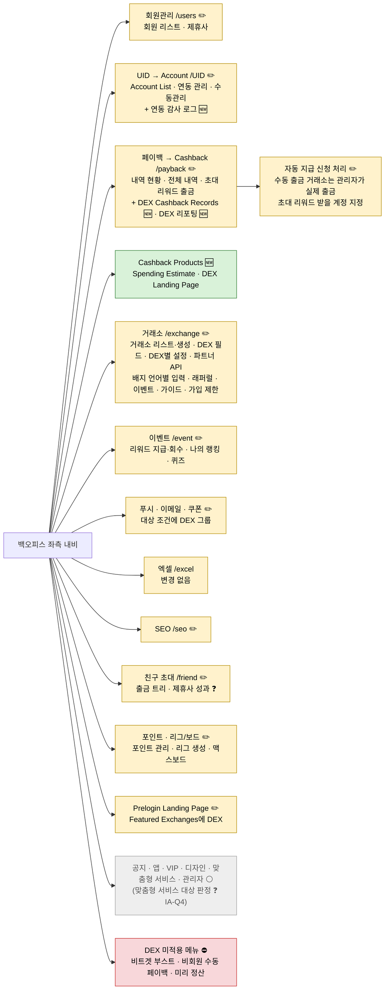
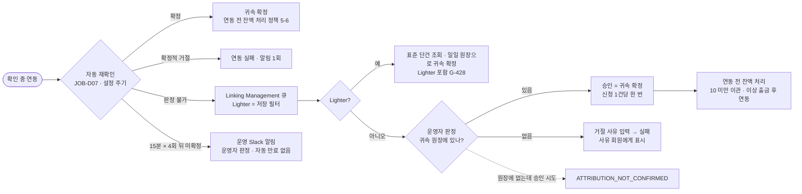
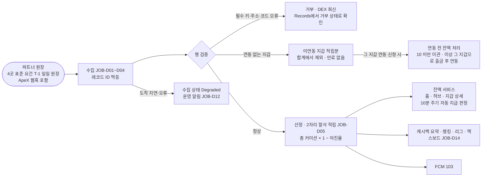
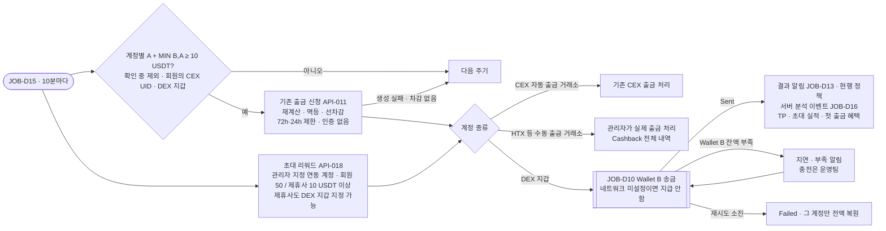
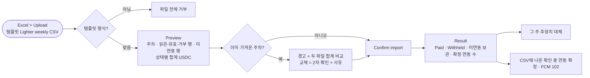
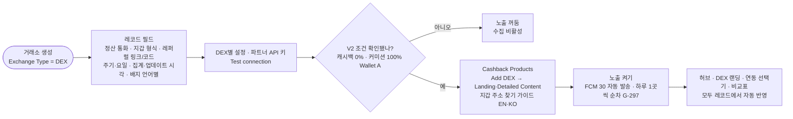

# 정보구조도 — 백오피스 (Information Architecture)

프로젝트명: TetherMax DEX 캐시백 연동 (Lighter · ApeX · EdgeX · Aster)
작성일: 2026-11-24
버전: v1.0
읽는 사람: 백오피스 화면 담당(기획·프론트엔드)과 공통 백엔드(수집 · 자동 지급 · 온체인 지급 · 알림) 담당
입력: `02.기획문서/요구사항정의서.md` v1.1 · `프론트_기능명세서_백오피스.md` · `백엔드_기능명세서_백오피스.md` · `API스펙_백오피스.md` · 정책 `00_DEX_최종정책.md`(기준일 2026-11-16, 본문 6장 · 부록 C-1) · 기존 구조 자료(0-1)
짝 문서: `정보구조도_사용자.md`

---

## 0. 읽는 법

**이 문서의 위치** — 기존 테더맥스 백오피스 구조 위에 **DEX 작업이 닿는 곳**을 표시하고, 화면 없는 시스템 기능(수집 · 10분 주기 자동 지급 · 지급 · 알림)의 흐름을 그렸습니다. 기존 메뉴를 「바뀜 / 그대로 / 미적용」으로 나눠 영향 범위를 보이게 했습니다. 우선순위는 **정책 > 요구사항정의서 > 기능명세서 > 이 문서**입니다. 사용자 화면은 `정보구조도_사용자.md`에 있습니다.

**표기**

| 표기 | 뜻 | 다이어그램 색 |
|---|---|---|
| 🆕 신규 | 새로 만드는 화면·메뉴 | 초록 |
| ✏️ 변경 | 기존 화면·메뉴에 DEX 분기·필드·문구가 들어감 | 노랑 |
| ⚪ 유지 | 기존 그대로. DEX 영향 없음(정책이 「변경 없음」으로 정했거나 거래소 축이 없음) | 회색 |
| ⛔ 미적용·제거 | DEX를 **넣으면 틀리는** 기존 화면, 또는 결정(자동 지급 · 게스트 직접 출금 폐지)으로 **없어지는** 기존 화면(Won't) | 빨강 |
| ❓ | 정해지지 않음. `G-nnn` = 정책 부록 G, `IA-Qn` = 이 문서가 기존 구조와 대조해 찾은 확인 항목(5장) | — |

**관련 기능 ID** — `FA` = `프론트_기능명세서_백오피스.md`, `BA` = `백엔드_기능명세서_백오피스.md`의 기능. 메뉴 표는 `FA`를 먼저 적고, 화면이 없는 기능은 `BA`로 적었습니다.

**URL** — 백오피스 경로는 2026-07-23 런타임 값입니다.

## 0-1. 기존 구조 — 출처와 한계

| 영역 | 출처 | 기준일 | 확인한 범위 | 한계 |
|---|---|---|---|---|
| 백오피스 | `LLM_wiki/docs/llm-wiki/operations/admin-dev-backoffice-audit-2026-07-23.md`(admin-dev 런타임 순회) | 2026-07-23 | 상위 19개 영역 · 메뉴 71개 · 라우트 전부 | 한 세션에서 보인 메뉴(역할별 차이 미확인). 그 뒤 생긴 메뉴(`리그/보드 > 맥스보드 목록`, `Exchange > Promotion Visibility`, 댓글·태그 관리 등)는 정책·PRD로 보완 |
| 백오피스 목표 구조 | 정책 C-1-1(DEX4 PRD `NAV-1`) | 2026-11-05 | 최상위 22개 메뉴 순서(영문명) | 런타임 국문 19개 영역과 이름·개수가 다름 → 3장 표에서 대응 |
| 기존 규칙 | `DEX/10_기존_테더맥스_기준선.md` | 2026-10-20 | 역할 · 상태 사전 · 연동·출금 규칙 | 자동 지급(10분 주기)은 정책 6장(2026-11-16)이 우선 |

> **최신성** — 백오피스 자료가 2026-07-23 기준입니다. 개발 착수 전 메뉴·라우트를 현재 코드와 한 번 대조해야 합니다(IA-Q2).

---

## 1. 사이트맵 — 기존 19개 영역 위의 DEX 영향

**목표 최상위 메뉴(정책 C-1-1)** — `Prelogin Landing Page` · `Member Management` · **`Account`**(기존 `UID` 개명) · `Cashback` · **`Cashback Products`**(🆕) · `Exchange` · `Event` · `Content` · `Notice` · `SEO` · `Push` · `Excel` · `Coupon` · `App` · `Email` · `Friend Invite` · `VIP` · `Design` · `Customized Service` · `Point` · `League`(→ `리그/보드`) · `Admin`. 전역 컨트롤(검색 · KO 토글 · Logout)은 변경 없음.

메뉴 단위 전체 판정(71개 + 신규)은 3.1 표입니다.

---

## 2. 운영·시스템 흐름

### 2.1 확인 중 연동의 해소 (시스템 · 운영자)

관련 기능: FA-010 · FA-045 · FA-052 · BA-023 / API-108 · API-109 · API-115

### 2.2 원장 수집 → 적립 → 화면 반영 (시스템)

관련 기능: BA-020 · BA-021 · BA-022 · BA-023 · BA-024 · BA-025 · BA-026 · BA-027 · BA-028 · BA-029 · BA-030 · BA-031 · BA-044 · BA-107 / JOB-D01 ~ D06 · JOB-D12 · JOB-D14

### 2.3 10분 주기 자동 지급 (시스템 · 운영자)

관련 기능: BA-016 · BA-017 · BA-018 · BA-019 · BA-032 · BA-033 · BA-034 · BA-035 · BA-052 / JOB-D15 · API-011 · API-018 · JOB-D10 · JOB-D13 · JOB-D16

### 2.4 Lighter 주간 CSV 가져오기 — 제외

> **제외 — G-428 확정: Lighter도 표준 요건 방식. 아래 흐름은 만들지 않는다.**

관련 기능: FA-052 · BA-027 / API-115

### 2.5 새 DEX 게시

관련 기능: FA-003 · FA-033 · FA-034 · FA-035 · FA-036 · FA-037 · FA-038 · FA-039 · FA-041 · FA-064 · FA-065 · FA-066 · FA-067 · FA-068 · BA-020 / API-102 ~ API-106 · API-127 · API-128

---

## 3. 화면-기능 매핑

### 3.1 백오피스 메뉴 (기존 71개 + 신규)

경로는 2026-07-23 런타임 값입니다. 영문명은 목표 구조(정책 C-1-1)입니다.

| 영역 | 메뉴 (라우트) | 주요 기능 | 관련 기능 ID | 구분 |
|---|---|---|---|---|
| 공통 셸 | 좌측 내비 · 검색 · KO 토글 · Logout · 상단 `페이백 엑셀 업로드` | 메뉴 순서 · `UID`→`Account` 개명 · 권한 · 편집·목록 공통 · 감사 | FA-025 · FA-026 · FA-027 · FA-028 · FA-030 | ✏️ |
| 회원관리 | 회원 리스트 `/users/member` | 금액에 DEX 합산 · 연동 계정 모달 · 상세 `Linked Accounts` | FA-042 | ✏️ |
| 회원관리 | 제휴사 `/users/partner` | 목록·등록(지급 목적지 CEX UID 또는 DEX 지갑) · 하부 내역 DEX · 제휴사 초대 리워드는 지정 연동 계정으로 자동 지급 | FA-043 | ✏️ |
| 회원관리 | 제한내역 `/users/restrict` · 탈퇴회원 리스트 `/users/withdrawal` · 구글 OTP 히스토리 `/users/otphistory` · 제휴사 광고 `/users/kol` · 사용자 접속 국가 코드 정보 `/users/nationalCode` | — | — | ⚪ |
| Account (UID) | Account List `/UID/info` | 유형 필터 · 지갑 전체값 검색 · 중복 판정 원본 | FA-044 | ✏️ |
| Account (UID) | 연동 관리 `/UID/integration` · 연동 신청 수동관리 `/UID/init-integration` | DEX 확인 중 큐 · 승인/거절 · Lighter 저장 필터 | FA-045 | ✏️ |
| Account (UID) | 연동 감사 로그 (메뉴 위치 ❓) | 행위당 1건 | FA-046 | 🆕 |
| Account (UID) | UID 예외 처리 `/UID/exception` | `Exchange List`에 활성 DEX | FA-047 · BA-031 | ✏️ |
| Account (UID) | 소유 확인 `/UID/ownership` · 소유 확인 제한 내역 `/UID/restrict` | DEX 지갑 신청 포함 — `Exchange Type` 필터 전체/CEX/DEX · 영상 플레이어 DEX · 10분 무응답 자동 실패 | FA-047 | ✏️ |
| Account (UID) | 부스트 `/UID/boost` | DEX 행·선택지 추가 | FA-047 | ✏️ |
| Account (UID) | 비트겟 부스트 `/UID/bitgetboost` | Bitget 전용 — DEX 없음 | — | ⛔ |
| Account (UID) | 연동 한도 사용량 (추가 여부 ❓) | 회원별 사용/한도 | FA-047 | 🆕❓ |
| Cashback (페이백) | 내역 현황 `/payback/status` | DEX 4곳 수집 상태 · Lighter 상세 · `Poll now` · ApeX 웹훅 로그 | FA-049 | ✏️ |
| Cashback (페이백) | 전체 내역 `/payback/total` | CEX·DEX 같은 내역 · 계정별 지급 상태·tx · 10분 주기 자동 지급이 만든 신청. 수동 출금 거래소(HTX 등)의 신청은 관리자가 실제 출금 처리 | FA-048 · BA-017 | ✏️ |
| Cashback (페이백) | 초대 리워드 출금 `/payback/partner` | 자동 지급 — 받을 계정은 관리자가 그 회원의 연동 계정(CEX UID · DEX 지갑)으로 지정(현행 기능) · 하위 DEX 출금 실적 · DEX 지갑 목적지 검증 | FA-022 · FA-054 | ✏️ |
| Cashback (페이백) | 회원 수동 페이백 `/payback/member` | DEX 행 포함 여부 G-240 확정: 회원 수동 캐시백은 DEX 행 포함, 인도네시안 캐시백 내역은 미포함 | BA-074 | |
| Cashback (페이백) | DEX Cashback Records | DEX별 원장 뷰 · 정정 · 미연동 지갑 적립분(「미연동 보관」)·거부 레코드(「거부」 + 사유) 확인. 미매칭 큐 화면·운영자 매칭 액션 없음 | FA-050 | 🆕 |
| Cashback (페이백) | DEX 리포팅 · Aster 상한 | 리포트 3종 · 소진율 | FA-055 | 🆕 |
| Cashback (페이백) | 지급 운영 (화면 없음, G-218) | 리밸런싱 · Wallet B · 가스는 운영팀이 직접 온체인으로. Wallet B 부족은 운영 알림 | BA-033 | 🆕❓ |
| Cashback (페이백) | 인도네시안 캐시백 내역 (런타임 목록에 없음) | DEX 행 여부 G-240 확정: 회원 수동 캐시백은 DEX 행 포함, 인도네시안 캐시백 내역은 미포함 | BA-074 | |
| Cashback (페이백) | 비회원 수동 페이백 `/payback/nonmember` | DEX 행 없음. 게스트 직접 출금 폐지 전 게스트 잔액의 회원 이관 기능은 유지(REQ-709) | FA-004 · REQ-583 | ⛔ |
| Cashback (페이백) | 챌린지 현황 `/payback/challenge` · 신규 회원 페이백 챌린지 `/payback/challenge/new` · 기존 회원 페이백 챌린지 `/payback/challenge/old` | 게이지 집계·수령 계정에 DEX 지갑, 계정 컬럼 CEX UID / DEX 지갑 주소 | — (REQ-438 · REQ-567) | ✏️ |
| Cashback (페이백) | 페이백 미리 정산 `/payback/pre-settlement` | DEX 없음 | — (REQ-440) | ⛔ |
| Cashback (페이백) | STG 페이백 `/payback/STG` | 테스트(현재 세션 `/unauthorized`) | — | ⚪ |
| Cashback Products | Spending Estimate | 탭 CEX·DEX 거래량 범위 · 기본 거래소 | FA-068 | 🆕 |
| Cashback Products | DEX Landing Page · Edit Landing Content · Edit Detailed Content | 리스트·우선순위 · Add DEX · 9개 영역 · Venue 카드 · 상세 콘텐츠 · 업로드 | FA-064 · FA-065 · FA-066 · FA-067 · FA-070 | 🆕 |
| 거래소 | 거래소 리스트 `/exchange/management` · 생성 `/exchange/create` | 목록·전역 순위 · DEX 필드 · 지갑 형식 · 파트너 API 설정·키 · DEX별 설정 | FA-033 · FA-034 · FA-035 · FA-037 · FA-038 | ✏️ |
| 거래소 | 거래소 래퍼럴 관리 `/exchange/referral` | DEX 행 · 마진 수정 | FA-039 | ✏️ |
| 거래소 | 거래소 이벤트 관리 `/exchange/event` · 테더맥스 이벤트 관리 `/exchange/tethermax` · 거래소 가이드 `/exchange/guide` | DEX 이벤트 · 지갑 주소 찾기 가이드 | FA-040 | ✏️ |
| 거래소 | 거래소 가입 제한 관리 `/exchange/joinRestrict` | 제한 지역 동기화·편집 | FA-036 | ✏️ |
| 거래소 | 거래소 캠페인 인원 `/exchange/campaignPersonnel` | 정책 언급 없음 | — | ❓ IA-Q4 |
| 거래소 | Promotion Visibility (런타임 목록 이후 추가) | DEX 판정 G-258 확정: 기존 방식 그대로 DEX 포함(화면 미확인 — 개발 확인) | FA-040 | |
| 이벤트 | 이벤트 리워드 지급 `/event/commission` · 회수 `/event/collect` | DEX 계정 지급·회수 | FA-053 | ✏️ |
| 이벤트 | 나의 페이백 랭킹 `/event/paybackranking` | Exchange Type · 지갑 · Account ID 컬럼 | FA-054 | ✏️ |
| 이벤트 | 퀴즈 이벤트 `/event/quiz` | `Exchange`에 DEX | FA-062 | ✏️ |
| 이벤트 | 비트코인 가격 맞추기 `/event/bitcoinprice` · 코인 뽑기 `/event/coinDraw` | 이벤트 리워드 계열(정책 7장 ✅) — 어드민 화면 변경 범위 미기재 | FA-020 | ❓ IA-Q4 |
| 이벤트 | 홈 혜택 배너 관리 `/event/homebenefitbanner` | 정책 언급 없음 | — | ❓ IA-Q4 |
| 이벤트 | 비트겟 캠페인 - 대시보드 `/event/bitgetCampaignDashboard` · 신규 `/event/bitgetCampaignNew` · 거래량 `/event/bitgetCampaignVolume` | Bitget 전용 | — | ⚪ |
| 공지 | 긴급 공지 `/notice/urgent` · 일반 공지 `/notice/normal` | 기존 카테고리 사용 | FU-086 | ⚪ |
| SEO | SEO 관리 `/seo/tag` | `Exchange Selection`에 DEX · 경로 템플릿 분기 | FA-069 | ✏️ |
| 푸시 | 수동 푸시 `/push/manual` | 대상 블록 DEX 그룹 · 딥링크 3종 추가 | FA-056 | ✏️ |
| 푸시 | 수동 푸시 히스토리 `/push/history` | — | — | ⚪ |
| 엑셀 | 업로드 `/excel/upload` · 히스토리 `/excel/history` | 변경 없음(Lighter CSV 제외, G-428) | — | ⚪ |
| 쿠폰 | 수동 쿠폰 발송 `/coupon/send` | `Linked Exchanges`에 DEX | FA-058 | ✏️ |
| 쿠폰 | 수동 쿠폰 발송 히스토리 `/coupon/history` | 기존 화면(DEX 첫 연동 쿠폰은 발급하지 않음, G-219) | FA-058 | ⚪ |
| 앱 | 의견 남기기 `/application/voice` | — | — | ⚪ |
| 이메일 | 이벤트 안내 이메일 전송 `/email/send` · 히스토리 `/email/history` · 이메일 캠페인 | 대상 필터 DEX · 이력 컬럼 | FA-057 | ✏️ |
| 친구 초대 | 출금 트리 - 초대 보상 `/friend/withdrawal-tree` | 하위 DEX 출금 실적 | FA-054 | ✏️ |
| 친구 초대 | 제휴사 성과 관리 `/friend/affiliate-performance-management` | DEX 포함 여부 G-239 확정: 포함 — 잠재 수령액은 CEX와 같은 산식에 DEX 커미션 적용 | FA-043 | |
| 친구 초대 | 초대 리워드 내역 `/friend/collect` | 거래소 축 없음 | — | ⚪ |
| 친구 초대 | 친구 초대 설정 · 월간 리포트 | 주목할 거래소에 DEX · 리포트 | FA-059 | ✏️ |
| 포인트 | 포인트 관리 `/point/manage` | 목록·모달·강조 거래소에 DEX | FA-059 | ✏️ |
| 포인트 | 포인트 조회 `/point/normal` | — | — | ⚪ |
| 리그/보드 | 글로벌 리그 목록 `/event/globalLeague/list` · 생성 `/event/globalLeague/create` | 운영 거래소에 DEX · 참가자 조회 지갑 | FA-060 | ✏️ |
| 리그/보드 | 글로벌 리그 팀 목록 `/event/globalLeague/team` | 정책 언급 없음(참가 계정 표시 영향 가능) | FA-060 | ❓ IA-Q4 |
| 리그/보드 | 맥스보드 목록·생성·상세 (런타임 목록 이후 추가) | DEX 보드 생성 · 복구 · 배치 | FA-061 | ✏️ |
| Prelogin Landing Page | Featured Exchanges · Hero Exchange | 순위 자리에 DEX | FA-011 · FA-069 | ✏️ |
| 디자인 | 홈 표시 거래소 `/design/homeExchange` | DEX 선택 가능 여부 정책 언급 없음 | — | ❓ IA-Q4 |
| 디자인 | 홈 광고 배너 `/design/homeAdvertise` · FAQ `/design/faq` · 앱 스플래시 `/design/appSplash` | — | — | ⚪ |
| 맞춤형 서비스 | 회원 홈 어나운스 (연동 미완료) `/customized/nonLinkAnnounce` · (연동 완료) `/customized/linkAnnounce` | **대상 판정이 「미연동」 정의(REQ-266)에 묶임 — DEX 지갑만 연동한 회원은 「연동 완료」 쪽** | FU-037 | ❓ IA-Q4 |
| 맞춤형 서비스 | 비회원 홈 히어로 캠페인 `/customized/guestHomeHeroCampaign` | — | — | ⚪ |
| VIP | VIP 승인/수동 지정 `/VIP/approval` · VIP 히스토리 `/VIP/history` | 범위 밖 | — | ⚪ |
| 관리자 | 계정 관리 `/admin/userManagement` | 역할 4종 유지(capability 추가) | FA-026 | ⚪ |

### 3.2 화면 없는 시스템 기능

| 기능 | 동작 위치 | 관련 기능 ID | 관련 API·작업 |
|---|---|---|---|
| 거래소 레코드 서비스 · 귀속 서비스 | 백엔드 | BA-002 · BA-003 | API-001 |
| 레퍼럴 귀속 확인 (4곳) | 백엔드 | BU-018 · BU-019 · BU-020 · BU-021 | API-007 · JOB-D01 |
| 원장 수집 · 적립 · 미연동 지갑 적립분(연동 신청 시 연동 전 잔액 처리) · 정정 | 배치 워커 | BA-020 · BA-021 · BA-022 · BA-023 · BA-024 · BA-025 · BA-026 · BA-027 · BA-028 · BA-029 · BA-030 · BA-031 | JOB-D01 ~ D06 · API-201 ~ 203 |
| **10분 주기 자동 지급** | 배치 워커 | BA-016 · BA-017 · BA-019 · BA-052 | JOB-D15 · API-011 · API-018 |
| 지급 실행 | 배치 워커 · 운영 | BA-032 · BA-033 · BA-034 · BA-035 · BA-036 | JOB-D10(리밸런싱은 운영팀 직접 온체인 G-218 · 대사 없음) |
| 확인 중 재확인 · 제한 지역 동기화 · DefiLlama | 배치 워커 | BA-010 · BA-040 · BA-067 | JOB-D07 · JOB-D08 · JOB-D09 |
| 수집 상태 · 운영 알림 | 배치 워커 → 운영 채널 | BA-025 · BA-107 | JOB-D12 |
| 회원 알림 발송(출금 메일·푸시는 현행 정책) | 이벤트 소비자 | BA-046 · BA-101 · BA-102 · BA-103 · BA-104 · BA-105 · BA-106 | JOB-D13 |
| 지급 결과 분석 이벤트(서버 이벤트) | 백엔드 | BA-018 · BA-108 | JOB-D16 |
| 맥스보드 원장 완료 연계 | 배치 워커 | BA-044 | JOB-D14 |
| 데이터 백필 · CEX 회귀 방지 | 배포 · QA | BA-062 · BA-063 | — |
| 감사 · 내보내기 · 식별자 보호 | 전 API | BU-003 · BA-060 · BA-061 | API-132 · API-133 |

---

## 4. 영향 범위 요약

개수는 3.1 표에서 센 값입니다.

**백오피스 — 기존 런타임 메뉴 71개** (3.1 표의 라우트를 메뉴 단위로 셈)

| ✏️ 변경 | ⚪ 유지 | ⛔ 미적용 | ❓ 판정 필요 | 합계 |
|---:|---:|---:|---:|---:|
| 35 | 23 | 3 | 10 | 71 |

- ⛔ 3 = 비트겟 부스트 · 비회원 수동 페이백 · 페이백 미리 정산.
- 10 = 회원 수동 페이백(G-240 확정: 회원 수동 캐시백은 DEX 행 포함, 인도네시안 캐시백 내역은 미포함) · 제휴사 성과 관리(G-239 확정: 포함 — 잠재 수령액은 CEX와 같은 산식에 DEX 커미션 적용) · 회원 홈 어나운스 2개 · 홈 표시 거래소 · 비트코인 가격 맞추기 · 코인 뽑기 · 홈 혜택 배너 · 거래소 캠페인 인원 · 글로벌 리그 팀 목록(IA-Q4).

**백오피스 — 런타임 목록 밖**

| 구분 | 메뉴·화면 |
|---|---|
| 🆕 신규 (5) | 연동 감사 로그 · DEX Cashback Records · DEX 리포팅 · Spending Estimate · DEX Landing Page(Edit Landing Content · Edit Detailed Content 포함) |
| 🆕❓ 신설 여부 미정 (1) | 연동 한도 사용량 |
| 런타임 이후 생긴 기존 메뉴 (5) | 맥스보드 목록 ✏️ · Prelogin Landing Page ✏️ · 이메일 캠페인 ✏️ · Promotion Visibility G-258 확정: 기존 방식 그대로 DEX 포함(화면 미확인 — 개발 확인) · 인도네시안 캐시백 내역 G-240 확정: 회원 수동 캐시백은 DEX 행 포함, 인도네시안 캐시백 내역은 미포함 |

- **신규 최상위 메뉴는 `Cashback Products` 하나**입니다. DEX 수동 연동는 새 메뉴 없이 기존 화면(`연동 관리` · `연동 신청 수동관리` · `엑셀 업로드`)을 확장합니다(정책 C-1 · C-4-3).
- 미매칭 큐(`Unmatched queue`)는 만들지 않습니다. 연동 전 레코드는 미연동 지갑 적립분으로 보관했다가 연동 신청 시 연동 전 잔액 처리(10 USDT 이상은 그 지갑으로 출금 후 연동, 미만은 이관)하고, 운영자는 `DEX Cashback Records`에서 상태로 확인만 합니다(정책 C-5-5).
- 최상위 `UID`는 `Account`로, `리그`는 `리그/보드`로 이름이 바뀝니다.

---

## 5. 확인 필요

### 5.1 기존 구조와 대조해 찾은 항목 (정책에 G-ID 없음)

| ID | 내용 | 영향 | 제안 |
|---|---|---|---|
| IA-Q2 | 백오피스 메뉴 자료가 2026-07-23 런타임 기준. 이후 추가된 메뉴(맥스보드 · Promotion Visibility · 댓글/태그 관리 · `Content`)와 `인도네시안 캐시백 내역`, 초대 리워드 받을 계정 지정 화면의 실제 위치 미확인. 목표 구조(22개, 영문)와 런타임(19개, 국문)의 대응도 일부 추정 | 3.1 표의 위치 | 현재 admin 메뉴 목록으로 3.1 표 대조 |
| IA-Q4 | 정책이 다루지 않은 기존 백오피스 메뉴의 DEX 영향: **회원 홈 어나운스(연동 미완료/완료) 대상 판정** — 「미연동」 정의가 바뀌므로(REQ-266) 대상 집합이 달라짐 · 홈 표시 거래소(DEX 선택 가능?) · 비트코인 가격 맞추기 · 코인 뽑기 어드민(정책 7장 ✅인데 어드민 변경 범위 없음) · 글로벌 리그 팀 목록(참가 계정 표시) · 홈 혜택 배너 · 거래소 캠페인 인원 | 요구사항 누락 가능성 — 특히 어나운스 대상 판정은 회원 화면 노출이 달라짐 | 각 메뉴의 DEX 판정을 정책에 추가(필요하면 요구사항 신설) |

### 5.2 정책 부록 G의 관련 미정 항목

| G-ID | 내용 | IA 영향 |
|---|---|---|
| G-235 확정: 국문 `계정` · G-236 확정: 기존 `/UID/...` 주소 유지(Account List로 열림) | `Account` 국문 라벨 · 하위 메뉴 명칭 | 백오피스 메뉴 라벨 |
| G-240 확정: 회원 수동 캐시백은 DEX 행 포함, 인도네시안 캐시백 내역은 미포함 | 회원 수동 캐시백 · 인도네시안 캐시백 내역의 DEX | 3.1 행 |
| G-239 확정: 포함 — 잠재 수령액은 CEX와 같은 산식에 DEX 커미션 적용 | 제휴사 성과 관리의 DEX | 3.1 행 |
| G-258 확정: 기존 방식 그대로 DEX 포함(화면 미확인 — 개발 확인) | Promotion Visibility · 아웃링크 모달의 DEX | 3.1 행 |
