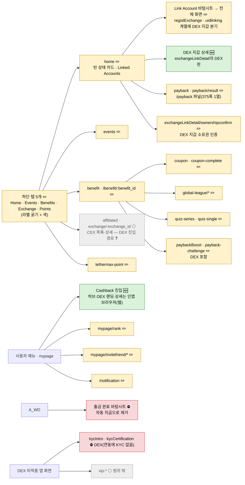
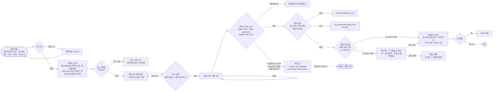
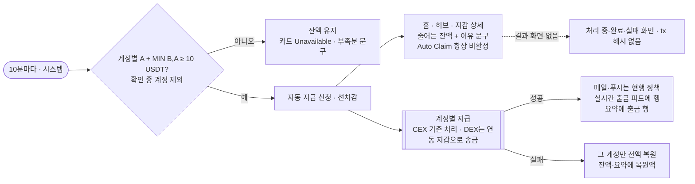
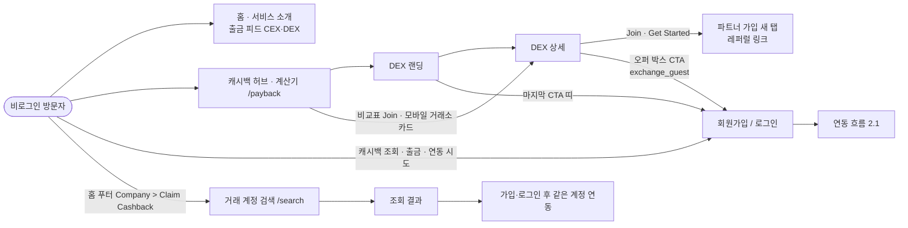
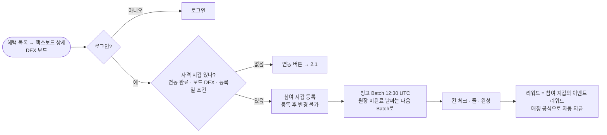

# 정보구조도 — 사용자 화면 (Information Architecture)

프로젝트명: TetherMax DEX 캐시백 연동 (Lighter · ApeX · EdgeX · Aster)
작성일: 2026-11-24
버전: v1.0
읽는 사람: 사용자 웹·모바일 웹·앱 화면 담당(기획·디자인·프론트엔드)
입력: `02.기획문서/요구사항정의서.md` v1.1 · `프론트_기능명세서_사용자.md` · `백엔드_기능명세서_사용자.md` · `API스펙_사용자.md` · 정책 `00_DEX_최종정책.md`(기준일 2026-11-16, 본문 6~9장 · 부록 B-21·B-22) · 기존 구조 자료(0-1) · STG 순회(`05.리포트/STG_대조_점검.md`)
짝 문서: `정보구조도_백오피스.md`

---

## 0. 읽는 법

**이 문서의 위치** — 기존 테더맥스의 사용자 웹 · 앱 구조 위에 **DEX 작업이 닿는 곳**을 표시한 정보구조도입니다. 새 화면만 그리지 않고, 기존 화면을 「바뀜 / 그대로 / 미적용·제거」로 나눠 영향 범위를 한눈에 보이게 했습니다. 우선순위는 **정책 > 요구사항정의서 > 기능명세서 > 이 문서**입니다. 백오피스 메뉴와 화면 없는 시스템 기능은 `정보구조도_백오피스.md`에 있습니다.

**전제가 되는 결정** — ① 출금은 **10분 주기 자동 지급**이며 모든 출금 버튼은 `Auto Claim`(항상 비활성)입니다. 회원 출금 화면(`/withdrawal-apply` · `/withdrawal`)은 진입 경로가 없어 삭제했고(G-448), 출금 확인·인증·신청 완료 화면도 없습니다. 잔액·상태는 홈·허브·지갑 상세에서 봅니다. ② 비회원은 홈에서 거래소와 UID 또는 지갑 주소를 입력해 캐시백을 조회합니다. 지급받으려면 가입 또는 로그인 후 같은 거래 계정을 연동해야 합니다.

**표기**

| 표기 | 뜻 | 다이어그램 색 |
|---|---|---|
| 🆕 신규 | 새로 만드는 화면·메뉴 | 초록 |
| ✏️ 변경 | 기존 화면·메뉴에 DEX 분기·필드·문구가 들어감 | 노랑 |
| ⚪ 유지 | 기존 그대로. DEX 영향 없음(정책이 「변경 없음」으로 정했거나 거래소 축이 없음) | 회색 |
| ⛔ 미적용·제거 | DEX를 **넣으면 틀리는** 기존 화면, 또는 결정(자동 지급 · 게스트 직접 출금 폐지)으로 **없어지는** 기존 화면(Won't) | 빨강 |
| ❓ | 정해지지 않음. `G-nnn` = 정책 부록 G, `IA-Qn` = 이 문서가 기존 구조와 대조해 찾은 확인 항목(5장) | — |

**관련 기능 ID** — `FU` = `프론트_기능명세서_사용자.md`의 기능. 화면 없는 처리는 `BU`·`BA`로 적었습니다.

**URL** — 기존 경로는 기존 구조 자료와 STG 순회(0-1)에서 확인한 값만 적었습니다. `{lang}`은 언어 코드(`en` 등)입니다. 새 페이지 경로는 정책에 없어 ``로 두었습니다(G-361 확정: 페이지·브레드크럼 슬러그는 이름을 따라감(301), SEO 키워드 슬러그는 등록 때 고정 슬러그 규칙 · G-362 확정: `/dex/{slug}` DEX 상세 경로 템플릿 · IA-Q5).

## 0-1. 기존 구조 — 출처와 한계

| 영역 | 출처 | 기준일 | 확인한 범위 | 한계 |
|---|---|---|---|---|
| 사용자 웹 | STG `www-dev.tethermax.io` 순회(게스트·회원, PC 1440 · 모바일 390) — `05.리포트/STG_대조_점검.md` | 2026-11-16 | 게스트·회원 각 122경로(링크 순회 46 + 앱 번들에서 찾은 경로 76), 열리는 화면 약 45종 | 상태를 바꾸는 버튼(출금·연동 제출·저장)은 누르지 않음. 캐시백 허브 · DEX 랜딩 · DEX 지갑 상세는 아직 없음 |
| 사용자 웹 (보조) | `LLM_wiki/.../operations/public-site-review-2026-07-21.md` · `policies/exchange-detail-comments.md` | 2026-07-21 | 공개 경로(`/{lang}/exchange` · `/{lang}/exchangeDetail/{slug}` · `/{lang}/details/{id}` · `/{lang}/review/{id}` · `/{lang}/max-board?benefitNo={n}`) | STG 순회와 다르면 STG가 최신 |
| 앱 | `LLM_wiki/.../screens/android-app-structure.md`(Android 빌드 50412 정적 분석) | 2026-07-23 | 하단 탭 · 네비게이션 URI 상수 82개 | iOS·런타임 동작 미확인. OTA로 달라질 수 있음 |
| 기존 API | `LLM_wiki/.../api-map/android-app-api-map.md`(앱 엔드포인트 75개) · STG 웹 번들 | 2026-07-23 · 2026-11-16 | 도메인·경로 | `API스펙_사용자.md`의 `기존·변경` 경로에 반영 |
| 기존 규칙 | `DEX/10_기존_테더맥스_기준선.md` | 2026-10-20 | 사용자 유형 · 상태 사전 · 연동·출금 규칙 | 자동 지급과 비회원 조회는 정책 6장(6-5 개정 2026-11-25)이 우선 |

---

## 1. 사이트맵

### 1.1 사용자 웹 — 기존 구조 위의 DEX 영향

진입 구조(헤더 · 드로어)는 1.3 표, 화면별 기능은 3장 표를 봅니다.

```mermaid
flowchart TD
    classDef new fill:#d9f2d9,stroke:#2e7d32,color:#000
    classDef chg fill:#fff2cc,stroke:#b58b00,color:#000
    classDef keep fill:#eeeeee,stroke:#9e9e9e,color:#555
    classDef no fill:#f8d7da,stroke:#c62828,color:#000

    ROOT["테더맥스 웹<br/>글로벌 헤더 · 모바일 드로어 · 푸터 ✏️"]:::chg

    ROOT --> CB["Cashback ˅ (헤더)"]
    CB --> HUB["캐시백 허브 · Cashback Landing 🆕<br/>계산기 · 라우트 3개 · 비교표 · DEX 잔액 패널"]:::new
    HUB --> CEXL["Centralised Exchanges<br/>= 기존 Exchange Listings ⚪<br/>/lang/exchange · CEX만 나열"]:::keep
    CEXL --> CEXD["CEX 거래소 상세 ⚪<br/>/lang/exchangeDetail/slug"]:::keep
    HUB --> DXL["Decentralised Exchanges 개요 · DEX 랜딩 🆕<br/>URL ❓"]:::new
    DXL --> VEN["DEX 거래소 상세 · Venue 🆕<br/>URL G-362 확정: `/dex/{slug}` · 리뷰 탭은 기존 댓글 기능 재사용"]:::new
    VEN --> EXT["파트너 가입 페이지 (외부, 새 탭)<br/>귀속 서비스가 레퍼럴 링크로 해석"]
    HUB --> BRK["Brokers ⚪<br/>/lang/brokers · 허브 탭 유지"]:::keep
    ROOT --> CALC["Calculator · /lang/payback ✏️<br/>기존 캐시백 테스트 경로 · CEX·DEX 퍼널로 개편"]:::chg

    ROOT --> MEM["회원 영역"]
    MEM --> HOME["홈 /lang ✏️<br/>총 잔액 · Linked Accounts · 타임라인 · FAQ<br/>Auto Claim 비활성"]:::chg
    HOME --> WAL["DEX 지갑 상세 🆕<br/>기존 계정 상세의 DEX판"]:::new
    HOME --> LNK["Link Account ✏️<br/>/lang/uidlinking · 꽉 찬 모달<br/>CEX/DEX 분기 · 지갑 주소 입력 · 결과 6종"]:::chg
    HOME --> WDX["출금 확인 · 인증 · 신청 완료 · 공유 카드 ⛔<br/>자동 지급으로 제거"]:::no
    MEM --> SUM["캐시백 요약 /lang/rewardHistory ✏️<br/>필터 · 월간 카드 · 캘린더 · 일별 목록"]:::chg
    MEM --> RNK["캐시백 랭킹 /lang/mypage/rank ✏️"]:::chg
    MEM --> CPN["쿠폰함 /lang/coupon ✏️<br/>계정 선택에 DEX 지갑"]:::chg
    MEM --> INV["친구 초대 /lang/mypage/invitefriend ✏️<br/>초대 리워드 Auto Claim 비활성"]:::chg
    MEM --> PH["파트너 허브 ✏️<br/>Auto Claim 비활성"]:::chg
    MEM --> NOTI["알림함 ✏️<br/>DEX 알림 FCM 100~106"]:::chg

    ROOT --> RW["혜택 · 이벤트 계열"]
    RW --> BEN["혜택 목록·상세 /lang/benefit ✏️"]:::chg
    BEN --> MXB["맥스보드 ✏️<br/>/lang/max-board?benefitNo=n · DEX 보드"]:::chg
    BEN --> LGE["글로벌 리그 /lang/global-league ✏️"]:::chg
    BEN --> CHL["캐시백 챌린지 ✏️<br/>게이지·수령 계정에 DEX"]:::chg
    RW --> CMP["캠페인 · 추첨 ✏️<br/>/lang/campaign · /lang/draw"]:::chg
    RW --> EVT["이벤트 /lang/events ✏️"]:::chg
    RW --> BST["캐시백 부스트 ✏️<br/>/lang/paybackBoost · DEX 행"]:::chg
    RW --> PT["포인트 /lang/tethermax-point ✏️<br/>문구 UID → 거래 계정 · 적립에 DEX 실적"]:::chg
    RW --> VIP["VIP ⚪ 범위 밖"]:::keep

    ROOT --> DIS["안내·교육 · 약관"]
    DIS --> SVC["서비스 소개 /lang/service-intro-new ✏️<br/>출금 피드 · 파트너 캐러셀"]:::chg
    DIS --> QZ["Beginner's Guide · 퀴즈 ✏️<br/>DEX 모듈 4·5 · Cashback Basics 문구"]:::chg
    DIS --> TRM["이용약관 · 개인정보처리방침 ✏️<br/>/lang/terms/use · /lang/terms/privacy"]:::chg
    DIS --> NTC["공지 ⚪"]:::keep

    ROOT --> PUB["비로그인 방문자"]
    PUB --> GH["홈 · 서비스 소개 · 허브 · DEX 랜딩 · 상세 · 계산기 열람<br/>CTA = 회원가입 / 로그인"]:::chg
    PUB --> GS["비회원 캐시백 조회 /lang/search · 출금은 연동 후"]

    ROOT --> OUT["DEX에 적용하지 않는 기존 화면"]
    OUT --> MP["마이포트폴리오 ⛔"]:::no
    MEM --> OWN["소유권 인증·이전 ✏️<br/>O0~O16 지갑 · 3단계 녹화 가이드"]:::chg
```

### 1.2 앱 — 하단 탭과 영향받는 화면

앱은 웹과 같은 기능을 쓰되 진입이 다릅니다. Cashback 제품군(허브 · DEX 랜딩 · 상세 · `/payback`)은 **사용자 메뉴에서 진입**하며(정책 B-22-1 `GN-6`), 앱 빌드가 지원하지 않는 Cashback 페이지는 **인앱 브라우저로 웹 경로**를 엽니다(REQ-470, 빈 화면 금지).

> 앱 하단 탭 라벨 `Exchange`/`Exchanges` 표기 통일 ❓, 앱에서 DEX로 가는 경로 미정의 ❓(정책 B-22-1) — 5장.

### 1.3 진입 구조 (헤더 · 드로어 · 앱)

| 진입점 | 구성 | 구분 | 근거 |
|---|---|---|---|
| 데스크톱 헤더 | 로고 · `Cashback ˅`(Hub · Calculator) · `Rewards Hub ˅` · `Discover ˅` / 우측 알림 벨 · 아바타 · 테마 · 언어(비로그인 `Login` · `Sign up`) | ✏️ | REQ-464, 정책 B-21-2 |
| `Cashback ˅` 패널 | 2행 `Cashback Hub` · `Cashback Calculator`(허브가 CEX·DEX·Brokers 포함). 라벨 클릭 = 허브 이동, hover = 패널 | 🆕 | 정책 B-21-2 |
| `Rewards Hub ˅` · `Discover ˅` 하위 | 정책에 하위 항목 목록 없음 | ❓ IA-Q3 | — |
| 모바일 웹 드로어 | 제품 6항목 `Exchanges, Brokers, Events, Benefits, Cashback Calculator, Point`(`Exchanges` = Cashback Hub로 이동) · 회사 행 `About TetherMax`, `Notices`, `Beginner's Guide` · 법적 행 | ✏️ | REQ-465·REQ-474 |
| 앱 하단 탭 | `Home, Events, Benefits, Exchanges, Point` | ✏️ | REQ-469 |
| 앱 Cashback | 사용자 메뉴에서 진입(단일 진입점) | 🆕 | 정책 B-22-1 |
| 푸터 | 지원 연락처 + 복사 · Company·Legal · 소셜 | ⚪ | REQ-472 |

---

## 2. 사용자 흐름 (User Flow)

### 2.1 DEX 지갑 연동 (회원)

관련 기능: FU-013 · FU-014 · FU-015 · FU-016 · FU-017 · FU-018 · FU-019 · FU-020 · FU-021 · FU-022 · FU-023 · FU-024 · FU-025 · BA-102 / API-005 · API-006 · API-007

### 2.2 출금 — 10분 주기 자동 지급 (회원이 보는 것)

회원은 출금을 신청하지 않습니다. 시스템이 10분마다 계정별 출금 가능액을 확인해 기준 이상이면 기존 출금 신청 API를 자동으로 호출하고, 회원 화면은 그 결과로 바뀐 잔액만 보여 줍니다. 서버 쪽 처리 흐름은 `정보구조도_백오피스.md` 2.3입니다.

관련 기능: FU-030 · FU-031 · FU-032 · FU-033 · FU-034 · FU-035 · FU-036 / API-010 · API-012 · API-015

### 2.3 비로그인 방문자

관련 기능: FU-010 · FU-012 · FU-045 · FU-046 · FU-047 · FU-048 · FU-049 · FU-050 · FU-051 · FU-052 · FU-053 · FU-054 · FU-055 · FU-056 · FU-057 · FU-058 · FU-059 / API-001 ~ API-004 · API-015

### 2.4 맥스보드 DEX 보드 참여

관련 기능: FU-065 · FU-066 · FU-067 · FU-068 · FU-069 / MB-API-002 ~ MB-API-005

---

## 3. 화면-기능 매핑

| 화면명 | URL | 주요 기능 | 관련 기능 ID | 구분 |
|---|---|---|---|---|
| 글로벌 헤더 · 모바일 드로어 · 푸터 | 공통 | `Cashback ˅` 2행 패널, 드로어 제품 6항목(Figma 최신판), 테마·언어 | FU-083 | ✏️ |
| 캐시백 허브 (Cashback Landing) | ❓ IA-Q5 | 히어로 · 계산기 · 라우트 3개 · 비교표 · 로고 그리드 · 상태별 구성 · DEX 잔액 패널(`Auto Claim` 비활성) | FU-010 · FU-045 · FU-046 · FU-047 · FU-048 | 🆕 |
| Exchange Listings (Centralised Exchanges) | `/{lang}/exchange` | CEX만 나열(DEX 추가 안 함), `Rating` 열 | FU-084 | ⚪ |
| DEX 랜딩 (Decentralised Exchanges 개요) | ❓ IA-Q5 | 히어로·위험 고지 · glance · DefiLlama · 배너 · Venue 카드 · 교육 섹션 · 빈 상태 | FU-049 · FU-050 · FU-051 · FU-052 · FU-053 | 🆕 |
| DEX 거래소 상세 (Venue) | G-362 확정: `/dex/{slug}` | 히어로 · 오퍼 박스(회원 상태 3분기, 연동 완료 = `Auto Claim` 비활성) · 탭 · 이유 카드 · 계산기 · 단계 가이드 · FAQ·약관 · 리뷰 | FU-054 · FU-055 · FU-056 · FU-057 · FU-058 · FU-059 | 🆕 |
| 거래소 리뷰(댓글) | `/{lang}/details/{id}` · `/{lang}/review/{id}` | 작성 자격에 DEX 지갑 `연동 완료`, `✓ Verified` | FU-058 | ✏️ |
| 캐시백 계산기 `/payback` | `/{lang}/payback` · `/{lang}/payback/result` | 진입 → 플랫폼 → 거래 프로필 → Lighter 계정 유형 → 결과 → Summary. 비로그인 열람 가능 | FU-081 · FU-082 | ✏️ |
| 홈 (회원, S3·S4) | `/{lang}` | 미연동 정의 · S3 체크리스트 · 총 잔액(`Auto Claim` 비활성) · Linked Accounts · 상태 칩 · 지연 표시 · 타임라인 · 누적 캐시백 | FU-007 · FU-037 · FU-038 · FU-039 · FU-041 | ✏️ |
| 홈 FAQ | `/{lang}` 홈 하단 | 회원 답변을 거래 계정 기준으로 · 비회원 답변 삭제 | FU-044 | ✏️ |
| DEX 지갑 상세 | ❓(앱 `exchangeLinkDetail`의 DEX판) | 헤더(주소 복사) · 금액 · 진행 줄 · 주간 내역 · 리뷰 유도 · 정산 상태 · `Auto Claim` 비활성 | FU-002 · FU-011 · FU-040 | 🆕 |
| Link Account (웹 꽉 찬 모달 · 앱 전체 화면) | 웹 `/{lang}/uidlinking`(`?page=1` UID 입력 · `?page=2` 거래소 선택) / 앱 `registExchange`·`uidlinking` 계열 | 현행 꽉 찬(전체 화면) 모달에 DEX 분기 · 거래소 선택(배지는 화면 언어) · 게이트 · 주소 입력·검증 · 지갑 주소 찾기 · 캡차 · 결과 6종 · 성공 화면 | FU-013 · FU-014 · FU-015 · FU-016 · FU-017 · FU-018 · FU-019 · FU-020 · FU-021 · FU-022 · FU-023 · FU-024 · FU-025 · FU-029 | ✏️ |
| 소유권 인증·이전 (O0~O16) | 기존 소유권 화면 / 앱 `exchangeLinkDetail/ownershipconfirm` | `Verify Ownership` 진입 · 30일 쿨다운(O2) · 3단계 녹화 가이드 · 업로드·제출 · 심사 상태 · 승인 후 이전·재청구 | FU-026 · FU-027 · FU-028 | ✏️ |
| 출금 화면 | 웹 `/{lang}/withdrawal-apply` / 앱 `withdrawal-apply` | **삭제** — 진입 경로 없음(G-448). 출금은 10분 주기 자동 지급, 버튼은 홈·허브·지갑 상세의 비활성 `Auto Claim` | — | ⛔ |
| 두 번째 출금 화면 | `/{lang}/withdrawal` | **삭제**(G-448) | — | ⛔ |
| 출금 확인 · 인증 · 신청 완료 · 공유 카드 · 출금 후 흐름 · 앱 완료 바텀시트 | — | 회원 화면에 없음 — 10분 주기 자동 지급(REQ-151~154 · REQ-165~167 · REQ-172) | — | ⛔ |
| 캐시백 요약 | `/{lang}/rewardHistory`(제목 `Cashback Summary`) | 그룹 필터 · 월간 카드 · 캘린더 · 일별 목록 · `DEX data pending` · 복원 행 | FU-005 · FU-060 · FU-061 · FU-062 | ✏️ |
| 캐시백 랭킹 | 웹 `/{lang}/mypage/rank` · `/{lang}/mypage/rankdetail`(IA-Q7) / 앱 `mypage/rank` | 진입 = 혜택 화면 `My Cashback Ranking` 사이드 패널(REQ-383, 별도 순위표 페이지 없음) · 한 순위표 · 유형 칩 · 0.01 하한. 기존 경로의 쓰임은 G-453 | FU-063 | ✏️ |
| 글로벌 리그 | 웹 `/{lang}/global-league/*`(IA-Q7) / 앱 `global-league/*` | 점수 · 팀 생성 자격 · 참가/수령 계정 | FU-064 | ✏️ |
| 맥스보드 (혜택 상세) | `/{lang}/max-board?benefitNo={n}` | DEX 보드 자격·참여·문구 | FU-065 · FU-066 · FU-067 · FU-068 | ✏️ |
| 혜택 목록·상세 | 웹 `/{lang}/benefit/*`(IA-Q7) / 앱 `/benefit/:benefit_id` | 첫 출금 혜택 표기 · 챌린지 CEX·DEX · `Total Event Rewards` | FU-071 | ✏️ |
| 캠페인 · 추첨 | 웹 `/{lang}/campaign/*` · `/{lang}/draw`(IA-Q7) | 웹에도 제공하며 웹 화면도 DEX 반영 범위 | FU-087 | ✏️ |
| 쿠폰함 · 쿠폰 계정 선택 · 수령 | 웹 `/{lang}/coupon` / 앱 `coupon` · `coupon-complete` | 계정 선택에 DEX 지갑 · 첫 연동 쿠폰 발급 규칙 · 약관 문구 | FU-070 | ✏️ |
| 이벤트 목록·상세 | 웹 `/{lang}/events` / 앱 `events` | DEX 이벤트 · 그룹 필터 | FU-072 | ✏️ |
| Beginner's Guide · 퀴즈 | 웹 `/{lang}/beginner-guide` / 앱 `quiz-series` · `quiz-single` | DEX 모듈 4·5 · 보상 경로 | FU-073 | ✏️ |
| `Cashback Basics` 아티클 | `/{lang}/beginner-guide/cashback-basics` | 거래 계정 기준 · 10 USDT 이상 자동 지급 · 게스트 문장 삭제 | FU-076 | ✏️ |
| 포인트 | 웹 `/{lang}/tethermax-point` / 앱 `tethermax-point` | DEX 실적 적립 · 안내 문구의 UID → 거래 계정 | FU-043 · FU-074 | ✏️ |
| 친구 초대 · 초대 리워드 | 웹 `/{lang}/mypage/invitefriend/*`(IA-Q7) / 앱 `mypage/invitefriend/*` | 산식·실적 · `Available Invitation Rewards` + `Auto Claim`(비활성) · `Reward History` · `Referral Details` · 문구 | FU-077 · FU-078 · FU-079 | ✏️ |
| 파트너 허브 | ❓ IA-Q1 | `Linked Accounts` 카드 · 모달 · 퍼널 · 출금 `Auto Claim`(비활성) | FU-080 | ✏️ |
| 서비스 소개 | `/{lang}/service-intro-new` | 실시간 출금 피드 · 파트너 캐러셀 · UID → 거래 계정 | FU-042 · FU-043 | ✏️ |
| 홈 (비로그인) | `/{lang}` | 실시간 출금 피드 CEX·DEX(열 `거래 계정`) · 푸터 Company > Claim Cashback → 비회원 조회 | FU-012 · FU-042 | ✏️ |
| 게스트 조회 · 나의 캐시백(게스트) | `/{lang}/search` | CEX UID·DEX 지갑 주소로 읽기 전용 조회. 지급 전 가입·로그인 및 연동 | FU-012 | ✏️ |
| 프리로그인 랜딩 | 기존 | `Featured Exchanges`에 DEX | FU-043 | ✏️ |
| 알림함 · 앱 푸시 · 이메일 | 앱 `/notification` · 웹 ❓ IA-Q1 | DEX 알림 12행 · 기존 행 DEX 분기 · 출금 메일·푸시는 현행 정책 | FU-069 · BA-101 · BA-102 · BA-103 · BA-104 · BA-105 · BA-106 | ✏️ |
| 이용약관 · 개인정보처리방침 | `/{lang}/terms/use` · `/{lang}/terms/privacy` | 지갑 주소 · DEX 거래 기록 수집 추가 · 비회원 조회에 쓰는 거래소·식별자의 처리 범위 검토 · 6.8 거래 계정 기준(🔴 G-425 법무) | FU-088 | ✏️ |
| 공지 | 기존 | 카테고리 `신규 거래소 추가` 사용 | FU-086 | ⚪ |
| 앱 하단 탭 · 인앱 브라우저 | 앱 | 탭 5개 · 미지원 페이지 웹 열기 | FU-085 | ✏️ |
| 캐시백 챌린지 | `payback-challenge`(앱) | 게이지에 DEX 커미션 캐시백 · 수령 계정 선택에 DEX 지갑 · `CEX only` 배지 없음 | FU-071 · FU-075 | ✏️ |
| 캐시백 부스트 | `/{lang}/paybackBoost` | 부스트 거래소 목록에 DEX 행(표시 G-431 확정: `타 플랫폼` 칸 `-`, 공식 파트너·부스트 값 표시(행 구조 유지)) | FU-075 | ✏️ |
| 마이포트폴리오 · VIP | 기존 | 미적용 / 범위 밖 | — (REQ-440) | ⛔ |

**화면 공통으로 걸리는 기능** — 모든 사용자 화면에 적용: FU-001 · FU-002 · FU-004 · FU-005 · FU-006 · FU-008 · FU-009 · FU-090(용어 · 주소 표시 · 금액 · 시각 · 그룹 드롭다운·배지 · 레코드 단일 원본·국가 노출 · 화면 공통 동작 · 분석 이벤트).

---

## 4. 영향 범위 요약

개수는 3장 표의 행으로 센 값입니다.

| 🆕 신규 | ✏️ 변경 | ⚪ 유지 | ⛔ 미적용·제거 | 합계 |
|---:|---:|---:|---:|---:|
| 4 | 30 | 2 | 3 | 39 |

- 신규 4개 = 캐시백 허브 · DEX 랜딩 · DEX 거래소 상세 · DEX 지갑 상세. 나머지 DEX 작업은 전부 **기존 화면 변경**입니다.
- ⛔ 중 결정으로 **없어지는** 것: 출금 확인·인증·신청 완료·공유 카드·출금 후 흐름·앱 완료 바텀시트(자동 지급) · 게스트 직접 출금.
- URL 미정: 캐시백 허브 · DEX 랜딩(IA-Q5) · DEX 상세(G-362 확정: `/dex/{slug}`) · DEX 지갑 상세 · 파트너 허브 · 알림함의 웹 경로(IA-Q1).

---

## 5. 확인 필요

### 5.1 기존 구조와 대조해 찾은 항목 (정책에 G-ID 없음)

| ID | 내용 | 영향 | 제안 |
|---|---|---|---|
| IA-Q1 | STG 순회로 웹 경로 대부분을 확인해 3장 URL 열에 넣었음(`/withdrawal-apply` · `/withdrawal` · `/rewardHistory` · `/coupon` · `/uidlinking` · `/mypage/*` · `/beginner-guide/*` · `/terms/*` 등). **아직 웹 경로가 없는 화면**: DEX 지갑 상세 · 파트너 허브 · 알림함 | 화면-URL 매핑 · 딥링크 · 분석 이벤트 page 값 | 프론트가 경로를 정하면 3장 URL 열을 채움 |
| IA-Q3 | 헤더 `Rewards Hub ˅` · `Discover ˅`의 하위 항목이 정책에 없음 | 사용자 진입 구조 | 디자인(Figma `GL-1`)의 하위 메뉴 확정 |
| IA-Q5 | 캐시백 허브 · DEX 랜딩의 URL이 정책에 없음(DEX 상세는 G-362 확정: `/dex/{slug}`). STG에 `/cashback` · `/dex` · `/decentralised-exchanges`는 없음(404) | 라우팅 · SEO · 딥링크 · 수동 푸시 딥링크 목적지(`Cashback Landing page` · `DEX List page`) | G-361 확정: 페이지·브레드크럼 슬러그는 이름을 따라감(301), SEO 키워드 슬러그는 등록 때 고정·G-362와 함께 결정 |
| IA-Q6 | 새 캐시백 계산기가 기존 `/payback`(캐시백 테스트, 앱 `payback` · `payback/result`) 경로를 쓰는데, 기존 화면을 **개편**하는지 **대체**하는지 정책에 명시 없음. FCM 3~7 Activation 대상(「캐시백 테스트 완료자」)이 이 화면의 완료 여부에 묶여 있음 | 기존 테스트 결과 데이터 · Activation 푸시 대상 | 개편이면 결과 저장(`/payback-test/save-payback-test`) 유지 여부 결정 |
| IA-Q7 | STG 웹에서 `/benefit/*` · `/global-league/*` · `/campaign/*` · `/mypage/rank` · `/mypage/rankdetail` · `/draw` · `/paybackBoost`가 회원·게스트 모두 홈으로 돌아가고, `/mypage/mypage` · `/mypage/invitefriend`는 `Unable to retrieve information`. 이 기능들은 **웹에도 있어야 함**(REQ-716) | 웹 화면의 DEX 반영 범위 | 원인은 개발 확인 |

### 5.2 정책 부록 G의 관련 미정 항목

| G-ID | 내용 | IA 영향 |
|---|---|---|
| G-361 확정: 페이지·브레드크럼 슬러그는 이름을 따라감(301), SEO 키워드 슬러그는 등록 때 고정 · G-362 확정: `/dex/{slug}` | 슬러그 규칙 · DEX 상세 경로 템플릿 | DEX 상세 URL |
| G-284 | DEX 알림 이동 경로(지갑 상세 라우트 사용 여부) | 알림 → 화면 이동 |
| G-402 확정: 그 DEX가 미리 선택된 연동 모달로 복귀. 문구는 문구표 | 비로그인 방문자용 DEX CTA 문구 · 가입 후 복귀 위치 | 비로그인 흐름(2.3) |
| G-419 확정: ①②③ 모두 진행 — 문구표에서 확정 | 화면·메일 문구 재작성(`Claim` 계열 포함) | 버튼 · 안내 문구 |
| G-425 🔴 | 개인정보처리방침 · 이용약관 개정(법무) | 약관 화면 |

앱 하단 탭 라벨(`Exchange`/`Exchanges`)과 앱에서 DEX로 가는 경로는 정책 B-22-1에 ❓로만 있고 G-ID가 없습니다(IA-Q3과 함께 디자인 확정 필요).
