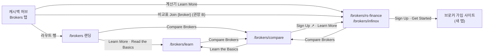

# Brokers 페이지 정리안

| 항목 | 내용 |
|---|---|
| 대상 | 실서비스 `/en/brokers` · `/en/brokers/learn` · `/en/brokers/compare` · `/en/brokers/rs-finance` · `/en/brokers/infinox` |
| 채집 | 2026-11-27 · 라이브 tethermax.io · 게스트 · Playwright PC 1440 / 모바일 390 · 버튼 목적지는 실제 클릭으로 측정 |
| Figma | fileKey `hsa3bSV9QmFTe2jsf6tzTm` · 2026-11-27 MCP 직접 조회(읽기 전용) |
| 기준 문서 | `00_DEX_최종정책.md`(B-5-6 · B-5-8 · B-21 · 9-1) · `02.기획문서/요구사항정의서.md`(REQ-044 · 308 · 311 · 312) · `02.기획문서/정보구조도_사용자.md`(1.1) · `05.리포트/_Figma수정_결정.md`(D4 · 12차) |
| 캡처 | `05.리포트/Brokers_img/` (7장 표) |

---

## 0. 결론 요약

| 구분 | 권장 |
|---|---|
| **없앨 페이지** | **없음.** 기존 거래소 목록(`/affiliated`)을 없앨 수 있었던 것은 허브 CEX 탭이 목록 기능(검색·정렬·평점·행 이동)을 그대로 받기 때문입니다(B-21-5). Brokers 5페이지는 허브가 그 내용을 담지 않습니다 — `/brokers`는 목록이 아니라 FX 소개·위험 고지 페이지이고, `/brokers/compare`는 허브 비교표와 **행(브로커 2곳)만 같고 열은 하나도 겹치지 않습니다.** |
| **없앨 것(페이지가 아닌 진입)** | 헤더 `Cashback ˅` 패널의 `Brokers` 행 — 실서비스 패널은 지금 `Exchanges · Brokers · Cashback Calculator`이고, 결정 D4로 `Cashback Hub · Cashback Calculator`가 됩니다. 이후 `/brokers` 진입은 허브 Brokers 라우트 행(RT-2)과 브로커 페이지 간 링크입니다 |
| **유지할 페이지** | `/brokers`(허브 Brokers 라우트 행 목적지) · `/brokers/learn` · `/brokers/compare` · `/brokers/rs-finance` · `/brokers/infinox` — 모두 현재 실서비스 그대로. 정책상 브로커는 대상 외·하드코딩(정책 493행 · 9-1 · C-5)이고 기존 페이지는 회귀 금지(NFR-2) |
| **`/brokers/compare` 조건부** | 줄이고 싶다면 없앨 수 있는 페이지는 이것뿐입니다(DEX도 「허브 비교표 외 전용 비교 페이지 없음」, B-21-1). 다만 정성 비교 8행을 허브로 옮기고, 이 페이지로 오는 CTA 4곳과 이메일 링크를 바꿔야 해서 별도 결정이 필요합니다 → ❓ 사용자 확인 #B1 |
| **허브 Brokers 비교표 `Join {broker}`** | **브로커 상세(`/{lang}/brokers/{slug}`, 현재 탭)로.** CEX·DEX `Join {partner}`는 결정 12차 그대로 레퍼럴 가입 새 탭. 근거: ① 실서비스 `/brokers/compare`의 `Sign Up ↗`도 브로커 사이트가 아니라 **테더맥스 브로커 상세로 이동**(측정) ② INFINOX는 계정 유형별(STP·ECN) 레퍼럴 링크가 2개라 버튼 하나로 열 링크를 정할 수 없음 ③ 브로커는 어드민·레코드가 없어 귀속 서비스(B-1-7)로 해석할 근거가 없음 ④ 상세에 IB 링크 귀속 조건·CFD 위험 고지가 있음. 결정 12차와 범위가 겹치므로 브로커 예외로 확정 필요 → ❓ 사용자 확인 #B2 |
| **프로토타입** | `prototype/full.html`에 Brokers 화면이 0개라 허브의 3곳(라우트 행 · 계산기 `Learn More` · 비교표 `Join`)이 모두 tethermax.io로 나갑니다. Figma `[MAX-]FX` Version 2(5개 프레임 + 모바일)로 화면을 만들면 내부 이동으로 바꿀 수 있습니다(5장) |

---

## 1. 페이지별 판단표

| 페이지 | 실서비스 구성 요약 | Figma 디자인(노드) | 문서 정의 | 허브와 겹침 | 권장 | 근거 |
|---|---|---|---|---|---|---|
| `/brokers` (랜딩) | 히어로 `Explore FX Rebates with TetherMax` + `Learn More`(→ learn) · `Compare Brokers`(→ compare) · CFD 위험 고지 · 앵커 탭 `How It Works`·`Why FX`·`Learn Basics` · 3단 소개 · `FX and CFDs, explained simply` 카드 2(`Read the Basics` → learn) · 위험 고지 블록 · `A simple 4-step path` · FAQ 4. **브로커 목록·요율 없음** | `[MAX-]FX` V2 `FX Integration LP` [28537:492801](https://www.figma.com/design/hsa3bSV9QmFTe2jsf6tzTm/UI-UX-Design?node-id=28537-492801) · 모바일 `fx-integration-lp-mobile` 28537:494216 | 정책 RT-2 · REQ-308: 허브 Brokers 라우트 행 → 「Brokers 페이지」. IA 1.1: `Brokers ⚪ /lang/brokers · 허브 탭 유지` | 없음 — 허브에 FX 소개·위험 고지 없음. 리드 문구만 비슷 | **유지** | 허브 라우트 행 목적지. DEX 행 → DEX 랜딩과 같은 「라우트 개요」 역할 |
| `/brokers/learn` | `Learn the Basics` — FX·CFD · 가격 · 레버리지(그림) · 4가지 비용 · 용어 13개 · 자가 점검 체크리스트. 오른쪽 목차 + `Compare Brokers`(→ compare) | V2 `Learn` [28537:493293](https://www.figma.com/design/hsa3bSV9QmFTe2jsf6tzTm/UI-UX-Design?node-id=28537-493293) | 문서 정의 없음 | 없음 | **유지** | 허브에 없는 교육 콘텐츠. 랜딩·compare·이메일이 이 페이지로 연결 |
| `/brokers/compare` | `Choose the route that fits you best` — 2열 비교표(RS Finance · INFINOX, 각 `Sign Up ↗` · `Learn More` → **둘 다 그 브로커 상세**) · 정성 8행(`Best for` · `Account Types` · `Execution Modal` · `Spread Type` · `Trading Platform` · `Products Available` · `Research and Tools` · `Onboarding Complexity`) · 고지 · `Your next steps` 4단계 · `Start with the basics` + `Learn the Basics`(→ learn) | V2 `Compare 2 brokers` [28537:493118](https://www.figma.com/design/hsa3bSV9QmFTe2jsf6tzTm/UI-UX-Design?node-id=28537-493118) · 모바일 `compare-2-brokers-mobile` 28537:494525 외 4 | 문서 정의 없음 | **부분** — 행(브로커 2곳)만 같음. 열 겹침 0(2장 표) | **유지** (없애려면 ❓ #B1) | 허브가 상위 집합이 아님. 대상 외·회귀 금지 |
| `/brokers/rs-finance` | 브레드크럼 · 헤더(`REGULATED` · `TETHERMAX REFERRAL REBATES RATE UP TO 21 USD* / standard lot`) · `Select Account`(→ 계정 유형으로 스크롤) · `Sign Up`(→ RS Finance 가입 새 탭) · 지표 4 · About·Company Profile · `Account Type#` STP 카드 + `Get Started`(→ 가입 새 탭) · `Earn Rebates on Every Trade` 4단계 · 스프레드·거래 조건 · T&C(IB 링크 귀속 조건) · 하단 띠 `Compare Brokers`(→ compare) · `Get Started`(→ 계정 유형으로 스크롤) | V2 `RS Finance` [28537:493558](https://www.figma.com/design/hsa3bSV9QmFTe2jsf6tzTm/UI-UX-Design?node-id=28537-493558) · 계정 카드 세트 28537:494119 | 문서 정의 없음(허브 계산기 `Learn More` = 「선택 파트너의 테더맥스 상세」 REQ-044·292 · 결정 12차) | 없음 — 허브는 요율 요약만 | **유지** | 브로커 레퍼럴 링크가 있는 유일한 곳. 허브 `Learn More`·compare 버튼의 목적지 |
| `/brokers/infinox` | RS Finance와 같은 틀. `TETHERMAX REFERRAL DISCOUNT UP TO 84%OFF*` · `Sign Up for STP Account` / `Sign Up for ECN Account`(→ 계정 유형별 서로 다른 INFINOX 가입 링크, 새 탭) · STP·ECN 카드 각 `Get Started` | V2 `INFINOX` [28537:493813](https://www.figma.com/design/hsa3bSV9QmFTe2jsf6tzTm/UI-UX-Design?node-id=28537-493813) · 계정 카드 세트 28537:494066 | 위와 같음 | 없음 | **유지** | 계정 유형별 가입 링크 2개 → 상세에서 고르게 해야 함 |

- 모바일(390)은 다섯 페이지 모두 PC와 섹션·버튼 구성이 같습니다(1열로 쌓임).
- 실서비스와 Figma V2 본문은 섹션·문구·CTA가 일치합니다. 다른 점은 **헤더**뿐입니다 — Figma FX 프레임은 옛 GNB(`Exchanges · Brokers · Events · Benefits · Cashback Preview · Point`), 실서비스는 이미 새 GNB(`Cashback ˅ · Rewards Hub ˅ · Discover ˅`). 브레드크럼은 Figma `Brokers / Learn`, 실서비스 `Brokers / Learn the Basics`.

---

## 2. 허브 Brokers 탭과의 겹침 상세

| 항목 | 허브 Brokers 비교표 (DEX(revision) [28960:126950](https://www.figma.com/design/hsa3bSV9QmFTe2jsf6tzTm/UI-UX-Design?node-id=28960-126950)) | `/brokers/compare` |
|---|---|---|
| 행 | RS Finance · INFINOX | RS Finance · INFINOX |
| 열 | `Cashback` · `Commission` · `Discounted commission` · `Est. monthly cashback` · `Rating` | `Best for` · `Account Types` · `Execution Modal` · `Spread Type` · `Trading Platform` · `Products Available` · `Research and Tools` · `Onboarding Complexity` |
| 계산기 연동 | 있음(월 lot → 예상 캐시백) | 없음 |
| 탐색 | 검색 · CEX/DEX/Brokers 칩 · 정렬 · 표/카드 | 없음(2열 고정) |
| 행 CTA | `Join {broker}` | `Sign Up ↗` · `Learn More` — 둘 다 테더맥스 브로커 상세 |
| 그 밖 | 게스트 이유 카드 | `Your next steps` 4단계 · `Learn the Basics` |

→ 허브는 **얼마 돌려받나(정량)**, compare는 **어떤 브로커인가(정성)**. 서로 대체하지 않습니다.

`/brokers/compare`로 들어오는 곳(없앨 경우 바꿔야 하는 곳): 랜딩 히어로 `Compare Brokers` · learn 오른쪽 `Compare Brokers` · RS Finance 하단 `Compare Brokers` · INFINOX 하단 `Compare Brokers` · Figma FX FAQ 「visit our Compare Brokers page」(28537:493812). 이메일 템플릿 `[TetherMax] Discover FX Brokers`(`[MAX-502]` 19394:1309 · 19405:1116 · 19454:1178)는 `/brokers`와 브로커 상세로 연결합니다.

---

## 3. 허브 Brokers `Join {broker}` 목적지

| 안 | 목적지 | 근거 | 걸리는 점 |
|---|---|---|---|
| A. 레퍼럴 가입 새 탭 | 브로커 가입 사이트(귀속 서비스 경유) | 결정 12차 · 정책 B-5-8 행 끝 · REQ-044·311·312 — 같은 표의 CEX·DEX와 동작이 같음 | INFINOX 링크가 STP·ECN 2개라 하나를 임의로 골라야 함 · 브로커는 어드민·활성 레코드가 없어(9-1 · G-246 비활성 유지) 귀속 서비스 해석 근거가 문서에 없음 · 가입 전 IB 귀속 조건·CFD 위험 고지를 건너뜀 |
| **B. 브로커 상세 (권장)** | `/{lang}/brokers/{slug}` 현재 탭 | **실서비스 compare의 `Sign Up ↗`가 이미 상세로 감**(측정) · 상세에서 계정 유형을 고르고 가입(새 탭) · 허브 계산기 `Learn More`(결정 12차 = 상세)와 같은 목적지 · 사용자 의견 | 같은 표 안에서 칩에 따라 `Join` 동작이 갈림 → Brokers 칩만의 예외로 문서화 필요 |

권장 B를 택하면 고칠 곳(❓ 사용자 확인 #B2 확정 후):

| 문서 | 위치 | 고칠 내용 |
|---|---|---|
| 정책 | B-5-8 「행 끝」 · 「모바일」 | Brokers 칩 `Join {broker}` → 그 브로커의 테더맥스 상세(현재 탭) |
| 정책 | B-1-7 외부 경로 목록 | 비교표 `Join`에서 Brokers 칩 제외 |
| 요구사항 | REQ-044 · REQ-311 · REQ-312 | 위와 같음 |
| 요구사항 | dexw7 `webhub_compare_join` | Brokers 칩은 outbound가 아니라 navigation |
| 기능명세서 사용자 | 위 REQ 사본 행 | 같이 동기화 |

---

## 4. Figma 노드 목록

| 페이지 | 노드 | 내용 | 상태 |
|---|---|---|---|
| `[MAX-]FX` [28537:488838](https://www.figma.com/design/hsa3bSV9QmFTe2jsf6tzTm/UI-UX-Design?node-id=28537-488838) | 섹션 `FX Integration - Work in progress as of 30th June (Version 2)` 28537:492800 | LP 28537:492801 · Compare 2 brokers 28537:493118 · Learn 28537:493293 · RS Finance 28537:493558 · INFINOX 28537:493813 · 계정 카드 세트 28537:494066 / 28537:494119 · FAQ 메모 28537:493812 | **실서비스와 일치하는 최신본** |
| 〃 | 섹션 `mobileWeb` 28537:494215 · 28537:495910 | `fx-integration-lp-mobile` · `compare-2-brokers-mobile` 5종 · RS·INFINOX 캐러셀 | 모바일 |
| 〃 | 섹션 `darkMode` 28537:496407 | V2 다크 | — |
| 〃 | 섹션 `FX Integration - (Version 1)` 28537:488849 | 랜딩 · `Comparing 2/3/4 brokers` · RS Finance 28537:491951 · INFINOX 28537:492521 | 이전 안 |
| 〃 | 소셜 카드 28537:497375(Broker page) · 28537:497405(Compare) · 28537:497432(RS) · 28537:497458(INFINOX) · `GNB for web` 28537:497552 | OG 이미지 · 옛 GNB | — |
| `FX with korean ( pending infinox table)` 17978:56722 | 17978:56949 LP · 17978:57234 Compare · 17978:57415 Learn · 17978:57650 RS · 17978:57880 INFINOX | 이전 사본 | 이전 안 |
| `DEX(revision)` 28960:125519 | 허브 H1-Broker PC 28960:126950 · 모바일 28960:130860 · 라우트 행 `row / Broker` 29400:140090 · 비교표 29400:140111 · 모바일 비교 카드 29352:145726 | 허브 Brokers 탭 | 현행 |
| `[MAX-502] Email Template` 7596:82127 | 19394:1309 · 19405:1116 · 19454:1178 외 | `Discover FX Brokers` 메일 → `/brokers` · 브로커 상세 | — |

- DEX(revision)에는 허브 Brokers 탭만 있고 Brokers 랜딩·학습·비교·상세 프레임은 없습니다. 오프라인 색인(`_프로토타입_전체/ref/figma_index.tsv`)에는 `[MAX-]FX` 페이지가 빠져 있어 이번에 MCP로 찾았습니다.
- 허브 Brokers 비교표 제목이 Figma·프로토타입은 `Compare cashback across 2 brokers`, 정책 B-5-8·REQ-312는 `Compare rebates across {n} brokers`입니다.

---

## 5. 프로토타입 현황과 반영 방향

| 위치(`prototype/full.html`) | 지금 | 권장 |
|---|---|---|
| 허브 라우트 행 `Brokers` (`go:'brokers.list'`, 5512행 `REAL`) | 실서비스 `https://tethermax.io/en/brokers`로 이동 | 프로토타입 Brokers 랜딩 화면 |
| 허브 계산기 `Learn More`(Brokers 라우트, 4152행 `brkd:`) | 실서비스 `/en/brokers/{slug}` 새 창(660행) | 프로토타입 브로커 상세 화면 |
| 허브 비교표 `Join {broker}`(4262행 `brkd:`) | 위와 같음 | 3장 권장 B면 브로커 상세 화면 |
| 허브 비교표 `Join {partner}` CEX·DEX(4262행) | 그 파트너의 테더맥스 상세로 이동(CEX는 실서비스 상세 새 창) | 결정 12차대로 레퍼럴 가입 새 탭(`05.리포트/화면요소_정의_전수점검.md` #45가 같은 수정 대상) |

추가할 화면(Figma V2 기준, 헤더는 새 GNB): 랜딩(앵커 탭·FAQ 펼침) · learn(목차 스크롤) · compare · 상세 2(`Select Account`·하단 `Get Started` = 계정 유형으로 스크롤, `Sign Up`·카드 `Get Started` = 브로커 가입 새 탭). 페이지 간 이동은 1장 표 그대로입니다.

---

## 6. 사용자 확인

| # | 질문 | 권장 |
|---|---|---|
| ❓ B1 | `/brokers/compare`를 남길까요, 허브 Brokers 탭으로 대체할까요? | 남김 — 허브와 열이 겹치지 않고, 브로커는 대상 외·하드코딩 |
| ❓ B2 | 허브 비교표 Brokers 칩의 `Join {broker}`를 브로커 상세(현재 탭)로 하는 예외를 둘까요? (CEX·DEX는 결정 12차대로 레퍼럴 새 탭) | 예외 둠 — 3장 근거 |

---

## 7. 캡처

| 파일 | 내용 |
|---|---|
| `Brokers_img/live_brokers_pc.png` · `_mo.png` | 실서비스 `/en/brokers` 전체 |
| `Brokers_img/live_brokers_learn_pc.png` · `_mo.png` | `/en/brokers/learn` 전체 |
| `Brokers_img/live_brokers_compare_pc.png` · `_mo.png` | `/en/brokers/compare` 전체 |
| `Brokers_img/live_brokers_rs-finance_pc.png` · `_mo.png` | `/en/brokers/rs-finance` 전체 |
| `Brokers_img/live_brokers_infinox_pc.png` · `_mo.png` | `/en/brokers/infinox` 전체 |
| `Brokers_img/live_gnb_cashback_panel.png` | 실서비스 헤더 `Cashback ˅` 패널(`Exchanges · Brokers · Cashback Calculator`) |
| `Brokers_img/figma_fx_landing_28537-492801.png` 외 4장 | Figma `[MAX-]FX` V2 LP · Compare · Learn · RS Finance · INFINOX |
| `Brokers_img/figma_fx_mobileweb_28537-494215.png` | Figma FX 모바일 섹션 |
| `Brokers_img/figma_hub_brokers_28960-126950.png` · `figma_hub_brokers_mo_28960-130860.png` | Figma 허브 Brokers 탭 PC · 모바일 |

- 실서비스 전체 캡처는 스크롤하며 나타나는 섹션을 띄운 뒤 찍어서, 고정 헤더가 페이지 중간에 한 번 찍힌 장이 있습니다.
