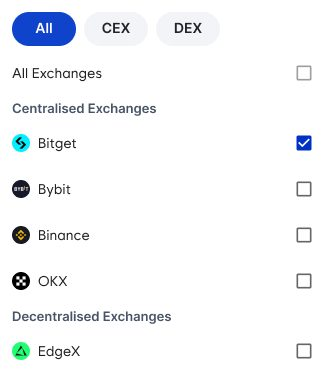
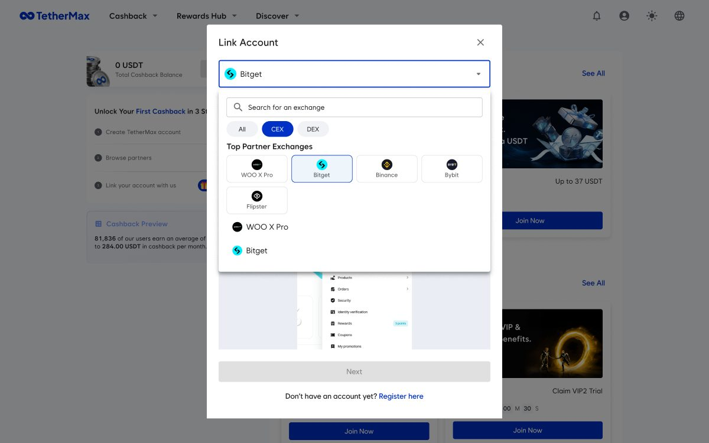
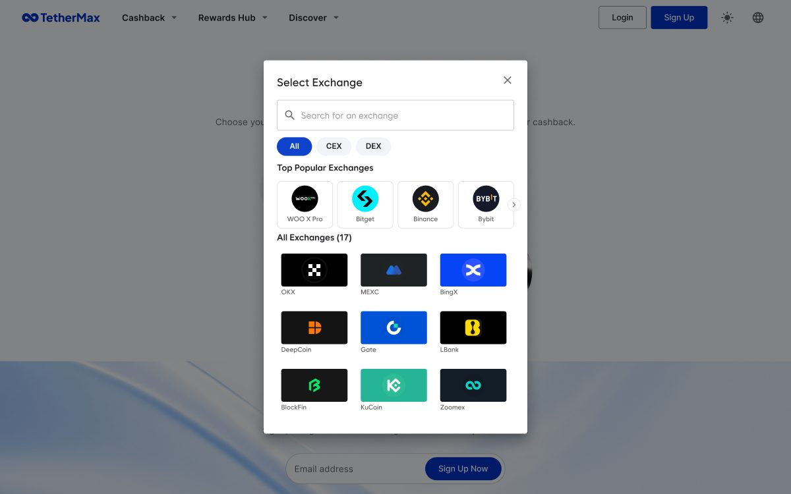
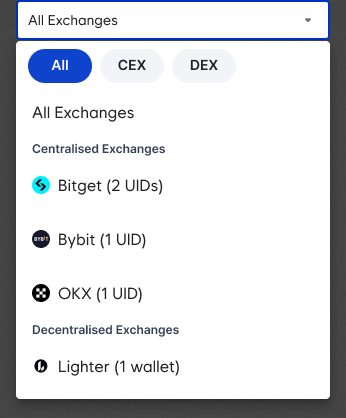
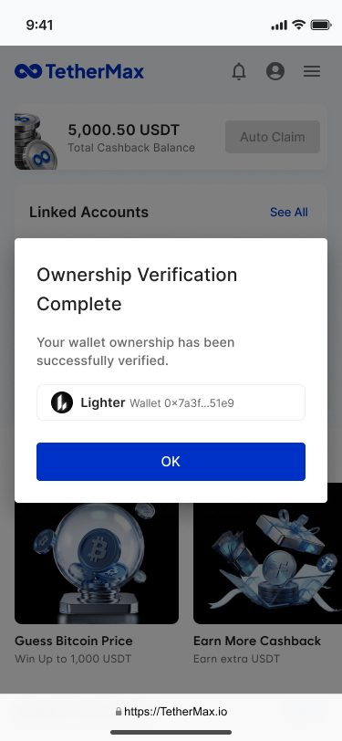
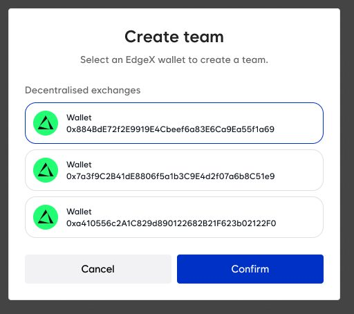
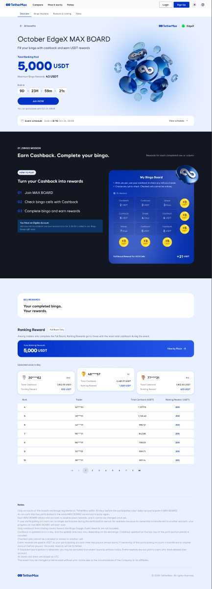
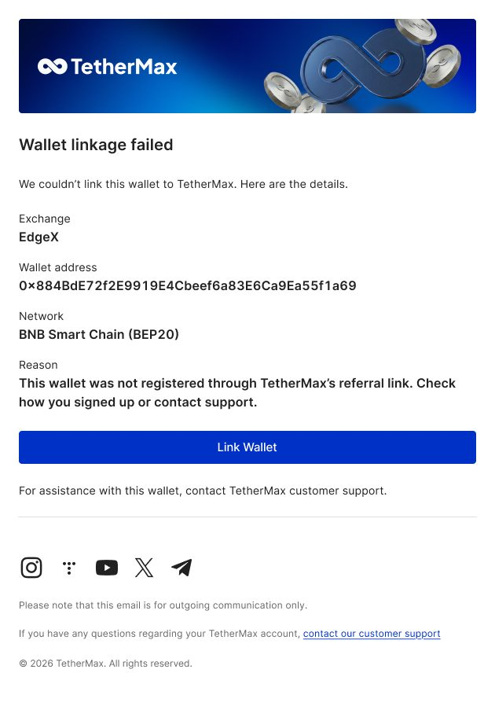
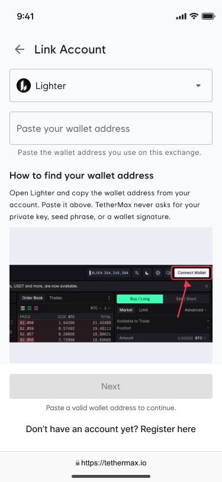

# Figma 최신 변경 대조 — 11/26 색인 이후 다른 작업자 변경

| 항목 | 내용 |
|---|---|
| 대상 | Figma `DEX(revision)` 페이지 [28960:125519](https://www.figma.com/design/hsa3bSV9QmFTe2jsf6tzTm/UI-UX-Design?node-id=28960-125519) |
| 이전 | 2026-11-26 09:55 `get_metadata` 원문(`_프로토타입_전체/ref/figma_pages/28960-125519_old_20261126.xml.bak`, 31,577노드) |
| 이후 | 2026-11-27 17시 `get_metadata` 원문(`ref/figma_pages/28960-125519.xml`로 교체, 76,180노드 — 페이지 전체를 한 번에 받음) |
| 중간 기준 | 2026-11-26 16:38에 받아 둔 원문(우리 1차 수정 시작 전) — 변경이 생긴 시점을 가르는 데만 씀 |
| 비교 | 노드 id 기준 추가(새 id) · 삭제 · 이름 변경(텍스트 레이어는 이름 = 문구) · 숨김/표시 변경. 인스턴스 안쪽(`I…` id)은 양쪽 원문의 펼침 깊이가 달라 뺌 |
| 제외(우리 수정) | `05.리포트/Figma수정결과_*.md`(1차 content·balance·link·rewards, 2~6차) 기준: ① 문서에 적힌 노드 id ② 그 문서의 새 프레임 안 ③ 문서에 노드가 있는 작업 세션(16:38 이후 id 앞자리)이 만든 노드 ④ 그 세션이 같은 이름으로 다시 만든 노드의 옛 노드 ⑤ 바뀐 문구·숨긴 레이어 이름이 문서에 그대로 있는 것 |
| 결과 | 바뀐 것 1,032건 중 우리 수정 701건 제외 → **남은 변경 331건 · 프레임 178개 · 주제 22개**(2장). 프로토타입 반영이 필요하거나 확인할 주제 11개 |

## 1. 요약

| 시점 | 주제 | 프레임 | 변경 | 성격 |
|---|---|---|---|---|
| 11/26 09:55~16:38 (우리 1차 수정 전) | 12 | 128 | 266 | CEX·DEX 유형 필터를 화면 전반에 넣은 묶음, 소유권(MAX-561) 홈 결과, 글로벌 리그 섹션. 레이어 이름이 국문 설계 메모 형식(`정책 변경 메모 · …`, `개발 메모 · …`)이라 시각 디자이너보다 기획 쪽 작업일 수 있음 — ❓ 사용자 확인 #1 작성 주체 |
| 11/26 16:38 이후 | 10 | 50 | 65 | 우리 수정결과 문서에 없는 문구 교체·버튼 추가. B1(Account 용어)·B4는 우리 결정과 같은 방향이지만 문서에 노드가 없어 남김 |

> 사용자가 찾은 예 「거래소 이벤트 필터 29069:6595의 All·CEX·DEX 칩」은 A1입니다. 칩 프레임 id(29190:123447)의 앞자리가 11/26 낮 작업 세션 번호라 우리 1차 수정 전에 생긴 변경입니다.

### 1.1 주제 목록

| # | 주제 | 프레임 | 변경 | 프로토타입 대응 | 반영 |
|---|---|---|---|---|---|
| A1 | 거래소 이벤트 필터 — 상단에 All·CEX·DEX 유형 칩, CEX·DEX 선택 상태 프레임 4개 | 6 | 6 | `events.list:filterMo`(모, 누락 0·다름 0) · `events.list:filterPc`(PC, 누락 0·다름 0) | 반영됨 — `events.list:filterPc`·`filterMo` 정밀 대조 누락 0. CEX·DEX 선택 상태 4개는 프로토타입 상태 없음(추가 여부 결정) |
| A2 | 거래 계정 연동 — 공통 거래소 검색(유형 필터 All·CEX·DEX) · 기존 연동 폼 유지 · 정책 변경 메모 | 26 | 48 | `link.addr:empty`(모, 누락 0·다름 1) · `link.addr:empty`(PC, 누락 0·다름 0) · `link.select:all`(PC, 누락 1·다름 0) 외 8 | 일부 필요 — `link.select:cex·dex·all`(PC)에서 Figma CEX 폼 안내 `Log in to the Bitget Website…` 누락. L1·L16·S3-3·S4-2 공통 검색 열림 프레임은 프로토타입 상태 미지정 |
| A3 | 비회원 거래소 선택 — 유형 필터 · 거래소 로고 · 바텀시트 손잡이 · 개발·정책 메모 | 7 | 36 | `guest.modal:picker`(모, 누락 6·다름 1) · `guest.modal:picker`(PC, 누락 9·다름 1) | 필요 — `guest.modal:picker` 누락 `All`·`CEX`·`DEX`, 다름 `All Exchanges (17)` ⇄ `Centralised exchanges` |
| A4 | 캐시백 요약 필터 — CEX·DEX 그룹 헤더 · All Types · 모바일 필터 3종 | 11 | 18 | `summary.main:types`(PC, 누락 0·다름 0) | 대체로 반영 — `summary.main:types` 누락 0. 그룹 헤더판 필터(29190:127304 등)는 프로토타입 상태 미지정 |
| A5 | 파트너 허브 — 거래소 옵션(유형별) 새 프레임 6개 | 6 | 6 | 대응 상태 없음 | 필요 — 프로토타입 대응 상태 없음(`partner.hub` 필터 상태 추가 검토) |
| A6 | 계산기 — 거래소 선택 원본 구성 · 유형 선택(DEX) · 계산 과정 프레임 수정 | 4 | 28 | `calc.p2:cexChip`(모, 누락 0·다름 0) · `calc.p2:cexChip`(PC, 누락 0·다름 0) · `calc.p2:dexChip`(모, 누락 0·다름 0) 외 1 | 판단 불요 — 계산기는 예외 EX-01(실서비스 계산기 채택)로 대조 제외 |
| A7 | 쿠폰 · 이벤트 · 랭킹 — 계정 선택/필터 CEX·DEX 상태 | 10 | 10 | `cmn.footer:normal`(모, 누락 0·다름 0) · `coupon.box:picker`(모, 누락 3·다름 0) · `coupon.box:picker`(PC, 누락 3·다름 0) 외 2 | 일부 필요 — `coupon.box:picker` 누락 `All`·`CEX`·`DEX` |
| A8 | 소유권 확인(MAX-561) — 홈 심사 상태 · 결과 · 재인증 모달(라이트·다크) · 변경 메모 | 14 | 56 | `own.home:approved`(모, 누락 0·다름 0) · `own.home:approved`(PC, 누락 0·다름 0) · `own.home:reclaim`(모, 누락 0·다름 0) 외 5 | 대체로 반영 — `own.home:*` 누락 0. `reclaimRejectedRow`(모) 누락 2·다름 2 |
| A9 | 맥스보드 종료 404 — 공통 404 본문 · 변경 메모 | 3 | 7 | `maxboard.main:ended404`(모, 누락 0·다름 0) · `maxboard.main:ended404`(PC, 누락 0·다름 0) | 반영됨 — `maxboard.main:ended404` 누락 0 |
| A10 | 글로벌 리그 — 「DEX 참가와 상금」 섹션 신설(지갑 선택 · 변경 불가 · Summary 차감 · 혜택 카드 · 메모) | 20 | 23 | 대응 상태 없음 | 필요 — 프로토타입 대응 상태 없음(`league.main`이 이 섹션 노드를 가리키지 않음) |
| A11 | 라벨·주석 — Wallet→Account 용어, Signup + Link UID→Wallet 이름 (화면 문구 아님) | 19 | 26 | `dex.detail:signupReturn`(PC, 누락 0·다름 1) · `link.signup:return`(PC, 누락 0·다름 2) | 불필요 — 주석. 참고: `link.signup:return` 다름 `Link Wallet` ⇄ `Link Account`(프로토타입이 용어 규칙을 따름) |
| A12 | 기타 — 업로드 이미지 2장(페이지 최상위) | 2 | 2 | 대응 상태 없음 | 불필요 |
| B1 | 맥스보드 — 안내 문구 「Only wallets…」→「Only accounts…」 (22프레임) | 22 | 22 | `maxboard.main:excluded`(모, 누락 0·다름 0) · `maxboard.main:excluded`(PC, 누락 0·다름 0) · `maxboard.main:join`(모, 누락 1·다름 2) 외 17 | 필요 — `maxboard.main:join`·`noEligible` 다름 `Only accounts…` ⇄ `Only wallets…`, `You Have an Eligible Account` ⇄ `…wallet` |
| B2 | 이메일 31(연동 결과 4종 × PC·모바일) — 「해당 DEX 연동 모달」 버튼 추가 | 8 | 8 | `email.link:e31auto`(모, 누락 1·다름 0) · `email.link:e31auto`(PC, 누락 1·다름 0) · `email.link:e31dup`(모, 누락 1·다름 0) 외 5 | 필요 — `email.link:e31*` 누락 `Link Wallet` |
| B3 | 모바일 지갑 연동 — 안내 문구 Bitget 예시 → 「Open Lighter and copy the wallet address…」 (라이트·다크 8프레임) | 7 | 7 | `link.addr:valid`(모, 누락 0·다름 1) · `link.addr:ws`(모, 누락 0·다름 1) · `link.captcha:normal`(모, 누락 0·다름 0) | 일부 필요 — `link.addr:empty·valid·ws`(모) 다름 1건(문장 끝 차이) |
| B4 | 지갑 상세 · 이벤트 리워드 매칭 상태 — Claimable·Matched 안내 문구 수정 | 1 | 5 | `home.wallet:cashBelow`(PC, 누락 3·다름 2) · `home.wallet:edge`(PC, 누락 3·다름 2) · `home.wallet:fullAbove`(PC, 누락 2·다름 0) 외 6 | 필요 — `home.wallet:*`(PC) 누락·다름 2~4건(Claimable·Matched 문장) |
| B5 | 퀴즈 모듈 5 본문 3문장 수정 | 1 | 3 | `quiz.article:member5`(PC, 누락 0·다름 0) | 반영됨 — `quiz.article:member5` 누락 0 |
| B6 | 친구 초대 — IF7 안내 문구 수정 · 모바일 표본 값(10→3, 123,123.00→24.00) | 2 | 3 | `cmn.footer:normal`(PC, 누락 0·다름 0) · `cmn.header:bellFail`(PC, 누락 0·다름 0) · `cmn.header:normal`(PC, 누락 0·다름 0) 외 2 | 일부 필요 — `invite.main:rewards`(PC) 누락 `If you sign up using this link…` |
| B7 | 소유권 업로드 실패 — 업로더 컨테이너 숨김(라이트·다크) | 2 | 2 | `own.verify:failed`(모, 누락 0·다름 0) | 반영됨 — `own.verify:failed` 누락 0 |
| B8 | 쿠폰 적용 완료 PC — 프레임 1개 추가 | 1 | 1 | `coupon.box:done`(PC, 누락 1·다름 0) | 확인 — `coupon.box:done`(PC) 누락 `Total Amount` |
| B9 | 모바일 DEX 개요(다크) — 카드 레이어 이름 ApeX↔Aster 교체(이름만) | 3 | 6 | 대응 상태 없음 | 불필요 |
| B10 | 화면 연결 화살표 — 라벨 배경 도형 추가(주석) | 3 | 8 | 대응 상태 없음 | 불필요 |

「누락·다름」은 `프로토타입_Figma_자동대조.md`(정밀 모드) 결과에서 그 상태의 전체 수치이고, 그중 이 변경과 관련된 것만 「반영」 칸에 적었습니다.

## 2. 변경 상세

### A1. 거래소 이벤트 필터 — 상단에 All·CEX·DEX 유형 칩, CEX·DEX 선택 상태 프레임 4개

| 항목 | 내용 |
|---|---|
| 전 → 후 | 필터 패널 맨 위에 `All`·`CEX`·`DEX` 유형 칩 줄이 생김(프레임 높이 372→382). CEX·DEX를 고른 상태 프레임 4개 신설 |
| 대표 노드 | [29069:6595](https://www.figma.com/design/hsa3bSV9QmFTe2jsf6tzTm/UI-UX-Design?node-id=29069-6595) `거래소 이벤트 필터 / PC · 목록` · [29069:6544](https://www.figma.com/design/hsa3bSV9QmFTe2jsf6tzTm/UI-UX-Design?node-id=29069-6544) `거래소 이벤트 필터 / 모바일` · [29190:123385](https://www.figma.com/design/hsa3bSV9QmFTe2jsf6tzTm/UI-UX-Design?node-id=29190-123385) `거래소 이벤트 필터 / PC · CEX` · [29190:123416](https://www.figma.com/design/hsa3bSV9QmFTe2jsf6tzTm/UI-UX-Design?node-id=29190-123416) `거래소 이벤트 필터 / PC · DEX` · [29190:123474](https://www.figma.com/design/hsa3bSV9QmFTe2jsf6tzTm/UI-UX-Design?node-id=29190-123474) `거래소 이벤트 필터 / 모바일 · CEX` · [29190:123515](https://www.figma.com/design/hsa3bSV9QmFTe2jsf6tzTm/UI-UX-Design?node-id=29190-123515) `거래소 이벤트 필터 / 모바일 · DEX` |
| 프로토타입 대응 | `events.list:filterMo`(모, 누락 0·다름 0) · `events.list:filterPc`(PC, 누락 0·다름 0) |
| 반영 | 반영됨 — `events.list:filterPc`·`filterMo` 정밀 대조 누락 0. CEX·DEX 선택 상태 4개는 프로토타입 상태 없음(추가 여부 결정) |

### A2. 거래 계정 연동 — 공통 거래소 검색(유형 필터 All·CEX·DEX) · 기존 연동 폼 유지 · 정책 변경 메모

| 항목 | 내용 |
|---|---|
| 전 → 후 | 연동 화면 「Select a DEX」 목록이 공통 거래소 검색(All·CEX·DEX 필터) + 기존 연동 폼 유지 구조로 바뀜. 화면 라벨·안내도 같은 내용으로 교체. 정책 변경 메모 2장 |
| 대표 노드 | [29192:119719](https://www.figma.com/design/hsa3bSV9QmFTe2jsf6tzTm/UI-UX-Design?node-id=29192-119719) `PC · 연동 검색 팝오버 · CEX 필터` · [29192:119723](https://www.figma.com/design/hsa3bSV9QmFTe2jsf6tzTm/UI-UX-Design?node-id=29192-119723) `PC · 연동 검색 팝오버 · DEX 필터` · [29225:119304](https://www.figma.com/design/hsa3bSV9QmFTe2jsf6tzTm/UI-UX-Design?node-id=29225-119304) `연동 · 공통 거래소 검색 팝오버` · [29227:119346](https://www.figma.com/design/hsa3bSV9QmFTe2jsf6tzTm/UI-UX-Design?node-id=29227-119346) `PC · 기존 UID 연동 · 검색 닫힘` · [28960:127271](https://www.figma.com/design/hsa3bSV9QmFTe2jsf6tzTm/UI-UX-Design?node-id=28960-127271) `DEX / link / L1 공통 거래소 검색 열림 / light` · [28960:127275](https://www.figma.com/design/hsa3bSV9QmFTe2jsf6tzTm/UI-UX-Design?node-id=28960-127275) `DEX / link / L2 Paste address, empty / l` 외 20 |
| 프로토타입 대응 | `link.addr:empty`(모, 누락 0·다름 1) · `link.addr:empty`(PC, 누락 0·다름 0) · `link.select:all`(PC, 누락 1·다름 0) · `link.select:cex`(PC, 누락 1·다름 0) · `link.select:dex`(PC, 누락 1·다름 0) · `link.select:dexlist`(PC, 누락 1·다름 0) · `link.select:many`(모, 누락 0·다름 0) · `link.select:one`(모, 누락 0·다름 0) 외 3 |
| 반영 | 일부 필요 — `link.select:cex·dex·all`(PC)에서 Figma CEX 폼 안내 `Log in to the Bitget Website…` 누락. L1·L16·S3-3·S4-2 공통 검색 열림 프레임은 프로토타입 상태 미지정 |

### A3. 비회원 거래소 선택 — 유형 필터 · 거래소 로고 · 바텀시트 손잡이 · 개발·정책 메모

| 항목 | 내용 |
|---|---|
| 전 → 후 | 비회원 거래소 선택에 유형 필터(All·CEX·DEX)·거래소 로고·바텀시트 손잡이 추가, CEX·DEX 필터 상태 프레임 3개 신설 |
| 대표 노드 | [29035:98030](https://www.figma.com/design/hsa3bSV9QmFTe2jsf6tzTm/UI-UX-Design?node-id=29035-98030) `Web / Guest / picker · 거래소 선택` · [29035:98094](https://www.figma.com/design/hsa3bSV9QmFTe2jsf6tzTm/UI-UX-Design?node-id=29035-98094) `Mobile / Guest / picker · 거래소 선택` · [29179:116130](https://www.figma.com/design/hsa3bSV9QmFTe2jsf6tzTm/UI-UX-Design?node-id=29179-116130) `Web / Guest / picker · DEX 필터` · [29179:116351](https://www.figma.com/design/hsa3bSV9QmFTe2jsf6tzTm/UI-UX-Design?node-id=29179-116351) `Mobile / Guest / picker · CEX 필터` · [29179:116630](https://www.figma.com/design/hsa3bSV9QmFTe2jsf6tzTm/UI-UX-Design?node-id=29179-116630) `Mobile / Guest / picker · DEX 필터` · [29179:117882](https://www.figma.com/design/hsa3bSV9QmFTe2jsf6tzTm/UI-UX-Design?node-id=29179-117882) `개발 메모 · 거래소 유형과 검색` 외 1 |
| 프로토타입 대응 | `guest.modal:picker`(모, 누락 6·다름 1) · `guest.modal:picker`(PC, 누락 9·다름 1) |
| 반영 | 필요 — `guest.modal:picker` 누락 `All`·`CEX`·`DEX`, 다름 `All Exchanges (17)` ⇄ `Centralised exchanges` |

### A4. 캐시백 요약 필터 — CEX·DEX 그룹 헤더 · All Types · 모바일 필터 3종

| 항목 | 내용 |
|---|---|
| 전 → 후 | 캐시백 요약 필터 드롭다운에 CEX·DEX 그룹 헤더, `All Types`, 모바일 필터 3종 신설. 필터 라벨 이름 교체 |
| 대표 노드 | [29190:127304](https://www.figma.com/design/hsa3bSV9QmFTe2jsf6tzTm/UI-UX-Design?node-id=29190-127304) `캐시백 요약 거래소 필터 · All` · [29190:127401](https://www.figma.com/design/hsa3bSV9QmFTe2jsf6tzTm/UI-UX-Design?node-id=29190-127401) `캐시백 요약 거래소 필터 · CEX` · [29191:120035](https://www.figma.com/design/hsa3bSV9QmFTe2jsf6tzTm/UI-UX-Design?node-id=29191-120035) `모바일 · 캐시백 요약 거래소 필터 · All` · [29191:120083](https://www.figma.com/design/hsa3bSV9QmFTe2jsf6tzTm/UI-UX-Design?node-id=29191-120083) `모바일 · 캐시백 요약 거래소 필터 · CEX` · [29191:120131](https://www.figma.com/design/hsa3bSV9QmFTe2jsf6tzTm/UI-UX-Design?node-id=29191-120131) `모바일 · 캐시백 요약 거래소 필터 · DEX` · [29257:120145](https://www.figma.com/design/hsa3bSV9QmFTe2jsf6tzTm/UI-UX-Design?node-id=29257-120145) `모바일 · 거래소 필터` 외 5 |
| 프로토타입 대응 | `summary.main:types`(PC, 누락 0·다름 0) |
| 반영 | 대체로 반영 — `summary.main:types` 누락 0. 그룹 헤더판 필터(29190:127304 등)는 프로토타입 상태 미지정 |

### A5. 파트너 허브 — 거래소 옵션(유형별) 새 프레임 6개

| 항목 | 내용 |
|---|---|
| 전 → 후 | 파트너 허브 거래소 옵션(유형별 PC·모바일) 새 프레임 6개 |
| 대표 노드 | [29197:120038](https://www.figma.com/design/hsa3bSV9QmFTe2jsf6tzTm/UI-UX-Design?node-id=29197-120038) `파트너 허브 · 거래소 옵션 / PC` · [29197:120754](https://www.figma.com/design/hsa3bSV9QmFTe2jsf6tzTm/UI-UX-Design?node-id=29197-120754) `파트너 허브 · 거래소 옵션 / 모바일` · [29198:119759](https://www.figma.com/design/hsa3bSV9QmFTe2jsf6tzTm/UI-UX-Design?node-id=29198-119759) `파트너 허브 · 거래소 옵션 / PC · CEX` · [29198:119797](https://www.figma.com/design/hsa3bSV9QmFTe2jsf6tzTm/UI-UX-Design?node-id=29198-119797) `파트너 허브 · 거래소 옵션 / PC · DEX` · [29198:119841](https://www.figma.com/design/hsa3bSV9QmFTe2jsf6tzTm/UI-UX-Design?node-id=29198-119841) `파트너 허브 · 거래소 옵션 / 모바일 · CEX` · [29198:119889](https://www.figma.com/design/hsa3bSV9QmFTe2jsf6tzTm/UI-UX-Design?node-id=29198-119889) `파트너 허브 · 거래소 옵션 / 모바일 · DEX` |
| 프로토타입 대응 | 대응 상태 없음 |
| 반영 | 필요 — 프로토타입 대응 상태 없음(`partner.hub` 필터 상태 추가 검토) |

### A6. 계산기 — 거래소 선택 원본 구성 · 유형 선택(DEX) · 계산 과정 프레임 수정

| 항목 | 내용 |
|---|---|
| 전 → 후 | 계산기 거래소 선택을 원본 구성으로 다시 그림(유형 선택 DEX, 거래소 마크), 계산 과정 프레임 일부 숨김 |
| 대표 노드 | [29194:120979](https://www.figma.com/design/hsa3bSV9QmFTe2jsf6tzTm/UI-UX-Design?node-id=29194-120979) `계산기 · 거래소 선택 / PC · CEX` · [29194:121473](https://www.figma.com/design/hsa3bSV9QmFTe2jsf6tzTm/UI-UX-Design?node-id=29194-121473) `계산기 · 거래소 선택 / 모바일 · CEX` · [29064:934](https://www.figma.com/design/hsa3bSV9QmFTe2jsf6tzTm/UI-UX-Design?node-id=29064-934) `계산기 · 계산 과정 / PC` · [29064:1384](https://www.figma.com/design/hsa3bSV9QmFTe2jsf6tzTm/UI-UX-Design?node-id=29064-1384) `계산기 · 계산 과정 / 모바일` |
| 프로토타입 대응 | `calc.p2:cexChip`(모, 누락 0·다름 0) · `calc.p2:cexChip`(PC, 누락 0·다름 0) · `calc.p2:dexChip`(모, 누락 0·다름 0) · `calc.p2:dexChip`(PC, 누락 0·다름 0) |
| 반영 | 판단 불요 — 계산기는 예외 EX-01(실서비스 계산기 채택)로 대조 제외 |

### A7. 쿠폰 · 이벤트 · 랭킹 — 계정 선택/필터 CEX·DEX 상태

| 항목 | 내용 |
|---|---|
| 전 → 후 | 쿠폰 계정 선택·거래소 이벤트·캐시백 랭킹에 CEX·DEX 상태 프레임·필터 진입 추가 |
| 대표 노드 | [29062:117713](https://www.figma.com/design/hsa3bSV9QmFTe2jsf6tzTm/UI-UX-Design?node-id=29062-117713) `쿠폰 · 사용할 계정 선택 / PC` · [29062:117894](https://www.figma.com/design/hsa3bSV9QmFTe2jsf6tzTm/UI-UX-Design?node-id=29062-117894) `쿠폰 · 사용할 계정 선택 / 모바일` · [29190:126577](https://www.figma.com/design/hsa3bSV9QmFTe2jsf6tzTm/UI-UX-Design?node-id=29190-126577) `쿠폰 · 계정 선택 / 모바일 · CEX` · [29190:126833](https://www.figma.com/design/hsa3bSV9QmFTe2jsf6tzTm/UI-UX-Design?node-id=29190-126833) `쿠폰 · 계정 선택 / 모바일 · DEX` · [29062:112586](https://www.figma.com/design/hsa3bSV9QmFTe2jsf6tzTm/UI-UX-Design?node-id=29062-112586) `이벤트 · 거래소 이벤트 / PC` · [29194:119460](https://www.figma.com/design/hsa3bSV9QmFTe2jsf6tzTm/UI-UX-Design?node-id=29194-119460) `이벤트 · 거래소 이벤트 / 모바일` 외 4 |
| 프로토타입 대응 | `cmn.footer:normal`(모, 누락 0·다름 0) · `coupon.box:picker`(모, 누락 3·다름 0) · `coupon.box:picker`(PC, 누락 3·다름 0) · `events.list:exchange`(PC, 누락 0·다름 0) · `ranking.main:unranked`(모, 누락 7·다름 0) |
| 반영 | 일부 필요 — `coupon.box:picker` 누락 `All`·`CEX`·`DEX` |

### A8. 소유권 확인(MAX-561) — 홈 심사 상태 · 결과 · 재인증 모달(라이트·다크) · 변경 메모

| 항목 | 내용 |
|---|---|
| 전 → 후 | 소유권 확인(MAX-561): 홈 심사 상태·결과·재인증 모달·재인증 거절 모달을 모바일 라이트·다크 프레임에 추가, 변경 메모 2장 |
| 대표 노드 | [28982:126253](https://www.figma.com/design/hsa3bSV9QmFTe2jsf6tzTm/UI-UX-Design?node-id=28982-126253) `Ownership / Review in progress / Light` · [28982:126268](https://www.figma.com/design/hsa3bSV9QmFTe2jsf6tzTm/UI-UX-Design?node-id=28982-126268) `Ownership / Ownership approved / Light` · [28982:126283](https://www.figma.com/design/hsa3bSV9QmFTe2jsf6tzTm/UI-UX-Design?node-id=28982-126283) `Ownership / Ownership not approved / Lig` · [28982:126318](https://www.figma.com/design/hsa3bSV9QmFTe2jsf6tzTm/UI-UX-Design?node-id=28982-126318) `Ownership / Reclaim wallet / Light` · [28982:126338](https://www.figma.com/design/hsa3bSV9QmFTe2jsf6tzTm/UI-UX-Design?node-id=28982-126338) `Ownership / Reclaim rejected / Light` · [28982:126508](https://www.figma.com/design/hsa3bSV9QmFTe2jsf6tzTm/UI-UX-Design?node-id=28982-126508) `Ownership / Review in progress / Dark` 외 8 |
| 프로토타입 대응 | `own.home:approved`(모, 누락 0·다름 0) · `own.home:approved`(PC, 누락 0·다름 0) · `own.home:reclaim`(모, 누락 0·다름 0) · `own.home:reclaimRejected`(모, 누락 0·다름 0) · `own.home:reclaimRejectedRow`(모, 누락 2·다름 2) · `own.home:rejected`(모, 누락 0·다름 0) · `own.home:rejected`(PC, 누락 0·다름 0) · `own.home:review`(모, 누락 5·다름 2) |
| 반영 | 대체로 반영 — `own.home:*` 누락 0. `reclaimRejectedRow`(모) 누락 2·다름 2 |

### A9. 맥스보드 종료 404 — 공통 404 본문 · 변경 메모

| 항목 | 내용 |
|---|---|
| 전 → 후 | 맥스보드 종료 404를 공통 404 본문으로 교체, 변경 메모 |
| 대표 노드 | [29064:15501](https://www.figma.com/design/hsa3bSV9QmFTe2jsf6tzTm/UI-UX-Design?node-id=29064-15501) `맥스보드 · 종료 · 404 / PC` · [29064:15511](https://www.figma.com/design/hsa3bSV9QmFTe2jsf6tzTm/UI-UX-Design?node-id=29064-15511) `맥스보드 · 종료 · 404 / 모바일` · [29200:130717](https://www.figma.com/design/hsa3bSV9QmFTe2jsf6tzTm/UI-UX-Design?node-id=29200-130717) `변경 메모 · 맥스보드 공통 404` |
| 프로토타입 대응 | `maxboard.main:ended404`(모, 누락 0·다름 0) · `maxboard.main:ended404`(PC, 누락 0·다름 0) |
| 반영 | 반영됨 — `maxboard.main:ended404` 누락 0 |

### A10. 글로벌 리그 — 「DEX 참가와 상금」 섹션 신설(지갑 선택 · 변경 불가 · Summary 차감 · 혜택 카드 · 메모)

| 항목 | 내용 |
|---|---|
| 전 → 후 | 페이지 최상위에 섹션 「글로벌 리그 · DEX 참가와 상금」 신설 — 팀 생성·팀 참가·개인전 지갑 선택(DEX 그룹 헤더), 참가 지갑 변경 불가, 회원 Summary 자동 지급 차감, 혜택 목록 EdgeX 리그 카드, 메모 5장. 주요 화면 바로가기에 「글로벌 리그 바로가기」 |
| 대표 노드 | [29183:117205](https://www.figma.com/design/hsa3bSV9QmFTe2jsf6tzTm/UI-UX-Design?node-id=29183-117205) `글로벌 리그 · DEX 참가와 상금` · [29183:117629](https://www.figma.com/design/hsa3bSV9QmFTe2jsf6tzTm/UI-UX-Design?node-id=29183-117629) `PC · 개인 리더보드` · [29183:118054](https://www.figma.com/design/hsa3bSV9QmFTe2jsf6tzTm/UI-UX-Design?node-id=29183-118054) `PC · 팀 생성 지갑 선택` · [29183:118079](https://www.figma.com/design/hsa3bSV9QmFTe2jsf6tzTm/UI-UX-Design?node-id=29183-118079) `모바일 · 팀 생성 지갑 선택` · [29183:118116](https://www.figma.com/design/hsa3bSV9QmFTe2jsf6tzTm/UI-UX-Design?node-id=29183-118116) `PC · 팀 참가 지갑 선택` · [29183:118141](https://www.figma.com/design/hsa3bSV9QmFTe2jsf6tzTm/UI-UX-Design?node-id=29183-118141) `모바일 · 팀 참가 지갑 선택` 외 14 |
| 프로토타입 대응 | 대응 상태 없음 |
| 반영 | 필요 — 프로토타입 대응 상태 없음(`league.main`이 이 섹션 노드를 가리키지 않음) |

### A11. 라벨·주석 — Wallet→Account 용어, Signup + Link UID→Wallet 이름 (화면 문구 아님)

| 항목 | 내용 |
|---|---|
| 전 → 후 | 화면 라벨·주석의 Wallet→Account 용어, 프레임 이름 `Signup + Link UID`→`Signup + Link Wallet`(화면 문구 아님) |
| 대표 노드 | [28960:127261](https://www.figma.com/design/hsa3bSV9QmFTe2jsf6tzTm/UI-UX-Design?node-id=28960-127261) `SCREEN-LABEL · L9 Wallet already in use` · [28960:127326](https://www.figma.com/design/hsa3bSV9QmFTe2jsf6tzTm/UI-UX-Design?node-id=28960-127326) `SCREEN-LABEL · L12 Verification limit re` · [28960:127335](https://www.figma.com/design/hsa3bSV9QmFTe2jsf6tzTm/UI-UX-Design?node-id=28960-127335) `SCREEN-LABEL · L13 Unable to link wallet` · [28960:127344](https://www.figma.com/design/hsa3bSV9QmFTe2jsf6tzTm/UI-UX-Design?node-id=28960-127344) `SCREEN-LABEL · L14 Wallet already added` · [28960:127376](https://www.figma.com/design/hsa3bSV9QmFTe2jsf6tzTm/UI-UX-Design?node-id=28960-127376) `Signup + Link Wallet / 1 Entry / Light` · [28960:127391](https://www.figma.com/design/hsa3bSV9QmFTe2jsf6tzTm/UI-UX-Design?node-id=28960-127391) `Signup + Link Wallet / 2 Signup / Light` 외 13 |
| 프로토타입 대응 | `dex.detail:signupReturn`(PC, 누락 0·다름 1) · `link.signup:return`(PC, 누락 0·다름 2) |
| 반영 | 불필요 — 주석. 참고: `link.signup:return` 다름 `Link Wallet` ⇄ `Link Account`(프로토타입이 용어 규칙을 따름) |

### A12. 기타 — 업로드 이미지 2장(페이지 최상위)

| 항목 | 내용 |
|---|---|
| 전 → 후 | 페이지 최상위에 `Uploaded Image` 프레임 2개 |
| 대표 노드 | [29215:119118](https://www.figma.com/design/hsa3bSV9QmFTe2jsf6tzTm/UI-UX-Design?node-id=29215-119118) `Uploaded Image` · [29215:119119](https://www.figma.com/design/hsa3bSV9QmFTe2jsf6tzTm/UI-UX-Design?node-id=29215-119119) `Uploaded Image` |
| 프로토타입 대응 | 대응 상태 없음 |
| 반영 | 불필요 |

### B1. 맥스보드 — 안내 문구 「Only wallets…」→「Only accounts…」 (22프레임)

| 항목 | 내용 |
|---|---|
| 전 → 후 | 맥스보드 안내 `Only wallets of the board's exchange registered…` → `Only accounts of the board's exchange registered…`(22프레임) |
| 대표 노드 | [29062:111024](https://www.figma.com/design/hsa3bSV9QmFTe2jsf6tzTm/UI-UX-Design?node-id=29062-111024) `맥스보드 · 참여 가능 / PC` · [29062:111380](https://www.figma.com/design/hsa3bSV9QmFTe2jsf6tzTm/UI-UX-Design?node-id=29062-111380) `맥스보드 · 참여 가능 / 모바일` · [29062:111741](https://www.figma.com/design/hsa3bSV9QmFTe2jsf6tzTm/UI-UX-Design?node-id=29062-111741) `맥스보드 · 정산 지연 / PC` · [29062:112159](https://www.figma.com/design/hsa3bSV9QmFTe2jsf6tzTm/UI-UX-Design?node-id=29062-112159) `맥스보드 · 정산 지연 / 모바일` · [29064:7182](https://www.figma.com/design/hsa3bSV9QmFTe2jsf6tzTm/UI-UX-Design?node-id=29064-7182) `맥스보드 · 사전공개 · 자격 있음 / PC` · [29064:7428](https://www.figma.com/design/hsa3bSV9QmFTe2jsf6tzTm/UI-UX-Design?node-id=29064-7428) `맥스보드 · 사전공개 · 자격 있음 / 모바일` 외 16 |
| 프로토타입 대응 | `maxboard.main:excluded`(모, 누락 0·다름 0) · `maxboard.main:excluded`(PC, 누락 0·다름 0) · `maxboard.main:join`(모, 누락 1·다름 2) · `maxboard.main:join`(PC, 누락 1·다름 2) · `maxboard.main:noEligible`(모, 누락 1·다름 3) · `maxboard.main:noEligible`(PC, 누락 1·다름 3) · `maxboard.main:payout`(모, 누락 1·다름 2) · `maxboard.main:payout`(PC, 누락 1·다름 2) 외 12 |
| 반영 | 필요 — `maxboard.main:join`·`noEligible` 다름 `Only accounts…` ⇄ `Only wallets…`, `You Have an Eligible Account` ⇄ `…wallet` |

### B2. 이메일 31(연동 결과 4종 × PC·모바일) — 「해당 DEX 연동 모달」 버튼 추가

| 항목 | 내용 |
|---|---|
| 전 → 후 | 이메일 31(레퍼럴 귀속 불일치·기존 연동·중복 자동 거절·운영자 거절 × PC·모바일)에 「해당 DEX 연동 모달」로 가는 `Link Wallet` 버튼 추가 |
| 대표 노드 | [29061:902](https://www.figma.com/design/hsa3bSV9QmFTe2jsf6tzTm/UI-UX-Design?node-id=29061-902) `31 · 레퍼럴 귀속 불일치` · [29061:970](https://www.figma.com/design/hsa3bSV9QmFTe2jsf6tzTm/UI-UX-Design?node-id=29061-970) `31 · 기존 연동` · [29061:1038](https://www.figma.com/design/hsa3bSV9QmFTe2jsf6tzTm/UI-UX-Design?node-id=29061-1038) `31 · 중복 자동 거절` · [29061:1106](https://www.figma.com/design/hsa3bSV9QmFTe2jsf6tzTm/UI-UX-Design?node-id=29061-1106) `31 · 운영자 거절` · [29064:2214](https://www.figma.com/design/hsa3bSV9QmFTe2jsf6tzTm/UI-UX-Design?node-id=29064-2214) `31 · 레퍼럴 귀속 불일치 / 모바일 375` · [29064:2277](https://www.figma.com/design/hsa3bSV9QmFTe2jsf6tzTm/UI-UX-Design?node-id=29064-2277) `31 · 기존 연동 / 모바일 375` 외 2 |
| 프로토타입 대응 | `email.link:e31auto`(모, 누락 1·다름 0) · `email.link:e31auto`(PC, 누락 1·다름 0) · `email.link:e31dup`(모, 누락 1·다름 0) · `email.link:e31dup`(PC, 누락 1·다름 0) · `email.link:e31op`(모, 누락 1·다름 0) · `email.link:e31op`(PC, 누락 1·다름 0) · `email.link:e31ref`(모, 누락 1·다름 0) · `email.link:e31ref`(PC, 누락 1·다름 0) |
| 반영 | 필요 — `email.link:e31*` 누락 `Link Wallet` |

### B3. 모바일 지갑 연동 — 안내 문구 Bitget 예시 → 「Open Lighter and copy the wallet address…」 (라이트·다크 8프레임)

| 항목 | 내용 |
|---|---|
| 전 → 후 | 모바일 지갑 연동 안내가 Bitget UID 예시(`Log in to the Bitget Website…`)에서 `Open Lighter and copy the wallet address from your account…`로 바뀜(라이트·다크 8프레임) |
| 대표 노드 | [28969:126996](https://www.figma.com/design/hsa3bSV9QmFTe2jsf6tzTm/UI-UX-Design?node-id=28969-126996) `Link / Valid address / Light` · [28969:127006](https://www.figma.com/design/hsa3bSV9QmFTe2jsf6tzTm/UI-UX-Design?node-id=28969-127006) `Link / Invalid address / Light` · [28969:127016](https://www.figma.com/design/hsa3bSV9QmFTe2jsf6tzTm/UI-UX-Design?node-id=28969-127016) `Link / Captcha / Light` · [28969:127193](https://www.figma.com/design/hsa3bSV9QmFTe2jsf6tzTm/UI-UX-Design?node-id=28969-127193) `Link / Enter wallet address / Dark` · [28969:127203](https://www.figma.com/design/hsa3bSV9QmFTe2jsf6tzTm/UI-UX-Design?node-id=28969-127203) `Link / Valid address / Dark` · [28969:127213](https://www.figma.com/design/hsa3bSV9QmFTe2jsf6tzTm/UI-UX-Design?node-id=28969-127213) `Link / Invalid address / Dark` 외 1 |
| 프로토타입 대응 | `link.addr:valid`(모, 누락 0·다름 1) · `link.addr:ws`(모, 누락 0·다름 1) · `link.captcha:normal`(모, 누락 0·다름 0) |
| 반영 | 일부 필요 — `link.addr:empty·valid·ws`(모) 다름 1건(문장 끝 차이) |

### B4. 지갑 상세 · 이벤트 리워드 매칭 상태 — Claimable·Matched 안내 문구 수정

| 항목 | 내용 |
|---|---|
| 전 → 후 | 지갑 상세 이벤트 리워드 매칭 상태: `Claimable … Additional…` → `Claimable … You can…`, `Matched … in event rewards…` 문장 수정 |
| 대표 노드 | [29026:97581](https://www.figma.com/design/hsa3bSV9QmFTe2jsf6tzTm/UI-UX-Design?node-id=29026-97581) `지갑 상세 · 이벤트 리워드 매칭 상태` |
| 프로토타입 대응 | `home.wallet:cashBelow`(PC, 누락 3·다름 2) · `home.wallet:edge`(PC, 누락 3·다름 2) · `home.wallet:fullAbove`(PC, 누락 2·다름 0) · `home.wallet:fullBelow`(PC, 누락 2·다름 1) · `home.wallet:fullEqual`(PC, 누락 2·다름 0) · `home.wallet:noReward`(PC, 누락 4·다름 0) · `home.wallet:partialBelow`(PC, 누락 2·다름 1) · `home.wallet:rewardOnly`(PC, 누락 2·다름 1) 외 1 |
| 반영 | 필요 — `home.wallet:*`(PC) 누락·다름 2~4건(Claimable·Matched 문장) |

### B5. 퀴즈 모듈 5 본문 3문장 수정

| 항목 | 내용 |
|---|---|
| 전 → 후 | 퀴즈 모듈 5 본문 3문장 수정(Funding · Build one number · headline fee) |
| 대표 노드 | [28960:130685](https://www.figma.com/design/hsa3bSV9QmFTe2jsf6tzTm/UI-UX-Design?node-id=28960-130685) `Signed In, Module 5` |
| 프로토타입 대응 | `quiz.article:member5`(PC, 누락 0·다름 0) |
| 반영 | 반영됨 — `quiz.article:member5` 누락 0 |

### B6. 친구 초대 — IF7 안내 문구 수정 · 모바일 표본 값(10→3, 123,123.00→24.00)

| 항목 | 내용 |
|---|---|
| 전 → 후 | 친구 초대 IF7 안내 문장 수정, 모바일 표본 값 10→3 · 123,123.00→24.00 |
| 대표 노드 | [28967:127210](https://www.figma.com/design/hsa3bSV9QmFTe2jsf6tzTm/UI-UX-Design?node-id=28967-127210) `DEX / IF7 Invitation Reward tab / light` · [29065:6175](https://www.figma.com/design/hsa3bSV9QmFTe2jsf6tzTm/UI-UX-Design?node-id=29065-6175) `친구 초대 · 모바일` |
| 프로토타입 대응 | `cmn.footer:normal`(PC, 누락 0·다름 0) · `cmn.header:bellFail`(PC, 누락 0·다름 0) · `cmn.header:normal`(PC, 누락 0·다름 0) · `invite.main:rewards`(모, 누락 0·다름 0) · `invite.main:rewards`(PC, 누락 2·다름 0) |
| 반영 | 일부 필요 — `invite.main:rewards`(PC) 누락 `If you sign up using this link…` |

### B7. 소유권 업로드 실패 — 업로더 컨테이너 숨김(라이트·다크)

| 항목 | 내용 |
|---|---|
| 전 → 후 | 소유권 업로드 실패 프레임에서 업로더 컨테이너 숨김(라이트·다크) |
| 대표 노드 | [28982:126223](https://www.figma.com/design/hsa3bSV9QmFTe2jsf6tzTm/UI-UX-Design?node-id=28982-126223) `Ownership / Upload failed / Light` · [28982:126478](https://www.figma.com/design/hsa3bSV9QmFTe2jsf6tzTm/UI-UX-Design?node-id=28982-126478) `Ownership / Upload failed / Dark` |
| 프로토타입 대응 | `own.verify:failed`(모, 누락 0·다름 0) |
| 반영 | 반영됨 — `own.verify:failed` 누락 0 |

### B8. 쿠폰 적용 완료 PC — 프레임 1개 추가

| 항목 | 내용 |
|---|---|
| 전 → 후 | 쿠폰 적용 완료 PC에 프레임 1개 추가 |
| 대표 노드 | [29065:7079](https://www.figma.com/design/hsa3bSV9QmFTe2jsf6tzTm/UI-UX-Design?node-id=29065-7079) `쿠폰 적용 완료 · PC` |
| 프로토타입 대응 | `coupon.box:done`(PC, 누락 1·다름 0) |
| 반영 | 확인 — `coupon.box:done`(PC) 누락 `Total Amount` |

### B9. 모바일 DEX 개요(다크) — 카드 레이어 이름 ApeX↔Aster 교체(이름만)

| 항목 | 내용 |
|---|---|
| 전 → 후 | 모바일 DEX 개요(다크) 카드 레이어 이름 ApeX↔Aster 교체(이름만, 화면 동일) |
| 대표 노드 | [28960:130968](https://www.figma.com/design/hsa3bSV9QmFTe2jsf6tzTm/UI-UX-Design?node-id=28960-130968) `DEX / Mobile / OA DEX overview, keys con` · [28960:130974](https://www.figma.com/design/hsa3bSV9QmFTe2jsf6tzTm/UI-UX-Design?node-id=28960-130974) `DEX / Mobile / OA DEX overview, keys con` · [28960:130980](https://www.figma.com/design/hsa3bSV9QmFTe2jsf6tzTm/UI-UX-Design?node-id=28960-130980) `DEX / Mobile / OA DEX overview, keys con` |
| 프로토타입 대응 | 대응 상태 없음 |
| 반영 | 불필요 |

### B10. 화면 연결 화살표 — 라벨 배경 도형 추가(주석)

| 항목 | 내용 |
|---|---|
| 전 → 후 | 화면 연결 화살표 라벨 배경 도형(주석) |
| 대표 노드 | [29097:114837](https://www.figma.com/design/hsa3bSV9QmFTe2jsf6tzTm/UI-UX-Design?node-id=29097-114837) `화면 연결 · Verify Ownership` · [29097:114849](https://www.figma.com/design/hsa3bSV9QmFTe2jsf6tzTm/UI-UX-Design?node-id=29097-114849) `화면 연결 · 송금 확정 · 연동 완료` · [29097:114853](https://www.figma.com/design/hsa3bSV9QmFTe2jsf6tzTm/UI-UX-Design?node-id=29097-114853) `화면 연결 · 송금 실패 · 잔액 복원` |
| 프로토타입 대응 | 대응 상태 없음 |
| 반영 | 불필요 |

## 3. 우리 수정으로 보고 뺀 것

| 근거 | 건수 |
|---|---|
| 수정결과 문서에 적힌 노드 id | 339 |
| 수정결과 문서의 새 프레임 안 | 86 |
| 문서에 노드가 있는 작업 세션(16:38 이후)이 만든 노드 | 76 |
| 문서 노드의 부모 · 같은 세션이 다시 만든 노드의 옛 노드(분리·교체) | 90 |
| 바뀐 문구·숨긴 레이어 이름이 문서에 있음 | 110 |
| **합계** | **701** |

## 4. 전체 변경 노드

주제별 프레임 단위. 구분: 추가 · 삭제 · 이름·문구 · 숨김 · 표시. 문구는 앞 50자.

### A1

| 프레임 | 구분 | 노드 | 전 → 후 |
|---|---|---|---|
| [29069:6595](https://www.figma.com/design/hsa3bSV9QmFTe2jsf6tzTm/UI-UX-Design?node-id=29069-6595) 거래소 이벤트 필터 / PC · 목록 | 추가 | [29190:123447](https://www.figma.com/design/hsa3bSV9QmFTe2jsf6tzTm/UI-UX-Design?node-id=29190-123447) | frame `거래소 유형` |
| [29069:6544](https://www.figma.com/design/hsa3bSV9QmFTe2jsf6tzTm/UI-UX-Design?node-id=29069-6544) 거래소 이벤트 필터 / 모바일 | 추가 | [29190:123556](https://www.figma.com/design/hsa3bSV9QmFTe2jsf6tzTm/UI-UX-Design?node-id=29190-123556) | frame `거래소 유형` |
| [29190:123385](https://www.figma.com/design/hsa3bSV9QmFTe2jsf6tzTm/UI-UX-Design?node-id=29190-123385) 거래소 이벤트 필터 / PC · CEX | 추가 | [29190:123385](https://www.figma.com/design/hsa3bSV9QmFTe2jsf6tzTm/UI-UX-Design?node-id=29190-123385) | frame `거래소 이벤트 필터 / PC · CEX` |
| [29190:123416](https://www.figma.com/design/hsa3bSV9QmFTe2jsf6tzTm/UI-UX-Design?node-id=29190-123416) 거래소 이벤트 필터 / PC · DEX | 추가 | [29190:123416](https://www.figma.com/design/hsa3bSV9QmFTe2jsf6tzTm/UI-UX-Design?node-id=29190-123416) | frame `거래소 이벤트 필터 / PC · DEX` |
| [29190:123474](https://www.figma.com/design/hsa3bSV9QmFTe2jsf6tzTm/UI-UX-Design?node-id=29190-123474) 거래소 이벤트 필터 / 모바일 · CEX | 추가 | [29190:123474](https://www.figma.com/design/hsa3bSV9QmFTe2jsf6tzTm/UI-UX-Design?node-id=29190-123474) | frame `거래소 이벤트 필터 / 모바일 · CEX` |
| [29190:123515](https://www.figma.com/design/hsa3bSV9QmFTe2jsf6tzTm/UI-UX-Design?node-id=29190-123515) 거래소 이벤트 필터 / 모바일 · DEX | 추가 | [29190:123515](https://www.figma.com/design/hsa3bSV9QmFTe2jsf6tzTm/UI-UX-Design?node-id=29190-123515) | frame `거래소 이벤트 필터 / 모바일 · DEX` |

### A2

| 프레임 | 구분 | 노드 | 전 → 후 |
|---|---|---|---|
| [29192:119719](https://www.figma.com/design/hsa3bSV9QmFTe2jsf6tzTm/UI-UX-Design?node-id=29192-119719) PC · 연동 검색 팝오버 · CEX 필터 | 추가 | [29192:119719](https://www.figma.com/design/hsa3bSV9QmFTe2jsf6tzTm/UI-UX-Design?node-id=29192-119719) | frame `PC · 연동 검색 팝오버 · CEX 필터` |
| [29192:119719](https://www.figma.com/design/hsa3bSV9QmFTe2jsf6tzTm/UI-UX-Design?node-id=29192-119719) PC · 연동 검색 팝오버 · CEX 필터 | 추가 | [29227:123034](https://www.figma.com/design/hsa3bSV9QmFTe2jsf6tzTm/UI-UX-Design?node-id=29227-123034) | frame `기존 연동 폼 · CEX` |
| [29192:119719](https://www.figma.com/design/hsa3bSV9QmFTe2jsf6tzTm/UI-UX-Design?node-id=29192-119719) PC · 연동 검색 팝오버 · CEX 필터 | 추가 | [29227:123078](https://www.figma.com/design/hsa3bSV9QmFTe2jsf6tzTm/UI-UX-Design?node-id=29227-123078) | rounded-rectangle `거래소 드롭다운 포커스` |
| [29192:119719](https://www.figma.com/design/hsa3bSV9QmFTe2jsf6tzTm/UI-UX-Design?node-id=29192-119719) PC · 연동 검색 팝오버 · CEX 필터 | 추가 | [29227:123079](https://www.figma.com/design/hsa3bSV9QmFTe2jsf6tzTm/UI-UX-Design?node-id=29227-123079) | instance `공통 거래소 검색 · CEX` |
| [29192:119723](https://www.figma.com/design/hsa3bSV9QmFTe2jsf6tzTm/UI-UX-Design?node-id=29192-119723) PC · 연동 검색 팝오버 · DEX 필터 | 추가 | [29192:119723](https://www.figma.com/design/hsa3bSV9QmFTe2jsf6tzTm/UI-UX-Design?node-id=29192-119723) | frame `PC · 연동 검색 팝오버 · DEX 필터` |
| [29192:119723](https://www.figma.com/design/hsa3bSV9QmFTe2jsf6tzTm/UI-UX-Design?node-id=29192-119723) PC · 연동 검색 팝오버 · DEX 필터 | 추가 | [29227:123220](https://www.figma.com/design/hsa3bSV9QmFTe2jsf6tzTm/UI-UX-Design?node-id=29227-123220) | frame `기존 연동 폼 · CEX` |
| [29192:119723](https://www.figma.com/design/hsa3bSV9QmFTe2jsf6tzTm/UI-UX-Design?node-id=29192-119723) PC · 연동 검색 팝오버 · DEX 필터 | 추가 | [29227:123264](https://www.figma.com/design/hsa3bSV9QmFTe2jsf6tzTm/UI-UX-Design?node-id=29227-123264) | rounded-rectangle `거래소 드롭다운 포커스` |
| [29192:119723](https://www.figma.com/design/hsa3bSV9QmFTe2jsf6tzTm/UI-UX-Design?node-id=29192-119723) PC · 연동 검색 팝오버 · DEX 필터 | 추가 | [29227:123265](https://www.figma.com/design/hsa3bSV9QmFTe2jsf6tzTm/UI-UX-Design?node-id=29227-123265) | instance `공통 거래소 검색 · DEX` |
| [29225:119304](https://www.figma.com/design/hsa3bSV9QmFTe2jsf6tzTm/UI-UX-Design?node-id=29225-119304) 연동 · 공통 거래소 검색 팝오버 | 추가 | [29225:119304](https://www.figma.com/design/hsa3bSV9QmFTe2jsf6tzTm/UI-UX-Design?node-id=29225-119304) | frame `연동 · 공통 거래소 검색 팝오버` |
| [29227:119346](https://www.figma.com/design/hsa3bSV9QmFTe2jsf6tzTm/UI-UX-Design?node-id=29227-119346) PC · 기존 UID 연동 · 검색 닫힘 | 추가 | [29227:119346](https://www.figma.com/design/hsa3bSV9QmFTe2jsf6tzTm/UI-UX-Design?node-id=29227-119346) | frame `PC · 기존 UID 연동 · 검색 닫힘` |
| [29227:119346](https://www.figma.com/design/hsa3bSV9QmFTe2jsf6tzTm/UI-UX-Design?node-id=29227-119346) PC · 기존 UID 연동 · 검색 닫힘 | 추가 | [29228:120131](https://www.figma.com/design/hsa3bSV9QmFTe2jsf6tzTm/UI-UX-Design?node-id=29228-120131) | rounded-rectangle `열기 · 공통 거래소 검색` |
| [28960:127271](https://www.figma.com/design/hsa3bSV9QmFTe2jsf6tzTm/UI-UX-Design?node-id=28960-127271) DEX / link / L1 공통 거래소 검색 열림 / | 추가 | [29227:119483](https://www.figma.com/design/hsa3bSV9QmFTe2jsf6tzTm/UI-UX-Design?node-id=29227-119483) | instance `기존 연동 폼 · Wallet` |
| [28960:127271](https://www.figma.com/design/hsa3bSV9QmFTe2jsf6tzTm/UI-UX-Design?node-id=28960-127271) DEX / link / L1 공통 거래소 검색 열림 / | 추가 | [29227:119545](https://www.figma.com/design/hsa3bSV9QmFTe2jsf6tzTm/UI-UX-Design?node-id=29227-119545) | rounded-rectangle `거래소 드롭다운 포커스` |
| [28960:127271](https://www.figma.com/design/hsa3bSV9QmFTe2jsf6tzTm/UI-UX-Design?node-id=28960-127271) DEX / link / L1 공통 거래소 검색 열림 / | 추가 | [29227:119546](https://www.figma.com/design/hsa3bSV9QmFTe2jsf6tzTm/UI-UX-Design?node-id=29227-119546) | instance `공통 거래소 검색 · All` |
| [28960:127275](https://www.figma.com/design/hsa3bSV9QmFTe2jsf6tzTm/UI-UX-Design?node-id=28960-127275) DEX / link / L2 Paste address, | 추가 | [29228:120133](https://www.figma.com/design/hsa3bSV9QmFTe2jsf6tzTm/UI-UX-Design?node-id=29228-120133) | rounded-rectangle `열기 · 공통 거래소 검색` |
| [28960:127367](https://www.figma.com/design/hsa3bSV9QmFTe2jsf6tzTm/UI-UX-Design?node-id=28960-127367) DEX / link / L16 홈 체크리스트 · 공통  | 추가 | [29233:120240](https://www.figma.com/design/hsa3bSV9QmFTe2jsf6tzTm/UI-UX-Design?node-id=29233-120240) | frame `기존 연동 폼 · Empty` |
| [28960:127412](https://www.figma.com/design/hsa3bSV9QmFTe2jsf6tzTm/UI-UX-Design?node-id=28960-127412) DEX / link / L0 Lighter page,  | 추가 | [29228:120139](https://www.figma.com/design/hsa3bSV9QmFTe2jsf6tzTm/UI-UX-Design?node-id=29228-120139) | rounded-rectangle `열기 · 선택된 Wallet 연동 폼` |
| [28960:127381](https://www.figma.com/design/hsa3bSV9QmFTe2jsf6tzTm/UI-UX-Design?node-id=28960-127381) DEX / link / L17 홈 다른 계정 추가 ·  | 이름·문구 | [28960:127381](https://www.figma.com/design/hsa3bSV9QmFTe2jsf6tzTm/UI-UX-Design?node-id=28960-127381) | `DEX / link / L17 S4 Member, link another account /` → `DEX / link / L17 홈 다른 계정 추가 · 공통 거래소 검색 / light` |
| [29020:204682](https://www.figma.com/design/hsa3bSV9QmFTe2jsf6tzTm/UI-UX-Design?node-id=29020-204682) DEX / story / S3-3 공통 거래소 검색 / | 추가 | [29233:120143](https://www.figma.com/design/hsa3bSV9QmFTe2jsf6tzTm/UI-UX-Design?node-id=29233-120143) | frame `기존 연동 폼 · Empty` |
| [29020:204682](https://www.figma.com/design/hsa3bSV9QmFTe2jsf6tzTm/UI-UX-Design?node-id=29020-204682) DEX / story / S3-3 공통 거래소 검색 / | 추가 | [29227:122140](https://www.figma.com/design/hsa3bSV9QmFTe2jsf6tzTm/UI-UX-Design?node-id=29227-122140) | rounded-rectangle `거래소 드롭다운 포커스` |
| [29020:204682](https://www.figma.com/design/hsa3bSV9QmFTe2jsf6tzTm/UI-UX-Design?node-id=29020-204682) DEX / story / S3-3 공통 거래소 검색 / | 추가 | [29227:122141](https://www.figma.com/design/hsa3bSV9QmFTe2jsf6tzTm/UI-UX-Design?node-id=29227-122141) | instance `공통 거래소 검색 · All` |
| [29227:122305](https://www.figma.com/design/hsa3bSV9QmFTe2jsf6tzTm/UI-UX-Design?node-id=29227-122305) DEX / story / S4-2 공통 거래소 검색 / | 추가 | [29227:122305](https://www.figma.com/design/hsa3bSV9QmFTe2jsf6tzTm/UI-UX-Design?node-id=29227-122305) | frame `DEX / story / S4-2 공통 거래소 검색 / light` |
| [29230:120107](https://www.figma.com/design/hsa3bSV9QmFTe2jsf6tzTm/UI-UX-Design?node-id=29230-120107) 정책 변경 메모 · 공통 거래소 선택 | 추가 | [29230:120107](https://www.figma.com/design/hsa3bSV9QmFTe2jsf6tzTm/UI-UX-Design?node-id=29230-120107) | frame `정책 변경 메모 · 공통 거래소 선택` |
| [29260:120145](https://www.figma.com/design/hsa3bSV9QmFTe2jsf6tzTm/UI-UX-Design?node-id=29260-120145) 정책 변경 메모 · DEX 가입 후 지갑 연동 | 추가 | [29260:120145](https://www.figma.com/design/hsa3bSV9QmFTe2jsf6tzTm/UI-UX-Design?node-id=29260-120145) | frame `정책 변경 메모 · DEX 가입 후 지갑 연동` |
| [28960:127221](https://www.figma.com/design/hsa3bSV9QmFTe2jsf6tzTm/UI-UX-Design?node-id=28960-127221) SCREEN-LABEL · L1 · 공통 거래소 검색 | 이름·문구 | [28960:127221](https://www.figma.com/design/hsa3bSV9QmFTe2jsf6tzTm/UI-UX-Design?node-id=28960-127221) | `SCREEN-LABEL · L1 Select a DEX` → `SCREEN-LABEL · L1 · 공통 거래소 검색` |
| [28960:127221](https://www.figma.com/design/hsa3bSV9QmFTe2jsf6tzTm/UI-UX-Design?node-id=28960-127221) SCREEN-LABEL · L1 · 공통 거래소 검색 | 이름·문구 | [28960:127224](https://www.figma.com/design/hsa3bSV9QmFTe2jsf6tzTm/UI-UX-Design?node-id=28960-127224) | `Select a DEX` → `L1 · 공통 거래소 검색` |
| [28960:127221](https://www.figma.com/design/hsa3bSV9QmFTe2jsf6tzTm/UI-UX-Design?node-id=28960-127221) SCREEN-LABEL · L1 · 공통 거래소 검색 | 이름·문구 | [28960:127225](https://www.figma.com/design/hsa3bSV9QmFTe2jsf6tzTm/UI-UX-Design?node-id=28960-127225) | `Searchable DEX list, order from the backoffice.` → `Open the exchange dropdown in the wallet form. All` |
| [28960:127371](https://www.figma.com/design/hsa3bSV9QmFTe2jsf6tzTm/UI-UX-Design?node-id=28960-127371) SCREEN-LABEL · L16 · 공통 거래소 검색 | 이름·문구 | [28960:127371](https://www.figma.com/design/hsa3bSV9QmFTe2jsf6tzTm/UI-UX-Design?node-id=28960-127371) | `SCREEN-LABEL · L16 S3 Signed in, nothing linked` → `SCREEN-LABEL · L16 · 공통 거래소 검색` |
| [28960:127371](https://www.figma.com/design/hsa3bSV9QmFTe2jsf6tzTm/UI-UX-Design?node-id=28960-127371) SCREEN-LABEL · L16 · 공통 거래소 검색 | 이름·문구 | [28960:127374](https://www.figma.com/design/hsa3bSV9QmFTe2jsf6tzTm/UI-UX-Design?node-id=28960-127374) | `S3 Signed in, nothing linked` → `L16 · 공통 거래소 검색` |
| [28960:127371](https://www.figma.com/design/hsa3bSV9QmFTe2jsf6tzTm/UI-UX-Design?node-id=28960-127371) SCREEN-LABEL · L16 · 공통 거래소 검색 | 이름·문구 | [28960:127375](https://www.figma.com/design/hsa3bSV9QmFTe2jsf6tzTm/UI-UX-Design?node-id=28960-127375) | `Step 3 opens Link Account with no partner selected` → `From the home checklist, open the shared dropdown ` |
| [28960:127386](https://www.figma.com/design/hsa3bSV9QmFTe2jsf6tzTm/UI-UX-Design?node-id=28960-127386) SCREEN-LABEL · L17 · 공통 거래소 검색 | 이름·문구 | [28960:127386](https://www.figma.com/design/hsa3bSV9QmFTe2jsf6tzTm/UI-UX-Design?node-id=28960-127386) | `SCREEN-LABEL · L17 S4 Member, link another account` → `SCREEN-LABEL · L17 · 공통 거래소 검색` |
| [28960:127386](https://www.figma.com/design/hsa3bSV9QmFTe2jsf6tzTm/UI-UX-Design?node-id=28960-127386) SCREEN-LABEL · L17 · 공통 거래소 검색 | 이름·문구 | [28960:127389](https://www.figma.com/design/hsa3bSV9QmFTe2jsf6tzTm/UI-UX-Design?node-id=28960-127389) | `S4 Member, link another account` → `L17 · 공통 거래소 검색` |
| [28960:127386](https://www.figma.com/design/hsa3bSV9QmFTe2jsf6tzTm/UI-UX-Design?node-id=28960-127386) SCREEN-LABEL · L17 · 공통 거래소 검색 | 이름·문구 | [28960:127390](https://www.figma.com/design/hsa3bSV9QmFTe2jsf6tzTm/UI-UX-Design?node-id=28960-127390) | `Entry: "Link more accounts" in Linked Accounts (Jo` → `From Linked Accounts, open the shared dropdown wit` |
| [28960:127766](https://www.figma.com/design/hsa3bSV9QmFTe2jsf6tzTm/UI-UX-Design?node-id=28960-127766) SCREEN-LABEL · S3-3 · 공통 거래소 검 | 이름·문구 | [28960:127766](https://www.figma.com/design/hsa3bSV9QmFTe2jsf6tzTm/UI-UX-Design?node-id=28960-127766) | `SCREEN-LABEL · S3-3 Select a DEX` → `SCREEN-LABEL · S3-3 · 공통 거래소 검색` |
| [28960:127766](https://www.figma.com/design/hsa3bSV9QmFTe2jsf6tzTm/UI-UX-Design?node-id=28960-127766) SCREEN-LABEL · S3-3 · 공통 거래소 검 | 이름·문구 | [28960:127769](https://www.figma.com/design/hsa3bSV9QmFTe2jsf6tzTm/UI-UX-Design?node-id=28960-127769) | `Select a DEX` → `S3-3 · 공통 거래소 검색` |
| [28960:127766](https://www.figma.com/design/hsa3bSV9QmFTe2jsf6tzTm/UI-UX-Design?node-id=28960-127766) SCREEN-LABEL · S3-3 · 공통 거래소 검 | 이름·문구 | [28960:127770](https://www.figma.com/design/hsa3bSV9QmFTe2jsf6tzTm/UI-UX-Design?node-id=28960-127770) | `Selector open: search, Popular partners, All / CEX` → `The existing account-linking form stays open. Sele` |
| [28960:127838](https://www.figma.com/design/hsa3bSV9QmFTe2jsf6tzTm/UI-UX-Design?node-id=28960-127838) SCREEN-LABEL · S4-2 · 공통 거래소 검 | 이름·문구 | [28960:127838](https://www.figma.com/design/hsa3bSV9QmFTe2jsf6tzTm/UI-UX-Design?node-id=28960-127838) | `SCREEN-LABEL · S4-2 Select a DEX` → `SCREEN-LABEL · S4-2 · 공통 거래소 검색` |
| [28960:127838](https://www.figma.com/design/hsa3bSV9QmFTe2jsf6tzTm/UI-UX-Design?node-id=28960-127838) SCREEN-LABEL · S4-2 · 공통 거래소 검 | 이름·문구 | [28960:127841](https://www.figma.com/design/hsa3bSV9QmFTe2jsf6tzTm/UI-UX-Design?node-id=28960-127841) | `Select a DEX` → `S4-2 · 공통 거래소 검색` |
| [28960:127838](https://www.figma.com/design/hsa3bSV9QmFTe2jsf6tzTm/UI-UX-Design?node-id=28960-127838) SCREEN-LABEL · S4-2 · 공통 거래소 검 | 이름·문구 | [28960:127842](https://www.figma.com/design/hsa3bSV9QmFTe2jsf6tzTm/UI-UX-Design?node-id=28960-127842) | `The user chose the DEX filter. The initial partner` → `The existing UID form stays open. Use All / CEX / ` |
| [28960:127358](https://www.figma.com/design/hsa3bSV9QmFTe2jsf6tzTm/UI-UX-Design?node-id=28960-127358) GROUP-LABEL · A · HAPPY PATH | 이름·문구 | [28960:127360](https://www.figma.com/design/hsa3bSV9QmFTe2jsf6tzTm/UI-UX-Design?node-id=28960-127360) | `Select a DEX, paste the address, captcha, processi` → `Choose an exchange, enter the UID or wallet addres` |
| [29051:104229](https://www.figma.com/design/hsa3bSV9QmFTe2jsf6tzTm/UI-UX-Design?node-id=29051-104229) Link / 거래소 검색 · DEX 필터 multipl | 이름·문구 | [29051:104229](https://www.figma.com/design/hsa3bSV9QmFTe2jsf6tzTm/UI-UX-Design?node-id=29051-104229) | `Link / DEX search multiple results / Light` → `Link / 거래소 검색 · DEX 필터 multiple results / Light` |
| [29051:104415](https://www.figma.com/design/hsa3bSV9QmFTe2jsf6tzTm/UI-UX-Design?node-id=29051-104415) Link / 거래소 검색 · DEX 필터 one res | 이름·문구 | [29051:104415](https://www.figma.com/design/hsa3bSV9QmFTe2jsf6tzTm/UI-UX-Design?node-id=29051-104415) | `Link / DEX search one result / Light` → `Link / 거래소 검색 · DEX 필터 one result / Light` |
| [29051:104784](https://www.figma.com/design/hsa3bSV9QmFTe2jsf6tzTm/UI-UX-Design?node-id=29051-104784) Link / 거래소 검색 · DEX 필터 multipl | 이름·문구 | [29051:104784](https://www.figma.com/design/hsa3bSV9QmFTe2jsf6tzTm/UI-UX-Design?node-id=29051-104784) | `Link / DEX search multiple results / Dark` → `Link / 거래소 검색 · DEX 필터 multiple results / Dark` |
| [29051:104966](https://www.figma.com/design/hsa3bSV9QmFTe2jsf6tzTm/UI-UX-Design?node-id=29051-104966) Link / 거래소 검색 · DEX 필터 one res | 이름·문구 | [29051:104966](https://www.figma.com/design/hsa3bSV9QmFTe2jsf6tzTm/UI-UX-Design?node-id=29051-104966) | `Link / DEX search one result / Dark` → `Link / 거래소 검색 · DEX 필터 one result / Dark` |
| [29051:105148](https://www.figma.com/design/hsa3bSV9QmFTe2jsf6tzTm/UI-UX-Design?node-id=29051-105148) Link / 거래소 검색 · DEX 필터 no resu | 이름·문구 | [29051:105148](https://www.figma.com/design/hsa3bSV9QmFTe2jsf6tzTm/UI-UX-Design?node-id=29051-105148) | `Link / DEX search no results / Dark` → `Link / 거래소 검색 · DEX 필터 no results / Dark` |
| [29051:100488](https://www.figma.com/design/hsa3bSV9QmFTe2jsf6tzTm/UI-UX-Design?node-id=29051-100488) Link / Bitget UID · existing m | 추가 | [29228:120135](https://www.figma.com/design/hsa3bSV9QmFTe2jsf6tzTm/UI-UX-Design?node-id=29228-120135) | rounded-rectangle `열기 · 공통 거래소 검색` |
| [28969:126986](https://www.figma.com/design/hsa3bSV9QmFTe2jsf6tzTm/UI-UX-Design?node-id=28969-126986) Link / Enter wallet address /  | 추가 | [29228:120137](https://www.figma.com/design/hsa3bSV9QmFTe2jsf6tzTm/UI-UX-Design?node-id=29228-120137) | rounded-rectangle `열기 · 공통 거래소 검색` |
| [28969:126986](https://www.figma.com/design/hsa3bSV9QmFTe2jsf6tzTm/UI-UX-Design?node-id=28969-126986) Link / Enter wallet address /  | 이름·문구 | [29050:100984](https://www.figma.com/design/hsa3bSV9QmFTe2jsf6tzTm/UI-UX-Design?node-id=29050-100984) | `Log in to the Bitget Website. Go to My Profile ico` → `Open Lighter and copy the wallet address from your` |

### A3

| 프레임 | 구분 | 노드 | 전 → 후 |
|---|---|---|---|
| [29035:98030](https://www.figma.com/design/hsa3bSV9QmFTe2jsf6tzTm/UI-UX-Design?node-id=29035-98030) Web / Guest / picker · 거래소 선택 | 추가 | [29179:116909](https://www.figma.com/design/hsa3bSV9QmFTe2jsf6tzTm/UI-UX-Design?node-id=29179-116909) | frame `비회원 거래소 유형` |
| [29035:98030](https://www.figma.com/design/hsa3bSV9QmFTe2jsf6tzTm/UI-UX-Design?node-id=29035-98030) Web / Guest / picker · 거래소 선택 | 추가 | [29179:116916](https://www.figma.com/design/hsa3bSV9QmFTe2jsf6tzTm/UI-UX-Design?node-id=29179-116916) | frame `거래소 검색 결과` |
| [29035:98030](https://www.figma.com/design/hsa3bSV9QmFTe2jsf6tzTm/UI-UX-Design?node-id=29035-98030) Web / Guest / picker · 거래소 선택 | 추가 | [29246:120726](https://www.figma.com/design/hsa3bSV9QmFTe2jsf6tzTm/UI-UX-Design?node-id=29246-120726) | frame `기존 비회원 거래소 목록 · All` |
| [29035:98030](https://www.figma.com/design/hsa3bSV9QmFTe2jsf6tzTm/UI-UX-Design?node-id=29035-98030) Web / Guest / picker · 거래소 선택 | 추가 | [29248:120147](https://www.figma.com/design/hsa3bSV9QmFTe2jsf6tzTm/UI-UX-Design?node-id=29248-120147) | frame `WOO X Pro 로고` |
| [29035:98030](https://www.figma.com/design/hsa3bSV9QmFTe2jsf6tzTm/UI-UX-Design?node-id=29035-98030) Web / Guest / picker · 거래소 선택 | 추가 | [29248:120149](https://www.figma.com/design/hsa3bSV9QmFTe2jsf6tzTm/UI-UX-Design?node-id=29248-120149) | frame `Bitget 로고` |
| [29035:98030](https://www.figma.com/design/hsa3bSV9QmFTe2jsf6tzTm/UI-UX-Design?node-id=29035-98030) Web / Guest / picker · 거래소 선택 | 추가 | [29248:120151](https://www.figma.com/design/hsa3bSV9QmFTe2jsf6tzTm/UI-UX-Design?node-id=29248-120151) | frame `Binance 로고` |
| [29035:98030](https://www.figma.com/design/hsa3bSV9QmFTe2jsf6tzTm/UI-UX-Design?node-id=29035-98030) Web / Guest / picker · 거래소 선택 | 추가 | [29248:120153](https://www.figma.com/design/hsa3bSV9QmFTe2jsf6tzTm/UI-UX-Design?node-id=29248-120153) | frame `Bybit 로고` |
| [29035:98030](https://www.figma.com/design/hsa3bSV9QmFTe2jsf6tzTm/UI-UX-Design?node-id=29035-98030) Web / Guest / picker · 거래소 선택 | 추가 | [29248:120155](https://www.figma.com/design/hsa3bSV9QmFTe2jsf6tzTm/UI-UX-Design?node-id=29248-120155) | frame `Flipster 로고` |
| [29035:98030](https://www.figma.com/design/hsa3bSV9QmFTe2jsf6tzTm/UI-UX-Design?node-id=29035-98030) Web / Guest / picker · 거래소 선택 | 숨김 | [29091:11147](https://www.figma.com/design/hsa3bSV9QmFTe2jsf6tzTm/UI-UX-Design?node-id=29091-11147) | frame `Frame` |
| [29035:98030](https://www.figma.com/design/hsa3bSV9QmFTe2jsf6tzTm/UI-UX-Design?node-id=29035-98030) Web / Guest / picker · 거래소 선택 | 숨김 | [29091:11167](https://www.figma.com/design/hsa3bSV9QmFTe2jsf6tzTm/UI-UX-Design?node-id=29091-11167) | frame `Frame` |
| [29035:98094](https://www.figma.com/design/hsa3bSV9QmFTe2jsf6tzTm/UI-UX-Design?node-id=29035-98094) Mobile / Guest / picker · 거래소  | 추가 | [29179:116975](https://www.figma.com/design/hsa3bSV9QmFTe2jsf6tzTm/UI-UX-Design?node-id=29179-116975) | frame `검색 및 유형 필터` |
| [29035:98094](https://www.figma.com/design/hsa3bSV9QmFTe2jsf6tzTm/UI-UX-Design?node-id=29035-98094) Mobile / Guest / picker · 거래소  | 추가 | [29179:116983](https://www.figma.com/design/hsa3bSV9QmFTe2jsf6tzTm/UI-UX-Design?node-id=29179-116983) | frame `거래소 검색 결과` |
| [29035:98094](https://www.figma.com/design/hsa3bSV9QmFTe2jsf6tzTm/UI-UX-Design?node-id=29035-98094) Mobile / Guest / picker · 거래소  | 추가 | [29246:120979](https://www.figma.com/design/hsa3bSV9QmFTe2jsf6tzTm/UI-UX-Design?node-id=29246-120979) | frame `기존 비회원 거래소 목록 · All` |
| [29035:98094](https://www.figma.com/design/hsa3bSV9QmFTe2jsf6tzTm/UI-UX-Design?node-id=29035-98094) Mobile / Guest / picker · 거래소  | 추가 | [29248:120173](https://www.figma.com/design/hsa3bSV9QmFTe2jsf6tzTm/UI-UX-Design?node-id=29248-120173) | frame `WOO X Pro 로고` |
| [29035:98094](https://www.figma.com/design/hsa3bSV9QmFTe2jsf6tzTm/UI-UX-Design?node-id=29035-98094) Mobile / Guest / picker · 거래소  | 추가 | [29248:120175](https://www.figma.com/design/hsa3bSV9QmFTe2jsf6tzTm/UI-UX-Design?node-id=29248-120175) | frame `Bitget 로고` |
| [29035:98094](https://www.figma.com/design/hsa3bSV9QmFTe2jsf6tzTm/UI-UX-Design?node-id=29035-98094) Mobile / Guest / picker · 거래소  | 추가 | [29248:120177](https://www.figma.com/design/hsa3bSV9QmFTe2jsf6tzTm/UI-UX-Design?node-id=29248-120177) | frame `Binance 로고` |
| [29035:98094](https://www.figma.com/design/hsa3bSV9QmFTe2jsf6tzTm/UI-UX-Design?node-id=29035-98094) Mobile / Guest / picker · 거래소  | 추가 | [29248:120179](https://www.figma.com/design/hsa3bSV9QmFTe2jsf6tzTm/UI-UX-Design?node-id=29248-120179) | frame `Bybit 로고` |
| [29035:98094](https://www.figma.com/design/hsa3bSV9QmFTe2jsf6tzTm/UI-UX-Design?node-id=29035-98094) Mobile / Guest / picker · 거래소  | 추가 | [29248:120181](https://www.figma.com/design/hsa3bSV9QmFTe2jsf6tzTm/UI-UX-Design?node-id=29248-120181) | frame `Flipster 로고` |
| [29035:98094](https://www.figma.com/design/hsa3bSV9QmFTe2jsf6tzTm/UI-UX-Design?node-id=29035-98094) Mobile / Guest / picker · 거래소  | 추가 | [29248:120197](https://www.figma.com/design/hsa3bSV9QmFTe2jsf6tzTm/UI-UX-Design?node-id=29248-120197) | rounded-rectangle `바텀시트 손잡이` |
| [29035:98094](https://www.figma.com/design/hsa3bSV9QmFTe2jsf6tzTm/UI-UX-Design?node-id=29035-98094) Mobile / Guest / picker · 거래소  | 숨김 | [29091:11821](https://www.figma.com/design/hsa3bSV9QmFTe2jsf6tzTm/UI-UX-Design?node-id=29091-11821) | frame `Frame` |
| [29035:98094](https://www.figma.com/design/hsa3bSV9QmFTe2jsf6tzTm/UI-UX-Design?node-id=29035-98094) Mobile / Guest / picker · 거래소  | 숨김 | [29091:11841](https://www.figma.com/design/hsa3bSV9QmFTe2jsf6tzTm/UI-UX-Design?node-id=29091-11841) | frame `Frame` |
| [29179:116130](https://www.figma.com/design/hsa3bSV9QmFTe2jsf6tzTm/UI-UX-Design?node-id=29179-116130) Web / Guest / picker · DEX 필터 | 추가 | [29179:116130](https://www.figma.com/design/hsa3bSV9QmFTe2jsf6tzTm/UI-UX-Design?node-id=29179-116130) | frame `Web / Guest / picker · DEX 필터` |
| [29179:116130](https://www.figma.com/design/hsa3bSV9QmFTe2jsf6tzTm/UI-UX-Design?node-id=29179-116130) Web / Guest / picker · DEX 필터 | 추가 | [29246:120933](https://www.figma.com/design/hsa3bSV9QmFTe2jsf6tzTm/UI-UX-Design?node-id=29246-120933) | frame `기존 비회원 거래소 목록 · DEX` |
| [29179:116351](https://www.figma.com/design/hsa3bSV9QmFTe2jsf6tzTm/UI-UX-Design?node-id=29179-116351) Mobile / Guest / picker · CEX  | 추가 | [29179:116351](https://www.figma.com/design/hsa3bSV9QmFTe2jsf6tzTm/UI-UX-Design?node-id=29179-116351) | frame `Mobile / Guest / picker · CEX 필터` |
| [29179:116351](https://www.figma.com/design/hsa3bSV9QmFTe2jsf6tzTm/UI-UX-Design?node-id=29179-116351) Mobile / Guest / picker · CEX  | 추가 | [29246:121093](https://www.figma.com/design/hsa3bSV9QmFTe2jsf6tzTm/UI-UX-Design?node-id=29246-121093) | frame `기존 비회원 거래소 목록 · CEX` |
| [29179:116351](https://www.figma.com/design/hsa3bSV9QmFTe2jsf6tzTm/UI-UX-Design?node-id=29179-116351) Mobile / Guest / picker · CEX  | 추가 | [29248:120185](https://www.figma.com/design/hsa3bSV9QmFTe2jsf6tzTm/UI-UX-Design?node-id=29248-120185) | frame `WOO X Pro 로고` |
| [29179:116351](https://www.figma.com/design/hsa3bSV9QmFTe2jsf6tzTm/UI-UX-Design?node-id=29179-116351) Mobile / Guest / picker · CEX  | 추가 | [29248:120187](https://www.figma.com/design/hsa3bSV9QmFTe2jsf6tzTm/UI-UX-Design?node-id=29248-120187) | frame `Bitget 로고` |
| [29179:116351](https://www.figma.com/design/hsa3bSV9QmFTe2jsf6tzTm/UI-UX-Design?node-id=29179-116351) Mobile / Guest / picker · CEX  | 추가 | [29248:120189](https://www.figma.com/design/hsa3bSV9QmFTe2jsf6tzTm/UI-UX-Design?node-id=29248-120189) | frame `Binance 로고` |
| [29179:116351](https://www.figma.com/design/hsa3bSV9QmFTe2jsf6tzTm/UI-UX-Design?node-id=29179-116351) Mobile / Guest / picker · CEX  | 추가 | [29248:120191](https://www.figma.com/design/hsa3bSV9QmFTe2jsf6tzTm/UI-UX-Design?node-id=29248-120191) | frame `Bybit 로고` |
| [29179:116351](https://www.figma.com/design/hsa3bSV9QmFTe2jsf6tzTm/UI-UX-Design?node-id=29179-116351) Mobile / Guest / picker · CEX  | 추가 | [29248:120193](https://www.figma.com/design/hsa3bSV9QmFTe2jsf6tzTm/UI-UX-Design?node-id=29248-120193) | frame `Flipster 로고` |
| [29179:116351](https://www.figma.com/design/hsa3bSV9QmFTe2jsf6tzTm/UI-UX-Design?node-id=29179-116351) Mobile / Guest / picker · CEX  | 추가 | [29248:120198](https://www.figma.com/design/hsa3bSV9QmFTe2jsf6tzTm/UI-UX-Design?node-id=29248-120198) | rounded-rectangle `바텀시트 손잡이` |
| [29179:116630](https://www.figma.com/design/hsa3bSV9QmFTe2jsf6tzTm/UI-UX-Design?node-id=29179-116630) Mobile / Guest / picker · DEX  | 추가 | [29179:116630](https://www.figma.com/design/hsa3bSV9QmFTe2jsf6tzTm/UI-UX-Design?node-id=29179-116630) | frame `Mobile / Guest / picker · DEX 필터` |
| [29179:116630](https://www.figma.com/design/hsa3bSV9QmFTe2jsf6tzTm/UI-UX-Design?node-id=29179-116630) Mobile / Guest / picker · DEX  | 추가 | [29246:121186](https://www.figma.com/design/hsa3bSV9QmFTe2jsf6tzTm/UI-UX-Design?node-id=29246-121186) | frame `기존 비회원 거래소 목록 · DEX` |
| [29179:116630](https://www.figma.com/design/hsa3bSV9QmFTe2jsf6tzTm/UI-UX-Design?node-id=29179-116630) Mobile / Guest / picker · DEX  | 추가 | [29248:120199](https://www.figma.com/design/hsa3bSV9QmFTe2jsf6tzTm/UI-UX-Design?node-id=29248-120199) | rounded-rectangle `바텀시트 손잡이` |
| [29179:117882](https://www.figma.com/design/hsa3bSV9QmFTe2jsf6tzTm/UI-UX-Design?node-id=29179-117882) 개발 메모 · 거래소 유형과 검색 | 추가 | [29179:117882](https://www.figma.com/design/hsa3bSV9QmFTe2jsf6tzTm/UI-UX-Design?node-id=29179-117882) | text `개발 메모 · 거래소 유형과 검색` |
| [29248:120200](https://www.figma.com/design/hsa3bSV9QmFTe2jsf6tzTm/UI-UX-Design?node-id=29248-120200) 정책 변경 메모 · 비회원 거래소 선택 | 추가 | [29248:120200](https://www.figma.com/design/hsa3bSV9QmFTe2jsf6tzTm/UI-UX-Design?node-id=29248-120200) | frame `정책 변경 메모 · 비회원 거래소 선택` |

### A4

| 프레임 | 구분 | 노드 | 전 → 후 |
|---|---|---|---|
| [29190:127304](https://www.figma.com/design/hsa3bSV9QmFTe2jsf6tzTm/UI-UX-Design?node-id=29190-127304) 캐시백 요약 거래소 필터 · All | 추가 | [29190:127304](https://www.figma.com/design/hsa3bSV9QmFTe2jsf6tzTm/UI-UX-Design?node-id=29190-127304) | frame `캐시백 요약 거래소 필터 · All` |
| [29190:127304](https://www.figma.com/design/hsa3bSV9QmFTe2jsf6tzTm/UI-UX-Design?node-id=29190-127304) 캐시백 요약 거래소 필터 · All | 추가 | [29265:120143](https://www.figma.com/design/hsa3bSV9QmFTe2jsf6tzTm/UI-UX-Design?node-id=29265-120143) | frame `CEX 그룹 헤더 · 왼쪽 여백 16` |
| [29190:127304](https://www.figma.com/design/hsa3bSV9QmFTe2jsf6tzTm/UI-UX-Design?node-id=29190-127304) 캐시백 요약 거래소 필터 · All | 추가 | [29190:127615](https://www.figma.com/design/hsa3bSV9QmFTe2jsf6tzTm/UI-UX-Design?node-id=29190-127615) | text `CEX 그룹 헤더` |
| [29190:127304](https://www.figma.com/design/hsa3bSV9QmFTe2jsf6tzTm/UI-UX-Design?node-id=29190-127304) 캐시백 요약 거래소 필터 · All | 추가 | [29265:120144](https://www.figma.com/design/hsa3bSV9QmFTe2jsf6tzTm/UI-UX-Design?node-id=29265-120144) | frame `DEX 그룹 헤더 · 왼쪽 여백 16` |
| [29190:127304](https://www.figma.com/design/hsa3bSV9QmFTe2jsf6tzTm/UI-UX-Design?node-id=29190-127304) 캐시백 요약 거래소 필터 · All | 추가 | [29190:127616](https://www.figma.com/design/hsa3bSV9QmFTe2jsf6tzTm/UI-UX-Design?node-id=29190-127616) | text `DEX 그룹 헤더` |
| [29190:127401](https://www.figma.com/design/hsa3bSV9QmFTe2jsf6tzTm/UI-UX-Design?node-id=29190-127401) 캐시백 요약 거래소 필터 · CEX | 추가 | [29190:127401](https://www.figma.com/design/hsa3bSV9QmFTe2jsf6tzTm/UI-UX-Design?node-id=29190-127401) | frame `캐시백 요약 거래소 필터 · CEX` |
| [29190:127401](https://www.figma.com/design/hsa3bSV9QmFTe2jsf6tzTm/UI-UX-Design?node-id=29190-127401) 캐시백 요약 거래소 필터 · CEX | 추가 | [29265:120145](https://www.figma.com/design/hsa3bSV9QmFTe2jsf6tzTm/UI-UX-Design?node-id=29265-120145) | frame `CEX 그룹 헤더 · 왼쪽 여백 16` |
| [29190:127401](https://www.figma.com/design/hsa3bSV9QmFTe2jsf6tzTm/UI-UX-Design?node-id=29190-127401) 캐시백 요약 거래소 필터 · CEX | 추가 | [29190:127639](https://www.figma.com/design/hsa3bSV9QmFTe2jsf6tzTm/UI-UX-Design?node-id=29190-127639) | text `CEX 그룹 헤더` |
| [29191:120035](https://www.figma.com/design/hsa3bSV9QmFTe2jsf6tzTm/UI-UX-Design?node-id=29191-120035) 모바일 · 캐시백 요약 거래소 필터 · All | 추가 | [29191:120035](https://www.figma.com/design/hsa3bSV9QmFTe2jsf6tzTm/UI-UX-Design?node-id=29191-120035) | frame `모바일 · 캐시백 요약 거래소 필터 · All` |
| [29191:120083](https://www.figma.com/design/hsa3bSV9QmFTe2jsf6tzTm/UI-UX-Design?node-id=29191-120083) 모바일 · 캐시백 요약 거래소 필터 · CEX | 추가 | [29191:120083](https://www.figma.com/design/hsa3bSV9QmFTe2jsf6tzTm/UI-UX-Design?node-id=29191-120083) | frame `모바일 · 캐시백 요약 거래소 필터 · CEX` |
| [29191:120131](https://www.figma.com/design/hsa3bSV9QmFTe2jsf6tzTm/UI-UX-Design?node-id=29191-120131) 모바일 · 캐시백 요약 거래소 필터 · DEX | 추가 | [29191:120131](https://www.figma.com/design/hsa3bSV9QmFTe2jsf6tzTm/UI-UX-Design?node-id=29191-120131) | frame `모바일 · 캐시백 요약 거래소 필터 · DEX` |
| [29257:120145](https://www.figma.com/design/hsa3bSV9QmFTe2jsf6tzTm/UI-UX-Design?node-id=29257-120145) 모바일 · 거래소 필터 | 추가 | [29257:120145](https://www.figma.com/design/hsa3bSV9QmFTe2jsf6tzTm/UI-UX-Design?node-id=29257-120145) | text `모바일 · 거래소 필터` |
| [29265:120387](https://www.figma.com/design/hsa3bSV9QmFTe2jsf6tzTm/UI-UX-Design?node-id=29265-120387) All Types | 추가 | [29265:120387](https://www.figma.com/design/hsa3bSV9QmFTe2jsf6tzTm/UI-UX-Design?node-id=29265-120387) | frame `All Types` |
| [28960:127158](https://www.figma.com/design/hsa3bSV9QmFTe2jsf6tzTm/UI-UX-Design?node-id=28960-127158) SCREEN-LABEL · CS6 Filter drop | 이름·문구 | [28960:127161](https://www.figma.com/design/hsa3bSV9QmFTe2jsf6tzTm/UI-UX-Design?node-id=28960-127161) | `Filter dropdowns` → `Cashback Summary filters` |
| [28960:127158](https://www.figma.com/design/hsa3bSV9QmFTe2jsf6tzTm/UI-UX-Design?node-id=28960-127158) SCREEN-LABEL · CS6 Filter drop | 이름·문구 | [28960:127162](https://www.figma.com/design/hsa3bSV9QmFTe2jsf6tzTm/UI-UX-Design?node-id=28960-127162) | `Exchanges list counts UIDs and wallets; Accounts l` → `Filter by exchange, linked account, or cashback ty` |
| [28960:127167](https://www.figma.com/design/hsa3bSV9QmFTe2jsf6tzTm/UI-UX-Design?node-id=28960-127167) PC · 거래소 필터 | 이름·문구 | [28960:127167](https://www.figma.com/design/hsa3bSV9QmFTe2jsf6tzTm/UI-UX-Design?node-id=28960-127167) | `All Exchanges` → `PC · 거래소 필터` |
| [28960:127168](https://www.figma.com/design/hsa3bSV9QmFTe2jsf6tzTm/UI-UX-Design?node-id=28960-127168) PC · 거래 계정 필터 | 이름·문구 | [28960:127168](https://www.figma.com/design/hsa3bSV9QmFTe2jsf6tzTm/UI-UX-Design?node-id=28960-127168) | `All Accounts` → `PC · 거래 계정 필터` |
| [28960:127169](https://www.figma.com/design/hsa3bSV9QmFTe2jsf6tzTm/UI-UX-Design?node-id=28960-127169) PC · 캐시백 유형 필터 | 이름·문구 | [28960:127169](https://www.figma.com/design/hsa3bSV9QmFTe2jsf6tzTm/UI-UX-Design?node-id=28960-127169) | `Select Cashback Type` → `PC · 캐시백 유형 필터` |

### A5

| 프레임 | 구분 | 노드 | 전 → 후 |
|---|---|---|---|
| [29197:120038](https://www.figma.com/design/hsa3bSV9QmFTe2jsf6tzTm/UI-UX-Design?node-id=29197-120038) 파트너 허브 · 거래소 옵션 / PC | 추가 | [29197:120038](https://www.figma.com/design/hsa3bSV9QmFTe2jsf6tzTm/UI-UX-Design?node-id=29197-120038) | frame `파트너 허브 · 거래소 옵션 / PC` |
| [29197:120754](https://www.figma.com/design/hsa3bSV9QmFTe2jsf6tzTm/UI-UX-Design?node-id=29197-120754) 파트너 허브 · 거래소 옵션 / 모바일 | 추가 | [29197:120754](https://www.figma.com/design/hsa3bSV9QmFTe2jsf6tzTm/UI-UX-Design?node-id=29197-120754) | frame `파트너 허브 · 거래소 옵션 / 모바일` |
| [29198:119759](https://www.figma.com/design/hsa3bSV9QmFTe2jsf6tzTm/UI-UX-Design?node-id=29198-119759) 파트너 허브 · 거래소 옵션 / PC · CEX | 추가 | [29198:119759](https://www.figma.com/design/hsa3bSV9QmFTe2jsf6tzTm/UI-UX-Design?node-id=29198-119759) | frame `파트너 허브 · 거래소 옵션 / PC · CEX` |
| [29198:119797](https://www.figma.com/design/hsa3bSV9QmFTe2jsf6tzTm/UI-UX-Design?node-id=29198-119797) 파트너 허브 · 거래소 옵션 / PC · DEX | 추가 | [29198:119797](https://www.figma.com/design/hsa3bSV9QmFTe2jsf6tzTm/UI-UX-Design?node-id=29198-119797) | frame `파트너 허브 · 거래소 옵션 / PC · DEX` |
| [29198:119841](https://www.figma.com/design/hsa3bSV9QmFTe2jsf6tzTm/UI-UX-Design?node-id=29198-119841) 파트너 허브 · 거래소 옵션 / 모바일 · CEX | 추가 | [29198:119841](https://www.figma.com/design/hsa3bSV9QmFTe2jsf6tzTm/UI-UX-Design?node-id=29198-119841) | frame `파트너 허브 · 거래소 옵션 / 모바일 · CEX` |
| [29198:119889](https://www.figma.com/design/hsa3bSV9QmFTe2jsf6tzTm/UI-UX-Design?node-id=29198-119889) 파트너 허브 · 거래소 옵션 / 모바일 · DEX | 추가 | [29198:119889](https://www.figma.com/design/hsa3bSV9QmFTe2jsf6tzTm/UI-UX-Design?node-id=29198-119889) | frame `파트너 허브 · 거래소 옵션 / 모바일 · DEX` |

### A6

| 프레임 | 구분 | 노드 | 전 → 후 |
|---|---|---|---|
| [29194:120979](https://www.figma.com/design/hsa3bSV9QmFTe2jsf6tzTm/UI-UX-Design?node-id=29194-120979) 계산기 · 거래소 선택 / PC · CEX | 추가 | [29194:120979](https://www.figma.com/design/hsa3bSV9QmFTe2jsf6tzTm/UI-UX-Design?node-id=29194-120979) | frame `계산기 · 거래소 선택 / PC · CEX` |
| [29194:120979](https://www.figma.com/design/hsa3bSV9QmFTe2jsf6tzTm/UI-UX-Design?node-id=29194-120979) 계산기 · 거래소 선택 / PC · CEX | 추가 | [29197:121051](https://www.figma.com/design/hsa3bSV9QmFTe2jsf6tzTm/UI-UX-Design?node-id=29197-121051) | instance `Bitget 마크` |
| [29194:120979](https://www.figma.com/design/hsa3bSV9QmFTe2jsf6tzTm/UI-UX-Design?node-id=29194-120979) 계산기 · 거래소 선택 / PC · CEX | 추가 | [29197:121053](https://www.figma.com/design/hsa3bSV9QmFTe2jsf6tzTm/UI-UX-Design?node-id=29197-121053) | instance `Bybit 마크` |
| [29194:120979](https://www.figma.com/design/hsa3bSV9QmFTe2jsf6tzTm/UI-UX-Design?node-id=29194-120979) 계산기 · 거래소 선택 / PC · CEX | 추가 | [29197:121055](https://www.figma.com/design/hsa3bSV9QmFTe2jsf6tzTm/UI-UX-Design?node-id=29197-121055) | instance `Binance 마크` |
| [29194:120979](https://www.figma.com/design/hsa3bSV9QmFTe2jsf6tzTm/UI-UX-Design?node-id=29194-120979) 계산기 · 거래소 선택 / PC · CEX | 추가 | [29216:119405](https://www.figma.com/design/hsa3bSV9QmFTe2jsf6tzTm/UI-UX-Design?node-id=29216-119405) | frame `거래소 선택 · 계산기 원본 구성` |
| [29194:120979](https://www.figma.com/design/hsa3bSV9QmFTe2jsf6tzTm/UI-UX-Design?node-id=29194-120979) 계산기 · 거래소 선택 / PC · CEX | 추가 | [29219:119248](https://www.figma.com/design/hsa3bSV9QmFTe2jsf6tzTm/UI-UX-Design?node-id=29219-119248) | rounded-rectangle `WOO X Pro 원본 이미지` |
| [29194:120979](https://www.figma.com/design/hsa3bSV9QmFTe2jsf6tzTm/UI-UX-Design?node-id=29194-120979) 계산기 · 거래소 선택 / PC · CEX | 추가 | [29219:119249](https://www.figma.com/design/hsa3bSV9QmFTe2jsf6tzTm/UI-UX-Design?node-id=29219-119249) | rounded-rectangle `Flipster 원본 이미지` |
| [29194:120979](https://www.figma.com/design/hsa3bSV9QmFTe2jsf6tzTm/UI-UX-Design?node-id=29194-120979) 계산기 · 거래소 선택 / PC · CEX | 추가 | [29219:119250](https://www.figma.com/design/hsa3bSV9QmFTe2jsf6tzTm/UI-UX-Design?node-id=29219-119250) | frame `Toobit 원본 마크` |
| [29194:120979](https://www.figma.com/design/hsa3bSV9QmFTe2jsf6tzTm/UI-UX-Design?node-id=29194-120979) 계산기 · 거래소 선택 / PC · CEX | 추가 | [29216:119490](https://www.figma.com/design/hsa3bSV9QmFTe2jsf6tzTm/UI-UX-Design?node-id=29216-119490) | instance `DEX / Web / Navigation` |
| [29194:121473](https://www.figma.com/design/hsa3bSV9QmFTe2jsf6tzTm/UI-UX-Design?node-id=29194-121473) 계산기 · 거래소 선택 / 모바일 · CEX | 추가 | [29194:121473](https://www.figma.com/design/hsa3bSV9QmFTe2jsf6tzTm/UI-UX-Design?node-id=29194-121473) | frame `계산기 · 거래소 선택 / 모바일 · CEX` |
| [29194:121473](https://www.figma.com/design/hsa3bSV9QmFTe2jsf6tzTm/UI-UX-Design?node-id=29194-121473) 계산기 · 거래소 선택 / 모바일 · CEX | 추가 | [29197:121076](https://www.figma.com/design/hsa3bSV9QmFTe2jsf6tzTm/UI-UX-Design?node-id=29197-121076) | instance `Bitget 마크` |
| [29194:121473](https://www.figma.com/design/hsa3bSV9QmFTe2jsf6tzTm/UI-UX-Design?node-id=29194-121473) 계산기 · 거래소 선택 / 모바일 · CEX | 추가 | [29197:121078](https://www.figma.com/design/hsa3bSV9QmFTe2jsf6tzTm/UI-UX-Design?node-id=29197-121078) | instance `Bybit 마크` |
| [29194:121473](https://www.figma.com/design/hsa3bSV9QmFTe2jsf6tzTm/UI-UX-Design?node-id=29194-121473) 계산기 · 거래소 선택 / 모바일 · CEX | 추가 | [29197:121080](https://www.figma.com/design/hsa3bSV9QmFTe2jsf6tzTm/UI-UX-Design?node-id=29197-121080) | instance `Binance 마크` |
| [29194:121473](https://www.figma.com/design/hsa3bSV9QmFTe2jsf6tzTm/UI-UX-Design?node-id=29194-121473) 계산기 · 거래소 선택 / 모바일 · CEX | 추가 | [29217:119410](https://www.figma.com/design/hsa3bSV9QmFTe2jsf6tzTm/UI-UX-Design?node-id=29217-119410) | frame `거래소 선택 · 계산기 원본 구성` |
| [29194:121473](https://www.figma.com/design/hsa3bSV9QmFTe2jsf6tzTm/UI-UX-Design?node-id=29194-121473) 계산기 · 거래소 선택 / 모바일 · CEX | 추가 | [29219:119330](https://www.figma.com/design/hsa3bSV9QmFTe2jsf6tzTm/UI-UX-Design?node-id=29219-119330) | rounded-rectangle `WOO X Pro 원본 이미지` |
| [29194:121473](https://www.figma.com/design/hsa3bSV9QmFTe2jsf6tzTm/UI-UX-Design?node-id=29194-121473) 계산기 · 거래소 선택 / 모바일 · CEX | 추가 | [29219:119331](https://www.figma.com/design/hsa3bSV9QmFTe2jsf6tzTm/UI-UX-Design?node-id=29219-119331) | rounded-rectangle `Flipster 원본 이미지` |
| [29194:121473](https://www.figma.com/design/hsa3bSV9QmFTe2jsf6tzTm/UI-UX-Design?node-id=29194-121473) 계산기 · 거래소 선택 / 모바일 · CEX | 추가 | [29219:119332](https://www.figma.com/design/hsa3bSV9QmFTe2jsf6tzTm/UI-UX-Design?node-id=29219-119332) | frame `Toobit 원본 마크` |
| [29194:121473](https://www.figma.com/design/hsa3bSV9QmFTe2jsf6tzTm/UI-UX-Design?node-id=29194-121473) 계산기 · 거래소 선택 / 모바일 · CEX | 추가 | [29219:119336](https://www.figma.com/design/hsa3bSV9QmFTe2jsf6tzTm/UI-UX-Design?node-id=29219-119336) | frame `Frame` |
| [29064:934](https://www.figma.com/design/hsa3bSV9QmFTe2jsf6tzTm/UI-UX-Design?node-id=29064-934) 계산기 · 계산 과정 / PC | 추가 | [29198:119943](https://www.figma.com/design/hsa3bSV9QmFTe2jsf6tzTm/UI-UX-Design?node-id=29198-119943) | frame `거래소 유형 선택 · DEX` |
| [29064:934](https://www.figma.com/design/hsa3bSV9QmFTe2jsf6tzTm/UI-UX-Design?node-id=29064-934) 계산기 · 계산 과정 / PC | 추가 | [29216:119128](https://www.figma.com/design/hsa3bSV9QmFTe2jsf6tzTm/UI-UX-Design?node-id=29216-119128) | frame `거래소 선택 · 계산기 원본 구성` |
| [29064:934](https://www.figma.com/design/hsa3bSV9QmFTe2jsf6tzTm/UI-UX-Design?node-id=29064-934) 계산기 · 계산 과정 / PC | 추가 | [29216:119151](https://www.figma.com/design/hsa3bSV9QmFTe2jsf6tzTm/UI-UX-Design?node-id=29216-119151) | instance `DEX / Web / Navigation` |
| [29064:934](https://www.figma.com/design/hsa3bSV9QmFTe2jsf6tzTm/UI-UX-Design?node-id=29064-934) 계산기 · 계산 과정 / PC | 숨김 | [29064:937](https://www.figma.com/design/hsa3bSV9QmFTe2jsf6tzTm/UI-UX-Design?node-id=29064-937) | frame `Frame 1984078421` |
| [29064:934](https://www.figma.com/design/hsa3bSV9QmFTe2jsf6tzTm/UI-UX-Design?node-id=29064-934) 계산기 · 계산 과정 / PC | 숨김 | [29064:1377](https://www.figma.com/design/hsa3bSV9QmFTe2jsf6tzTm/UI-UX-Design?node-id=29064-1377) | frame `Choose platform · DEX selected` |
| [29064:934](https://www.figma.com/design/hsa3bSV9QmFTe2jsf6tzTm/UI-UX-Design?node-id=29064-934) 계산기 · 계산 과정 / PC | 숨김 | [29064:1295](https://www.figma.com/design/hsa3bSV9QmFTe2jsf6tzTm/UI-UX-Design?node-id=29064-1295) | frame `webPrelogin` |
| [29064:1384](https://www.figma.com/design/hsa3bSV9QmFTe2jsf6tzTm/UI-UX-Design?node-id=29064-1384) 계산기 · 계산 과정 / 모바일 | 추가 | [29198:119952](https://www.figma.com/design/hsa3bSV9QmFTe2jsf6tzTm/UI-UX-Design?node-id=29198-119952) | frame `거래소 유형 선택 · DEX` |
| [29064:1384](https://www.figma.com/design/hsa3bSV9QmFTe2jsf6tzTm/UI-UX-Design?node-id=29064-1384) 계산기 · 계산 과정 / 모바일 | 추가 | [29217:119236](https://www.figma.com/design/hsa3bSV9QmFTe2jsf6tzTm/UI-UX-Design?node-id=29217-119236) | frame `거래소 선택 · 계산기 원본 구성` |
| [29064:1384](https://www.figma.com/design/hsa3bSV9QmFTe2jsf6tzTm/UI-UX-Design?node-id=29064-1384) 계산기 · 계산 과정 / 모바일 | 추가 | [29219:119256](https://www.figma.com/design/hsa3bSV9QmFTe2jsf6tzTm/UI-UX-Design?node-id=29219-119256) | frame `Frame` |
| [29064:1384](https://www.figma.com/design/hsa3bSV9QmFTe2jsf6tzTm/UI-UX-Design?node-id=29064-1384) 계산기 · 계산 과정 / 모바일 | 숨김 | [29064:1652](https://www.figma.com/design/hsa3bSV9QmFTe2jsf6tzTm/UI-UX-Design?node-id=29064-1652) | frame `Choose platform · DEX selected` |

### A7

| 프레임 | 구분 | 노드 | 전 → 후 |
|---|---|---|---|
| [29062:117713](https://www.figma.com/design/hsa3bSV9QmFTe2jsf6tzTm/UI-UX-Design?node-id=29062-117713) 쿠폰 · 사용할 계정 선택 / PC | 추가 | [29190:126386](https://www.figma.com/design/hsa3bSV9QmFTe2jsf6tzTm/UI-UX-Design?node-id=29190-126386) | frame `거래소 유형` |
| [29062:117894](https://www.figma.com/design/hsa3bSV9QmFTe2jsf6tzTm/UI-UX-Design?node-id=29062-117894) 쿠폰 · 사용할 계정 선택 / 모바일 | 추가 | [29190:127089](https://www.figma.com/design/hsa3bSV9QmFTe2jsf6tzTm/UI-UX-Design?node-id=29190-127089) | frame `거래소 유형` |
| [29190:126577](https://www.figma.com/design/hsa3bSV9QmFTe2jsf6tzTm/UI-UX-Design?node-id=29190-126577) 쿠폰 · 계정 선택 / 모바일 · CEX | 추가 | [29190:126577](https://www.figma.com/design/hsa3bSV9QmFTe2jsf6tzTm/UI-UX-Design?node-id=29190-126577) | frame `쿠폰 · 계정 선택 / 모바일 · CEX` |
| [29190:126833](https://www.figma.com/design/hsa3bSV9QmFTe2jsf6tzTm/UI-UX-Design?node-id=29190-126833) 쿠폰 · 계정 선택 / 모바일 · DEX | 추가 | [29190:126833](https://www.figma.com/design/hsa3bSV9QmFTe2jsf6tzTm/UI-UX-Design?node-id=29190-126833) | frame `쿠폰 · 계정 선택 / 모바일 · DEX` |
| [29062:112586](https://www.figma.com/design/hsa3bSV9QmFTe2jsf6tzTm/UI-UX-Design?node-id=29062-112586) 이벤트 · 거래소 이벤트 / PC | 추가 | [29194:119444](https://www.figma.com/design/hsa3bSV9QmFTe2jsf6tzTm/UI-UX-Design?node-id=29194-119444) | instance `거래소 필터 진입` |
| [29194:119460](https://www.figma.com/design/hsa3bSV9QmFTe2jsf6tzTm/UI-UX-Design?node-id=29194-119460) 이벤트 · 거래소 이벤트 / 모바일 | 추가 | [29194:119460](https://www.figma.com/design/hsa3bSV9QmFTe2jsf6tzTm/UI-UX-Design?node-id=29194-119460) | frame `이벤트 · 거래소 이벤트 / 모바일` |
| [29192:123337](https://www.figma.com/design/hsa3bSV9QmFTe2jsf6tzTm/UI-UX-Design?node-id=29192-123337) 캐시백 랭킹 · 모바일 · CEX | 추가 | [29192:123337](https://www.figma.com/design/hsa3bSV9QmFTe2jsf6tzTm/UI-UX-Design?node-id=29192-123337) | frame `캐시백 랭킹 · 모바일 · CEX` |
| [29192:123432](https://www.figma.com/design/hsa3bSV9QmFTe2jsf6tzTm/UI-UX-Design?node-id=29192-123432) 캐시백 랭킹 · 모바일 · DEX | 추가 | [29192:123432](https://www.figma.com/design/hsa3bSV9QmFTe2jsf6tzTm/UI-UX-Design?node-id=29192-123432) | frame `캐시백 랭킹 · 모바일 · DEX` |
| [29192:124549](https://www.figma.com/design/hsa3bSV9QmFTe2jsf6tzTm/UI-UX-Design?node-id=29192-124549) 내 캐시백 랭킹 · 대상 없음 | 추가 | [29192:124549](https://www.figma.com/design/hsa3bSV9QmFTe2jsf6tzTm/UI-UX-Design?node-id=29192-124549) | frame `내 캐시백 랭킹 · 대상 없음` |
| [29065:6980](https://www.figma.com/design/hsa3bSV9QmFTe2jsf6tzTm/UI-UX-Design?node-id=29065-6980) 내 캐시백 랭킹 · 모바일 | 추가 | [29192:123527](https://www.figma.com/design/hsa3bSV9QmFTe2jsf6tzTm/UI-UX-Design?node-id=29192-123527) | frame `거래소 유형` |

### A8

| 프레임 | 구분 | 노드 | 전 → 후 |
|---|---|---|---|
| [28982:126253](https://www.figma.com/design/hsa3bSV9QmFTe2jsf6tzTm/UI-UX-Design?node-id=28982-126253) Ownership / Review in progress | 추가 | [29207:124871](https://www.figma.com/design/hsa3bSV9QmFTe2jsf6tzTm/UI-UX-Design?node-id=29207-124871) | frame `MAX-561 · 홈 심사 상태` |
| [28982:126253](https://www.figma.com/design/hsa3bSV9QmFTe2jsf6tzTm/UI-UX-Design?node-id=28982-126253) Ownership / Review in progress | 추가 | [29209:127069](https://www.figma.com/design/hsa3bSV9QmFTe2jsf6tzTm/UI-UX-Design?node-id=29209-127069) | instance `Lighter mark` |
| [28982:126253](https://www.figma.com/design/hsa3bSV9QmFTe2jsf6tzTm/UI-UX-Design?node-id=28982-126253) Ownership / Review in progress | 추가 | [29207:125080](https://www.figma.com/design/hsa3bSV9QmFTe2jsf6tzTm/UI-UX-Design?node-id=29207-125080) | instance `URL Bar Scroll/mini` |
| [28982:126253](https://www.figma.com/design/hsa3bSV9QmFTe2jsf6tzTm/UI-UX-Design?node-id=28982-126253) Ownership / Review in progress | 추가 | [29207:125085](https://www.figma.com/design/hsa3bSV9QmFTe2jsf6tzTm/UI-UX-Design?node-id=29207-125085) | frame `top nav` |
| [28982:126268](https://www.figma.com/design/hsa3bSV9QmFTe2jsf6tzTm/UI-UX-Design?node-id=28982-126268) Ownership / Ownership approved | 추가 | [29209:126107](https://www.figma.com/design/hsa3bSV9QmFTe2jsf6tzTm/UI-UX-Design?node-id=29209-126107) | frame `MAX-561 · 홈 연결 계정` |
| [28982:126268](https://www.figma.com/design/hsa3bSV9QmFTe2jsf6tzTm/UI-UX-Design?node-id=28982-126268) Ownership / Ownership approved | 추가 | [29209:126314](https://www.figma.com/design/hsa3bSV9QmFTe2jsf6tzTm/UI-UX-Design?node-id=29209-126314) | instance `URL Bar Scroll/mini` |
| [28982:126268](https://www.figma.com/design/hsa3bSV9QmFTe2jsf6tzTm/UI-UX-Design?node-id=28982-126268) Ownership / Ownership approved | 추가 | [29209:126319](https://www.figma.com/design/hsa3bSV9QmFTe2jsf6tzTm/UI-UX-Design?node-id=29209-126319) | frame `top nav` |
| [28982:126268](https://www.figma.com/design/hsa3bSV9QmFTe2jsf6tzTm/UI-UX-Design?node-id=28982-126268) Ownership / Ownership approved | 추가 | [29205:125636](https://www.figma.com/design/hsa3bSV9QmFTe2jsf6tzTm/UI-UX-Design?node-id=29205-125636) | instance `Backdrop` |
| [28982:126268](https://www.figma.com/design/hsa3bSV9QmFTe2jsf6tzTm/UI-UX-Design?node-id=28982-126268) Ownership / Ownership approved | 추가 | [29205:125168](https://www.figma.com/design/hsa3bSV9QmFTe2jsf6tzTm/UI-UX-Design?node-id=29205-125168) | frame `MAX-561 · 소유권 심사 결과` |
| [28982:126283](https://www.figma.com/design/hsa3bSV9QmFTe2jsf6tzTm/UI-UX-Design?node-id=28982-126283) Ownership / Ownership not appr | 추가 | [29209:126587](https://www.figma.com/design/hsa3bSV9QmFTe2jsf6tzTm/UI-UX-Design?node-id=29209-126587) | frame `MAX-561 · 홈 연결 계정` |
| [28982:126283](https://www.figma.com/design/hsa3bSV9QmFTe2jsf6tzTm/UI-UX-Design?node-id=28982-126283) Ownership / Ownership not appr | 추가 | [29209:126795](https://www.figma.com/design/hsa3bSV9QmFTe2jsf6tzTm/UI-UX-Design?node-id=29209-126795) | instance `URL Bar Scroll/mini` |
| [28982:126283](https://www.figma.com/design/hsa3bSV9QmFTe2jsf6tzTm/UI-UX-Design?node-id=28982-126283) Ownership / Ownership not appr | 추가 | [29209:126800](https://www.figma.com/design/hsa3bSV9QmFTe2jsf6tzTm/UI-UX-Design?node-id=29209-126800) | frame `top nav` |
| [28982:126283](https://www.figma.com/design/hsa3bSV9QmFTe2jsf6tzTm/UI-UX-Design?node-id=28982-126283) Ownership / Ownership not appr | 추가 | [29205:126105](https://www.figma.com/design/hsa3bSV9QmFTe2jsf6tzTm/UI-UX-Design?node-id=29205-126105) | instance `Backdrop` |
| [28982:126283](https://www.figma.com/design/hsa3bSV9QmFTe2jsf6tzTm/UI-UX-Design?node-id=28982-126283) Ownership / Ownership not appr | 추가 | [29205:125637](https://www.figma.com/design/hsa3bSV9QmFTe2jsf6tzTm/UI-UX-Design?node-id=29205-125637) | frame `MAX-561 · 소유권 심사 결과` |
| [28982:126318](https://www.figma.com/design/hsa3bSV9QmFTe2jsf6tzTm/UI-UX-Design?node-id=28982-126318) Ownership / Reclaim wallet / L | 추가 | [29209:125135](https://www.figma.com/design/hsa3bSV9QmFTe2jsf6tzTm/UI-UX-Design?node-id=29209-125135) | frame `MAX-561 · 홈 연결 계정` |
| [28982:126318](https://www.figma.com/design/hsa3bSV9QmFTe2jsf6tzTm/UI-UX-Design?node-id=28982-126318) Ownership / Reclaim wallet / L | 추가 | [29209:125343](https://www.figma.com/design/hsa3bSV9QmFTe2jsf6tzTm/UI-UX-Design?node-id=29209-125343) | instance `URL Bar Scroll/mini` |
| [28982:126318](https://www.figma.com/design/hsa3bSV9QmFTe2jsf6tzTm/UI-UX-Design?node-id=28982-126318) Ownership / Reclaim wallet / L | 추가 | [29209:125348](https://www.figma.com/design/hsa3bSV9QmFTe2jsf6tzTm/UI-UX-Design?node-id=29209-125348) | frame `top nav` |
| [28982:126318](https://www.figma.com/design/hsa3bSV9QmFTe2jsf6tzTm/UI-UX-Design?node-id=28982-126318) Ownership / Reclaim wallet / L | 추가 | [29202:121216](https://www.figma.com/design/hsa3bSV9QmFTe2jsf6tzTm/UI-UX-Design?node-id=29202-121216) | instance `Backdrop` |
| [28982:126318](https://www.figma.com/design/hsa3bSV9QmFTe2jsf6tzTm/UI-UX-Design?node-id=28982-126318) Ownership / Reclaim wallet / L | 추가 | [29202:121167](https://www.figma.com/design/hsa3bSV9QmFTe2jsf6tzTm/UI-UX-Design?node-id=29202-121167) | frame `MAX-561 · 재인증 모달` |
| [28982:126318](https://www.figma.com/design/hsa3bSV9QmFTe2jsf6tzTm/UI-UX-Design?node-id=28982-126318) Ownership / Reclaim wallet / L | 추가 | [29205:127108](https://www.figma.com/design/hsa3bSV9QmFTe2jsf6tzTm/UI-UX-Design?node-id=29205-127108) | frame `<DialogTitle>` |
| [28982:126338](https://www.figma.com/design/hsa3bSV9QmFTe2jsf6tzTm/UI-UX-Design?node-id=28982-126338) Ownership / Reclaim rejected / | 추가 | [29209:125621](https://www.figma.com/design/hsa3bSV9QmFTe2jsf6tzTm/UI-UX-Design?node-id=29209-125621) | frame `MAX-561 · 홈 연결 계정` |
| [28982:126338](https://www.figma.com/design/hsa3bSV9QmFTe2jsf6tzTm/UI-UX-Design?node-id=28982-126338) Ownership / Reclaim rejected / | 추가 | [29209:125829](https://www.figma.com/design/hsa3bSV9QmFTe2jsf6tzTm/UI-UX-Design?node-id=29209-125829) | instance `URL Bar Scroll/mini` |
| [28982:126338](https://www.figma.com/design/hsa3bSV9QmFTe2jsf6tzTm/UI-UX-Design?node-id=28982-126338) Ownership / Reclaim rejected / | 추가 | [29209:125834](https://www.figma.com/design/hsa3bSV9QmFTe2jsf6tzTm/UI-UX-Design?node-id=29209-125834) | frame `top nav` |
| [28982:126338](https://www.figma.com/design/hsa3bSV9QmFTe2jsf6tzTm/UI-UX-Design?node-id=28982-126338) Ownership / Reclaim rejected / | 추가 | [29202:121706](https://www.figma.com/design/hsa3bSV9QmFTe2jsf6tzTm/UI-UX-Design?node-id=29202-121706) | instance `Backdrop` |
| [28982:126338](https://www.figma.com/design/hsa3bSV9QmFTe2jsf6tzTm/UI-UX-Design?node-id=28982-126338) Ownership / Reclaim rejected / | 추가 | [29202:121663](https://www.figma.com/design/hsa3bSV9QmFTe2jsf6tzTm/UI-UX-Design?node-id=29202-121663) | frame `MAX-561 · 재인증 거절 모달` |
| [28982:126338](https://www.figma.com/design/hsa3bSV9QmFTe2jsf6tzTm/UI-UX-Design?node-id=28982-126338) Ownership / Reclaim rejected / | 추가 | [29205:127117](https://www.figma.com/design/hsa3bSV9QmFTe2jsf6tzTm/UI-UX-Design?node-id=29205-127117) | frame `<DialogTitle>` |
| [28982:126508](https://www.figma.com/design/hsa3bSV9QmFTe2jsf6tzTm/UI-UX-Design?node-id=28982-126508) Ownership / Review in progress | 추가 | [29207:125111](https://www.figma.com/design/hsa3bSV9QmFTe2jsf6tzTm/UI-UX-Design?node-id=29207-125111) | frame `MAX-561 · 홈 심사 상태` |
| [28982:126508](https://www.figma.com/design/hsa3bSV9QmFTe2jsf6tzTm/UI-UX-Design?node-id=28982-126508) Ownership / Review in progress | 추가 | [29209:127071](https://www.figma.com/design/hsa3bSV9QmFTe2jsf6tzTm/UI-UX-Design?node-id=29209-127071) | instance `Lighter mark` |
| [28982:126508](https://www.figma.com/design/hsa3bSV9QmFTe2jsf6tzTm/UI-UX-Design?node-id=28982-126508) Ownership / Review in progress | 추가 | [29207:125320](https://www.figma.com/design/hsa3bSV9QmFTe2jsf6tzTm/UI-UX-Design?node-id=29207-125320) | instance `URL Bar Scroll/mini` |
| [28982:126508](https://www.figma.com/design/hsa3bSV9QmFTe2jsf6tzTm/UI-UX-Design?node-id=28982-126508) Ownership / Review in progress | 추가 | [29207:125325](https://www.figma.com/design/hsa3bSV9QmFTe2jsf6tzTm/UI-UX-Design?node-id=29207-125325) | frame `top nav` |
| [28982:126523](https://www.figma.com/design/hsa3bSV9QmFTe2jsf6tzTm/UI-UX-Design?node-id=28982-126523) Ownership / Ownership approved | 추가 | [29209:126347](https://www.figma.com/design/hsa3bSV9QmFTe2jsf6tzTm/UI-UX-Design?node-id=29209-126347) | frame `MAX-561 · 홈 연결 계정` |
| [28982:126523](https://www.figma.com/design/hsa3bSV9QmFTe2jsf6tzTm/UI-UX-Design?node-id=28982-126523) Ownership / Ownership approved | 추가 | [29209:126554](https://www.figma.com/design/hsa3bSV9QmFTe2jsf6tzTm/UI-UX-Design?node-id=29209-126554) | instance `URL Bar Scroll/mini` |
| [28982:126523](https://www.figma.com/design/hsa3bSV9QmFTe2jsf6tzTm/UI-UX-Design?node-id=28982-126523) Ownership / Ownership approved | 추가 | [29209:126559](https://www.figma.com/design/hsa3bSV9QmFTe2jsf6tzTm/UI-UX-Design?node-id=29209-126559) | frame `top nav` |
| [28982:126523](https://www.figma.com/design/hsa3bSV9QmFTe2jsf6tzTm/UI-UX-Design?node-id=28982-126523) Ownership / Ownership approved | 추가 | [29205:126575](https://www.figma.com/design/hsa3bSV9QmFTe2jsf6tzTm/UI-UX-Design?node-id=29205-126575) | instance `Backdrop` |
| [28982:126523](https://www.figma.com/design/hsa3bSV9QmFTe2jsf6tzTm/UI-UX-Design?node-id=28982-126523) Ownership / Ownership approved | 추가 | [29205:126106](https://www.figma.com/design/hsa3bSV9QmFTe2jsf6tzTm/UI-UX-Design?node-id=29205-126106) | frame `MAX-561 · 소유권 심사 결과` |
| [28982:126538](https://www.figma.com/design/hsa3bSV9QmFTe2jsf6tzTm/UI-UX-Design?node-id=28982-126538) Ownership / Ownership not appr | 추가 | [29209:126828](https://www.figma.com/design/hsa3bSV9QmFTe2jsf6tzTm/UI-UX-Design?node-id=29209-126828) | frame `MAX-561 · 홈 연결 계정` |
| [28982:126538](https://www.figma.com/design/hsa3bSV9QmFTe2jsf6tzTm/UI-UX-Design?node-id=28982-126538) Ownership / Ownership not appr | 추가 | [29209:127036](https://www.figma.com/design/hsa3bSV9QmFTe2jsf6tzTm/UI-UX-Design?node-id=29209-127036) | instance `URL Bar Scroll/mini` |
| [28982:126538](https://www.figma.com/design/hsa3bSV9QmFTe2jsf6tzTm/UI-UX-Design?node-id=28982-126538) Ownership / Ownership not appr | 추가 | [29209:127041](https://www.figma.com/design/hsa3bSV9QmFTe2jsf6tzTm/UI-UX-Design?node-id=29209-127041) | frame `top nav` |
| [28982:126538](https://www.figma.com/design/hsa3bSV9QmFTe2jsf6tzTm/UI-UX-Design?node-id=28982-126538) Ownership / Ownership not appr | 추가 | [29205:127045](https://www.figma.com/design/hsa3bSV9QmFTe2jsf6tzTm/UI-UX-Design?node-id=29205-127045) | instance `Backdrop` |
| [28982:126538](https://www.figma.com/design/hsa3bSV9QmFTe2jsf6tzTm/UI-UX-Design?node-id=28982-126538) Ownership / Ownership not appr | 추가 | [29205:126576](https://www.figma.com/design/hsa3bSV9QmFTe2jsf6tzTm/UI-UX-Design?node-id=29205-126576) | frame `MAX-561 · 소유권 심사 결과` |
| [28982:126573](https://www.figma.com/design/hsa3bSV9QmFTe2jsf6tzTm/UI-UX-Design?node-id=28982-126573) Ownership / Reclaim wallet / D | 추가 | [29209:125376](https://www.figma.com/design/hsa3bSV9QmFTe2jsf6tzTm/UI-UX-Design?node-id=29209-125376) | frame `MAX-561 · 홈 연결 계정` |
| [28982:126573](https://www.figma.com/design/hsa3bSV9QmFTe2jsf6tzTm/UI-UX-Design?node-id=28982-126573) Ownership / Reclaim wallet / D | 추가 | [29209:125584](https://www.figma.com/design/hsa3bSV9QmFTe2jsf6tzTm/UI-UX-Design?node-id=29209-125584) | instance `URL Bar Scroll/mini` |
| [28982:126573](https://www.figma.com/design/hsa3bSV9QmFTe2jsf6tzTm/UI-UX-Design?node-id=28982-126573) Ownership / Reclaim wallet / D | 추가 | [29209:125589](https://www.figma.com/design/hsa3bSV9QmFTe2jsf6tzTm/UI-UX-Design?node-id=29209-125589) | frame `top nav` |
| [28982:126573](https://www.figma.com/design/hsa3bSV9QmFTe2jsf6tzTm/UI-UX-Design?node-id=28982-126573) Ownership / Reclaim wallet / D | 추가 | [29202:122198](https://www.figma.com/design/hsa3bSV9QmFTe2jsf6tzTm/UI-UX-Design?node-id=29202-122198) | instance `Backdrop` |
| [28982:126573](https://www.figma.com/design/hsa3bSV9QmFTe2jsf6tzTm/UI-UX-Design?node-id=28982-126573) Ownership / Reclaim wallet / D | 추가 | [29202:122153](https://www.figma.com/design/hsa3bSV9QmFTe2jsf6tzTm/UI-UX-Design?node-id=29202-122153) | frame `MAX-561 · 재인증 모달` |
| [28982:126573](https://www.figma.com/design/hsa3bSV9QmFTe2jsf6tzTm/UI-UX-Design?node-id=28982-126573) Ownership / Reclaim wallet / D | 추가 | [29205:127126](https://www.figma.com/design/hsa3bSV9QmFTe2jsf6tzTm/UI-UX-Design?node-id=29205-127126) | frame `<DialogTitle>` |
| [28982:126593](https://www.figma.com/design/hsa3bSV9QmFTe2jsf6tzTm/UI-UX-Design?node-id=28982-126593) Ownership / Reclaim rejected / | 추가 | [29209:125862](https://www.figma.com/design/hsa3bSV9QmFTe2jsf6tzTm/UI-UX-Design?node-id=29209-125862) | frame `MAX-561 · 홈 연결 계정` |
| [28982:126593](https://www.figma.com/design/hsa3bSV9QmFTe2jsf6tzTm/UI-UX-Design?node-id=28982-126593) Ownership / Reclaim rejected / | 추가 | [29209:126070](https://www.figma.com/design/hsa3bSV9QmFTe2jsf6tzTm/UI-UX-Design?node-id=29209-126070) | instance `URL Bar Scroll/mini` |
| [28982:126593](https://www.figma.com/design/hsa3bSV9QmFTe2jsf6tzTm/UI-UX-Design?node-id=28982-126593) Ownership / Reclaim rejected / | 추가 | [29209:126075](https://www.figma.com/design/hsa3bSV9QmFTe2jsf6tzTm/UI-UX-Design?node-id=29209-126075) | frame `top nav` |
| [28982:126593](https://www.figma.com/design/hsa3bSV9QmFTe2jsf6tzTm/UI-UX-Design?node-id=28982-126593) Ownership / Reclaim rejected / | 추가 | [29202:126054](https://www.figma.com/design/hsa3bSV9QmFTe2jsf6tzTm/UI-UX-Design?node-id=29202-126054) | instance `Backdrop` |
| [28982:126593](https://www.figma.com/design/hsa3bSV9QmFTe2jsf6tzTm/UI-UX-Design?node-id=28982-126593) Ownership / Reclaim rejected / | 추가 | [29202:126015](https://www.figma.com/design/hsa3bSV9QmFTe2jsf6tzTm/UI-UX-Design?node-id=29202-126015) | frame `MAX-561 · 재인증 거절 모달` |
| [28982:126593](https://www.figma.com/design/hsa3bSV9QmFTe2jsf6tzTm/UI-UX-Design?node-id=28982-126593) Ownership / Reclaim rejected / | 추가 | [29205:127135](https://www.figma.com/design/hsa3bSV9QmFTe2jsf6tzTm/UI-UX-Design?node-id=29205-127135) | frame `<DialogTitle>` |
| [29205:124141](https://www.figma.com/design/hsa3bSV9QmFTe2jsf6tzTm/UI-UX-Design?node-id=29205-124141) DEX / own / O12 Ownership appr | 추가 | [29205:124141](https://www.figma.com/design/hsa3bSV9QmFTe2jsf6tzTm/UI-UX-Design?node-id=29205-124141) | frame `DEX / own / O12 Ownership approved / light` |
| [29205:124663](https://www.figma.com/design/hsa3bSV9QmFTe2jsf6tzTm/UI-UX-Design?node-id=29205-124663) DEX / own / O13 Ownership not  | 추가 | [29205:124663](https://www.figma.com/design/hsa3bSV9QmFTe2jsf6tzTm/UI-UX-Design?node-id=29205-124663) | frame `DEX / own / O13 Ownership not approved / light` |
| [29205:127082](https://www.figma.com/design/hsa3bSV9QmFTe2jsf6tzTm/UI-UX-Design?node-id=29205-127082) 변경 메모 · MAX-561 소유권 모달 | 추가 | [29205:127082](https://www.figma.com/design/hsa3bSV9QmFTe2jsf6tzTm/UI-UX-Design?node-id=29205-127082) | frame `변경 메모 · MAX-561 소유권 모달` |
| [29205:127085](https://www.figma.com/design/hsa3bSV9QmFTe2jsf6tzTm/UI-UX-Design?node-id=29205-127085) 변경 메모 · MAX-561 소유권 모달 | 추가 | [29205:127085](https://www.figma.com/design/hsa3bSV9QmFTe2jsf6tzTm/UI-UX-Design?node-id=29205-127085) | frame `변경 메모 · MAX-561 소유권 모달` |

### A9

| 프레임 | 구분 | 노드 | 전 → 후 |
|---|---|---|---|
| [29064:15501](https://www.figma.com/design/hsa3bSV9QmFTe2jsf6tzTm/UI-UX-Design?node-id=29064-15501) 맥스보드 · 종료 · 404 / PC | 추가 | [29200:130577](https://www.figma.com/design/hsa3bSV9QmFTe2jsf6tzTm/UI-UX-Design?node-id=29200-130577) | frame `MAX-497 · 공통 404 본문` |
| [29064:15501](https://www.figma.com/design/hsa3bSV9QmFTe2jsf6tzTm/UI-UX-Design?node-id=29064-15501) 맥스보드 · 종료 · 404 / PC | 추가 | [29200:130720](https://www.figma.com/design/hsa3bSV9QmFTe2jsf6tzTm/UI-UX-Design?node-id=29200-130720) | instance `DEX / Web / Navigation` |
| [29064:15511](https://www.figma.com/design/hsa3bSV9QmFTe2jsf6tzTm/UI-UX-Design?node-id=29064-15511) 맥스보드 · 종료 · 404 / 모바일 | 추가 | [29200:130645](https://www.figma.com/design/hsa3bSV9QmFTe2jsf6tzTm/UI-UX-Design?node-id=29200-130645) | frame `MAX-497 · 공통 404 본문` |
| [29064:15511](https://www.figma.com/design/hsa3bSV9QmFTe2jsf6tzTm/UI-UX-Design?node-id=29064-15511) 맥스보드 · 종료 · 404 / 모바일 | 추가 | [29200:130654](https://www.figma.com/design/hsa3bSV9QmFTe2jsf6tzTm/UI-UX-Design?node-id=29200-130654) | frame `Frame` |
| [29064:15511](https://www.figma.com/design/hsa3bSV9QmFTe2jsf6tzTm/UI-UX-Design?node-id=29064-15511) 맥스보드 · 종료 · 404 / 모바일 | 추가 | [29200:130656](https://www.figma.com/design/hsa3bSV9QmFTe2jsf6tzTm/UI-UX-Design?node-id=29200-130656) | instance `URL Bar Scroll/mini` |
| [29064:15511](https://www.figma.com/design/hsa3bSV9QmFTe2jsf6tzTm/UI-UX-Design?node-id=29064-15511) 맥스보드 · 종료 · 404 / 모바일 | 추가 | [29200:130661](https://www.figma.com/design/hsa3bSV9QmFTe2jsf6tzTm/UI-UX-Design?node-id=29200-130661) | frame `Frame` |
| [29200:130717](https://www.figma.com/design/hsa3bSV9QmFTe2jsf6tzTm/UI-UX-Design?node-id=29200-130717) 변경 메모 · 맥스보드 공통 404 | 추가 | [29200:130717](https://www.figma.com/design/hsa3bSV9QmFTe2jsf6tzTm/UI-UX-Design?node-id=29200-130717) | frame `변경 메모 · 맥스보드 공통 404` |

### A10

| 프레임 | 구분 | 노드 | 전 → 후 |
|---|---|---|---|
| [29183:117205](https://www.figma.com/design/hsa3bSV9QmFTe2jsf6tzTm/UI-UX-Design?node-id=29183-117205) 글로벌 리그 · DEX 참가와 상금 | 추가 | [29183:117205](https://www.figma.com/design/hsa3bSV9QmFTe2jsf6tzTm/UI-UX-Design?node-id=29183-117205) | section `글로벌 리그 · DEX 참가와 상금` |
| [29183:117629](https://www.figma.com/design/hsa3bSV9QmFTe2jsf6tzTm/UI-UX-Design?node-id=29183-117629) PC · 개인 리더보드 | 추가 | [29185:121121](https://www.figma.com/design/hsa3bSV9QmFTe2jsf6tzTm/UI-UX-Design?node-id=29185-121121) | instance `DEX 회원 헤더` |
| [29183:118054](https://www.figma.com/design/hsa3bSV9QmFTe2jsf6tzTm/UI-UX-Design?node-id=29183-118054) PC · 팀 생성 지갑 선택 | 추가 | [29184:119369](https://www.figma.com/design/hsa3bSV9QmFTe2jsf6tzTm/UI-UX-Design?node-id=29184-119369) | text `DEX 그룹 헤더` |
| [29183:118079](https://www.figma.com/design/hsa3bSV9QmFTe2jsf6tzTm/UI-UX-Design?node-id=29183-118079) 모바일 · 팀 생성 지갑 선택 | 추가 | [29184:119370](https://www.figma.com/design/hsa3bSV9QmFTe2jsf6tzTm/UI-UX-Design?node-id=29184-119370) | text `DEX 그룹 헤더` |
| [29183:118116](https://www.figma.com/design/hsa3bSV9QmFTe2jsf6tzTm/UI-UX-Design?node-id=29183-118116) PC · 팀 참가 지갑 선택 | 추가 | [29184:119371](https://www.figma.com/design/hsa3bSV9QmFTe2jsf6tzTm/UI-UX-Design?node-id=29184-119371) | text `DEX 그룹 헤더` |
| [29183:118141](https://www.figma.com/design/hsa3bSV9QmFTe2jsf6tzTm/UI-UX-Design?node-id=29183-118141) 모바일 · 팀 참가 지갑 선택 | 추가 | [29184:119372](https://www.figma.com/design/hsa3bSV9QmFTe2jsf6tzTm/UI-UX-Design?node-id=29184-119372) | text `DEX 그룹 헤더` |
| [29183:118178](https://www.figma.com/design/hsa3bSV9QmFTe2jsf6tzTm/UI-UX-Design?node-id=29183-118178) PC · 개인전 참가 지갑 선택 | 추가 | [29184:119373](https://www.figma.com/design/hsa3bSV9QmFTe2jsf6tzTm/UI-UX-Design?node-id=29184-119373) | text `DEX 그룹 헤더` |
| [29183:118203](https://www.figma.com/design/hsa3bSV9QmFTe2jsf6tzTm/UI-UX-Design?node-id=29183-118203) 모바일 · 개인전 참가 지갑 선택 | 추가 | [29184:119374](https://www.figma.com/design/hsa3bSV9QmFTe2jsf6tzTm/UI-UX-Design?node-id=29184-119374) | text `DEX 그룹 헤더` |
| [29184:118620](https://www.figma.com/design/hsa3bSV9QmFTe2jsf6tzTm/UI-UX-Design?node-id=29184-118620) PC · 회원 Summary · 자동 지급 차감 반영 | 추가 | [29184:118620](https://www.figma.com/design/hsa3bSV9QmFTe2jsf6tzTm/UI-UX-Design?node-id=29184-118620) | frame `PC · 회원 Summary · 자동 지급 차감 반영` |
| [29184:118620](https://www.figma.com/design/hsa3bSV9QmFTe2jsf6tzTm/UI-UX-Design?node-id=29184-118620) PC · 회원 Summary · 자동 지급 차감 반영 | 추가 | [29185:121174](https://www.figma.com/design/hsa3bSV9QmFTe2jsf6tzTm/UI-UX-Design?node-id=29185-121174) | instance `DEX 회원 헤더` |
| [29184:118620](https://www.figma.com/design/hsa3bSV9QmFTe2jsf6tzTm/UI-UX-Design?node-id=29184-118620) PC · 회원 Summary · 자동 지급 차감 반영 | 추가 | [29187:119204](https://www.figma.com/design/hsa3bSV9QmFTe2jsf6tzTm/UI-UX-Design?node-id=29187-119204) | frame `EdgeX · 리그 운영 거래소` |
| [29184:118995](https://www.figma.com/design/hsa3bSV9QmFTe2jsf6tzTm/UI-UX-Design?node-id=29184-118995) 모바일 · 회원 Summary · 자동 지급 차감 반영 | 추가 | [29184:118995](https://www.figma.com/design/hsa3bSV9QmFTe2jsf6tzTm/UI-UX-Design?node-id=29184-118995) | frame `모바일 · 회원 Summary · 자동 지급 차감 반영` |
| [29184:118995](https://www.figma.com/design/hsa3bSV9QmFTe2jsf6tzTm/UI-UX-Design?node-id=29184-118995) 모바일 · 회원 Summary · 자동 지급 차감 반영 | 추가 | [29187:119207](https://www.figma.com/design/hsa3bSV9QmFTe2jsf6tzTm/UI-UX-Design?node-id=29187-119207) | frame `EdgeX · 리그 운영 거래소` |
| [29185:119073](https://www.figma.com/design/hsa3bSV9QmFTe2jsf6tzTm/UI-UX-Design?node-id=29185-119073) PC · 참가 지갑 변경 불가 | 추가 | [29185:119073](https://www.figma.com/design/hsa3bSV9QmFTe2jsf6tzTm/UI-UX-Design?node-id=29185-119073) | frame `PC · 참가 지갑 변경 불가` |
| [29185:119099](https://www.figma.com/design/hsa3bSV9QmFTe2jsf6tzTm/UI-UX-Design?node-id=29185-119099) 모바일 · 참가 지갑 변경 불가 | 추가 | [29185:119099](https://www.figma.com/design/hsa3bSV9QmFTe2jsf6tzTm/UI-UX-Design?node-id=29185-119099) | frame `모바일 · 참가 지갑 변경 불가` |
| [29185:121040](https://www.figma.com/design/hsa3bSV9QmFTe2jsf6tzTm/UI-UX-Design?node-id=29185-121040) PC · 혜택 목록 · EdgeX 리그 카드 | 추가 | [29185:121040](https://www.figma.com/design/hsa3bSV9QmFTe2jsf6tzTm/UI-UX-Design?node-id=29185-121040) | frame `PC · 혜택 목록 · EdgeX 리그 카드` |
| [29185:121059](https://www.figma.com/design/hsa3bSV9QmFTe2jsf6tzTm/UI-UX-Design?node-id=29185-121059) 모바일 · 혜택 목록 · EdgeX 리그 카드 | 추가 | [29185:121059](https://www.figma.com/design/hsa3bSV9QmFTe2jsf6tzTm/UI-UX-Design?node-id=29185-121059) | frame `모바일 · 혜택 목록 · EdgeX 리그 카드` |
| [29185:121227](https://www.figma.com/design/hsa3bSV9QmFTe2jsf6tzTm/UI-UX-Design?node-id=29185-121227) 리그 디자인 변경 메모 | 추가 | [29185:121227](https://www.figma.com/design/hsa3bSV9QmFTe2jsf6tzTm/UI-UX-Design?node-id=29185-121227) | text `리그 디자인 변경 메모` |
| [29185:121228](https://www.figma.com/design/hsa3bSV9QmFTe2jsf6tzTm/UI-UX-Design?node-id=29185-121228) 리그 예시 메모 | 추가 | [29185:121228](https://www.figma.com/design/hsa3bSV9QmFTe2jsf6tzTm/UI-UX-Design?node-id=29185-121228) | text `리그 예시 메모` |
| [29185:121229](https://www.figma.com/design/hsa3bSV9QmFTe2jsf6tzTm/UI-UX-Design?node-id=29185-121229) 리그 참가 메모 | 추가 | [29185:121229](https://www.figma.com/design/hsa3bSV9QmFTe2jsf6tzTm/UI-UX-Design?node-id=29185-121229) | text `리그 참가 메모` |
| [29185:121230](https://www.figma.com/design/hsa3bSV9QmFTe2jsf6tzTm/UI-UX-Design?node-id=29185-121230) 리그 선차감 메모 | 추가 | [29185:121230](https://www.figma.com/design/hsa3bSV9QmFTe2jsf6tzTm/UI-UX-Design?node-id=29185-121230) | text `리그 선차감 메모` |
| [29185:121232](https://www.figma.com/design/hsa3bSV9QmFTe2jsf6tzTm/UI-UX-Design?node-id=29185-121232) 리그 혜택 메모 | 추가 | [29185:121232](https://www.figma.com/design/hsa3bSV9QmFTe2jsf6tzTm/UI-UX-Design?node-id=29185-121232) | text `리그 혜택 메모` |
| [28988:126328](https://www.figma.com/design/hsa3bSV9QmFTe2jsf6tzTm/UI-UX-Design?node-id=28988-126328) 정책 수정 안내 · 주요 화면 바로가기 | 추가 | [29186:119194](https://www.figma.com/design/hsa3bSV9QmFTe2jsf6tzTm/UI-UX-Design?node-id=29186-119194) | text `글로벌 리그 바로가기` |

### A11

| 프레임 | 구분 | 노드 | 전 → 후 |
|---|---|---|---|
| [28960:127261](https://www.figma.com/design/hsa3bSV9QmFTe2jsf6tzTm/UI-UX-Design?node-id=28960-127261) SCREEN-LABEL · L9 Wallet alrea | 이름·문구 | [28960:127264](https://www.figma.com/design/hsa3bSV9QmFTe2jsf6tzTm/UI-UX-Design?node-id=28960-127264) | `Wallet already in use` → `Account already in use` |
| [28960:127261](https://www.figma.com/design/hsa3bSV9QmFTe2jsf6tzTm/UI-UX-Design?node-id=28960-127261) SCREEN-LABEL · L9 Wallet alrea | 이름·문구 | [28960:127265](https://www.figma.com/design/hsa3bSV9QmFTe2jsf6tzTm/UI-UX-Design?node-id=28960-127265) | `Try a different wallet or verify ownership. Suppor` → `FAILED_ALREADY_INTEGRATION · Verify Ownership open` |
| [28960:127326](https://www.figma.com/design/hsa3bSV9QmFTe2jsf6tzTm/UI-UX-Design?node-id=28960-127326) SCREEN-LABEL · L12 Verificatio | 이름·문구 | [28960:127330](https://www.figma.com/design/hsa3bSV9QmFTe2jsf6tzTm/UI-UX-Design?node-id=28960-127330) | `LW-8. Wait time not specified in the PRD.` → `FAILED_RECENT_POSSESSION · Ownership was verified ` |
| [28960:127335](https://www.figma.com/design/hsa3bSV9QmFTe2jsf6tzTm/UI-UX-Design?node-id=28960-127335) SCREEN-LABEL · L13 Unable to l | 이름·문구 | [28960:127338](https://www.figma.com/design/hsa3bSV9QmFTe2jsf6tzTm/UI-UX-Design?node-id=28960-127338) | `Unable to link wallet, contact support` → `Unable to link account, contact support` |
| [28960:127335](https://www.figma.com/design/hsa3bSV9QmFTe2jsf6tzTm/UI-UX-Design?node-id=28960-127335) SCREEN-LABEL · L13 Unable to l | 이름·문구 | [28960:127339](https://www.figma.com/design/hsa3bSV9QmFTe2jsf6tzTm/UI-UX-Design?node-id=28960-127339) | `LW-8, second "Unable to Link Wallet" reason (the f` → `LW-8, second "Unable to Link Account" reason (the ` |
| [28960:127344](https://www.figma.com/design/hsa3bSV9QmFTe2jsf6tzTm/UI-UX-Design?node-id=28960-127344) SCREEN-LABEL · L14 Wallet alre | 이름·문구 | [28960:127347](https://www.figma.com/design/hsa3bSV9QmFTe2jsf6tzTm/UI-UX-Design?node-id=28960-127347) | `Wallet already added` → `Account already added` |
| [28960:127376](https://www.figma.com/design/hsa3bSV9QmFTe2jsf6tzTm/UI-UX-Design?node-id=28960-127376) Signup + Link Wallet / 1 Entry | 이름·문구 | [28960:127376](https://www.figma.com/design/hsa3bSV9QmFTe2jsf6tzTm/UI-UX-Design?node-id=28960-127376) | `Signup + Link UID / 1 Entry / Light` → `Signup + Link Wallet / 1 Entry / Light` |
| [28960:127376](https://www.figma.com/design/hsa3bSV9QmFTe2jsf6tzTm/UI-UX-Design?node-id=28960-127376) Signup + Link Wallet / 1 Entry | 이름·문구 | [28960:127379](https://www.figma.com/design/hsa3bSV9QmFTe2jsf6tzTm/UI-UX-Design?node-id=28960-127379) | `Signup + Link UID / 1 Entry / Light` → `Signup + Link Wallet / 1 Entry / Light` |
| [28960:127391](https://www.figma.com/design/hsa3bSV9QmFTe2jsf6tzTm/UI-UX-Design?node-id=28960-127391) Signup + Link Wallet / 2 Signu | 이름·문구 | [28960:127394](https://www.figma.com/design/hsa3bSV9QmFTe2jsf6tzTm/UI-UX-Design?node-id=28960-127394) | `Signup + Link UID / 2 Signup / Light` → `Signup + Link Wallet / 2 Signup / Light` |
| [28960:127396](https://www.figma.com/design/hsa3bSV9QmFTe2jsf6tzTm/UI-UX-Design?node-id=28960-127396) Signup + Link Wallet / 3 Retur | 이름·문구 | [28960:127396](https://www.figma.com/design/hsa3bSV9QmFTe2jsf6tzTm/UI-UX-Design?node-id=28960-127396) | `Signup + Link UID / 3 Return / Light` → `Signup + Link Wallet / 3 Return / Light` |
| [28960:127396](https://www.figma.com/design/hsa3bSV9QmFTe2jsf6tzTm/UI-UX-Design?node-id=28960-127396) Signup + Link Wallet / 3 Retur | 이름·문구 | [28960:127399](https://www.figma.com/design/hsa3bSV9QmFTe2jsf6tzTm/UI-UX-Design?node-id=28960-127399) | `Signup + Link UID / 3 Return / Light` → `Signup + Link Wallet / 3 Return / Light` |
| [28960:127404](https://www.figma.com/design/hsa3bSV9QmFTe2jsf6tzTm/UI-UX-Design?node-id=28960-127404) Signup + Link Wallet / 1 Entry | 이름·문구 | [28960:127404](https://www.figma.com/design/hsa3bSV9QmFTe2jsf6tzTm/UI-UX-Design?node-id=28960-127404) | `Signup + Link UID / 1 Entry / Light` → `Signup + Link Wallet / 1 Entry / Light` |
| [28960:127404](https://www.figma.com/design/hsa3bSV9QmFTe2jsf6tzTm/UI-UX-Design?node-id=28960-127404) Signup + Link Wallet / 1 Entry | 이름·문구 | [28960:127405](https://www.figma.com/design/hsa3bSV9QmFTe2jsf6tzTm/UI-UX-Design?node-id=28960-127405) | `Signup + Link UID / 1 Entry / Light` → `Signup + Link Wallet / 1 Entry / Light` |
| [28960:127639](https://www.figma.com/design/hsa3bSV9QmFTe2jsf6tzTm/UI-UX-Design?node-id=28960-127639) SCREEN-LABEL · O1 Wallet alrea | 이름·문구 | [28960:127642](https://www.figma.com/design/hsa3bSV9QmFTe2jsf6tzTm/UI-UX-Design?node-id=28960-127642) | `Wallet already in use` → `Account already in use` |
| [28960:127639](https://www.figma.com/design/hsa3bSV9QmFTe2jsf6tzTm/UI-UX-Design?node-id=28960-127639) SCREEN-LABEL · O1 Wallet alrea | 이름·문구 | [28960:127643](https://www.figma.com/design/hsa3bSV9QmFTe2jsf6tzTm/UI-UX-Design?node-id=28960-127643) | `Verify Ownership opens the Ownership Verification ` → `Verify Ownership opens the Ownership Verification ` |
| [28960:127784](https://www.figma.com/design/hsa3bSV9QmFTe2jsf6tzTm/UI-UX-Design?node-id=28960-127784) SCREEN-LABEL · S3-6 Wallet lin | 이름·문구 | [28960:127788](https://www.figma.com/design/hsa3bSV9QmFTe2jsf6tzTm/UI-UX-Design?node-id=28960-127788) | `Wallet Linked with Back to Home (LW-7). John W5.` → `Account Link Completed with Back to Home (LW-7). J` |
| [28960:127799](https://www.figma.com/design/hsa3bSV9QmFTe2jsf6tzTm/UI-UX-Design?node-id=28960-127799) SCREEN-LABEL · S3-F1 Verificat | 이름·문구 | [28960:127803](https://www.figma.com/design/hsa3bSV9QmFTe2jsf6tzTm/UI-UX-Design?node-id=28960-127803) | `Too many attempts (LW-8).` → `FAILED_RECENT_POSSESSION · Ownership was verified ` |
| [28960:127817](https://www.figma.com/design/hsa3bSV9QmFTe2jsf6tzTm/UI-UX-Design?node-id=28960-127817) SCREEN-LABEL · S3-F4 Wallet al | 이름·문구 | [28960:127820](https://www.figma.com/design/hsa3bSV9QmFTe2jsf6tzTm/UI-UX-Design?node-id=28960-127820) | `Wallet already in use` → `Account already in use` |
| [28960:127871](https://www.figma.com/design/hsa3bSV9QmFTe2jsf6tzTm/UI-UX-Design?node-id=28960-127871) SCREEN-LABEL · S4-F1 Wallet al | 이름·문구 | [28960:127874](https://www.figma.com/design/hsa3bSV9QmFTe2jsf6tzTm/UI-UX-Design?node-id=28960-127874) | `Wallet already added` → `Account already added` |
| [28960:127871](https://www.figma.com/design/hsa3bSV9QmFTe2jsf6tzTm/UI-UX-Design?node-id=28960-127871) SCREEN-LABEL · S4-F1 Wallet al | 이름·문구 | [28960:127875](https://www.figma.com/design/hsa3bSV9QmFTe2jsf6tzTm/UI-UX-Design?node-id=28960-127875) | `This wallet is already in your Linked Accounts (LW` → `This account is already in your Linked Accounts (L` |
| [28960:127889](https://www.figma.com/design/hsa3bSV9QmFTe2jsf6tzTm/UI-UX-Design?node-id=28960-127889) SCREEN-LABEL · S4-F4 Verificat | 이름·문구 | [28960:127889](https://www.figma.com/design/hsa3bSV9QmFTe2jsf6tzTm/UI-UX-Design?node-id=28960-127889) | `SCREEN-LABEL · S4-F4 Verification limit reached` → `SCREEN-LABEL · S4-F4 Verification limit reached · ` |
| [28960:127416](https://www.figma.com/design/hsa3bSV9QmFTe2jsf6tzTm/UI-UX-Design?node-id=28960-127416) Signup + Link Wallet / 1 Entry | 이름·문구 | [28960:127416](https://www.figma.com/design/hsa3bSV9QmFTe2jsf6tzTm/UI-UX-Design?node-id=28960-127416) | `Signup + Link UID / 1 Entry / Light` → `Signup + Link Wallet / 1 Entry / Light` |
| [28960:127883](https://www.figma.com/design/hsa3bSV9QmFTe2jsf6tzTm/UI-UX-Design?node-id=28960-127883) SCREEN-LABEL · S4-F3 Wallet al | 이름·문구 | [28960:127886](https://www.figma.com/design/hsa3bSV9QmFTe2jsf6tzTm/UI-UX-Design?node-id=28960-127886) | `Wallet already in use` → `Account already in use` |
| [28960:130788](https://www.figma.com/design/hsa3bSV9QmFTe2jsf6tzTm/UI-UX-Design?node-id=28960-130788) Signup + Link Wallet / 1 Entry | 이름·문구 | [28960:130788](https://www.figma.com/design/hsa3bSV9QmFTe2jsf6tzTm/UI-UX-Design?node-id=28960-130788) | `Signup + Link UID / 1 Entry / Light` → `Signup + Link Wallet / 1 Entry / Light` |
| [28960:130787](https://www.figma.com/design/hsa3bSV9QmFTe2jsf6tzTm/UI-UX-Design?node-id=28960-130787) Signup + Link Wallet / 1 Entry | 이름·문구 | [28960:130787](https://www.figma.com/design/hsa3bSV9QmFTe2jsf6tzTm/UI-UX-Design?node-id=28960-130787) | `Signup + Link UID / 1 Entry / Light` → `Signup + Link Wallet / 1 Entry / Light` |
| [28960:127422](https://www.figma.com/design/hsa3bSV9QmFTe2jsf6tzTm/UI-UX-Design?node-id=28960-127422) Signup + Link Wallet / 3 Retur | 이름·문구 | [28960:127422](https://www.figma.com/design/hsa3bSV9QmFTe2jsf6tzTm/UI-UX-Design?node-id=28960-127422) | `Signup + Link UID / 3 Return / Light` → `Signup + Link Wallet / 3 Return / Light` |

### A12

| 프레임 | 구분 | 노드 | 전 → 후 |
|---|---|---|---|
| [29215:119118](https://www.figma.com/design/hsa3bSV9QmFTe2jsf6tzTm/UI-UX-Design?node-id=29215-119118) Uploaded Image | 추가 | [29215:119118](https://www.figma.com/design/hsa3bSV9QmFTe2jsf6tzTm/UI-UX-Design?node-id=29215-119118) | frame `Uploaded Image` |
| [29215:119119](https://www.figma.com/design/hsa3bSV9QmFTe2jsf6tzTm/UI-UX-Design?node-id=29215-119119) Uploaded Image | 추가 | [29215:119119](https://www.figma.com/design/hsa3bSV9QmFTe2jsf6tzTm/UI-UX-Design?node-id=29215-119119) | frame `Uploaded Image` |

### B1

| 프레임 | 구분 | 노드 | 전 → 후 |
|---|---|---|---|
| [29062:111024](https://www.figma.com/design/hsa3bSV9QmFTe2jsf6tzTm/UI-UX-Design?node-id=29062-111024) 맥스보드 · 참여 가능 / PC | 이름·문구 | [29062:111358](https://www.figma.com/design/hsa3bSV9QmFTe2jsf6tzTm/UI-UX-Design?node-id=29062-111358) | `Only wallets of the board's exchange registered on` → `Only accounts of the board's exchange registered o` |
| [29062:111380](https://www.figma.com/design/hsa3bSV9QmFTe2jsf6tzTm/UI-UX-Design?node-id=29062-111380) 맥스보드 · 참여 가능 / 모바일 | 이름·문구 | [29062:111716](https://www.figma.com/design/hsa3bSV9QmFTe2jsf6tzTm/UI-UX-Design?node-id=29062-111716) | `Only wallets of the board's exchange registered on` → `Only accounts of the board's exchange registered o` |
| [29062:111741](https://www.figma.com/design/hsa3bSV9QmFTe2jsf6tzTm/UI-UX-Design?node-id=29062-111741) 맥스보드 · 정산 지연 / PC | 이름·문구 | [29062:112137](https://www.figma.com/design/hsa3bSV9QmFTe2jsf6tzTm/UI-UX-Design?node-id=29062-112137) | `Only wallets of the board's exchange registered on` → `Only accounts of the board's exchange registered o` |
| [29062:112159](https://www.figma.com/design/hsa3bSV9QmFTe2jsf6tzTm/UI-UX-Design?node-id=29062-112159) 맥스보드 · 정산 지연 / 모바일 | 이름·문구 | [29062:112561](https://www.figma.com/design/hsa3bSV9QmFTe2jsf6tzTm/UI-UX-Design?node-id=29062-112561) | `Only wallets of the board's exchange registered on` → `Only accounts of the board's exchange registered o` |
| [29064:7182](https://www.figma.com/design/hsa3bSV9QmFTe2jsf6tzTm/UI-UX-Design?node-id=29064-7182) 맥스보드 · 사전공개 · 자격 있음 / PC | 이름·문구 | [29064:7406](https://www.figma.com/design/hsa3bSV9QmFTe2jsf6tzTm/UI-UX-Design?node-id=29064-7406) | `Only wallets of the board's exchange registered on` → `Only accounts of the board's exchange registered o` |
| [29064:7428](https://www.figma.com/design/hsa3bSV9QmFTe2jsf6tzTm/UI-UX-Design?node-id=29064-7428) 맥스보드 · 사전공개 · 자격 있음 / 모바일 | 이름·문구 | [29064:7657](https://www.figma.com/design/hsa3bSV9QmFTe2jsf6tzTm/UI-UX-Design?node-id=29064-7657) | `Only wallets of the board's exchange registered on` → `Only accounts of the board's exchange registered o` |
| [29064:7679](https://www.figma.com/design/hsa3bSV9QmFTe2jsf6tzTm/UI-UX-Design?node-id=29064-7679) 맥스보드 · 사전공개 · 자격 없음 / PC | 이름·문구 | [29064:7903](https://www.figma.com/design/hsa3bSV9QmFTe2jsf6tzTm/UI-UX-Design?node-id=29064-7903) | `Only wallets of the board's exchange registered on` → `Only accounts of the board's exchange registered o` |
| [29064:7925](https://www.figma.com/design/hsa3bSV9QmFTe2jsf6tzTm/UI-UX-Design?node-id=29064-7925) 맥스보드 · 사전공개 · 자격 없음 / 모바일 | 이름·문구 | [29064:8154](https://www.figma.com/design/hsa3bSV9QmFTe2jsf6tzTm/UI-UX-Design?node-id=29064-8154) | `Only wallets of the board's exchange registered on` → `Only accounts of the board's exchange registered o` |
| [29064:8176](https://www.figma.com/design/hsa3bSV9QmFTe2jsf6tzTm/UI-UX-Design?node-id=29064-8176) 맥스보드 · 참여 전 · 자격 없음 / PC | 이름·문구 | [29064:8509](https://www.figma.com/design/hsa3bSV9QmFTe2jsf6tzTm/UI-UX-Design?node-id=29064-8509) | `Only wallets of the board's exchange registered on` → `Only accounts of the board's exchange registered o` |
| [29064:8531](https://www.figma.com/design/hsa3bSV9QmFTe2jsf6tzTm/UI-UX-Design?node-id=29064-8531) 맥스보드 · 참여 전 · 자격 없음 / 모바일 | 이름·문구 | [29064:8866](https://www.figma.com/design/hsa3bSV9QmFTe2jsf6tzTm/UI-UX-Design?node-id=29064-8866) | `Only wallets of the board's exchange registered on` → `Only accounts of the board's exchange registered o` |
| [29064:8888](https://www.figma.com/design/hsa3bSV9QmFTe2jsf6tzTm/UI-UX-Design?node-id=29064-8888) 맥스보드 · 참여 지갑 해제 · 재선택 가능 / PC | 이름·문구 | [29064:9222](https://www.figma.com/design/hsa3bSV9QmFTe2jsf6tzTm/UI-UX-Design?node-id=29064-9222) | `Only wallets of the board's exchange registered on` → `Only accounts of the board's exchange registered o` |
| [29064:9244](https://www.figma.com/design/hsa3bSV9QmFTe2jsf6tzTm/UI-UX-Design?node-id=29064-9244) 맥스보드 · 참여 지갑 해제 · 재선택 가능 / 모바일 | 이름·문구 | [29064:9579](https://www.figma.com/design/hsa3bSV9QmFTe2jsf6tzTm/UI-UX-Design?node-id=29064-9579) | `Only wallets of the board's exchange registered on` → `Only accounts of the board's exchange registered o` |
| [29064:9601](https://www.figma.com/design/hsa3bSV9QmFTe2jsf6tzTm/UI-UX-Design?node-id=29064-9601) 맥스보드 · 참여 지갑 해제 · 선택지 없음 / PC | 이름·문구 | [29064:9939](https://www.figma.com/design/hsa3bSV9QmFTe2jsf6tzTm/UI-UX-Design?node-id=29064-9939) | `Only wallets of the board's exchange registered on` → `Only accounts of the board's exchange registered o` |
| [29064:9961](https://www.figma.com/design/hsa3bSV9QmFTe2jsf6tzTm/UI-UX-Design?node-id=29064-9961) 맥스보드 · 참여 지갑 해제 · 선택지 없음 / 모바일 | 이름·문구 | [29064:10300](https://www.figma.com/design/hsa3bSV9QmFTe2jsf6tzTm/UI-UX-Design?node-id=29064-10300) | `Only wallets of the board's exchange registered on` → `Only accounts of the board's exchange registered o` |
| [29064:12448](https://www.figma.com/design/hsa3bSV9QmFTe2jsf6tzTm/UI-UX-Design?node-id=29064-12448) 맥스보드 · 집계 · 참여자 / PC | 이름·문구 | [29064:12804](https://www.figma.com/design/hsa3bSV9QmFTe2jsf6tzTm/UI-UX-Design?node-id=29064-12804) | `Only wallets of the board's exchange registered on` → `Only accounts of the board's exchange registered o` |
| [29064:12826](https://www.figma.com/design/hsa3bSV9QmFTe2jsf6tzTm/UI-UX-Design?node-id=29064-12826) 맥스보드 · 집계 · 참여자 / 모바일 | 이름·문구 | [29064:13179](https://www.figma.com/design/hsa3bSV9QmFTe2jsf6tzTm/UI-UX-Design?node-id=29064-13179) | `Only wallets of the board's exchange registered on` → `Only accounts of the board's exchange registered o` |
| [29064:13201](https://www.figma.com/design/hsa3bSV9QmFTe2jsf6tzTm/UI-UX-Design?node-id=29064-13201) 맥스보드 · 결과 발표 · 참여자 / PC | 이름·문구 | [29064:13557](https://www.figma.com/design/hsa3bSV9QmFTe2jsf6tzTm/UI-UX-Design?node-id=29064-13557) | `Only wallets of the board's exchange registered on` → `Only accounts of the board's exchange registered o` |
| [29064:13579](https://www.figma.com/design/hsa3bSV9QmFTe2jsf6tzTm/UI-UX-Design?node-id=29064-13579) 맥스보드 · 결과 발표 · 참여자 / 모바일 | 이름·문구 | [29064:13936](https://www.figma.com/design/hsa3bSV9QmFTe2jsf6tzTm/UI-UX-Design?node-id=29064-13936) | `Only wallets of the board's exchange registered on` → `Only accounts of the board's exchange registered o` |
| [29064:13958](https://www.figma.com/design/hsa3bSV9QmFTe2jsf6tzTm/UI-UX-Design?node-id=29064-13958) 맥스보드 · 지급 기간 · 참여자 / PC | 이름·문구 | [29064:14334](https://www.figma.com/design/hsa3bSV9QmFTe2jsf6tzTm/UI-UX-Design?node-id=29064-14334) | `Only wallets of the board's exchange registered on` → `Only accounts of the board's exchange registered o` |
| [29064:14356](https://www.figma.com/design/hsa3bSV9QmFTe2jsf6tzTm/UI-UX-Design?node-id=29064-14356) 맥스보드 · 지급 기간 · 참여자 / 모바일 | 이름·문구 | [29064:14732](https://www.figma.com/design/hsa3bSV9QmFTe2jsf6tzTm/UI-UX-Design?node-id=29064-14732) | `Only wallets of the board's exchange registered on` → `Only accounts of the board's exchange registered o` |
| [29064:14754](https://www.figma.com/design/hsa3bSV9QmFTe2jsf6tzTm/UI-UX-Design?node-id=29064-14754) 맥스보드 · 결과 발표 · 제외 / PC = 결과 발표 | 이름·문구 | [29064:15105](https://www.figma.com/design/hsa3bSV9QmFTe2jsf6tzTm/UI-UX-Design?node-id=29064-15105) | `Only wallets of the board's exchange registered on` → `Only accounts of the board's exchange registered o` |
| [29064:15127](https://www.figma.com/design/hsa3bSV9QmFTe2jsf6tzTm/UI-UX-Design?node-id=29064-15127) 맥스보드 · 결과 발표 · 제외 / 모바일 = 결과 발 | 이름·문구 | [29064:15479](https://www.figma.com/design/hsa3bSV9QmFTe2jsf6tzTm/UI-UX-Design?node-id=29064-15479) | `Only wallets of the board's exchange registered on` → `Only accounts of the board's exchange registered o` |

### B2

| 프레임 | 구분 | 노드 | 전 → 후 |
|---|---|---|---|
| [29061:902](https://www.figma.com/design/hsa3bSV9QmFTe2jsf6tzTm/UI-UX-Design?node-id=29061-902) 31 · 레퍼럴 귀속 불일치 | 추가 | [29470:137670](https://www.figma.com/design/hsa3bSV9QmFTe2jsf6tzTm/UI-UX-Design?node-id=29470-137670) | instance `<Button> · 해당 DEX 연동 모달` |
| [29061:970](https://www.figma.com/design/hsa3bSV9QmFTe2jsf6tzTm/UI-UX-Design?node-id=29061-970) 31 · 기존 연동 | 추가 | [29470:137686](https://www.figma.com/design/hsa3bSV9QmFTe2jsf6tzTm/UI-UX-Design?node-id=29470-137686) | instance `<Button> · 해당 DEX 연동 모달` |
| [29061:1038](https://www.figma.com/design/hsa3bSV9QmFTe2jsf6tzTm/UI-UX-Design?node-id=29061-1038) 31 · 중복 자동 거절 | 추가 | [29470:137697](https://www.figma.com/design/hsa3bSV9QmFTe2jsf6tzTm/UI-UX-Design?node-id=29470-137697) | instance `<Button> · 해당 DEX 연동 모달` |
| [29061:1106](https://www.figma.com/design/hsa3bSV9QmFTe2jsf6tzTm/UI-UX-Design?node-id=29061-1106) 31 · 운영자 거절 | 추가 | [29470:137708](https://www.figma.com/design/hsa3bSV9QmFTe2jsf6tzTm/UI-UX-Design?node-id=29470-137708) | instance `<Button> · 해당 DEX 연동 모달` |
| [29064:2214](https://www.figma.com/design/hsa3bSV9QmFTe2jsf6tzTm/UI-UX-Design?node-id=29064-2214) 31 · 레퍼럴 귀속 불일치 / 모바일 375 | 추가 | [29470:137730](https://www.figma.com/design/hsa3bSV9QmFTe2jsf6tzTm/UI-UX-Design?node-id=29470-137730) | instance `<Button> · 해당 DEX 연동 모달` |
| [29064:2277](https://www.figma.com/design/hsa3bSV9QmFTe2jsf6tzTm/UI-UX-Design?node-id=29064-2277) 31 · 기존 연동 / 모바일 375 | 추가 | [29470:137741](https://www.figma.com/design/hsa3bSV9QmFTe2jsf6tzTm/UI-UX-Design?node-id=29470-137741) | instance `<Button> · 해당 DEX 연동 모달` |
| [29064:2340](https://www.figma.com/design/hsa3bSV9QmFTe2jsf6tzTm/UI-UX-Design?node-id=29064-2340) 31 · 중복 자동 거절 / 모바일 375 | 추가 | [29470:137752](https://www.figma.com/design/hsa3bSV9QmFTe2jsf6tzTm/UI-UX-Design?node-id=29470-137752) | instance `<Button> · 해당 DEX 연동 모달` |
| [29064:2403](https://www.figma.com/design/hsa3bSV9QmFTe2jsf6tzTm/UI-UX-Design?node-id=29064-2403) 31 · 운영자 거절 / 모바일 375 | 추가 | [29470:137763](https://www.figma.com/design/hsa3bSV9QmFTe2jsf6tzTm/UI-UX-Design?node-id=29470-137763) | instance `<Button> · 해당 DEX 연동 모달` |

### B3

| 프레임 | 구분 | 노드 | 전 → 후 |
|---|---|---|---|
| [28969:126996](https://www.figma.com/design/hsa3bSV9QmFTe2jsf6tzTm/UI-UX-Design?node-id=28969-126996) Link / Valid address / Light | 이름·문구 | [29050:101060](https://www.figma.com/design/hsa3bSV9QmFTe2jsf6tzTm/UI-UX-Design?node-id=29050-101060) | `Log in to the Bitget Website. Go to My Profile ico` → `Open Lighter and copy the wallet address from your` |
| [28969:127006](https://www.figma.com/design/hsa3bSV9QmFTe2jsf6tzTm/UI-UX-Design?node-id=28969-127006) Link / Invalid address / Light | 이름·문구 | [29050:101140](https://www.figma.com/design/hsa3bSV9QmFTe2jsf6tzTm/UI-UX-Design?node-id=29050-101140) | `Log in to the Bitget Website. Go to My Profile ico` → `Open Lighter and copy the wallet address from your` |
| [28969:127016](https://www.figma.com/design/hsa3bSV9QmFTe2jsf6tzTm/UI-UX-Design?node-id=28969-127016) Link / Captcha / Light | 이름·문구 | [29050:101354](https://www.figma.com/design/hsa3bSV9QmFTe2jsf6tzTm/UI-UX-Design?node-id=29050-101354) | `Log in to the Bitget Website. Go to My Profile ico` → `Open Lighter and copy the wallet address from your` |
| [28969:127193](https://www.figma.com/design/hsa3bSV9QmFTe2jsf6tzTm/UI-UX-Design?node-id=28969-127193) Link / Enter wallet address /  | 이름·문구 | [29050:101430](https://www.figma.com/design/hsa3bSV9QmFTe2jsf6tzTm/UI-UX-Design?node-id=29050-101430) | `Log in to the Bitget Website. Go to My Profile ico` → `Open Lighter and copy the wallet address from your` |
| [28969:127203](https://www.figma.com/design/hsa3bSV9QmFTe2jsf6tzTm/UI-UX-Design?node-id=28969-127203) Link / Valid address / Dark | 이름·문구 | [29050:101506](https://www.figma.com/design/hsa3bSV9QmFTe2jsf6tzTm/UI-UX-Design?node-id=29050-101506) | `Log in to the Bitget Website. Go to My Profile ico` → `Open Lighter and copy the wallet address from your` |
| [28969:127213](https://www.figma.com/design/hsa3bSV9QmFTe2jsf6tzTm/UI-UX-Design?node-id=28969-127213) Link / Invalid address / Dark | 이름·문구 | [29050:101582](https://www.figma.com/design/hsa3bSV9QmFTe2jsf6tzTm/UI-UX-Design?node-id=29050-101582) | `Log in to the Bitget Website. Go to My Profile ico` → `Open Lighter and copy the wallet address from your` |
| [28969:127223](https://www.figma.com/design/hsa3bSV9QmFTe2jsf6tzTm/UI-UX-Design?node-id=28969-127223) Link / Captcha / Dark | 이름·문구 | [29050:101791](https://www.figma.com/design/hsa3bSV9QmFTe2jsf6tzTm/UI-UX-Design?node-id=29050-101791) | `Log in to the Bitget Website. Go to My Profile ico` → `Open Lighter and copy the wallet address from your` |

### B4

| 프레임 | 구분 | 노드 | 전 → 후 |
|---|---|---|---|
| [29026:97581](https://www.figma.com/design/hsa3bSV9QmFTe2jsf6tzTm/UI-UX-Design?node-id=29026-97581) 지갑 상세 · 이벤트 리워드 매칭 상태 | 이름·문구 | [29026:97669](https://www.figma.com/design/hsa3bSV9QmFTe2jsf6tzTm/UI-UX-Design?node-id=29026-97669) | `Claimable 3.00 USDT · Minimum 10 USDT Additional e` → `Claimable 3.00 USDT · Minimum 10 USDT You can clai` |
| [29026:97581](https://www.figma.com/design/hsa3bSV9QmFTe2jsf6tzTm/UI-UX-Design?node-id=29026-97581) 지갑 상세 · 이벤트 리워드 매칭 상태 | 이름·문구 | [29026:97698](https://www.figma.com/design/hsa3bSV9QmFTe2jsf6tzTm/UI-UX-Design?node-id=29026-97698) | `Matched 0.00 / 8.00 USDT in event rewards Claimabl` → `Matched 0.00 / 8.00 USDT in event rewards Claimabl` |
| [29026:97581](https://www.figma.com/design/hsa3bSV9QmFTe2jsf6tzTm/UI-UX-Design?node-id=29026-97581) 지갑 상세 · 이벤트 리워드 매칭 상태 | 이름·문구 | [29026:97727](https://www.figma.com/design/hsa3bSV9QmFTe2jsf6tzTm/UI-UX-Design?node-id=29026-97727) | `Matched 2.00 / 8.00 USDT in event rewards Claimabl` → `Matched 2.00 / 8.00 USDT in event rewards Claimabl` |
| [29026:97581](https://www.figma.com/design/hsa3bSV9QmFTe2jsf6tzTm/UI-UX-Design?node-id=29026-97581) 지갑 상세 · 이벤트 리워드 매칭 상태 | 이름·문구 | [29026:97785](https://www.figma.com/design/hsa3bSV9QmFTe2jsf6tzTm/UI-UX-Design?node-id=29026-97785) | `Matched 4.50 / 4.50 USDT in event rewards Claimabl` → `Matched 4.50 / 4.50 USDT in event rewards Claimabl` |
| [29026:97581](https://www.figma.com/design/hsa3bSV9QmFTe2jsf6tzTm/UI-UX-Design?node-id=29026-97581) 지갑 상세 · 이벤트 리워드 매칭 상태 | 이름·문구 | [29026:97872](https://www.figma.com/design/hsa3bSV9QmFTe2jsf6tzTm/UI-UX-Design?node-id=29026-97872) | `Claimable 9.99 USDT · Minimum 10 USDT Additional e` → `Claimable 9.99 USDT · Minimum 10 USDT You can clai` |

### B5

| 프레임 | 구분 | 노드 | 전 → 후 |
|---|---|---|---|
| [28960:130685](https://www.figma.com/design/hsa3bSV9QmFTe2jsf6tzTm/UI-UX-Design?node-id=28960-130685) Signed In, Module 5 | 이름·문구 | [28960:130710](https://www.figma.com/design/hsa3bSV9QmFTe2jsf6tzTm/UI-UX-Design?node-id=28960-130710) | `Funding is the payment between longs and shorts th` → `Funding is the payment between longs and shorts th` |
| [28960:130685](https://www.figma.com/design/hsa3bSV9QmFTe2jsf6tzTm/UI-UX-Design?node-id=28960-130685) Signed In, Module 5 | 이름·문구 | [28960:130719](https://www.figma.com/design/hsa3bSV9QmFTe2jsf6tzTm/UI-UX-Design?node-id=28960-130719) | `Build one number per venue: fees plus slippage at ` → `Build one number per venue: fees plus slippage at ` |
| [28960:130685](https://www.figma.com/design/hsa3bSV9QmFTe2jsf6tzTm/UI-UX-Design?node-id=28960-130685) Signed In, Module 5 | 이름·문구 | [28960:130722](https://www.figma.com/design/hsa3bSV9QmFTe2jsf6tzTm/UI-UX-Design?node-id=28960-130722) | `The headline fee is one of four costs. Add fees, s` → `The headline fee is one of four costs. Add fees, s` |

### B6

| 프레임 | 구분 | 노드 | 전 → 후 |
|---|---|---|---|
| [28967:127210](https://www.figma.com/design/hsa3bSV9QmFTe2jsf6tzTm/UI-UX-Design?node-id=28967-127210) DEX / IF7 Invitation Reward ta | 이름·문구 | [28967:127331](https://www.figma.com/design/hsa3bSV9QmFTe2jsf6tzTm/UI-UX-Design?node-id=28967-127331) | `If you sign up using this link, you do not need to` → `If you sign up using this link, you do not need to` |
| [29065:6175](https://www.figma.com/design/hsa3bSV9QmFTe2jsf6tzTm/UI-UX-Design?node-id=29065-6175) 친구 초대 · 모바일 | 이름·문구 | [29065:6286](https://www.figma.com/design/hsa3bSV9QmFTe2jsf6tzTm/UI-UX-Design?node-id=29065-6286) | `10` → `3` |
| [29065:6175](https://www.figma.com/design/hsa3bSV9QmFTe2jsf6tzTm/UI-UX-Design?node-id=29065-6175) 친구 초대 · 모바일 | 이름·문구 | [29065:6287](https://www.figma.com/design/hsa3bSV9QmFTe2jsf6tzTm/UI-UX-Design?node-id=29065-6287) | `123,123.00` → `24.00` |

### B7

| 프레임 | 구분 | 노드 | 전 → 후 |
|---|---|---|---|
| [28982:126223](https://www.figma.com/design/hsa3bSV9QmFTe2jsf6tzTm/UI-UX-Design?node-id=28982-126223) Ownership / Upload failed / Li | 숨김 | [29102:120495](https://www.figma.com/design/hsa3bSV9QmFTe2jsf6tzTm/UI-UX-Design?node-id=29102-120495) | frame `_Custom / Uploader / Container` |
| [28982:126478](https://www.figma.com/design/hsa3bSV9QmFTe2jsf6tzTm/UI-UX-Design?node-id=28982-126478) Ownership / Upload failed / Da | 숨김 | [29102:124104](https://www.figma.com/design/hsa3bSV9QmFTe2jsf6tzTm/UI-UX-Design?node-id=29102-124104) | frame `_Custom / Uploader / Container` |

### B8

| 프레임 | 구분 | 노드 | 전 → 후 |
|---|---|---|---|
| [29065:7079](https://www.figma.com/design/hsa3bSV9QmFTe2jsf6tzTm/UI-UX-Design?node-id=29065-7079) 쿠폰 적용 완료 · PC | 추가 | [29337:139733](https://www.figma.com/design/hsa3bSV9QmFTe2jsf6tzTm/UI-UX-Design?node-id=29337-139733) | frame `Frame 1984078286` |

### B9

| 프레임 | 구분 | 노드 | 전 → 후 |
|---|---|---|---|
| [28960:130968](https://www.figma.com/design/hsa3bSV9QmFTe2jsf6tzTm/UI-UX-Design?node-id=28960-130968) DEX / Mobile / OA DEX overview | 이름·문구 | I28960:130968;27610:306306 | `card / Aster` → `card / ApeX` |
| [28960:130968](https://www.figma.com/design/hsa3bSV9QmFTe2jsf6tzTm/UI-UX-Design?node-id=28960-130968) DEX / Mobile / OA DEX overview | 이름·문구 | I28960:130968;27610:306312 | `card / ApeX` → `card / Aster` |
| [28960:130974](https://www.figma.com/design/hsa3bSV9QmFTe2jsf6tzTm/UI-UX-Design?node-id=28960-130974) DEX / Mobile / OA DEX overview | 이름·문구 | I28960:130974;27610:306306 | `card / Aster` → `card / ApeX` |
| [28960:130974](https://www.figma.com/design/hsa3bSV9QmFTe2jsf6tzTm/UI-UX-Design?node-id=28960-130974) DEX / Mobile / OA DEX overview | 이름·문구 | I28960:130974;27610:306312 | `card / ApeX` → `card / Aster` |
| [28960:130980](https://www.figma.com/design/hsa3bSV9QmFTe2jsf6tzTm/UI-UX-Design?node-id=28960-130980) DEX / Mobile / OA DEX overview | 이름·문구 | I28960:130980;27610:306306 | `card / Aster` → `card / ApeX` |
| [28960:130980](https://www.figma.com/design/hsa3bSV9QmFTe2jsf6tzTm/UI-UX-Design?node-id=28960-130980) DEX / Mobile / OA DEX overview | 이름·문구 | I28960:130980;27610:306312 | `card / ApeX` → `card / Aster` |

### B10

| 프레임 | 구분 | 노드 | 전 → 후 |
|---|---|---|---|
| [29097:114837](https://www.figma.com/design/hsa3bSV9QmFTe2jsf6tzTm/UI-UX-Design?node-id=29097-114837) 화면 연결 · Verify Ownership | 추가 | [0:149594](https://www.figma.com/design/hsa3bSV9QmFTe2jsf6tzTm/UI-UX-Design?node-id=0-149594) | vector `Shape` |
| [29097:114837](https://www.figma.com/design/hsa3bSV9QmFTe2jsf6tzTm/UI-UX-Design?node-id=29097-114837) 화면 연결 · Verify Ownership | 추가 | [0:149595](https://www.figma.com/design/hsa3bSV9QmFTe2jsf6tzTm/UI-UX-Design?node-id=0-149595) | frame `Text Background` |
| [29097:114837](https://www.figma.com/design/hsa3bSV9QmFTe2jsf6tzTm/UI-UX-Design?node-id=29097-114837) 화면 연결 · Verify Ownership | 삭제 | [0:120065](https://www.figma.com/design/hsa3bSV9QmFTe2jsf6tzTm/UI-UX-Design?node-id=0-120065) | vector `Shape` |
| [29097:114837](https://www.figma.com/design/hsa3bSV9QmFTe2jsf6tzTm/UI-UX-Design?node-id=29097-114837) 화면 연결 · Verify Ownership | 삭제 | [0:120066](https://www.figma.com/design/hsa3bSV9QmFTe2jsf6tzTm/UI-UX-Design?node-id=0-120066) | frame `Text Background` |
| [29097:114849](https://www.figma.com/design/hsa3bSV9QmFTe2jsf6tzTm/UI-UX-Design?node-id=29097-114849) 화면 연결 · 송금 확정 · 연동 완료 | 추가 | [0:149597](https://www.figma.com/design/hsa3bSV9QmFTe2jsf6tzTm/UI-UX-Design?node-id=0-149597) | vector `Shape` |
| [29097:114849](https://www.figma.com/design/hsa3bSV9QmFTe2jsf6tzTm/UI-UX-Design?node-id=29097-114849) 화면 연결 · 송금 확정 · 연동 완료 | 추가 | [0:149598](https://www.figma.com/design/hsa3bSV9QmFTe2jsf6tzTm/UI-UX-Design?node-id=0-149598) | frame `Text Background` |
| [29097:114853](https://www.figma.com/design/hsa3bSV9QmFTe2jsf6tzTm/UI-UX-Design?node-id=29097-114853) 화면 연결 · 송금 실패 · 잔액 복원 | 추가 | [0:149600](https://www.figma.com/design/hsa3bSV9QmFTe2jsf6tzTm/UI-UX-Design?node-id=0-149600) | vector `Shape` |
| [29097:114853](https://www.figma.com/design/hsa3bSV9QmFTe2jsf6tzTm/UI-UX-Design?node-id=29097-114853) 화면 연결 · 송금 실패 · 잔액 복원 | 추가 | [0:149601](https://www.figma.com/design/hsa3bSV9QmFTe2jsf6tzTm/UI-UX-Design?node-id=0-149601) | frame `Text Background` |

## 5. 다시 돌리는 법

| 단계 | 방법 |
|---|---|
| 1. 현재 구조 받기 | `get_metadata(fileKey=hsa3bSV9QmFTe2jsf6tzTm, nodeId=28960:125519)` — 결과가 커서 도구 결과 파일로 저장됨. 그 안의 XML을 `ref/figma_pages/28960-125519.xml`로(옛 것은 `_old_날짜.xml.bak`) → `python tools/figindex.py` |
| 2. 비교 | 옛 XML과 새 XML을 노드 id로 비교(추가·삭제·이름·숨김). 인스턴스 안쪽 id(`I…`)는 뺌 |
| 3. 우리 수정 빼기 | 맨 위 「제외」의 ①~⑤ 규칙 |
| 4. 정밀 대조 | `python -I _프로토타입_전체/tools/figma-diff.py` → `프로토타입_Figma_자동대조.md` |
