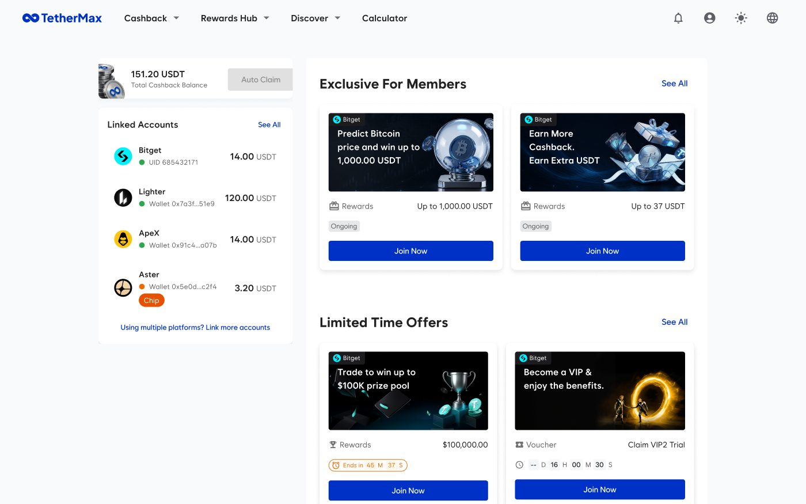
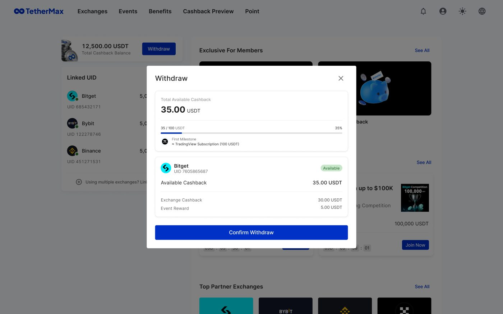
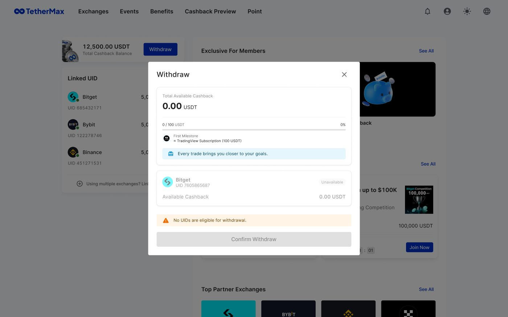
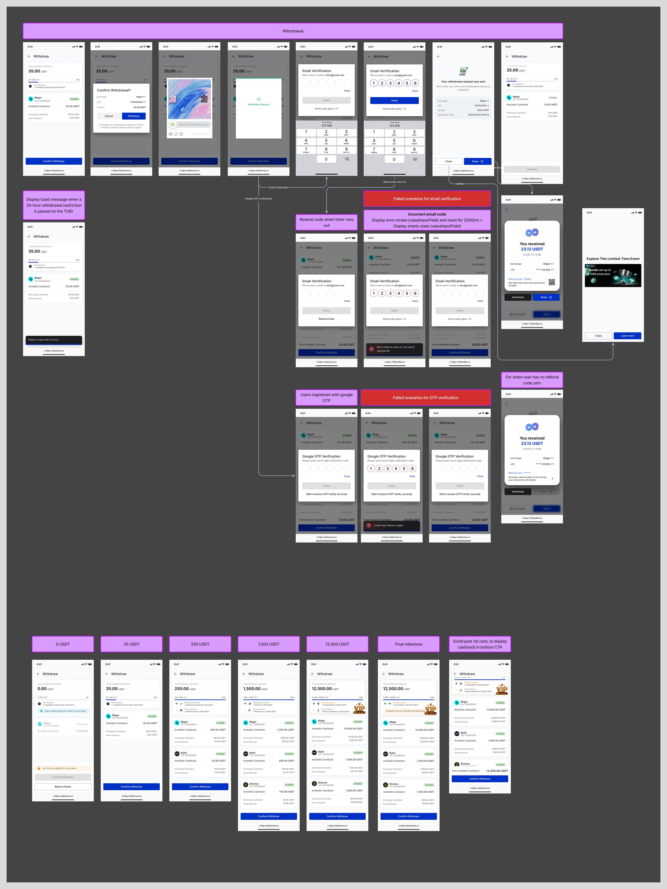
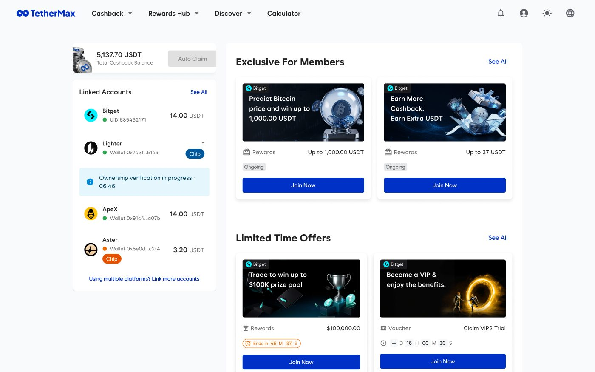
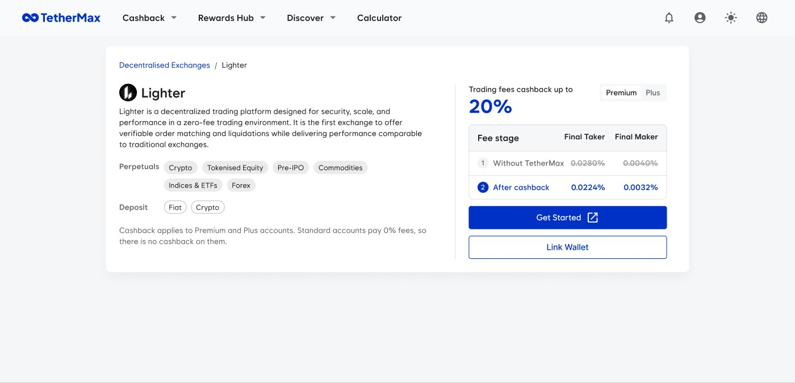
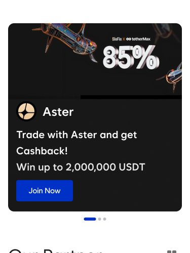
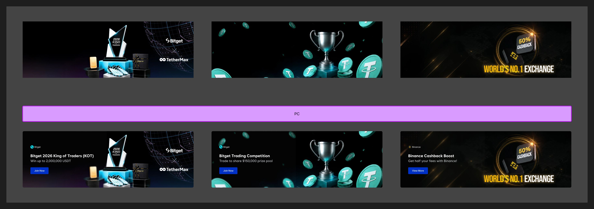
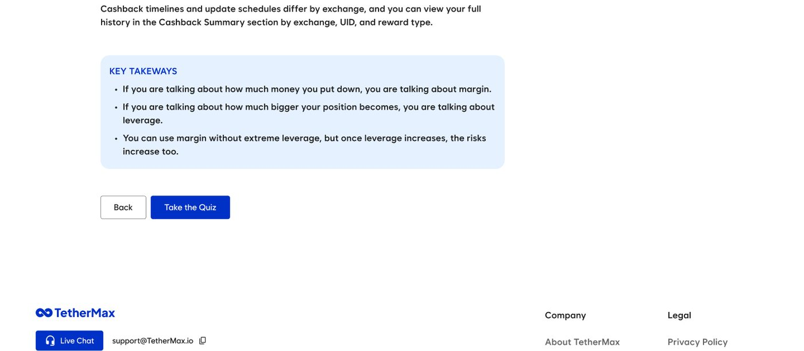
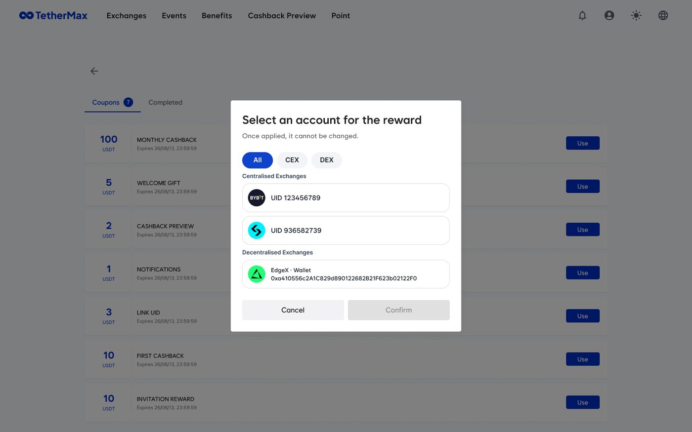

# Figma 수정 — 승인 요약

2026-11-26 · 대상 Figma `UI-UX-Design` [DEX(revision)](https://www.figma.com/design/hsa3bSV9QmFTe2jsf6tzTm/UI-UX-Design?node-id=28960-125519) · 원 계획서 [link](Figma수정계획_link.md) · [balance](Figma수정계획_balance.md) · [content](Figma수정계획_content.md) · [rewards](Figma수정계획_rewards.md) · 체크리스트 [1 연동·잔액](디자인_체크리스트점검_1_연동_잔액.md) · [2 콘텐츠·리워드](디자인_체크리스트점검_2_콘텐츠_리워드.md) · 기준 [결정 기록](_Figma수정_결정.md)(최우선) > [정책](../00_DEX_최종정책.md)(부록 G) > `02.기획문서/*`

**Figma는 아직 고치지 않았다.** 이 문서로 승인을 받은 뒤 수정한다. 노드 번호는 `https://www.figma.com/design/hsa3bSV9QmFTe2jsf6tzTm/UI-UX-Design?node-id={앞}-{뒤}`로 열린다.

## 요약

| 구분 | 수 | 답하는 법 |
|---|---|---|
| 승인 대상 | **139건** = 원 계획서 134건(우선 1: 29) + 2절 결론으로 생긴 추가 5건 | 「전부 승인」 또는 「제외: L-05, #12, CT-20 …」 |
| 스스로 정리한 것 | **12건**(근거 없음 9 · 체크리스트 우선 1의 3) + 계획서 항목 조정 9건 | 답 불필요 |
| 보류로 정리한 것 | **12건** — 미정 G·문구 원문 대기. 이번 수정에서 빼고 확정되면 반영 | 답 불필요 |
| 결정 필요 | **10건** — 권장 있음 7 · 권장 없음 3 | 「Q1 B, Q2 C, …」 또는 「G-448 B …」 |

근거 없음 34건(link 6 · balance 10 · content 9 · rewards 9)과 체크리스트 우선 1의 9건(연동·잔액 6 · 콘텐츠·리워드 3) = 43건의 배분: 스스로 정리 12 · 보류 12 · 디자인 없음 묶음(Q10) 12 · 개별 결정 7.

---

## 1. 승인 요약 — 계획 항목 139건

열 「근거 디자인」은 따라 할 기존 디자인(또는 같은 화면의 기준 프레임) 노드다. 「조정」 열의 ✏️는 2-2절에 따라 계획서 내용을 바꿔 수행, ⏸는 3절 결정에 따라 수행 여부가 갈리는 항목이다.

### 1-1. 연동 (link) — 28건 · 우선 1: 3

| # | 우선 | 화면 | 무엇을 | 근거 디자인 | 조정 | 원문 |
|---|---|---|---|---|---|---|
| L-01 | 1 | 연동 폼 L10 · 모바일 결과 | Lighter Standard 경고 박스·결과 프레임 숨김 | L3 28960:127279 | | [↗](Figma수정계획_link.md) |
| L-02 | 1 | 연동 성공 정산 카드 | Lighter `Weekly` → `Daily`, 모바일 형식을 PC와 같게 | L7 28960:127297 · MAXOP-751 25960:1342528 | | [↗](Figma수정계획_link.md) |
| L-03 | 1 | 주소 입력 | 결과 닫은 뒤·재로그인 뒤 입력 유지 프레임 + 퍼즐 실패 메모 | L3 · MAX-30 9105:196091 | | [↗](Figma수정계획_link.md) |
| L-04 | 2 | 결과 — 한도 초과 | 본문 교체, 버튼 `Contact Support` 하나 | 28969:127153 · MAX-30 13992:388676 | | [↗](Figma수정계획_link.md) |
| L-05 | 2 | 결과 — 확인 중 | 제목·본문 문구 | MAXOP-751 Info | | [↗](Figma수정계획_link.md) |
| L-06 | 2 | 결과 — 처리 중·확인 중 | 순서·이름 정리, 모바일 처리 중 추가 | MAXOP-751 · 28969:127080 | | [↗](Figma수정계획_link.md) |
| L-07 | 2 | 결과 — 연동 전 잔액 출금 대기 | 문구표(G-426) 확정 시 본문만 교체 | MAXOP-751 Info | | [↗](Figma수정계획_link.md) |
| L-08 | 2 | 주소 입력 가이드 | 보안 문구 통일 | 28969:126986 | | [↗](Figma수정계획_link.md) |
| L-09 | 2 | 주소 입력 | 인라인 오류 PC 1 · 모바일 5 | 28980:132242 · CMT-05 22934:77485 | | [↗](Figma수정계획_link.md) |
| L-10 | 2 | 거래소 선택기 | 파트너 목록 로드 실패 + `Retry` | S9 22442:219848 | | [↗](Figma수정계획_link.md) |
| L-11 | 2 | 연동 성공 | `Cashback shown from {date}` 줄 | L7 | | [↗](Figma수정계획_link.md) |
| L-12 | 2 | 홈 Linked Accounts | 확인 중·`Inactive` 행, `Chip` → `소유 확인중` | O11 28960:127709 · MAX-561 12792:2788 | | [↗](Figma수정계획_link.md) |
| L-13 | 2 | CEX UID 폼 | 제목 `Link Account` · `Sign up here` | 28969:126986 | | [↗](Figma수정계획_link.md) |
| L-14 | 2 | 소유권 업로드 | 경고 문구 | MAX-561 12773:343687 | | [↗](Figma수정계획_link.md) |
| L-15 | 2 | 소유권 업로드 | 심사 시간 문구 | MAX-561 12773:343687 · 12773:347156 | | [↗](Figma수정계획_link.md) |
| L-16 | 2 | 게스트 조회 | 지갑 주소 형식 오류 상태 | CMT-05 22934:77485 | | [↗](Figma수정계획_link.md) |
| L-17 | 2 | 게스트 결과 → 연동 | DEX 도착 폼 연결 · CEX 채운 폼 | L3 · 29227:120903 · 9105:196091 | | [↗](Figma수정계획_link.md) |
| L-18 | 2 | 모바일 연동 | 거래소 미선택 첫 화면 | S3-2 28960:127765 | | [↗](Figma수정계획_link.md) |
| L-19 | 2 | 소유권 | 신청 시 통합 한도 도달 | L15(L-04 반영본) | | [↗](Figma수정계획_link.md) |
| L-20 | 2 | 개발 인계 메모 | CEX 결과 화면 기준 2줄 | 29066:897 | | [↗](Figma수정계획_link.md) |
| L-21 | 3 | `Verification Success` | 모바일 `Close` → `Back to Home` | MAXOP-751 | | [↗](Figma수정계획_link.md) |
| L-22 | 3 | 모바일 홈 | 첫 연동 후 토스트·새 행 | S3-7 28960:127795 · MAX-30 9733:177641 | | [↗](Figma수정계획_link.md) |
| L-23 | 3 | 소유권 쿨다운 | 하단 링크 → `Close` | MAX-561 12783:405465 | | [↗](Figma수정계획_link.md) |
| L-24 | 3 | 모바일 소유권 | 업로드 실패 뒤 빈 카드·버튼 비활성 | O8 28960:127688 | | [↗](Figma수정계획_link.md) |
| L-25 | 3 | 모바일 소유권 | 제출 확인 뒤 제목·버튼 문구 | 28982:126103 | | [↗](Figma수정계획_link.md) |
| L-26 | 3 | 거래소 선택기 | PC 검색 결과 3변형 · 게스트 0건 | 29051:104597 · MAX-30 9105:194510 | | [↗](Figma수정계획_link.md) |
| L-27 | 3 | 게스트 10 USDT 미만 | 문구표(G-419) 확정 시 텍스트만 교체 | — | | [↗](Figma수정계획_link.md) |
| L-28 | 3 | 모바일 결과 | 프레임 이름 정정 | L13 28960:127331 | | [↗](Figma수정계획_link.md) |

### 1-2. 잔액·출금·홈·허브·요약·랭킹 (balance) — 40건 · 우선 1: 8

| # | 우선 | 화면 | 무엇을 | 근거 디자인 | 조정 | 원문 |
|---|---|---|---|---|---|---|
| #1 | 1 | 출금 화면 `/withdrawal-apply` | PC 모달·mWeb 페이지 정상 화면, 버튼 비활성 `Auto Claim` | MAX-18 12936:389796 · 8873:164829 | ✏️ ⑥ | [↗](Figma수정계획_balance.md) |
| #2 | 1 | 출금 화면 | 상태 6종 × PC·mWeb | 10500:94074 · S7 22442:219836 · S9 22442:219848 | ✏️ ② · ⏸ ① Q2 | [↗](Figma수정계획_balance.md) |
| #3 | 1 | 출금 화면 `/withdrawal` | 출금 가능 계정 없음 PC·mWeb | MAX-18 10498:41192 | ⏸ Q2 | [↗](Figma수정계획_balance.md) |
| #4 | 1 | 메모·FU-036 색인 | 「출금 화면 둔다」로 문구 정정 | 결정 2026-11-26 | | [↗](Figma수정계획_balance.md) |
| #5 | 1 | 허브 Lighter 패널 | 주중 추정치 줄 삭제 | H5 28960:126908 | | [↗](Figma수정계획_balance.md) |
| #6 | 1 | 허브 EdgeX 패널 | 금액 정의 일치·어드민 상태어 삭제 | H5 | | [↗](Figma수정계획_balance.md) |
| #7 | 1 | 홈·허브·지갑 상세·출금 | 자동 지급 선차감 상태 4프레임 | 17023:56436 · 10444:141294 | | [↗](Figma수정계획_balance.md) |
| #8 | 1 | 캐시백 요약 | `Withdrawal returned` 행 | MAX-601 12772:344799 | | [↗](Figma수정계획_balance.md) |
| #9 | 2 | 홈 총액 카드 | 로딩·실패·지연 | S7 · S9 · MAXOP-731 22913:1052131 | | [↗](Figma수정계획_balance.md) |
| #10 | 2 | 홈 Linked Accounts | 행 상태 칩·상태 7종·로딩·10개 초과 | MAX-561 12792:2788 | ✏️ | [↗](Figma수정계획_balance.md) |
| #11 | 2 | 모바일 홈 | DEX 행 · `Auto Claim` · `Linked Accounts` | S4 mWeb 4060:25384 | | [↗](Figma수정계획_balance.md) |
| #12 | 2 | 모바일 지갑 상세 | 기존 mWeb UID 상세 기준 새 프레임 | 8582:167558 · U3 mWeb 25867:1351184 | ✏️ | [↗](Figma수정계획_balance.md) |
| #13 | 2 | 지갑 상세 PW1 | 리뷰 버튼 문구 · `Total Claimed` 행 | U3 25867:1349190 · 17023:56436 | ✏️ | [↗](Figma수정계획_balance.md) |
| #14 | 2 | 지갑 상세 | 지연·로딩·실패·리뷰 작성 후 | S7 · S9 · 17023:56436 | ✏️ | [↗](Figma수정계획_balance.md) |
| #15 | 2 | 지갑 상세·허브 | 부족분 문구 확정 원문으로 | REQ-130 STG 문구 | ✏️ | [↗](Figma수정계획_balance.md) |
| #16 | 2 | 허브 DEX 패널 | 줄 구성 · 미만·일부·로딩 상태 | H4 28960:126902 · 17023:56436 | ✏️ | [↗](Figma수정계획_balance.md) |
| #17 | 2 | 허브 계산기 | 절삭값 · 요율 실패 | S9 | | [↗](Figma수정계획_balance.md) |
| #18 | 2 | 허브 비교표 | 빈 검색 | MAX-30 9105:194510 · 6322:66795 | | [↗](Figma수정계획_balance.md) |
| #19 | 2 | 공개 출금 피드 | 로딩·오류·모바일 | 19224:4458 · S7 · S9 | | [↗](Figma수정계획_balance.md) |
| #20 | 2 | 허브·지갑·피드·요약 | 시각 형식 하나로 | — | | [↗](Figma수정계획_balance.md) |
| #21 | 2 | 캐시백 요약 | `Withdrawn` · `Claim Amount` · 지연 · 로딩 | MAXOP-732 27624:27307 | | [↗](Figma수정계획_balance.md) |
| #22 | 2 | 모바일 요약 | 월간 카드·계정 시트·유형값·빈 달/날 | 25886:1340772 · 12772:306034 · 27200:24437 · 13762:174885 | | [↗](Figma수정계획_balance.md) |
| #23 | 2 | 캐시백 랭킹 | 안내 캡션 2종 | 13060:149480 | | [↗](Figma수정계획_balance.md) |
| #24 | 2 | 홈 FAQ 색인 | FU-044 줄 정정 | 17000:86187 | | [↗](Figma수정계획_balance.md) |
| #25 | 2 | 홈 | 누적 캐시백 블록 | MAXOP-731 22913:1052131 | | [↗](Figma수정계획_balance.md) |
| #26 | 2 | 허브·출금 카드 | `DEX data pending` 라벨 | CS1 28960:127133 · 10444:141294 | ✏️ | [↗](Figma수정계획_balance.md) |
| #27 | 2 | 허브·피드 | `payout`·`rebates` 용어 | — | ✏️ | [↗](Figma수정계획_balance.md) |
| #28 | 2 | 랜딩 다크 | 3단계 문구 라이트와 통일 | LL 28960:128375 | | [↗](Figma수정계획_balance.md) |
| #29 | 2 | 홈·요약 | 예시 금액 정합 | — | | [↗](Figma수정계획_balance.md) |
| #30 | 3 | 홈 S3 · 랭킹 | `0 USDT` → `0.00 USDT` | — | | [↗](Figma수정계획_balance.md) |
| #31 | 3 | 모바일 요약 행 | 부호·소수 둘째 자리 | CS1 | | [↗](Figma수정계획_balance.md) |
| #32 | 3 | 요약 CS4 | `Net` 값 | MAXOP-732 | | [↗](Figma수정계획_balance.md) |
| #33 | 3 | 요약 필터·목록 | `All Types` · DEX 주소 팝오버 | RKpop 28984:126304 | | [↗](Figma수정계획_balance.md) |
| #34 | 3 | 요약 필터 | `All DEX exchanges` 트리거 | CS6dex 29190:127498 | | [↗](Figma수정계획_balance.md) |
| #35 | 3 | 모바일 허브 | 슬라이더·파트너 수 값 | H1-CEX 28960:126944 · H3 | | [↗](Figma수정계획_balance.md) |
| #36 | 3 | 허브 H2 | `Minimum 10 USDT` 줄 | H5 | | [↗](Figma수정계획_balance.md) |
| #37 | 3 | 허브 | Aster 패널 | H5 | | [↗](Figma수정계획_balance.md) |
| #38 | 3 | 프리로그인 랜딩 | DEX 선택 Featured 모듈 | Renewal 랜딩(현행판 A3) | | [↗](Figma수정계획_balance.md) |
| #39 | 3 | 공개 피드 | 제목·부제·열 통일 | 기존 피드 | | [↗](Figma수정계획_balance.md) |
| #40 | 3 | 랭킹·지갑 상세 | 랭킹 로딩·모바일 팝오버·복사 토스트 | S7 · RKpop · 8582:167558 | | [↗](Figma수정계획_balance.md) |

### 1-3. 콘텐츠 (content) — 33건 · 우선 1: 11

| # | 우선 | 화면 | 무엇을 | 근거 디자인 | 조정 | 원문 |
|---|---|---|---|---|---|---|
| CT-01 | 1 | 웹 GNB | 단독 `Calculator` 삭제, `Cashback ▾` 2행 패널 | 19604:32651 | | [↗](Figma수정계획_content.md) |
| CT-02 | 1 | DEX 랜딩 히어로 | 리드 문구(G-154) | 현 히어로 | | [↗](Figma수정계획_content.md) |
| CT-03 | 1 | DEX 랜딩 비교 | 제목·출금 행·리워드 행 문구 | 같은 섹션 CEX 패널 | | [↗](Figma수정계획_content.md) |
| CT-04 | 1 | DEX 랜딩 glance | TVL · 24H Vol 칸 | venue 카드 | | [↗](Figma수정계획_content.md) |
| CT-05 | 1 | 랜딩 카드 ↔ 상세 | 값 일치·노출 순서 하나로 | 상세 오퍼 박스 | | [↗](Figma수정계획_content.md) |
| CT-06 | 1 | Aster 상세 | Solana 삭제 | 현 레이아웃 | | [↗](Figma수정계획_content.md) |
| CT-07 | 1 | AI 리뷰 요약 | 「DEX 계정으로 들어간다」 문장 교체 | Lighter 28960:127443 | | [↗](Figma수정계획_content.md) |
| CT-08 | 1 | 상세 계산기 PC | 3칸 값·라벨 | MAX 1216 22442:219830 | | [↗](Figma수정계획_content.md) |
| CT-09 | 1 | 단계 가이드 | 제목·경고 박스·Step 3 본문·미디어 비율 | 같은 가이드 | | [↗](Figma수정계획_content.md) |
| CT-10 | 1 | 리뷰 작성 게이트 | DEX판 게이트 | MAX 1216 22919:73859 | | [↗](Figma수정계획_content.md) |
| CT-11 | 1 | /payback DEX 결과 | 평균 카드 삭제 · PC 결과 프레임 | MAX-146 6922:77328 | | [↗](Figma수정계획_content.md) |
| CT-12 | 2 | 상세 오퍼 박스 | 연동 불가 · 탭 1개 · Plus 선택 | 같은 오퍼 박스 | ⏸ ① Q5 | [↗](Figma수정계획_content.md) |
| CT-13 | 2 | DEX 랜딩 | 노출 0곳 · 3곳 | 같은 랜딩 | | [↗](Figma수정계획_content.md) |
| CT-14 | 2 | 랜딩·/payback·서비스 소개 | 목록 조회 실패 영역 오류 | MAX 1216 22954:81674 | | [↗](Figma수정계획_content.md) |
| CT-15 | 2 | DEX 랜딩 | DefiLlama 증감·24시간 경과 | venue 카드 | | [↗](Figma수정계획_content.md) |
| CT-16 | 2 | DEX 랜딩 모바일 | 1열 카드 / 리스트 구분 | PC 카드 · 28960:125536 | | [↗](Figma수정계획_content.md) |
| CT-17 | 2 | 랜딩 리스트 PC | 버튼 `View {DEX}` | 현 행 | | [↗](Figma수정계획_content.md) |
| CT-18 | 2 | 상세 히어로 | 이름 옆 `DEX` 알약 칩 | CEX 상세 22442:219830 | | [↗](Figma수정계획_content.md) |
| CT-19 | 2 | 상세 계산기 모바일 | PC 구성으로 | PC 28960:127443 | | [↗](Figma수정계획_content.md) |
| CT-20 | 2 | 리뷰 | 게스트 안내·축 이름·태그 | 모바일 리뷰 블록 | | [↗](Figma수정계획_content.md) |
| CT-21 | 2 | 리뷰 | 0건 DEX판 | 22442:219830 · 22956:84690 | | [↗](Figma수정계획_content.md) |
| CT-22 | 2 | 모바일 상세 | 다른 DEX에 Lighter 리뷰 노출 정정 | 같은 리뷰 컴포넌트 | | [↗](Figma수정계획_content.md) |
| CT-23 | 2 | /payback | EdgeX 각주 · Lighter 타일(`Daily`) | PB-3 DEX 타일 | | [↗](Figma수정계획_content.md) |
| CT-24 | 2 | /payback | Landing · Trading profile PC · 계산 근거 펼침 | MAX-146 6510:88151 · 6510:88401 · 5123:32498 | | [↗](Figma수정계획_content.md) |
| CT-25 | 2 | Exchange Listings | `Rating` 열 판 + 새 GNB | CMT-08 22799:96486 | | [↗](Figma수정계획_content.md) |
| CT-26 | 2 | 프리로그인 랜딩 | 헤더 우측 게스트 | 28960:125521 헤더 | | [↗](Figma수정계획_content.md) |
| CT-27 | 2 | 앱 사용자 메뉴 | Cashback 진입 행 | mAPP 10981:111021 | | [↗](Figma수정계획_content.md) |
| CT-28 | 3 | 단계 가이드 | Step 2 · 3단계 · 영상 실패 | 같은 가이드 | | [↗](Figma수정계획_content.md) |
| CT-29 | 3 | FAQ | `Withdrawals & Account Management` · 동시 펼침 | 같은 아코디언 | | [↗](Figma수정계획_content.md) |
| CT-30 | 3 | 상세 탭 바 | 스크롤 고정 · 다른 탭 활성 | 같은 탭 바 | | [↗](Figma수정계획_content.md) |
| CT-31 | 3 | 랜딩 넘침 | `XX%` 자리표시 → 표본 요율 | 같은 카드 | | [↗](Figma수정계획_content.md) |
| CT-32 | 3 | /payback Summary | PC 헤더 · 모바일 `Restart` · 예시값 | PC Summary | | [↗](Figma수정계획_content.md) |
| CT-33 | 3 | 서비스 소개·프리로그인 모바일 | DEX판 | 19224:4458 · 20932:96981 | | [↗](Figma수정계획_content.md) |

### 1-4. 리워드 (rewards) — 33건 · 우선 1: 7

| # | 우선 | 화면 | 무엇을 | 근거 디자인 | 조정 | 원문 |
|---|---|---|---|---|---|---|
| R-01 | 1 | 맥스보드 | 계정 문구 `Account` 통일 | Bingo 28537:448894 · 449250 · 444666 · 448183 | | [↗](Figma수정계획_rewards.md) |
| R-02 | 1 | 혜택 · 첫 캐시백 상세 | CTA 비활성 + Claim 계열, `CEX and DEX` 행 | MAX-468 10978:69402 · 9622:112561 | | [↗](Figma수정계획_rewards.md) |
| R-03 | 1 | 친구 초대 모바일 | 비활성 `Auto Claim` · 표 제목·행 | PC IF7 28967:127210 | | [↗](Figma수정계획_rewards.md) |
| R-04 | 1 | 초대·파트너 허브 약관 | `50` → `10 USDT`(D8) | 같은 프레임 | | [↗](Figma수정계획_rewards.md) |
| R-05 | 1 | 파트너 허브 모바일 | 비활성 `Auto Claim` · 퍼널 · 캡션 | PC PH1 28960:127182 | | [↗](Figma수정계획_rewards.md) |
| R-06 | 1 | Cashback Basics 아티클 | 본문 교체 + KEY TAKEAWAYS | 19604:32207 · 19604:31955 | ⏸ Q8 | [↗](Figma수정계획_rewards.md) |
| R-07 | 1 | EMAIL 29 EN | 「종료일 전에 출금」 문장 삭제 | KO 29062:118802 | | [↗](Figma수정계획_rewards.md) |
| R-08 | 2 | 맥스보드 | `Updated once a day` 노출 정리 | Bingo 28537:450393 | | [↗](Figma수정계획_rewards.md) |
| R-09 | 2 | 맥스보드 | 계정 선택·등록 확인·재선택 모달(시안 B) | Bingo 28537:463009 · 462948 | | [↗](Figma수정계획_rewards.md) |
| R-10 | 2 | 맥스보드 | 게스트·미참여 5단계 10프레임 | Bingo 28537:444420 외 | | [↗](Figma수정계획_rewards.md) |
| R-11 | 2 | 맥스보드 | 등록 실패 토스트 | Bingo 28537:451987 | | [↗](Figma수정계획_rewards.md) |
| R-12 | 2 | 맥스보드 | `Ends Today` | Bingo 28537:451942 | | [↗](Figma수정계획_rewards.md) |
| R-13 | 2 | 맥스보드 | 마지막 날 Batch 후 완성 | Bingo 28537:450028 | | [↗](Figma수정계획_rewards.md) |
| R-14 | 2 | 쿠폰 적용 완료 | PC `Total Amount` · 모바일 화면 | 25994:12167 | | [↗](Figma수정계획_rewards.md) |
| R-15 | 2 | 쿠폰함 Completed | 약관 2문장(문구 원문 대기) | 같은 프레임 | | [↗](Figma수정계획_rewards.md) |
| R-16 | 2 | 쿠폰 | 연동 계정 없음 · 이미 사용 | 12474:164021 | | [↗](Figma수정계획_rewards.md) |
| R-17 | 2 | 혜택 목록(회원) | `LINK UID` 행 부제 | 10954:228708 · 17170:172813 | | [↗](Figma수정계획_rewards.md) |
| R-18 | 2 | 혜택 | 완료 0건 | 10954:230325 · 11100:221304 | | [↗](Figma수정계획_rewards.md) |
| R-19 | 2 | 혜택 상세 | UID 연동 3 USDT(CEX 전용) | 10976:53104 · 11731:356403 | | [↗](Figma수정계획_rewards.md) |
| R-20 | 2 | 캐시백 챌린지 | 진행·수령 계정 선택·미연동(Account) | 10981:85015 · 85017 · 85016 · 29062:117713 | | [↗](Figma수정계획_rewards.md) |
| R-21 | 2 | 퀴즈 모듈 4·5 | 모바일 전 상태 20프레임 | Quiz mWeb 19604:32020 · 19604:32311 | | [↗](Figma수정계획_rewards.md) |
| R-22 | 2 | 퀴즈 모듈 5 | `rebate` → `cashback` | — | | [↗](Figma수정계획_rewards.md) |
| R-23 | 2 | 파트너 허브 PC | 하위 회원 모달 그룹 헤더 | 29062:117713 | | [↗](Figma수정계획_rewards.md) |
| R-24 | 2 | 친구 초대 랜딩 | `How it works` 3단계 구절(G-198) | IF1 | | [↗](Figma수정계획_rewards.md) |
| R-25 | 2 | 친구 초대 | 10 USDT 미만 안내 | 5654:105991 | | [↗](Figma수정계획_rewards.md) |
| R-26 | 2 | EMAIL 31 | 연동 전 잔액 출금 실패 변형(문구표 대기) | 29061:1106 · 29062:118600 | | [↗](Figma수정계획_rewards.md) |
| R-27 | 3 | 맥스보드 | 등수별 리워드 팝업 + 서수 오타 | Bingo 28537:463082 · 463143 | | [↗](Figma수정계획_rewards.md) |
| R-28 | 3 | 맥스보드 | 결과 발표·제외 프레임 숨김 | — | | [↗](Figma수정계획_rewards.md) |
| R-29 | 3 | 쿠폰함 | 빈 화면 배지 `0` | 11982:388195 · 11982:387214 | | [↗](Figma수정계획_rewards.md) |
| R-30 | 3 | 이벤트 | 거래소 필터 0건 | 11366:318672 · 9733:148686 | | [↗](Figma수정계획_rewards.md) |
| R-31 | 3 | 퀴즈 모듈 4 | 같은 보기 문구 통일 | 28978:127406 외 | | [↗](Figma수정계획_rewards.md) |
| R-32 | 3 | TP FAQ | `payback` → `cashback` | — | | [↗](Figma수정계획_rewards.md) |
| R-33 | 3 | 리그 상금 수령 PC | 배경 GNB 교체 | 29183:117206 | | [↗](Figma수정계획_rewards.md) |

### 1-5. 2절 결론으로 생긴 추가 항목 — 5건

| # | 화면 | 무엇을 | 근거 디자인 | 근거 번호 |
|---|---|---|---|---|
| 추가-1 | CEX UID 상세 | 기존 U3 복제 → `Withdraw` → 비활성 `Auto Claim`, Cashback Milestone 블록 삭제 | U3 25867:1349190 · PW1 28960:125943 버튼 | REQ-133 · 결정 A-18 · A6 |
| 추가-2 | 캐시백 랭킹 패널 | RK1·RK2·RK3·RK DEX 프레임의 배경을 홈에서 혜택 화면으로 교체(패널은 그대로) | 혜택 PC 29062:113000 · 기존 패널 13074:242317 | D6 · REQ-379 · REQ-383 |
| 추가-3 | 푸터 | `Terms of Service` → `Terms of Use`(DEX(revision) 인스턴스 오버라이드만, 기존 푸터 메인은 손대지 않음) | 드로어 19604:33156 | REQ-474 |
| 추가-4 | Lighter 표기 전체 | Figma에 남은 Lighter `Weekly`·월요일·주간 정산 표기를 다른 DEX와 같은 일일 문구로(계획 항목에 없는 레이어만) | 같은 프레임의 다른 DEX 표기 | G-428 |
| 추가-5 | 공개 출금 피드 | DEX 행 거래소 이름 옆 `DEX` 알약 칩 | CT-18과 같은 칩(22442:219830) | REQ-031 · REQ-285 |

---

## 2. 스스로 정리한 것 (답 불필요)

### 2-1. 근거 없음 · 체크리스트 우선 1 중 결론이 나는 것 — 12건

| 출처 | 항목 | 결론 | 근거 |
|---|---|---|---|
| link 근거 없음 #34 | L2 Lighter 가이드 대체 스크린샷 | Figma에서 만들지 않는다. 가이드 이미지는 운영 콘텐츠(기존 `UID 찾기` 단계 편집기에서 단계마다 모바일·PC 이미지 등록) | G-443 |
| balance U2 | 홈 행 상태 점 텍스트 병기 | 텍스트 병기는 #10의 상태 칩(텍스트)으로 충족. 점만 있는 행은 두지 않는다 | REQ-271 · 정책 B-3-2 |
| balance U3 | 공개 피드 `DEX` 배지 | CT-18 알약 칩을 그대로 쓴다(추가-5) | REQ-031 · REQ-285 · CT-18 |
| balance U4 | 지갑 상세 헤더 칩 | DEX 전용 완료 라벨을 만들지 않고 기존 CEX UID 상세 칩 인스턴스(같은 문자열)를 쓴다. 국문 `연동 완료` | REQ-008 · REQ-273 · 정책 B-3-4 |
| balance U7 | 모바일 빈 홈 카드 | 넣는다. 문구 `Link once and cashbacks keep coming` + `Link Account`(단·복수 표기만 사용자 확인 #48) | REQ-267 · 정책 B-3-1 |
| balance U8 | Lighter 전용 문구(월요일 정산 배너 · `Every Monday` · $1 미만 · `Withheld by Lighter`) | Lighter도 일 1회 원장 — 다른 DEX와 같은 문구(`Cashback appears here the day after you trade on your linked DEX.` · `Daily, {로컬 시각}`). $1 미만·`Withheld` 문구는 쓰지 않는다. REQ-137·G-110의 Lighter 월요일 문구보다 정책 G-428이 우선 | G-428 · 이어받기 dex-10 |
| balance U9 | 명세 원문 안의 동작어 `withdraw`·`payout` | 출금 요청·동작은 `Claim` 계열로 다시 쓴다. 새 문구는 문구표에서 확정 — Figma에는 지금 명세 원문을 표본으로 넣고 레이어에 `G-419 문구표` 표시, 확정되면 텍스트만 교체. 실적·결과(`Withdrawn` 등)는 그대로 | G-418 · G-419 · 용어 규칙 |
| content U8 | 푸터 `Terms of Service` ↔ 드로어 `Terms of Use` | `Terms of Use`로 통일(추가-3) | REQ-474(확정 원문) |
| content U9 | TP 페이지 `exchange UID linked to …` | 교체는 확정. 레이어 위치는 수정 작업 중 TP 프레임(29062:114041 · 29062:114572)에서 찾아 같은 항목(R-32)과 함께 처리 | REQ-715 · G-424 |
| 체크리스트 1 D8 | CEX UID 상세의 활성 `Withdraw` · 마일스톤 | 모든 출금 버튼은 비활성 `Auto Claim`, 마일스톤은 없어진 기능, UID 상세는 기존 디자인 — 추가-1로 반영. G-452의 나머지(D3·D4·D7)는 열린 채 둔다 | REQ-133 · 결정 A-18 · A6 · N16·N17·N19 |
| 체크리스트 1 R1 | 랭킹 패널 진입 위치 | 혜택 화면의 기존 `My Cashback Ranking` 사이드 패널. Figma 「홈 위 패널」은 이 위치로 고친다(추가-2). `/mypage/rank` 경로 처리는 G-453(문서 담당) | 결정 D6 「현행 유지」 · REQ-379 · REQ-383 |
| 체크리스트 2 리그 | 보상 수령 계정 선택 화면 | 선택 화면 없음. 리그 보상은 참가 계정으로 지급 — 참가 지갑 선택(29183:118178)만 둔다 | G-187 · REQ-391 |

### 2-2. 계획서 항목 조정 — 결정·확정 명세로 내용이 바뀌는 것 9건

| 항목 | 조정 | 근거 |
|---|---|---|
| balance #1 ⑥ · #2 ② | DEX 카드 `Cashback updates`·0원 안내에서 Lighter도 `Daily, {로컬 시각}` · 일 정산 문구(「U8 확인」 표시 삭제) | G-428 |
| balance #10 | 행 상태는 텍스트 칩으로(점 단독 없음) | REQ-271 |
| balance #12 | `Weekly Cashback History` 띠를 넣지 않는다. 하단 `Top Partner DEXs` → 기존 `Top Partner Exchanges`(CEX·DEX 공통, 각 `Up to {rate}% cashback`) | REQ-278 · 정책 B-3-4 · 결정 기록 「지갑 상세 하단」 |
| balance #13 | 헤더 칩 = 기존 CEX UID 상세 칩 인스턴스 | REQ-008 |
| balance #14 | 로딩 스켈레톤에서 「띠」 제외(띠 없음) | REQ-278 |
| balance #26 | 지갑 상세 `Weekly Cashback History` 칸 라벨(`Wallet detail / Data pending` 프레임) 빼고, 허브 H6 · 출금 카드 표본만 | REQ-278 |
| balance #15 · #16 · #27 | 각주·`Withdrawable`·라우트 행의 `withdraw`/`payout` 문구는 명세 원문 표본 + `G-419 문구표` 표시 | G-418 · G-419 |
| 전 영역 | 출금 확인 다이얼로그·출금 팝업·24시간 토스트는 어떤 프레임에도 넣지 않는다 | 결정 B6 · REQ-133 |
| 전 영역 | CEX·DEX 공통 문맥 = `Account`, 출금 요청·동작 = `Claim`, 실적·결과 = `Withdraw`/`Withdrawn` | 결정 용어 규칙 · D2 · N5 · N10 · G-418 |

### 2-3. 보류로 정리한 것 — 12건 (이번 수정에서 제외, 확정되면 반영)

| 출처 | 항목 | 기다리는 것 |
|---|---|---|
| link #10 | 캡차 스크립트 로드 실패 인라인 오류 | ❓ G-098 · 문구 원문 |
| link #35 | `Paste` 권한 거부 힌트 | ❓ G-351 |
| balance U5 | 지갑 상세 404 · 요약 180일 이전 달 · 계정 필터 빈 상태 · 지급 네트워크 미설정 · 피드 빈 상태 · 비교표·요약·랭킹 조회 실패 문구 | 명세 처리·문구(G-454 · G-459 · G-477) |
| balance U6 | 요약 쿠폰 사용 행 유형명 | 문구 원문(REQ-371) |
| balance U10 | 허브 — 연동 없는 파트너 선택 시 계산기 복귀 | ❓ G-149 |
| content U5 | 프리로그인 `Hero Exchange` DEX 선택 상태 | ❓ G-466 |
| content U6 | 앱 DEX 외부 링크 실패 다이얼로그 | ❓ G-216 |
| content U7 | 상세 약관 서랍 펼침 본문 | ❓ G-369 |
| rewards X-2 | 맥스보드 `PHASE_NOT_PARTICIPATION` · `CONCURRENT_REQUEST` 안내 | 문구 원문(토스트 틀 28537:451987은 있음) |
| rewards X-7 | 429 · 멱등 키 재사용 · 잘못된 범위 값 | G-459(정상 UI에서 도달하지 않는 것 포함) |
| rewards X-8 | 파트너 허브 403(파트너 아님) | 명세(메뉴 미노출로 도달하지 않는지) |
| rewards X-9 | 초대 등록 현황 친구 0 연동 | ❓ G-200(권고: 헤더만, 행 없음) |

---

## 3. 결정이 필요한 것 — 10건

체크리스트 기반 질문은 부록 G 번호를 붙였다. G 번호로 답하면 문서 담당이 부록 G를 닫는다.

### Q1. 출금 화면에 들어오는 길 — G-448 (체크리스트 W1)

모든 출금 버튼이 비활성 `Auto Claim`이라 `/withdrawal-apply`(balance #1)로 들어오는 요소가 없다.




| 선택 | 내용 |
|---|---|
| A | 홈 `Total Cashback Balance` 카드(금액 영역)를 누르면 출금 화면 |
| B | 홈 `Linked Accounts` `See All`을 누르면 출금 화면(Q3 A와 같은 답) |
| C | 화면 요소로는 들어오지 않음(알림·직접 URL만) |
| **권장 B** | 새 요소 없이 이미 있는 `See All`의 목적지가 생긴다. 출금 화면은 CEX·DEX 계정 카드 전체 한 목록(10개 + `더보기`)으로 `Linked Accounts`(10개 + `더보기`)의 「전체 보기」와 같은 단위다. 형태는 결정 2026-11-26 「기존 출금 모달 디자인 기준」대로 웹 = 홈 위 모달, mWeb = 페이지, 직접 URL 진입 시 배경은 홈 |

근거: REQ-133 · REQ-134 · REQ-271 · 결정 2026-11-26 · MAX-18 8970:173588 · 8873:164829

### Q2. 출금 가능 계정이 0일 때 두 출금 화면의 관계 — G-449 (체크리스트 W3)

`/withdrawal-apply` 「전부 불가」(REQ-139, balance #2 ①)와 `/withdrawal`(REQ-710, balance #3)이 같은 조건을 다르게 그린다.




| 선택 | 내용 | Figma 영향 |
|---|---|---|
| A | `/withdrawal-apply` 안에서 「전부 불가」만 보인다. `/withdrawal`은 쓰지 않음 | #2 ① 진행 · #3 제외(−2) |
| B | 자격 0이면 `/withdrawal`로 보낸다. `/withdrawal-apply` 「전부 불가」 상태는 없음 | #2 ① 제외(−2) · #3 진행 |
| C | 기존 디자인 배치대로 — 웹은 모달 안 「전부 불가」(10500:94074), mWeb은 `/withdrawal` 페이지(10498:41192) | #2 ① PC만 · #3 mWeb만 |
| **권장 없음** | STG에서 두 화면이 어떤 조건으로 갈리는지 확인되지 않았다. 기존 디자인은 C처럼 플랫폼별로 나뉘어 있다 | |

근거: REQ-139 · REQ-710 · 정책 S-14

### Q3. 홈 `Linked Accounts` `See All`의 목적지 — G-451 (체크리스트 H1)


| 선택 | 내용 |
|---|---|
| A | 출금 화면 `/withdrawal-apply`(Q1 B와 같은 답) |
| B | 새 화면 없이 홈 패널을 펼쳐 전체 행 표시 |
| C | `See All` 삭제 |
| **권장 A** | 전체 계정 목록을 보이는 기존 화면은 출금 화면뿐이고, 새 화면을 그리지 않는다. REQ-271의 `See All`을 지우는 C는 확정 원문과 다르다 |

### Q4. 홈 상태별 행을 눌렀을 때 — G-451 (체크리스트 H2)

`연동 시도중이에요` · `소유 확인중` · `연동 실패` · `소유 확인 실패` 행(해제 행은 O14 모달로 정해짐).




| 선택 | 내용 |
|---|---|
| A | 모든 행 → 지갑 상세(상태 칩 · 금액 `-` · 비활성 `Auto Claim`) — 연동 완료가 아닌 지갑의 상세 프레임 새로 필요(G-452 D7) |
| B | `연동 완료` 행만 상세로 간다. 그 밖의 상태 행은 누를 수 없고 행 안 칩·안내로만 알린다 |
| **권장 B** | REQ-271 행 선택 규칙은 연동 완료 계정(CEX → 계정 페이지, DEX → 지갑 페이지) 기준이고, 연동이 끝나지 않은 계정은 없는 셈(P8)이다. 기존 MAX-561 행도 진행 안내를 행 안에 둔다. 비완료 지갑 상세를 새로 그리지 않아도 된다 |

### Q5. DEX 상세 오퍼 박스의 점검·연동 불가 값 — G-460 (체크리스트 2 우선 1)

API-004에 `status`가 없어 상세에서 G-162(`Link Wallet` 숨김, `Get Started` 유지)를 판단할 수 없다. CT-12 ① `연동 불가` 프레임이 이 값을 전제로 한다.



| 선택 | 내용 |
|---|---|
| A | API-004에 API-003과 같은 `status`(`AVAILABLE` / `MAINTENANCE` / `LINK_UNAVAILABLE`)를 넣는다. `LINK_UNAVAILABLE`·`MAINTENANCE` 모두 `Link Wallet` 숨김 · `Get Started` 유지(CT-12 ① 프레임 하나로). 점검 표시 배지는 Q10 묶음 6 |
| B | 상세에는 상태를 두지 않는다. 연동 시도 후 결과 화면에서만 막힌다 |
| **권장 A** | G-162가 「카드·상세 노출, 연동 진입만 숨김」으로 확정돼 있어 상세가 그 값을 알아야 한다 |

### Q6. 확인 중 지갑만 있는 회원의 DEX 상세 오퍼 박스 — G-460 (체크리스트 2 우선 1)

이 DEX 지갑이 `manual_link_pending`(`연동 시도중이에요`)뿐인 회원.

| 선택 | 내용 |
|---|---|
| A | `exchange_member_unlinked`로 본다 — 버튼 `Link Wallet`, 리뷰 게이트도 미연동과 같음(CT-10) |
| B | 연동 버튼 자리에 확인 중 상태 표시(비활성) — 새 오퍼 박스 상태 프레임 필요 |
| **권장 A** | 연동이 끝나지 않은 계정은 없는 셈(정책 P8 · 5-5 확정)이고, 맥스보드 자격(D-1-5)·리뷰 자격도 같은 기준이다. 같은 지갑을 다시 넣었을 때 결과는 G-456(체크리스트 L13)에서 정한다 |

### Q7. DEX 프로모 배너가 「거래소 목록 상단 배너」를 공유하는 문제 — G-463 (결정 D7)

D7로 DEX 개요 배너 관리는 기존 어드민 「거래소 목록 상단 배너」 모달을 그대로 쓴다. 그 모달 항목은 CEX 거래소 목록 상단에도 뜨므로, 등록한 슬라이드가 두 화면에 모두 나온다.




| 선택 | 내용 |
|---|---|
| A | 공유 그대로 — 같은 슬라이드가 Listings 상단과 DEX 개요 모두에 노출(운영자가 양쪽에 맞는 슬라이드만 등록) |
| B | 기존 모달 항목에 노출 위치(`거래소 목록` / `DEX 개요` / 둘 다) 선택값 하나 추가 |
| **권장 없음** | A는 G-156 「그대로 쓴다」에 맞지만 DEX 전용 슬라이드를 CEX 목록에서 숨길 수 없다. B는 어드민 모달 변경이 생긴다 |

### Q8. KEY TAKEAWAYS 초안 3줄 승인 — 결정 N12 (rewards R-06)



R-06 초안 그대로:

| # | EN 초안 | 뜻(KO) |
|---|---|---|
| 1 | **Cashback is tracked per account.** Each linked exchange UID or DEX wallet has its own balance, and event rewards can be paid out only up to the cashback earned on the same account. | 캐시백은 계정별로 쌓인다. 이벤트 리워드는 같은 계정의 캐시백만큼만 함께 지급(매칭 `A + MIN(B, A)`) |
| 2 | **Payouts are automatic.** When an account's claimable amount reaches 10 USDT, TetherMax sends it to that account. You don't need to press Claim. | 계정별 출금 가능액 10 USDT 이상이면 자동 지급, 버튼 없음 |
| 3 | **Anyone can check, members get paid.** Guests can look up cashback with an exchange and a UID or wallet address, but you need to sign up and link the account to receive it. | 게스트는 조회만, 지급은 가입·연동 후 |

| 선택 | 내용 |
|---|---|
| A | 초안 그대로 넣는다 |
| B | 초안을 넣되 1의 `paid out`, 2의 `Payouts`는 문구표(G-419)에서 Claim 계열로 다듬는다 — Figma에는 초안 표본 + `G-419 문구표` 표시 |
| **권장 B** | 구조(정확히 3개, 짧은 주장 + 상세 1~2문장 — 정책 B-17)와 내용(정책 6-1 · 6-5 · 매칭 공식)은 맞다. 다만 balance #27 · #28에서 같은 이유로 `payout(s)`를 쓰지 않기로 했다(G-418) |

### Q9. 쿠폰 계정 선택 — 고를 계정이 1개일 때 (rewards X-5)



| 선택 | 내용 |
|---|---|
| A | 목록 그대로(1행, 직접 선택 후 적용) — 새 프레임 없음 |
| B | 자동 선택한 상태로 확인 단계만 — 선택된 변형 프레임 1개 |
| **권장 없음** | 기존 쿠폰 다이얼로그의 1개 분기 동작이 정책·디자인 어디에도 없다 |

### Q10. 디자인 근거가 없는 상태 — 묶어서 한 번에

명세에 있거나 필요한데 따라 할 기존 디자인이 없는 12건.

| 선택 | 내용 |
|---|---|
| A | 아래 「가장 가까운 기존 컴포넌트」로 그린다(복제 + 문구 교체, 문구 원문이 없으면 `{문구 원문 없음}`) |
| B | 디자이너에게 넘긴다(이번 수정에서 제외, 디자인 요청 목록으로 전달) |
| **권장 A** | 이번 작업 원칙(기존 프레임·인스턴스 복제, 새 모양 금지)과 같은 방식이다. 번호별로 B를 고를 수 있다(예 「Q10 A, 단 5·8은 B」) |

| # | 출처 | 상태 | 가장 가까운 기존 컴포넌트 |
|---|---|---|---|
| 1 | link #3 | 웹 연동 입력 단계를 현행 꽉 찬(전체 화면) 모달로 (REQ-712) | MAXOP-751 전체 화면 스플래시 틀 25960:1342528 + MAX-30 Web 모달 내용 9105:196091 |
| 2 | link #21 | `/uidlinking` 진입 질문(`Have you registered…` · `Yes, I have one!` / `No, not yet!`, REQ-712 원문) | 1과 같은 틀 + 기존 버튼 2개 |
| 3 | link #18 | CEX UID 형식 오류(게스트 조회 · CEX 연동 폼) | CMT-05 Inline messages 22934:77485(문구 원문 없음) |
| 4 | balance U1 | 허브 DEX 패널 — 같은 DEX 복수 지갑 `+N`·지갑 선택 | 쿠폰 계정 선택 행 29062:117713(지갑 전체 주소 행) |
| 5 | content U1 | DEX 랜딩 마지막 CTA 띠를 라이트 테마에서도 다크로 | Landing Dark 28960:127917 섹션 배경 |
| 6 | content U2 | DEX 카드·상세 「점검 중」 표시(Q5와 함께) | 배지 `Active` 6042:88184 형태(문구 원문 없음) |
| 7 | content U3 | 상세 `How this works` 드로어 | 오른쪽 사이드 패널 13074:242317 틀 |
| 8 | content U4 | 상세 히어로 혜택 줄(체크 표시 목록, G-441 확정) | 히어로 텍스트 스타일 + 기존 체크 아이콘 행 |
| 9 | rewards X-1 | 맥스보드 의존 시스템 장애(503) | S9 List failed 22442:219848 + `Try again` |
| 10 | rewards X-3 | 캐시백 챌린지 수령 완료 PC | MO 10981:80498 구성을 PC 모달 폭으로 |
| 11 | rewards X-4 | 파트너 허브 하위 회원 연동 계정 모달 MO | PC 모달 28960:127188(R-23 반영본)을 바텀시트 폭으로 |
| 12 | rewards X-6 | 쿠폰 404(없는·남의 쿠폰) | 기존 404 12216:419863 · mWeb 12085:401487 |

### 3절에 넣지 않은 체크리스트 항목

체크리스트의 우선 2·3 빈칸(G-450 · G-452(D3·D4·D7) · G-453 · G-454~G-459 · G-461 · G-462 · G-464~G-477)은 이번 Figma 수정을 막지 않아 여기서 묻지 않는다. 문서 담당이 부록 G에서 다룬다.

---

## 답 예시

```
1절: 전부 승인 (또는 제외: L-05, #20, CT-31)
Q1 B · Q2 C · Q3 A · Q4 B · Q5 A · Q6 A · Q7 A · Q8 B · Q9 A · Q10 A(단 5는 B)
```
