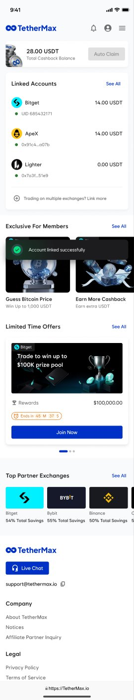
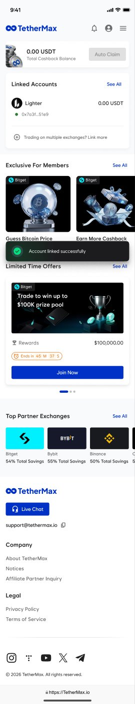

# Figma 수정 결과 — 10차 (모바일 홈 첫 연동 1행)

2026-11-27 · 대상 Figma `DEX(revision)` [28960:125519](https://www.figma.com/design/hsa3bSV9QmFTe2jsf6tzTm/UI-UX-Design?node-id=28960-125519) · 이전 [9차](Figma수정결과_9차.md) · 캡처 [Figma수정결과_img/](Figma수정결과_img/) `r10_*.jpg`

## 요약

| 구분 | 내용 |
|---|---|
| 새 프레임 | [29530:134341](https://www.figma.com/design/hsa3bSV9QmFTe2jsf6tzTm/UI-UX-Design?node-id=29530-134341) `Home / mWeb / S4 DEX · After first link (Lighter) · First link (1 row)` — Mobile · Link Account 섹션 28969:126952(원본 29381:137457 오른쪽 줄 끝, 섹션 폭 10550 → 11025) |
| 인계 메모 | FU-037 · 홈 상태 분기 [29066:891](https://www.figma.com/design/hsa3bSV9QmFTe2jsf6tzTm/UI-UX-Design?node-id=29066-891) |

## 바꾼 것

| 항목 | 내용 | 전/후 |
|---|---|---|
| 1행 상태 프레임 | 모바일 홈 첫 연동 3행 원본 [29381:137457](https://www.figma.com/design/hsa3bSV9QmFTe2jsf6tzTm/UI-UX-Design?node-id=29381-137457)(Bitget · ApeX · Lighter `0.00 USDT`)을 복제해 Bitget 행(29530:134363) · ApeX 행(29530:134376)을 숨김 → Linked Accounts에 새 Lighter 행 `0x7a3f…51e9` · `0.00 USDT`만. 토스트 `Account linked successfully`는 원본 그대로. 총액은 남은 행 합계와 맞춰 `28.00 USDT` → `0.00 USDT` | 원본 `r10_01_firstLink3_before` · 새 `r10_01_firstLink1_new` |
| FU-037 메모 | `모바일 첫 연동(연동 계정 1행, S3-7) — 새 거래소 행만, 토스트 Account linked successfully.` 한 줄 + `피그마 모바일 첫 연동 1행 열기` 링크(29530:134341) | `r10_02_FU037_after` |

| 원본(3행) | 새 프레임(1행) |
|---|---|
|  |  |

## 프로토타입에 반영할 것

| # | 내용 | 기준 노드 |
|---|---|---|
| 1 | 모바일 홈 첫 연동(연동 계정 1개) — Linked Accounts에 새 행 1개(`0.00 USDT`), 총액 `0.00 USDT`, 토스트 `Account linked successfully` | 29530:134341 |
