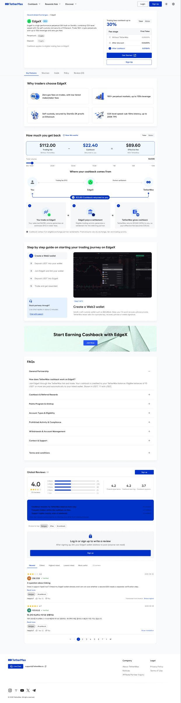
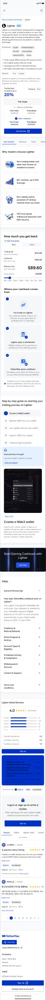
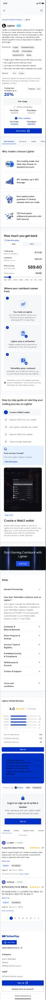
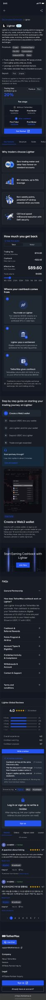
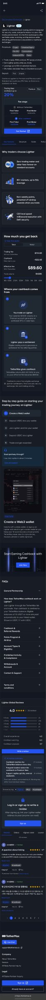
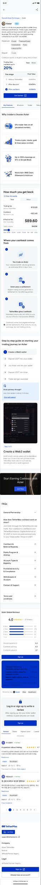
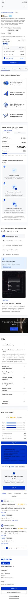

# Figma 수정 결과 — 11차 (프로토타입 대조 3)

2026-11-27 · 대상 Figma `DEX(revision)` [28960:125519](https://www.figma.com/design/hsa3bSV9QmFTe2jsf6tzTm/UI-UX-Design?node-id=28960-125519) · 문구 기준: 웹 → Figma → (정책과 어긋나면) 정책 · 이전 [10차](Figma수정결과_10차.md) · 캡처 [Figma수정결과_img/](Figma수정결과_img/) `r11_*.jpg`

노드 링크: `https://www.figma.com/design/hsa3bSV9QmFTe2jsf6tzTm/UI-UX-Design?node-id={앞}-{뒤}`. 다른 페이지·컴포넌트 메인은 고치지 않았다.

## 바뀐 노드 목록

| # | 항목 | 노드 |
|---|---|---|
| 1 | PC EdgeX · Aster · ApeX 상세 설명 카드 줄 높이 209 → 212(안 여백 16 기준 내용 높이) | D4 [28960:127454](https://www.figma.com/design/hsa3bSV9QmFTe2jsf6tzTm/UI-UX-Design?node-id=28960-127454) 카드 줄 **29534:134477**(옛 28960:127581) · D5 29357:147710 계산기 블록 **29534:134545**(옛 29357:147760) · 카드 줄 **29534:134725** · D6 29357:148976 계산기 블록 **29534:134793**(옛 29357:149026) · 카드 줄 **29534:134973** — 높이를 바꾸려고 DEX(revision) 인스턴스만 분리 |
| 2 | 모바일 상세 이름 글상자 폭 고정 68 → 글자 폭(hug) — `DEX` 칩이 이름 바로 뒤에 붙음 | 29360:141134 `Lighter` 68 · 29360:142115 `Lighter` 68 · 29360:143096 `Lighter` 68 · 29369:136828 `Lighter` 68 · 29360:144075 `EdgeX` 62 · 29427:143897 `EdgeX` 62 · 29360:145025 `Aster` 53 · 29360:145999 `ApeX` 53 |
| 3 | 모바일 리뷰 카드 `A question about linking` 본문 → PC 표본 | Lighter `Does it support ApeX too? I linked my Lighter wallet already and I am not sure whether a second DEX needs a separate verification step.` — I29360:141208;22953:80533;22952:80307 · I29360:142189;… · I29360:143170;… / EdgeX(`…my EdgeX wallet…`) — I29360:144149;… · I29427:143972;… / Aster(`…my Aster wallet…`) — I29360:145099;… / ApeX(`Does it support EdgeX too? I linked my ApeX wallet…`) — I29360:146073;… |
| 4 | Lighter 모바일 D1(다크) AI 요약 → PC Lighter 문구 | [29360:146954](https://www.figma.com/design/hsa3bSV9QmFTe2jsf6tzTm/UI-UX-Design?node-id=29360-146954) — I29360:147047;22953:80447;22952:80284 `Cashback reaches my TetherMax balance every day.` · I29360:147047;22953:80447;22952:80288 `Frequent traders notice the cashback on Premium fees.` |
| 5 | 모바일 마켓 칩 `Indices & ETFs` — PC에 없는 것 숨김 | Aster D5 29360:145006 칩 **29360:145036** 숨김(PC D5에 없음) · ApeX D6 29360:145980 중복 칩 **29360:146010** 숨김(PC D6은 1개, 모바일 2개 → 1개) |

모바일 리뷰 카드 제목 `A question about linking`은 PC와 같아 그대로. Lighter · EdgeX 모바일의 `Indices & ETFs`는 PC D1에도 있어 그대로(EdgeX는 PC · 모바일 모두 없음).

## 캡처

| 항목 | 전 | 후 |
|---|---|---|
| 1 PC EdgeX D4 |  |  |
| 2 · 3 모바일 Lighter |  |   |
| 4 모바일 D1 다크 |  |  |
| 5 모바일 Aster |  |  |
