# Figma 수정 결과 — 3차 (8차 결정 반영 · 전수 재검증)

2026-11-27 · 대상 Figma `DEX(revision)` [28960:125519](https://www.figma.com/design/hsa3bSV9QmFTe2jsf6tzTm/UI-UX-Design?node-id=28960-125519) · 이전 결과 [2차](Figma수정결과_2차.md) · [content](Figma수정결과_content.md) · [balance](Figma수정결과_balance.md) · [rewards](Figma수정결과_rewards.md) · [link](Figma수정결과_link.md) · 결정 [_Figma수정_결정.md](_Figma수정_결정.md)(8차 · N1 · A-5 변경) · 문구 [문구표_DEX.md](문구표_DEX.md) · 캡처 [Figma수정결과_img/](Figma수정결과_img/) `r3_*.jpg`

## 요약

| 구분 | 수 | 내용 |
|---|---|---|
| 고친 것 | **15** | 결정 반영 3(가이드 Step 2 본문 · FAQ `Withdrawals & Account Management` · CT-33 모바일 `Our Partners` 탭·DEX 로고) + 재검증에서 찾아 고친 것 12(아래 2장) |
| 재검증에서 찾은 문제 | **24** | 고침 12 · 남김 12(아래 「남은 것」) |
| 1·2차 「완료」 항목 재확인 | **164행 전부** | 노드 존재 · 표시 여부 · 바뀐 문구를 노드 단위로 대조. 미반영 0 — 분리(detach)로 id가 바뀐 노드 8개는 새 id에서 확인(아래 3장) |
| 결정으로 제외 | **6** | H6 `DEX data pending` · CT-14 ③ · CT-28 ③ 영상 실패 · 홈 누적 블록 모바일 · 다크 프레임 반영 · CT-24 Landing |
| 대상 없음 | 1 | 모바일 드로어 `Exchanges` → `Cashback Hub`(N1) — DEX(revision)에 펼친 모바일 드로어 프레임이 없음(검색 범위는 4장) |

### 남은 것과 이유

| # | 항목 | 화면 | 이유 |
|---|---|---|---|
| 1 | `Get automatic payouts in USDT` ×3 | 컴포넌트 세트 `earn 애니메이션` [28960:130341](https://www.figma.com/design/hsa3bSV9QmFTe2jsf6tzTm/UI-UX-Design?node-id=28960-130341) | 컴포넌트 메인이라 고치지 않음(지시 원칙). 랜딩 화면의 같은 줄은 인스턴스 오버라이드로 고침(2-3) |
| 2 | 서비스 소개 `Three steps to start earning cashback` 부제 | PC [28960:129666](https://www.figma.com/design/hsa3bSV9QmFTe2jsf6tzTm/UI-UX-Design?node-id=28960-129666) · 다크 28960:128975 · 모바일 29386:139409 | 문구표 #75(`Join an exchange with your TetherMax code and just link your account. Done, under 3 minutes!`)와 Figma PC 문구(`Join a partner through your TetherMax referral and link your exchange UID or DEX wallet address.`)가 다름. 둘 다 REQ-715(UID 단독 표기 0건)는 충족 — ❓ 어느 쪽으로 할지 사용자 확인 |
| 3 | `payout` 표현 | 랜딩 `View live payouts` · FAQ `What is the minimum payout?` · 서비스 소개 `Every payout, live, on your phone.` · 모바일 `3 minutes from here to your first payout.` · `Automatic cashback payouts from 10 USDT per account`(28960:130303) · DEX 개요 표 `PAYOUT` · 상세 이유 카드 `Cashback payouts` · 계산기 Summary `Payout Details` / `Payout Time` | 결정·문구표에 `payout` 사용 여부가 없음. 문구표에 행이 있는 곳(피드 열 #42 · 3단계 #44 · 허브 #32 · #38)만 고침 — ❓ 나머지 표현 기준 사용자 확인 |
| 4 | 쿠폰 약관 `Our coupon expriation date is based on UTC …` | 쿠폰 이력 [29365:135006](https://www.figma.com/design/hsa3bSV9QmFTe2jsf6tzTm/UI-UX-Design?node-id=29365-135006) · 쿠폰 없음 29335:140206 | 기존 서비스 약관 원문. 사용자 화면 타임존 라벨 금지 원칙과 부딪힘 — 약관 문안이라 지어내지 않음, ❓ 사용자 확인 |
| 5 | AI 리뷰 요약 `Cashback reaches my TetherMax balance every week.` | DEX 상세 PC 10 · 링크 섹션 상세 12 | CT-07에서 넣은 표본 문구. G-428(Lighter도 일 1회)과 「every week」가 어긋남 — 리뷰 요약은 사용자 글 요약 표본이라 ❓ 사용자 확인 |
| 6 | 서버 값 표기 `{rate}%` · `{date}` · `{local_time}` | Plus 선택 [29327:390098](https://www.figma.com/design/hsa3bSV9QmFTe2jsf6tzTm/UI-UX-Design?node-id=29327-390098) · 맥스보드 29330:191656 · 29330:192021 · 챌린지 29335:142890 외 4 | 운영 입력값(문구표 #93)·서버 값 자리로 1차에 의도해서 넣은 표기. 원문이 아니라 값이 없어서 생긴 자리표시가 아님 — 표본 값으로 바꿀지 ❓ 사용자 확인 |
| 7 | 공개 피드 로딩 · 오류 · 모바일 피드(balance #19) | 서비스 소개 · 랜딩 | 1차 balance 「못 한 것」이었으나 2차 표에서 빠져 있었음. 새 프레임 3개 필요(피드 빈·실패 = 결정 3차 #3 「기존 빈 상태」, 문구표 #43). 모바일 피드는 랜딩·서비스 소개 모바일에 이미 있음 |
| 8 | 모바일 캐시백 요약 새 상태 4종(balance #22 ②~⑤) · 캘린더 25일 `DEX data pending`(#22 ①의 모바일분) | 모바일 요약 [29065:6366](https://www.figma.com/design/hsa3bSV9QmFTe2jsf6tzTm/UI-UX-Design?node-id=29065-6366) | 위와 같이 2차 표에서 빠져 있었음. 새 프레임 4개(월간 카드 · 계정 시트 · 빈 달 · 빈 날) 필요 |
| 9 | 랭킹 로딩 · 모바일 주소 팝오버(balance #40) | 랭킹 | 위와 같음. 새 프레임 2개 필요(웹 복사 토스트는 PW1 · Copied 29330:203678로 있음) |
| 10 | CEX UID 상세(balance 추가-1) | — | 1차부터 대상 프레임 없음. 사용자 기능 섹션의 UID 연동 상세(29327:403008)는 혜택 상세라 다른 화면 |
| 11 | 문구표 행 중 화면이 없는 것 #12 · #16 · #19 · #36 · #49 · #51 · #54 · #3~#5 | — | DEX(revision)에 그 화면·상태 프레임이 없음(앱·모바일 빈 홈 카드 · 웹 `/uidlinking` · 가입 후 복귀 안내 · 매칭 안내 캡션 · DEX 카드 파트너 오류 · DEX 0원 배너 · 연동 전 출금 행 · 홈 행 이슈·실패 칩). 홈 행 칩은 결정 Q4(기존 디자인) |
| 12 | `Boost` · `Start Cashback Preview` | 계산기 Trading profile [29370:136469](https://www.figma.com/design/hsa3bSV9QmFTe2jsf6tzTm/UI-UX-Design?node-id=29370-136469) | 기존 [MAX-146] /payback 퍼널을 복제한 화면의 단계명. N7(Boost 범위 밖)이 이 단계명까지 바꾸라는 결정인지 ❓ 사용자 확인 |

### 결정으로 제외 (8차 결정, 2026-11-27)

| 항목 | 결정 |
|---|---|
| 허브 H6 `DEX data pending` | 불러오기 실패·대기 상태는 만들지 않음 |
| CT-14 ③ 서비스 소개 파트너 캐러셀 실패 | 만들지 않음 |
| CT-28 ③ 가이드 영상 재생 실패 | 만들지 않음 — 영상 자리는 영상이라는 것만 표시 |
| 홈 누적 캐시백 블록 — 모바일 홈 | 이번에 넣지 않음 |
| CT-04 · CT-16 등 다크 프레임 | 다크 모드는 자동 변환 — 다크 프레임 별도 반영 안 함 |
| CT-24 Landing | 기존 화면(PB-3)과 중복 — 만들지 않음 |

---

## 1. 8차 결정 반영

| 항목 | 화면(노드 링크) | 바꾼 것 | 근거 | 전/후 캡처 |
|---|---|---|---|---|
| A1 CT-28 Step 2 본문 | [Step 2 선택](https://www.figma.com/design/hsa3bSV9QmFTe2jsf6tzTm/UI-UX-Design?node-id=29386-137364) 본문 `I29386:137437;354:49242` | `{Step 2 body — 문구 원문 없음}` → `Check the receiving network before sending. Sending funds on the wrong network can cause permanent loss.` 제목 `Deposit USDC into your wallet` 유지. 같은 자리표시는 DEX(revision) 다른 프레임에 없음(검색 4장) | 8차 결정 · DEX(revision) 기존 프레임 `DEX guide / Step 2 of 5`(28981:129056) 원문 · REQ-345 | `r3_A1_step2_before` / `r3_A1_step2_after` |
| A5 CT-29 FAQ `Withdrawals & Account Management` | [FAQ 두 구역 펼침](https://www.figma.com/design/hsa3bSV9QmFTe2jsf6tzTm/UI-UX-Design?node-id=29367-138679) | 질문 `How do I receive my cashback?` · 답변 `Your cashback is credited to your TetherMax balance. Eligible balances of 10 USDT or more are paid automatically to your linked wallet.` **운영자가 어드민에서 입력하는 FAQ의 예시**(G-265 · G-272 · G-439) | 사용자 결정(A-5 변경, 11-27) · 답변 = 같은 FAQ 첫 질문 답변 원문(28960:127610) · 정책 B-7-7 출금 답변 필수 내용(DEX가 지급·DEX에서 출금 표현 없음) | `r3_A5_faq_before` / `r3_A5_faq_after` |
| A2 CT-33 서비스 소개 모바일 DEX 로고 | [Service intro / mo](https://www.figma.com/design/hsa3bSV9QmFTe2jsf6tzTm/UI-UX-Design?node-id=29386-139416) 로고 띠 | PC 서비스 소개 로고 띠의 `DEX pill / Lighter · EdgeX · ApeX · Aster`(28960:129532 · 129541 · 129567 · 129578)를 복제해 모바일 높이(44)로 축소, 첫 줄 Lighter · EdgeX, 둘째 줄 ApeX · Aster가 화면 폭 안에 보이도록 배치. 새 노드 29400:140676 · 140679 · 140682 · 140685 | 8차 결정(지금 디자인 기조) · REQ-287 · PC 28960:129521 | `r3_A2_svcm_before` / `r3_A2_svcm_after` |
| A2 CT-33 랜딩 모바일 `Our Partners` 탭 | [Landing / mWeb](https://www.figma.com/design/hsa3bSV9QmFTe2jsf6tzTm/UI-UX-Design?node-id=29386-140183) 파트너 카드 | `Top Exchanges` → `Our Partners`, PC 랜딩의 칩 묶음 `filter (All / Exchanges / DEXs)`(28960:128424, `<Chip>` 3개)를 복제해 제목 아래(29400:140688), 목록 끝 두 행을 PC와 같은 `ApeX 30%` · `Lighter 20%`(로고 이미지는 PC 행에서 복사) | 8차 결정 · REQ-287 · PC 랜딩 28960:128375. PC 서비스 소개(28960:129521)에는 탭이 없어 같은 페이지 PC 랜딩의 탭을 씀 | `r3_A2_landm_before` / `r3_A2_landm_after` |
| A3 모바일 드로어 항목 이름 | — | 바꿀 대상 없음. DEX(revision)의 모바일 프레임은 모두 드로어가 닫힌 상태(햄버거 아이콘 `MenuRounded`·`MenuFilled`만 있음). 개발 인계 카드 FU-083 설명을 결정대로 정정(2-8) | 결정 N1 · D4 | — |

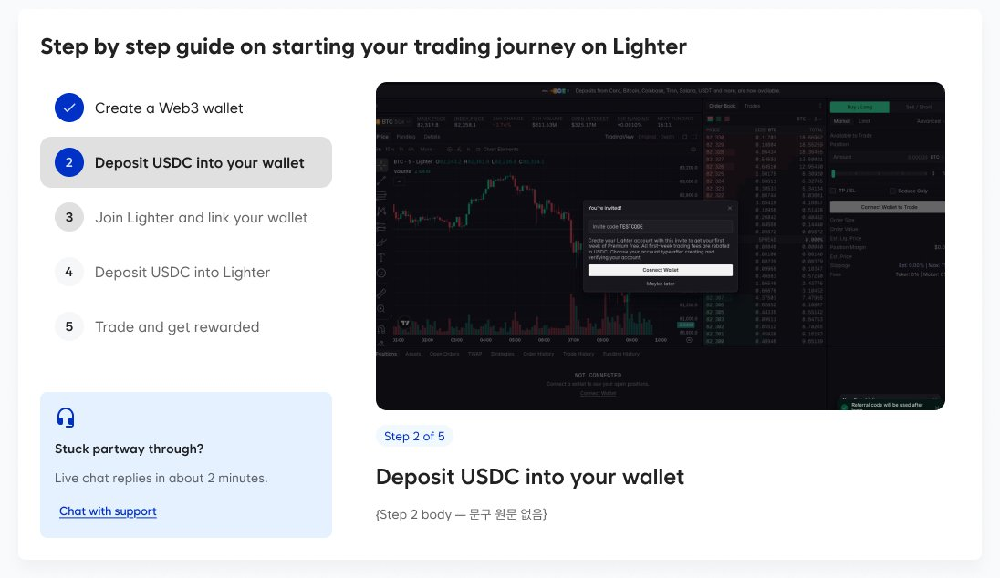 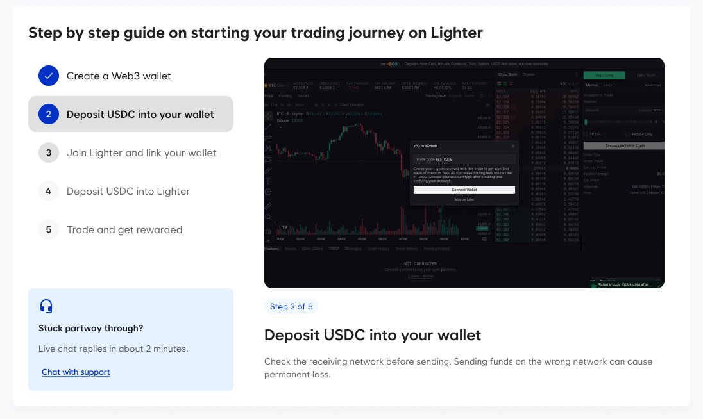
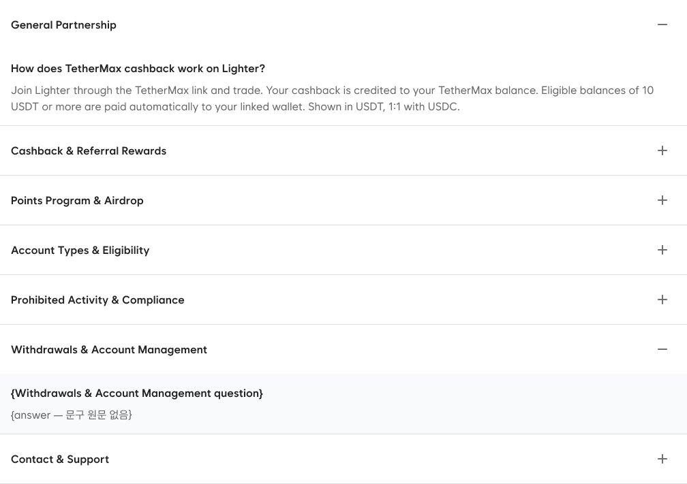 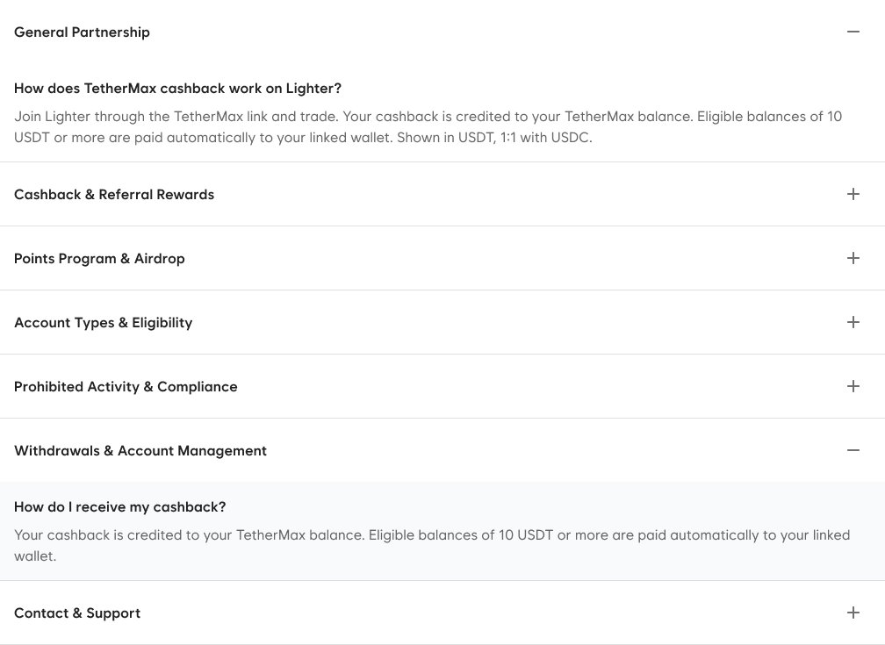
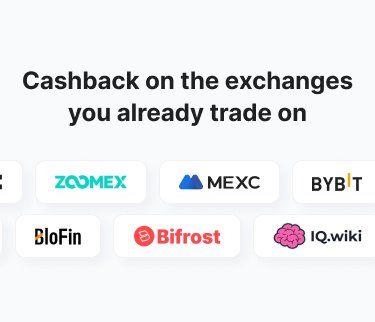 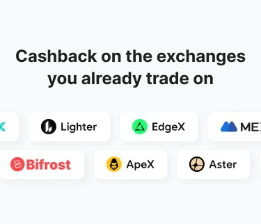 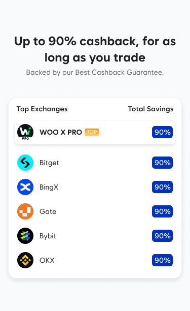 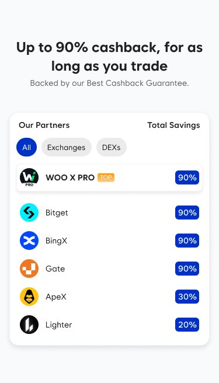

---

## 2. 재검증에서 찾아 고친 것

| 항목 | 화면(노드 링크) | 바꾼 것 | 근거 | 전/후 캡처 |
|---|---|---|---|---|
| 2-1 공개 피드 열 이름 | 랜딩 PC 라이트 [28960:128534](https://www.figma.com/design/hsa3bSV9QmFTe2jsf6tzTm/UI-UX-Design?node-id=28960-128534) · 다크 28960:128079 · 서비스 소개 PC 라이트·다크(`I28960:129611;19224:3442` · `I28960:128920;19224:3442`) | `Payout Time` → `Withdrawal Time` (4곳) | 문구표 #42 · 결정 D2 · balance #27(1차 못 한 것) | `r3_B1_feedL_before` / `r3_B1_feedL_after` |
| 2-2 서비스 소개 피드 제목·부제 | PC 라이트 [28960:129609](https://www.figma.com/design/hsa3bSV9QmFTe2jsf6tzTm/UI-UX-Design?node-id=28960-129609) · 다크 28960:128918 · 모바일 29386:139488 | `Someone just got paid. Watch it happen.` → `Someone is cashing out right now`, 부제(`Eligible account balances are paid automatically from 10 USDT.` · 모바일 `… every cent you earn is paid out, instantly.`) → `Claim every cent you've earned` — 랜딩과 같은 문구 | 문구표 #41(두 화면 통일) · balance #39(1차 못 한 것) | `r3_B2_feedSvc_before` / `r3_B2_feedSvc_after` · 모바일 `r3_B2_feedSvcM_before` / `r3_B2_feedSvcM_after` |
| 2-3 랜딩 3단계 셋째 줄 | 랜딩 라이트 [28960:128610](https://www.figma.com/design/hsa3bSV9QmFTe2jsf6tzTm/UI-UX-Design?node-id=28960-128610) · 다크 28960:128155 (인스턴스 오버라이드) | 제목 `Get automatic payouts in USDT`(라이트) · `Get paid daily in USDT`(다크) → `Get cashback in USDT automatically`. 다크 본문 `Trade, and cashback accrues automatically` → 라이트와 같은 `Each linked account is paid automatically once its claimable balance reaches 10 USDT.` | 문구표 #44 · balance #28(1차 못 한 것, 라이트·다크 같은 문구) | `r3_B3_stepsL_before` / `r3_B3_stepsL_after` · 다크 `r3_B3_stepsD_before` / `r3_B3_stepsD_after` |
| 2-4 DW0 허브 DEX 패널 | [DW0 Hub, DEX balance](https://www.figma.com/design/hsa3bSV9QmFTe2jsf6tzTm/UI-UX-Design?node-id=28960-125773) — 분리본 29400:140028 · 히어로 29400:140280 | 1·2차의 H5 수정이 이 프레임에는 빠져 있었음. H5와 같게: `Event Reward` → `Total event reward` · 주간 추정 줄(`Accruing this week (estimate)` · `Lighter settles weekly. Not in the totals above.` · `3.20 USDT`) → `Claimable 125.00 USDT`(캡션·금액 숨김) · `Total claimed 0.00 USDT` 줄 추가(29400:140372, 같은 패널 줄 복제) · 각주 `Payout destination: linked Lighter wallet.` → `Cashback is sent automatically to your linked Lighter wallet.` · 라우트 행 `Automatic payouts from 10 USDT` ×2 → `Claimed automatically from 10 USDT` · 톱니 장식을 영수증 끝으로 | G-428 · REQ-300 · REQ-307 · 문구표 #31 · #32 · #38 · H5 29352:145077 | `r3_B4_DW0_before` / `r3_B4_DW0_after` |
| 2-5 게스트 조회 결과 10 USDT 이상 | [Web / Guest DEX 결과](https://www.figma.com/design/hsa3bSV9QmFTe2jsf6tzTm/UI-UX-Design?node-id=29035-97792) · 29035:97855 | `10 USDT minimum reached. Link your account to receive your cashback.` → `10 USDT minimum reached. Link this account to receive it.` (2곳) | 문구표 #45 | `r3_B5_guest_before` / `r3_B5_guest_after` |
| 2-6 서비스 소개 파트너십 문장 | PC 라이트 [28960:129859](https://www.figma.com/design/hsa3bSV9QmFTe2jsf6tzTm/UI-UX-Design?node-id=28960-129859) · 다크 28960:129168 · 모바일 `I29386:139815;19224:6382` · `;19224:6412` | PC `… links their account and trades …` · 모바일 `… links a UID and trades …` → `Every time a trader you invite links an account and trades, you earn rewards.` / 모바일 `… and link their UID` → PC 문장 `Traders you invite join an exchange with the TetherMax code and link their account.` | 문구표 #76 · REQ-715 · 용어 규칙(Account) | PC `r3_B6_partnerPC_before` / `r3_B6_partnerPC_after` · 모바일 `r3_B6_partnerM_before` / `r3_B6_partnerM_after` |
| 2-7 연동 섹션 상세 배경의 FAQ 구역 이름 | 연동 섹션 상세 배경 12프레임(28960:127271 · 127275 · 127279 · 127283 · 127287 · 127412 · 127414 · 127416 · 127418 · 127422 · 29327:385103 · 29327:388255) | `Payouts & Account Management` → `Withdrawals & Account Management` | 정책 B-7-7 · REQ-361(7구역 이름) | 프레임 높이 900에 잘려 화면에는 보이지 않는 레이어 — 캡처 차이 없음 |
| 2-8 개발 인계 FU-083 | [FU-083 사이트맵·헤더·드로어·푸터](https://www.figma.com/design/hsa3bSV9QmFTe2jsf6tzTm/UI-UX-Design?node-id=29066-1029) | `Cashback hover 패널 3행` → `Cashback ▾ 패널(Cashback Hub · Cashback Calculator) · 모바일 드로어 Cashback Hub` | 결정 D4 · N1 | `r3_B8_FU083_before` / `r3_B8_FU083_after` |
| 2-9 모바일 랭킹 안내 · 금액 | [내 캐시백 랭킹 · 모바일](https://www.figma.com/design/hsa3bSV9QmFTe2jsf6tzTm/UI-UX-Design?node-id=29065-6980) | 목록 아래 캡션 2줄을 RK1에서 복제(29402:143477 · 143478) `Cashback under 0.01 USDT isn’t included in the rankings.` / `Ranking rewards can’t be claimed on their own. They’re matched 1:1 with the same account’s cashback.` · 배경 잔액 `0 USDT` → `0.00 USDT` | 문구표 #52 · #53 · balance #23 · #30(1차 못 한 것) | 후 `r3_B9_mRK_after` |
| 2-10 모바일 캐시백 요약 금액 | [캐시백 요약 · 모바일](https://www.figma.com/design/hsa3bSV9QmFTe2jsf6tzTm/UI-UX-Design?node-id=29065-6366) | `150.00 USDT` → `+150.00 USDT` · `+50 USDT` ×3 → `+50.00 USDT` | balance #31 · REQ-019 · REQ-024 | 전 `r2_mCS_after` / 후 `r3_B9_mCS_after` |
| 2-11 혜택 진행 중 모바일 `LINK UID` 부제 | [혜택 · 진행 중 / 모바일](https://www.figma.com/design/hsa3bSV9QmFTe2jsf6tzTm/UI-UX-Design?node-id=29062-113469) | `Bind your exchange UID` → `Link a CEX UID to Get Cashback` (회원판 29327:401359와 같게) | REQ-396 · 결정 N5 | `r3_B10_benefitsM_before` / `r3_B10_benefitsM_after` |
| 2-12 가려진 옛 GNB 레이어 | 게스트 섹션 PC 22 · 모바일 16 · 랭킹 6 · 퀴즈 모바일 4(합 48, 모두 새 GNB·모바일 헤더 아래에 겹쳐 있던 옛 `webPrelogin`) | 숨김(`visible=false`). 자동 레이아웃 흐름 밖(절대 위치)인 것만 — 화면 변화 없음, 개발자가 레이어에서 옛 메뉴(`Exchanges · Events · Benefits · Cashback Preview · Point`)를 보지 않게 함. 새 GNB를 담은 `합체` 인스턴스 안 `webPrelogin`(이름만 같고 새 메뉴)과 맥스보드 모바일 16프레임의 흐름 안 헤더는 그대로 | 결정 A1 · D4 | 화면 변화 없음 |

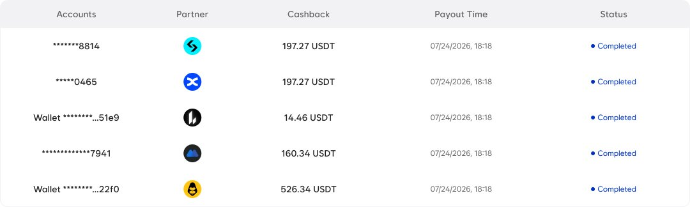 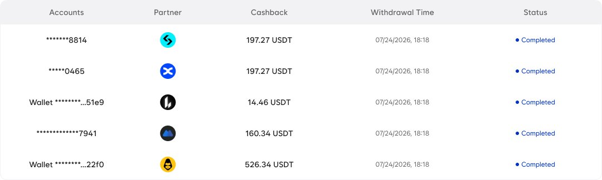
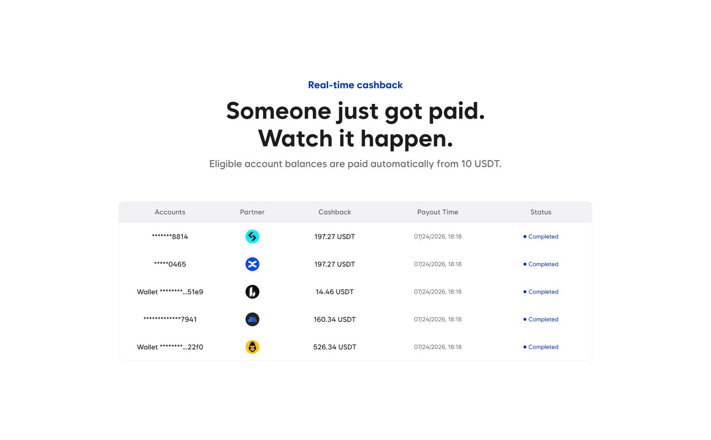 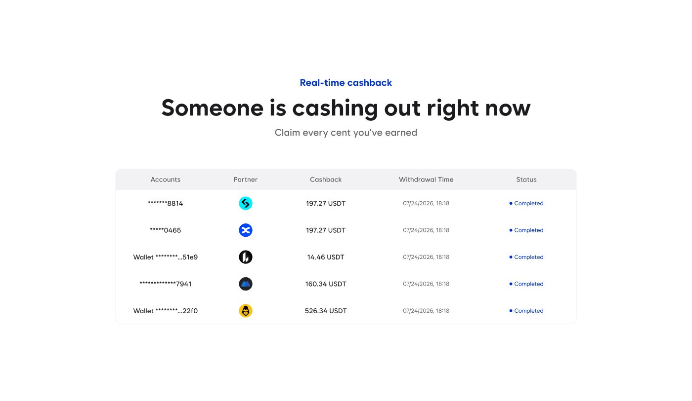
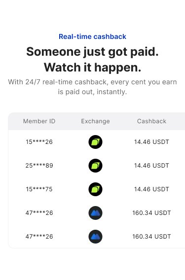 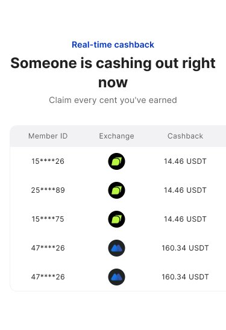
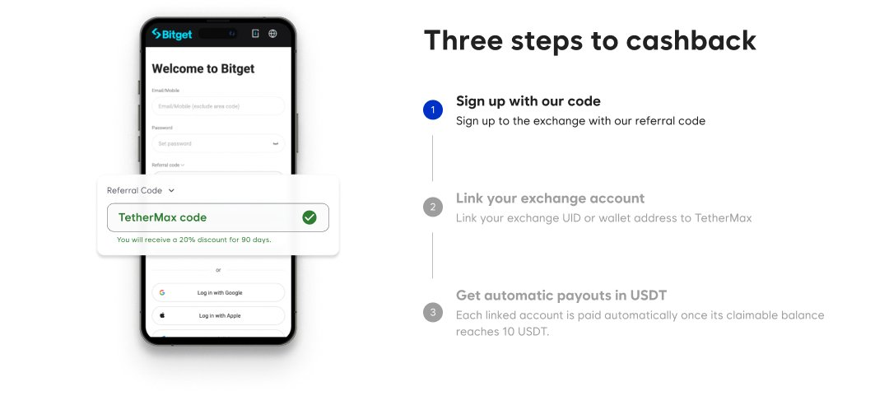 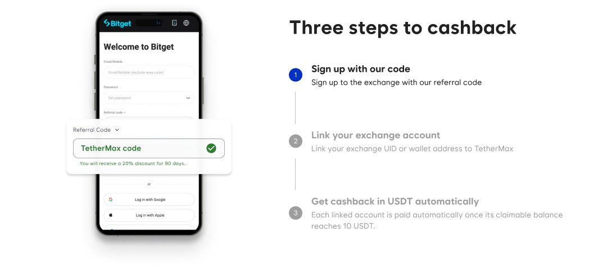
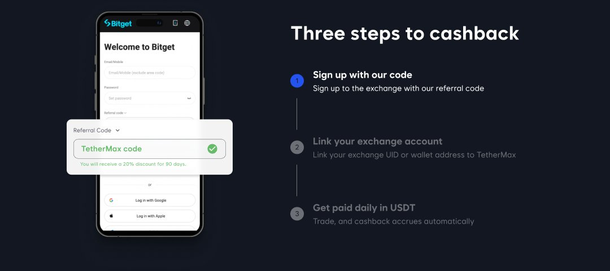 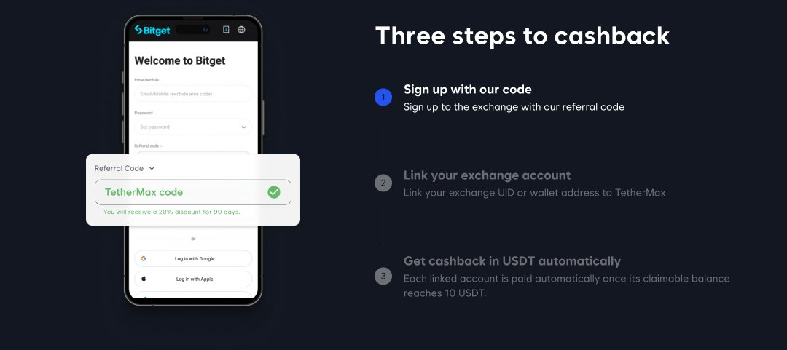
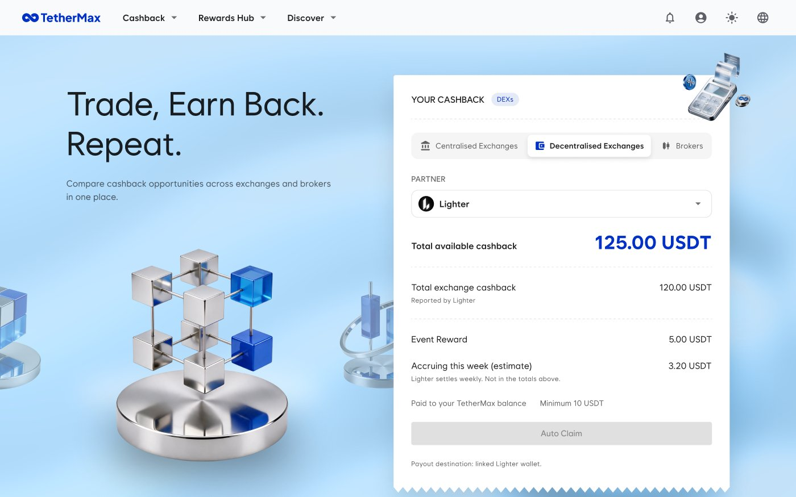 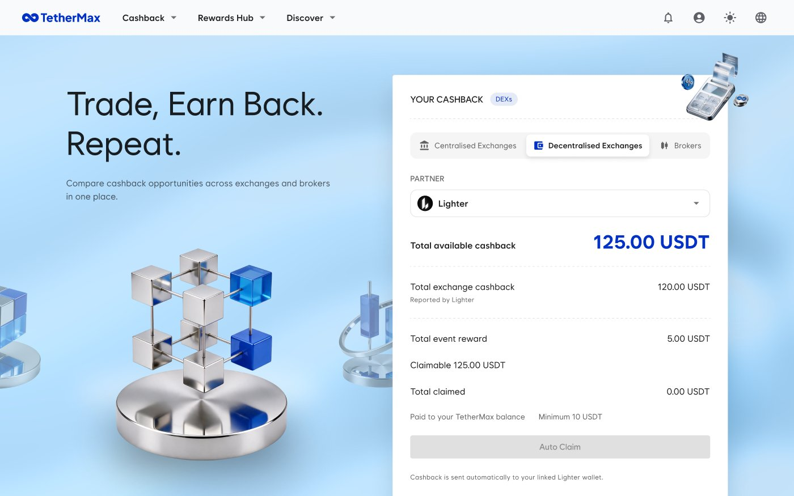
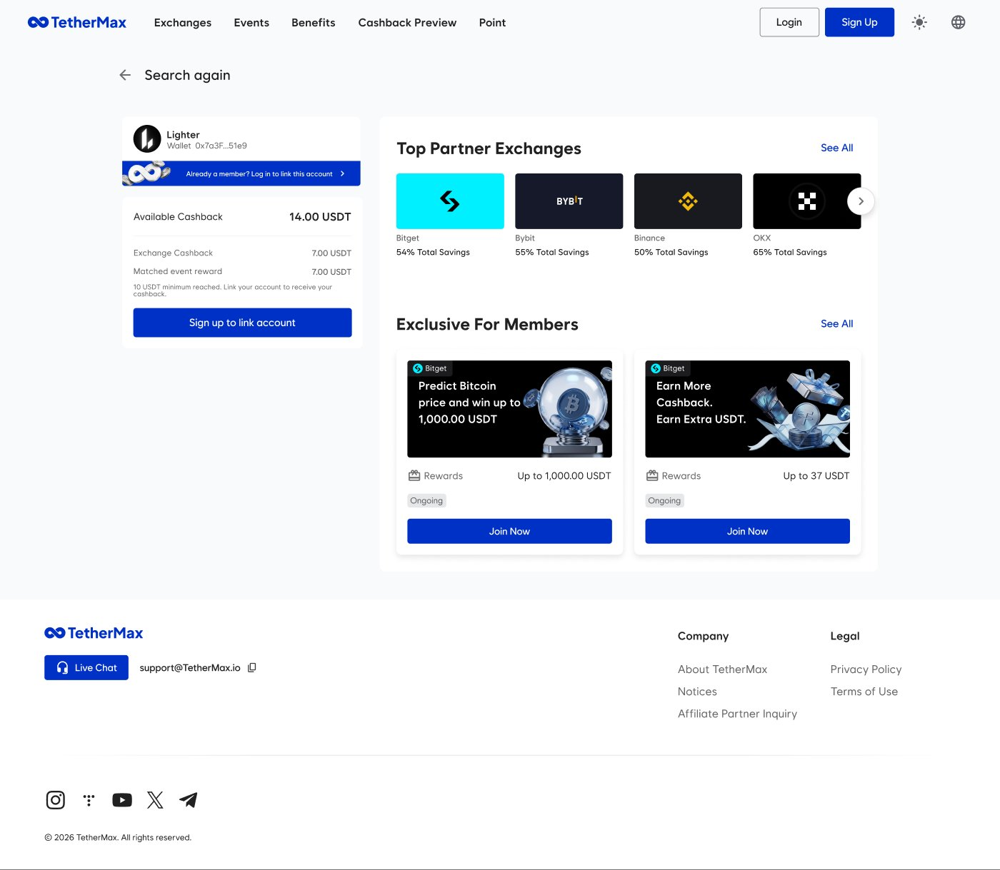 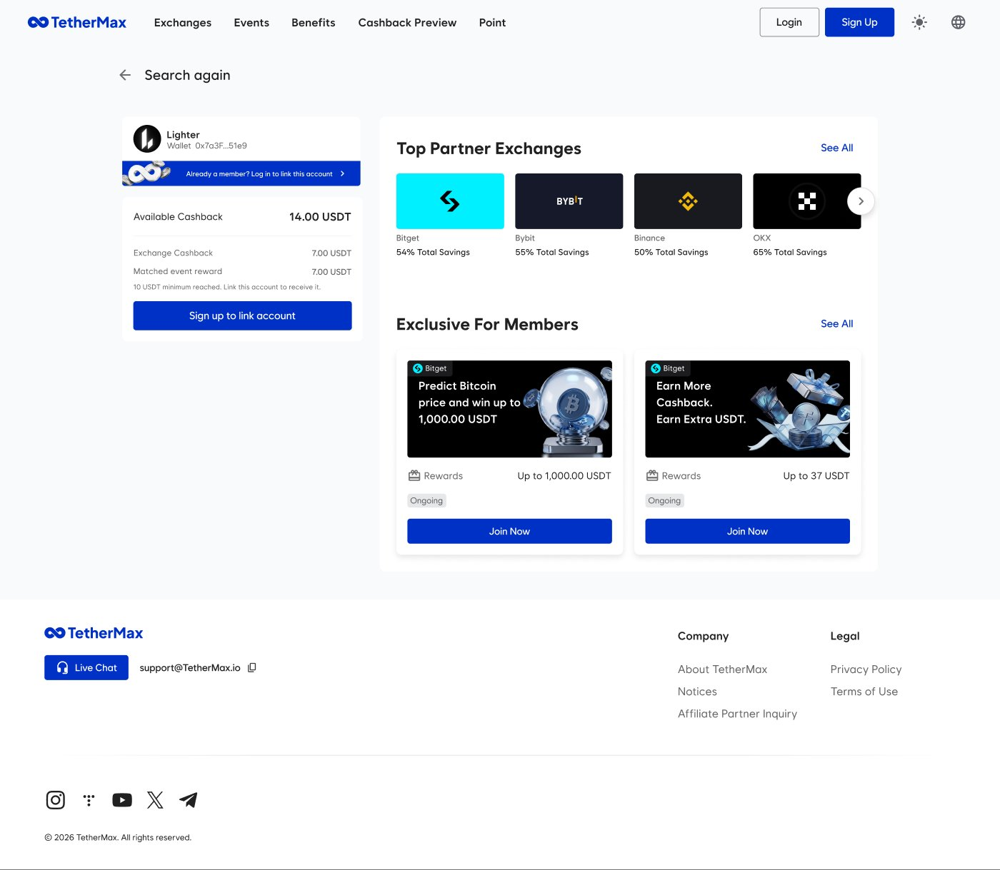
 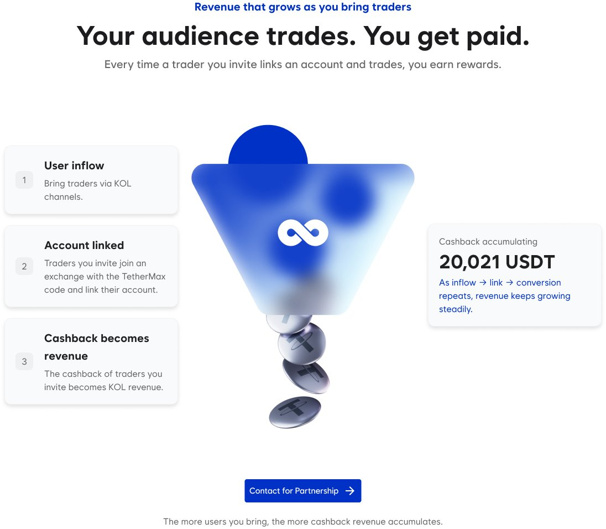 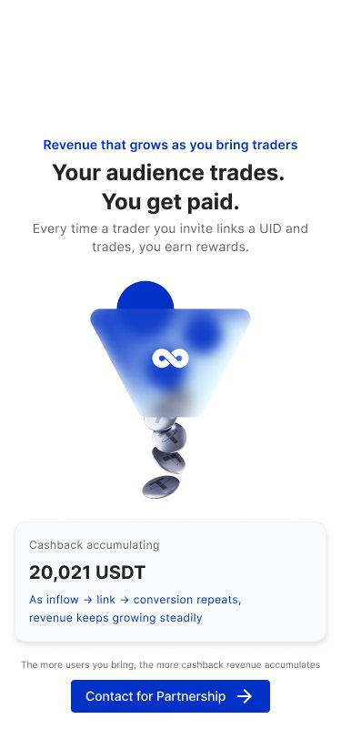 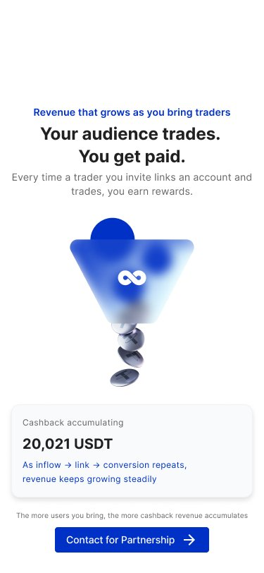
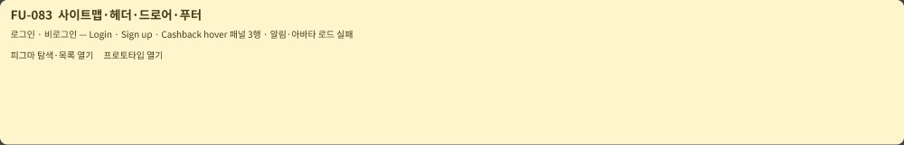 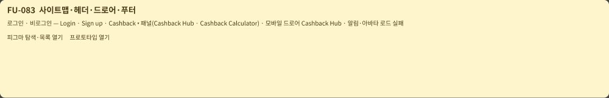
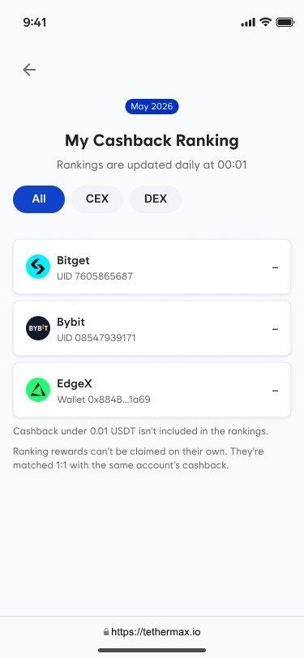  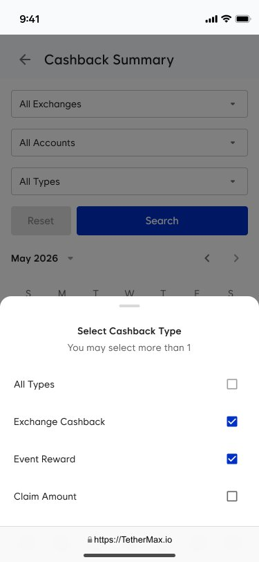
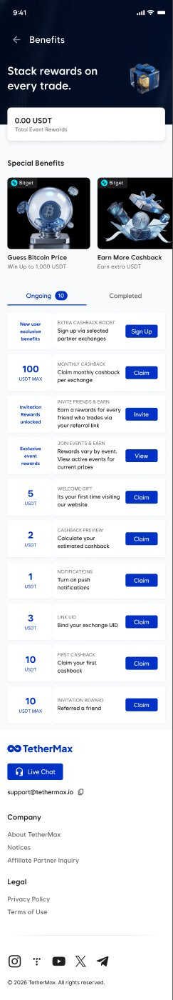 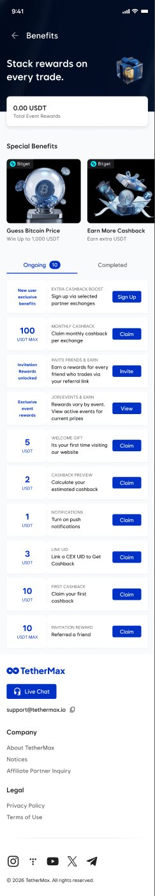

---

## 3. 1·2차 「완료」 항목 재확인

결과 문서 5개(link · balance · content · rewards · 2차)의 항목 표에서 `바꾼 것` 열이 있는 행 **164행**(link 27 · balance 51 · content 25 · rewards 33 · 2차 28)을 모두 뽑아, 행에 적힌 노드 **338개**마다 ① 노드 존재 ② DEX(revision) 페이지 소속 ③ 표시 여부(상위 포함) ④ `바꾼 것`의 바뀐 뒤 문구가 그 노드의 보이는 텍스트에 있는지를 대조했다. 노드가 적혀 있지 않은 18행은 문구로 페이지 전체를 검색했다.

| 결과 | 행 수 | 내용 |
|---|---|---|
| 반영 확인 | 164 | 미반영 0 |
| 노드 id가 바뀐 노드 | 8 | 2차 분리(detach)로 원 노드가 없어짐 → 분리본에서 확인: H5 28960:126908 → 29352:145077 · H8 28960:126926 → 29354:139273 · Aster 상세 28960:127627 → 29357:147710 · 혜택 PC 29062:113000 → 29365:134382 · TP 29062:114041 → 29365:134702 · 쿠폰 이력 29062:115768 → 29365:135006 · 랜딩 3곳 29330:193664 → 29361:137628 · 리스트 뷰 28960:125536 → 29361:138251 |
| 숨김으로 처리된 행 | 9 | 숨김이 바꾼 내용인 행(L-01 Lighter Standard · L-04 `Need help?` · L-24 `Complete` · mWeb 지갑 상세 `View Cashback Summary` · R-07 메일 문장 삭제 · R-28 결과 발표 2프레임 · R-23 원본 모달 · H5 주간 추정 줄 · D4 3행 패널 `Brokers`) — 숨김 상태 확인 |
| 다른 페이지 근거 노드 | 9 | 근거로 적은 기존 노드(8582:167801 · 8582:167558 · 4060:25384 · 22442:219836 · 22442:219848 · 9287:166523 · 9401:160223 등) — 고치지 않은 원본 |
| 공통 GNB 교체 19프레임 | 19 | 프레임마다 옛 1440 `webPrelogin` 표시 0 · 새 `DEX / Web / Navigation` 표시 1 이상 |

---

## 4. 재검증 범위

### 훑은 섹션 · 프레임

| 구분 | 수 |
|---|---|
| 섹션 | 18(사용자 화면 17 + 개발 인계 색인 1) + 섹션 밖 보이는 프레임 5(`DEX guide / Step 1~3 of 5` · 정책 수정 안내 · PC 기존 UID 연동) |
| 섹션 안 보이는 최상위 프레임 | 944(모바일 섹션은 하위 섹션 9개 단위로 셈) |
| 훑은 보이는 텍스트 노드 | 38,422 |
| 제외 | 숨김 최상위 프레임 10(`API 상태 흐름 1~8` · `DEX 사용자 화면 · 진입과 복귀 경로`) · 빈 `Uploaded Image` 2 |

섹션: DEX overview Web · 기존 홈/허브/지갑 상세 잔액 · Invite Friends · Cashback Hub · Cashback Summary · Partner Hub · Cashback Ranking · Link · DEX detail Web · Ownership verification · Link stories(S3·S4) · Landing + Service intro · Quiz · Mobile(허브 2 · 개요 2 · 상세 2 · 연동 · 소유권) · DEX 상세 회원 상태별 오퍼 · 게스트 캐시백 · 사용자 이메일 · 사용자 기능 PC·모바일 원본 보완 · 글로벌 리그 · 개발 인계 색인.

### 검색어

| 목적 | 검색어(대소문자 무시) |
|---|---|
| 자리표시 | `{` · `원문 없음` · `문구 대기` · `TBD` · `Lorem` |
| 결정 위반 | `payback` · `rebate` · `UID`(CEX·DEX 공통 맥락 확인) · `withdraw` · `claim` · `calculator` · `Decentralised/Decentralized Exchanges` · `milestone` · `boost` · `maintenance` · `UTC` · `KST` · `GMT` · `Top Partner DEX` · `non-member` · `disconnect` · `Exchanges`(단독) · `Cashback Preview` · `Benefits`(단독) · `Trying` · `Checking` · `Pending` · `확인 중` · `payout` · `paid daily` · `got paid` · `instant` · `monday` · `weekly` · `every week` |
| 옛 GNB · 드로어 | 레이어 이름 `webPrelogin` · `drawer` · `menu` · `hamburger` · `sidebar` · `sheet` · `메뉴` · `드로어` · `햄버거`, 모바일 폭 프레임 안 텍스트 `Rewards Hub` · `Cashback Hub` · `Discover` · `Exchanges` · `Cashback` · `Calculator` · `Events` · `Point` · `Benefits` |
| 문구표 대조 | 문구표 EN 85개(값·서버 값 자리 앞 문장) 완전 일치 수, 불일치 시 앞 3단어로 비슷한 문장 |
| 원문 찾기(「없음」 판정 전) | DEX(revision) 전체 텍스트 · 오프라인 색인 `_프로토타입_전체/ref/figma_pages/*.xml`(42페이지) · `ref/figma_index.tsv` — Step 2 본문은 28981:129056에서 원문 확인, 모바일 드로어는 DEX(revision)·색인 모두 펼친 프레임 없음(드로어 프레임은 `[MAX 1216]` 22044:758840 · `[MAX-30]` 8013:42844 · `[MAX-18]` 8013:42845 등 다른 페이지에만 있음) |
