# Figma 수정 결과 — 4차 (9차 결정 반영)

2026-11-27 · 대상 Figma `DEX(revision)` [28960:125519](https://www.figma.com/design/hsa3bSV9QmFTe2jsf6tzTm/UI-UX-Design?node-id=28960-125519) · 이전 결과 [3차](Figma수정결과_3차.md) · 결정 [_Figma수정_결정.md](_Figma수정_결정.md)(9차 · 8차) · 문구 [문구표_DEX.md](문구표_DEX.md) · 캡처 [Figma수정결과_img/](Figma수정결과_img/) `r4_*.jpg`

## 요약

| 구분 | 수 | 내용 |
|---|---|---|
| 고친 것(기존 노드) | **12건** | 서비스 소개 부제 3노드 · AI 리뷰 요약 22노드 · 중괄호 값 10노드 · 개발 인계 메모 7장(서버·어드민 값 3 · CEX UID 상세 링크 2 · 할인 행 규칙 2) · 허브 H5 매칭 안내 1줄 · 초대 그룹 라벨 50→10 USDT · GNB `Exchanges Events` → `Exchange Events` 16노드 + FU-083 메모 · 리뷰 영역 파랑 207노드 · 옛 파랑 `primary/main` 나머지 전부 `primary/blue/main`으로(8장) · 리뷰 표본 「매주 들어오고」 → 「매일 들어오고」 23노드 |
| 새 프레임 | **13개** | 모바일 캐시백 요약 4 · 모바일 랭킹 주소 팝오버 1 · 문구표 행 상태 6 · 할인 단계 오퍼 박스 2(아래 「새 프레임 목록」) |
| 결정·판단으로 손대지 않은 것 | 8건 | 아래 표 |
| 남은 것 | **1건** | 컴포넌트 메인 문구(아래) |

### 결정·판단으로 손대지 않은 것

| 항목 | 화면 | 정리 |
|---|---|---|
| `payout` 라벨 — 계산기 Summary `Payout Details` · `Payout Time`, DEX 개요 교육 타일 `PAYOUT` | 계산기 29187:119365 · 29187:119560 · 개요 타일 14곳 | 유지 — 사용자 결정(실서비스 계산기 화면 확인). 정책 3220행 · REQ-459(`Payout Time` = 테더맥스 계정 적립 시점) · REQ-329(`PAYOUT` 원문)와도 같음 |
| 메일 템플릿 중괄호 값(약 30곳) | 사용자 이메일 섹션 29060:101537 | 유지 — 사용자 결정(발송 템플릿의 치환 변수) |
| #49 DEX 카드 파트너 오류 | — | 그리지 않음. 문구가 쓰이는 화면이 출금 화면 계정 카드(정책 A-23, REQ-148 「제외 — 출금 화면 삭제 G-448」)와 허브 DEX 패널 「원장 하나만 실패」(정책 B-5-5)뿐 — 앞은 화면 삭제, 뒤는 8차 「불러오기 실패 상태 만들지 않음」. 검색: DEX(revision) `latest .*cashback right now` · `can.t load your latest` 0건, 색인 `latest` 3건(무관) |
| #51 `Cashback updates` · `Daily, {로컬 시각}` 칸 | — | 놓을 화면 없음 — 출금 화면 DEX 계정 카드의 행(정책 A-23, G-448 삭제). 지갑 상세에는 같은 정보가 Earning Timeline `Updated`로 있음. 배너 문장은 지갑 상세 0원 프레임에 반영(3장) |
| 쿠폰 약관 UTC · 계산기 `Boost` · 공개 피드 로딩·오류 · 랭킹 로딩 | — | 9차 #3 · #6 · #7 · #9 |

### 남은 것

| 항목 | 화면 | 이유 |
|---|---|---|
| `Get automatic payouts in USDT` ×3 · 게스트 GNB `Cashback ▾` 패널 옛 3행(`Exchanges` · `Brokers` · `Cashback Calculator`) | 컴포넌트 세트 `earn 애니메이션` [28960:130341](https://www.figma.com/design/hsa3bSV9QmFTe2jsf6tzTm/UI-UX-Design?node-id=28960-130341) · 게스트 화면 `합체` GNB 16곳 | 컴포넌트 메인이라 고치지 않음(지시 원칙). `earn 애니메이션`은 홍보 문장(9차 #2 유지 대상). GNB 드롭다운은 화면에 펼쳐지지 않는 패널(opacity 0) — `Cashback ▾` 항목은 FU-083 메모에 결정 D4 기준이 적혀 있음 |

---|---|---|---|
| 1 | `payout` 라벨 — 계산기 Summary `Payout Details` · `Payout Time`, DEX 개요 교육 타일 말머리 `PAYOUT` | 계산기 [29187:119365](https://www.figma.com/design/hsa3bSV9QmFTe2jsf6tzTm/UI-UX-Design?node-id=29187-119365) · 모바일 29187:119560 · 개요 타일 8곳(28960:125714 · 29361:136254 외) · 모바일 개요 6곳 | **바꾸지 않음 — ❓ 사용자 확인.** 9차 결정은 「출금 실적을 가리키는 라벨」만 `Withdraw` 계열로 바꾸라는 것인데, 두 라벨은 정책상 출금 실적이 아님. ① 정책 3220행 · REQ-459: `Payout Time`의 payout은 「출금이 아니라 테더맥스 계정에 금액이 적립되는 시점」(같은 블록 문장 `Cashback from EdgeX is credited to your TetherMax balance.` · `Schedule Daily` · `Destination TetherMax Account`). `Withdrawal Time 09:00`으로 바꾸면 10분 주기 자동 출금과 어긋난 시각을 출금 시각으로 보여 줌. ② `PAYOUT`은 REQ-329 · 정책 553 · 2634 · 4704행에 원문이 정해진 교육 타일 말머리(`PAYOUT` / `Paid to your TetherMax balance`)로, 역시 적립을 설명 |
| 2 | 메일 템플릿의 중괄호 값(`{exchange}` · `{date}` · `{payout date}` · `{rank}` · `{amount}` 등 약 30곳) | 사용자 이메일 섹션 29060:101537(29 · 16~20 · 24 · 25번 메일과 모바일 375) | 화면이 아니라 발송 템플릿 — 치환 변수 이름이 개발 인계 내용이고, 같은 섹션 「발송 조건」 카드와 짝. 표본 값으로 바꿀지 ❓ 사용자 확인(바꾸면 「발송 조건」 카드에 변수 목록을 옮겨 적어야 함). 검색어: `\{` · `\}` |
| 3 | #49 DEX 카드 파트너 오류 `We can't load your latest {DEX} cashback right now.` | — | 그리지 않음. 이 문구의 화면은 ① 출금 화면 계정 카드(정책 A-23 「화면 상태 · 파트너 오류」, REQ-148 「제외 — 회원 출금 화면 삭제(G-448)」) ② 허브 DEX 패널 「원장 하나만 실패」(정책 B-5-5)인데, ①은 화면 삭제, ②는 8차 결정 「불러오기 실패 상태는 만들지 않음」에 해당. 검색: DEX(revision) 텍스트 `latest .*cashback right now` · `can.t load your latest` 0건, 오프라인 색인 `latest` 3건(앱 업데이트 안내·메모, 무관) |
| 4 | #51의 둘째 값 `Cashback updates` · `Daily, {로컬 시각}` 칸 | — |  갱신 주기 칸은 정책 A-23 출금 화면 DEX 계정 카드의 행(`Cashback updates` 행)이라 화면 삭제(G-448)로 놓을 자리가 없음. 지갑 상세에는 같은 정보가 Earning Timeline `Updated`로 이미 있음. 검색: `day after you trade` · `appears here` · `Cashback updates` DEX(revision) 0건 |
| 5 | `Get automatic payouts in USDT` ×3 · 게스트 GNB `Cashback ▾` 패널 옛 3행(`Exchanges` · `Brokers` · `Cashback Calculator`) | 컴포넌트 세트 `earn 애니메이션` [28960:130341](https://www.figma.com/design/hsa3bSV9QmFTe2jsf6tzTm/UI-UX-Design?node-id=28960-130341) · 게스트 화면 `합체` GNB 16곳 | 컴포넌트 메인이라 고치지 않음(지시 원칙). `earn 애니메이션`은 홍보 문장(9차 #2 유지 대상). GNB 드롭다운은 화면에 펼쳐지지 않는 패널(opacity 0) — `Cashback ▾` 항목은 FU-083 메모에 결정 D4 기준이 이미 적혀 있음 |

---

## 1. 9차 결정 반영

| 항목 | 화면(노드 링크) | 바꾼 것 | 근거 | 전/후 캡처 |
|---|---|---|---|---|
| 4-1 서비스 소개 3단계 부제 | PC [28960:129666](https://www.figma.com/design/hsa3bSV9QmFTe2jsf6tzTm/UI-UX-Design?node-id=28960-129666) · 다크 28960:128975 · 모바일 [29386:139586](https://www.figma.com/design/hsa3bSV9QmFTe2jsf6tzTm/UI-UX-Design?node-id=29386-139586) | `Join a partner through your TetherMax referral and link your exchange UID or DEX wallet address.` → `Join an exchange with your TetherMax code and just link your account. Done, under 3 minutes!` | 9차 #1 · 문구표 #75 | `r4_01_svcPC_before` / `_after` · `r4_01_svcM_before` / `_after` |
| 4-2 `payout` 라벨 | 초대 섹션 그룹 라벨 [28960:126810](https://www.figma.com/design/hsa3bSV9QmFTe2jsf6tzTm/UI-UX-Design?node-id=28960-126810) | 라벨성 표기 전수 확인. 화면 라벨 중 「출금 실적」을 가리키는 것은 0건(계산기 `Payout Details`/`Payout Time` · 개요 `PAYOUT`은 적립 의미 — 사용자 결정으로 유지). 함께 찾은 그룹 라벨 `Minimum automatic payout: 50 USDT.` → `10 USDT.` | 9차 #2 · 초대 최소 10 USDT(결정) · REQ-414 | `r4_02_inviteLabel_before` / `_after` |
| 4-3 쿠폰 약관 UTC | 쿠폰 이력 29365:135006 · 쿠폰 없음 29335:140206 | 변경 없음 | 9차 #3(원문 유지) | — |
| 4-4 AI 리뷰 요약 표본 | DEX 상세 PC 10(D1 29357:143619 · D2 29357:144968 · 29386:137364 · 29386:137485 · D3 29357:146245 · 29367:138679 · 29367:139672 · D4 28960:127454 · D5 29357:147710 · D6 29357:148976) · 연동 섹션 상세 배경 12(28960:127271 · 127275 · 127279 · 127283 · 127287 · 127412 · 127414 · 127416 · 127418 · 127422 · 29327:385103 · 29327:388255) | `Cashback reaches my TetherMax balance every week.` → `… every day.` (22노드, 인스턴스 오버라이드). 모바일 상세에는 이 문장 없음 | 9차 #4 · G-428 | `r4_04_review_before` / `_after` |
| 4-5 중괄호 값 → 표본 값 | 아래 표 | 화면 10노드를 표본 값으로 + 개발 인계 메모 3장에 「서버·어드민 값」 줄 추가 | 9차 #5 | 아래 |
| 4-6 계산기 `Boost` | 29370:136469 | 변경 없음 | 9차 #6 | — |
| 4-7 공개 피드 로딩·오류 | — | 만들지 않음 | 9차 #7 · 8차 | — |
| 4-8 모바일 캐시백 요약 상태 4종 | 새 프레임 4(아래 2장) | 월간 카드 · 계정 시트 · 빈 달 · 빈 날. `DEX data pending` 없음 | 9차 #8 · balance #22 | 아래 |
| 4-9 모바일 랭킹 주소 팝오버 | 새 프레임 1(아래 2장) | 로딩은 만들지 않음 | 9차 #9 · balance #40 | 아래 |
| 4-10 CEX UID 상세 | 정책 변경 메모 · 자동 지급 및 계정별 잔액 [28965:123621](https://www.figma.com/design/hsa3bSV9QmFTe2jsf6tzTm/UI-UX-Design?node-id=28965-123621) · 개발 인계 FU-040 [29066:900](https://www.figma.com/design/hsa3bSV9QmFTe2jsf6tzTm/UI-UX-Design?node-id=29066-900) | 새로 그리지 않고 기존 디자인 노드 링크 한 줄(노드 id마다 하이퍼링크): [MAX-1216] UID detail 웹 25867:1347701 · 모바일 25867:1348700 · 웹 타임라인 26047:1349155 · 모바일 타임라인 26047:1348691 · mWeb S4 6042:88184 · UID 복사 8582:167558. 메모 카드 높이 190→286(아래 그룹 라벨과 겹치지 않게 위로 32 이동) | 9차 #10 · 색인 `ref/figma_index.tsv`(`[MAX-7] Landing Page` 페이지의 `[MAX-1216] UID detail update` · `MAXOP-783` · `mobileWeb › S4`). 지시의 9193:119755는 같은 페이지의 `mWeb/landingPage/firstFold`(게스트 검색 결과)라 UID 상세 노드로 위 6개를 씀 | `r4_10_memoBal_before` / `_after` · `r4_10_FU040_before` / `_after` |
| 4-11 문구표 행 상태 프레임 | 새 프레임 6 · 기존 1줄(아래 3장) | #3~#5 · #12 · #16 · #19 · #36 · #51 · #54 반영, #49 · #51 갱신 주기 칸은 놓을 화면 없음(요약 표) | 9차 #11 | 아래 |
| 추가 GNB `Rewards Hub ▾` 항목 | 게스트 섹션 `합체` GNB 인스턴스 16곳(29035:97622 · 98030 · 98155 · 98278 · 98401 · 98526 · 98877 · 98986 · 99091 · 99200 · 29037:102201 · 102332 · 29179:115909 · 116130 · 29327:414533 · 414670) · FU-083 [29066:1029](https://www.figma.com/design/hsa3bSV9QmFTe2jsf6tzTm/UI-UX-Design?node-id=29066-1029) | `Exchanges Events` → `Exchange Events`(인스턴스 오버라이드, 메인 그대로). 드롭다운 패널이 opacity 0이라 화면에는 안 보임 → FU-083 메모에 「Rewards Hub ▾ 항목명은 Exchange Events … 구현 시 이 이름을 쓸 것」 한 줄. 재검색 결과 DEX(revision)에 `Exchanges Events` 0건 | 사용자 결정(추가 항목) | `r4_12_FU083_before` / `_after`(화면 변화 없음 — 메모 카드로 확인) |

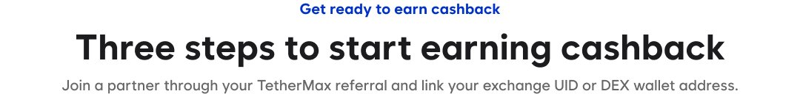 
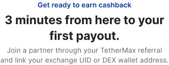 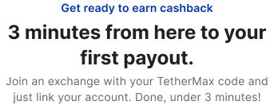
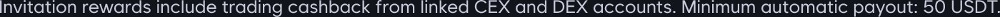 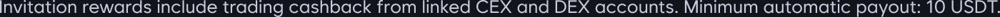
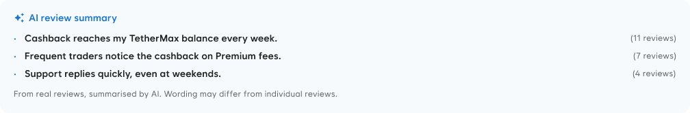 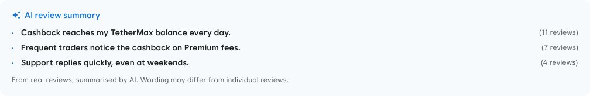
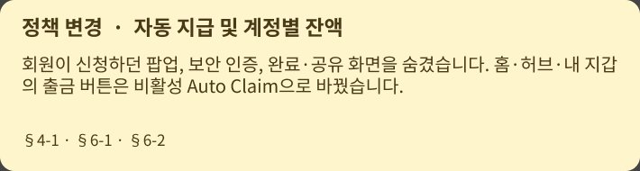 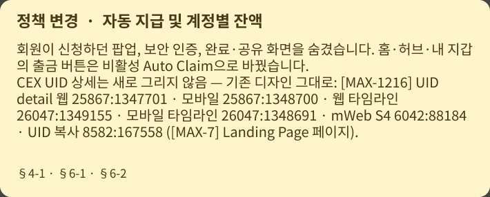
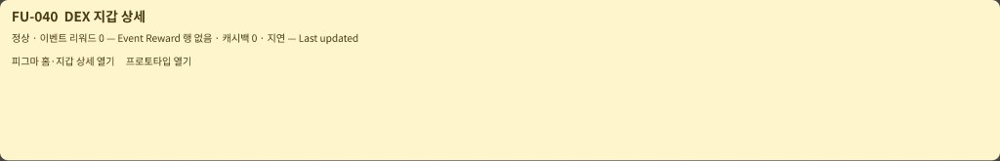 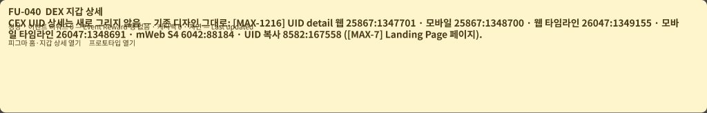
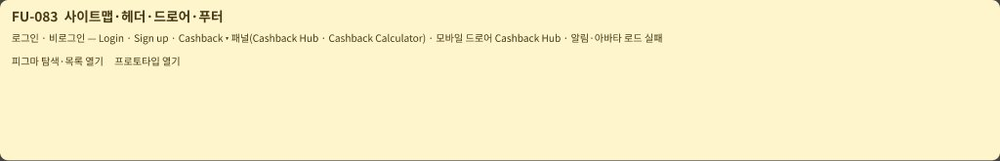 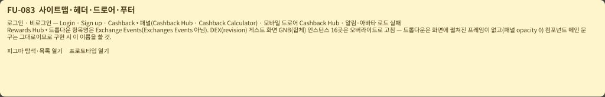

### 4-5 중괄호 값 — 표본 값과 출처

| 화면(노드) | 전 | 후(표본) | 표본 출처 | 개발 인계 메모(추가한 줄) |
|---|---|---|---|---|
| DEX 상세 Plus 선택 [29327:390098](https://www.figma.com/design/hsa3bSV9QmFTe2jsf6tzTm/UI-UX-Design?node-id=29327-390098) 오퍼 박스(인스턴스 오버라이드 3) | `{rate}%` · After cashback `{rate}%` ×2 | `20%` · `0.0040%` · `0.0040%` | 컴포넌트 `DEX / Offer box` · `Venue=Lighter Plus`(27610:193624)의 값 — 같은 섹션 Premium 탭도 `20%`, Plus 수수료 `0.0050%`×(1−20%) · 정책 G-011 Plus 예시 `0.0050%` | [정책 변경 메모 · DEX 상세 · 회원 상태와 거래 가이드](https://www.figma.com/design/hsa3bSV9QmFTe2jsf6tzTm/UI-UX-Design?node-id=28981-129068): Plus 탭 요율 = API-004 `offerBox.tabs[].headline`(어드민 Right Box `Line 2` 치환), 단계 값 = `offerBox.tabs[].stages[]`(레코드 요율로 서버 계산) |
| 맥스보드 · 마지막 날 Batch 후 완성 PC [29330:191656](https://www.figma.com/design/hsa3bSV9QmFTe2jsf6tzTm/UI-UX-Design?node-id=29330-191656) · 모바일 29330:192021 | `Final rankings will be shown when results are announced · {date}` | `… · Oct 28, 09:00` | 같은 보드 집계 화면 `Results on Oct 28, 09:00` · `Results will be announced on Oct 28, 09:00.`(맥스보드 PC 프레임 날짜 표기 `Oct 31, 09:00` 형식). REQ-378의 `YYYY/MM/DD`는 캐시백 요약 형식이라 맥스보드 화면의 기존 형식을 따름 | [FU-068](https://www.figma.com/design/hsa3bSV9QmFTe2jsf6tzTm/UI-UX-Design?node-id=29066-984): `Oct 28, 09:00` = MB-API-002 기존 보드 일정의 결과 발표 시작 시각(어드민 맥스보드 일정 입력, 회원 로컬 시각) |
| 캐시백 챌린지 PC·모바일 5(29335:142890 · 143129 · 143474 · 144127 · 144217) | `Cashback history is updated daily at {local_time}` | `… at 22:00` | REQ-410 · 정책 2952행: 13:00 UTC를 회원 로컬로 변환 — 같은 섹션 시각 표본(맥스보드 `09:00`)과 같은 KST 기준으로 22:00, 타임존 라벨 없음 | [FU-075](https://www.figma.com/design/hsa3bSV9QmFTe2jsf6tzTm/UI-UX-Design?node-id=29066-1005): 고정 13:00 UTC를 회원 로컬 시각으로 변환한 값(감지 실패 시 13:00) |

DEX(revision) 전체 중괄호 검색(`\{` · `\}`, 보이는 텍스트) 결과: 위 10노드 외에는 메일 템플릿(사용자 결정으로 유지)과 주석 `State`(29327:414119 `{venue} = this DEX`, 개발 설명) · 이번에 넣은 메모의 `{요율}`(어드민 입력 틀 설명)뿐.

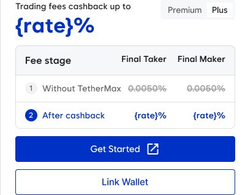 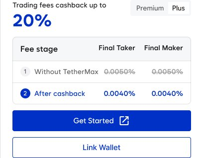
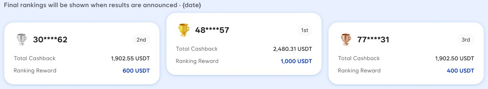 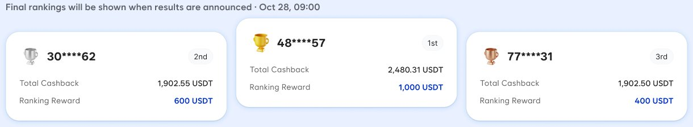
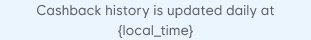 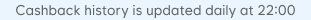
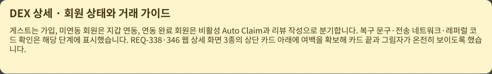 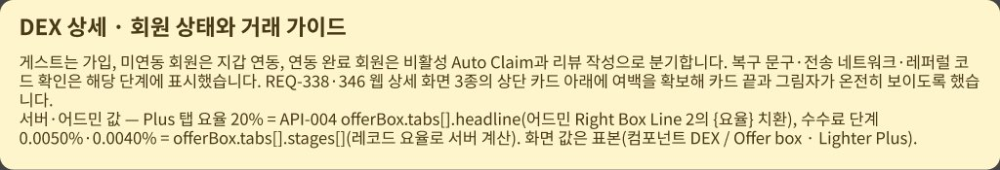
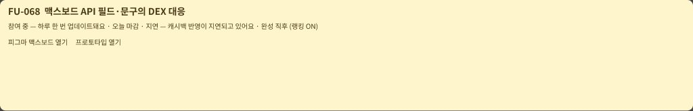 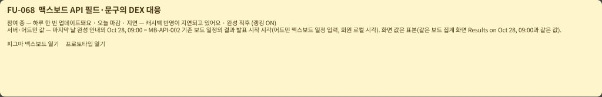 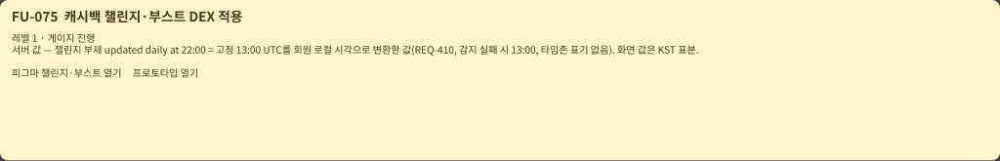

---

## 2. 모바일 캐시백 요약 · 랭킹 (새 프레임)

섹션 「사용자 기능 · PC와 모바일 원본 보완」(29062:110172), 기존 [캐시백 요약 · 모바일](https://www.figma.com/design/hsa3bSV9QmFTe2jsf6tzTm/UI-UX-Design?node-id=29065-6366) 바로 아래 줄.

| 항목 | 화면(노드 링크) | 바꾼 것 | 근거 | 전/후 캡처 |
|---|---|---|---|---|
| 월간 카드 | [캐시백 요약 · 모바일 · 월간 카드](https://www.figma.com/design/hsa3bSV9QmFTe2jsf6tzTm/UI-UX-Design?node-id=29413-137686) | 29065:6366 복제(유형 시트·배경 숨김). 캘린더 칸은 일 순액 1줄(PC CS1과 같은 값: 5일 `-15.00` · 12일 `-11.80` · 26일 `+17.40`, 나머지 `+5.00`, 27일 이후 미표시) · 월간 카드는 기존 mWeb 카드(25886:716270) 복제 `Received +50.60` / `Withdrawn -60.00` / `Net -9.40 USDT`(PC CS1 값) · 캡션 `All amounts are shown in USDT. …`(REQ-378) · 선택일 `2026/05/05` `-15.00 USDT` · 목록 `Exchange Cashback` Lighter Wallet `+5.00` / `Claim Amount` Bitget UID `-20.00`(Lighter 로고 = 같은 섹션 `Lighter mark`) | 9차 #8 · REQ-367 · 369 · 378 · 기존 mWeb 월간 카드 25886:1340772 | `r4_08_mCS_before` / `r4_08_monthly_after` |
| 계정 시트 | [… · 계정 시트](https://www.figma.com/design/hsa3bSV9QmFTe2jsf6tzTm/UI-UX-Design?node-id=29414-138712) | 기존 mWeb `Select UID(s)` 시트(12772:333155) 복제 → 제목 `Select Accounts` · `All Accounts` · CEX 4행 + `Lighter Wallet 0x7a3f…51e9` 행(PC CS6 계정 필터와 같은 목록) | balance #22 ③(승인) · N5 · REQ-366 | `r4_08_accounts_after` |
| 빈 달 | [… · 빈 달](https://www.figma.com/design/hsa3bSV9QmFTe2jsf6tzTm/UI-UX-Design?node-id=29414-137826) | 캘린더 값 없음 · 기존 mWeb 빈 달 카드(27200:24437) `There is no cashback history for this month.` · 목록 `No cashback activity yet.` | PC CS5 · 문구표 #43 | `r4_08_emptyMonth_after` |
| 빈 날 | [… · 빈 날](https://www.figma.com/design/hsa3bSV9QmFTe2jsf6tzTm/UI-UX-Design?node-id=29414-138255) | 월간 카드 유지, 선택일(5일) 값 없음 · 합계 숨김 · `No cashback activity yet.` | PC CS4 · 기존 13762:174885 | `r4_08_emptyDay_after` |
| 모바일 랭킹 주소 팝오버 | [내 캐시백 랭킹 · 모바일 · 주소 팝오버](https://www.figma.com/design/hsa3bSV9QmFTe2jsf6tzTm/UI-UX-Design?node-id=29415-138026) | 29065:6980 복제 + PC 팝오버(28984:126304) 복제를 343 폭으로, EdgeX 행 아래. `Wallet address` · 전체 주소 `0x884BdE72f2E9919E4Cbeef6a83E6Ca9Ea55f1a69`(DEX(revision) 기존 표본) · `Close` | 9차 #9 · balance #40 · REQ-010 | `r4_09_mRK_before` / `r4_09_mRKpop_after` |

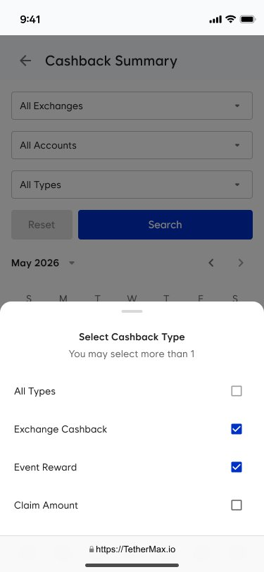 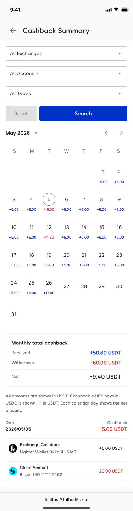 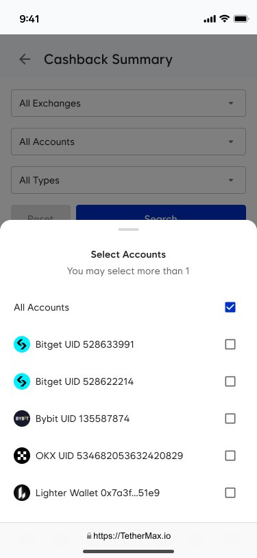 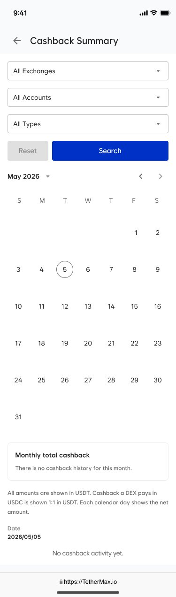 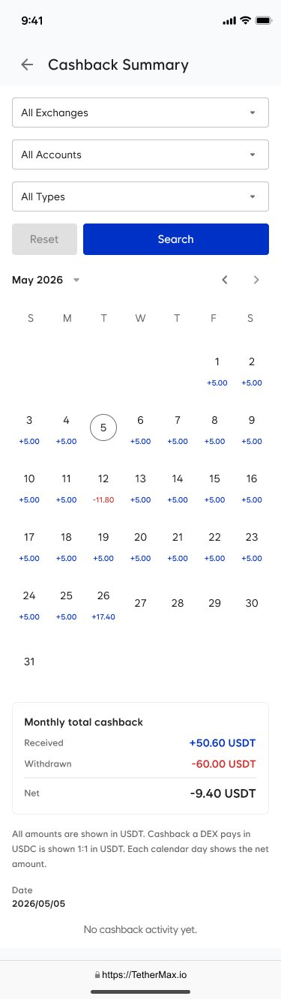
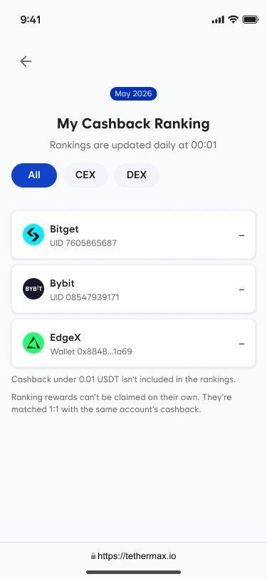 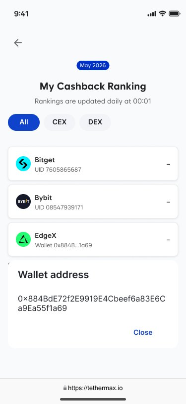

---

## 3. 문구표 행 상태 (9차 #11)

「원본 없음」 판정 전 검색: DEX(revision) 보이는·숨긴 텍스트 전체(섹션 단위) · 오프라인 색인 `_프로토타입_전체/ref/figma_pages/*.xml`(42페이지) · `ref/figma_index.tsv`. 검색어 — #12 `link once` · `keeps? coming` / #16 `uidlinking` · `You must link your account` · `Have you registered` · `I have one` / #19 `Signed up on` · `Paste your .* wallet address to link` / #36 `matched 1:1` · `minimum per account` / #49 `latest .*cashback right now` / #51 `day after you trade` · `appears here` · `Cashback updates` / #54 `before linking` · `Claim Amount (` / #3~#5 `There.s an issue` · `Linking failed` · `Ownership verification failed`. 결과: 문구표 문장 그대로인 화면 0건(#36은 랭킹 캡션의 다른 문장, #54는 연동 섹션 라벨·ApeX 메일의 다른 문장, 색인의 `Linking failed`는 [MAX-7] 메모, `Signed up on`은 `Already signed up on our Partner Exchanges?`).

| 행 | 화면(노드 링크) | 바꾼 것 | 근거 | 전/후 캡처 |
|---|---|---|---|---|
| #3~#5 홈 행 이슈·실패 칩 | 🆕 [HW1 Home, Linked Accounts · Issue and failed](https://www.figma.com/design/hsa3bSV9QmFTe2jsf6tzTm/UI-UX-Design?node-id=29418-141446) | 같은 섹션 `· States`(29328:142352) 복제. ApeX `Linking failed` · Lighter `Ownership verification failed` · EdgeX `There’s an issue` — 칩은 같은 `DEX / Status chip` 인스턴스 `Color=Error`, 상태 점 빨강(Q4 기존 디자인 9401:87675의 빨간 점), 실패 두 행은 금액 `-`(연동·소유 확인이 안 된 지갑이라 잔액 없음), 기존 보조 줄(`Last updated` · 오프보딩 안내) 숨김 | 결정 Q4 · 문구표 #3~#5 · REQ-272 | `r4_11_chips_before` / `_after` |
| #12 앱·모바일웹 빈 홈 카드 | 🆕 [Home / mWeb / S3 · Empty home card](https://www.figma.com/design/hsa3bSV9QmFTe2jsf6tzTm/UI-UX-Design?node-id=29420-138295) | 모바일 섹션 `Home / mWeb / S4 DEX · After first link`(29381:137457) 복제. 잔액 `0.00 USDT` · 토스트 숨김 · Linked Accounts 카드 → 제목 `Link once and cashback keeps coming` + 같은 화면의 기본 버튼(`Join Now` 인스턴스) 복제 `Link Account`, 행·`See All`·추가 연동 줄 숨김 | 문구표 #12 · REQ-267 | `r4_11_12_before` / `_after` |
| #16 웹 `/uidlinking` 진입 질문 | 🆕 [Web / uidlinking · 진입 질문 (꽉 찬 모달)](https://www.figma.com/design/hsa3bSV9QmFTe2jsf6tzTm/UI-UX-Design?node-id=29422-138484) | MAXOP-751 전체 화면 틀(`Platform=Desktop, Severity=Info` 25963:710355) 인스턴스. 제목 `Have you registered a trading account with the TetherMax referral code?`(REQ-712 STG 원문) · 본문 문구표 #16 · 버튼 `Yes, I have one!`(Contained) / `No, not yet!`(Outlined) · 아이콘 숨김 | 문구표 #16 · REQ-712 · 승인 요약 Q10 #2(「1과 같은 틀 + 기존 버튼 2개」) | `r4_11_16_after` |
| #19 가입 후 복귀 안내 | 🆕 [DEX / link / L2-R Return after sign-up, Lighter preselected](https://www.figma.com/design/hsa3bSV9QmFTe2jsf6tzTm/UI-UX-Design?node-id=29422-138551) | L2(28960:127275) 복제, 모달 첫 줄 `No wallet connection or signature required.`(아래 안내 문단에 같은 문장 있음) → `Signed up on Lighter? Paste your Lighter wallet address to link it.`(`{DEX}` = Lighter 표본) | 문구표 #19 · G-402 | `r4_11_19_before` / `_after` |
| #36 매칭 안내 | ✏️ 허브 [H5](https://www.figma.com/design/hsa3bSV9QmFTe2jsf6tzTm/UI-UX-Design?node-id=29352-145077) DEX 패널 영수증 29352:146629 | 각주 아래에 같은 텍스트 스타일로 `Event rewards are matched 1:1 with the same account’s cashback. The minimum per account is 10 USDT.`(29423:139846) | 문구표 #36 · 정책 4-1 · G-419 | `r4_11_36_before` / `_after` |
| #51 DEX 0원 배너 | 🆕 [PW1 My Cashback · Zero balance](https://www.figma.com/design/hsa3bSV9QmFTe2jsf6tzTm/UI-UX-Design?node-id=29423-139494) | `· Delayed`(29330:199016) 복제, 안내 줄 자리 → `Cashback appears here the day after you trade on your linked DEX.` · `Available Cashback` · `Exchange Cashback` `0.00 USDT` · `Event Reward` 행 숨김 · `Claimable 0.00 USDT · Minimum 10 USDT` · 진행 막대 채움 숨김. 갱신 주기 칸은 놓을 화면 없음(요약 표) | 문구표 #51 · G-110 · G-428 | `r4_11_51_before`(Delayed) / `_after` |
| #54 연동 전 출금 행 | 🆕 [CS1 Month view · Claim before linking](https://www.figma.com/design/hsa3bSV9QmFTe2jsf6tzTm/UI-UX-Design?node-id=29424-139723) | CS1(28960:127133) 복제, Lighter 행 → `Claim Amount (before linking)` `-12.40 USDT` · 26일 칸 `-7.40` · 월간 `+38.20` / `-72.40` / `-34.20 USDT`. 섹션 높이 2659→2960 | 문구표 #54 · G-426 · API-사용자 `PRELINK_PAYOUT`(요약에 `연동 전 출금` 행) | `r4_11_54_before` / `_after` |
| #49 | — | 그리지 않음(요약 표) | — | — |

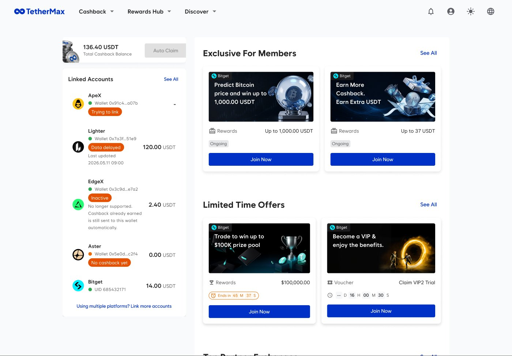 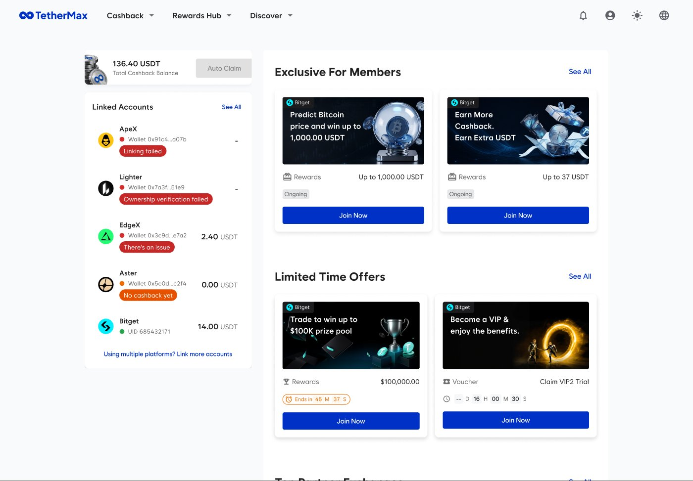
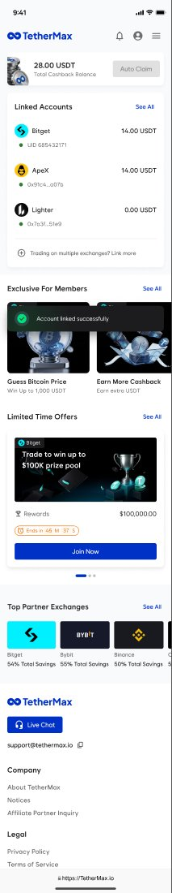 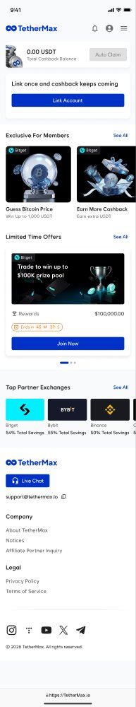
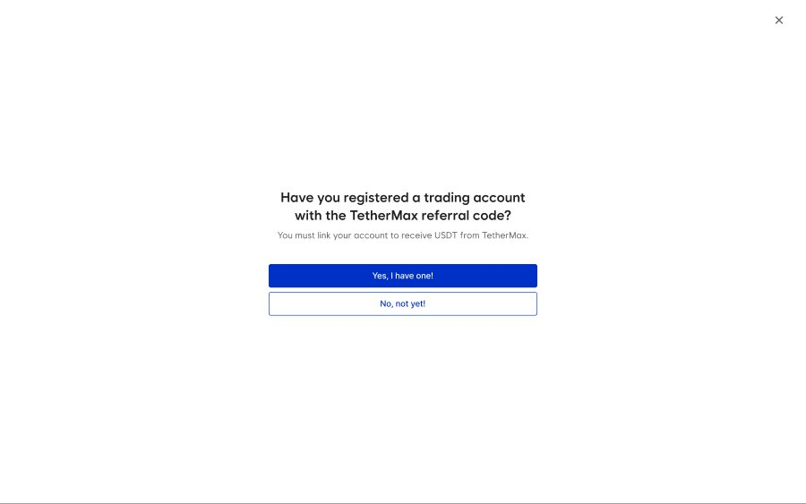
 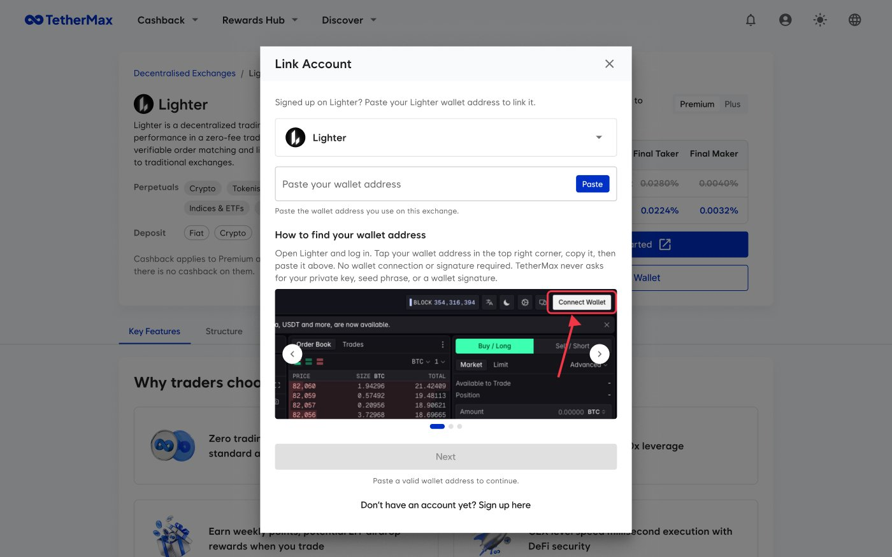
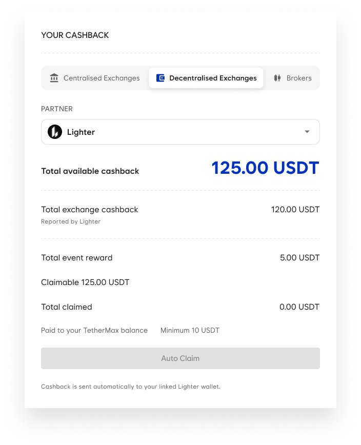 
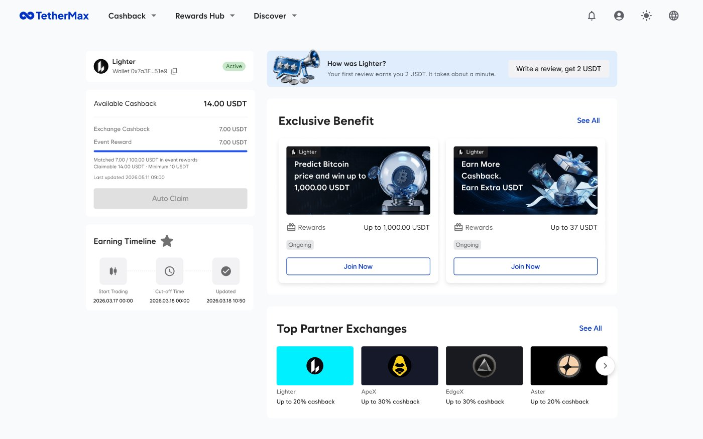 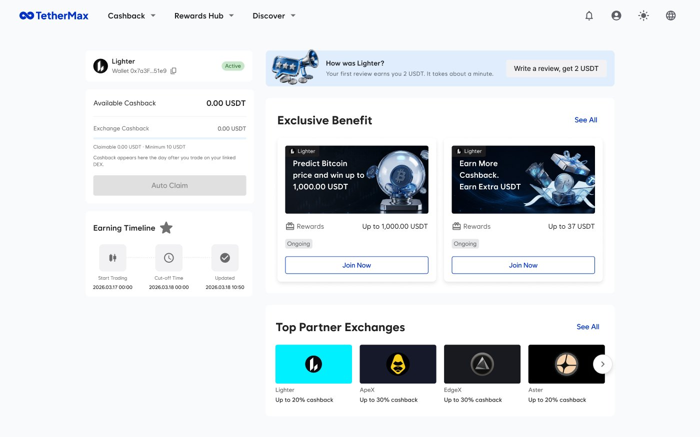
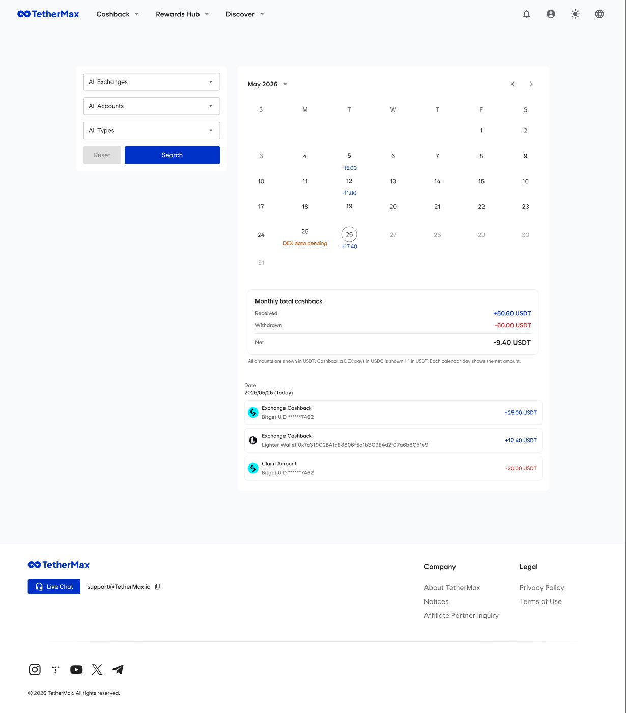 

---

## 4. 새 프레임 목록

| # | 노드 | 이름 | 섹션 |
|---|---|---|---|
| 1 | 29413:137686 | 캐시백 요약 · 모바일 · 월간 카드 | 사용자 기능 · PC와 모바일 원본 보완 |
| 2 | 29414:138712 | 캐시백 요약 · 모바일 · 계정 시트 | 〃 |
| 3 | 29414:137826 | 캐시백 요약 · 모바일 · 빈 달 | 〃 |
| 4 | 29414:138255 | 캐시백 요약 · 모바일 · 빈 날 | 〃 |
| 5 | 29415:138026 | 내 캐시백 랭킹 · 모바일 · 주소 팝오버 | 〃 |
| 6 | 29418:141446 | DEX / Web / DEX withdraw HW1 Home, Linked Accounts / Light · Issue and failed | DEX · 기존 홈 / 허브 / 지갑 상세의 잔액 표시 · Web |
| 7 | 29423:139494 | DEX / Web / DEX withdraw PW1 My Cashback, Lighter selected / Light · Zero balance | 〃 |
| 8 | 29420:138295 | Home / mWeb / S3 · Empty home card | Mobile |
| 9 | 29422:138484 | Web / uidlinking · 진입 질문 (꽉 찬 모달) | DEX — Link, all states and detail page entry |
| 10 | 29422:138551 | DEX / link / L2-R Return after sign-up, Lighter preselected / light | 〃 |
| 11 | 29424:139723 | DEX / CS1 Month view / light · Claim before linking | DEX — Cashback Summary Web |
| 12 | 29427:143649 | DEX detail / Member without a linked wallet · Offer box with discount (Taker) | DEX 상세 · 회원 상태별 오퍼(섹션 폭 4700→6260) |
| 13 | 29427:143878 | DEX / Mobile / detail / D4 EdgeX · Offer box with discount (Taker) / light | DEX — DEX detail Mobile [Light] |

기존 프레임에 넣은 새 노드: H5 매칭 안내 줄 29423:139846.

---

## 5. 프로토타입에 반영할 것

| 화면 | 바꿀 것 |
|---|---|
| 서비스 소개 3단계 부제(PC·모바일) | `Join an exchange with your TetherMax code and just link your account. Done, under 3 minutes!`(문구표 #75) |
| DEX 상세 리뷰 AI 요약 표본 | `Cashback reaches my TetherMax balance every day.` |
| DEX 상세 Lighter Plus 탭 | `20%` · After cashback `0.0040%` / `0.0040%` |
| 맥스보드 마지막 날 완성 안내 | `Final rankings will be shown when results are announced · Oct 28, 09:00` |
| 캐시백 챌린지 부제 | `Cashback history is updated daily at 22:00`(로컬 변환 표본) |
| GNB `Rewards Hub ▾` | `Exchange Events` |
| 모바일 캐시백 요약 | 월간 카드(`Received` · `Withdrawn` · `Net` + 캡션) · 계정 시트(`Select Accounts`, CEX UID + DEX Wallet 행) · 빈 달 · 빈 날 상태, 캘린더 칸 = 일 순액 1줄 |
| 모바일 랭킹 | DEX 행 주소 탭 → 팝오버(`Wallet address` · 전체 주소 · `Close`) |
| 홈 Linked Accounts 행 | `Linking failed` · `Ownership verification failed` · `There’s an issue` 칩(오류 색) + 빨간 상태 점, 실패 행 금액 `-` |
| 앱·모바일웹 S3 홈 | 빈 홈 카드 `Link once and cashback keeps coming` + `Link Account` |
| 웹 `/uidlinking` 진입 | 꽉 찬 모달: 제목 `Have you registered a trading account with the TetherMax referral code?` · 본문 `You must link your account to receive USDT from TetherMax.` · `Yes, I have one!` / `No, not yet!` |
| 연동 모달 가입 후 복귀 | 첫 줄 `Signed up on {DEX}? Paste your {DEX} wallet address to link it.` |
| 허브 DEX 패널 | 각주 아래 매칭 안내(문구표 #36) |
| 지갑 상세 0원 | 안내 `Cashback appears here the day after you trade on your linked DEX.` · 금액 0.00 · 진행 막대 0 |
| 캐시백 요약 일별 목록 | `Claim Amount (before linking)` 행 유형 |
| DEX 상세 오퍼 박스 | `After discount` 행은 선택한 Taker/Maker의 레코드 할인율 > 0일 때만(0이면 2행, Lighter 포함) |
| 리뷰 영역 · 상세 | 별점 막대 · AI 요약 아이콘·제목·불릿·배경 · `Read more` · `How this works` · 계산기 단계 배지 · Lighter 오퍼 `After cashback` 값 = #0031C6(`primary/blue/main`) |
| 리뷰 표본 국문 | 「매주 들어오고」 → 「매일 들어오고」 |

---

## 6. 추가 — 오퍼 박스 할인 단계(`After discount`) 상태

결정(사용자): `After discount` 행은 레코드 할인율(선택한 Taker/Maker 기준)이 0보다 클 때만 표시, 0이면 2행(모든 DEX, Lighter 포함). EdgeX Maker는 할인 전 값이 없어 2행 — Maker 3행 프레임은 만들지 않음.

| 항목 | 화면(노드 링크) | 바꾼 것 | 근거 | 전/후 캡처 |
|---|---|---|---|---|
| PC Taker 3행 | 🆕 [DEX detail / Member without a linked wallet · Offer box with discount (Taker)](https://www.figma.com/design/hsa3bSV9QmFTe2jsf6tzTm/UI-UX-Design?node-id=29427-143649) + 위 `State` 설명(29427:143681) | 같은 섹션 EdgeX 탭 1개 상태(29327:389756) 복제, 오퍼 박스만 분리(7차 A) 후 기존 `<ToggleButtonGroup>` 인스턴스(Taker 선택 / Maker) 추가. 행 ① `Without TetherMax` `0.0600%`(취소선) ② `After discount` `0.0400%`(번호 배지 2, 일반 색) ③ `After cashback` `0.0280%`(강조), 헤드라인 `30%` | 정책 B-7-2 · REQ-339 · REQ-505 · 프로토타입 `_프로토타입_전체/src/80-dex.js` EdgeX 레코드 표본 `rate:30, list:.06, taker:.04, maker:.015` · `fin = taker×(1−rate/100)` = 0.0280% | `r4_13_offerPC_before`(원본 389756, ③ `0.0184%`) / `r4_13_offerPC_after` |
| 모바일 Taker 3행 | 🆕 [DEX / Mobile / detail / D4 EdgeX · Offer box with discount (Taker)](https://www.figma.com/design/hsa3bSV9QmFTe2jsf6tzTm/UI-UX-Design?node-id=29427-143878) | 모바일 D4 EdgeX(29360:144056) 복제, 오퍼 박스 분리 후 ③ `0.0184%` → `0.0280%`(토글 Taker/Maker · 3행은 원래 있음) | 위와 같음 | `r4_13_offerM_before` / `r4_13_offerM_after` |
| 개발 인계 메모 | [FU-054](https://www.figma.com/design/hsa3bSV9QmFTe2jsf6tzTm/UI-UX-Design?node-id=29066-942) · [정책 변경 메모 · DEX 상세](https://www.figma.com/design/hsa3bSV9QmFTe2jsf6tzTm/UI-UX-Design?node-id=28981-129068) | 「After discount 행은 레코드 할인율(Taker/Maker 각각)이 0보다 클 때만 표시, 0이면 2행 — REQ-339. 예: EdgeX Taker 3행(0.0600% → 0.0400% → 0.0280%), Maker는 할인 없음 → 2행.」 | 결정 | `r4_13_FU054_before` / `r4_13_FU054_after` |

기존 EdgeX·Aster·ApeX 상세(D4~D6 PC·모바일)와 29327:389756의 ③ `0.0184%`는 기존 Figma 값 그대로(프로토타입은 REQ-339 기준 레코드 표본 0.0280%로 통일 — G-045 실값 회신 전).

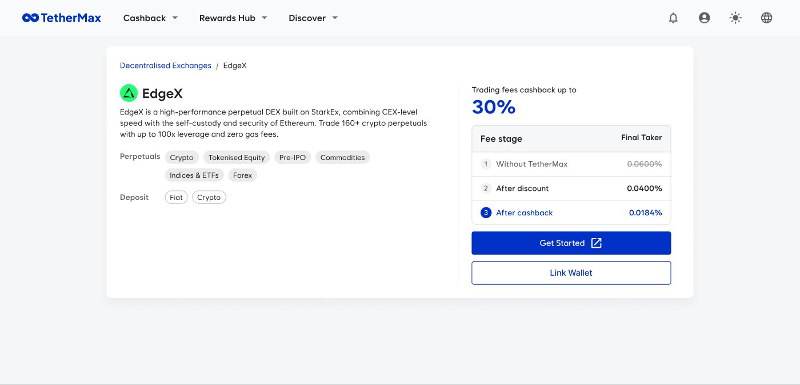 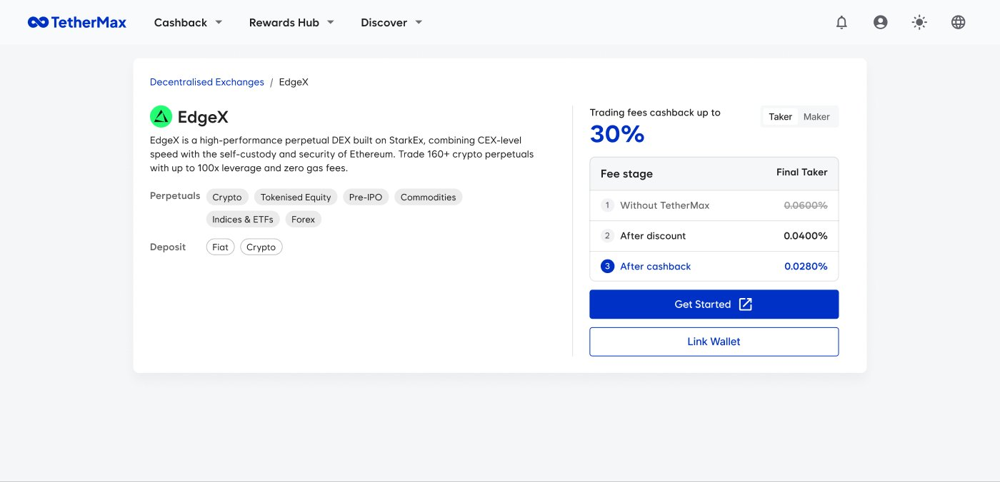
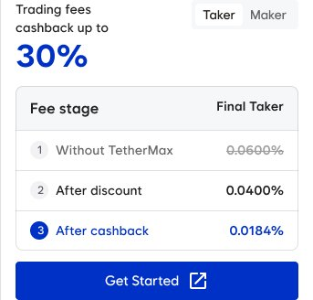 
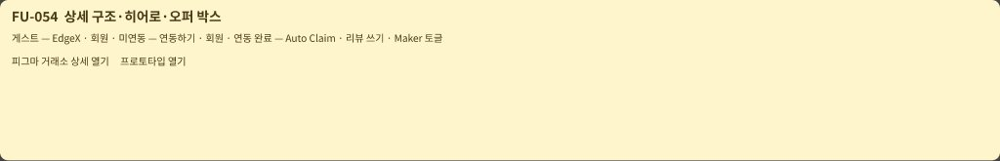 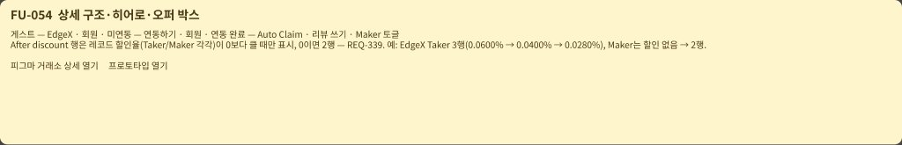

---

## 7. 추가 — 리뷰 영역 파랑 통일

기준 색: 같은 블록 오른쪽 `Sign up` 버튼(`Reviews / Write gate pane` › `cta`) 채움 = 변수 **`primary/blue/main`**(컬렉션 `palette`, 라이브러리 변수, 값 #0031C6). 바꾸기 전 색: 변수 **`primary/main`**(#1976D2, MUI 기본 파랑).

| 항목 | 화면 | 바꾼 것 | 전/후 캡처 |
|---|---|---|---|
| 별점 분포 막대(5~2 Stars 채움) | DEX 상세 PC 섹션(28960:127424) · 연동 섹션 상세 배경(28960:127217)의 `Reviews / Histogram row` 인스턴스 | 채움 `fill` 사각형 92개: `primary/main` → `primary/blue/main` 바인딩(인스턴스 오버라이드) | `r4_review_color_PC_before` / `r4_review_color_PC_after` |
| `AI review summary` 아이콘(✦) · 제목 · 불릿(·) | 같은 두 섹션의 `Reviews / AI summary` 인스턴스 | 아이콘 23 · 제목 23 · 불릿 69: 같은 변수로 바인딩 | 위와 같음 |
| 모바일 리뷰(Mobile 섹션 13블록) | `Reviews / Section / 375` | 변경 없음 — 막대·아이콘·제목·불릿이 이미 `primary/blue/main` | — |

AI 요약 상자 배경 · 리뷰 카드 `Read more`는 후속 결정으로 8장에서 같은 변수로 바꿈. 별(`components/rating/activefill`)은 그대로, `Show original`·정렬 탭은 이미 `primary/blue/main`.

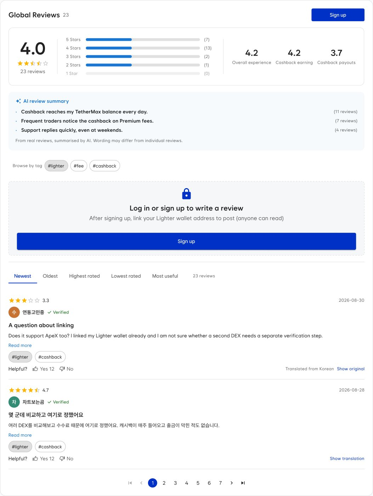 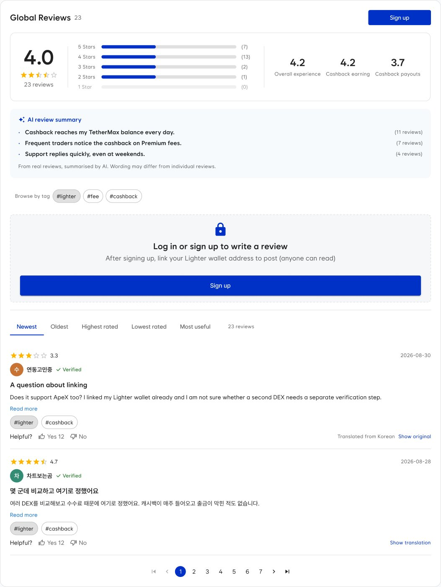

### #1976D2 계열이 리뷰 외에 쓰인 곳(8장에서 모두 변경)

| 섹션 | 요소 | 수 | 예시 프레임 |
|---|---|---|---|
| DEX — DEX detail Web | 계산기 블록 제목 `How this works` 글자 + 정보 아이콘(`InfoOutlineRounded`) | 10 + 10 | 29357:143619 |
| DEX — Link, all states and detail page entry | 같은 `How this works` 글자 + 아이콘(상세 배경) | 13 + 13 | 28960:127271 |
| DEX — DEX detail Web · Link 섹션 | 리뷰 카드 `Read more`(리뷰 블록 안이지만 이번 대상 아님) | 17 · 26 | 29357:143619 · 28960:127271 |
| Mobile | Lighter 오퍼 박스 `After cashback` 값 `0.0224%` · `0.0032%` | 7 · 7 | 29360:141115 |
| DEX — DEX detail Web · Link 섹션 | AI 요약 상자 배경(`primary/_states/hover`) | 24 | 29357:144636 |

검색 범위: DEX(revision) 섹션 전체의 보이는 TEXT · RECTANGLE · VECTOR · FRAME · ELLIPSE · LINE 채움·선 중 #1976D2 · #1565C0 · #42A5F5 또는 변수 `primary/main` 바인딩.

---

## 8. 후속 — 옛 파랑 나머지 · 리뷰 표본 국문

| 항목 | 화면 | 바꾼 것 | 근거 | 전/후 캡처 |
|---|---|---|---|---|
| `How this works` 글자 · 정보 아이콘 | DEX 상세 PC(D4~D6 등 10) · 연동 섹션 상세 배경(13) | `primary/main` → `primary/blue/main` 바인딩 23 + 23(인스턴스 오버라이드) | 사용자 결정(옛 파랑 통일) | `r4_review_color_how_before` / `_after` |
| 리뷰 카드 `Read more` | DEX 상세 PC 17 · 연동 섹션 26 | 같은 변수로 43 | 〃 | `r4_review_color_card_before` / `_after` |
| AI 요약 상자 배경 | DEX 상세 11 · 연동 섹션 13 | `primary/_states/hover`(#1976D2 4%) → `primary/blue/main` + 칠 불투명도 4% 유지(24) | 〃 | `r4_review_color_aiBg_before` / `_after` |
| 모바일 Lighter 오퍼 `After cashback` 값 | Mobile 섹션 Lighter 상세 7프레임 | `0.0224%` · `0.0032%` 글자 14 | 〃 | `r4_review_color_moOffer_before` / `_after` |
| 계산기 설명 단계 번호 배지(`Cashback / Step Badge`) | DEX 상세 PC · 연동 섹션 `Cashback / Steps Row` 23줄 | 배지 69: 같은 변수로(7장 목록 조사에서 인스턴스 자체 칠이라 빠졌던 곳) | 〃 | `r4_review_color_steps_after` |
| 리뷰 표본 국문 본문 | DEX 상세 PC 10 · 연동 섹션 13(새 프레임 L2-R 포함) | 「…캐시백이 매주 들어오고…」 → 「…매일 들어오고…」 23노드 | 9차 #4 · G-428 | `r4_review_color_card_after`(두 번째 카드) |

확인: 변경 후 DEX 상세 PC · 연동 · Mobile 세 섹션에서 `primary/main` 바인딩 0건, 그 밖의 섹션은 처음부터 0건. 같은 블록의 다른 색(별 · 칩 테두리 · `Verified` 초록 · 이미 `primary/blue/main`인 노드)은 그대로.

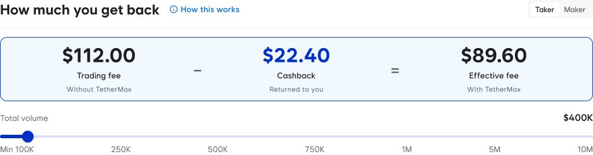 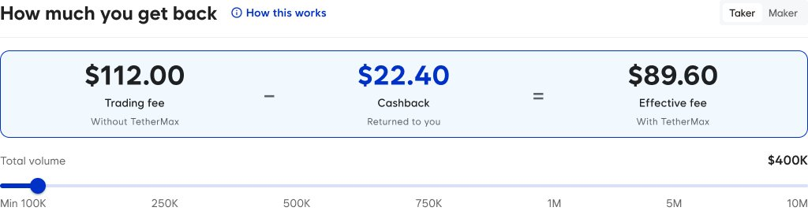
 
 
 

