# Figma 수정 결과 — 6차 (12차 결정 · 화면 요소 정의)

2026-11-27 · 대상 Figma `DEX(revision)` [28960:125519](https://www.figma.com/design/hsa3bSV9QmFTe2jsf6tzTm/UI-UX-Design?node-id=28960-125519) · 결정 [_Figma수정_결정.md](_Figma수정_결정.md) 12차 · 근거 [화면요소_정의_전수점검.md](화면요소_정의_전수점검.md)(🔴 2장 · 🔁 3장) · 이전 [5차](Figma수정결과_5차.md) · 캡처 [Figma수정결과_img/](Figma수정결과_img/) `r6_*.jpg`

노드 링크: `https://www.figma.com/design/hsa3bSV9QmFTe2jsf6tzTm/UI-UX-Design?node-id={앞}-{뒤}`. 다른 페이지·컴포넌트 메인은 고치지 않았다. 연동 모달 중간 안내 `Start by signing up for Lighter?`(28960:127418)는 13차 결정으로 숨겼다(4장).

## 요약

| 구분 | 수 | 내용 |
|---|---|---|
| 처리 | **14건** | ① 연동 모달 첫 상태 WOO X Pro 4프레임 · ② 리그 상금 수령 화면 6프레임 숨김 + 메모 · ③ 🔴 #7 · #22 · #27 · #47 · #48 · 🔁 #31 · #34 · #33 · #43 · #55 · 추가 결정 3(가입 중간 안내 숨김 · `Register here` 60곳 · EMAIL 31 버튼 10) |
| 새 프레임 | **2** | PC S3-2 기본 선택(29467:139474) · 모바일 기본 선택(29467:140062) |
| 숨김 | 프레임 14 · 요소 211 | 리그 6 · EMAIL 32 6(EN·KO·모바일·발송 조건) · 옛 S3-2 · 옛 모바일 빈 선택 / 소유권 토글 16 · 허브 모바일 ⓘ 168 · 보기 토글 20 · TP 안내 줄·칩 4 · 목록 `See All` 1 · 힌트 2 |
| Figma가 이미 맞음 | 6건 | 아래 「손대지 않은 것」 |
| 못 한 것 | 1건 | STG 직접 확인(#47 · #48) — STG 접근 없음, 실사이트 수집본으로 판단 |

---

## ① 연동 모달 첫 상태 = 목록 첫 거래소 `WOO X Pro` (G-379 · 🔁 #31 · #34)

기준: 기존 CEX 연동 폼 — PC [29327:385171](https://www.figma.com/design/hsa3bSV9QmFTe2jsf6tzTm/UI-UX-Design?node-id=29327-385171) · 모바일 [29051:100488](https://www.figma.com/design/hsa3bSV9QmFTe2jsf6tzTm/UI-UX-Design?node-id=29051-100488)(거래소 선택 행 · `Enter your UID` 빈 입력란 · 비활성 `Next` · `Steps to link UID` · `Sign up here`). 거래소 마크는 같은 화면 공통 거래소 검색 목록의 `WOO X Pro` 마크(I29227:120739;29225:119319)를 복제. 목록 이름은 `WOO X Pro`(G-379 · 공통 검색 목록 표기).

| 화면(노드) | 바꾼 것 | 전/후 |
|---|---|---|
| S3-2 홈 첫 연동 PC — 새 [29467:139474](https://www.figma.com/design/hsa3bSV9QmFTe2jsf6tzTm/UI-UX-Design?node-id=29467-139474)(옛 28960:127765 숨김, 같은 자리) | 홈 위 연동 모달을 기존 CEX 폼으로: `WOO X Pro` 선택 · `Enter your UID` · `Next` 비활성(State=Disabled) · 가이드 문장의 거래소명 `WOO X Pro`. 옛 `Select a partner` · `Link Account`(비활성) 모달 숨김 | `r6_01_S3-2_before` · `_after` |
| L16 홈 체크리스트 · 공통 거래소 검색 [28960:127367](https://www.figma.com/design/hsa3bSV9QmFTe2jsf6tzTm/UI-UX-Design?node-id=28960-127367) | 드롭다운 `Select a partner` → WOO X Pro 마크 + `WOO X Pro` · 안내 `Select the partner you trade on…` 숨김 · 버튼 `Link Account` → `Next` | `r6_01_L16_before` · `_after` |
| S3-3 공통 거래소 검색 [29020:204682](https://www.figma.com/design/hsa3bSV9QmFTe2jsf6tzTm/UI-UX-Design?node-id=29020-204682) | 같음 | `r6_01_S3-3_before` · `_after` |
| 모바일 빈 선택 — 새 [29467:140062](https://www.figma.com/design/hsa3bSV9QmFTe2jsf6tzTm/UI-UX-Design?node-id=29467-140062)(옛 「Link Account — nothing selected」 29327:405399 숨김) | 기존 모바일 CEX 폼 복제: `WOO X Pro` · `Enter your UID` · `Next` 비활성 | `r6_01_mEmpty_before` · `r6_01_mDefault_after` |
| 라벨 · 묶음 설명 28960:127763 · 28960:127764 · 28960:127753 | `Link Account, choose a partner` → `Link Account, WOO X Pro selected by default` · 설명 「nothing selected … preselecting nothing」 → 「the first partner in the list (WOO X Pro) selected (G-379)」 | — |

가이드 이미지(`Steps to link UID`)는 거래소별 어드민 입력값이라 기존 표본 이미지를 그대로 두었다.

## ② 글로벌 리그 상금 수령 화면 없음 (REQ-391 · 🔁 #63 · #64)

| 화면(노드) | 바꾼 것 | 전/후 |
|---|---|---|
| 상금 수령 계정 PC [29183:118280](https://www.figma.com/design/hsa3bSV9QmFTe2jsf6tzTm/UI-UX-Design?node-id=29183-118280) · 모바일 29183:118305(`Receive league prize` · `Receive Prize`/`Cancel`) | 숨김 | `r6_02_prize_before` |
| 수령 완료 PC 29183:118342 · 29187:119752 · 모바일 [29186:120005](https://www.figma.com/design/hsa3bSV9QmFTe2jsf6tzTm/UI-UX-Design?node-id=29186-120005) · 29187:119756(`Back to Home` · `View Rewards`) | 숨김 | `r6_02_prizeDoneM_before` |
| 인계 메모 FU-064 29066:974 | ` · 상금 수령 계정 선택` → ` · 상금 = 참가 계정으로 지급(수령 화면 없음, REQ-391)` | `r6_02_FU064_after` |

리그 상금 메모 29185:121231(「상금은 실제 참가 지갑으로 귀속」)과 캐시백 요약의 리그 상금 내역 프레임은 그대로.

## ③ 화면 요소 정의 — Figma 쪽 수정

| 점검 # | 화면(노드) | 바꾼 것 | 근거(권장안) | 전/후 |
|---|---|---|---|---|
| 🔴 #7 | Exchange Listings PC [29370:138808](https://www.figma.com/design/hsa3bSV9QmFTe2jsf6tzTm/UI-UX-Design?node-id=29370-138808) | `Top Centralised Exchanges` 옆 `See All` 29370:138879 숨김(목록 화면 안에서 갈 곳 없음) | (b) | `r6_03_listing_before` · `_after` |
| 🔴 #22 | 모바일 소유권 16프레임(Recording guide 1~3 · Uploading · Ready to submit · Upload failed · Confirm submission · Unexpected error, 라이트·다크) | 제목 줄 `<ToggleButtonGroup>`(2칸) 숨김 — 29102:118120 · 119057 · 119458 · 120010 · 118636 · 120522 · 121036 · 121539 · 121940 · 122341 · 122969 · 123507 · 124131 · 124721 · 132488 · 133058 | A | `r6_03_ownToggle_before` · `_after` |
| 🔴 #27 | 허브 모바일 라이트 28960:130790 · 다크 28960:130866 카드 `Up to n% cashback` 옆 ⓘ(`rate` › `info`) 168곳 | 숨김(인스턴스 오버라이드) — 기존 거래소 목록 카드(MAX-1216 CMT-08 모바일 26382:789181)에 ⓘ 없음, 같은 페이지 메모 23311:165306 「실사이트 info 아이콘은 아무 동작 없음」 | B → 기존 동작 없음 → A | `r6_03_hubM_before` · `_after` |
| 🔁 #43 | 같은 허브 모바일 `view toggle (single icon, shows List)` 20곳 | 숨김 — 모바일은 카드 고정(G-151) | 문서 기준 | 같음 |
| 🔴 #47 · #48 | TP · 포인트 내역 PC [29365:134702](https://www.figma.com/design/hsa3bSV9QmFTe2jsf6tzTm/UI-UX-Design?node-id=29365-134702) · 모바일 29062:114572 | 안내 줄 `You have TetherMax Points available to claim.`(`View`) 29365:134728 · I29062:114572;12565:360136 숨김 · 칩 `Real-Time Ranking` 29365:134738 · I29062:114572;12565:275730 숨김 — 실사이트 수집본에 둘 다 없음(칩은 `TP` · `Earning History` 2개) | 「현행에 없으면 제거」 | `r6_03_TP_before` · `_after` |
| 🔁 #55 | 사용자 이메일 EMAIL 32 `Lighter 확인 중 → 확정` EN [29061:1174](https://www.figma.com/design/hsa3bSV9QmFTe2jsf6tzTm/UI-UX-Design?node-id=29061-1174) · KO 29062:118668 · 모바일 29064:2466 · 29064:5695 · 발송 조건 29061:1238 · 29062:118732 | 숨김(`View linked wallet` 포함) | 정책 D-5-12 「적용 안 함」 · G-428 | `r6_03_email32_before` |
| 🔁 #33 | 개발 인계 메모 · 연동 입력·오류 [29010:126471](https://www.figma.com/design/hsa3bSV9QmFTe2jsf6tzTm/UI-UX-Design?node-id=29010-126471) | 한 줄 추가: `Register here = 선택한 거래소의 테더맥스 레퍼럴 가입 페이지를 새 탭으로 엽니다(REQ-053). 모달 첫 상태는 목록 첫 거래소(WOO X Pro) 선택(G-379).` 메모 높이 253 → 275 | 12차 · REQ-053 | `r6_03_memoLink_before` · `_after` |

### 손대지 않은 것 (Figma가 이미 문서와 같음 · 프로토타입 쪽 수정)

| 점검 # | 내용 |
|---|---|
| 🔁 #60 · #61 맥스보드 라벨(N5) | Figma는 이미 `Select New Account` · `Link Account`(29064:8176 · 29064:8531 · 29064:9601 · 29064:9961) — `Select New Wallet` · `Link Wallet`은 프로토타입에만. 연동 화면의 `Link Wallet`은 DEX 상세 오퍼 버튼(DEX 문맥)이라 대상 아님 |
| 🔁 #23 O1 `Try a different wallet` | Figma O1(28960:127644)에 없음, O2(28960:127650)에만 — REQ-089 · REQ-724와 같음 |
| 🔁 #32 · #42 검색 0건 문구 | Figma는 `No results found for {검색어}` |
| 🔴 나머지(#1~#6 · #8~#21 · #23~#26 · #28~#46) | 동작·목적지 정의 — 문서·프로토타입 반영 대상, Figma 변경 없음 |
| 🔁 #5 · #46 · #50 · #53 · #65 | 새 요소 추가가 필요하거나(푸터 `Claim Cashback` PC · 모바일 비교 카드 `Join` 버튼) 문서끼리·실서비스 근거가 정리되지 않음(리뷰 게이트 `Link Wallet` ❓ 권고 · Cashback Basics 하단 버튼 · 혜택 완료 빈 상태 문구 — 실사이트 수집본에 두 문구 모두 없음) — 결정 후 |

## 4. 연동 가입 링크 · EMAIL 31 버튼 (13차 결정)

| 결정 | 화면(노드) | 바꾼 것 | 전/후 |
|---|---|---|---|
| ① 가입 중간 안내 없음 | `Signup + Link Wallet / 2 Signup` [28960:127418](https://www.figma.com/design/hsa3bSV9QmFTe2jsf6tzTm/UI-UX-Design?node-id=28960-127418)(`Start by signing up for Lighter?` · `Sign up through our Lighter link`) + 라벨 28960:127391 | 숨김 — 가입 링크는 바로 선택 거래소 레퍼럴 가입 새 탭. 1 Entry · 3 Return 프레임은 그대로 | `r6_04_signupMid_before` |
| ② 가입 링크 문구 | 연동 모달 PC · 모바일 60곳(연동 L1~L5 · L16 · L17 · L1-F · L2-R · L3-R · 주소 검증 7 · 검색 팝오버 2 · 홈 스토리 S3-2~S4-4 · CEX 폼 · 모바일 폼, 6차 새 프레임 2 포함) + 연동 인계 메모 | `Don’t have an account yet? Sign up here` → `Don’t have an account yet? Register here`(링크 부분 글자 모양 유지) | `r6_04_L2_before` · `_after` |
| ③ EMAIL 31 버튼 | EN 5 [29061:902](https://www.figma.com/design/hsa3bSV9QmFTe2jsf6tzTm/UI-UX-Design?node-id=29061-902) · 29061:970 · 29061:1038 · 29061:1106 · 29349:139404 / 모바일 5 29064:2214 · 2277 · 2340 · 2403 · 29349:139536 | 기존 메일 버튼(EMAIL 16 `<Button>` 29062:8642 · 모바일 29064:5921) 복제 → 라벨 `Link Wallet`(DEX 기존 버튼 문구), 상세 블록 아래 · 고객지원 문장 위. 메일 높이 +66. 발송 조건 카드 8장(EN·KO)에 `버튼 Link Wallet → 해당 DEX가 선택된 연동 모달(정책 D-5-11 이동 경로). KO 버튼 문구는 문구표 대기.` 한 줄 | `r6_04_email31_before` · `_after` · `r6_04_email31m_before` · `_after` · `r6_04_email31cond_after` |
| ④ TP 안내 줄 · `Real-Time Ranking` | — | 3장 숨김 유지 | — |

KO 메일 10장(29062:118396 · 118464 · 118532 · 118600 · 29349:139470 · 모바일 29064:5443 · 5506 · 5569 · 5632 · 29349:139602)에는 버튼을 넣지 않았다 — `Link Wallet` 국문 원문 없음(문구표 #4는 「기존 국문 짝」만, 실사이트 수집본에 국문 조각 없음). 국문 확정 후 같은 방식으로 추가.

검색: 연동 · 홈 스토리 · 오퍼 · 게스트 · 소유권 · 사용자 기능 · 상세 · 인계 · 허브 · 개요 섹션 + Mobile 하위 묶음 TEXT `Sign up here`(보이는 60 · 숨김 0) · `Start by signing up`(1프레임).

| 전 | 후 |
|---|---|
| 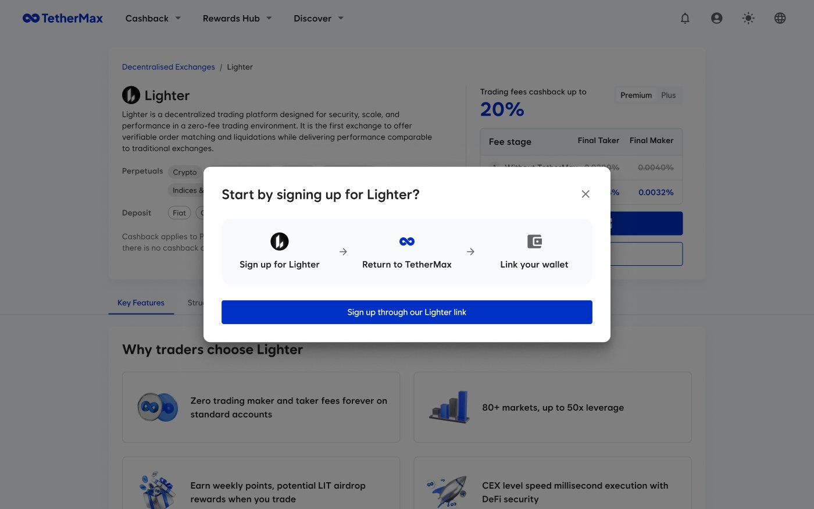 | (숨김) |
| 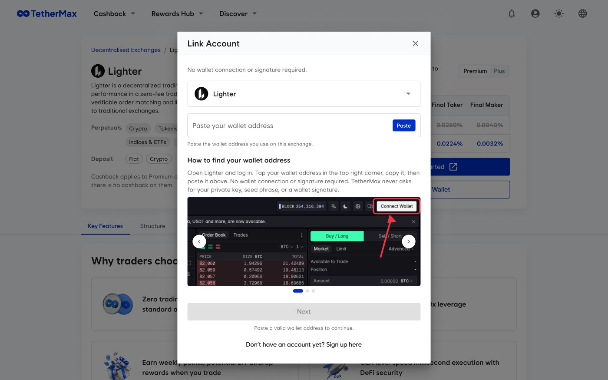 |  |
| 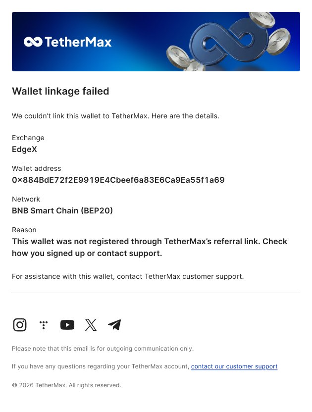 | 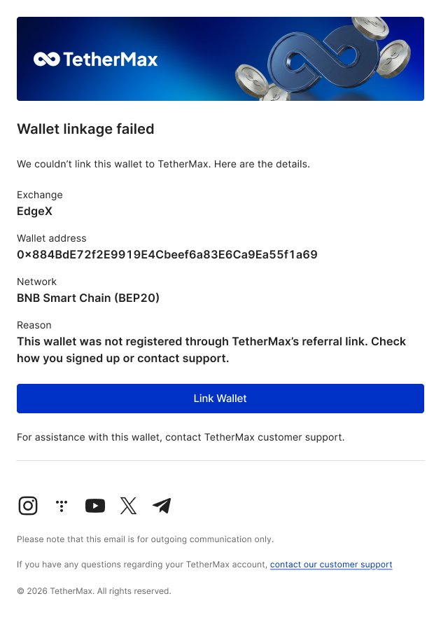 |
| 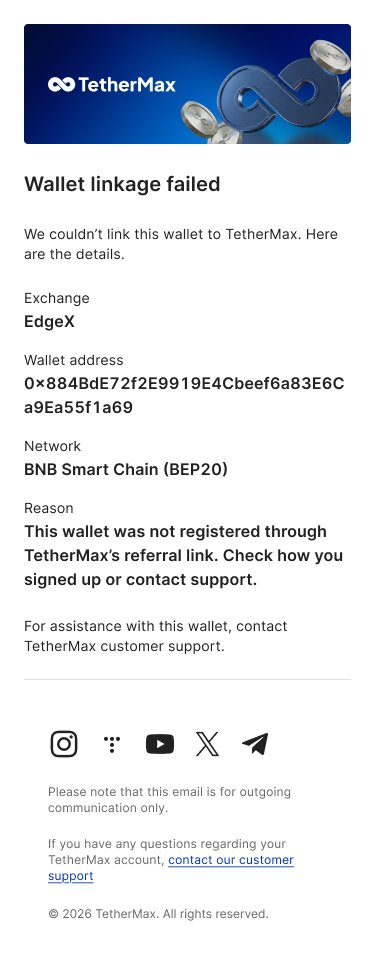 | 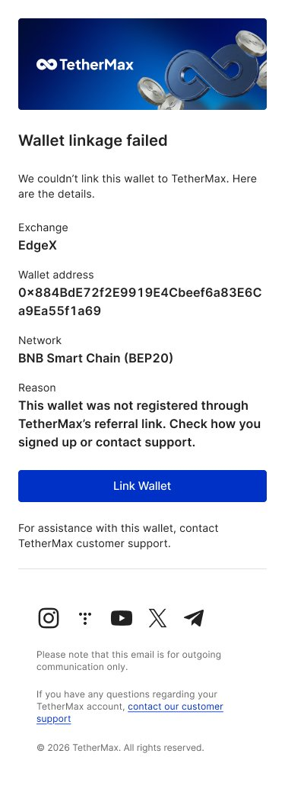 |

## 새 프레임 목록

| 노드 | 이름 | 섹션 |
|---|---|---|
| [29467:139474](https://www.figma.com/design/hsa3bSV9QmFTe2jsf6tzTm/UI-UX-Design?node-id=29467-139474) | DEX / story / S3-2 Link Account, WOO X Pro selected by default / light | 홈 연동 스토리 28960:127750 |
| [29467:140062](https://www.figma.com/design/hsa3bSV9QmFTe2jsf6tzTm/UI-UX-Design?node-id=29467-140062) | Link / Link Account — WOO X Pro selected by default / Light | Mobile · Link Account 28969:126952 |

## 캡처

| 항목 | 전 | 후 |
|---|---|---|
| S3-2 PC | 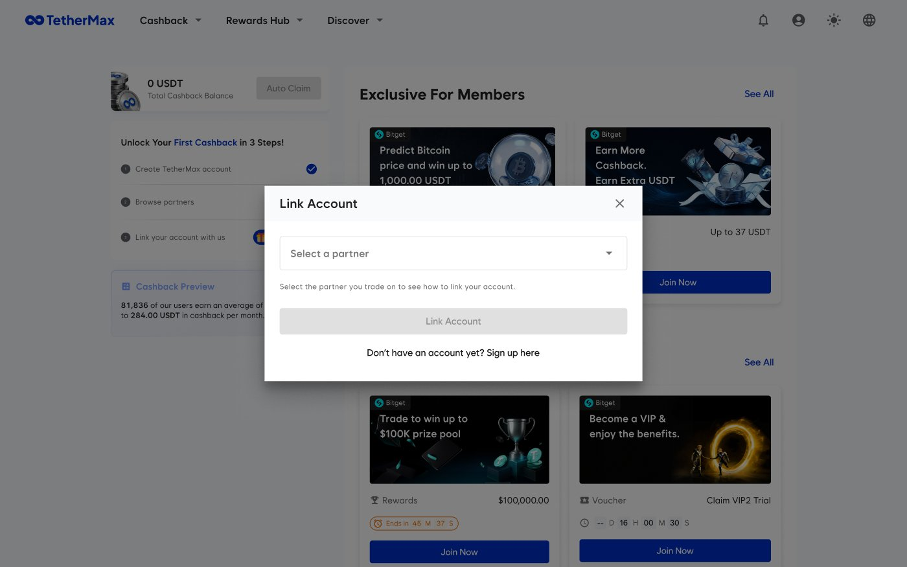 | 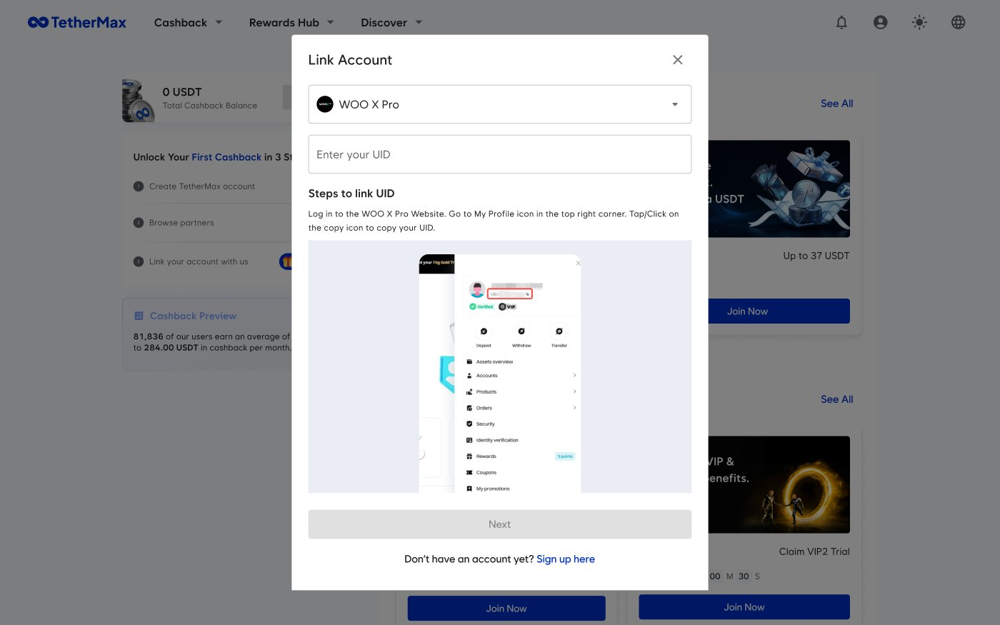 |
| L16 | 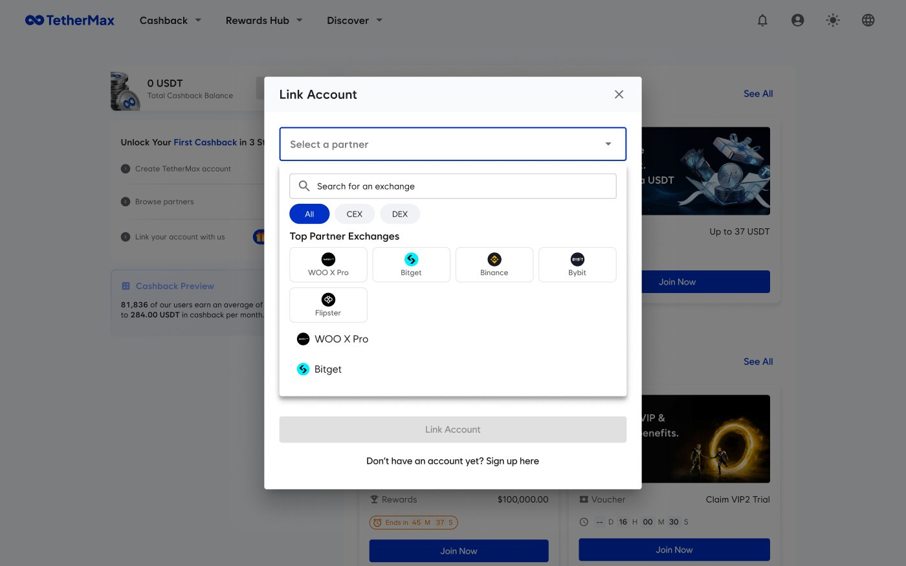 |  |
| S3-3 |  | 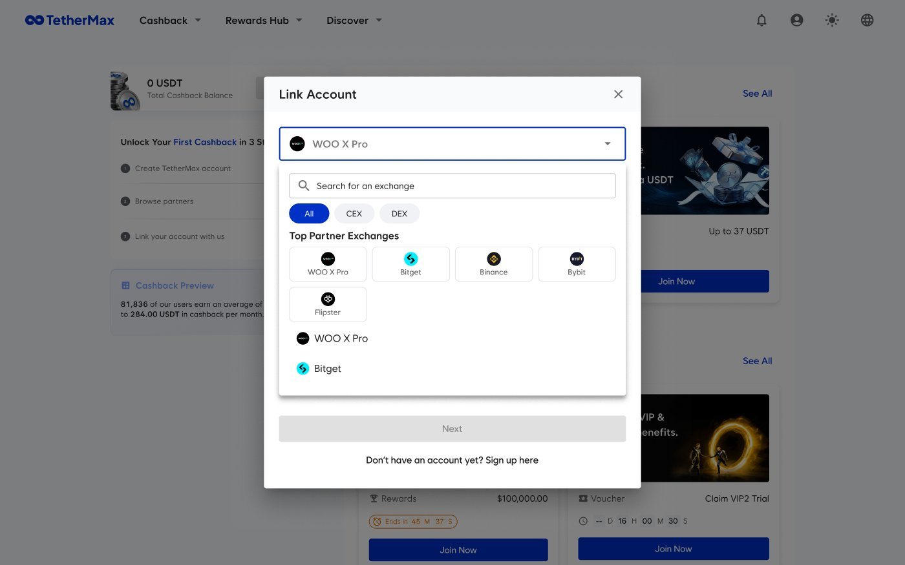 |
| 모바일 첫 상태 | 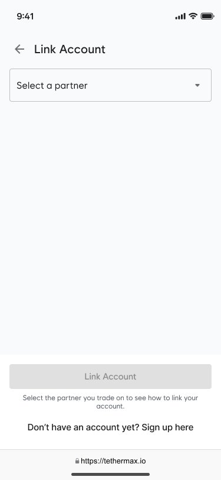 | 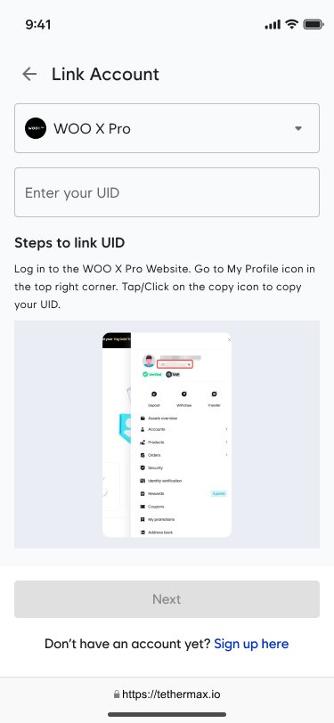 |
| 리그 상금 수령(숨김) | 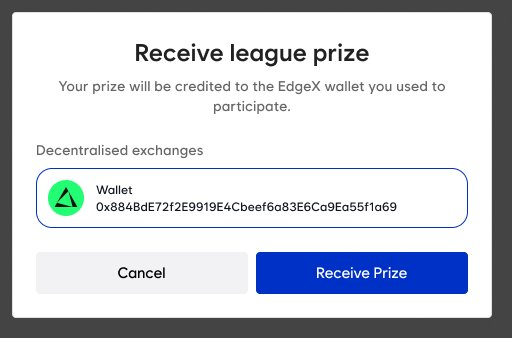 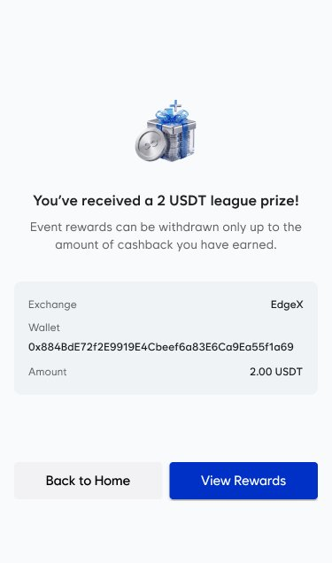 | (숨김) · 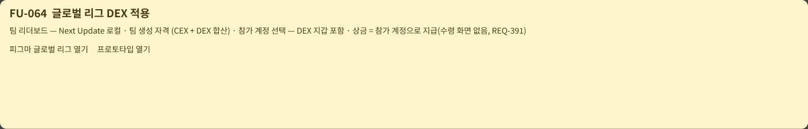 |
| 소유권 토글 | 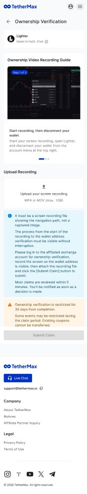 |  |
| TP | 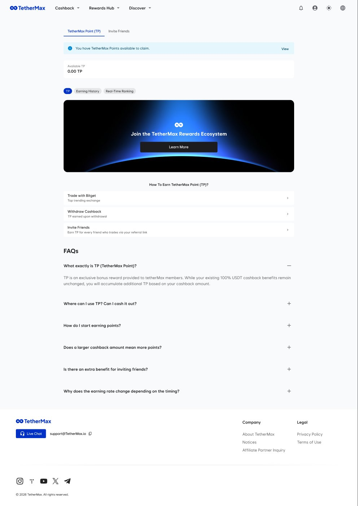 |  |
| 허브 모바일 ⓘ · 보기 토글 | 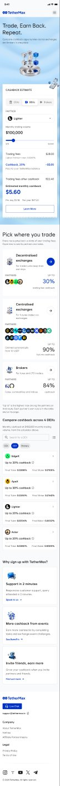 |  |
| Exchange Listings `See All` | 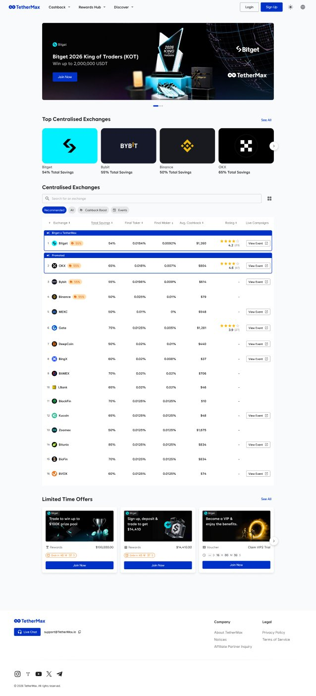 | 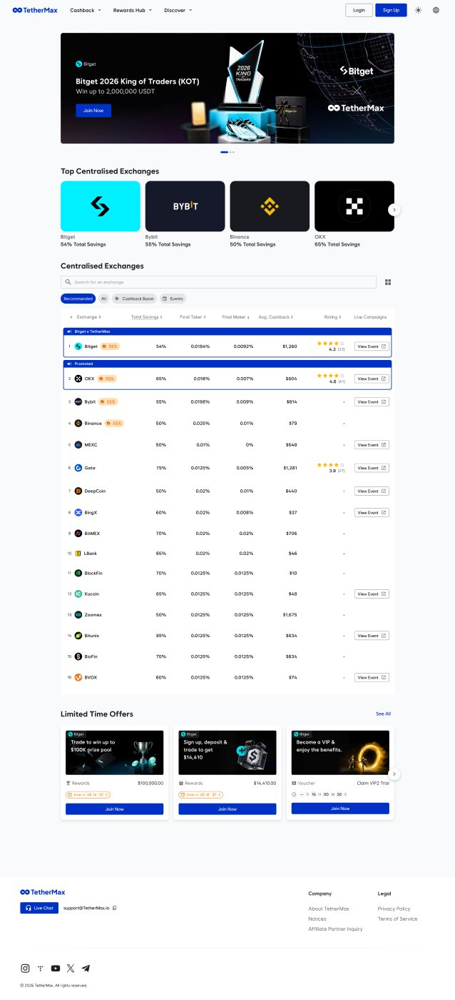 |
| EMAIL 32(숨김) | 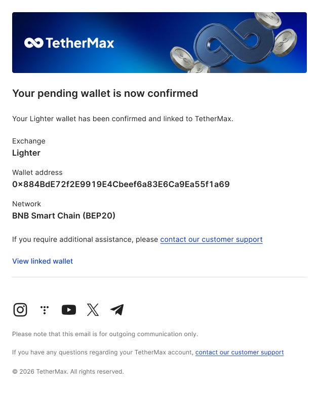 | (숨김) |
| 연동 인계 메모 | 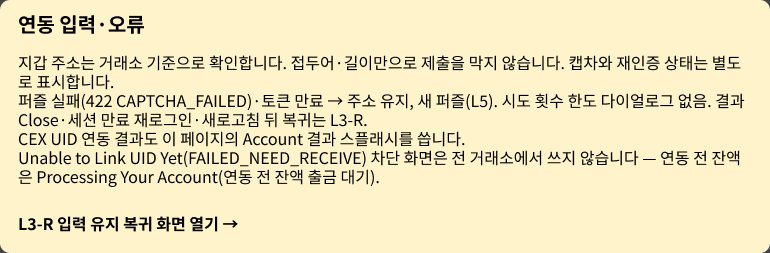 | 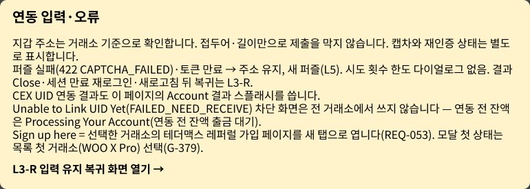 |

## 검색 기록

| 찾은 것 | 범위 · 검색어 | 결과 |
|---|---|---|
| 선택 없음 모달 | 연동 · 홈 스토리 · 소유권 · 사용자 기능 · 게스트 · 오퍼 · 허브 섹션 + Mobile 하위 묶음 TEXT `^Select a partner$` · `^(Select an exchange|Select exchange)$` | PC 3(L16 · S3-2 · S3-3) · 모바일 1(29327:405399). 모바일 `Select an exchange` 13곳은 거래소 선택 화면 제목이라 대상 아님 |
| 기존 빈 UID 입력 | [MAX-30] 8013:42844 TEXT `Enter your UID` | 기존 모바일 폼 placeholder `Enter your UID`(9105:188079 등) — DEX(revision) 29051:100488과 같음 |
| 상금 수령 | 리그 · 인계 섹션 `Receive Prize|Receive league prize|상금 수령` | 위 6프레임 + FU-064 |
| 맥스보드 라벨 | 사용자 기능 섹션 `Select New Wallet` · `^Link Wallet$` | 맥스보드 0건 |
| ⓘ 기존 동작 | 오프라인 색인 `22044-758840.xml` `name="info"` 0건 · `CMT-08` 모바일 26382:789181 · 메모 23311:165306 · 23312:168907 | 기존 목록 카드에 ⓘ 없음, 상세 블록 ⓘ는 「아무 동작 없음」 |
| TP 안내 줄 · 칩 | 실사이트 수집본 `TetherMax Points available to claim` · `Real-Time Ranking` | 0건 |
| 가입 링크 경로 | 인계 섹션 `Sign up here|Register here|가입 새 탭|회원가입` | 0건 → 연동 인계 메모에 한 줄 추가 |

## 프로토타입에 반영할 것

| # | 내용 | 기준 노드 |
|---|---|---|
| 1 | 연동 모달 첫 상태 = `WOO X Pro` 선택 · `Enter your UID` · 비활성 `Next`(PC · 모바일, 홈 체크리스트 · 다른 계정 추가 진입) | 29467:139474 · 29467:140062 · 28960:127367 |
| 2 | 글로벌 리그 `Receive Prize` 다이얼로그 · 수령 완료 화면 제거 | 29183:118280(숨김) |
| 3 | 맥스보드 `Select New Wallet` → `Select New Account` · `Link Wallet` → `Link Account` | 29064:8176 |
| 4 | 모바일 소유권 제목 줄 토글 제거 | 28982:126103 |
| 5 | 허브 모바일 카드 ⓘ · 보기 토글 제거 | 28960:130794 |
| 6 | TP 안내 줄 `View` · 칩 `Real-Time Ranking` 제거 | 29365:134702 |
| 7 | 거래소 목록 화면 안 `See All` 제거 | 29370:138808 |
| 8 | EMAIL 32 상태(e32) 제거 | 29061:1174(숨김) |
| 9 | 연동 모달 가입 링크 `Don't have an account yet? Register here` → 선택 거래소 레퍼럴 가입 새 탭, 중간 안내 `Start by signing up for Lighter?` 제거 | 28960:127275 · 28960:127418(숨김) |
| 10 | EMAIL 31 `Link Wallet` 버튼 → 해당 DEX가 선택된 연동 모달 | 29061:902 |
