# Figma 수정 결과 — 7차 (모바일 주소 툴팁 · 누적 캐시백 블록 제외)

2026-11-27 · 대상 Figma `DEX(revision)` [28960:125519](https://www.figma.com/design/hsa3bSV9QmFTe2jsf6tzTm/UI-UX-Design?node-id=28960-125519) · 결정 [_Figma수정_결정.md](_Figma수정_결정.md) 맨 아래 2행 · 이전 [6차](Figma수정결과_6차.md) · 캡처 [Figma수정결과_img/](Figma수정결과_img/) `r7_*.jpg`

노드 링크: `https://www.figma.com/design/hsa3bSV9QmFTe2jsf6tzTm/UI-UX-Design?node-id={앞}-{뒤}`. 다른 페이지·컴포넌트 메인은 고치지 않았다.

## 요약

| 구분 | 수 | 내용 |
|---|---|---|
| 처리 | **2건** | ① 축약 지갑 주소 → 전체 주소 툴팁(기존 `<Tooltip>` Direction=None) 모바일 5화면 + PC 호버 1(지갑 상세) + 인계 메모 · ② 홈 누적 캐시백 블록(MAXOP-731) 숨김 + 메모 |
| 새 프레임 | **5** | 아래 「새 프레임 목록」 |
| 숨김 | 11노드 | 누적 블록 29355:141323 · 구분선 29355:141506 · 흰 주소 카드 6(5개 툴팁 프레임 + 랭킹 29415:138130) · 목록 툴팁 프레임 3 |

---

## ① 축약 지갑 주소 → 전체 주소 툴팁 (모바일 탭 · PC 호버)

기준 툴팁: [MAX-22] 거래소 상세 `Total Savings` 툴팁 [8538:123923](https://www.figma.com/design/hsa3bSV9QmFTe2jsf6tzTm/UI-UX-Design?node-id=8538-123923) — 컴포넌트 세트 `<Tooltip>` 7082:66775의 `Direction=None`(꼬리 없음). 원본 값을 그대로 씀:

| 속성 | 원본 값(8538:123923) |
|---|---|
| 채움 | 변수 `components/tooltip/fill` = #616161, 불투명도 90%(뒤가 비침) |
| 모서리 · 패딩 | 4 · 위아래 4 / 좌우 8 |
| 글자 | Wanted Sans Medium 12, 줄 간격 140%, 가운데 정렬, 흰색(`common/white/main`) |
| 폭 | 200 고정, 높이는 글자에 맞춤 |

DEX 지갑 주소에만 적용(CEX UID 행에는 툴팁 없음 — 8개 툴팁 모두 지갑 주소에 붙어 있음). 툴팁 안에는 전체 주소만(표본 `0x7a3f9C2B41dE8806f5a1b3C9E4d2f07a6b8C51e9` · 게스트 `0x7a3F9C2B…C51e9` · 랭킹 `0x884BdE72f2E9919E4Cbeef6a83E6Ca9Ea55f1a69`). 축약 주소 바로 아래, 주소 시작 위치에 맞춰 놓음. 화면의 축약 주소·복사 아이콘은 그대로.

| 화면(원본) | 툴팁 상태 프레임 | 툴팁 인스턴스 | 전 / 후 |
|---|---|---|---|
| 모바일 지갑 상세 헤더 [29330:208223](https://www.figma.com/design/hsa3bSV9QmFTe2jsf6tzTm/UI-UX-Design?node-id=29330-208223) | [29474:136690](https://www.figma.com/design/hsa3bSV9QmFTe2jsf6tzTm/UI-UX-Design?node-id=29474-136690) `Wallet detail / mWeb · Lighter · Address tooltip` | 29484:181385 | `r7_01_walletM_before` / `r7_01_walletM_after` |
| 모바일 캐시백 요약 계정 필터 29413:137686 | [29474:137624](https://www.figma.com/design/hsa3bSV9QmFTe2jsf6tzTm/UI-UX-Design?node-id=29474-137624) | 29484:181397 | — / `r7_01_summaryM_after` |
| 모바일 게스트 조회 결과 29035:97855 | [29474:138068](https://www.figma.com/design/hsa3bSV9QmFTe2jsf6tzTm/UI-UX-Design?node-id=29474-138068) | 29484:181401 | — / `r7_01_guestM_after` |
| 모바일 소유권 인증 헤더 28982:126103 | [29474:138344](https://www.figma.com/design/hsa3bSV9QmFTe2jsf6tzTm/UI-UX-Design?node-id=29474-138344) | 29484:181405 | — / `r7_01_ownM_after` |
| 모바일 내 캐시백 랭킹 주소 | 4차 [29415:138026](https://www.figma.com/design/hsa3bSV9QmFTe2jsf6tzTm/UI-UX-Design?node-id=29415-138026) — 흰 카드(`Wallet address` · `Close`, 29415:138130) 숨기고 툴팁으로 | 29484:181409 | `r7_01_rankM_before` / `r7_01_rankM_after` |
| PC 지갑 상세 헤더(호버) — 대표 1장 | 새 [29494:137572](https://www.figma.com/design/hsa3bSV9QmFTe2jsf6tzTm/UI-UX-Design?node-id=29494-137572) `… PW1 My Cashback, Lighter selected / Light · Address tooltip (PC hover)`(원본 28960:125943, `Wallet 0x7a3F…51e9`) | 29494:138154 | — / `r7_01_walletPC_hover` |

행을 누르면 상세로 가는 목록(홈 Linked Accounts 행 · `See All` 모달 행)에는 툴팁 없음 — 해당 프레임 29474:136960 · 29474:137355 · 29484:192183은 숨김. 남은 「· Address tooltip」 프레임의 흰 카드(29474:136956 · 137620 · 138064 · 138340 · 138560)는 숨김. 축약 주소에 밑줄·점선 표시는 없음(남은 5화면 글자 장식·선 검사). 같은 화면의 다른 상태 프레임(소유권 28장 등)은 같은 동작이라 화면마다 1장만 그렸다.

| 인계 메모 | 바꾼 것 | 전/후 |
|---|---|---|
| FU-002 · 지갑 주소 표시·복사 [29066:786](https://www.figma.com/design/hsa3bSV9QmFTe2jsf6tzTm/UI-UX-Design?node-id=29066-786) | `DEX 지갑 축약 주소: 모바일 탭 / PC 호버 → 전체 주소 툴팁(기존 툴팁 컴포넌트), 바깥 탭·마우스 이탈로 닫힘, 복사 아이콘 유지. 적용 화면: 지갑 상세 헤더 · 캐시백 요약 계정 필터 · 게스트 조회 결과 · 소유권 인증 헤더 · 랭킹(홈 행 · See All 모달 행은 행 탭이 상세 이동이라 없음).` + `피그마 주소 툴팁 열기` 링크(29474:136690) | `r7_01_FU002_before` · `_after` |

검색: 기준 툴팁 — 오프라인 색인 `maximum fee savings`(`5113-47485.xml` → [MAX-22] 8538:123923, 모바일은 하단 시트 `Filter` 8538:134490) · `<Tooltip>` 인스턴스. 대상 화면 — 잔액 · 허브 · 요약 · 랭킹 · 초대 · 파트너 허브 · 사용자 기능 · 리그 · 게스트 · 홈 스토리 · 오퍼 · 소유권 섹션과 Mobile 하위 묶음의 보이는 TEXT `0x[0-9a-fA-F]{2,6}…[0-9a-fA-F]{3,6}`.

## ② 홈 누적 캐시백 블록(MAXOP-731) 제외

| 화면(노드) | 바꾼 것 | 전/후 |
|---|---|---|
| HW1 홈 [28960:126108](https://www.figma.com/design/hsa3bSV9QmFTe2jsf6tzTm/UI-UX-Design?node-id=28960-126108) Linked Accounts 패널 | `Cumulative Cashback Summary` 29355:141323(`Total cumulative cashback` · `This month` · `Total withdrawn` · `Sum of … linked accounts` · `View history`)과 위 구분선 `Line 252` 29355:141506 숨김. 블록이 보이는 곳은 이 1곳뿐(잔액 · 홈 스토리 · 사용자 기능 · 소유권 · 연동 · Mobile 섹션 검색 `Total cumulative cashback`) | `r7_02_HW1_before` · `_after` |
| 인계 메모 FU-041 29066:904 | 제목 `캐시백 타임라인·누적 캐시백` → `캐시백 타임라인 (누적 캐시백 블록 없음 — MAXOP-731 제외)`. 다른 메모에 누적 블록 줄 없음 | `r7_02_FU041_before` · `_after` |

## 새 프레임 목록

| 노드 | 이름 | 섹션 |
|---|---|---|
| 29474:136690 | Wallet detail / mWeb · Lighter · Address tooltip | 잔액 표시 28960:125772 |
| 29474:137624 | 캐시백 요약 · 모바일 · 월간 카드 · Address tooltip | 사용자 기능 29062:110172 |
| 29474:138068 | Mobile / Guest / above · 조회 성공 · 10 USDT 이상 · Address tooltip | 게스트 캐시백 29033:99901 |
| 29474:138344 | Ownership / Recording guide 1 / Light · Address tooltip | Mobile · 소유권 28982:126102 |
| 29494:137572 | DEX / Web / DEX withdraw PW1 My Cashback, Lighter selected / Light · Address tooltip (PC hover) | 잔액 표시 28960:125772 |

섹션 크기: 28969:126952 폭 10275 → 10550 · 29033:99901 폭 6490 → 7010.

## 캡처

| 항목 | 전 | 후 |
|---|---|---|
| 모바일 지갑 상세 | 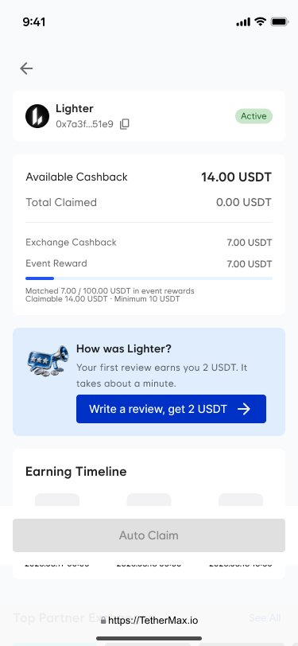 | 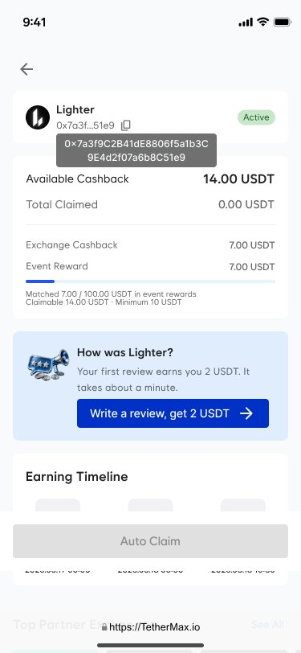 |
| 모바일 요약 · 게스트 · 소유권 | 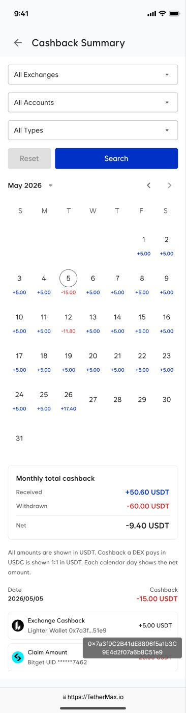 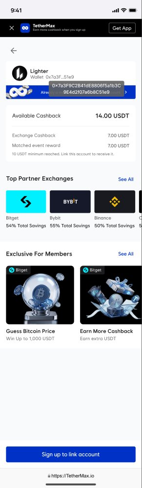 | 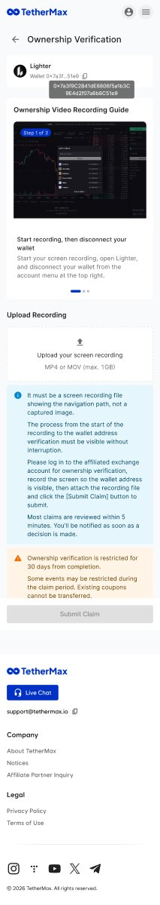 |
| 모바일 랭킹 | 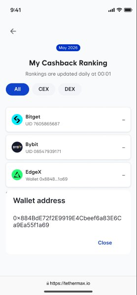 | 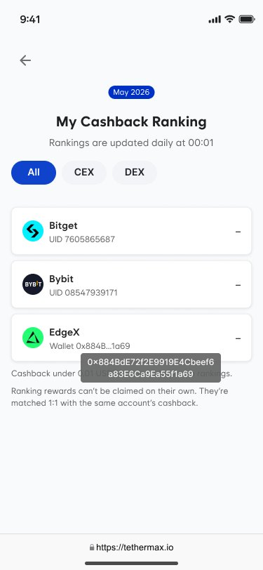 |
| PC 지갑 상세 호버 | — | 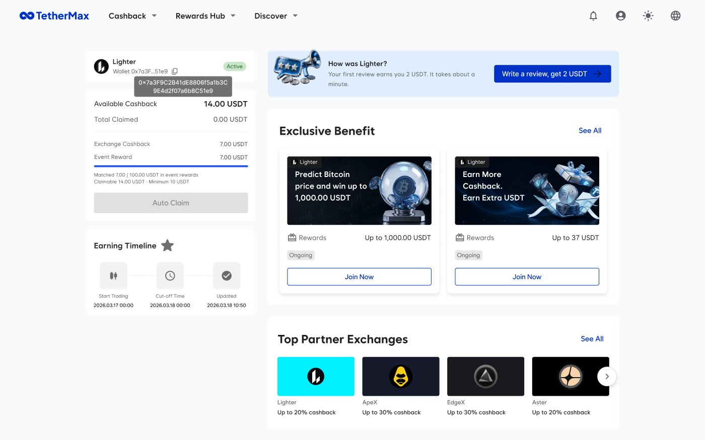 |
| FU-002 |  | 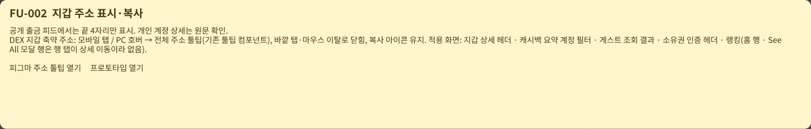 |
| HW1 누적 블록 | 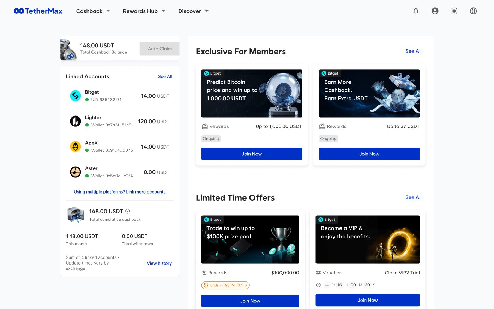 | 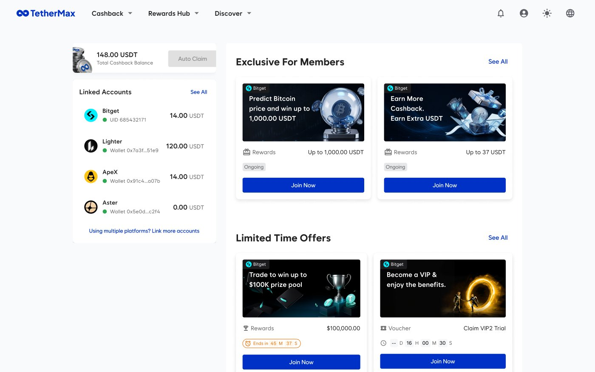 |
| FU-041 |  | 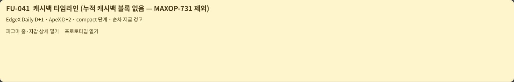 |

## 프로토타입에 반영할 것

| # | 내용 | 기준 노드 |
|---|---|---|
| 1 | DEX 축약 지갑 주소(CEX UID 제외): 모바일 탭 · PC 호버 → 기존 회색 반투명 툴팁(꼬리 없음, `Total Savings` 툴팁과 같은 값)에 전체 주소만, 바깥 탭 · 마우스 이탈로 닫힘, 복사 아이콘 유지 — 지갑 상세 헤더 · 요약 계정 필터 · 게스트 결과 · 소유권 헤더 · 랭킹(홈 행 · `See All` 모달 행 제외) | 29474:136690 · 29494:137572 |
| 2 | 홈 누적 캐시백 블록(`Total cumulative cashback` · `This month` · `Total withdrawn` · `View history`) 제거 | 28960:126108 |
