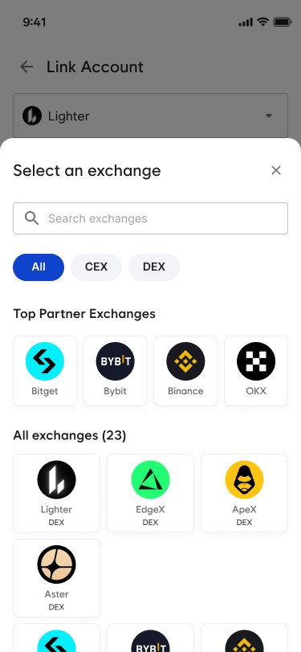
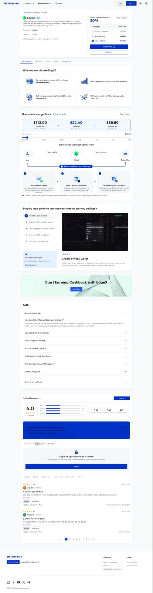
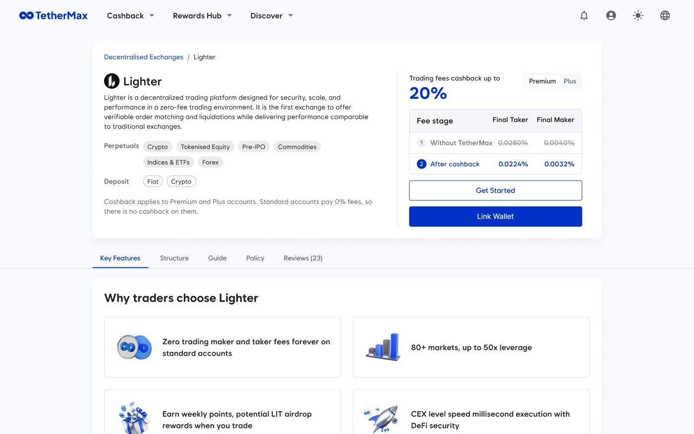
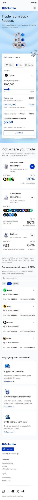
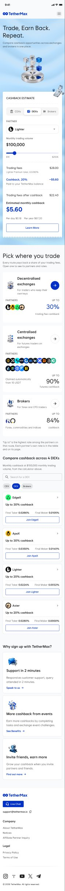
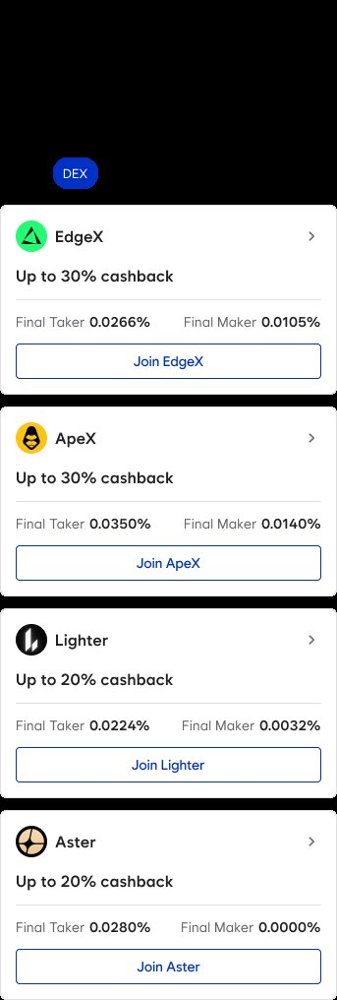

# Figma 수정 결과 — 8차 (프로토타입 대조에서 나온 Figma 쪽 오류)

2026-11-27 · 대상 Figma `DEX(revision)` [28960:125519](https://www.figma.com/design/hsa3bSV9QmFTe2jsf6tzTm/UI-UX-Design?node-id=28960-125519) · 근거 [정책](../00_DEX_최종정책.md) B-5-8 · B-7-4(설명 카드 1) · G-392 · REQ-359 · REQ-360 · 결정 [_Figma수정_결정.md](_Figma수정_결정.md) · 이전 [7차](Figma수정결과_7차.md) · 캡처 [Figma수정결과_img/](Figma수정결과_img/) `r8_*.jpg`

노드 링크: `https://www.figma.com/design/hsa3bSV9QmFTe2jsf6tzTm/UI-UX-Design?node-id={앞}-{뒤}`. 다른 페이지·컴포넌트 메인은 고치지 않았다.

## 요약

| 구분 | 수 | 내용 |
|---|---|---|
| 처리 | **5건** | ① 오타 9곳 · ② 등급 문장 13곳(EdgeX · Aster · ApeX) · ③ 상세 가이드 1단계 12곳 · ④ 모바일 비교 카드 `Join` 74개(10프레임) · ⑤ 비교표 `Join` 외부 아이콘 0건(바꿀 것 없음) |
| 분리(detach) | 프레임 8 · 비교 묶음 10 · 카드 74 | ④ 버튼을 카드 안에 넣기 위해 DEX(revision) 인스턴스만 분리(결정 7차 A). 분리로 바뀐 프레임 ID는 ④ 표 |

---

## ① 오타 `60% Total Savingst` → `60% Total Savings`

| 화면 | 노드 |
|---|---|
| 모바일 연동 거래소 선택 | 28969:126953 · 28969:127160(다크) · 28986:126528 · 28986:126586(다크) · 29327:412552 |
| 게스트 모바일 거래소 선택 | 29035:98094 · 29179:116351 · 29179:116630 · 29327:415265 |

검색: DEX(revision) 전 섹션 + Mobile 하위 묶음 TEXT `Savingst` → 9곳 모두 수정, 남은 0. 전/후 `r8_01_mSelect_before` · `_after`.

## ② EdgeX(· Aster · ApeX) 상세 계산기의 Lighter 전용 등급 문장

정책 B-7-4 설명 카드 1 · REQ-359: `Your selected {volume} volume on a {account tier} account generates an estimated {fee} in {taker or maker} fees.` — **EdgeX · Aster · ApeX는 등급 언급 없음**. 마지막 줄 `Frequent traders notice the cashback on … fees.`는 같은 페이지 다른 DEX 모바일 화면의 등급 없는 문장(`… on fees.`)과 맞춤. 숫자(`$400K` · `$112`)는 그대로.

| 화면 | 바꾼 것 | 노드 |
|---|---|---|
| PC D4 EdgeX [28960:127454](https://www.figma.com/design/hsa3bSV9QmFTe2jsf6tzTm/UI-UX-Design?node-id=28960-127454) | `…$400K volume on a Premium account generates…` → `…$400K volume generates an estimated $112 in taker fees.` · `…cashback on Premium fees.` → `…cashback on fees.` | I28960:127581;… · I29357:147450;… |
| PC D5 Aster 29357:147710 · D6 ApeX 29357:148976 | 같음(같은 규칙 — 정책이 세 DEX를 함께 정함) | 4노드 |
| 모바일 D4 EdgeX 29360:144056 · 29427:143878 · 다크 29360:149893 / D5 Aster 29360:145006 · 다크 / D6 ApeX 29360:145980 · 다크 | 설명 카드 1 문장 | 7노드 |

Lighter 상세(D1~D3 · 단계 가이드 프레임)의 `Premium` 문장은 Lighter 등급이 있으므로 그대로. 전/후 `r8_02_D4_before` · `_after`.

## ③ Lighter 상세 단계 가이드 1단계 문구

같은 상세 페이지 D 프레임(D1 29357:143619 등)의 최신 1단계 본문: `Install a self-custody wallet, or sign up on Lighter with email to get a wallet made for you. Keep your 12-word recovery phrase private. TetherMax never asks for a private key, recovery phrase or wallet signature.`

| 바꾼 곳(상세 페이지 `step panel`) | 노드 |
|---|---|
| 가입 복귀 `Signup + Link Wallet / 3 Return` [28960:127422](https://www.figma.com/design/hsa3bSV9QmFTe2jsf6tzTm/UI-UX-Design?node-id=28960-127422) · 1 Entry 28960:127416 · 2 Signup 28960:127418(숨김) | 마지막 문장 `…for your private key, seed phrase, or a wallet signature.` → `…for a private key, recovery phrase or wallet signature.` |
| 같은 상세 페이지를 배경으로 쓰는 연동 프레임 L1~L5 · L0 2장 · L3-R · L1-F · L2-R | 같음 — 12노드 |

연동 모달 안 「지갑 주소 찾기」 안내(`help`)와 모바일 연동 폼의 같은 문장은 G-392 확정 원문(`TetherMax never asks for your private key, seed phrase, or a wallet signature.`)이라 그대로 둠. 전/후 `r8_03_return_before` · `_after`.

## ④ 모바일 허브 비교 카드 끝 `Join` 버튼 (정책 B-5-8)

PC 비교표 행 끝 `Join {partner}` 버튼(I28960:126884;27610:202802;437:17392 — `<Button>` Size=Medium · Color=Primary · Variant=Outlined, 끝 아이콘 없음)을 복제해 각 카드 맨 아래에 전폭으로. 라벨은 카드의 거래소 이름. 누르면 그 거래소 상세(외부 아이콘 없음). 카드의 `detail chevron`은 그대로.

| 화면(라이트) | 지금 노드(분리 후) | 추가 버튼 |
|---|---|---|
| H1 Guest, DEX route | [29515:137400](https://www.figma.com/design/hsa3bSV9QmFTe2jsf6tzTm/UI-UX-Design?node-id=29515-137400)(옛 28960:130794) | 4 |
| H2 Signed in, nothing linked | 29515:138107(옛 28960:130800) | 4 |
| H3 Signed in, exchange UID linked | 29515:138815(옛 28960:130806) | 16 |
| H4 Exchange balance under 10 USDT | 29515:140513(옛 28960:130812) | 16 |
| H5 Signed in, DEX wallet linked | 29352:145635 | 4 |
| H7 Balance did not load | 29515:142500(옛 28960:130830) | 16 |
| H8 EdgeX wallet linked | 29515:144188(옛 28960:130836) | 4 |
| H1-CEX Guest | 29515:144850(옛 28960:130854) | 16 |
| H1-Broker Guest | 29515:146538(옛 28960:130860) | 2 |
| H1-Rate error | 29327:412884(높이 4877 → 5052) | 4 |
| H1-No results | 29327:413500 | 0(카드 없음) |

다크 묶음(28960:130866)은 결정 8차 「다크는 자동 변환」으로 손대지 않음. 옛 ID를 가리키는 메모 링크 없음(인계 · 허브 · 모바일 허브 · 사용자 기능 섹션 검사). 모바일 허브 묶음 섹션 높이 → 8721(다른 섹션과 겹침 없음). 전/후 `r8_04_hubM_before` · `r8_04_hubM_after` · 카드 `r8_04_cards_after`.

## ⑤ 비교표 `Join` 외부 링크 아이콘

허브 섹션 `Join …` 버튼 106개의 `End Icon` 속성 확인 — 켜진 것 0개. 바꿀 것 없음.

## 캡처

| 항목 | 전 | 후 |
|---|---|---|
| ① 오타 |  |  |
| ② EdgeX D4 |  |  |
| ③ 가입 복귀 |  |  |
| ④ 모바일 허브 H1 |  |   |

## 프로토타입에 반영할 것

| # | 내용 | 기준 노드 |
|---|---|---|
| 1 | `60% Total Savings` 표기 | 28969:126953 |
| 2 | EdgeX · Aster · ApeX 상세 계산기 설명 카드 1에 등급 언급 없음(`Your selected {volume} volume generates an estimated {fee} in {taker/maker} fees.`), 마지막 줄 `…cashback on fees.` | 28960:127454 |
| 3 | 상세 단계 가이드 1단계 마지막 문장 `TetherMax never asks for a private key, recovery phrase or wallet signature.`(연동 모달 주소 찾기 안내는 G-392 원문 유지) | 29357:143619 |
| 4 | 모바일 허브 비교 카드 맨 아래 전폭 `Join {partner}`(Outlined) → 그 거래소 상세 | 29515:137400 |
