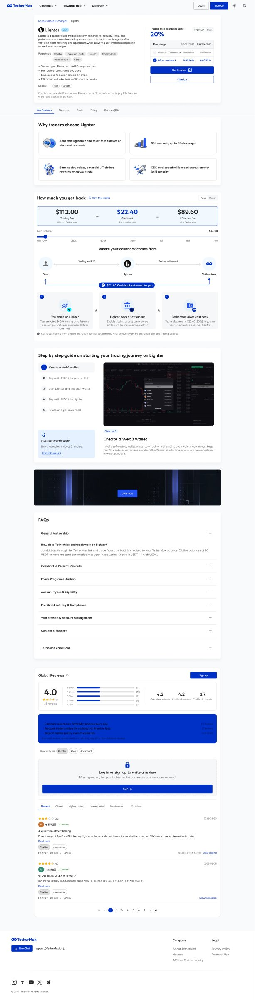
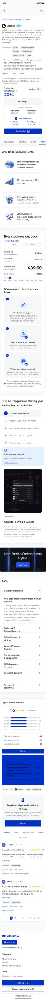
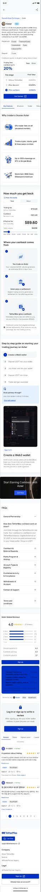
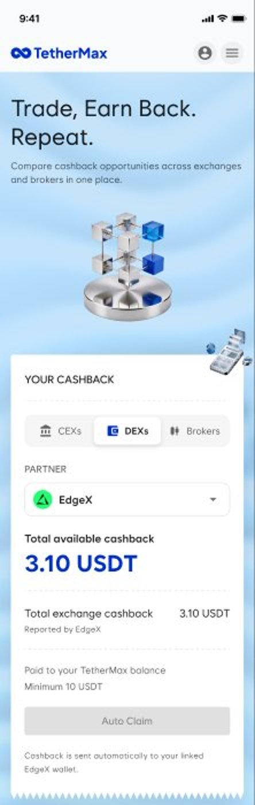
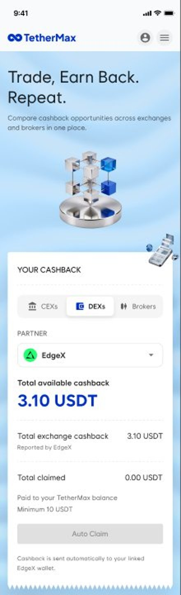
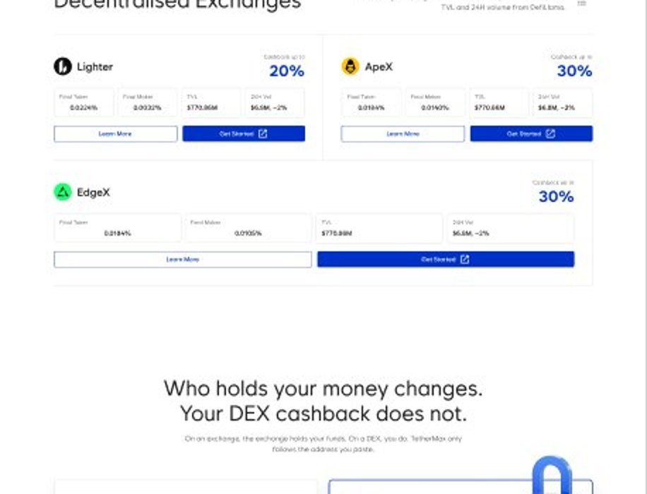
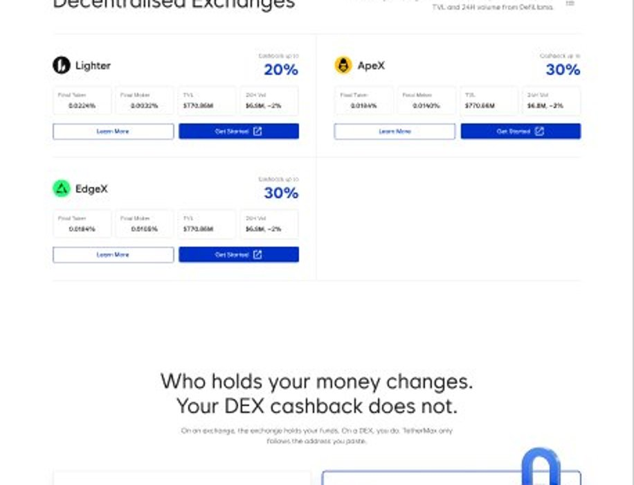

# Figma 수정 결과 — 9차 (프로토타입 대조에서 나온 Figma 쪽 오류 2)

2026-11-27 · 대상 Figma `DEX(revision)` [28960:125519](https://www.figma.com/design/hsa3bSV9QmFTe2jsf6tzTm/UI-UX-Design?node-id=28960-125519) · 문구 기준: 웹 → Figma → (정책과 어긋나면) 정책 · 근거 REQ-354 · REQ-357 · REQ-307 · G-053 · G-168 · 이전 [8차](Figma수정결과_8차.md) · 캡처 [Figma수정결과_img/](Figma수정결과_img/) `r9_*.jpg`

노드 링크: `https://www.figma.com/design/hsa3bSV9QmFTe2jsf6tzTm/UI-UX-Design?node-id={앞}-{뒤}`. 다른 페이지·컴포넌트 메인은 고치지 않았다. 다크 프레임은 결정 8차(자동 변환)로 손대지 않았다.

## 요약

| # | 항목 | 처리 |
|---|---|---|
| ① | PC Lighter·단계 가이드 상세의 계산기 설명 카드 넘침 | 7프레임 — 카드 줄 높이 209 → 232(본문 높이에 맞춤) |
| ② | 모바일 상세 AI 요약 · 리뷰 본문 표본 | 7프레임 — PC 표본으로 |
| ③ | 모바일 상세 마켓 칩 | Aster 2개 · ApeX 1개 중복 칩 숨김 → PC와 같은 구성 |
| ④ | 모바일 리뷰 게스트 버튼 | 게스트 리뷰 영역 7곳 `Write a review` → `Sign up` |
| ⑤ | 모바일 허브 H8 `Total claimed` 줄 | 1줄 추가 |
| ⑥ | PC DEX 개요 venue 홀수 마지막 카드 | 3곳 프레임 마지막 카드 1200 → 600.5(왼쪽 칸 폭) |

---

## ① 계산기 설명 카드 높이 (PC)

설명 카드 줄 `Cashback / Steps Row`와 카드 3장·화살표 2개가 높이 209 고정이라, 첫 카드 본문(`Your selected $400K volume on a Premium account generates…`)이 카드 아래로 넘쳤다. 카드 안 내용 높이(232)로 줄·카드·화살표 높이를 맞춤. 인스턴스 안이라 높이가 바뀌지 않아 DEX(revision)의 계산기 블록·카드 줄 인스턴스만 분리(결정 7차 A).

| 프레임 | 계산기 블록(분리 후) |
|---|---|
| D1 Key features [29357:143619](https://www.figma.com/design/hsa3bSV9QmFTe2jsf6tzTm/UI-UX-Design?node-id=29357-143619) | 29524:134735(옛 29357:143669) |
| D2 Step guide, step 3 29357:144968 | 29524:134982(옛 29357:145018) |
| D3 FAQ, reviews and terms 29357:146245 | 29524:135229(옛 29357:146295) |
| D3 · Reviews 0 29367:137704 | 29524:135476(옛 29367:137760) |
| D3 · FAQ two sections open 29367:138679 | 29524:135723(옛 29367:138735) |
| D2 · Step 2 selected 29386:137364 | 29524:135970(옛 29386:137420) |
| D2 · 3 steps 29386:137485 | 29524:136217(옛 29386:137541) |

검색: 상세 섹션 PC 프레임에서 높이 209인 프레임·인스턴스 60개 중 본문이 아래로 넘치는 것 → 위 7곳(모두 Lighter). EdgeX · Aster · ApeX는 8차에서 등급 문장을 줄여 넘치지 않음. 전/후 `r9_01_D1_before` · `_after`.

## ② 모바일 상세 AI 요약 · 리뷰 본문 표본

| 항목 | 모바일(전) | PC 표본(후) |
|---|---|---|
| AI 요약 1 | `Cashback arrives at the same time every day.` | `Cashback reaches my TetherMax balance every day.` |
| AI 요약 2 | `The fee discount is wide enough that frequent traders notice it.` | Lighter `Frequent traders notice the cashback on Premium fees.` / EdgeX · Aster · ApeX `Frequent traders notice the cashback on fees.` |
| 리뷰 카드 `몇 군데 비교하고 여기로 정했어요` 본문 | `여러 거래소를 비교해보고 … 캐시백이 매일 같은 시간에 들어오고 …` | `여러 DEX를 비교해보고 수수료 때문에 여기로 정했어요. 캐시백이 매일 들어오고 출금이 막힌 적도 없습니다.` |
| 같은 카드 작성자 | `수수료헌터` · 아바타 `수` | `차트보는곰` · `차` |

대상: 모바일 상세 라이트 7프레임(Detail mobile 375 29360:141115 · D2 29360:142096 · D3 29360:143077 · D4 EdgeX 29360:144056 · D5 Aster 29360:145006 · D6 ApeX 29360:145980 · D4 EdgeX 오퍼 29427:143878). 전/후 `r9_02_mD3_before` · `_after`.

## ③ 모바일 상세 마켓 칩 (REQ-357)

| 화면 | PC 구성 | 모바일에서 숨긴 칩 |
|---|---|---|
| Aster D5 | `Perpetuals` · `Crypto` `Commodities` `Forex` · 입금 `Crypto` | 중복 `Forex` 29360:145037 · 입금 중복 `Crypto` 29360:145041 |
| ApeX D6 | `Perpetuals` · `Crypto` `Commodities` · 입금 `Crypto` | `Forex` 29360:146011 |
| EdgeX · Lighter | PC와 같음 | — |

전/후 `r9_03_asterM_before` · `_after`.

## ④ 모바일 리뷰 게스트 버튼 (REQ-354)

`Reviews / Section / 375 / guest` 영역의 `Write a review` → `Sign up`(PC 게스트 리뷰 영역과 같음). 게스트 영역 7곳(② 대상 7프레임). 회원 리뷰 영역은 그대로.

## ⑤ 모바일 허브 H8 `Total claimed` (G-053 · REQ-307)

H8 EdgeX wallet linked [29515:144188](https://www.figma.com/design/hsa3bSV9QmFTe2jsf6tzTm/UI-UX-Design?node-id=29515-144188)의 receipt 카드에 H5의 `line / total claimed`(29352:146818, `Total claimed` · `0.00 USDT`)를 복제해 `Paid to your TetherMax balance` 줄 위에 넣음(새 줄 29525:134498). 카드가 든 hero 인스턴스만 분리(29525:134419). 전/후 `r9_05_H8crop_before` · `_after`.

## ⑥ PC DEX 개요 venue 홀수 마지막 카드 (G-168)

`OA DEX overview, 3 partner DEXs` [29361:137628](https://www.figma.com/design/hsa3bSV9QmFTe2jsf6tzTm/UI-UX-Design?node-id=29361-137628)의 3번째 카드 `Venue card / EdgeX`(I29361:137679;540:167579)가 줄 전체(1200)로 늘어나 있던 것을 왼쪽 칸 폭(600.5)으로 고정 — 오른쪽 칸은 빈칸. 다른 개요 프레임은 카드 수가 짝수. 전/후 `r9_06_venue3crop_before` · `_after`.

## 캡처

| 항목 | 전 | 후 |
|---|---|---|
| ① D1 |  |  |
| ②④ 모바일 D3 |  |  |
| ③ 모바일 Aster |  |  |
| ⑤ 모바일 H8 |  |  |
| ⑥ venue 3곳 |  |  |

## 프로토타입에 반영할 것

| # | 내용 | 기준 노드 |
|---|---|---|
| 1 | 상세 계산기 설명 카드 높이는 본문에 맞춤(넘침 없음) | 29357:143619 |
| 2 | 모바일 상세 AI 요약 · 리뷰 표본을 PC와 같게 | 29360:143077 |
| 3 | 모바일 상세 마켓 칩을 PC와 같게(Aster · ApeX 중복 제거) | 29360:145006 |
| 4 | 모바일 게스트 리뷰 영역 버튼 `Sign up` | 29360:143077 |
| 5 | 모바일 허브 DEX 연동 상태 receipt에 `Total claimed` 줄 | 29515:144188 |
| 6 | DEX 개요 venue 홀수일 때 마지막 카드는 왼쪽 칸 폭, 오른쪽 빈칸 | 29361:137628 |
