# Figma 수정 결과 — 거래 계정 연동 (link)

2026-11-26 · 대상 [DEX(revision)](https://www.figma.com/design/hsa3bSV9QmFTe2jsf6tzTm/UI-UX-Design?node-id=28960-125519) · 계획 [Figma수정계획_link.md](Figma수정계획_link.md) · 결정 [_Figma수정_결정.md](_Figma수정_결정.md) · 문구 [문구표_DEX.md](문구표_DEX.md)

## 요약

| 구분 | 건수 | 항목 |
|---|---|---|
| 완료 | **26** | L-01 ~ L-16 · L-18 · L-19 · L-20 · L-21 · L-23 ~ L-28 (L-17은 ②만 완료) |
| 문구 대기 | **0** | 문구표 확정본으로 L-07 · L-10 · L-12 · L-27 문구를 채움 |
| 못 한 것 | **2** | L-17① 게스트 결과 → 연동 폼 화살표 · L-22 모바일 홈 첫 연동 S4 — 아래 표 |
| 새 프레임 | **25** | 아래 「새로 만든 프레임」 |

### 못 한 것

| 항목 | 이유 |
|---|---|
| L-17① 게스트 DEX 결과 화살표 끝을 L3로 연결 | 게스트 섹션과 연동 섹션이 캔버스에서 약 7만 px 떨어져 있어 연결선을 이으면 페이지를 가로지르는 선이 생김. 도착 화면은 L3(기존)·L3-R(새)로 이미 있음 |
| L-22 모바일 홈 · 연동 성공 토스트 · 새 행 | DEX(revision)에 복제할 모바일 홈 S4 프레임이 없음(모바일 섹션은 허브·상세·연동·소유권뿐). 근거 프레임이 생기면 PC S3-7 구성대로 복제 |

### 계획과 다르게 처리한 것 (결정·문구표 우선)

| 항목 | 처리 | 근거 |
|---|---|---|
| L-12 ①② 홈 행에 확인 중·`Inactive` 행 추가 | 추가하지 않음 | 결정 Q4 — 홈 Linked Accounts 행 상태는 기존 디자인(9401:87675, 상태 점·시계 아이콘) 그대로 |
| L-12 ③ O11 칩 `Chip` | Lighter 행 칩 → `Verifying ownership`, Aster 행 자리표시 칩은 숨김 | 문구표 #2(언어팩 `link status owner`) · Aster 행은 정할 상태 근거 없음 |
| L-20 개발 인계 메모 | 개발 인계 섹션(29066:897) 대신 이 영역의 연동 입력 메모 [29010:126471](https://www.figma.com/design/hsa3bSV9QmFTe2jsf6tzTm/UI-UX-Design?node-id=29010-126471)에 추가 | 영역 밖 섹션은 고치지 않음 |
| L-26 ① PC 선택기 변형 3개 | 컴포넌트 세트에 변형을 추가하지 않고, 세트 옆에 인스턴스로 만든 상태 프레임 3개 | 컴포넌트 메인 수정 금지 |
| L-02 PC 정산 줄 | `Weekly` → `Daily`만 바꿈(표본 시각 유지). S3-6 [28960:127789](https://www.figma.com/design/hsa3bSV9QmFTe2jsf6tzTm/UI-UX-Design?node-id=28960-127789)도 같은 문구라 함께 | G-428 · REQ-095 |

## 새로 만든 프레임

| 항목 | 노드 | 이름 |
|---|---|---|
| L-03 | [29327:385103](https://www.figma.com/design/hsa3bSV9QmFTe2jsf6tzTm/UI-UX-Design?node-id=29327-385103) · [29327:405133](https://www.figma.com/design/hsa3bSV9QmFTe2jsf6tzTm/UI-UX-Design?node-id=29327-405133) | L3-R Return — input kept (PC · 모바일) |
| L-06 | [29327:405180](https://www.figma.com/design/hsa3bSV9QmFTe2jsf6tzTm/UI-UX-Design?node-id=29327-405180) | 모바일 L6 Processing Your Account |
| L-09 | [29327:385261](https://www.figma.com/design/hsa3bSV9QmFTe2jsf6tzTm/UI-UX-Design?node-id=29327-385261) · [29327:405500](https://www.figma.com/design/hsa3bSV9QmFTe2jsf6tzTm/UI-UX-Design?node-id=29327-405500) · [29327:405548](https://www.figma.com/design/hsa3bSV9QmFTe2jsf6tzTm/UI-UX-Design?node-id=29327-405548) · [29327:405596](https://www.figma.com/design/hsa3bSV9QmFTe2jsf6tzTm/UI-UX-Design?node-id=29327-405596) · [29327:405644](https://www.figma.com/design/hsa3bSV9QmFTe2jsf6tzTm/UI-UX-Design?node-id=29327-405644) · [29327:405692](https://www.figma.com/design/hsa3bSV9QmFTe2jsf6tzTm/UI-UX-Design?node-id=29327-405692) | PC Unsupported format · 모바일 Empty · Unsupported format · Couldn't verify · Name instead of address · Zero address |
| L-10 | [29327:388255](https://www.figma.com/design/hsa3bSV9QmFTe2jsf6tzTm/UI-UX-Design?node-id=29327-388255) · [29327:412552](https://www.figma.com/design/hsa3bSV9QmFTe2jsf6tzTm/UI-UX-Design?node-id=29327-412552) | L1-F Partner list failed (PC · 모바일) |
| L-11 | [29327:385112](https://www.figma.com/design/hsa3bSV9QmFTe2jsf6tzTm/UI-UX-Design?node-id=29327-385112) · [29327:405246](https://www.figma.com/design/hsa3bSV9QmFTe2jsf6tzTm/UI-UX-Design?node-id=29327-405246) | L7-B Cashback shown from (PC · 모바일) |
| L-16 | [29327:414533](https://www.figma.com/design/hsa3bSV9QmFTe2jsf6tzTm/UI-UX-Design?node-id=29327-414533) · [29327:414573](https://www.figma.com/design/hsa3bSV9QmFTe2jsf6tzTm/UI-UX-Design?node-id=29327-414573) | Guest bad · 지갑 주소 형식 오류 (Web · Mobile) |
| L-17② | [29327:385171](https://www.figma.com/design/hsa3bSV9QmFTe2jsf6tzTm/UI-UX-Design?node-id=29327-385171) · [29327:405312](https://www.figma.com/design/hsa3bSV9QmFTe2jsf6tzTm/UI-UX-Design?node-id=29327-405312) | CEX form — prefilled from guest (PC · 모바일) |
| L-18 | [29327:405399](https://www.figma.com/design/hsa3bSV9QmFTe2jsf6tzTm/UI-UX-Design?node-id=29327-405399) | 모바일 Link Account — nothing selected |
| L-19 | [29327:414159](https://www.figma.com/design/hsa3bSV9QmFTe2jsf6tzTm/UI-UX-Design?node-id=29327-414159) · [29327:414166](https://www.figma.com/design/hsa3bSV9QmFTe2jsf6tzTm/UI-UX-Design?node-id=29327-414166) | O2-L Integration limit (PC · 모바일) |
| L-26 | [29327:416296](https://www.figma.com/design/hsa3bSV9QmFTe2jsf6tzTm/UI-UX-Design?node-id=29327-416296) · [29327:416463](https://www.figma.com/design/hsa3bSV9QmFTe2jsf6tzTm/UI-UX-Design?node-id=29327-416463) · [29327:416630](https://www.figma.com/design/hsa3bSV9QmFTe2jsf6tzTm/UI-UX-Design?node-id=29327-416630) · [29327:414670](https://www.figma.com/design/hsa3bSV9QmFTe2jsf6tzTm/UI-UX-Design?node-id=29327-414670) · [29327:415265](https://www.figma.com/design/hsa3bSV9QmFTe2jsf6tzTm/UI-UX-Design?node-id=29327-415265) | PC 선택기 1 exchange found · several found · No results · 게스트 선택기 검색 결과 없음 (Web · Mobile) |

라벨: SCREEN-LABEL L3-R · L7-B · CEX-G · L1-F · O2-L, 그룹 라벨 「E · RETURN, RESULT DETAILS AND EXTRA STATES」. 연동 PC 섹션 · 모바일 연동 섹션 · 모바일 소유권 섹션 · 게스트 섹션은 새 행을 넣느라 높이를 늘림.

---

## 항목별

### L-01. Lighter Standard 경고 제거

| 항목 | 화면(노드 링크) | 바꾼 것 | 근거(결정·REQ·기존 노드) | 전/후 캡처 |
|---|---|---|---|---|
| L-01 | [28960:127309](https://www.figma.com/design/hsa3bSV9QmFTe2jsf6tzTm/UI-UX-Design?node-id=28960-127309) · [28969:127146](https://www.figma.com/design/hsa3bSV9QmFTe2jsf6tzTm/UI-UX-Design?node-id=28969-127146) · [28969:127353](https://www.figma.com/design/hsa3bSV9QmFTe2jsf6tzTm/UI-UX-Design?node-id=28969-127353) | PC L10 프레임·라벨, 모바일 `Lighter Standard` 라이트·다크 프레임 숨김(visible=false) | REQ-116 · 정책 5-9 · 근거 L3(경고 없는 같은 폼) | `L-01_before` / `L-01_after` · `L-01m_before` / `L-01m_after` |

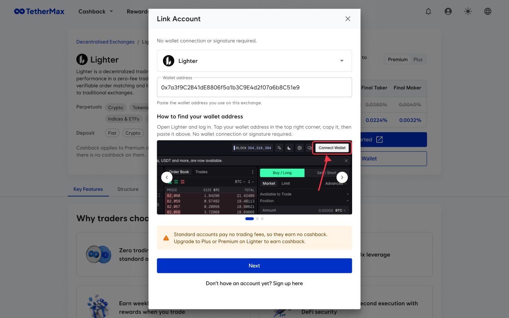 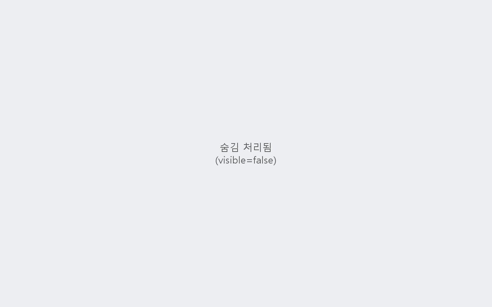

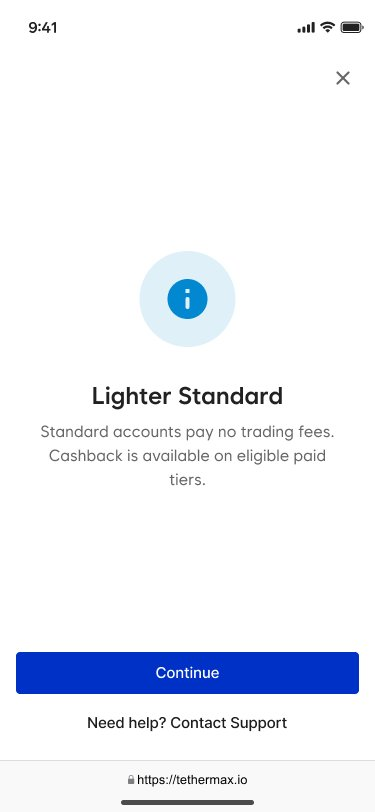 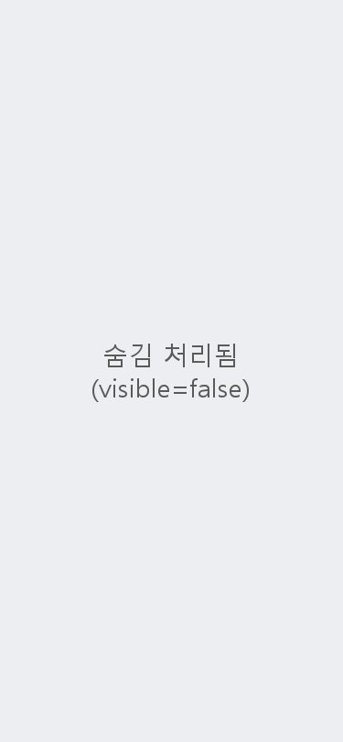

### L-02. 연동 성공 정산 줄 `Daily`

| 항목 | 화면(노드 링크) | 바꾼 것 | 근거(결정·REQ·기존 노드) | 전/후 캡처 |
|---|---|---|---|---|
| L-02 | [28960:127297](https://www.figma.com/design/hsa3bSV9QmFTe2jsf6tzTm/UI-UX-Design?node-id=28960-127297) · [28960:127789](https://www.figma.com/design/hsa3bSV9QmFTe2jsf6tzTm/UI-UX-Design?node-id=28960-127789) · [28969:127101](https://www.figma.com/design/hsa3bSV9QmFTe2jsf6tzTm/UI-UX-Design?node-id=28969-127101) · [28969:127308](https://www.figma.com/design/hsa3bSV9QmFTe2jsf6tzTm/UI-UX-Design?node-id=28969-127308) | PC L7·S3-6 `Weekly ·` → `Daily ·` · 모바일 라이트·다크 `Weekly settlement · Monday` → `Daily  ·  Next update 26.11.27 09:00`(표본, 타임존 라벨 없음) | G-428 · REQ-095 | `L-02_before` / `L-02_after` · `L-02m_before` / `L-02m_after` |

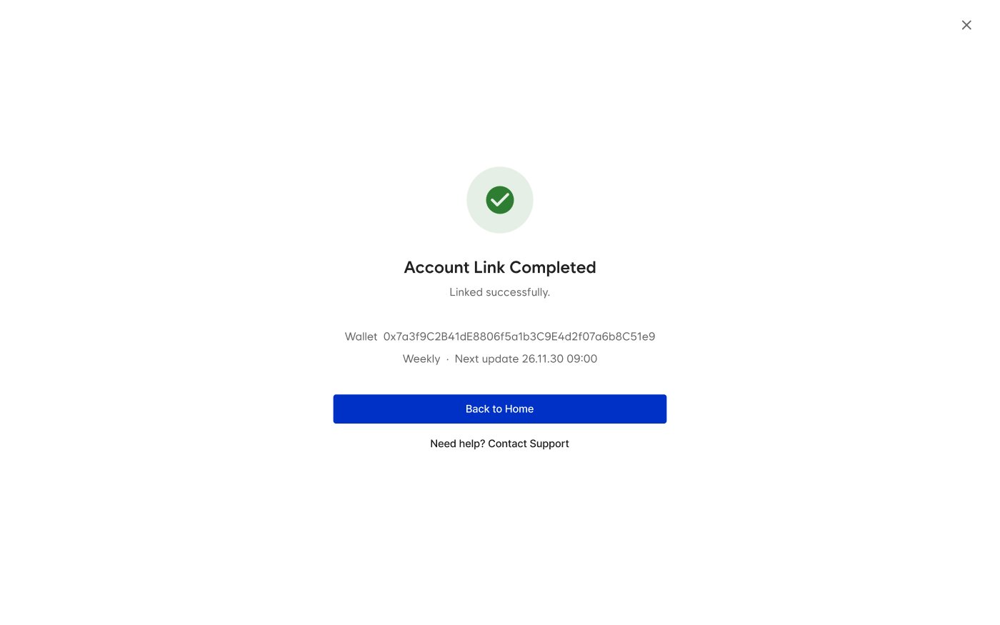 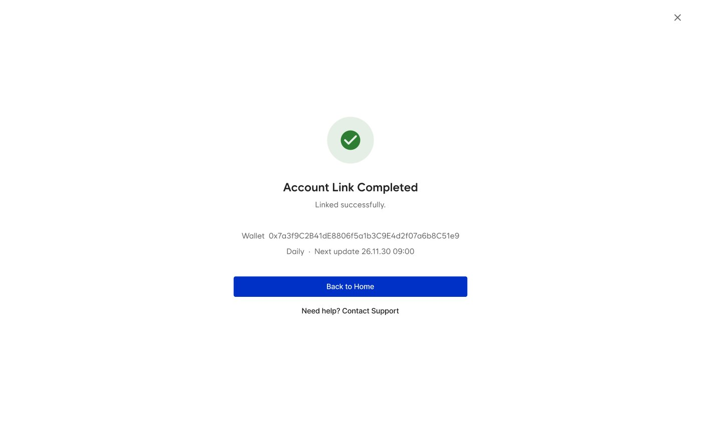

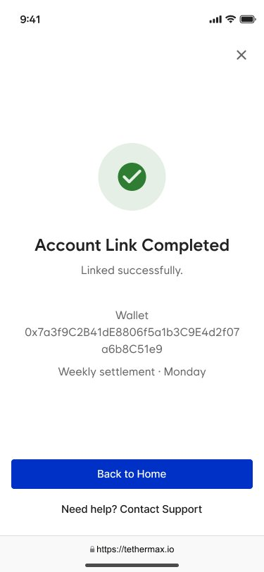 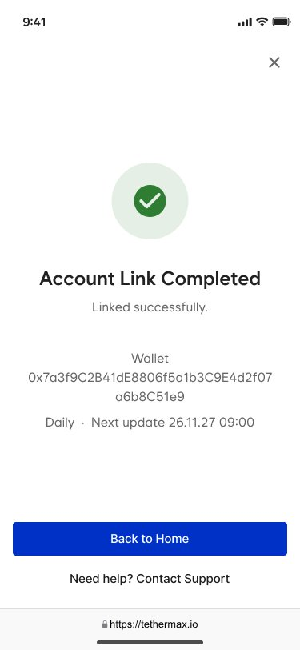

### L-03. 복귀 시 입력 유지 · 퍼즐 실패 재시도

| 항목 | 화면(노드 링크) | 바꾼 것 | 근거(결정·REQ·기존 노드) | 전/후 캡처 |
|---|---|---|---|---|
| L-03 | [29327:385103](https://www.figma.com/design/hsa3bSV9QmFTe2jsf6tzTm/UI-UX-Design?node-id=29327-385103) · [29327:405133](https://www.figma.com/design/hsa3bSV9QmFTe2jsf6tzTm/UI-UX-Design?node-id=29327-405133) · [29010:126471](https://www.figma.com/design/hsa3bSV9QmFTe2jsf6tzTm/UI-UX-Design?node-id=29010-126471) | L3 복제 → `L3-R Return — input kept`(PC + 라벨 · 모바일). 연동 입력 메모에 「퍼즐 실패·토큰 만료 → 주소 유지, 새 퍼즐(L5), 시도 한도 다이얼로그 없음」 추가. 화면 문구 변경 없음 | REQ-064 · REQ-072 · G-380 · API-007 · 기존 L3 | `L-03_before` / `L-03_after` · `L-03m_before` / `L-03m_after` · `L-03memo_before` / `L-03memo_after` |

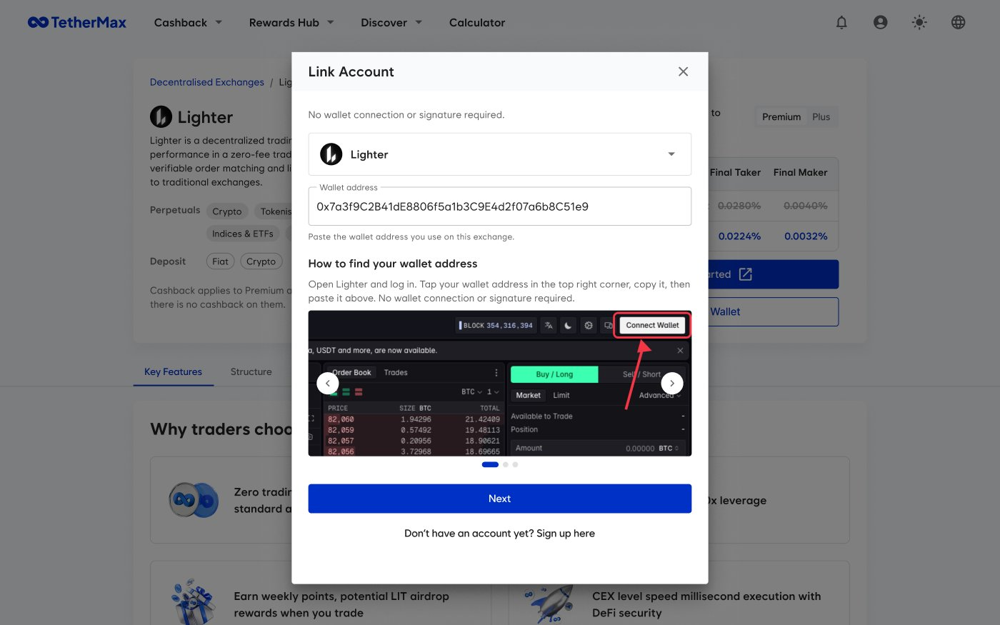 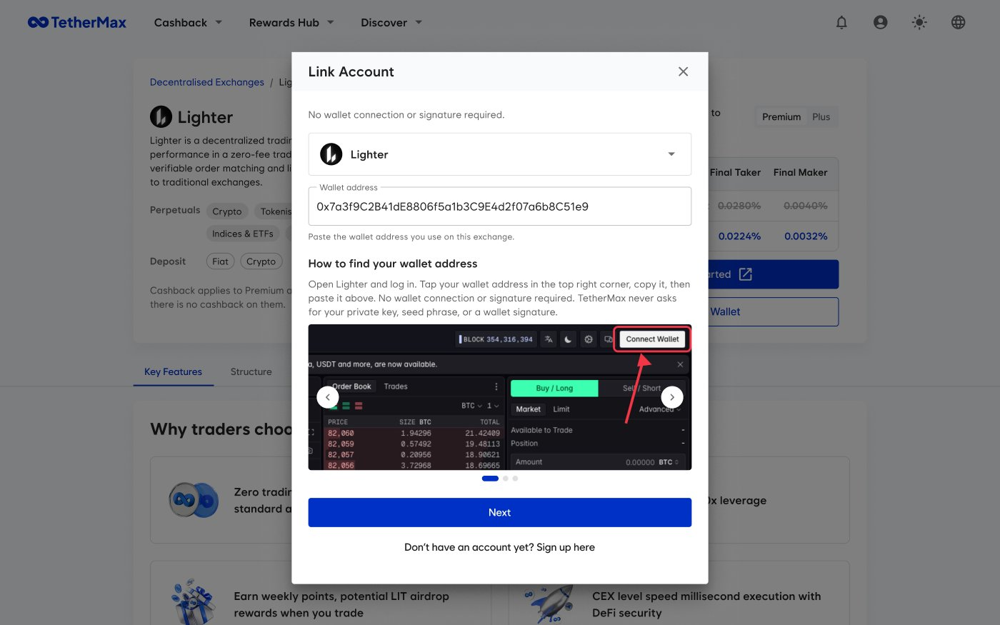

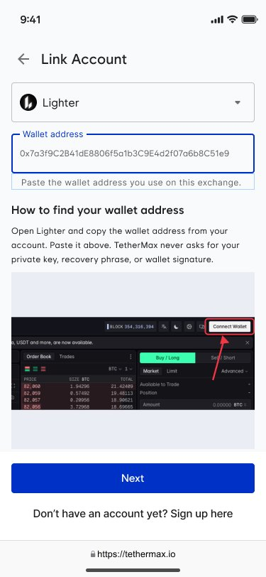 

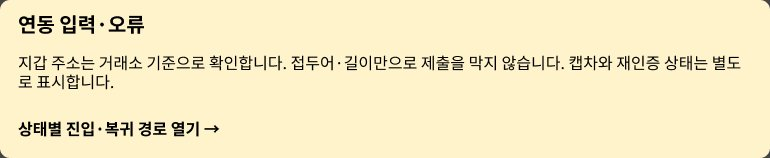 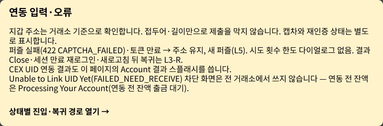

### L-04. 한도 초과 결과

| 항목 | 화면(노드 링크) | 바꾼 것 | 근거(결정·REQ·기존 노드) | 전/후 캡처 |
|---|---|---|---|---|
| L-04 | [28960:127349](https://www.figma.com/design/hsa3bSV9QmFTe2jsf6tzTm/UI-UX-Design?node-id=28960-127349) · [28960:127882](https://www.figma.com/design/hsa3bSV9QmFTe2jsf6tzTm/UI-UX-Design?node-id=28960-127882) · [28969:127118](https://www.figma.com/design/hsa3bSV9QmFTe2jsf6tzTm/UI-UX-Design?node-id=28969-127118) · [28969:127325](https://www.figma.com/design/hsa3bSV9QmFTe2jsf6tzTm/UI-UX-Design?node-id=28969-127325) | 본문 → `You've linked the maximum number of accounts (12).` · 주 버튼 `Close` → `Contact Support` · 하단 `Need help? Contact Support` 끔(Secondary 속성). 제목 유지 | G-091 · REQ-112 · 정책 확정 문구 · 기존 28969:127153 배치 | `L-04_before` / `L-04_after` · `L-04m_before` / `L-04m_after` |

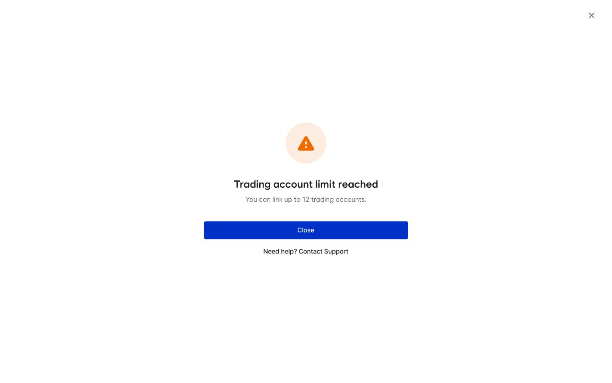 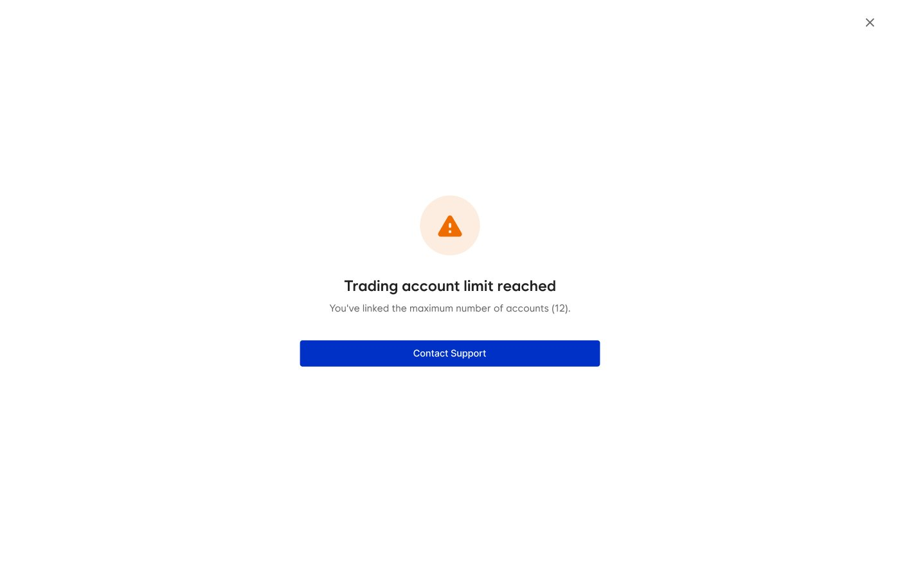

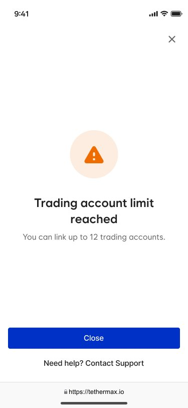 

### L-05. 확인 중 대기 안내

| 항목 | 화면(노드 링크) | 바꾼 것 | 근거(결정·REQ·기존 노드) | 전/후 캡처 |
|---|---|---|---|---|
| L-05 | [28960:127313](https://www.figma.com/design/hsa3bSV9QmFTe2jsf6tzTm/UI-UX-Design?node-id=28960-127313) · [28960:127912](https://www.figma.com/design/hsa3bSV9QmFTe2jsf6tzTm/UI-UX-Design?node-id=28960-127912) · [28969:127080](https://www.figma.com/design/hsa3bSV9QmFTe2jsf6tzTm/UI-UX-Design?node-id=28969-127080) · [28969:127287](https://www.figma.com/design/hsa3bSV9QmFTe2jsf6tzTm/UI-UX-Design?node-id=28969-127287) | 제목 `We're checking your account link` · 본문 `We'll let you know the result after checking the exchange's referral records.` · `Back to Home` 유지 | G-094 · REQ-100 · 정책 확정 문구 | `L-05_before` / `L-05_after` · `L-05m_before` / `L-05m_after` |

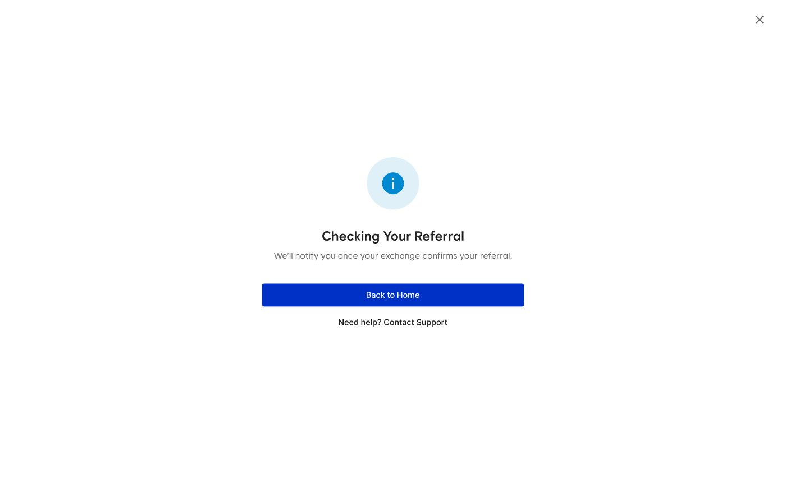 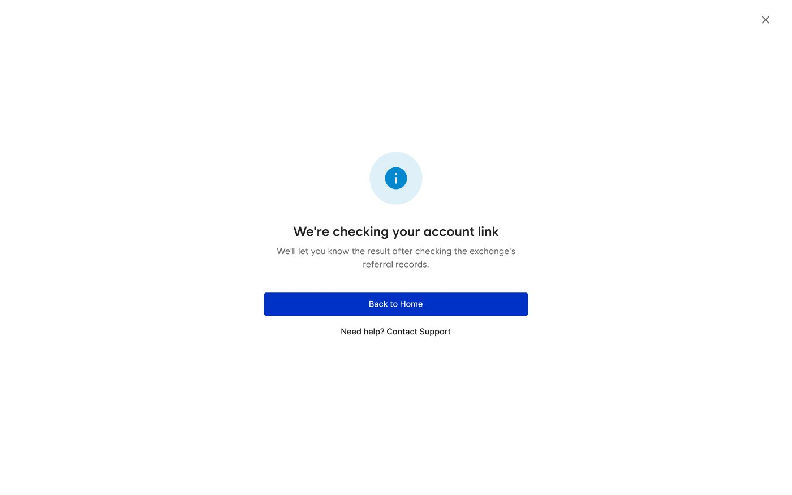

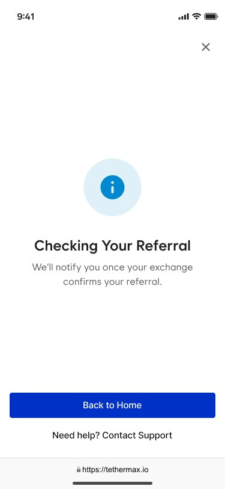 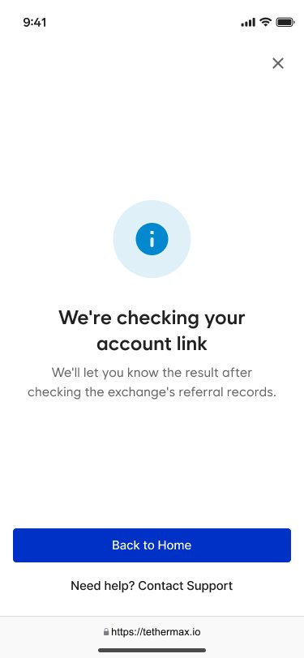

### L-06. 처리 중 · 확인 중 순서, 모바일 처리 중

| 항목 | 화면(노드 링크) | 바꾼 것 | 근거(결정·REQ·기존 노드) | 전/후 캡처 |
|---|---|---|---|---|
| L-06 | [28960:127293](https://www.figma.com/design/hsa3bSV9QmFTe2jsf6tzTm/UI-UX-Design?node-id=28960-127293) · [28960:127313](https://www.figma.com/design/hsa3bSV9QmFTe2jsf6tzTm/UI-UX-Design?node-id=28960-127313) · [29327:405180](https://www.figma.com/design/hsa3bSV9QmFTe2jsf6tzTm/UI-UX-Design?node-id=29327-405180) | PC 프레임 이름 `L6 Processing (request wait ≥1s)` · `L11 Checking (PROCESSING · PARTNER_LOOKUP)`. 모바일 확인 중 복제 → `Processing Your Account` / `Your account is being processed. You'll be notified once linking is complete.` / `Back to Home` | REQ-091 · REQ-100 | `L-05m_before` / `L-06m_after` |

 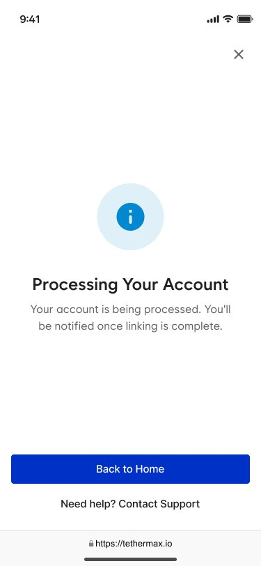

### L-07. 연동 전 잔액 출금 대기 · 실패

| 항목 | 화면(노드 링크) | 바꾼 것 | 근거(결정·REQ·기존 노드) | 전/후 캡처 |
|---|---|---|---|---|
| L-07 | [28966:124158](https://www.figma.com/design/hsa3bSV9QmFTe2jsf6tzTm/UI-UX-Design?node-id=28966-124158) · [28969:127087](https://www.figma.com/design/hsa3bSV9QmFTe2jsf6tzTm/UI-UX-Design?node-id=28969-127087) · [28969:127294](https://www.figma.com/design/hsa3bSV9QmFTe2jsf6tzTm/UI-UX-Design?node-id=28969-127294) · [28966:124162](https://www.figma.com/design/hsa3bSV9QmFTe2jsf6tzTm/UI-UX-Design?node-id=28966-124162) · [28969:127094](https://www.figma.com/design/hsa3bSV9QmFTe2jsf6tzTm/UI-UX-Design?node-id=28969-127094) · [28969:127301](https://www.figma.com/design/hsa3bSV9QmFTe2jsf6tzTm/UI-UX-Design?node-id=28969-127301) | 대기 본문 → `Your previous cashback of 30.00 USDT is being sent to this account. Linking completes once the transfer is confirmed.`(금액 표본) · 실패 본문 → `We couldn’t send your previous cashback, so this account wasn’t linked. The amount is back in this account’s balance. You can try linking again.` | 문구표 #20 · #21 · G-426 · REQ-107 · REQ-108 | `L-07_before` / `L-07_after` · `L-07f_before` / `L-07f_after` |

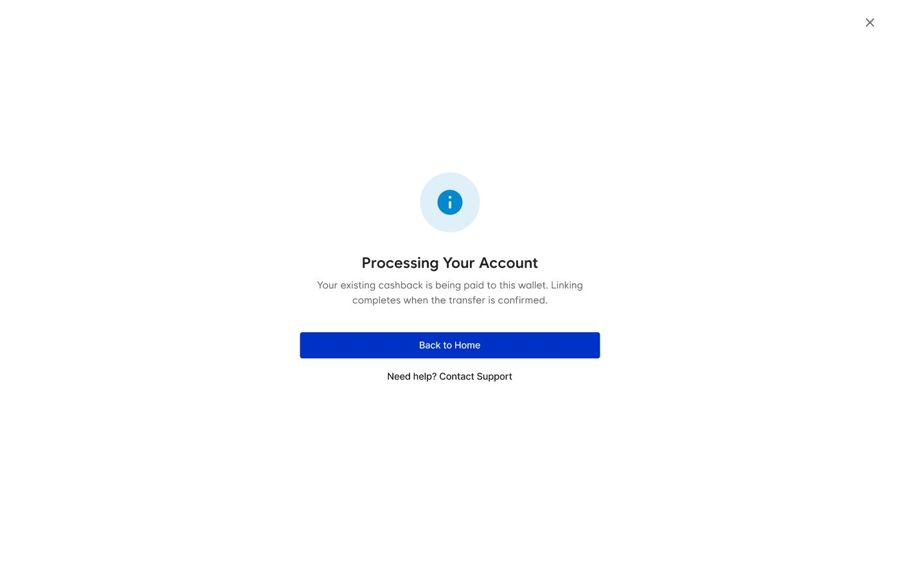 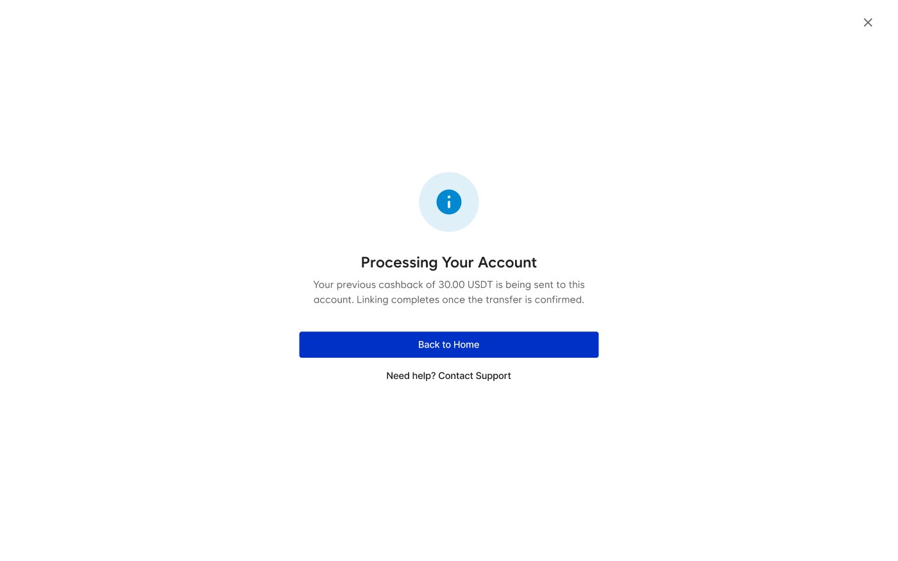

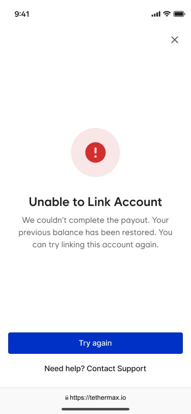 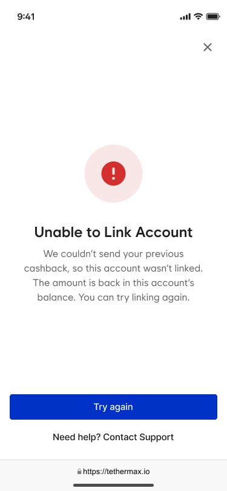

### L-08. 가이드 보안 문구

| 항목 | 화면(노드 링크) | 바꾼 것 | 근거(결정·REQ·기존 노드) | 전/후 캡처 |
|---|---|---|---|---|
| L-08 | [28960:127275](https://www.figma.com/design/hsa3bSV9QmFTe2jsf6tzTm/UI-UX-Design?node-id=28960-127275) · [28969:126986](https://www.figma.com/design/hsa3bSV9QmFTe2jsf6tzTm/UI-UX-Design?node-id=28969-126986) | PC 가이드 본문 끝에 `TetherMax never asks for your private key, seed phrase, or a wallet signature.` 추가(13곳) · 모바일·배경 상세 가이드의 `…recovery phrase…` 문장을 같은 문장으로 교체(30곳). 인스턴스 오버라이드 | G-392 · REQ-071 | `L-08_before` / `L-08_after` · `L-08m_before` / `L-08m_after` |

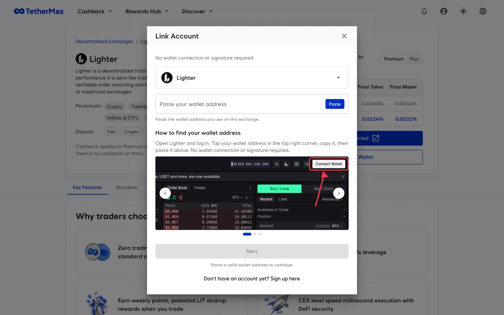 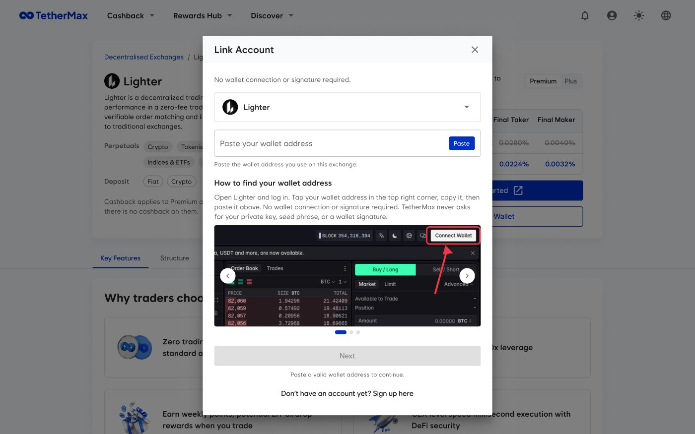

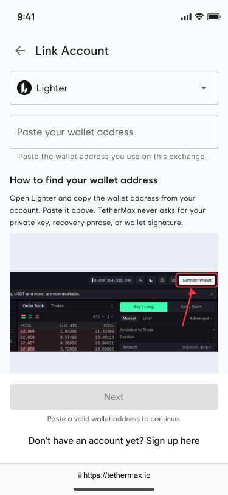 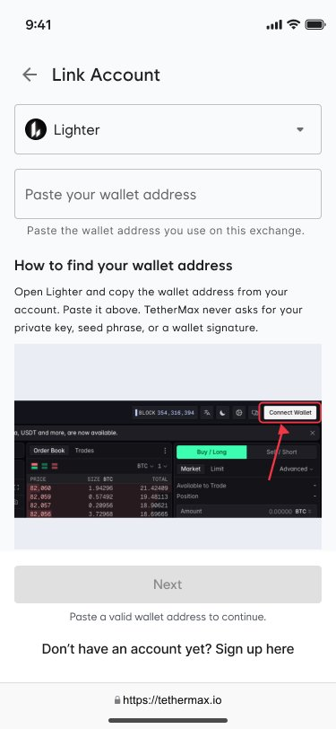

### L-09. 주소 인라인 오류 상태

| 항목 | 화면(노드 링크) | 바꾼 것 | 근거(결정·REQ·기존 노드) | 전/후 캡처 |
|---|---|---|---|---|
| L-09 | [29327:385261](https://www.figma.com/design/hsa3bSV9QmFTe2jsf6tzTm/UI-UX-Design?node-id=29327-385261) · [29327:405500](https://www.figma.com/design/hsa3bSV9QmFTe2jsf6tzTm/UI-UX-Design?node-id=29327-405500) · [29327:405548](https://www.figma.com/design/hsa3bSV9QmFTe2jsf6tzTm/UI-UX-Design?node-id=29327-405548) · [29327:405596](https://www.figma.com/design/hsa3bSV9QmFTe2jsf6tzTm/UI-UX-Design?node-id=29327-405596) · [29327:405644](https://www.figma.com/design/hsa3bSV9QmFTe2jsf6tzTm/UI-UX-Design?node-id=29327-405644) · [29327:405692](https://www.figma.com/design/hsa3bSV9QmFTe2jsf6tzTm/UI-UX-Design?node-id=29327-405692) | PC `Address validation / Unsupported format` 1개 · 모바일 Empty · Unsupported format · Couldn't verify · Name instead of address · Zero address 5개(입력 표본은 PC 같은 상태 프레임 값). 모바일 캡처는 Unsupported format | 문구표 #22~#27 · A-12 · 기존 28980:132242 · 28969:127006 | `L-09_before` / `L-09_after` · `L-09m_before` / `L-09m_after` |

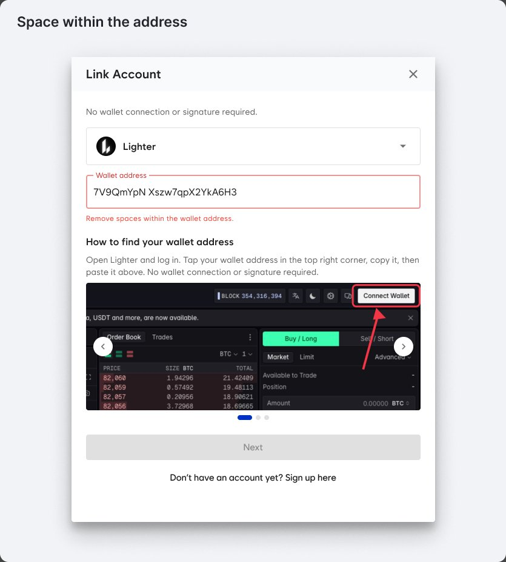 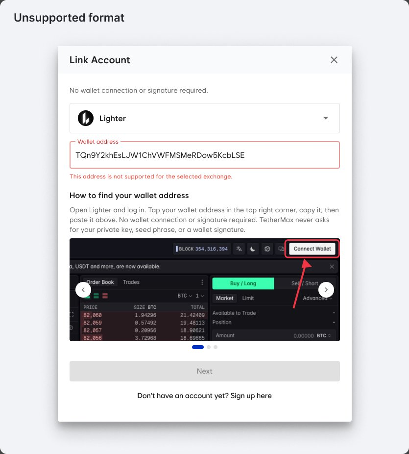

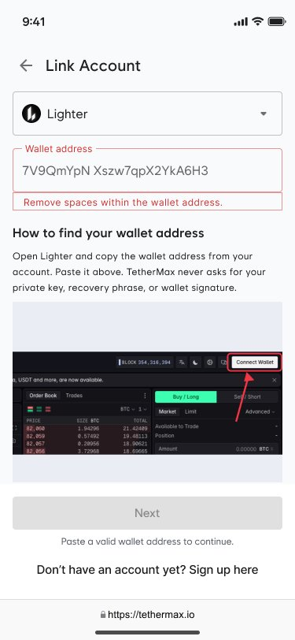 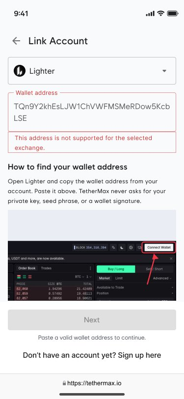

### L-10. 파트너 목록 로드 실패

| 항목 | 화면(노드 링크) | 바꾼 것 | 근거(결정·REQ·기존 노드) | 전/후 캡처 |
|---|---|---|---|---|
| L-10 | [29327:388255](https://www.figma.com/design/hsa3bSV9QmFTe2jsf6tzTm/UI-UX-Design?node-id=29327-388255) · [29327:412552](https://www.figma.com/design/hsa3bSV9QmFTe2jsf6tzTm/UI-UX-Design?node-id=29327-412552) | L1 · 모바일 선택 시트 복제 → 목록·Top Partner 숨김, [MAX 1216] S9 경고 바 + 외곽선 버튼 복제 삽입: `Partners couldn’t load` / `Please try loading the exchange list again.` / `Retry` | 문구표 #17 · G-097 · 기존 22442:219848 | `L-10_before` / `L-10_after` · `L-10m_before` / `L-10m_after` |

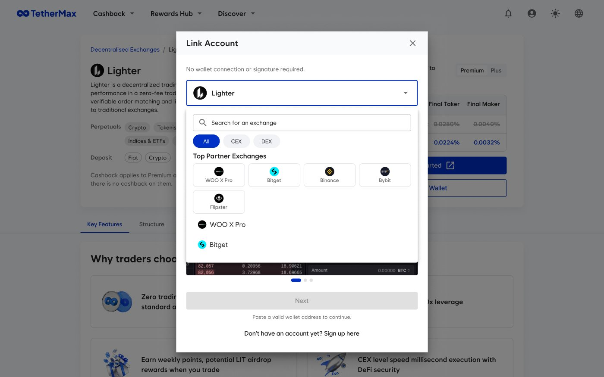 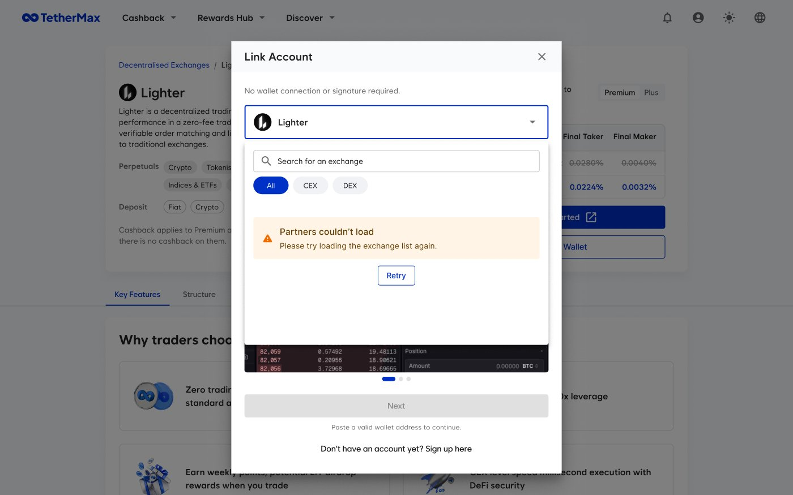

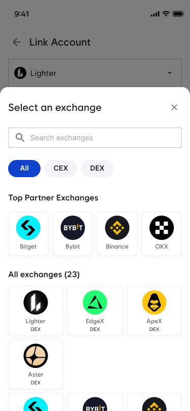 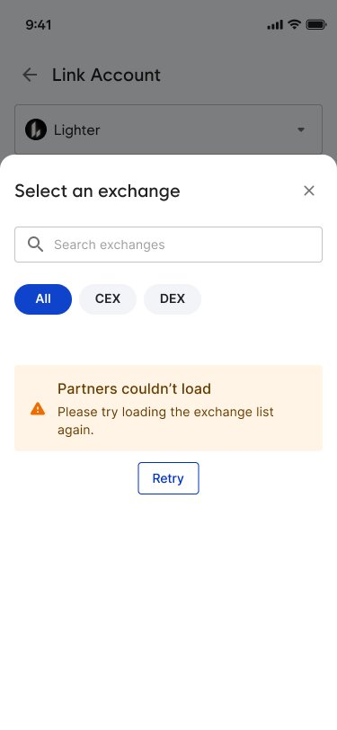

### L-11. `Cashback shown from`

| 항목 | 화면(노드 링크) | 바꾼 것 | 근거(결정·REQ·기존 노드) | 전/후 캡처 |
|---|---|---|---|---|
| L-11 | [29327:385112](https://www.figma.com/design/hsa3bSV9QmFTe2jsf6tzTm/UI-UX-Design?node-id=29327-385112) · [29327:405246](https://www.figma.com/design/hsa3bSV9QmFTe2jsf6tzTm/UI-UX-Design?node-id=29327-405246) | L7 · 모바일 성공 복제 → 정산 줄 아래 `Cashback shown from 26.05.30`(표본, 같은 날짜 표기) | REQ-119 · A-16 | `L-02_before` / `L-11_after` · `L-02m_before` / `L-11m_after` |

 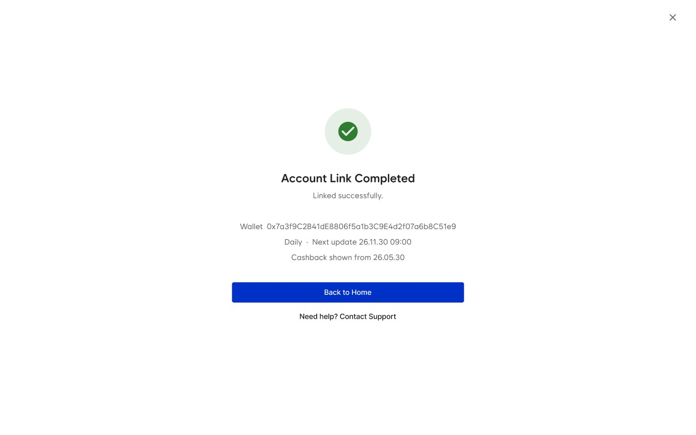

 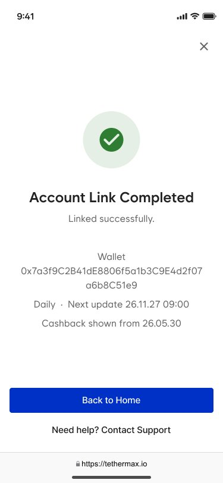

### L-12. O11 칩 자리표시

| 항목 | 화면(노드 링크) | 바꾼 것 | 근거(결정·REQ·기존 노드) | 전/후 캡처 |
|---|---|---|---|---|
| L-12 | [28960:127709](https://www.figma.com/design/hsa3bSV9QmFTe2jsf6tzTm/UI-UX-Design?node-id=28960-127709) | Lighter 행 칩 `Chip` → `Verifying ownership` · Aster 행 자리표시 칩 숨김. 홈 행 추가는 하지 않음(결정 Q4) | 문구표 #2 · 결정 Q4 · 기존 9401:87675 | `L-12_before` / `L-12_after` |

 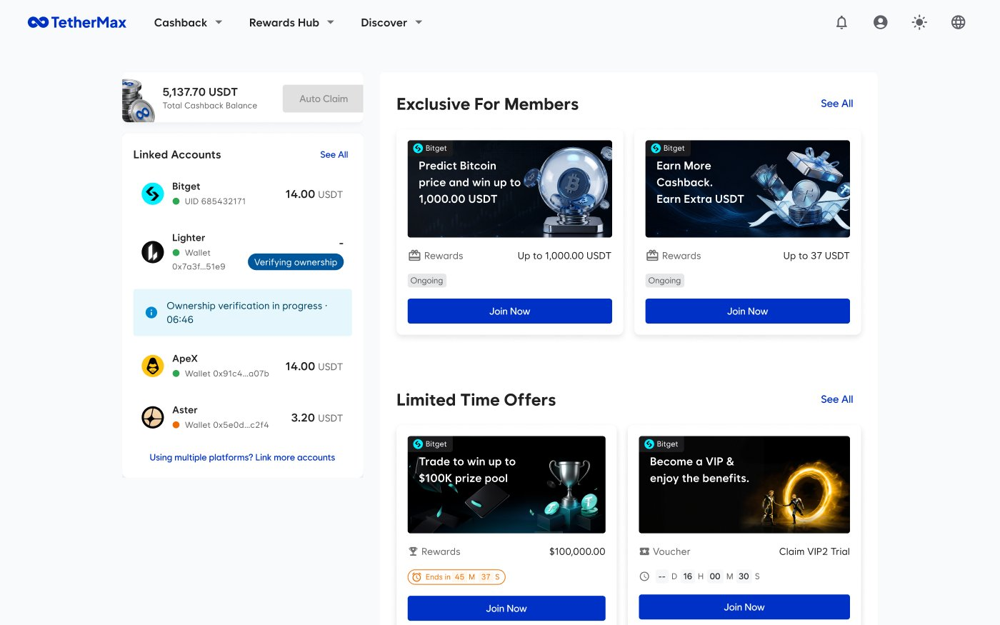

### L-13. CEX 폼 제목 · 가입 링크

| 항목 | 화면(노드 링크) | 바꾼 것 | 근거(결정·REQ·기존 노드) | 전/후 캡처 |
|---|---|---|---|---|
| L-13 | [29227:120903](https://www.figma.com/design/hsa3bSV9QmFTe2jsf6tzTm/UI-UX-Design?node-id=29227-120903) · [29051:100488](https://www.figma.com/design/hsa3bSV9QmFTe2jsf6tzTm/UI-UX-Design?node-id=29051-100488) | `Link your exchange UID` → `Link Account`(6곳) · `Register here` → `Sign up here`(18곳, 모바일 선택 시트 포함) | REQ-054 · REQ-053 · 결정 N10 | `L-13_before` / `L-13_after` · `L-13m_before` / `L-13m_after` |

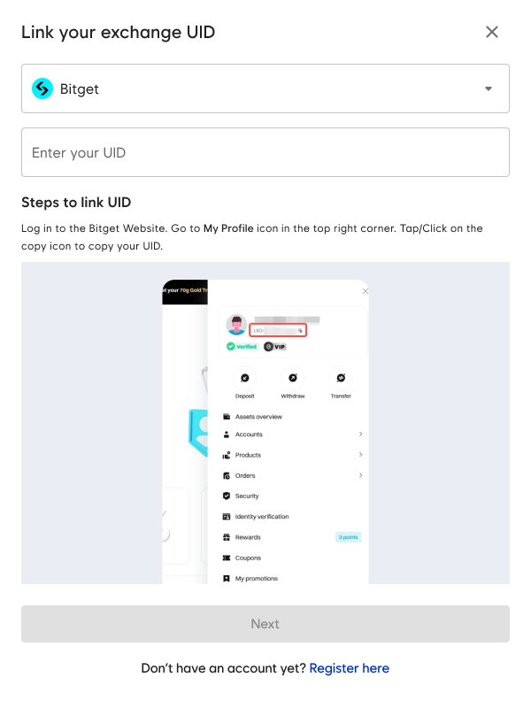 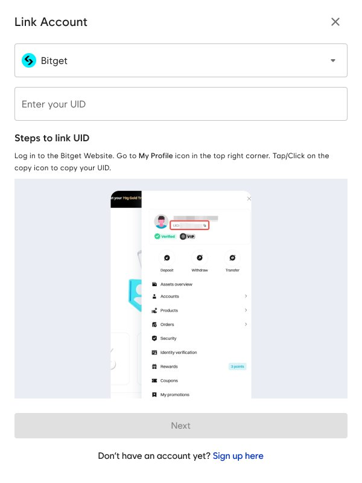

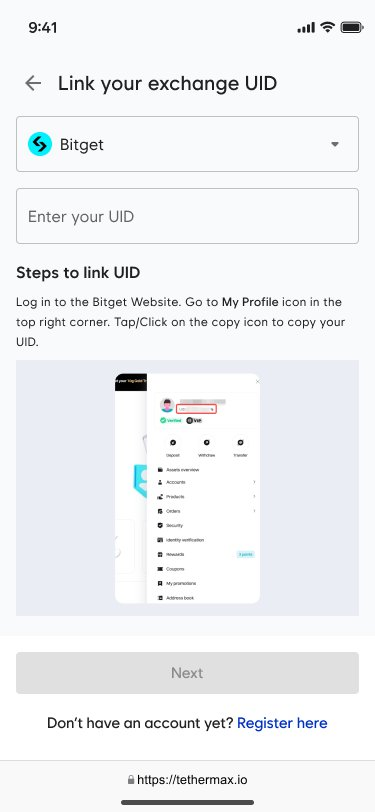 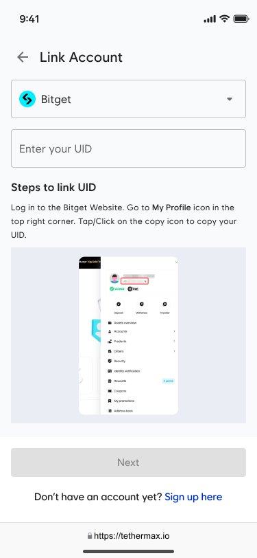

### L-14. 소유권 업로드 경고

| 항목 | 화면(노드 링크) | 바꾼 것 | 근거(결정·REQ·기존 노드) | 전/후 캡처 |
|---|---|---|---|---|
| L-14 | [28960:127635](https://www.figma.com/design/hsa3bSV9QmFTe2jsf6tzTm/UI-UX-Design?node-id=28960-127635) · [28982:126199](https://www.figma.com/design/hsa3bSV9QmFTe2jsf6tzTm/UI-UX-Design?node-id=28982-126199) | `…during the coupon usage period. Existing coupons are non-transferable.` → `…during the claim period. Existing coupons cannot be transferred.`(PC·모바일 24곳, 컴포넌트 메인 2곳은 손대지 않음) | REQ-726 · 정책 5-10 | `L-14_before` / `L-14_after` · `L-14m_before` / `L-14m_after` |

 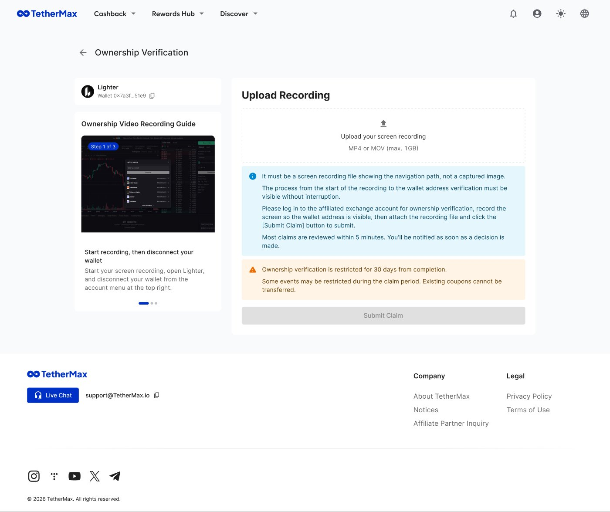

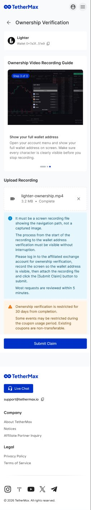 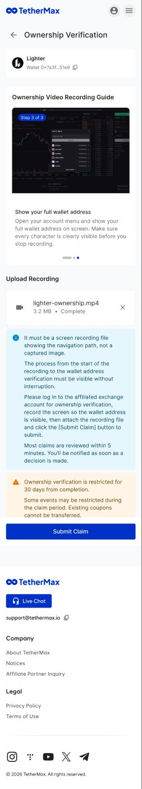

### L-15. 심사 시간 안내

| 항목 | 화면(노드 링크) | 바꾼 것 | 근거(결정·REQ·기존 노드) | 전/후 캡처 |
|---|---|---|---|---|
| L-15 | [28960:127700](https://www.figma.com/design/hsa3bSV9QmFTe2jsf6tzTm/UI-UX-Design?node-id=28960-127700) | `Most requests are reviewed within 5 minutes.` → `Most claims are reviewed within 5 minutes. You'll be notified as soon as a decision is made.`(24곳). 확인창 `Average review time: ~5 minutes` 유지 | REQ-726 · 기존 [MAX-561] 12773:343687 | `L-15_before` / `L-15_after` |

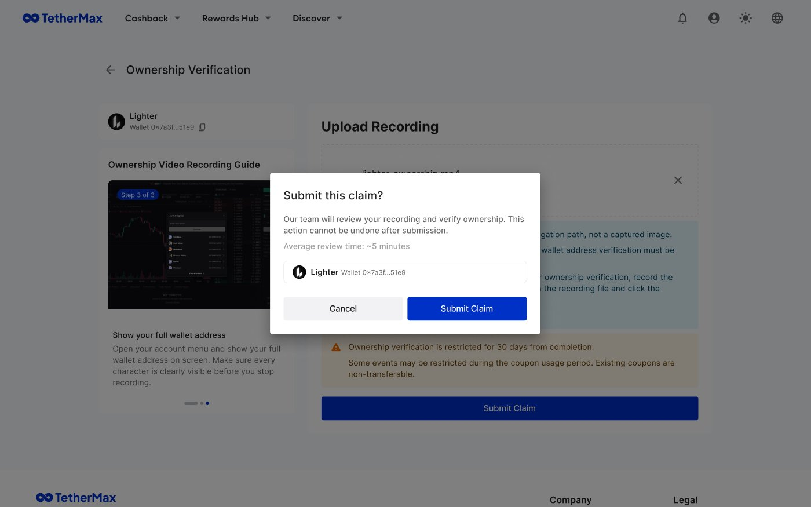 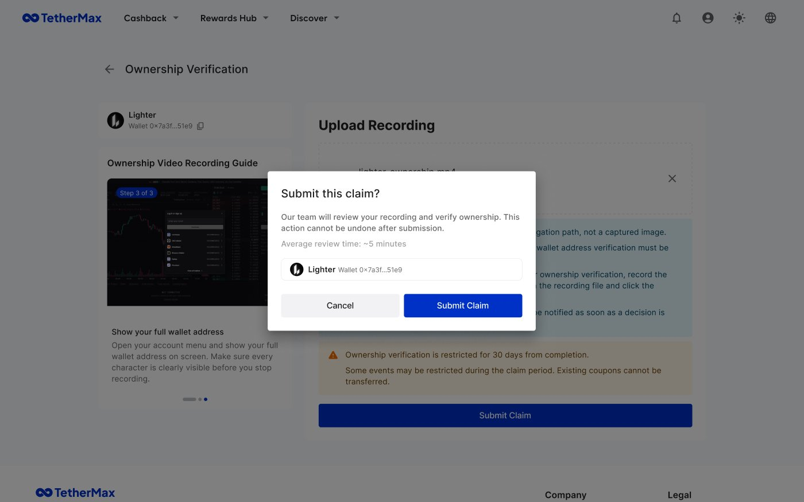

### L-16. 게스트 주소 형식 오류

| 항목 | 화면(노드 링크) | 바꾼 것 | 근거(결정·REQ·기존 노드) | 전/후 캡처 |
|---|---|---|---|---|
| L-16 | [29327:414533](https://www.figma.com/design/hsa3bSV9QmFTe2jsf6tzTm/UI-UX-Design?node-id=29327-414533) · [29327:414573](https://www.figma.com/design/hsa3bSV9QmFTe2jsf6tzTm/UI-UX-Design?node-id=29327-414573) | 게스트 오류 프레임 복제(Web·Mobile) → 입력란 공백 섞인 표본, 오류 `Remove spaces within the wallet address.` 새 행 제목 「입력 오류 · 지갑 주소 형식」 | API-023 · REQ-065 · 문구표 #23 | `L-16_before` / `L-16_after` · `L-16m_before` / `L-16m_after` |

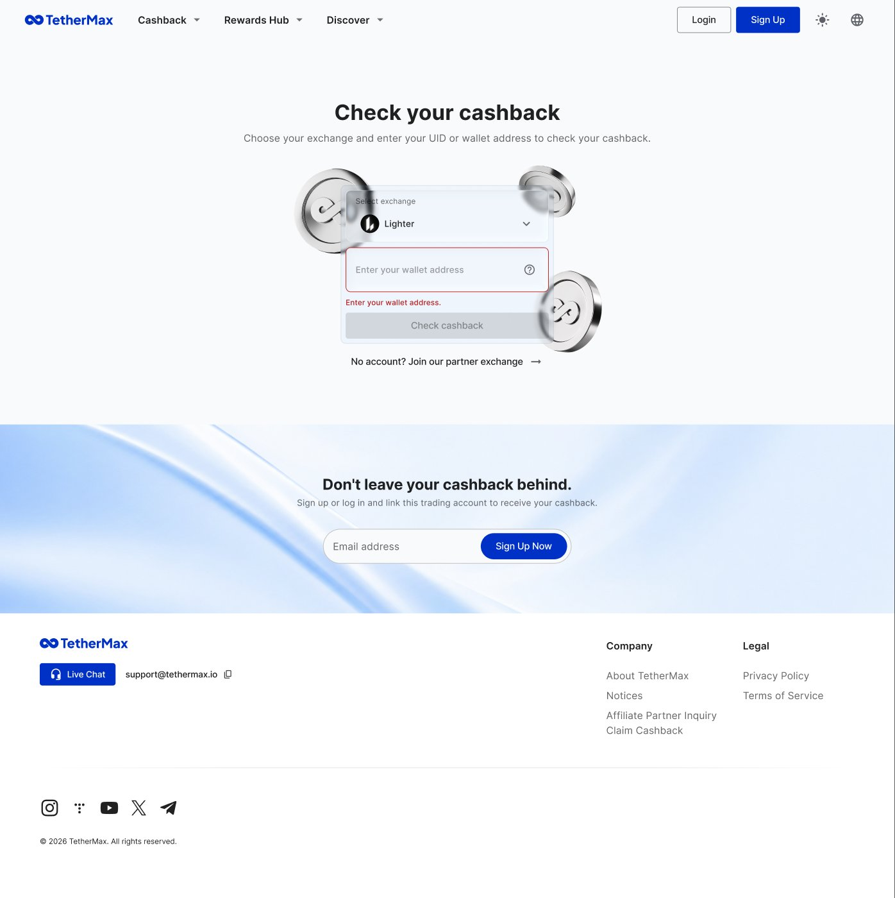 

 

### L-17. 게스트 → CEX 연동 폼 미리 채움

| 항목 | 화면(노드 링크) | 바꾼 것 | 근거(결정·REQ·기존 노드) | 전/후 캡처 |
|---|---|---|---|---|
| L-17 | [29327:385171](https://www.figma.com/design/hsa3bSV9QmFTe2jsf6tzTm/UI-UX-Design?node-id=29327-385171) · [29327:405312](https://www.figma.com/design/hsa3bSV9QmFTe2jsf6tzTm/UI-UX-Design?node-id=29327-405312) | CEX 폼 복제(PC·모바일) → UID `685432171`(표본), `Next` 활성. ① 화살표 연결은 못 함(요약 참고) | FU-012 · REQ-180 | `L-13_before` / `L-17_after` · `L-13m_before` / `L-17m_after` |

 

 

### L-18. 모바일 아무것도 선택 안 된 첫 화면

| 항목 | 화면(노드 링크) | 바꾼 것 | 근거(결정·REQ·기존 노드) | 전/후 캡처 |
|---|---|---|---|---|
| L-18 | [29327:405399](https://www.figma.com/design/hsa3bSV9QmFTe2jsf6tzTm/UI-UX-Design?node-id=29327-405399) | 입력 폼 복제 → `Select a partner`, 마크·주소 입력·가이드 숨김, 안내 `Select the partner you trade on to see how to link your account.`, 버튼 `Link Account` 비활성 | REQ-051 · 근거 PC S3-2 | `L-08m_before` / `L-18_after` |

 

### L-19. 소유권 신청 시 한도 도달

| 항목 | 화면(노드 링크) | 바꾼 것 | 근거(결정·REQ·기존 노드) | 전/후 캡처 |
|---|---|---|---|---|
| L-19 | [29327:414159](https://www.figma.com/design/hsa3bSV9QmFTe2jsf6tzTm/UI-UX-Design?node-id=29327-414159) · [29327:414166](https://www.figma.com/design/hsa3bSV9QmFTe2jsf6tzTm/UI-UX-Design?node-id=29327-414166) | L-04 반영된 L15 · 모바일 한도 프레임 복제 → 소유권 섹션 `O2-L Integration limit`(+ 라벨) | API-025 · REQ-731 · G-091 | `L-04_before` / `L-19_after` · `L-04m_before` / `L-19m_after` |

 

 

### L-20. CEX 결과 화면 기준 메모

| 항목 | 화면(노드 링크) | 바꾼 것 | 근거(결정·REQ·기존 노드) | 전/후 캡처 |
|---|---|---|---|---|
| L-20 | [29010:126471](https://www.figma.com/design/hsa3bSV9QmFTe2jsf6tzTm/UI-UX-Design?node-id=29010-126471) | 연동 입력 메모에 「CEX UID 연동 결과도 Account 결과 스플래시」·「`Unable to Link UID Yet` 차단 화면 미사용 — 연동 전 잔액은 `Processing Your Account`」 추가 | REQ-107 · REQ-108 · 결정 N5 · N10 | `L-03memo_before` / `L-03memo_after` |

 

### L-21. `Verification Success` 버튼

| 항목 | 화면(노드 링크) | 바꾼 것 | 근거(결정·REQ·기존 노드) | 전/후 캡처 |
|---|---|---|---|---|
| L-21 | [28969:127073](https://www.figma.com/design/hsa3bSV9QmFTe2jsf6tzTm/UI-UX-Design?node-id=28969-127073) · [28969:127280](https://www.figma.com/design/hsa3bSV9QmFTe2jsf6tzTm/UI-UX-Design?node-id=28969-127280) | 모바일 라이트·다크 `Close` → `Back to Home` | REQ-094 · 현행판 B10 | `L-21_before` / `L-21_after` |

 

### L-23. 소유권 쿨다운 하단 버튼

| 항목 | 화면(노드 링크) | 바꾼 것 | 근거(결정·REQ·기존 노드) | 전/후 캡처 |
|---|---|---|---|---|
| L-23 | [28960:127650](https://www.figma.com/design/hsa3bSV9QmFTe2jsf6tzTm/UI-UX-Design?node-id=28960-127650) · [28982:126298](https://www.figma.com/design/hsa3bSV9QmFTe2jsf6tzTm/UI-UX-Design?node-id=28982-126298) · [28982:126553](https://www.figma.com/design/hsa3bSV9QmFTe2jsf6tzTm/UI-UX-Design?node-id=28982-126553) | 하단 `Need help? Contact Support` → `Close`. `Try a different wallet` 유지 | REQ-724 · 기존 [MAX-561] 12783:405465 | `L-23_before` / `L-23_after` · `L-23m_before` / `L-23m_after` |

 

 

### L-24. 업로드 실패 뒤 카드

| 항목 | 화면(노드 링크) | 바꾼 것 | 근거(결정·REQ·기존 노드) | 전/후 캡처 |
|---|---|---|---|---|
| L-24 | [28982:126223](https://www.figma.com/design/hsa3bSV9QmFTe2jsf6tzTm/UI-UX-Design?node-id=28982-126223) · [28982:126478](https://www.figma.com/design/hsa3bSV9QmFTe2jsf6tzTm/UI-UX-Design?node-id=28982-126478) | 뒤쪽 업로더 `Complete` 숨기고 빈 상태(`Upload your screen recording` / `MP4 or MOV (max. 1GB)`) 복제 삽입 · `Submit Claim` 비활성(라이트·다크) | REQ-726 · 기존 28982:126103 | `L-24_before` / `L-24_after` |

 

### L-25. 제출 확인 뒤 화면 문구

| 항목 | 화면(노드 링크) | 바꾼 것 | 근거(결정·REQ·기존 노드) | 전/후 캡처 |
|---|---|---|---|---|
| L-25 | [28982:126238](https://www.figma.com/design/hsa3bSV9QmFTe2jsf6tzTm/UI-UX-Design?node-id=28982-126238) · [28982:126493](https://www.figma.com/design/hsa3bSV9QmFTe2jsf6tzTm/UI-UX-Design?node-id=28982-126493) | `How to find your UID` → `Ownership Video Recording Guide` · `Attach Recording` → `Upload Recording` | REQ-725 · REQ-726 | `L-25_before` / `L-25_after` |

 

### L-26. 선택기 검색 결과 상태

| 항목 | 화면(노드 링크) | 바꾼 것 | 근거(결정·REQ·기존 노드) | 전/후 캡처 |
|---|---|---|---|---|
| L-26 | [29327:416296](https://www.figma.com/design/hsa3bSV9QmFTe2jsf6tzTm/UI-UX-Design?node-id=29327-416296) · [29327:416463](https://www.figma.com/design/hsa3bSV9QmFTe2jsf6tzTm/UI-UX-Design?node-id=29327-416463) · [29327:416630](https://www.figma.com/design/hsa3bSV9QmFTe2jsf6tzTm/UI-UX-Design?node-id=29327-416630) · [29327:414670](https://www.figma.com/design/hsa3bSV9QmFTe2jsf6tzTm/UI-UX-Design?node-id=29327-414670) · [29327:415265](https://www.figma.com/design/hsa3bSV9QmFTe2jsf6tzTm/UI-UX-Design?node-id=29327-415265) | PC: 선택기 컴포넌트 인스턴스로 `1 exchange found`(bitg) · `several found`(bit) · `No results`(DEX · bit) 상태 프레임 3개(세트 옆). 게스트 선택기 Web·Mobile 복제 → 검색 `bit`, 결과 목록 숨김, `No results found for “bit”` 줄(모바일 기존 프레임 복제) | REQ-055 · REQ-056 · 결정 N13 · 기존 29051:104597 | `L-26_before` / `L-26_after` · `L-26g_before` / `L-26g_after` · `L-26gm_before` / `L-26gm_after` |

 

 

 

### L-27. 게스트 10 USDT 미만 안내

| 항목 | 화면(노드 링크) | 바꾼 것 | 근거(결정·REQ·기존 노드) | 전/후 캡처 |
|---|---|---|---|---|
| L-27 | [29035:98631](https://www.figma.com/design/hsa3bSV9QmFTe2jsf6tzTm/UI-UX-Design?node-id=29035-98631) · [29035:98694](https://www.figma.com/design/hsa3bSV9QmFTe2jsf6tzTm/UI-UX-Design?node-id=29035-98694) · [29035:99309](https://www.figma.com/design/hsa3bSV9QmFTe2jsf6tzTm/UI-UX-Design?node-id=29035-99309) · [29035:99372](https://www.figma.com/design/hsa3bSV9QmFTe2jsf6tzTm/UI-UX-Design?node-id=29035-99372) | `Below the 10 USDT payout minimum.` → `Below the 10 USDT minimum to claim.` | 문구표 #46 · G-419 | `L-27_before` / `L-27_after` |

 

### L-28. 모바일 기타 실패 프레임 이름

| 항목 | 화면(노드 링크) | 바꾼 것 | 근거(결정·REQ·기존 노드) | 전/후 캡처 |
|---|---|---|---|---|
| L-28 | [28969:127153](https://www.figma.com/design/hsa3bSV9QmFTe2jsf6tzTm/UI-UX-Design?node-id=28969-127153) · [28969:127360](https://www.figma.com/design/hsa3bSV9QmFTe2jsf6tzTm/UI-UX-Design?node-id=28969-127360) | 레이어 이름 → `Link / L13 Unable to Link Account (LINK_REJECTED · FAILED_ISSUE_UID) / Light·Dark`. 화면 변화 없음 | REQ-092 · G-161 | `L-28_before` / `L-28_after` |

 

