# Figma 수정 계획 — balance (잔액·출금·홈·허브·요약·랭킹)

2026-11-26 · 대상 [DEX(revision)](https://www.figma.com/design/hsa3bSV9QmFTe2jsf6tzTm/UI-UX-Design?node-id=28960-125519) · 입력 [디자인 상태점검 balance](디자인_상태점검_balance.md) · [재점검](DEX_revision_화면상태_재점검.md) · [결정 기록](_Figma수정_결정.md)(최우선) · [기존 디자인 카탈로그 B](기존디자인_카탈로그/B_거래소_연동_잔액.md) · [현행판 확인서](기존디자인_현행판_확인.md) · [정책](../00_DEX_최종정책.md) 부록 G(G-428 포함)

**Figma는 아직 고치지 않았다.** 아래는 항목마다 지금 화면 · 따라 할 기존 디자인 · 수정안이다. 승인을 받은 뒤 수정한다.

## 요약

| 항목 | 수 |
|---|---|
| 수정 항목 | **40건** — 우선 1: 8 · 우선 2: 21 · 우선 3: 11 |
| 새 프레임 | **56개**(출금 화면 17 · 홈 8 · 지갑 상세 8 · 허브 9 · 요약 8 · 피드·랜딩 4 · 랭킹 2, 맨 아래 「새 프레임 목록」) |
| 문구·값만 바꾸는 항목 | **16건**(#4 · #5 · #6 · #15 · #20 · #23 · #24 · #27 · #28 · #29 · #30 · #31 · #32 · #35 · #36 · #39) |
| 근거 없음(사용자 확인) — 계획에서 제외 | **10건**(아래 표) |

**작업 원칙** — 새 모양을 만들지 않는다. 기존 프레임·인스턴스를 복제하고 문구·값을 바꾸거나, 정책 위반 요소를 삭제·숨김한다. 새 프레임은 같은 섹션의 해당 기존 프레임 바로 오른쪽에 둔다. 다크 사본이 있는 프레임은 라이트를 고친 뒤 같은 내용으로 다크 사본에 반영한다.

**결정 적용**(결정 기록) — 출금 화면은 둔다(기존 출금 모달·페이지 + 비활성 `Auto Claim`, 출금 확인 다이얼로그 없음) · 출금 실적·결과 = `Withdraw`/`Withdrawn`(D2), 요청·동작 = `Claim` · CEX·DEX 공용 자리는 `Account` · 지갑 상세는 기존 디자인 + Earning Timeline 3단계(N16·N17·N19, 새 4단계·캐러셀 없음) · 빈 검색 `No results found for {검색어}`(N13) · 누적 캐시백 캡션 `Sum of {n} linked accounts · Update times vary by exchange`(N16 2차) · Lighter도 일 1회 원장(G-428, 주중 추정·주간 표기 없음).

### 근거 없음 — 사용자 확인 (계획에서 제외)

| # | 화면 · 상태 | 이유 | 근거 번호 |
|---|---|---|---|
| U1 | 허브 DEX 패널 — 같은 DEX 복수 지갑 `+N` 표시와 넛지 지갑 선택 | 기존 디자인에 같은 거래소 여러 계정을 한 패널에서 고르는 패턴이 없다(출금 화면의 카드 여러 장은 #1에 포함) | REQ-302 · 정책 6장 |
| U2 | 홈 Linked Accounts — 상태 점에 텍스트 병기 | 기존 홈 행([S4 mWeb][X-mS4] · [MAXOP-731 웹][X-731])은 점만 있다 | REQ-039 · REQ-271 |
| U3 | 공개 피드 — 거래소 이름 옆 `DEX` 배지 | 기존 피드([모바일 서비스 소개][X-SIm])는 로고만, 배지 디자인 없음 | REQ-031 · REQ-285 |
| U4 | 지갑 상세 헤더 칩 | 기존 CEX UID 상세 칩이 `Active`다([U3 웹][X-U3] · [mWeb][X-copy]). DEX 칩 `Active`는 「CEX와 같은 문자열」(REQ-008)과 맞지만 REQ-273은 「`Active` → `연동 완료`」라고 적었다. 영문 칩을 `Active`로 둘지 확인 | REQ-008 · REQ-273 |
| U5 | 지갑 상세 404 · 요약 180일 이전 달 · 계정 필터 빈 상태 · 출금 화면 지급 네트워크 미설정 · 피드 빈 상태 · 비교표·요약·랭킹 조회 실패 문구 | 명세에 화면 처리·문구가 없다(명세 누락 후보) | REQ-142 · REQ-366 · REQ-374 · API-001·002·009·012~015 |
| U6 | 캐시백 요약 — 쿠폰 사용 행 | 행 유형명 원문이 없다 | REQ-371 |
| U7 | 모바일 빈 홈 카드 `Link once and cashbacks keep coming` | 노출 여부가 ❓ 사용자 확인 #48 | REQ-267 |
| U8 | Lighter 전용 문구 — 0원 배너 `Cashback appears here after Lighter's Monday settlement.`(G-110) · `Cashback updates` `Every Monday` 툴팁(REQ-137) · 주 $1 미만 · `Withheld by Lighter after review`(REQ-047) | G-428로 Lighter도 일 1회 원장이 되어 주간·월요일 표기를 쓰지 않는다. Lighter도 일 정산 문구(`Cashback appears here the day after you trade on your linked DEX.` · `Daily, {로컬 시각}`)로 쓸지 확인 | G-428 · G-110 · REQ-137 |
| U9 | 명세 원문 안의 동작어 `withdraw`·`payout` — `Withdrawable {amount} USDT` · `You withdraw on TetherMax, to your linked {DEX} wallet.`(REQ-300) · `You can withdraw once your available cashback reaches 10 USDT.`(REQ-301) · `Paid daily, withdraw from 10 USDT`(REQ-309) · 메일 EN `Cashback payout received`(G-405) | 용어 규칙(요청·동작 = `Claim`)과 어긋난다. 아래 #16 · #27은 명세 원문을 쓰되, 바꿀지 확인 | G-418 · 용어 규칙 2026-11-26 |
| U10 | 허브 — 연동 없는 파트너 선택 시 계산기 복귀 | G-149 미정 | REQ-298 · ❓ G-149 |

**문구 원문 없음**(디자인은 진행, 문구 자리는 국문 원문 또는 `{문구 원문 없음}` 표시): 선차감 사유 영문(G-112 문구표 미등록) · `Network fee` 「테더맥스가 전액 부담」 영문 · 매칭 안내 영문 · 「일부만 출금할 수 있습니다」 영문 · 랭킹 안내 2종 영문 · 피드 제목·열 영문 · `더보기` 영문 · 확인 중 행 영문 · 지갑 주소 복사 토스트 · 홈 FAQ 답변 · 랜딩 3단계 3번째 줄.

---

## 우선 1 — 개발 막힘·정책 위반

### #1 출금 화면 `/withdrawal-apply` 정상 화면 (PC 모달 · mWeb 페이지)

| 구분 | 내용 |
|---|---|
| 지금 | 화면 없음. [독립 출금 화면 제외 메모][MEMO-WD]가 화면을 뺐다 |
| 근거 | [MAX-18] 출금 모달(웹) [8970:173588][X-WD] · 다중 UID 판 [12936:389796][X-WDm] · mWeb 페이지 [8873:164829][X-WDmw] — 현행 판(카탈로그 B 판 #9, 결정 2026-11-26 「기존 출금 모달 디자인 기준」) |
| 수정안 | ① 12936:389796을 복제해 `DEX / Withdraw / PC / Default`로 HW1(28960:126108) 섹션 오른쪽에 둔다. 배경 홈은 HW1 인스턴스로 교체 ② 제목 `Withdraw` → `Claim`, 합계 라벨 `Total Available Cashback` → `Total Claimable Cashback` ③ 마일스톤 막대 · `First Milestone` 행 삭제 ④ 계정 카드 목록(가능 위·불가 아래, 확인 중 제외): CEX 카드 1(기존 그대로), DEX 카드 = 기존 카드 복제 + 식별자 줄 `Wallet {전체 주소}`, 행 `Available Cashback` · `Exchange Cashback` · `Event Reward`(값 있을 때만), 칩 `Available`/`Unclaimable`(기존 `Unavailable` 칩 스타일 복제), 불가 카드에 부족분 `You can claim cashback if you receive an additional {n} USDT in exchange Cashback.` ⑤ 표본 카드: 같은 DEX 지갑 2개(Lighter 12.00 · 4.00 → 카드 2장, 판정 각각) · 같은 주소의 Lighter·EdgeX 카드 따로 · 오프보딩 카드 칩 `Inactive` ⑥ DEX 카드 하단 `Cashback updates` 행 + 정보 아이콘(EdgeX `Daily, {로컬 시각}`; Lighter는 U8) ⑦ 적립 전 줄(ApeX 원장 전 배치만): 카드 안 별도 줄 `Pending`(합계 미포함, 기존 [`Pending` 칩][X-WDp] 복제) ⑧ 카드 아래 `Network` 행(선택 불가) + `Deposits are made to the above wallet address on {network name}.`(예시값 `BNB Smart Chain (BEP20)`) · `Network fee` 행 「테더맥스가 전액 부담」(숫자·`TBC` 없음, 영문 원문 없음) ⑨ 하단 `Confirm Withdraw` → 비활성 `Auto Claim`(홈 HW1 버튼 인스턴스), 팝업·토스트 없음 — 24시간 토스트 삭제 ⑩ mWeb: 8873:164829를 복제해 `DEX / Withdraw / mWeb / Default`로 같은 내용 반영(하단 고정 버튼 = 비활성 `Auto Claim`) |
| 근거 번호 | 결정 2026-11-26 · B6 · 정책 6-1 · REQ-133~141 · REQ-143 · REQ-033 · REQ-273 · G-114 · G-127 · ⏳ G-044 |
| 새 프레임 | 2(PC 1 · mWeb 1) |

지금 — [제외 메모][MEMO-WD]

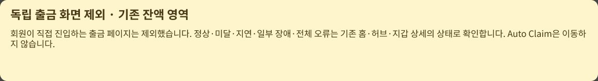

근거 — 다중 UID 출금 모달(웹) · 기본 모달 · mWeb 페이지

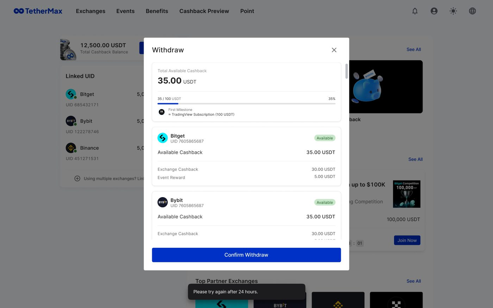
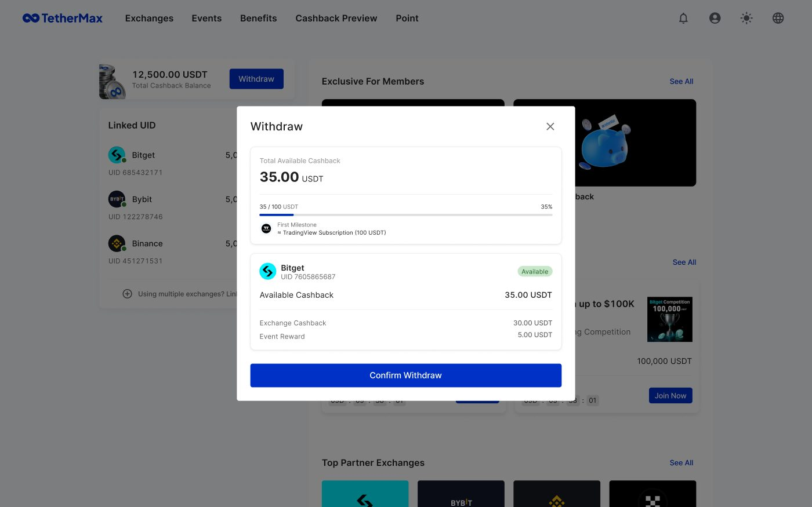
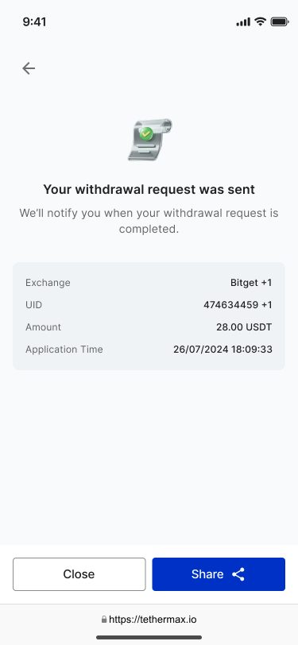

### #2 출금 화면 상태 6종 (PC · mWeb 각각)

| 구분 | 내용 |
|---|---|
| 지금 | 없음 |
| 근거 | 전부 불가: [Not eligible to withdraw][X-NE](10500:94074) · 로딩: [MAX 1216 S7 Loading][X-S7](22442:219836) 스켈레톤 · 오류: [MAX 1216 S9 List failed][X-S9](22442:219848) 주황 안내 박스 + `Try again` · 긴 목록: 다중 UID 판 스크롤([12936:389796][X-WDm]) |
| 수정안 | #1 프레임을 복제해 PC·mWeb 각각 6개를 `DEX / Withdraw / {플랫폼} / {상태}`로 #1 오른쪽에 둔다. ① `All unavailable`: 10500:94074 구성 그대로 — 합계 `0.00 USDT`, 안내 박스 `No UIDs are eligible for withdrawal.` → `No account can be claimed yet. You can claim once {n} USDT more cashback accrues.` + 매칭 안내 줄(국문 `이벤트 리워드는 같은 계정의 캐시백과 1:1로 매칭됩니다. 최소 출금액은 계정별 10 USDT입니다.`, 영문 원문 없음), 마일스톤 안내 `Every trade brings you closer to your goals.` 삭제, 칩 `Unavailable` → `Unclaimable` ② `Zero cashback DEX`: DEX 카드 `Exchange Cashback 0.00 USDT` + 같은 안내 박스 스타일로 `Cashback appears here the day after you trade on your linked DEX.` ③ `Delayed · partner error`: 카드 A 금액 아래 캡션 `Last updated {time}`(자동 지급 유지), 카드 B는 금액 자리에 S9 박스 `We can't load your latest {DEX} cashback right now.` + `Try again` — 다른 카드는 정상 ④ `Balance error`: 합계 카드 금액 자리에 S9 박스 `We can't load your balance right now.` + `Try again`(0 표시 없음), 카드 목록 숨김 ⑤ `Loading`: 합계 금액·카드·버튼 자리를 S7 스켈레톤 막대로 교체(금액·버튼 미렌더) ⑥ `More than 10`: 카드 10장 + 목록 끝 `더보기` 텍스트 버튼(영문 원문 없음) |
| 근거 번호 | REQ-136 · REQ-139 · REQ-145~149 · G-108 · G-110 · G-114 · G-348 · 정책 6장 |
| 새 프레임 | 12(6 상태 × PC·mWeb) |

근거 — Not eligible 모달 · S9 오류 박스 · S7 스켈레톤

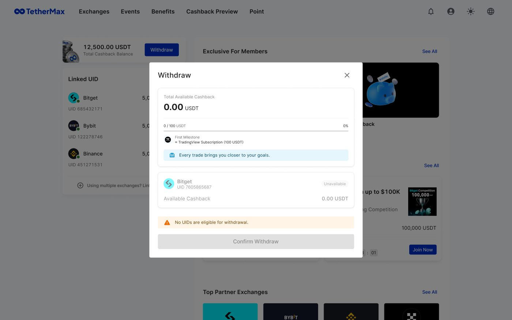
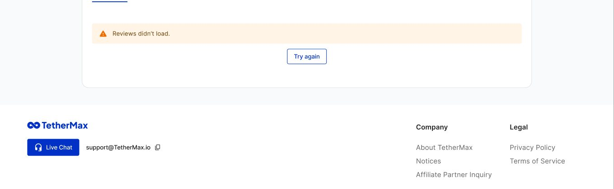
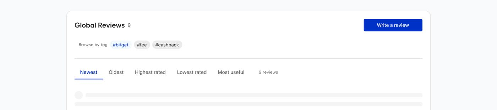

### #3 두 번째 출금 화면 `/withdrawal` — 출금 가능 계정 없음

| 구분 | 내용 |
|---|---|
| 지금 | 없음. [개발 인계 색인 FU-036][HO-036]이 「사용자 직접 출금 진입점 폐지」로 적었다 |
| 근거 | [MAX-18] mWeb `0 USDT`([10498:41192][X-WD0], 섹션 캡처 [8873:165905](기존디자인_카탈로그/img/8013-42845__8873-165905.jpg)) — `No UIDs are eligible for withdrawal.` + `Back to Home` |
| 수정안 | 10498:41192를 복제해 `DEX / Withdrawal / mWeb / None eligible`, #1 PC 프레임을 복제해 `DEX / Withdrawal / PC / None eligible`로 #2 오른쪽에 둔다. 문구 `Trading just a bit more and you can claim.` · 금액 라벨 `Cashback to be Claimed` · 버튼 `Back to Home` → `Go back`. 계정 행: DEX 행은 `Wallet {전체 주소}`, 기준 안내 「캐시백 10 USDT 이상」을 매칭 기준 문구로(국문 문구표 기준, 영문 원문 없음). 마일스톤·VIP 배지 삭제 |
| 근거 번호 | REQ-710 · 정책 S-14 · G-419 |
| 새 프레임 | 2 |

### #4 메모·개발 인계 색인 문구 정정 (문구만)

| 구분 | 내용 |
|---|---|
| 지금 | [28987:126383][MEMO-WD] 「독립 출금 화면 제외 · 기존 잔액 영역 — 회원이 직접 진입하는 출금 페이지는 제외했습니다 …」 · [29066:888][HO-036] FU-036 「사용자 직접 출금 진입점 폐지」 |
| 근거 | 결정 기록 2026-11-26(출금 화면 「둔다」) |
| 수정안 | 메모 제목 `출금 화면 — 기존 출금 모달 기준`, 본문 「출금 화면(`/withdrawal-apply` · `/withdrawal`)은 둔다. 기존 출금 모달(웹)·페이지(mWeb) 디자인 기준이며 하단 버튼은 비활성 `Auto Claim`이다. 출금 확인 다이얼로그는 쓰지 않는다. 상태는 `DEX / Withdraw` 프레임 참고」. 색인 FU-036 줄도 같은 뜻으로 바꾸고 #1~#3 프레임 링크를 단다 |
| 근거 번호 | 결정 2026-11-26 · B6 · REQ-134 · REQ-710 |

지금 — FU-036 색인

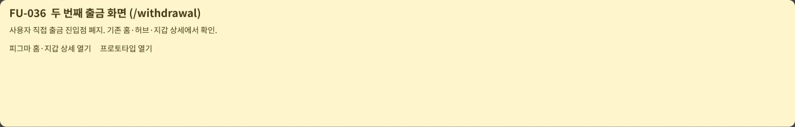

### #5 허브 Lighter 패널 — 주중 추정치 줄 삭제 (삭제·문구)

| 구분 | 내용 |
|---|---|
| 지금 | [H5][H5] · [DW0][DW0] · [모바일 H5][mH5] · [모바일 H5 다크][mH5d] — `Accruing this week (estimate)` `3.20 USDT` + `Lighter settles weekly. Not in the totals above.` |
| 근거 | 삭제 항목(정책 위반 요소). 남는 패널 구성은 같은 허브의 다른 DEX 패널과 같다 |
| 수정안 | 두 줄(`Accruing this week (estimate)` 행과 설명 캡션)을 삭제한다. Lighter도 일 1회 원장이므로 패널 구성 · 금액 정의는 다른 DEX와 같다(#16). 머리 금액 `125.00 USDT`는 `Total exchange cashback` + 매칭된 리워드와 같은 값으로 둔다 |
| 근거 번호 | G-428 · G-100 · G-059 · REQ-047 · REQ-303 |

지금 — H5 Lighter

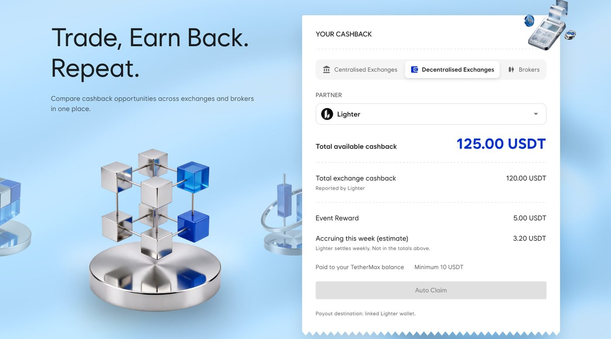

### #6 허브 EdgeX 패널 — 금액 정의 일치·어드민 상태어 삭제 (문구·값)

| 구분 | 내용 |
|---|---|
| 지금 | [H8][H8] · [모바일 H8][mH8] — 머리 `Paid to your TetherMax balance 3.10 USDT` · `Total exchange cashback 3.10` + 캡션 `Paid records, reported by EdgeX` · `Reported next day 1.25 USDT` |
| 근거 | 같은 허브의 DEX 패널 구성(REQ-300) — H5 인스턴스 |
| 수정안 | ① 캡션 `Paid records, reported by EdgeX` → `Reported by EdgeX` ② `Reported next day 1.25 USDT` 행 삭제 ③ 머리 라벨·금액을 H5와 같은 정의로(머리 금액 = `Total exchange cashback` + 매칭된 리워드; 리워드 없으면 `Total exchange cashback`과 같은 값) |
| 근거 번호 | REQ-300 · G-059 |

지금 — H8 EdgeX

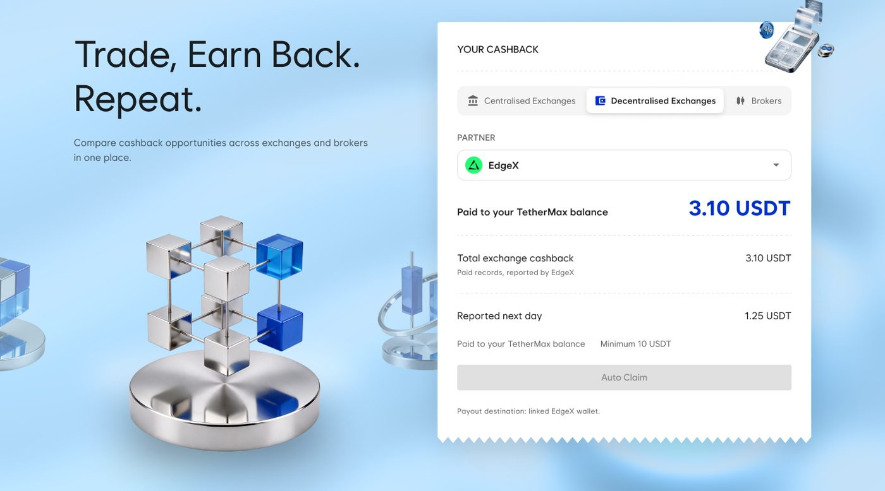

### #7 자동 지급 신청 후 선차감 상태 (홈 · 허브 · 지갑 상세 · 출금)

| 구분 | 내용 |
|---|---|
| 지금 | 없음([지갑 상세 메모][WD]에 「서버가 차감한 잔액으로 갱신」만) |
| 근거 | 기존 출금 신청 후 상태 — [UID 상세 `Pending`][X-UIDw](17023:56436: 줄어든 잔액 + 비활성 `Pending` + 토스트) · [mWeb 출금 `Pending`][X-WDp](10444:141294) |
| 수정안 | 네 프레임을 복제해 `… / Pre-deducted`로 원본 오른쪽에 둔다: HW1 · H5 · PW1 · #1 PC. 금액은 신청액만큼 줄인 값(예 14.00 → 0.00, 합계도 같은 값만큼), 금액 아래 캡션 = 국문 `출금 신청한 금액은 결과가 나올 때까지 잔액에서 제외됩니다`(영문 원문 없음). 버튼은 `Pending`이 아니라 비활성 `Auto Claim` 그대로, 토스트 없음 |
| 근거 번호 | 정책 6장 · REQ-158 · G-112 |
| 새 프레임 | 4 |

근거 — UID 상세(신청 후) · mWeb 출금

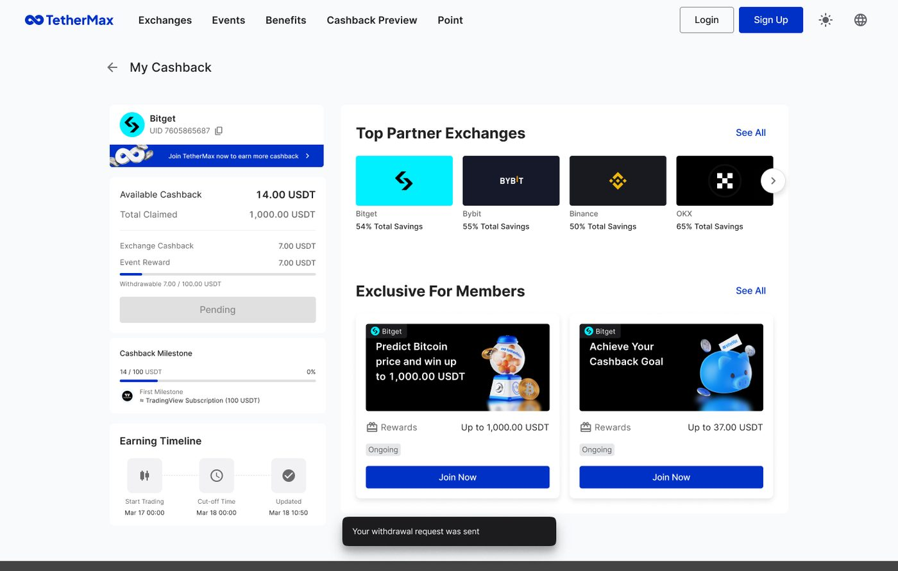
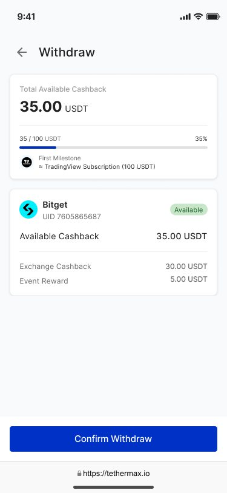

### #8 최종 실패 복원 — 캐시백 요약 `Withdrawal returned` 행

| 구분 | 내용 |
|---|---|
| 지금 | 없음 |
| 근거 | 요약 일별 행([MAX-601][X-CSw] 일별 내역 행) — DEX(revision) [CS1][CS1]이 같은 인스턴스 |
| 수정안 | CS1을 복제해 `CS / Withdrawal returned`로 CS1 오른쪽에 둔다. 복원된 날 칸에 `+` 금액, 일별 목록에 행 `Withdrawal returned · Lighter Wallet {주소} · +20.00 USDT`(파란 `+` 색). 홈·허브·지갑 상세는 금액만 복원되므로 별도 프레임 없음 |
| 근거 번호 | 정책 6장 · REQ-164 · REQ-372 · G-113 |
| 새 프레임 | 1 |

---

## 우선 2 — 개발자가 추측해야 함

### #9 홈 총액 카드 — 로딩 · 로드 실패 · 원장 지연

| 구분 | 내용 |
|---|---|
| 지금 | [HW1][HW1] 정상만 |
| 근거 | 로딩 [S7][X-S7] · 오류 [S9][X-S9] · 갱신 캡션 [MAXOP-731][X-731](`Updated daily at …` 캡션 스타일) |
| 수정안 | HW1을 복제해 `Home / Balance / Loading` · `Error` · `Delayed`. ① 금액·버튼 자리 S7 스켈레톤 ② 금액 자리 S9 박스 `We can't load your balance right now.` + `Try again`(0 표시 없음) ③ 총액 아래 캡션 `Last updated {time}`, 늦은 DEX 행에 자기 갱신 시각 |
| 근거 번호 | REQ-269 |
| 새 프레임 | 3 |

지금 — HW1

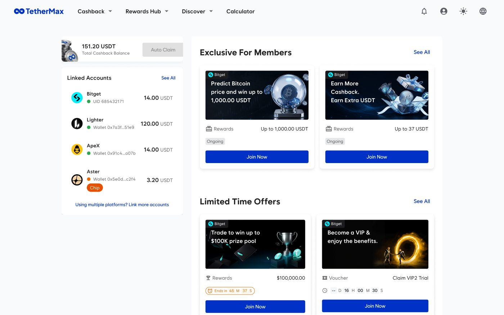

### #10 홈 Linked Accounts 행 상태

| 구분 | 내용 |
|---|---|
| 지금 | [HW1][HW1] · [S4-6][S4-6] — Aster 행 아래 주황 칩 텍스트 `Chip`(자리표시), 나머지 상태 없음 |
| 근거 | 기존 홈 행 안 안내 박스·금액 `-`([MAX-561 진행 중 행][X-own](12792:2788)) · 칩 스타일(기존 출금 카드 `Available`/`Unavailable`) |
| 수정안 | ① HW1에서 `Chip` 자리표시 → 상태 칩. 표본 Aster 행은 `0.00 USDT` + 칩 `No cashback yet` ② HW1을 복제해 `Home / Linked accounts / States`: 행 7개를 정책 우선순위로 정렬 — 확인 중 행(금액 `-`, 상태 `연동 시도중이에요`, 영문 원문 없음, 총액·계정 수 제외) · `Data delayed` 칩 + 행 안 안내 박스(국문 `신규 적립 내역 반영이 지연되고 있습니다. 기존 확정 잔액은 그대로이며 출금할 수 있어요.` + `Last updated {time}`) · 오프보딩 칩 `Inactive` · `No cashback yet` · 정상 ③ `Home / Linked accounts / Loading`: 행 자리 S7 스켈레톤 ④ `Home / Linked accounts / More than 10`: 행 10개 + `더보기`, 패널 안 스크롤 |
| 근거 번호 | REQ-034 · REQ-271~274 · API-008 |
| 새 프레임 | 3 |

근거 — 진행 중 행(mWeb)

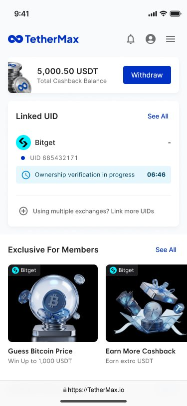

### #11 모바일 홈 — DEX 행

| 구분 | 내용 |
|---|---|
| 지금 | 모바일 홈 DEX 시안 없음 |
| 근거 | [S4 full view mWeb][X-mS4](4060:25384) |
| 수정안 | 4060:25384를 복제해 `Home / mWeb / S4 DEX`로 HW1 섹션에 둔다. 행에 Lighter·ApeX 추가(로고·이름·금액·주소만, `Wallet` 라벨 없음, 6+4 축약), 버튼 `Withdraw` → 비활성 `Auto Claim`, 제목 `Linked UID` → `Linked Accounts`, 푸터 `Trading on multiple exchanges? Link more`, 누적 캐시백 블록(#25) |
| 근거 번호 | REQ-013 · REQ-271 · N5 |
| 새 프레임 | 1 |

근거 — S4 mWeb

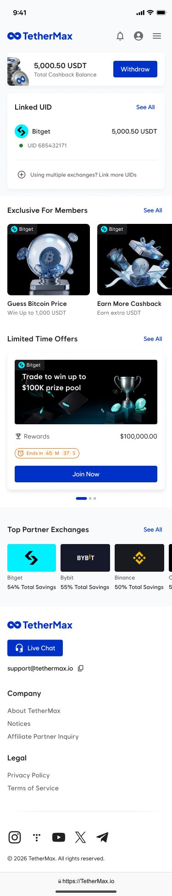

### #12 모바일 지갑 상세

| 구분 | 내용 |
|---|---|
| 지금 | 없음 |
| 근거 | 기존 mWeb UID 상세 [8582:167558][X-copy](헤더·`Available Cashback`·`Total Claimed`·Earning Timeline 3단계) · 리뷰 유도 [U3 mWeb][X-U3m](25867:1351184) |
| 수정안 | 8582:167558을 복제해 `Wallet detail / mWeb`로 PW1 섹션에 둔다. 헤더 Lighter + `{전체 주소}` + 복사 아이콘, 금액 카드는 PW1과 같은 행(`Matched … in event rewards` · `Claimable {amount} USDT · Minimum 10 USDT` · 진행 막대), `Withdraw` · `View Cashback Summary` → 비활성 `Auto Claim` 하나, `Weekly Cashback History` 띠 · 리뷰 유도 · Earning Timeline 3단계(`Start Trading` · `Cut-off Time` · `Updated`) · `Exclusive Benefit` · `Top Partner DEXs`. 토스트는 #40 |
| 근거 번호 | REQ-276~281 · N16·N17·N19 · A6 |
| 새 프레임 | 1 |

근거 — mWeb UID 상세

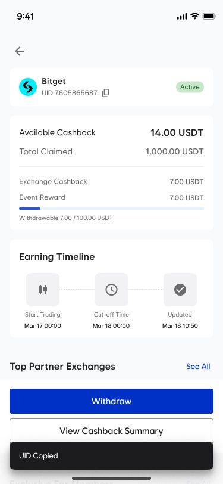

### #13 지갑 상세 PW1 — 리뷰 버튼 · `Total Claimed`

| 구분 | 내용 |
|---|---|
| 지금 | [PW1][PW1] 리뷰 배너 버튼 `Label`(자리표시), `Total Claimed` 줄 없음 |
| 근거 | 리뷰 버튼 [U3 웹][X-U3](25867:1349190) `Write a review, get 2 USDT` · `Total Claimed` 줄 [UID 상세 웹][X-UIDw](17023:56436) |
| 수정안 | 버튼 인스턴스를 U3의 채움 버튼(화살표 포함)으로 교체하고 문구 `Write a review, get 2 USDT`. 금액 카드 `Available Cashback` 아래에 17023:56436의 `Total Claimed` 행 인스턴스를 넣는다(예 `0.00 USDT`). 같은 내용을 지갑 상세 10종 카드([WD][WD])에도 반영 |
| 근거 번호 | REQ-278 · REQ-281 · G-053 |

지금 — PW1 · 근거 — U3 리뷰 유도

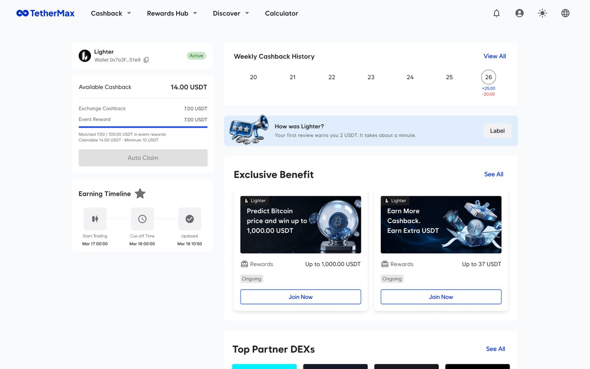
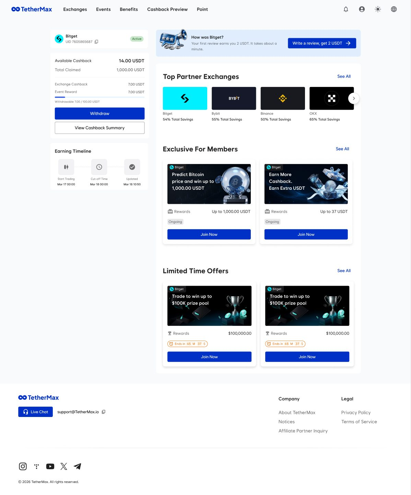

### #14 지갑 상세 상태 — 지연 · 로딩 · 조회 실패 · 리뷰 작성 후

| 구분 | 내용 |
|---|---|
| 지금 | [WD][WD] 메모 텍스트만 |
| 근거 | S7 · S9 · MAXOP-731 캡션 · 리뷰 유도 없는 기존 UID 상세([17023:56436][X-UIDw]) |
| 수정안 | PW1을 복제해 4개(`Delayed` · `Loading` · `Error` · `Reviewed`): ① 금액 아래 `Last updated {time}` ② 금액 카드·띠 S7 스켈레톤 ③ 금액 카드 자리 S9 박스 `We can't load your balance right now.` + `Try again`(0과 구분) ④ 리뷰 배너 숨김 |
| 근거 번호 | REQ-145 · REQ-277 · REQ-278 · REQ-149 · FU-040 |
| 새 프레임 | 4 |

### #15 부족분 문구 확정 원문으로 (문구만)

| 구분 | 내용 |
|---|---|
| 지금 | [지갑 상세 10종][WD] `Additional exchange cashback needed: {n} USDT` · [H4][H4] · [모바일 H4][mH4] `Just 3.00 USDT more to qualify.` + 각주 `Minimum per account: 10 USDT.` |
| 근거 | 기존 문구(REQ-130 STG 현행) |
| 수정안 | 지갑 상세: `You can claim cashback if you receive an additional {n} USDT in exchange Cashback.` · 허브 넛지: `You can claim if you receive an additional {n} USDT in exchange cashback.` · 허브 각주: `You can withdraw once your available cashback reaches 10 USDT.`(U9). n은 매칭 계산값(예 A=0·B=8 → 5.00) |
| 근거 번호 | REQ-130 · REQ-301 · G-139 |

지금 — H4 · 지갑 상세 10종

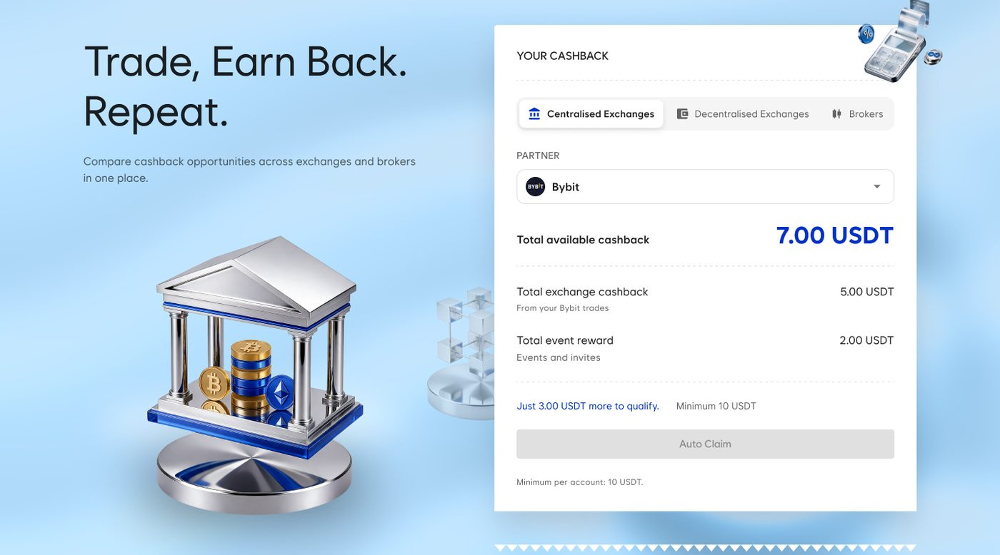
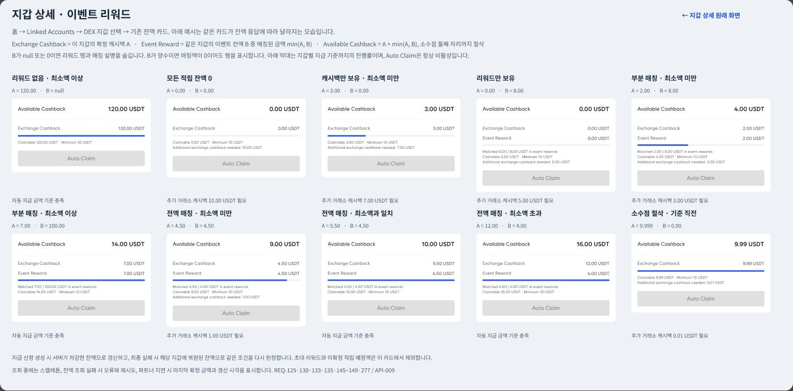

### #16 허브 DEX 패널 — 줄 구성 · 상태 3종

| 구분 | 내용 |
|---|---|
| 지금 | [H5][H5] 머리 `Total available cashback`, `Event Reward`, `Withdrawable` 줄 없음, 각주 `Payout destination: linked Lighter wallet.` / 상태 없음 |
| 근거 | 같은 패널의 CEX 판 [H4][H4](`Total event reward` + `Events and invites`, 넛지 줄) · `Total Claimed` 행([17023:56436][X-UIDw]) · S7 |
| 수정안 | ① H5 · mH5 · 다크 사본: `Event Reward` → `Total event reward`(리워드 있을 때만), `Total exchange cashback` 아래 캡션 `Reported by {DEX}` 유지, `Withdrawable {amount} USDT` 줄 추가(U9), `Total claimed` 행 추가, 각주 → `You withdraw on TetherMax, to your linked {DEX} wallet.`(U9) ② H4를 복제해 `H4-DEX`(DEX 탭, 매칭액 <10, #15 넛지·각주) ③ H5를 복제해 `H5-Partial`(A=3·B=8: `Withdrawable 6.00 USDT` + 「일부만 출금할 수 있습니다」, 영문 원문 없음) ④ H5를 복제해 `H5-Loading`(금액 자리 S7 스켈레톤, 0 대신) |
| 근거 번호 | REQ-300 · REQ-301 · REQ-306 · REQ-307 · G-053 |
| 새 프레임 | 3 |

### #17 허브 계산기 — 절삭 · 요율 실패

| 구분 | 내용 |
|---|---|
| 지금 | [H1][H1] `Per day $0.19` · [H1-CEX][H1C] `$0.83`(반올림), 모바일 같음 / 요율 실패 상태 없음 |
| 근거 | 오류 박스 [S9][X-S9] |
| 수정안 | 값 교체 `$0.19` → `$0.18`, `$0.83` → `$0.82`(H1 · H1-CEX · mH1 · mH1-CEX · 다크 사본). H1·mH1을 복제해 `H1-Rate error`: 계산 결과 카드 자리 S9 박스 `Estimate unavailable` + `Try again`, 금액 0 표시 없음 |
| 근거 번호 | REQ-042 · REQ-296 · REQ-317 · G-144 |
| 새 프레임 | 2 |

지금 — H1 계산기·라우트

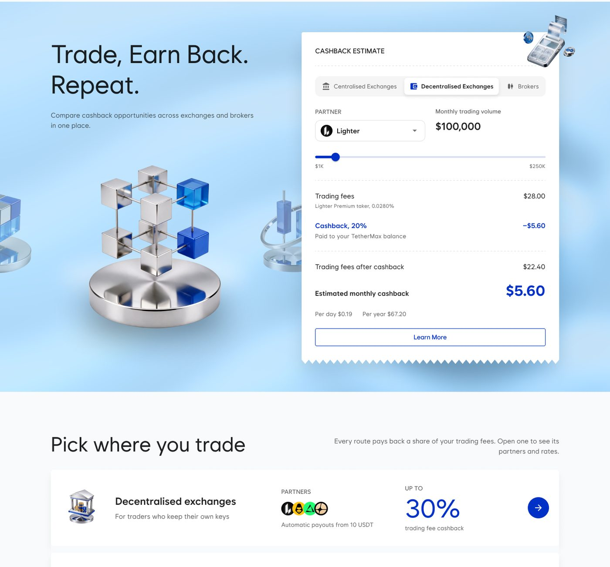

### #18 허브 비교표 — 빈 검색

| 구분 | 내용 |
|---|---|
| 지금 | 없음 |
| 근거 | 기존 빈 검색 문구 [MAX-30 Select Exchange][X-noq](9105:194510) `No results found for Crypto.com` · 빈 표 배치 [Partner Hub Web][X-noT](6322:66795) |
| 수정안 | H1·mH1을 복제해 `H1-No results`: 검색창에 입력값, 표(모바일 카드) 자리에 `No results found for {검색어}`(검색어 굵게) + 검색창 지우기 아이콘 |
| 근거 번호 | N13 · G-151 |
| 새 프레임 | 2 |

근거 — 빈 검색 문구 · 빈 표

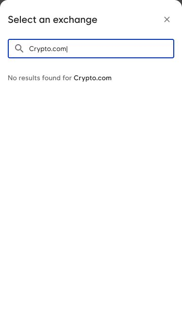
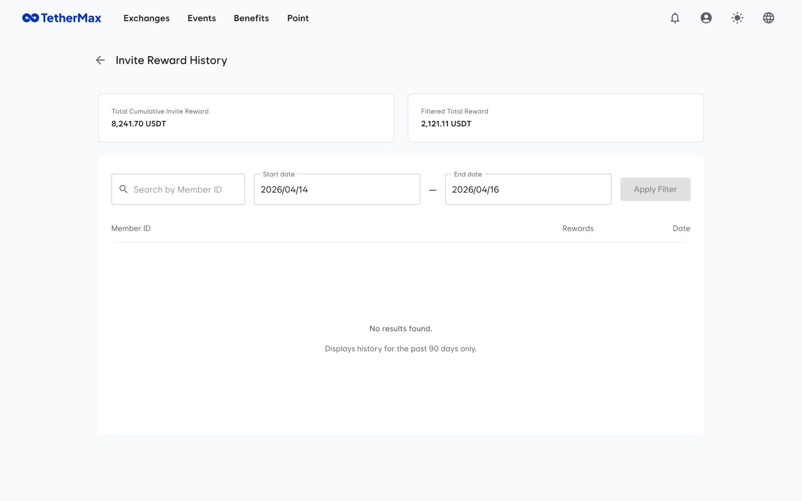

### #19 공개 출금 피드 — 로딩 · 오류 · 모바일

| 구분 | 내용 |
|---|---|
| 지금 | [서비스 소개 피드][SIfeed] · [랜딩][LL] 정상만, 모바일 피드 없음 |
| 근거 | 기존 모바일 서비스 소개 피드 [19224:4458][X-SIm](현행판 A9) · S7 · S9 |
| 수정안 | ① SIfeed를 복제해 `Feed / Loading`(행 자리 S7 스켈레톤) · `Feed / Error`(피드 영역만 S9 박스 + `Try again`, 오류 문구 영문 원문 없음, 나머지 페이지 유지) ② 19224:4458의 피드 블록을 복제해 `Feed / mWeb`(행 식별자 고정 마스크 + 끝 4자리, DEX 지갑 행 포함) |
| 근거 번호 | REQ-285 · API-015 |
| 새 프레임 | 3 |

지금 — 서비스 소개 피드 · 근거 — 모바일 피드

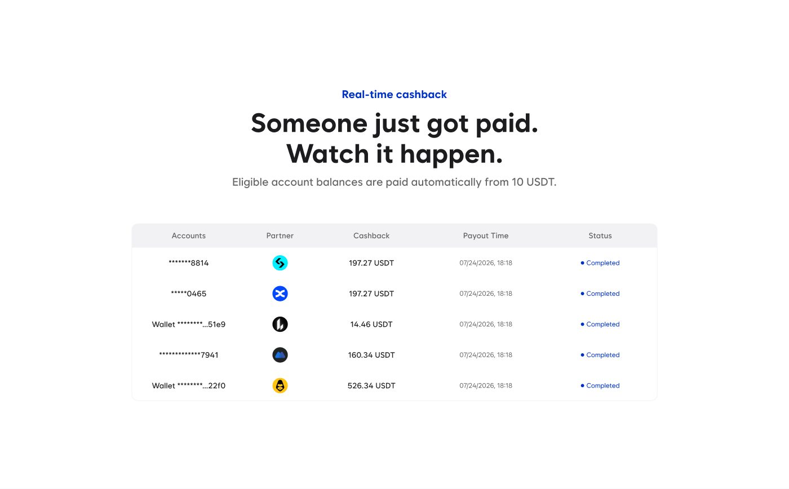
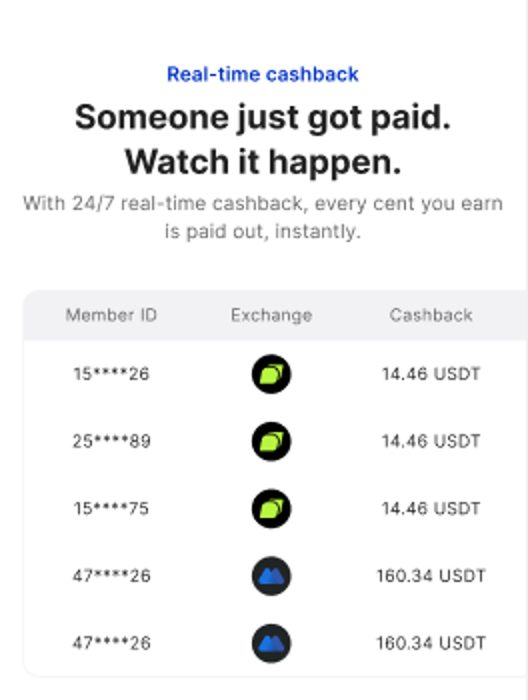

### #20 시각 표시 형식 하나로 (문구만)

| 구분 | 내용 |
|---|---|
| 지금 | [H6][H6] `14 Oct 2026, 09:12` · [PW1][PW1] `Mar 17 00:00` · [피드][SIfeed] `07/24/2026, 18:18` · [CS1][CS1] `2026/05/26` · [모바일 요약][mCS] `2026/03/05` |
| 근거 | REQ-043 표시 형식 예 |
| 수정안 | 시각은 `2026.05.12 14:35` 형식, 날짜만은 `2026.05.12`로 바꾼다(타임존 라벨 없음). 모바일 요약 선택일은 캘린더 월(May 2026)과 같은 달로 |
| 근거 번호 | REQ-026 · REQ-043 |

### #21 캐시백 요약 — 출금 문구 · 지연 · 로딩

| 구분 | 내용 |
|---|---|
| 지금 | [CS1][CS1] 월간 카드 `Claimed`, 일별 출금 행 `Payout -20.00 USDT`, 지연·로딩 없음 |
| 근거 | 월 합계 [MAXOP-732 Receipt][X-732](`Received` · `Withdrawn` · `Net`) · S9 박스 · S7 |
| 수정안 | ① 월간 카드 `Claimed` → `Withdrawn`(CS1 · CS3 · CS4 · CS5 · 다크) ② 출금 행 유형명 `Payout` → `Claim Amount` ③ CS1을 복제해 `CS / Delayed`: 캘린더 위 S9 박스 `Last updated {time}` · `{DEX} has not sent new data yet. Amounts show the last update.` ④ `CS / Loading`: 월간 카드·캘린더·목록 S7 스켈레톤 |
| 근거 번호 | D2 · G-418 · REQ-369 · REQ-371 · REQ-376 |
| 새 프레임 | 2 |

지금 — CS1

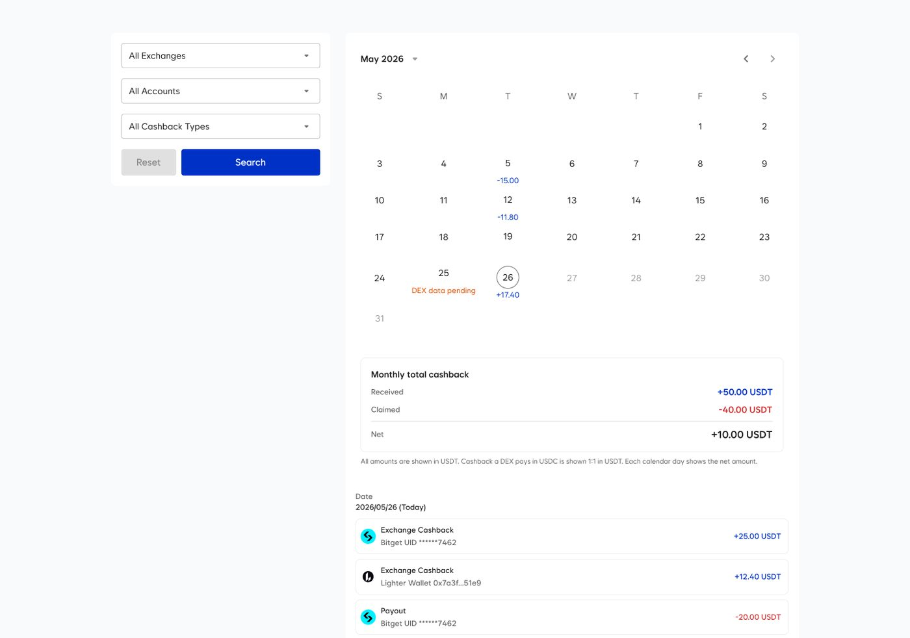

### #22 모바일 캐시백 요약 — 월간 카드 · 계정 시트 · 유형값 · 빈 상태

| 구분 | 내용 |
|---|---|
| 지금 | [모바일 요약][mCS] 월간 카드 없음, 유형 시트 `Trading Cashback` · `Withdrawal`, 트리거 `All Cashback Types`, 계정 시트·빈 상태·`DEX data pending` 없음 |
| 근거 | 월간 카드 mWeb [25886:1340772][X-732m] · 계정 시트 [Select UIDs][X-selU](12772:306034) · 빈 달 [27200:24437][X-emM] · 빈 날 [13762:174885][X-emD](섹션 캡처 [12772:357583](기존디자인_카탈로그/img/9287-167854__12772-357583.jpg)) |
| 수정안 | ① mCS 유형 시트 값 `Exchange Cashback` · `Event Reward` · `Claim Amount`, 트리거 `All Types`, 캘린더 25일 칸 `DEX data pending` ② 25886:1340772 복제 → `CS / mWeb / Monthly card`(`Received` · `Withdrawn` · `Net`) ③ 12772:306034 복제 → `CS / mWeb / Accounts sheet`(제목 `Select Accounts`, CEX `UID …` · DEX `Wallet {축약}` 행, `All Accounts`) ④ 27200:24437 복제 → `CS / mWeb / Empty month`(`There is no cashback history for this month.` + `No cashback activity yet.`) ⑤ 13762:174885 복제 → `CS / mWeb / Empty day` |
| 근거 번호 | B5 · N5 · REQ-366 · REQ-367 · REQ-369 · REQ-373 · REQ-375 · G-418 |
| 새 프레임 | 4 |

지금 — 모바일 요약 · 근거 — 월간 카드 · 계정 시트 · 빈 달

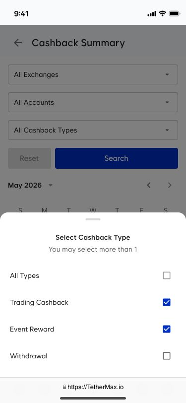
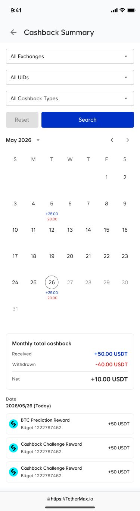
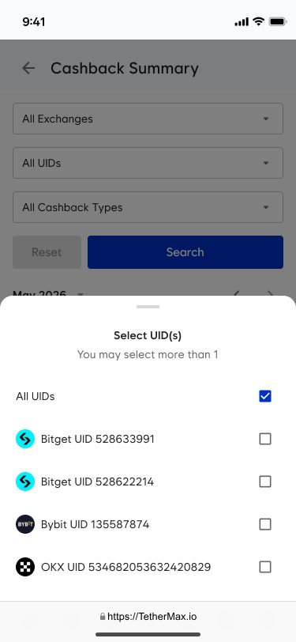
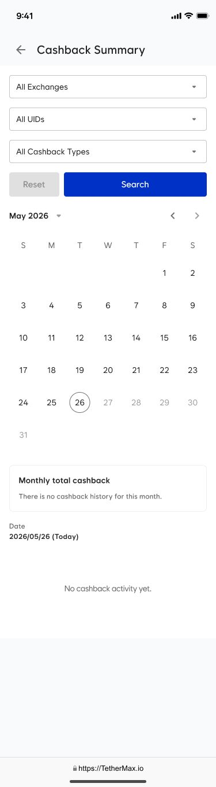

### #23 캐시백 랭킹 — 안내 2종 (문구 추가)

| 구분 | 내용 |
|---|---|
| 지금 | [RK1][RK1] · [모바일 랭킹][mRK] 안내 없음 |
| 근거 | 기존 랭킹 부제 캡션 [13060:149480][X-RK] `Rankings are updated daily at 00:01` 스타일 |
| 수정안 | 목록 아래 캡션 두 줄: 국문 `캐시백 0.01 USDT 미만은 순위에 포함되지 않습니다.`(영문 원문 없음) · 「랭킹 리워드만으로는 출금 불가」(문구 원문 없음). `–` 행이 있는 RK1 · mRK에 넣는다 |
| 근거 번호 | REQ-381 · REQ-382 |

지금 — RK1 · 근거 — 기존 랭킹

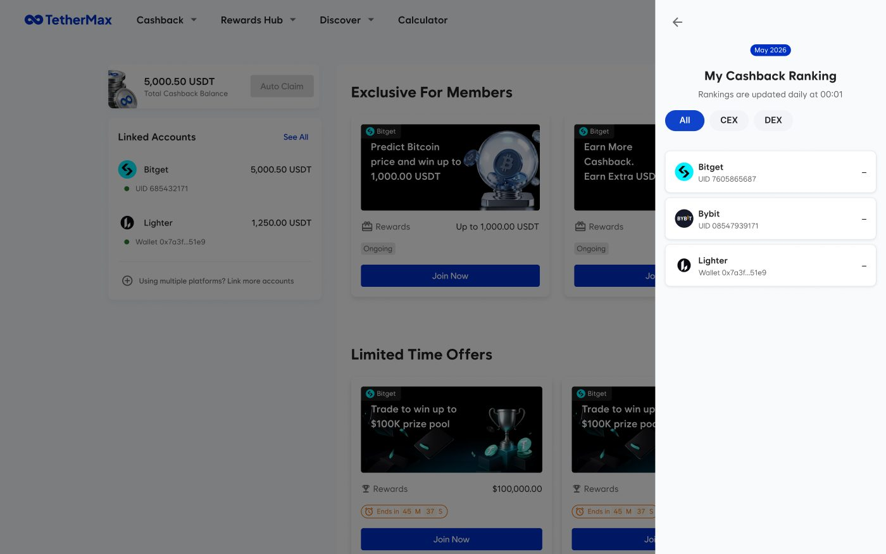
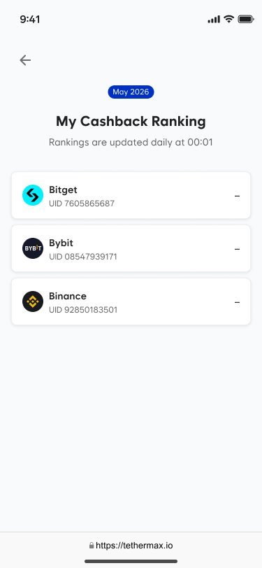

### #24 홈 FAQ — 회원·비회원 답변 (문구만)

| 구분 | 내용 |
|---|---|
| 지금 | [개발 인계 색인 FU-044][HO-044] 「비회원 답변 삭제」 |
| 근거 | 기존 FAQ [MAXOP-307 웹][X-FAQ](17000:86187) · [모바일][X-mFAQ] |
| 수정안 | 색인 FU-044 줄을 「회원 = 거래 계정 기준 자동 지급, 비회원 = 홈에서 UID 또는 지갑 주소로 조회 후 같은 거래 계정을 연동하면 지급」으로 고친다. FAQ 답변 문구는 원문 없음 — 문구표 확정 후 기존 아코디언에 넣는다 |
| 근거 번호 | REQ-711 |

지금 — FU-044 색인 · 근거 — 기존 FAQ

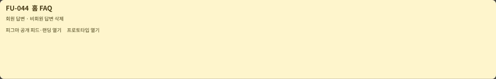
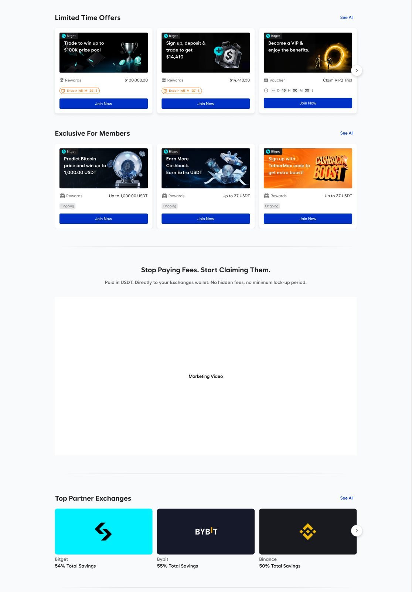

### #25 홈 누적 캐시백 블록

| 구분 | 내용 |
|---|---|
| 지금 | [HW1][HW1]에 없음 |
| 근거 | [MAXOP-731 Accumulated Cashback 웹][X-731](22913:1052131) — `Total cumulative cashback` · `This month` · `Total withdrawn` · 캡션 · `View history` |
| 수정안 | 22913:1052131의 누적 블록 인스턴스를 HW1 Linked Accounts 카드 하단에 그대로 넣는다(#11 모바일도). 캡션 `Sum of 3 linked UIDs · Updated daily at 09:00 KST` → `Sum of {n} linked accounts · Update times vary by exchange`. 라벨·툴팁은 그대로 |
| 근거 번호 | N16(2차) · REQ-283 · REQ-290 · G-191 |

근거 — MAXOP-731

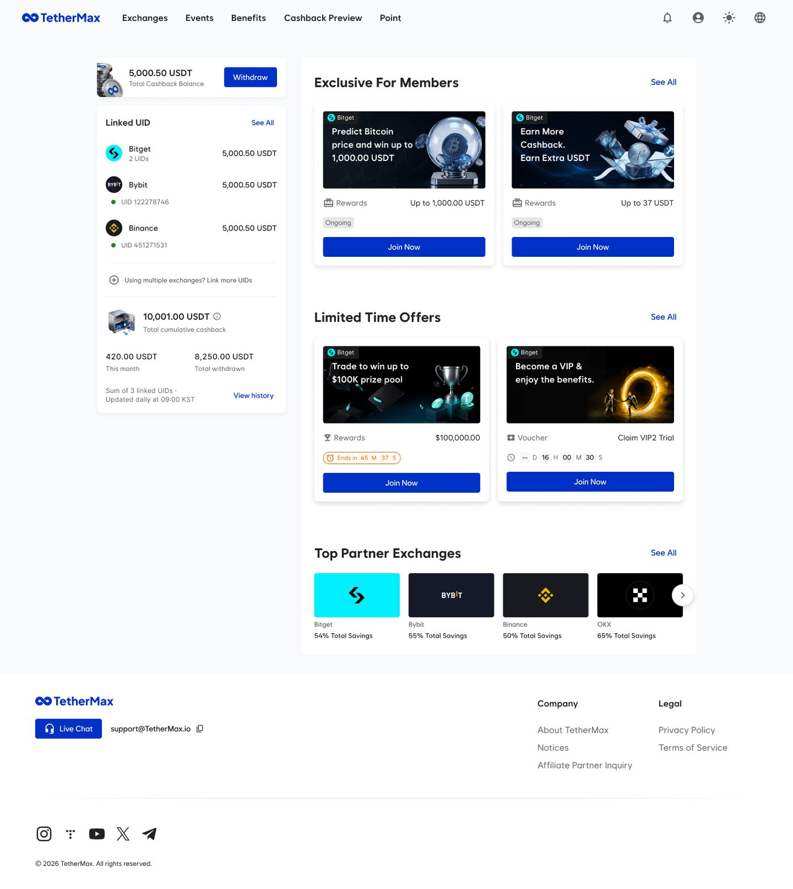

### #26 `DEX data pending` 라벨 — 지갑 상세 · 패널 · 카드

| 구분 | 내용 |
|---|---|
| 지금 | 요약 캘린더([CS1][CS1] 25일)에만 있음 |
| 근거 | CS1 칸 라벨(주황 텍스트) · 기존 [`Pending` 칩][X-WDp] |
| 수정안 | PW1을 복제해 `Wallet detail / Data pending`: 원장 미수신 날 `Weekly Cashback History` 칸에 `DEX data pending`(0 표시 없음). 허브 H6 패널 · #1 출금 카드에도 해당 날 라벨 표본 추가. ApeX `Pending` 줄은 #1 ⑦ |
| 근거 번호 | REQ-047 · G-059 · G-127 |
| 새 프레임 | 1 |

### #27 사용자 화면 용어 — `payout` · `rebates` (문구만)

| 구분 | 내용 |
|---|---|
| 지금 | [H1][H1] · [모바일 H1][mH1] 라우트 행 `Automatic payouts from 10 USDT` · [H5][H5] 각주 `Payout destination: linked Lighter wallet.` · [피드][SIfeed] 열 `Payout Time` · [H1-Broker][H1B] · [모바일][mH1B] · [다크][mH1Bd] `Compare rebates across 2 brokers` |
| 근거 | 명세 원문 |
| 수정안 | 라우트 행 → `Paid daily, withdraw from 10 USDT`(CEX·DEX 같은 문구, U9) · H5 각주 → #16 · 피드 열 → 국문 `출금 시각`(영문 원문 없음, #39와 함께) · 비교표 제목 → `Compare cashback across 2 brokers` |
| 근거 번호 | REQ-001 · REQ-005 · REQ-309 · REQ-719 · G-418 |

지금 — H1-Broker

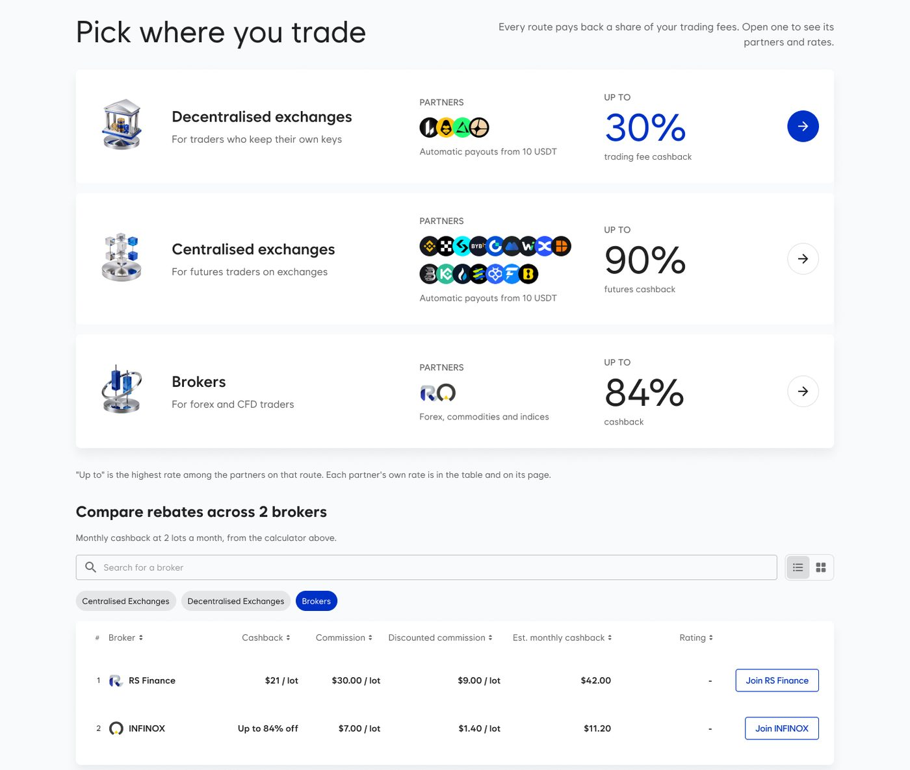

### #28 랜딩 다크 3단계 (문구만)

| 구분 | 내용 |
|---|---|
| 지금 | [LDk][LDk] 3단계 `Get paid daily in USDT` / `Trade, and cashback accrues automatically` ↔ 라이트 [LL][LL] `Get automatic payouts in USDT` |
| 근거 | 라이트판과 같은 구성 |
| 수정안 | 라이트·다크 같은 문구로. 3번째 줄 문구 원문 없음(라이트판 `payouts`는 용어 규칙에 맞지 않아 복사하지 않음) |
| 근거 번호 | 정책 6-1 · REQ-287 |

지금 — 랜딩 다크

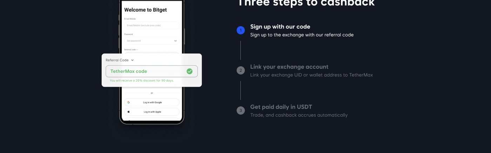

### #29 예시 금액 정합 (값만)

| 구분 | 내용 |
|---|---|
| 지금 | [S3-7][S3-7] · [S4-1][S4-1] 총액 `5,137.70` ↔ 행 합 `0.00`/`134.00` · [CS1][CS1] 월 `Net +10.00` ↔ 캘린더 일 순액 합 `−4.40` |
| 근거 | 같은 프레임 |
| 수정안 | 총액 = 표시된 행 합(확인 중 행 제외), 월 `Received`·`Withdrawn`·`Net` = 캘린더 일 순액 합으로 숫자를 맞춘다 |
| 근거 번호 | REQ-021 · REQ-268 |

---

## 우선 3 — 다듬기

| # | 화면 | 지금 | 근거 | 수정안 | 근거 번호 | 새 프레임 |
|---|---|---|---|---|---|---|
| 30 | 홈 S3 · 랭킹 사이드 카드 | [S3-1][S3-1] · [RK1][RK1] · [mRK][mRK] `0 USDT` | 값 규칙 | `0.00 USDT` (문구만) | REQ-023 · REQ-267 | 0 |
| 31 | 모바일 요약 행 | [mCS][mCS] `150.00 USDT` · `+50 USDT` | 웹 CS1 행 | `+150.00 USDT` · `+50.00 USDT`(부호·소수 둘째 자리) (값만) | REQ-019 · REQ-024 | 0 |
| 32 | 요약 CS4 | [CS4][CS4] `Net` 값 비어 있음 | MAXOP-732 Receipt | `Net` 값 채움(행 합과 일치) (값만) | REQ-369 | 0 |
| 33 | 요약 필터·목록 | [CS1][CS1] `All Cashback Types` ↔ [CS6 유형][CS6type] `All Types` · DEX 행 주소 CS1 축약 ↔ CS3 전체 · [계정 필터][CS6acct] 축약만 | DEX(revision) [랭킹 주소 팝오버][RKpop] | 트리거 `All Types`로 통일, 일별 목록 DEX 주소는 축약 + 탭하면 전체(팝오버 `Wallet address` + 전체 + `Close` 인스턴스를 계정 필터 옆에 표본 1개) | REQ-366 · REQ-371 · REQ-378 · REQ-010 | 0 |
| 34 | 요약 필터 | `DEX 전체` 선택 후 트리거 없음 | [CS6 DEX][CS6dex] 드롭다운 행 `All DEX exchanges` | CS6dex 복제 → 드롭다운 닫힌 상태, 트리거 `All DEX exchanges` | REQ-030 | 1 |
| 35 | 모바일 허브 | [mH1-CEX][mH1C] 슬라이더 `$1K`~`$250K` · [mH3][mH3] `23 partners` | 웹 [H1-CEX][H1C] · [H3][H3] | `$10K`~`$500K` · `Compare cashback across 16 exchanges` (문구·값만) | REQ-294 · REQ-312 | 0 |
| 36 | 허브 H2 | [H2][H2] 로그인 줄 `Minimum 10 USDT` 없음 | H5 로그인 줄 | `Paid to your TetherMax balance    Minimum 10 USDT` (문구만) | REQ-292 | 0 |
| 37 | 허브 Aster | Aster 패널 없음 | H5 | H5 복제 → `H5-Aster`: 캡션 `Reported by Aster, USDT value at payout` | REQ-300 | 1 |
| 38 | 프리로그인 랜딩 | `Featured Exchanges`·`Hero Exchange`에 DEX 선택 상태 없음 | Renewal 랜딩 `Most popular exchange` 모듈(현행판 A3, [캡처](기존디자인_현행판_확인_img/A03_guest_landing.jpg)) | LDk 모듈 복제 → Lighter 선택 표본 | REQ-288 | 1 |
| 39 | 공개 피드 | [랜딩][LL] `Someone is cashing out right now` / `Claim every cent you've earned` ↔ [서비스 소개][SI] `Someone just got paid. Watch it happen.`, 열 `Accounts · Partner · Cashback · Payout Time · Status` | 기존 피드 | 두 화면 제목·부제 통일 — 국문 원문 `지금 이 순간에도 누군가는 캐시백을 받고 있어요` / `쌓인 캐시백을 한 푼도 빠짐없이 받아가세요`, 열 `거래 계정 · 거래소 · 캐시백 · 출금 시각 · 상태`(영문 원문 없음) (문구만) | REQ-285 | 0 |
| 40 | 랭킹 · 지갑 상세 | 랭킹 로딩 없음 · 모바일 주소 팝오버 없음 · 웹 복사 완료 토스트 없음 | S7 · [RKpop][RKpop] · 기존 [`UID Copied` 토스트][X-copy] | RK1 복제 → `RK / Loading`(행 스켈레톤) · mRK 복제 → `RK / mWeb / Address popover` · PW1 복제 → `Wallet detail / Copied`(토스트 인스턴스, 문구 원문 없음) | REQ-010 · REQ-013 · API-014 | 3 |

지금 — 허브 H2 · CS4 · 모바일 허브 CEX · 홈 S3 · 자동 지급 접수 메일(EN, U9)

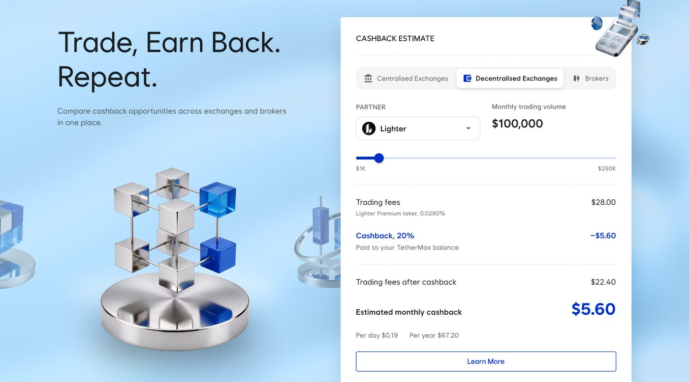
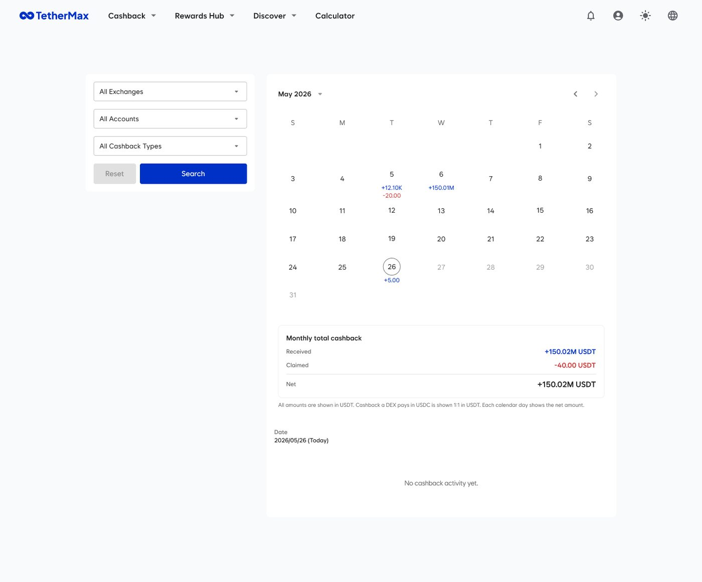
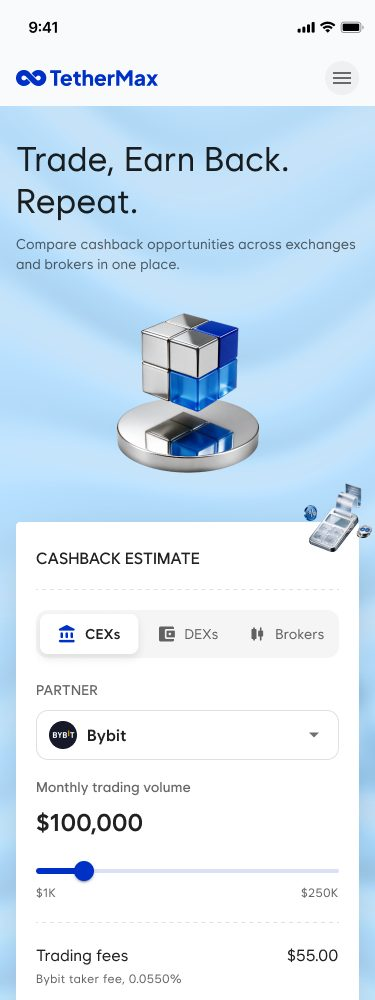
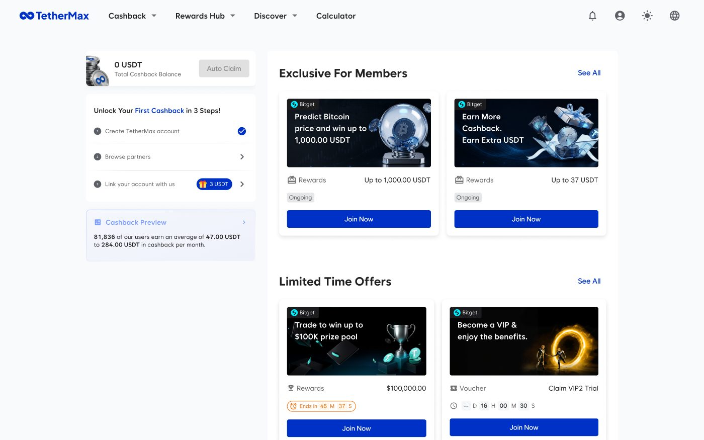
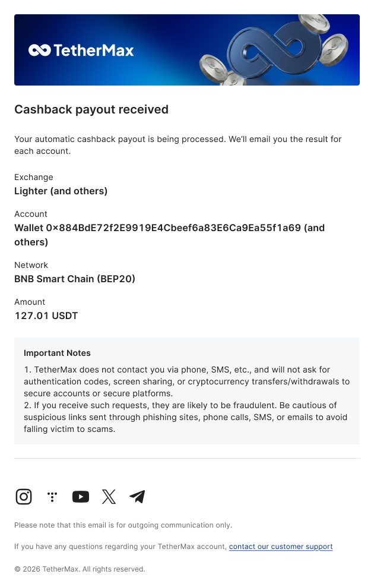

## 새 프레임 목록

| # | 섹션(옆에 둘 기존 프레임) | 새 프레임 이름 | 수 |
|---|---|---|---|
| 1 | 홈 잔액(HW1 28960:126108) | `DEX / Withdraw / PC / Default` · `DEX / Withdraw / mWeb / Default` | 2 |
| 2 | 위와 같음 | `DEX / Withdraw / {PC·mWeb} / All unavailable · Zero cashback DEX · Delayed · partner error · Balance error · Loading · More than 10` | 12 |
| 3 | 위와 같음 | `DEX / Withdrawal / {PC·mWeb} / None eligible` | 2 |
| 7 | HW1 · H5 · PW1 · #1 PC | `… / Pre-deducted` | 4 |
| 8 | 캐시백 요약(CS1) | `CS / Withdrawal returned` | 1 |
| 9 | 홈(HW1) | `Home / Balance / Loading · Error · Delayed` | 3 |
| 10 | 홈(HW1) | `Home / Linked accounts / States · Loading · More than 10` | 3 |
| 11 | 홈(HW1) | `Home / mWeb / S4 DEX` | 1 |
| 12 | 지갑 상세(PW1) | `Wallet detail / mWeb` | 1 |
| 14 | 지갑 상세(PW1) | `Wallet detail / Delayed · Loading · Error · Reviewed` | 4 |
| 16 | 허브(H4·H5) | `H4-DEX` · `H5-Partial` · `H5-Loading` | 3 |
| 17 | 허브(H1 · mH1) | `H1-Rate error` × 2 | 2 |
| 18 | 허브(H1 · mH1) | `H1-No results` × 2 | 2 |
| 19 | 서비스 소개 피드 | `Feed / Loading · Error · mWeb` | 3 |
| 21 | 캐시백 요약(CS1) | `CS / Delayed · Loading` | 2 |
| 22 | 모바일 캐시백 요약(mCS) | `CS / mWeb / Monthly card · Accounts sheet · Empty month · Empty day` | 4 |
| 26 | 지갑 상세(PW1) | `Wallet detail / Data pending` | 1 |
| 34 | 요약 필터(CS6dex) | `CS6 / DEX selected` | 1 |
| 37 | 허브(H5) | `H5-Aster` | 1 |
| 38 | 랜딩(LDk) | `Landing / Featured DEX` | 1 |
| 40 | 랭킹 · 지갑 상세 | `RK / Loading` · `RK / mWeb / Address popover` · `Wallet detail / Copied` | 3 |
| | **합계** | | **56** |

[MEMO-WD]: https://www.figma.com/design/hsa3bSV9QmFTe2jsf6tzTm/UI-UX-Design?node-id=28987-126383
[HO-036]: https://www.figma.com/design/hsa3bSV9QmFTe2jsf6tzTm/UI-UX-Design?node-id=29066-888
[HO-044]: https://www.figma.com/design/hsa3bSV9QmFTe2jsf6tzTm/UI-UX-Design?node-id=29066-912
[DW0]: https://www.figma.com/design/hsa3bSV9QmFTe2jsf6tzTm/UI-UX-Design?node-id=28960-125773
[PW1]: https://www.figma.com/design/hsa3bSV9QmFTe2jsf6tzTm/UI-UX-Design?node-id=28960-125943
[HW1]: https://www.figma.com/design/hsa3bSV9QmFTe2jsf6tzTm/UI-UX-Design?node-id=28960-126108
[WD]: https://www.figma.com/design/hsa3bSV9QmFTe2jsf6tzTm/UI-UX-Design?node-id=29026-97581
[H1]: https://www.figma.com/design/hsa3bSV9QmFTe2jsf6tzTm/UI-UX-Design?node-id=28960-126884
[H2]: https://www.figma.com/design/hsa3bSV9QmFTe2jsf6tzTm/UI-UX-Design?node-id=28960-126890
[H3]: https://www.figma.com/design/hsa3bSV9QmFTe2jsf6tzTm/UI-UX-Design?node-id=28960-126896
[H4]: https://www.figma.com/design/hsa3bSV9QmFTe2jsf6tzTm/UI-UX-Design?node-id=28960-126902
[H5]: https://www.figma.com/design/hsa3bSV9QmFTe2jsf6tzTm/UI-UX-Design?node-id=28960-126908
[H6]: https://www.figma.com/design/hsa3bSV9QmFTe2jsf6tzTm/UI-UX-Design?node-id=28960-126914
[H8]: https://www.figma.com/design/hsa3bSV9QmFTe2jsf6tzTm/UI-UX-Design?node-id=28960-126926
[H1C]: https://www.figma.com/design/hsa3bSV9QmFTe2jsf6tzTm/UI-UX-Design?node-id=28960-126944
[H1B]: https://www.figma.com/design/hsa3bSV9QmFTe2jsf6tzTm/UI-UX-Design?node-id=28960-126950
[mH1]: https://www.figma.com/design/hsa3bSV9QmFTe2jsf6tzTm/UI-UX-Design?node-id=28960-130794
[mH3]: https://www.figma.com/design/hsa3bSV9QmFTe2jsf6tzTm/UI-UX-Design?node-id=28960-130806
[mH4]: https://www.figma.com/design/hsa3bSV9QmFTe2jsf6tzTm/UI-UX-Design?node-id=28960-130812
[mH5]: https://www.figma.com/design/hsa3bSV9QmFTe2jsf6tzTm/UI-UX-Design?node-id=28960-130818
[mH5d]: https://www.figma.com/design/hsa3bSV9QmFTe2jsf6tzTm/UI-UX-Design?node-id=28960-130894
[mH8]: https://www.figma.com/design/hsa3bSV9QmFTe2jsf6tzTm/UI-UX-Design?node-id=28960-130836
[mH1C]: https://www.figma.com/design/hsa3bSV9QmFTe2jsf6tzTm/UI-UX-Design?node-id=28960-130854
[mH1B]: https://www.figma.com/design/hsa3bSV9QmFTe2jsf6tzTm/UI-UX-Design?node-id=28960-130860
[mH1Bd]: https://www.figma.com/design/hsa3bSV9QmFTe2jsf6tzTm/UI-UX-Design?node-id=28960-130936
[CS1]: https://www.figma.com/design/hsa3bSV9QmFTe2jsf6tzTm/UI-UX-Design?node-id=28960-127133
[CS4]: https://www.figma.com/design/hsa3bSV9QmFTe2jsf6tzTm/UI-UX-Design?node-id=28960-127151
[CS6dex]: https://www.figma.com/design/hsa3bSV9QmFTe2jsf6tzTm/UI-UX-Design?node-id=29190-127498
[CS6acct]: https://www.figma.com/design/hsa3bSV9QmFTe2jsf6tzTm/UI-UX-Design?node-id=29265-120180
[CS6type]: https://www.figma.com/design/hsa3bSV9QmFTe2jsf6tzTm/UI-UX-Design?node-id=29265-120387
[mCS]: https://www.figma.com/design/hsa3bSV9QmFTe2jsf6tzTm/UI-UX-Design?node-id=29065-6366
[RK1]: https://www.figma.com/design/hsa3bSV9QmFTe2jsf6tzTm/UI-UX-Design?node-id=29192-121828
[RKpop]: https://www.figma.com/design/hsa3bSV9QmFTe2jsf6tzTm/UI-UX-Design?node-id=28984-126304
[mRK]: https://www.figma.com/design/hsa3bSV9QmFTe2jsf6tzTm/UI-UX-Design?node-id=29065-6980
[S3-1]: https://www.figma.com/design/hsa3bSV9QmFTe2jsf6tzTm/UI-UX-Design?node-id=28960-127759
[S3-7]: https://www.figma.com/design/hsa3bSV9QmFTe2jsf6tzTm/UI-UX-Design?node-id=28960-127795
[S4-1]: https://www.figma.com/design/hsa3bSV9QmFTe2jsf6tzTm/UI-UX-Design?node-id=28960-127837
[S4-6]: https://www.figma.com/design/hsa3bSV9QmFTe2jsf6tzTm/UI-UX-Design?node-id=28960-127867
[LDk]: https://www.figma.com/design/hsa3bSV9QmFTe2jsf6tzTm/UI-UX-Design?node-id=28960-127917
[LL]: https://www.figma.com/design/hsa3bSV9QmFTe2jsf6tzTm/UI-UX-Design?node-id=28960-128375
[SI]: https://www.figma.com/design/hsa3bSV9QmFTe2jsf6tzTm/UI-UX-Design?node-id=28960-129521
[SIfeed]: https://www.figma.com/design/hsa3bSV9QmFTe2jsf6tzTm/UI-UX-Design?node-id=28960-129606
[X-WD]: https://www.figma.com/design/hsa3bSV9QmFTe2jsf6tzTm/UI-UX-Design?node-id=8970-173588
[X-WDm]: https://www.figma.com/design/hsa3bSV9QmFTe2jsf6tzTm/UI-UX-Design?node-id=12936-389796
[X-WDmw]: https://www.figma.com/design/hsa3bSV9QmFTe2jsf6tzTm/UI-UX-Design?node-id=8873-164829
[X-WDp]: https://www.figma.com/design/hsa3bSV9QmFTe2jsf6tzTm/UI-UX-Design?node-id=10444-141294
[X-WD0]: https://www.figma.com/design/hsa3bSV9QmFTe2jsf6tzTm/UI-UX-Design?node-id=10498-41192
[X-NE]: https://www.figma.com/design/hsa3bSV9QmFTe2jsf6tzTm/UI-UX-Design?node-id=10500-94074
[X-S7]: https://www.figma.com/design/hsa3bSV9QmFTe2jsf6tzTm/UI-UX-Design?node-id=22442-219836
[X-S9]: https://www.figma.com/design/hsa3bSV9QmFTe2jsf6tzTm/UI-UX-Design?node-id=22442-219848
[X-UIDw]: https://www.figma.com/design/hsa3bSV9QmFTe2jsf6tzTm/UI-UX-Design?node-id=17023-56436
[X-U3]: https://www.figma.com/design/hsa3bSV9QmFTe2jsf6tzTm/UI-UX-Design?node-id=25867-1349190
[X-U3m]: https://www.figma.com/design/hsa3bSV9QmFTe2jsf6tzTm/UI-UX-Design?node-id=25867-1351184
[X-copy]: https://www.figma.com/design/hsa3bSV9QmFTe2jsf6tzTm/UI-UX-Design?node-id=8582-167558
[X-own]: https://www.figma.com/design/hsa3bSV9QmFTe2jsf6tzTm/UI-UX-Design?node-id=12792-2788
[X-mS4]: https://www.figma.com/design/hsa3bSV9QmFTe2jsf6tzTm/UI-UX-Design?node-id=4060-25384
[X-731]: https://www.figma.com/design/hsa3bSV9QmFTe2jsf6tzTm/UI-UX-Design?node-id=22913-1052131
[X-CSw]: https://www.figma.com/design/hsa3bSV9QmFTe2jsf6tzTm/UI-UX-Design?node-id=12772-344799
[X-732]: https://www.figma.com/design/hsa3bSV9QmFTe2jsf6tzTm/UI-UX-Design?node-id=27624-27307
[X-732m]: https://www.figma.com/design/hsa3bSV9QmFTe2jsf6tzTm/UI-UX-Design?node-id=25886-1340772
[X-selU]: https://www.figma.com/design/hsa3bSV9QmFTe2jsf6tzTm/UI-UX-Design?node-id=12772-306034
[X-emM]: https://www.figma.com/design/hsa3bSV9QmFTe2jsf6tzTm/UI-UX-Design?node-id=27200-24437
[X-emD]: https://www.figma.com/design/hsa3bSV9QmFTe2jsf6tzTm/UI-UX-Design?node-id=13762-174885
[X-RK]: https://www.figma.com/design/hsa3bSV9QmFTe2jsf6tzTm/UI-UX-Design?node-id=13060-149480
[X-noq]: https://www.figma.com/design/hsa3bSV9QmFTe2jsf6tzTm/UI-UX-Design?node-id=9105-194510
[X-noT]: https://www.figma.com/design/hsa3bSV9QmFTe2jsf6tzTm/UI-UX-Design?node-id=6322-66795
[X-SIm]: https://www.figma.com/design/hsa3bSV9QmFTe2jsf6tzTm/UI-UX-Design?node-id=19224-4458
[X-FAQ]: https://www.figma.com/design/hsa3bSV9QmFTe2jsf6tzTm/UI-UX-Design?node-id=17000-86187
[X-mFAQ]: https://www.figma.com/design/hsa3bSV9QmFTe2jsf6tzTm/UI-UX-Design?node-id=17000-64552
