# Figma 수정 계획 — content (DEX 랜딩 · 상세 · 서비스 소개 · /payback · 내비게이션)

2026-11-26 · 대상 Figma `DEX(revision)` [28960:125519](https://www.figma.com/design/hsa3bSV9QmFTe2jsf6tzTm/UI-UX-Design?node-id=28960-125519) · 입력 [디자인_상태점검_content.md](디자인_상태점검_content.md) · [DEX_revision_화면상태_재점검.md](DEX_revision_화면상태_재점검.md) · 결정 [_Figma수정_결정.md](_Figma수정_결정.md)(최우선) · [이어받기_dex10](../_프로토타입_전체/ref/이어받기_dex10_20261126.md)(G-428) · 근거 디자인 [기존디자인_현행판_확인.md](기존디자인_현행판_확인.md) · 캡처 [Figma수정계획_img/](Figma수정계획_img/) `content_*.jpg`

**이 문서는 계획이다. Figma는 아직 고치지 않았다.** 항목마다 「지금」(DEX(revision) 캡처) · 「근거」(따라 할 기존 디자인 캡처) · 「수정안」을 두었다. 승인되면 수정안대로 기존 컴포넌트 복제 · 문구·값 교체 · 정책 위반 요소 삭제/숨김만 한다.

## 요약

| 항목 | 수 |
|---|---|
| 수정 항목 | **33** — 우선 1: **11** · 우선 2: **16** · 우선 3: **6** |
| 새 프레임 | **26** |
| 문구·값만 바꾸는 항목 | **10** (CT-02 · 03 · 05 · 06 · 07 · 08 · 17 · 20 · 22 · 31) |
| 근거 없음 — 사용자 확인(계획에서 제외) | **9** (아래 표) |
| 수정 없음(현행 디자인 그대로) | 8 (맨 아래 표) |

| 우선 | 뜻 |
|---|---|
| 1 | 개발이 막히거나 화면대로 만들면 정책 위반 |
| 2 | 개발자가 추측해야 함(상태·변형 프레임 없음) |
| 3 | 다듬기 |

### 근거 없음 — 사용자 확인 목록

| # | 화면 · 내용 | 왜 제외했나 | 근거 번호 |
|---|---|---|---|
| U1 | DEX 랜딩 마지막 CTA 띠를 라이트 테마에서도 다크로 | 라이트·다크 프레임 모두 띠가 같은 회색으로 렌더된다(아래 CT 목록 밖 캡처 `content_now_landing_m_finalcta_light_dark.jpg`). 따라 할 다크 띠 디자인이 없다 | REQ-331 |
| U2 | DEX 랜딩 카드 「점검 중」(`MAINTENANCE`) 표시 | 명세 문구 없음, 기존 거래소 카드에 점검 배지 디자인 없음 | REQ-332 · 정책 8-4 |
| U3 | 상세 `How this works` 드로어 | 기존 디자인에 같은 드로어 없음(CEX 상세도 링크만 있음) | REQ-344 |
| U4 | 상세 히어로 혜택 줄(ELC `Bullet 1~4`, 체크 표시 목록) | 기존 거래소 상세·DEX 화면에 체크 목록 컴포넌트 없음 | REQ-337 · G-441 |
| U5 | 프리로그인 랜딩 `Hero Exchange`에 DEX를 고른 상태(`Promo Tagline` · `CTA Button Title`) | 현재 히어로에 Hero Exchange 카드 구성이 없고 고지 문장(`… based on Bitget's cashback rate.`)만 있다. 원문 문구도 없음 | REQ-288 |
| U6 | 앱 DEX 외부 링크 실패 다이얼로그(링크 복사 + `Open {DEX}`) | ❓ G-216 미정, 기존 다이얼로그 근거 없음 | REQ-470 · G-216 |
| U7 | 상세 약관 서랍 펼침 본문 | G-369(거래소별 약관 게시) 보류 | REQ-351 · G-369 |
| U8 | 푸터 `Terms of Service` ↔ 드로어 `Terms of Use` 통일 | 현행 푸터(6487:76563)와 현행 드로어(19604:33156)가 서로 다른 현행 디자인이다. 어느 쪽으로 맞출지 근거 없음 | REQ-472 · REQ-474 |
| U9 | TP 페이지 `trade using the exchange UID linked to your TetherMax account`의 UID → 거래 계정 | 기존 [MAX-659] 페이지(13033:27246)에서 이 문장 레이어를 찾지 못했다(표 머리 `Occurrence UID/Member Number`만 있음). 문장 위치 확인 필요 | REQ-715 · G-424 |

### 작업 공통 메모

- DEX 랜딩 PC 프레임(28960:125521 등)은 메인 컴포넌트(`27610:199366` 계열) 인스턴스다. 문구·값 교체는 메인 컴포넌트에서 하고, 인스턴스 오버라이드가 있으면 함께 지운다.
- 새 GNB는 결정 D4에 따라 `Cashback ▾`(Cashback Hub · Cashback Calculator) · `Rewards Hub ▾` · `Discover ▾` 셋이다. 이 문서의 「새 GNB」는 CT-01을 반영한 `DEX / Web / Navigation`을 뜻한다.
- G-428(Lighter도 일일 원장)로 Lighter 관련 `Weekly`·월요일 표기는 쓰지 않는다. 이 영역에서 해당하는 곳은 CT-23(/payback Lighter Summary)뿐이다. 상세의 `Earn weekly points …`는 Lighter 포인트 혜택 문장이라 해당 없음.

---

## 우선 1

### CT-01. 웹 GNB — `Cashback ▾` 패널 2행, 단독 `Calculator` 삭제

| 구분 | 내용 |
|---|---|
| 우선 | 1 (웹 전 페이지 헤더, 결정과 다름) |
| 지금 | `DEX / Web / Navigation` [28960:125543](https://www.figma.com/design/hsa3bSV9QmFTe2jsf6tzTm/UI-UX-Design?node-id=28960-125543)(main 27610:192948) — `Cashback ▾ · Rewards Hub ▾ · Discover ▾ · Calculator`. 열린 `Cashback` 패널 프레임 없음 |
| 근거 | 새 GNB 드롭다운 [19604:32651](https://www.figma.com/design/hsa3bSV9QmFTe2jsf6tzTm/UI-UX-Design?node-id=19604-32651)(Quiz 페이지, MAX-1039 계열) — `Cashback` 패널 `Exchanges` · `Brokers` · `Cashback Calculator` |
| 수정안 | ① main 27610:192948에서 `Calculator` 메뉴 레이어 삭제(인스턴스 104개에 반영). ② 분리 프레임 헤더 `Frame 1984078430`(계산기 PC [29064:934](https://www.figma.com/design/hsa3bSV9QmFTe2jsf6tzTm/UI-UX-Design?node-id=29064-934) · [29194:120700](https://www.figma.com/design/hsa3bSV9QmFTe2jsf6tzTm/UI-UX-Design?node-id=29194-120700) · [29194:120979](https://www.figma.com/design/hsa3bSV9QmFTe2jsf6tzTm/UI-UX-Design?node-id=29194-120979))와 프리로그인 [28960:128375](https://www.figma.com/design/hsa3bSV9QmFTe2jsf6tzTm/UI-UX-Design?node-id=28960-128375)의 `Calculator`도 삭제. ③ 19604:32651의 `Cashback` 열림 행을 복제해 28960:125543 옆에 새 프레임 `DEX / Web / Navigation / Cashback open` — 패널 행을 `Cashback Hub` · `Cashback Calculator` 2행으로(`Exchanges` · `Brokers` 행 삭제) |
| 문구 | `Cashback Hub` · `Cashback Calculator` (결정 D4 원문) |
| 새 프레임 | 1 |
| 근거 번호 | 결정 D4 · A1 · REQ-464 |

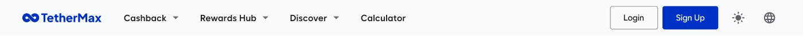
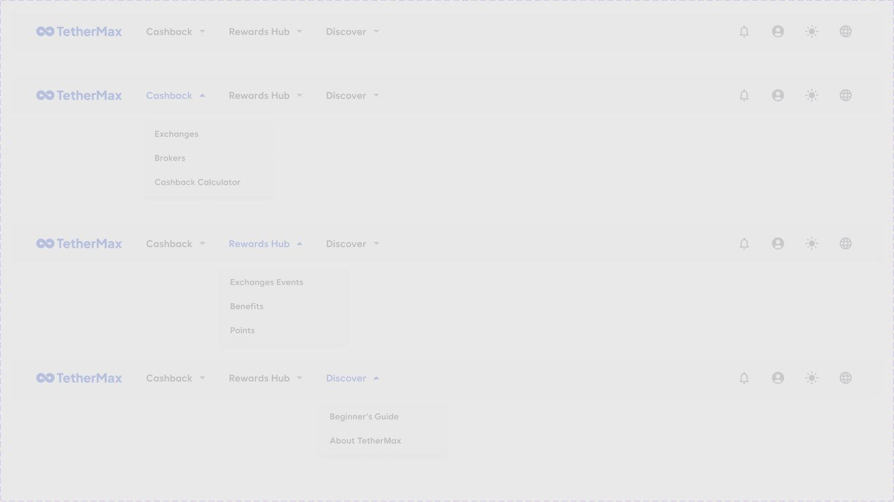

### CT-02. DEX 랜딩 히어로 리드 문구

| 구분 | 내용 |
|---|---|
| 우선 | 1 (확정 문구와 다름) |
| 지금 | PC [28960:125521](https://www.figma.com/design/hsa3bSV9QmFTe2jsf6tzTm/UI-UX-Design?node-id=28960-125521) · 로그인 [28960:125522](https://www.figma.com/design/hsa3bSV9QmFTe2jsf6tzTm/UI-UX-Design?node-id=28960-125522) · 모바일 [28960:130946](https://www.figma.com/design/hsa3bSV9QmFTe2jsf6tzTm/UI-UX-Design?node-id=28960-130946) · [28960:130952](https://www.figma.com/design/hsa3bSV9QmFTe2jsf6tzTm/UI-UX-Design?node-id=28960-130952) · 다크 [28960:130968](https://www.figma.com/design/hsa3bSV9QmFTe2jsf6tzTm/UI-UX-Design?node-id=28960-130968) — `Trade on the DEX. Paste your address on TetherMax.` |
| 근거 | 현 히어로 레이아웃 그대로(문구만 교체) |
| 수정안 | 리드 텍스트 레이어(PC `I…;27610:199380`) 문구 교체. 두 줄 이상이 되면 `copy` 프레임 높이만 hug로 |
| 문구 | `Trade with your own wallet on the DEX. Paste your wallet address into TetherMax and we pay your cashback into your TetherMax balance.` |
| 새 프레임 | 0 |
| 근거 번호 | G-154 · REQ-320 |

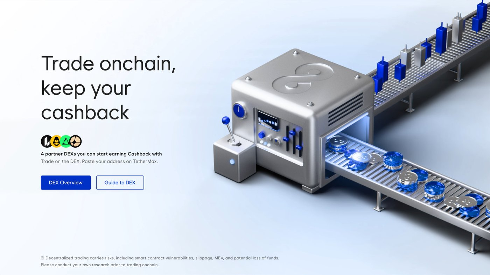

### CT-03. DEX 랜딩 CEX/DEX 비교 — 제목 · 출금 행 · 리워드 행

| 구분 | 내용 |
|---|---|
| 우선 | 1 (확정 문구와 다름) |
| 지금 | [28960:125521](https://www.figma.com/design/hsa3bSV9QmFTe2jsf6tzTm/UI-UX-Design?node-id=28960-125521) 비교 섹션(모바일·다크 같은 컴포넌트) — 제목 `Your cashback does not.` · 행 라벨 `Where payouts go`(양쪽) · DEX 값 `To your linked wallet from 10 USDT` · DEX 리워드 행 라벨 `Rewards` + `Event and invitation rewards are available.` |
| 근거 | 같은 섹션의 CEX 패널 행 구성(라벨 + 값 1줄) |
| 수정안 | 문구만 교체. DEX 리워드 행은 CEX 패널 `Event and invite rewards` 행과 같은 라벨·값 구조로. `Your Cashback` 칩은 둔다(D1 — Figma 문구 채택) |
| 문구 | 제목 2줄째 `Your DEX cashback does not.` · 행 라벨 `Where you withdraw` · CEX 값 `On TetherMax, from {min} USDT` · DEX 값 `On TetherMax, from {min} USDT, to your linked wallet` · 리워드 행 라벨 `Event and invite rewards`, 값 양쪽 `Yes` (`{min}` 표본 값은 결정 D8에 따라 `10`) |
| 새 프레임 | 0 |
| 근거 번호 | G-401 · REQ-327 · 정책 8-4 |

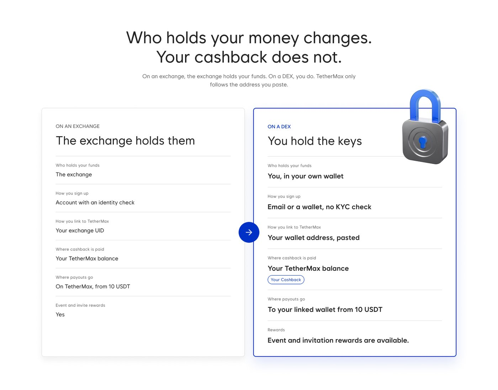

### CT-04. DEX 랜딩 glance 타일에 TVL · 24H 거래량

| 구분 | 내용 |
|---|---|
| 우선 | 1 (명세 필수 지표 없음) |
| 지금 | [28960:125521](https://www.figma.com/design/hsa3bSV9QmFTe2jsf6tzTm/UI-UX-Design?node-id=28960-125521) · 모바일 [28960:130946](https://www.figma.com/design/hsa3bSV9QmFTe2jsf6tzTm/UI-UX-Design?node-id=28960-130946) · 넘침 [28960:125542](https://www.figma.com/design/hsa3bSV9QmFTe2jsf6tzTm/UI-UX-Design?node-id=28960-125542) — 타일은 마크 · 이름 · `Up to` 요율만 |
| 근거 | 같은 페이지 venue 카드의 `TVL` · `24H Vol` 숫자 칸(아래 CT-05 캡처) |
| 수정안 | venue 카드의 `TVL` · `24H Vol` 칸 2개를 복제해 각 glance 타일 아래쪽에 넣는다. 값은 카드와 같은 표본(`$770.86M` · `$6.8M`) |
| 문구 | `TVL` · `24H Vol` (카드 라벨 그대로) |
| 새 프레임 | 0 |
| 근거 번호 | REQ-322 |

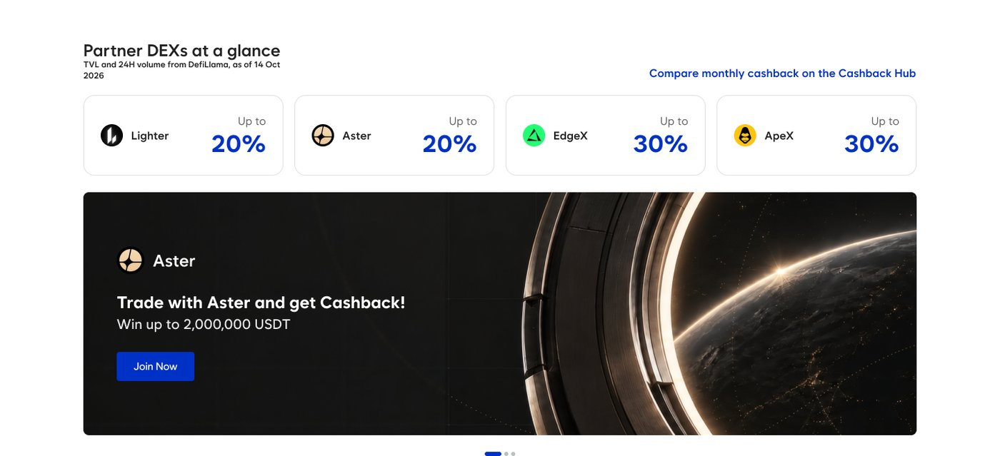

### CT-05. 랜딩 카드 ↔ 상세 값 일치 · 노출 순서 하나로

| 구분 | 내용 |
|---|---|
| 우선 | 1 (값이 다르면 게시 차단 규칙에 걸림) |
| 지금 | 카드 [28960:125521](https://www.figma.com/design/hsa3bSV9QmFTe2jsf6tzTm/UI-UX-Design?node-id=28960-125521): EdgeX `0.0266%` · ApeX `0.0350%` · Aster `0.0280%`, Aster `Cashback up to 30%`. 상세 오퍼 박스 `After cashback`: EdgeX [28960:127454](https://www.figma.com/design/hsa3bSV9QmFTe2jsf6tzTm/UI-UX-Design?node-id=28960-127454) · Aster [28960:127627](https://www.figma.com/design/hsa3bSV9QmFTe2jsf6tzTm/UI-UX-Design?node-id=28960-127627) · ApeX [28960:127633](https://www.figma.com/design/hsa3bSV9QmFTe2jsf6tzTm/UI-UX-Design?node-id=28960-127633) 모두 `0.0184%`, Aster 헤드라인 `20%`. 순서: glance `Lighter·Aster·EdgeX·ApeX` / PC 카드 `Lighter·ApeX·EdgeX·Aster` / 모바일 `EdgeX·ApeX·Lighter·Aster` |
| 근거 | 각 상세 오퍼 박스 값(레코드 표본) · 정책 표시 요율 Lighter·Aster 20% / EdgeX·ApeX 30% |
| 수정안 | ① 카드 `Final Taker`/`Final Maker`를 해당 상세 `After cashback` 값으로 교체(Lighter는 이미 일치). ② Aster 카드 `30%` → `20%`. ③ glance · PC 카드 · 모바일 목록 · 넘침 프레임을 한 순서 `Lighter · ApeX · EdgeX · Aster`(PC 카드 순서)로 재배치. 실제 순서는 백오피스 전역 순위이며 표본임을 개발 인계 메모에 적는다. ApeX·Aster 숫자는 레코드 전 표본(REQ-364) |
| 문구 | 값만 교체 |
| 새 프레임 | 0 |
| 근거 번호 | REQ-319 · REQ-325 · REQ-339 · REQ-364 · 정책 8-3 |

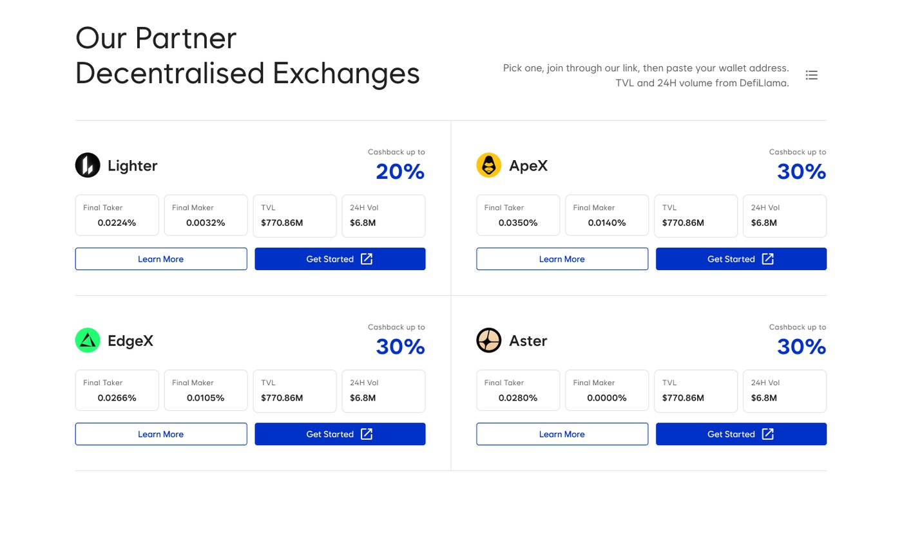
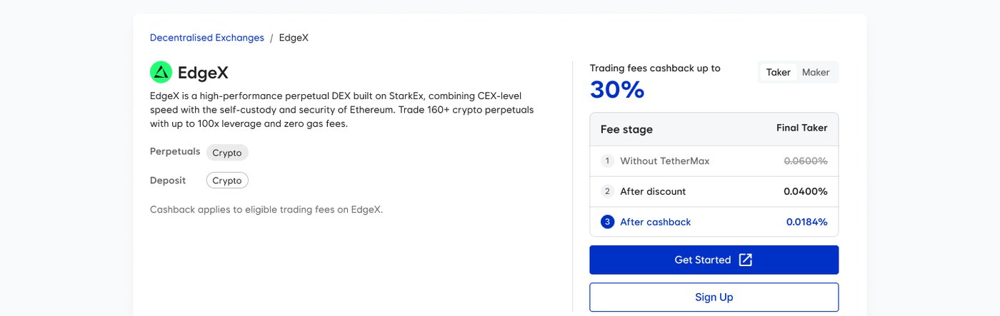

### CT-06. Aster 상세 — Solana 삭제

| 구분 | 내용 |
|---|---|
| 우선 | 1 (정책 위반 문구) |
| 지금 | PC [28960:127627](https://www.figma.com/design/hsa3bSV9QmFTe2jsf6tzTm/UI-UX-Design?node-id=28960-127627) · 모바일 [28960:131017](https://www.figma.com/design/hsa3bSV9QmFTe2jsf6tzTm/UI-UX-Design?node-id=28960-131017) — 설명 `… BNB Chain, Ethereum, Solana and Arbitrum.` · 이유 카드 4 `Multichain: BNB Chain, Ethereum, Solana & Arbitrum` |
| 근거 | 현 레이아웃 그대로(문구만) |
| 수정안 | 두 텍스트 레이어 문구 교체 |
| 문구 | `Aster is a multichain perpetual DEX on BNB Chain, Ethereum and Arbitrum. …`(뒤 문장은 현행 유지) · `Multichain: BNB Chain, Ethereum & Arbitrum` |
| 새 프레임 | 0 |
| 근거 번호 | 정책 8-5 · REQ-357 · REQ-363 |

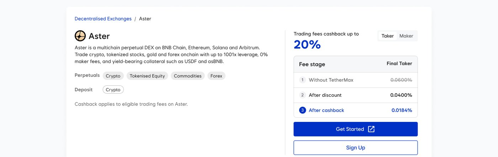
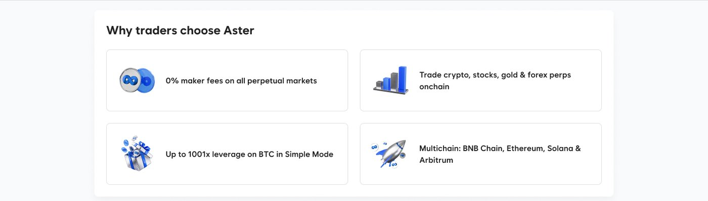

### CT-07. AI 리뷰 요약 — 「DEX 계정으로 들어간다」 문장 교체

| 구분 | 내용 |
|---|---|
| 우선 | 1 (금지 문장) |
| 지금 | Aster [28960:127627](https://www.figma.com/design/hsa3bSV9QmFTe2jsf6tzTm/UI-UX-Design?node-id=28960-127627) `Cashback lands in my Aster account every week.` · ApeX [28960:127633](https://www.figma.com/design/hsa3bSV9QmFTe2jsf6tzTm/UI-UX-Design?node-id=28960-127633) `Cashback lands in my ApeX account every week.` · EdgeX [28960:127454](https://www.figma.com/design/hsa3bSV9QmFTe2jsf6tzTm/UI-UX-Design?node-id=28960-127454)(점검 문서 기준 같은 문장) |
| 근거 | Lighter PC [28960:127443](https://www.figma.com/design/hsa3bSV9QmFTe2jsf6tzTm/UI-UX-Design?node-id=28960-127443)의 같은 줄 `Cashback reaches my TetherMax balance every week.` |
| 수정안 | 세 프레임의 첫 줄을 Lighter PC 줄로 교체(AI 요약은 표본 문장) |
| 문구 | 문구 원문 없음 — 표본으로 Lighter PC 문장 재사용 |
| 새 프레임 | 0 |
| 근거 번호 | REQ-354 · REQ-362 · 정책 8-5 |

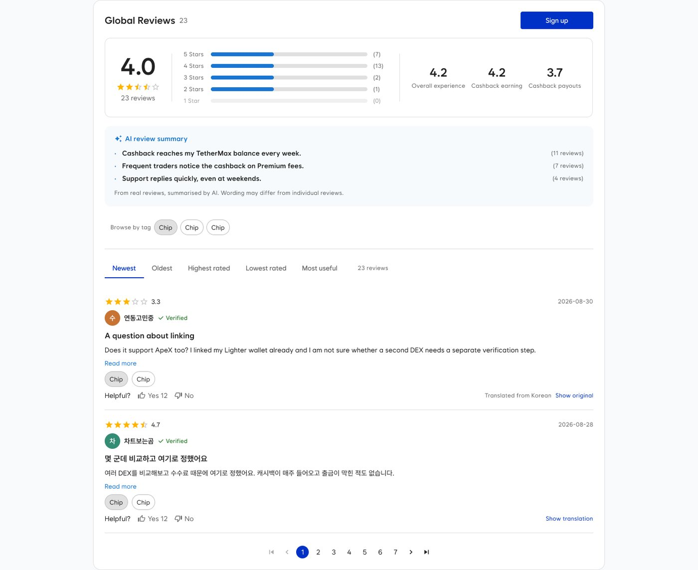

### CT-08. 상세 계산기 PC — 3칸 값

| 구분 | 내용 |
|---|---|
| 우선 | 1 (화면대로 만들면 계산이 틀림) |
| 지금 | [28960:127443](https://www.figma.com/design/hsa3bSV9QmFTe2jsf6tzTm/UI-UX-Design?node-id=28960-127443)(D2~D6 같은 컴포넌트) — 세 칸 모두 `$112.00 / Trading fee / Without TetherMax` |
| 근거 | CEX 상세 계산기 [22442:219830](https://www.figma.com/design/hsa3bSV9QmFTe2jsf6tzTm/UI-UX-Design?node-id=22442-219830)(MAX 1216) — 칸마다 다른 값·라벨 |
| 수정안 | 칸 2·3 인스턴스의 값·라벨 오버라이드 교체 |
| 문구 | 칸 1 `$112.00` · `Trading fee` · `Without TetherMax` / 칸 2 `$22.40` · `Cashback` · `Returned to you` / 칸 3 `$89.60` · `Effective fee` · `With TetherMax` |
| 새 프레임 | 0 |
| 근거 번호 | REQ-343 · REQ-359 |

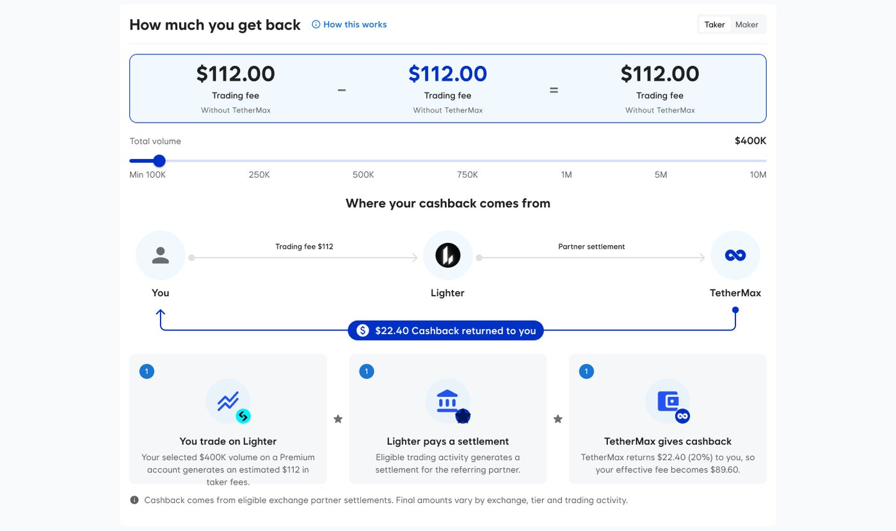
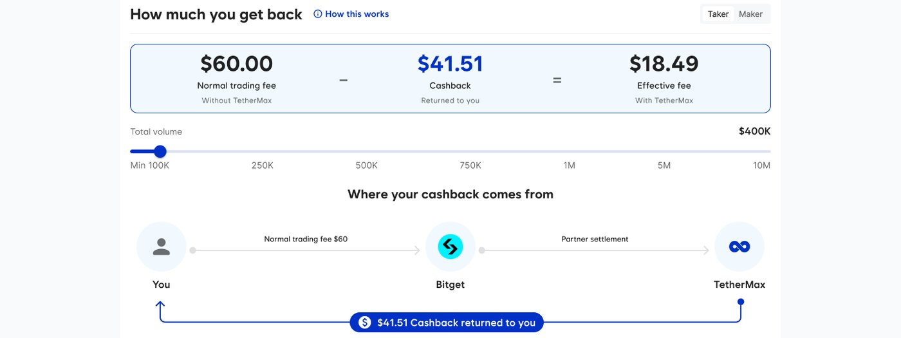

### CT-09. 단계 가이드 — 제목 하나 · 경고 박스 삭제 · Step 3 본문 · 미디어 비율

| 구분 | 내용 |
|---|---|
| 우선 | 1 (G-437 확정과 다름) |
| 지금 | PC [28960:127443](https://www.figma.com/design/hsa3bSV9QmFTe2jsf6tzTm/UI-UX-Design?node-id=28960-127443) · [28960:127444](https://www.figma.com/design/hsa3bSV9QmFTe2jsf6tzTm/UI-UX-Design?node-id=28960-127444) · 모바일 [28960:130999](https://www.figma.com/design/hsa3bSV9QmFTe2jsf6tzTm/UI-UX-Design?node-id=28960-130999) — 오른쪽 제목 `Join the DEX through the TetherMax link and paste your wallet address`(왼쪽 `Join Lighter and link your wallet`), Step 1 `Create a Web3 Wallet`(왼쪽 `wallet`), 경고 문장 전용 `note` 박스, 미디어 PC 624×360 · 모바일 311×360 |
| 근거 | 같은 가이드의 왼쪽 목록 라벨 · 본문 텍스트 스타일 |
| 수정안 | ① 오른쪽 패널 제목 = 왼쪽 목록 라벨(Step 1 `Create a Web3 wallet`, Step 3 `Join Lighter and link your wallet`). ② `note` 박스 삭제, 경고 문장을 본문 텍스트 끝 문단으로. ③ Lighter Step 3 본문을 REQ-360 원문으로 바꾸고 레퍼럴 코드 확인 문장(REQ-346)은 유지. ④ 미디어 슬롯 크기만 PC 2:1(624×312) · 모바일 1:1(311×311) |
| 문구 | Step 3 본문 `Open Lighter through the TetherMax link and log in. Then copy your wallet address from Lighter and paste it in TetherMax. TetherMax never asks you to connect a wallet.` + `Cashback applies only to Plus and Premium accounts. Standard accounts pay no fees.` (레퍼럴 확인 문장과 합친 최종 순서는 ❓ 사용자 확인 #37) |
| 새 프레임 | 0 |
| 근거 번호 | G-437 · G-270 · REQ-345 · REQ-346 · REQ-347 · REQ-360 |

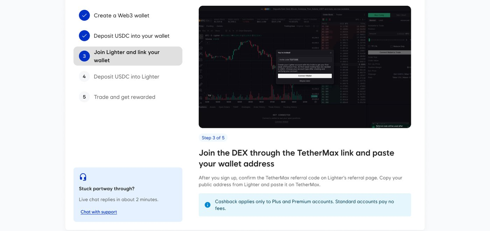
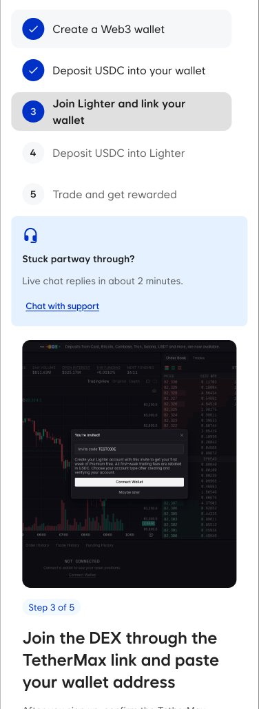

### CT-10. 리뷰 작성 게이트 · 403 안내 — DEX판

| 구분 | 내용 |
|---|---|
| 우선 | 1 (UID 문구, DEX용 없음) |
| 지금 | DEX(revision)에 없음 |
| 근거 | 기존 게이트 다이얼로그 [22919:73859](https://www.figma.com/design/hsa3bSV9QmFTe2jsf6tzTm/UI-UX-Design?node-id=22919-73859)(MAX 1216) — `Link your exchange UID to write a review` · `Close` · `Link UID` |
| 수정안 | 22919:73859를 복제해 상세 회원 상태별 묶음 [28969:129577](https://www.figma.com/design/hsa3bSV9QmFTe2jsf6tzTm/UI-UX-Design?node-id=28969-129577) 옆에 `DEX / Review gate / not linked`. 제목·버튼 문구 교체. 같은 프레임을 확인 중 지갑만 있는 회원 · API-022 403에 공통으로 쓴다고 메모 |
| 문구 | 제목 `Link your {venue} wallet to write a review.` · 버튼 `Link Wallet`(오퍼 박스 현행 라벨) · 본문은 현행 `Only verified members can post (anyone can read)` 유지(국문 `연동 완료 계정이 있는 회원이 작성할 수 있습니다`) |
| 새 프레임 | 1 |
| 근거 번호 | G-170 · REQ-352 · REQ-362 · API-022 403 |

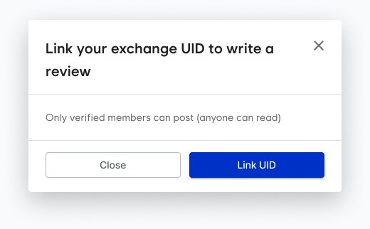

### CT-11. /payback DEX 결과 — 평균 카드 삭제 · PC 결과 프레임

| 구분 | 내용 |
|---|---|
| 우선 | 1 (DEX 결과에 CEX 평균 카드 금지) |
| 지금 | 모바일 [29187:119430](https://www.figma.com/design/hsa3bSV9QmFTe2jsf6tzTm/UI-UX-Design?node-id=29187-119430) `On average, 81,836 Bitget traders like you earn about 4.70 USDT/mo.` 카드. PC [29187:119248](https://www.figma.com/design/hsa3bSV9QmFTe2jsf6tzTm/UI-UX-Design?node-id=29187-119248)는 결과 레이어가 프레임 위쪽(y −356)에 잘려 렌더되지 않고 Summary만 보인다 |
| 근거 | 기존 Web 결과 [6922:77328](https://www.figma.com/design/hsa3bSV9QmFTe2jsf6tzTm/UI-UX-Design?node-id=6922-77328)([MAX-146]) — `Trade with TetherMax` / `Without TetherMax` 두 카드 |
| 수정안 | ① 모바일 평균 카드 삭제. ② 6922:77328을 복제해 29187:119248 옆에 `계산기 · DEX 결과 / PC` — 새 GNB로 교체, EdgeX 값(`+1.89` / `-1.89`), 평균 카드 삭제. ③ 29187:119248 안의 잘린 결과 레이어 삭제 |
| 문구 | `YOUR CASHBACK (USDT)` · `FEES LOST (USDT)` (현행) |
| 새 프레임 | 1 |
| 근거 번호 | REQ-458 · 묶음 메모 29187:119616 |

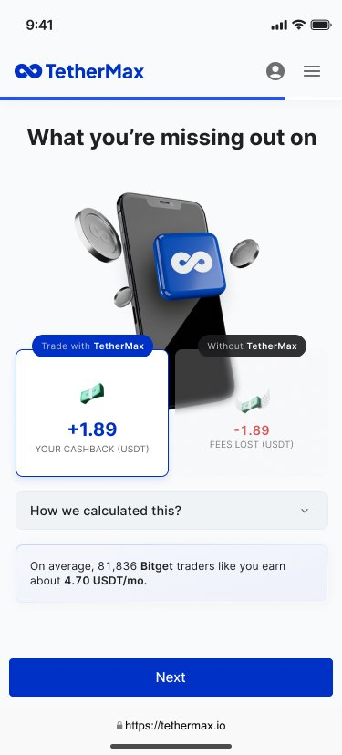
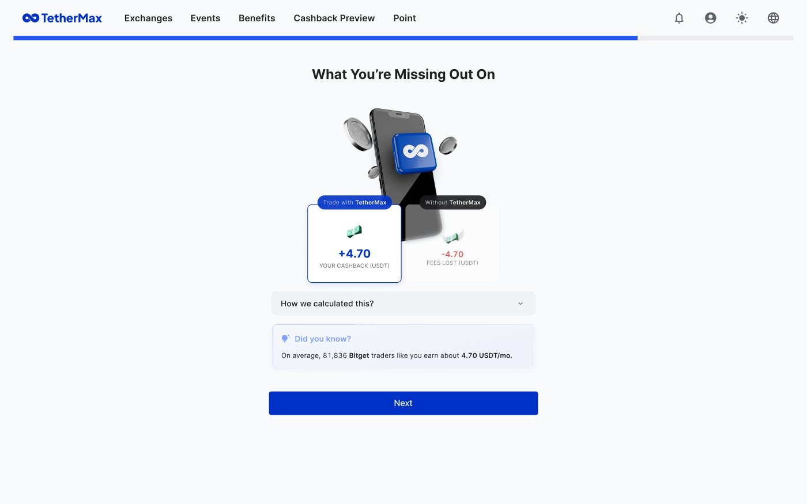

---

## 우선 2

### CT-12. 상세 오퍼 박스 — 연동 불가 · 탭 1개 · 둘째 탭 선택

| 구분 | 내용 |
|---|---|
| 우선 | 2 |
| 지금 | 회원 상태별 [28969:129578](https://www.figma.com/design/hsa3bSV9QmFTe2jsf6tzTm/UI-UX-Design?node-id=28969-129578) · [28969:129666](https://www.figma.com/design/hsa3bSV9QmFTe2jsf6tzTm/UI-UX-Design?node-id=28969-129666) · [28969:129751](https://www.figma.com/design/hsa3bSV9QmFTe2jsf6tzTm/UI-UX-Design?node-id=28969-129751) — 첫 탭 선택 · 토글 있음 상태만 |
| 근거 | 같은 오퍼 박스(`Offer box (pinned on scroll)`) · 토글 컴포넌트의 선택 변형 |
| 수정안 | 28969:129666 복제 3개를 같은 묶음 오른쪽에: ① `연동 불가`(`LINK_UNAVAILABLE`) — `Link Wallet` 숨김, `Get Started` 유지. ② `탭 1개` — 토글 숨김(EdgeX 값). ③ `Plus 선택` — 토글 변형을 `Plus`로, 단계 표 `Without TetherMax` `0.0050%` / `0.0050%` |
| 문구 | Plus 헤드라인 요율·`After cashback` 값은 문구 원문 없음(레코드) — `{rate}%` 자리표시로 |
| 새 프레임 | 3 |
| 근거 번호 | G-162 · G-438 · REQ-339 · 정책 PB-5(Plus 수수료) |

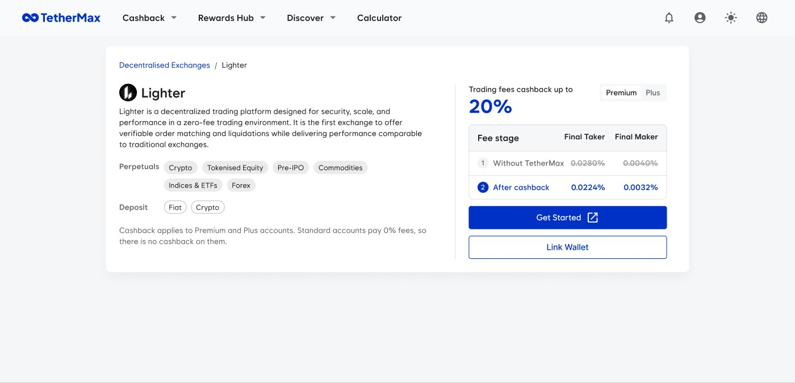

### CT-13. DEX 랜딩 — 노출 DEX 0곳 · 활성 DEX 3곳

| 구분 | 내용 |
|---|---|
| 우선 | 2 |
| 지금 | 4곳 고정([28960:125521](https://www.figma.com/design/hsa3bSV9QmFTe2jsf6tzTm/UI-UX-Design?node-id=28960-125521))과 8곳 넘침([28960:125542](https://www.figma.com/design/hsa3bSV9QmFTe2jsf6tzTm/UI-UX-Design?node-id=28960-125542))만 |
| 근거 | 같은 랜딩 컴포넌트(섹션 숨김·카드 삭제만) |
| 수정안 | 28960:125542 옆에 ① `0 partner DEXs`: 125521 복제 → glance · 프로모 배너 · venue 섹션 숨김, 히어로 파트너 마크 줄 숨김(빈 상태 화면 없음). ② `3 partner DEXs`: 125521 복제 → 마크·glance 타일·카드에서 Aster 삭제, 히어로 `{n}` = 3 |
| 문구 | 히어로 `3 partner DEXs you can start earning Cashback with` (현행 문장의 숫자만) |
| 새 프레임 | 2 |
| 근거 번호 | G-160 · REQ-320 · REQ-332 |

### CT-14. 목록 조회 실패 — 영역 오류

| 구분 | 내용 |
|---|---|
| 우선 | 2 (실패를 「0곳」과 구분) |
| 지금 | DEX 랜딩(API-003) · /payback 플랫폼(API-001) · 서비스 소개 파트너 캐러셀(API-001) 실패 상태 없음 |
| 근거 | 리뷰 목록 실패 [22954:81674](https://www.figma.com/design/hsa3bSV9QmFTe2jsf6tzTm/UI-UX-Design?node-id=22954-81674)(MAX 1216) — 빨간 경고 줄 + `Try again` |
| 수정안 | 경고 줄 + `Try again`을 복제해 ① 랜딩 PC 복제본의 glance·venue 영역 자리(125542 옆) ② /payback PB-3 [29194:120700](https://www.figma.com/design/hsa3bSV9QmFTe2jsf6tzTm/UI-UX-Design?node-id=29194-120700) 복제본의 타일 그리드 자리 ③ 서비스 소개 [28960:129521](https://www.figma.com/design/hsa3bSV9QmFTe2jsf6tzTm/UI-UX-Design?node-id=28960-129521) 복제본의 캐러셀 자리에 둔다. 나머지 영역은 그대로 |
| 문구 | 문구 원문 없음 — 근거 문장 `Reviews didn't load.`의 형식만 따름 |
| 새 프레임 | 3 |
| 근거 번호 | API-001 · API-003 · G-160 · 재점검 우선 1 |

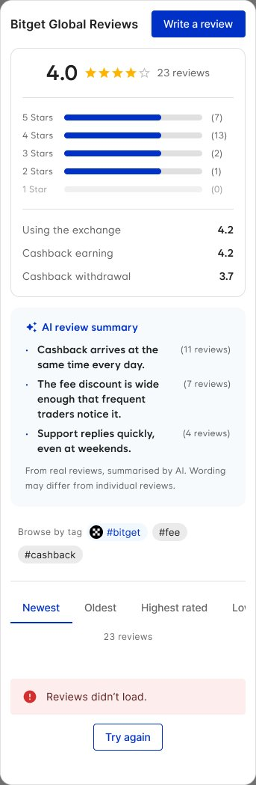

### CT-15. DefiLlama — 24시간 경과 카드 · 전일 대비 증감

| 구분 | 내용 |
|---|---|
| 우선 | 2 |
| 지금 | [28960:125521](https://www.figma.com/design/hsa3bSV9QmFTe2jsf6tzTm/UI-UX-Design?node-id=28960-125521) 카드 `24H Vol $6.8M`(증감 없음), 지표가 빠진 카드 모양 없음 |
| 근거 | 같은 venue 카드 |
| 수정안 | ① 정상 카드 값에 증감 추가 `$6.8M, −2%`. ② 125521 복제 `DefiLlama 24h 경과` — 카드·glance의 `TVL` · `24H Vol` 칸 숨김, 나머지(요율·버튼) 유지. 24시간 이내 장애는 glance 서브라인 `as of {date}`가 마지막 값 기준이라 프레임 불필요 |
| 문구 | `$6.8M, −2%` (정책 카드 예시) |
| 새 프레임 | 1 |
| 근거 번호 | REQ-323 · G-349 · B-6-3 · B-6-5 |

### CT-16. DEX 랜딩 모바일 — 기본 1열 카드 / 리스트 뷰 구분

| 구분 | 내용 |
|---|---|
| 우선 | 2 |
| 지금 | 기본 [28960:130946](https://www.figma.com/design/hsa3bSV9QmFTe2jsf6tzTm/UI-UX-Design?node-id=28960-130946)과 리스트 뷰 [28960:130958](https://www.figma.com/design/hsa3bSV9QmFTe2jsf6tzTm/UI-UX-Design?node-id=28960-130958)이 같은 목록 행 |
| 근거 | PC venue 카드(CT-05 캡처) · PC 리스트 행 [28960:125536](https://www.figma.com/design/hsa3bSV9QmFTe2jsf6tzTm/UI-UX-Design?node-id=28960-125536) |
| 수정안 | 130946 목록을 PC 카드 인스턴스 1열(343 폭, TVL·24H·`Learn More`·`Get Started`)로 교체. 130958 행에 PC 리스트 행의 리뷰 점수 `4.0 (23)`과 `View {DEX}` 버튼을 복제 |
| 문구 | `View Lighter` 등(CT-17과 같음) |
| 새 프레임 | 0 |
| 근거 번호 | REQ-325 · REQ-326 |

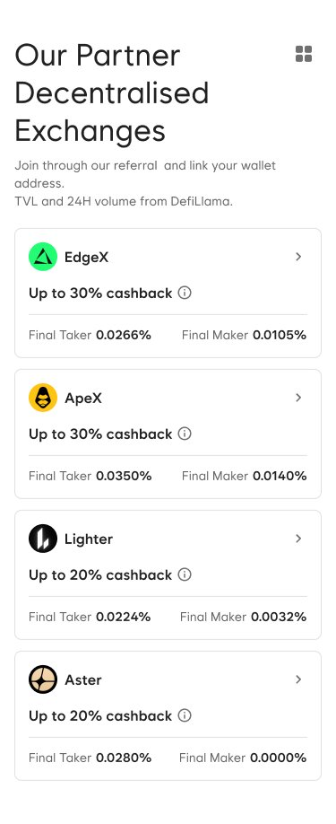

### CT-17. DEX 랜딩 리스트 뷰 PC — 버튼 `Label`

| 구분 | 내용 |
|---|---|
| 우선 | 2 |
| 지금 | [28960:125536](https://www.figma.com/design/hsa3bSV9QmFTe2jsf6tzTm/UI-UX-Design?node-id=28960-125536) 행 버튼 자리표시자 `Label` |
| 근거 | 현 행 그대로 |
| 수정안 | 행마다 버튼 문구 교체 |
| 문구 | `View Lighter` · `View ApeX` · `View EdgeX` · `View Aster` (`View {DEX}`) |
| 새 프레임 | 0 |
| 근거 번호 | REQ-326 |

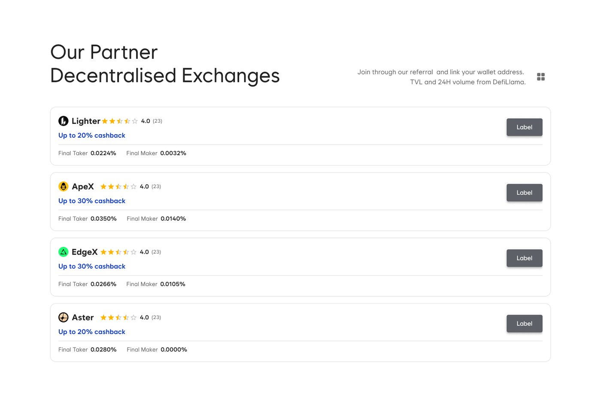

### CT-18. 상세 히어로 — 이름 옆 `DEX` 배지

| 구분 | 내용 |
|---|---|
| 우선 | 2 |
| 지금 | [28960:127443](https://www.figma.com/design/hsa3bSV9QmFTe2jsf6tzTm/UI-UX-Design?node-id=28960-127443) 외 상세 6개 · 모바일 5개 — 배지 없음 |
| 근거 | CEX 상세 [22442:219830](https://www.figma.com/design/hsa3bSV9QmFTe2jsf6tzTm/UI-UX-Design?node-id=22442-219830) 이름 아래 알약 칩(`3 events`) |
| 수정안 | 알약 칩을 복제해 거래소 이름 오른쪽에 두고 아이콘 삭제, 문구 `DEX`. 상세 메인 컴포넌트 한 곳에서 |
| 문구 | `DEX` |
| 새 프레임 | 0 |
| 근거 번호 | REQ-337 · P5 |

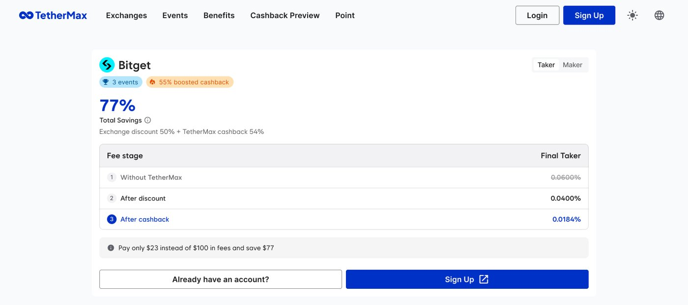

### CT-19. 상세 계산기 모바일 — PC 구성으로

| 구분 | 내용 |
|---|---|
| 우선 | 2 |
| 지금 | [28960:130990](https://www.figma.com/design/hsa3bSV9QmFTe2jsf6tzTm/UI-UX-Design?node-id=28960-130990)(모바일 상세 공통) — `Normal trading fee`, `20%/80%` 막대, `Stays with the fee — $89.60` / `Split between Lighter and TetherMax.`, 카드 문구 PC와 다름, 흐름도 없음 |
| 근거 | PC 계산기 [28960:127443](https://www.figma.com/design/hsa3bSV9QmFTe2jsf6tzTm/UI-UX-Design?node-id=28960-127443)(CT-08 캡처) |
| 수정안 | ① 라벨 `Normal trading fee` → `Trading fee`. ② 막대·범례 블록 삭제, 그 자리에 PC 흐름도 `Where your cashback comes from` 인스턴스(343 폭). ③ 설명 카드 3장·고지 문구를 PC 원문으로 |
| 문구 | 카드 1 `Your selected {volume} volume on a {account tier} account generates …` · 카드 2 `Eligible trading activity generates a settlement for the referring partner.` · 고지 `Cashback comes from eligible exchange partner settlements. Final amounts vary by exchange, tier and trading activity.` |
| 새 프레임 | 0 |
| 근거 번호 | REQ-343 · REQ-344 · REQ-359 |

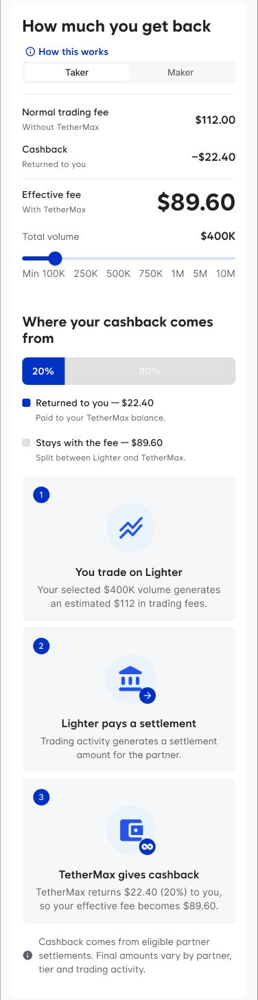

### CT-20. 리뷰 — 게스트 안내 · 하위 점수 · 태그 자리표시자

| 구분 | 내용 |
|---|---|
| 우선 | 2 |
| 지금 | PC [28960:127443](https://www.figma.com/design/hsa3bSV9QmFTe2jsf6tzTm/UI-UX-Design?node-id=28960-127443) · [28960:127445](https://www.figma.com/design/hsa3bSV9QmFTe2jsf6tzTm/UI-UX-Design?node-id=28960-127445): 게스트 안내 없음(머리 `Sign up`만), 태그 칩 `Chip` 자리표시. 모바일 [28960:130990](https://www.figma.com/design/hsa3bSV9QmFTe2jsf6tzTm/UI-UX-Design?node-id=28960-130990): 안내 둘째 줄 `Sign in and link your wallet for this DEX to write a review.`, 첫 축 `Using the exchange` |
| 근거 | 모바일 게스트 안내 블록(잠금 아이콘 + 두 줄 + `Sign up`) · 모바일 태그 칩 `#lighter` `#fee` `#cashback` |
| 수정안 | ① 모바일 안내 블록을 복제해 PC 정렬 탭 위에 넣고 두 줄 문구 교체(모바일도 같은 문구). ② 모바일 첫 축 → PC와 같은 `Overall experience`(셋째 축 `Cashback payouts`는 D1로 유지). ③ PC `Chip` → 거래소별 태그 |
| 문구 | `Log in or sign up to write a review` · `After signing up, link your {venue} wallet address to post (anyone can read)` · 태그 `#lighter` `#fee` `#cashback`(거래소명 태그는 그 DEX) |
| 새 프레임 | 0 |
| 근거 번호 | REQ-353 · REQ-354 · REQ-362 · 결정 D1 |

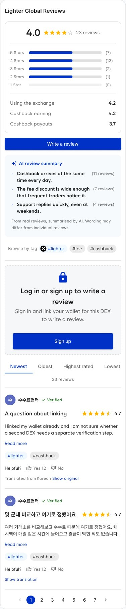

### CT-21. 리뷰 0건 — DEX판

| 구분 | 내용 |
|---|---|
| 우선 | 2 |
| 지금 | DEX(revision)에 없음 |
| 근거 | CEX 상세 빈 상태 [22442:219830](https://www.figma.com/design/hsa3bSV9QmFTe2jsf6tzTm/UI-UX-Design?node-id=22442-219830) — `Global Reviews 0` · `Be the first to review.` · `Write a review` · 모바일 [22956:84690](https://www.figma.com/design/hsa3bSV9QmFTe2jsf6tzTm/UI-UX-Design?node-id=22956-84690) |
| 수정안 | DEX 상세 리뷰 섹션 PC·모바일 복제 → 요약·히스토그램·AI 요약·태그·목록 숨김, CEX 빈 상태 본문 블록으로 교체, 탭 바 `Reviews (0)`. [28960:127445](https://www.figma.com/design/hsa3bSV9QmFTe2jsf6tzTm/UI-UX-Design?node-id=28960-127445) · [28960:131005](https://www.figma.com/design/hsa3bSV9QmFTe2jsf6tzTm/UI-UX-Design?node-id=28960-131005) 옆 |
| 문구 | `No reviews yet` (국문 `아직 작성된 리뷰가 없습니다`) · 탭 `Reviews (0)` |
| 새 프레임 | 2 |
| 근거 번호 | G-169 · REQ-355 |

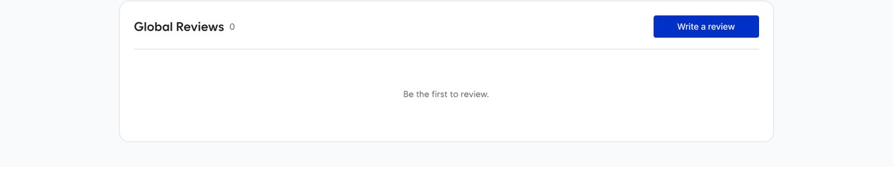

### CT-22. Aster 등 모바일 상세 — Lighter 리뷰가 나옴

| 구분 | 내용 |
|---|---|
| 우선 | 2 |
| 지금 | Aster 모바일 [28960:131017](https://www.figma.com/design/hsa3bSV9QmFTe2jsf6tzTm/UI-UX-Design?node-id=28960-131017) — `Lighter Global Reviews` · `#lighter` |
| 근거 | 같은 리뷰 컴포넌트 |
| 수정안 | 리뷰 머리·태그를 그 거래소로(Aster `Aster Global Reviews` · `#aster`). 다른 모바일 상세(EdgeX 131011 · ApeX 131023)도 같은 확인 후 교체. Lighter 요약 `Cashback arrives at the same time every day.`는 G-428(일일)과 맞아 유지 |
| 문구 | `{DEX} Global Reviews` · `#{dex}` |
| 새 프레임 | 0 |
| 근거 번호 | REQ-354 · G-428 |

### CT-23. /payback — EdgeX 각주 · Lighter 타일(G-428)

| 구분 | 내용 |
|---|---|
| 우선 | 2 |
| 지금 | Summary [29187:119248](https://www.figma.com/design/hsa3bSV9QmFTe2jsf6tzTm/UI-UX-Design?node-id=29187-119248) · [29187:119510](https://www.figma.com/design/hsa3bSV9QmFTe2jsf6tzTm/UI-UX-Design?node-id=29187-119510) EdgeX에 CEX 각주 `*Calculated based on paid trading fees`. PB-3 [29194:120700](https://www.figma.com/design/hsa3bSV9QmFTe2jsf6tzTm/UI-UX-Design?node-id=29194-120700) · DEX 칩 [29064:934](https://www.figma.com/design/hsa3bSV9QmFTe2jsf6tzTm/UI-UX-Design?node-id=29064-934) · 모바일 [29194:121368](https://www.figma.com/design/hsa3bSV9QmFTe2jsf6tzTm/UI-UX-Design?node-id=29194-121368) · [29064:1384](https://www.figma.com/design/hsa3bSV9QmFTe2jsf6tzTm/UI-UX-Design?node-id=29064-1384)에 Lighter 타일 없음 |
| 근거 | 같은 PB-3의 DEX 타일(`EdgeX 30% Cashback`) |
| 수정안 | ① EdgeX 각주 문구 교체. ② DEX 타일 하나를 복제해 Lighter 타일 추가(DEX 순서 CT-05와 같게 Lighter 먼저). Lighter Summary `Schedule`은 `Daily`(G-428 — REQ-459의 `Weekly`·`Every Monday`는 쓰지 않음) |
| 문구 | `*Based on paid trading fees. EdgeX pays in USDC, shown 1:1 in USDT.` · Lighter 타일 `Lighter` · `20% Cashback` |
| 새 프레임 | 0 |
| 근거 번호 | REQ-455 · REQ-459 · REQ-462 · G-055 · G-428 |

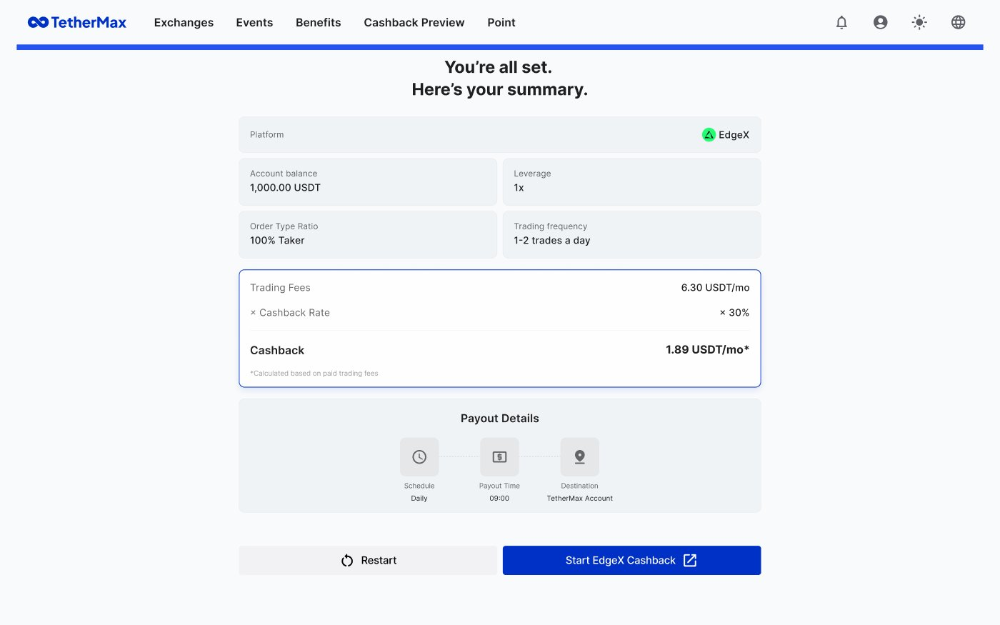
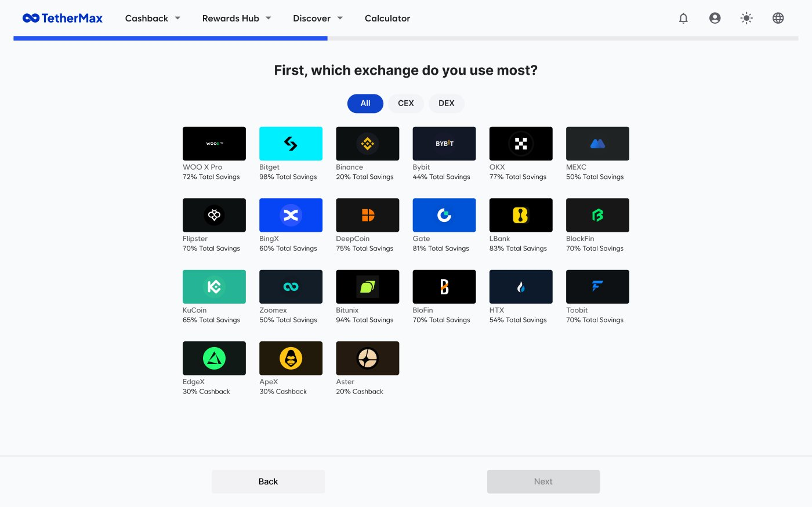

### CT-24. /payback — Landing · Trading profile PC · 계산 근거 펼침

| 구분 | 내용 |
|---|---|
| 우선 | 2 |
| 지금 | DEX(revision)에 PB-2 Landing · PB-4 Trading profile PC와 `How we calculated this?` 펼침 없음(기존판은 구 GNB · 옛 리드) |
| 근거 | [MAX-146] Web Landing [6510:88151](https://www.figma.com/design/hsa3bSV9QmFTe2jsf6tzTm/UI-UX-Design?node-id=6510-88151) · Web Trading profile [6510:88401](https://www.figma.com/design/hsa3bSV9QmFTe2jsf6tzTm/UI-UX-Design?node-id=6510-88401) · mWeb 펼침 [5123:32498](https://www.figma.com/design/hsa3bSV9QmFTe2jsf6tzTm/UI-UX-Design?node-id=5123-32498) |
| 수정안 | 세 노드를 복제해 /payback 묶음(29194:120700 왼쪽 · 29187:119430 옆)에 둔다. PC 두 장은 헤더를 새 GNB로, Landing 리드·카드 문구 교체. 펼침은 DEX 결과 값(1.89)으로 |
| 문구 | Landing 리드 `See how much cashback you're missing out on, across exchanges, DEXs and brokers.` · 카드 `{n} of our users earn an average of {amount} USDT in cashback per month.` |
| 새 프레임 | 3 |
| 근거 번호 | REQ-453 · REQ-454 · REQ-456 · REQ-458 · REQ-461 |

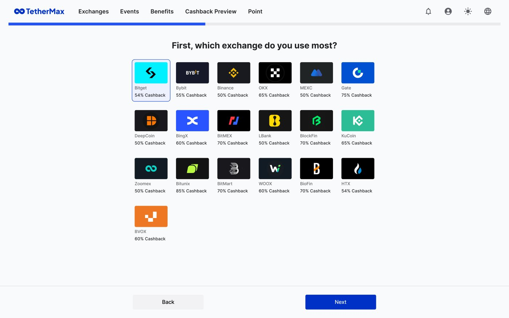
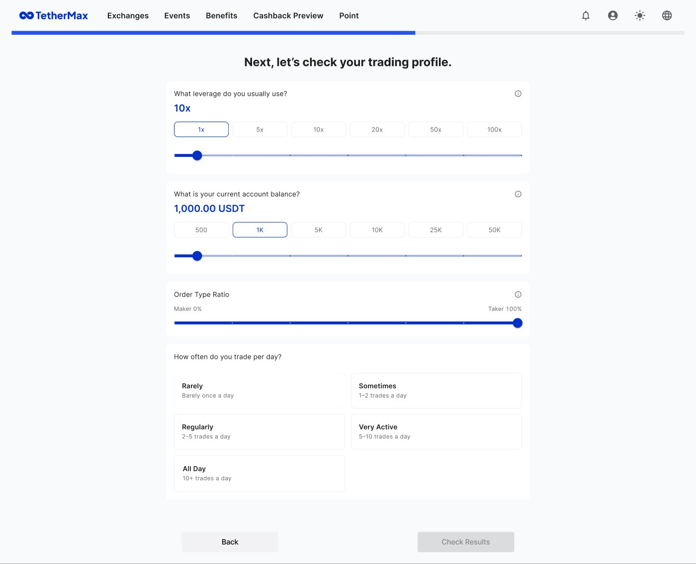
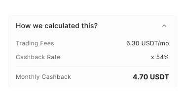

### CT-25. Exchange Listings — `Rating` 열 판 + 새 GNB

| 구분 | 내용 |
|---|---|
| 우선 | 2 |
| 지금 | DEX(revision)에 Exchange Listings 없음 |
| 근거 | [MAX 1216] CMT-08 [22799:96486](https://www.figma.com/design/hsa3bSV9QmFTe2jsf6tzTm/UI-UX-Design?node-id=22799-96486) — `Top Centralised Exchanges` · `Centralised Exchanges` 표 `Rating` 열(20개 미만 `-` 포함) · 카드 뷰 [22807:98684](https://www.figma.com/design/hsa3bSV9QmFTe2jsf6tzTm/UI-UX-Design?node-id=22807-98684) |
| 수정안 | 22799:96486을 DEX(revision)에 복제(`Exchange Listings / PC`), 헤더를 새 GNB(게스트 `Login` · `Sign Up`)로 교체. 목록·필터에 DEX 없음 그대로 |
| 문구 | 현행 그대로 |
| 새 프레임 | 1 |
| 근거 번호 | 결정 N2 · B3 · REQ-466 · REQ-475 |

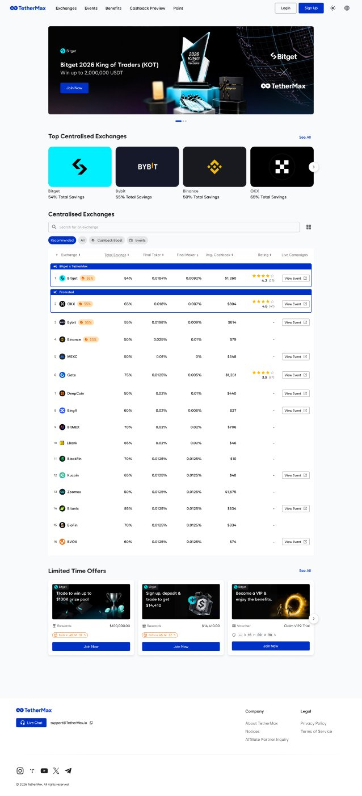

### CT-26. 프리로그인 랜딩 — 헤더 우측 게스트

| 구분 | 내용 |
|---|---|
| 우선 | 2 |
| 지금 | [28960:128375](https://www.figma.com/design/hsa3bSV9QmFTe2jsf6tzTm/UI-UX-Design?node-id=28960-128375) — 가입 히어로인데 헤더 우측이 벨·프로필·테마·언어(Landing Dark [28960:127917](https://www.figma.com/design/hsa3bSV9QmFTe2jsf6tzTm/UI-UX-Design?node-id=28960-127917)은 자리표시 아이콘 4개) |
| 근거 | DEX 랜딩 게스트 헤더 [28960:125521](https://www.figma.com/design/hsa3bSV9QmFTe2jsf6tzTm/UI-UX-Design?node-id=28960-125521)(`Login` · `Sign up`) |
| 수정안 | 두 프레임 헤더를 게스트 변형 인스턴스로 교체 |
| 문구 | `Login` · `Sign up` |
| 새 프레임 | 0 |
| 근거 번호 | 결정 A4 · REQ-464 |

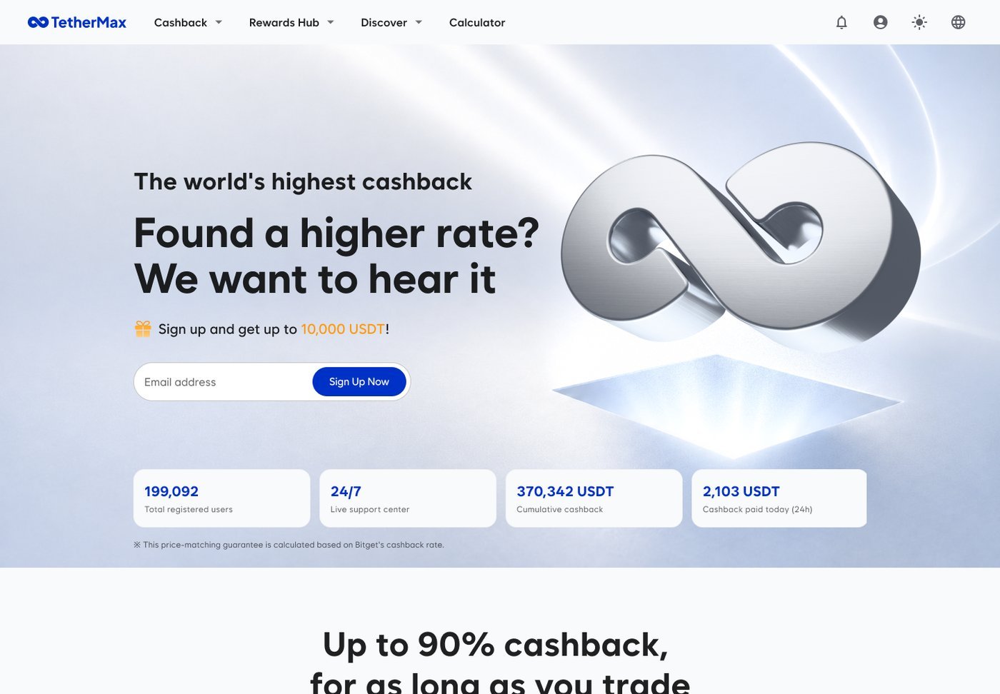

### CT-27. 앱 사용자 메뉴 — Cashback 진입

| 구분 | 내용 |
|---|---|
| 우선 | 2 |
| 지금 | DEX(revision)에 앱 사용자 메뉴 없음(앱에서 Cashback 허브로 들어갈 길이 화면에 없음) |
| 근거 | mAPP My Page [10981:111021](https://www.figma.com/design/hsa3bSV9QmFTe2jsf6tzTm/UI-UX-Design?node-id=10981-111021) — 2×2 카드 + `Account Security` 등 행 목록 |
| 수정안 | 10981:111021을 DEX(revision)에 복제, `Account Security` 행을 복제해 목록 첫 행으로 넣고 Cashback 허브 이동 행으로 |
| 문구 | 문구 원문 없음(행 라벨) |
| 새 프레임 | 1 |
| 근거 번호 | REQ-469 · G-214 |

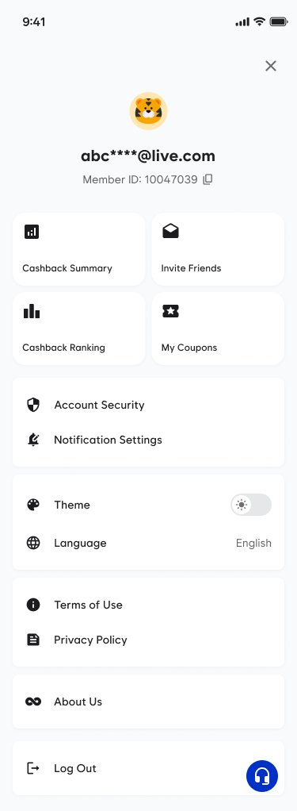

---

## 우선 3

### CT-28. 단계 가이드 — 추가 상태

| 구분 | 내용 |
|---|---|
| 우선 | 3 |
| 지금 | Step 1·3 선택만. 모바일 프레임 이름 `step 5`/`step 6`([28960:131000](https://www.figma.com/design/hsa3bSV9QmFTe2jsf6tzTm/UI-UX-Design?node-id=28960-131000) · [28960:131043](https://www.figma.com/design/hsa3bSV9QmFTe2jsf6tzTm/UI-UX-Design?node-id=28960-131043))인데 화면은 Step 3 |
| 근거 | 같은 가이드 컴포넌트(CT-09 캡처) |
| 수정안 | [28960:127444](https://www.figma.com/design/hsa3bSV9QmFTe2jsf6tzTm/UI-UX-Design?node-id=28960-127444) 옆에 복제 ① Step 2 선택 ② 단계 3개 가이드(`Step 1 of 3`, 목록 3행) ③ 영상 실패 — 미디어 자리에 정지된 첫 프레임 이미지, 본문 그대로. 모바일 프레임 이름을 화면과 같게 |
| 문구 | Step 2 본문(잘못된 체인 경고)은 문구 원문 없음 |
| 새 프레임 | 3 |
| 근거 번호 | REQ-345 · REQ-346 · REQ-348 |

### CT-29. FAQ — 구역 이름 · 두 구역 동시 펼침

| 구분 | 내용 |
|---|---|
| 우선 | 3 |
| 지금 | [28960:127443](https://www.figma.com/design/hsa3bSV9QmFTe2jsf6tzTm/UI-UX-Design?node-id=28960-127443) 외 상세 전부 · 모바일 — `Payouts & Account Management`, 첫 구역만 펼침 |
| 근거 | 같은 FAQ 아코디언 |
| 수정안 | 구역 이름 교체. 127445 옆에 복제 1장 — 첫 구역과 `Withdrawals & Account Management` 구역 동시 펼침(`−` 아이콘) |
| 문구 | `Withdrawals & Account Management` |
| 새 프레임 | 1 |
| 근거 번호 | REQ-350 · REQ-361 · G-418(실적·결과 = Withdraw) |

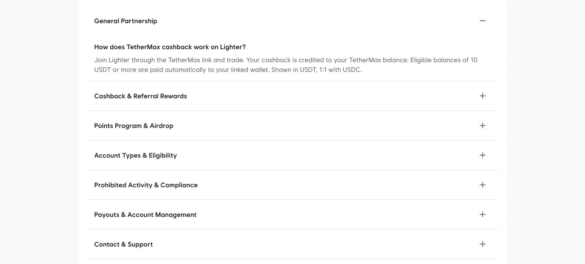

### CT-30. 상세 탭 바 — 스크롤 고정 · 다른 탭 활성

| 구분 | 내용 |
|---|---|
| 우선 | 3 |
| 지금 | 로드 상태(`Key Features` 활성)만 |
| 근거 | 같은 탭 바 컴포넌트의 활성 변형 |
| 수정안 | 127445 옆에 복제 1장 — 탭 바를 헤더 아래 고정 위치로, `Reviews (23)` 활성 |
| 문구 | 현행 탭 문구 |
| 새 프레임 | 1 |
| 근거 번호 | REQ-341 |

### CT-31. 8곳 넘침 — `XX%` 자리표시자

| 구분 | 내용 |
|---|---|
| 우선 | 3 |
| 지금 | [28960:125542](https://www.figma.com/design/hsa3bSV9QmFTe2jsf6tzTm/UI-UX-Design?node-id=28960-125542) 추가 카드 요율 `XX%` |
| 근거 | 같은 프레임 카드 |
| 수정안 | 문구만 |
| 문구 | 문구 원문 없음 — 표본 요율(예 기존 카드와 같은 `20%`)로 |
| 새 프레임 | 0 |
| 근거 번호 | REQ-325 |

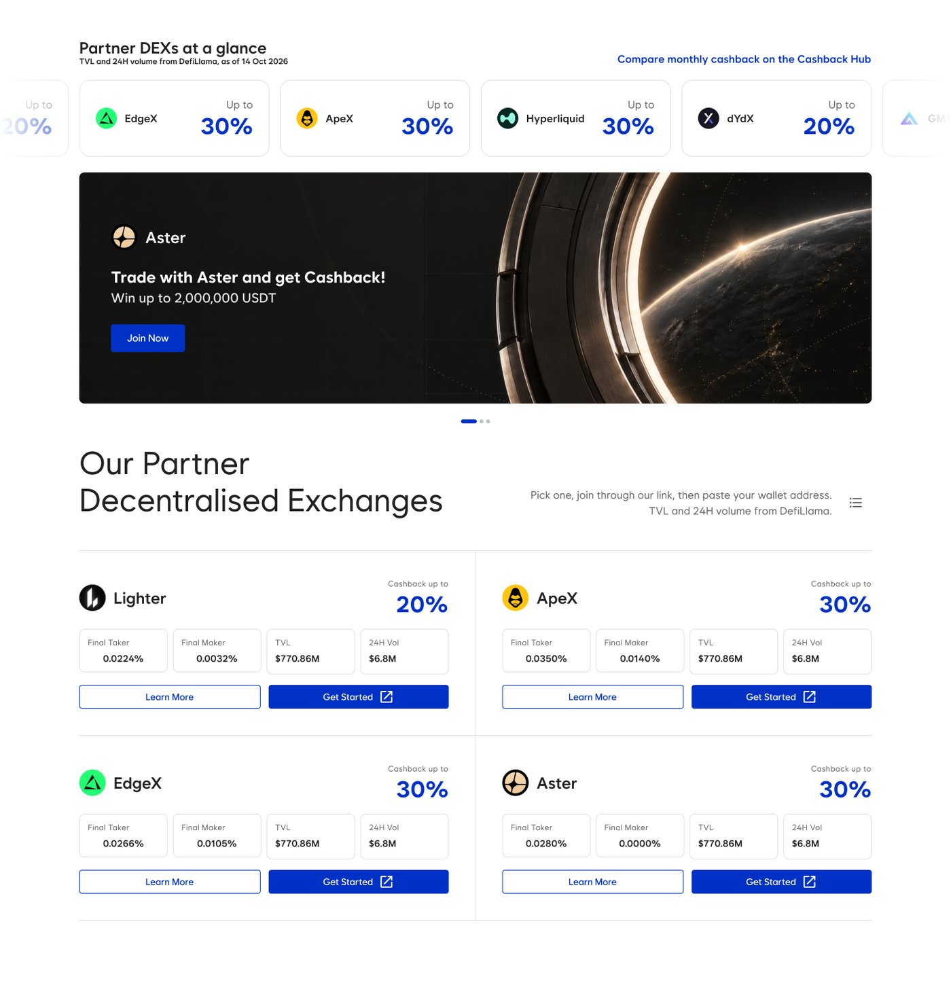

### CT-32. /payback Summary — PC 헤더 · 모바일 `Restart` · 같은 예시값

| 구분 | 내용 |
|---|---|
| 우선 | 3 |
| 지금 | PC [29187:119248](https://www.figma.com/design/hsa3bSV9QmFTe2jsf6tzTm/UI-UX-Design?node-id=29187-119248) 구 GNB(`Exchanges · Events · Benefits · Cashback Preview · Point`). 모바일 [29187:119510](https://www.figma.com/design/hsa3bSV9QmFTe2jsf6tzTm/UI-UX-Design?node-id=29187-119510) `Restart` 없음, `Order Type Ratio` `20% Maker / 80% Taker`(PC `100% Taker`)인데 `Trading Fees 6.30` 같음 |
| 근거 | PC Summary의 `Restart` 버튼 · 새 GNB(CT-01) |
| 수정안 | PC 헤더를 새 GNB로 교체. PC `Restart` 버튼을 모바일 `Start EdgeX Cashback` 위에 복제. 모바일 `Order Type Ratio`를 PC 값 `100% Taker`로 |
| 문구 | `Restart` |
| 새 프레임 | 0 |
| 근거 번호 | REQ-459 · REQ-464 · 결정 A1 |

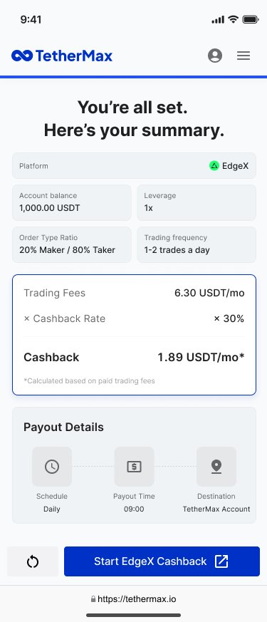

### CT-33. 서비스 소개 · 프리로그인 랜딩 모바일 — DEX판

| 구분 | 내용 |
|---|---|
| 우선 | 3 |
| 지금 | DEX(revision)에 모바일판 없음. 기존 모바일은 DEX 반영 전 |
| 근거 | 서비스 소개 mo [19224:4458](https://www.figma.com/design/hsa3bSV9QmFTe2jsf6tzTm/UI-UX-Design?node-id=19224-4458)(A9 — 다크 짝 19224:5152) · Renewal `update clause max-1208` mWeb [20932:96981](https://www.figma.com/design/hsa3bSV9QmFTe2jsf6tzTm/UI-UX-Design?node-id=20932-96981)(A3) |
| 수정안 | 두 노드를 DEX(revision) 서비스 소개 · 랜딩 묶음에 복제하고 PC DEX판([28960:129521](https://www.figma.com/design/hsa3bSV9QmFTe2jsf6tzTm/UI-UX-Design?node-id=28960-129521) · [28960:128375](https://www.figma.com/design/hsa3bSV9QmFTe2jsf6tzTm/UI-UX-Design?node-id=28960-128375))과 같게: 파트너 캐러셀에 DEX 로고, `Our Partners` 탭 `All` · `Exchanges` · `DEXs`, UID 문장을 PC 문구로 |
| 문구 | `link your exchange UID or DEX wallet address` (PC 현행) |
| 새 프레임 | 2 |
| 근거 번호 | REQ-287 · REQ-288 · REQ-715 · G-424 |

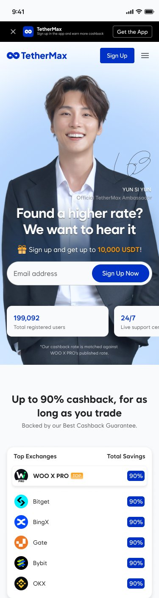

---

## 수정 없음 (현행 디자인 그대로)

| 화면 | 이유 | 근거 번호 |
|---|---|---|
| 모바일 웹 드로어 | 결정 N1 — 최신 Figma 드로어 [19604:33156](https://www.figma.com/design/hsa3bSV9QmFTe2jsf6tzTm/UI-UX-Design?node-id=19604-33156)(게스트) · [19604:32998](https://www.figma.com/design/hsa3bSV9QmFTe2jsf6tzTm/UI-UX-Design?node-id=19604-32998)(회원) 그대로. `Exchanges` 행 = Cashback Hub 이동(개발 인계 메모로만 전달). 회사 행 `Beginner's Guide` 이미 있음 | N1 · REQ-465 · REQ-474 |
| 앱 하단 탭 | `Exchanges` · `Point` 현행 라벨 유지 | D5 · G-215 |
| 앱 필수 업데이트 다이얼로그 | 옛 스타일 유지 [2913:17755](https://www.figma.com/design/hsa3bSV9QmFTe2jsf6tzTm/UI-UX-Design?node-id=2913-17755) | N3 |
| DEX 랜딩 프로모 배너 | 넣는다 — 현 캐러셀 그대로, 관리는 기존 어드민 배너 영역 | D7 · G-156 |
| 404 | [12216:419863](https://www.figma.com/design/hsa3bSV9QmFTe2jsf6tzTm/UI-UX-Design?node-id=12216-419863) · mWeb [12085:401487](https://www.figma.com/design/hsa3bSV9QmFTe2jsf6tzTm/UI-UX-Design?node-id=12085-401487) 그대로(없는 슬러그·비게시 상세 포함) | API-004 |
| 점검 | MAXOP-299 [17000:883](https://www.figma.com/design/hsa3bSV9QmFTe2jsf6tzTm/UI-UX-Design?node-id=17000-883) · [17000:844](https://www.figma.com/design/hsa3bSV9QmFTe2jsf6tzTm/UI-UX-Design?node-id=17000-844) 그대로 | REQ-473 |
| 공지 | DEX 전용 UI 없음 — 카테고리는 운영 입력 | REQ-468 |
| DEX 랜딩 비교 STEP 3 · Learn and Earn 본문 | Figma 자동 지급 문구 채택 | D1 · G-158 |

화면 디자인이 필요 없는 상태(리다이렉트 301, 배너 0개 미렌더, 자격 안내 비면 숨김, 리뷰 401 후 복귀, 앱 미지원 페이지의 인앱 브라우저, 결정 대기 G-163 · G-164 · G-166 · G-172 · G-174 · G-213)는 인수 조건으로 검증하고 이 계획에 넣지 않았다.
