# Figma 수정 계획 — 거래 계정 연동 (link)

2026-11-26 · 대상 [DEX(revision)](https://www.figma.com/design/hsa3bSV9QmFTe2jsf6tzTm/UI-UX-Design?node-id=28960-125519) · 범위: 비회원 조회 · 연동 · 소유권 · CEX UID 연동 · 입력 [디자인_상태점검_link.md](디자인_상태점검_link.md) 디자이너 요청 37건 · [DEX_revision_화면상태_재점검.md](DEX_revision_화면상태_재점검.md) · 결정 [_Figma수정_결정.md](_Figma수정_결정.md) · [이어받기_dex10](../_프로토타입_전체/ref/이어받기_dex10_20261126.md)(G-428)

**Figma는 아직 수정하지 않았다.** 아래는 승인용 계획이며 캡처는 읽기 전용으로 받았다.

## 요약

| 항목 | 값 |
|---|---|
| 계획 항목 | **28건** — 우선 1: 3 · 우선 2: 17 · 우선 3: 8 |
| 새 프레임 | **28개**(모두 기존 프레임 복제 + 문구 교체) |
| 문구만 바꾸는 항목 | **11건**(L-02 · L-05 · L-08 · L-13 · L-14 · L-15 · L-20 · L-21 · L-23 · L-25 · L-28) |
| 문구 원문 없음(문구표 확정 대기) | 3건 — L-07 연동 전 출금 대기 문구 · L-10 목록 로드 실패 안내문 · L-27 게스트 10 USDT 미만 문구 |
| 근거 없음 — 사용자 확인(계획에서 제외) | **6건** — 아래 표 |
| 결정으로 수정하지 않는 요청 | 요청 #2 업로드 한도(결정: 1GB 유지) |

### 근거 없음 — 사용자 확인 (계획에서 제외)

| 점검 요청 | 화면 | 없는 것 | 확인할 것 |
|---|---|---|---|
| #3 (우선 1) | 웹 연동 입력 단계 L1~L5 · S3-4 · S4-3 | REQ-712 「현행 꽉 찬(전체 화면) 모달」의 기존 Figma 디자인. 기존 [MAX-30] Web은 홈 위 부분 모달([9105:196091](https://www.figma.com/design/hsa3bSV9QmFTe2jsf6tzTm/UI-UX-Design?node-id=9105-196091))이고 전체 화면은 결과 스플래시(MAXOP-751 Desktop)뿐 | 따라 할 꽉 찬 입력 모달 디자인(또는 STG 화면 캡처)을 근거로 줄지 |
| #21 | 웹 `/uidlinking` 진입 질문 | `Have you registered…` · `Yes, I have one!` / `No, not yet!` 화면이 [MAX-30]·DEX(revision) 어디에도 없음 | #3과 같은 근거 |
| #10 중 스크립트 로드 실패 | L5 퍼즐 | 캡차 스크립트 로드 실패 인라인 오류 + `Retry` 디자인·문구 원문(A-13 ❓ 권고, G-098 미정) | G-098 결정 후 문구 |
| #18 중 CEX UID 형식 오류 | 게스트 조회 · CEX 연동 폼 | UID 형식 오류 문구 원문·기존 디자인([MAX-30]에도 없음) | 기존 CEX 오류 문구 원본 |
| #34 | L2 Lighter 가이드 스크린샷 | `Connect Wallet`을 가리키지 않는 대체 캡처 원본(운영 콘텐츠 예시) | 대체 이미지 제공 여부 |
| #35 | L2 `Paste` 권한 거부 힌트 | 문구 원문(❓ 권고)·기존 디자인 | 상태를 둘지 |

명세 누락 후보(API-007 409 `IDEMPOTENCY_KEY_REUSED` · 429 · 500 · 503, API-006 실패)와 미정 G-434 · G-435(소유권 중복 신청 · 확인 중 지갑 신청)는 사용자 표시가 정해지지 않아 계획에 넣지 않았다.

### 점검 요청 → 계획 항목

| 점검 요청 # | 계획 | 점검 요청 # | 계획 |
|---|---|---|---|
| 1 | L-01 | 20 | L-18 |
| 2 | 결정(1GB 유지)으로 수정 없음 | 21 | 근거 없음 |
| 3 | 근거 없음 | 22 | L-20(미사용 표시) · L-07(CEX 문구) |
| 4 | L-04 | 23 | L-19 |
| 5 | L-05 | 24 | L-21 |
| 6 | L-06 | 25 | L-02 |
| 7 | L-07 | 26 | L-22 |
| 8 | L-08 | 27 | L-23 |
| 9 | L-09 | 28 | 모바일 승인 다이얼로그 [28982:126268](https://www.figma.com/design/hsa3bSV9QmFTe2jsf6tzTm/UI-UX-Design?node-id=28982-126268)에 `Lighter Wallet 0x7a3f…51e9`가 들어 있음 — 계획 없음 |
| 10 | L-03(퍼즐 실패) · 근거 없음(스크립트) | 29 | L-24 |
| 11 | L-03 | 30 | L-25 |
| 12 | L-10 | 31 | L-13 |
| 13 | L-11 | 32 | L-26(모바일 All 목록 `DEX` 표기는 [28969:126953](https://www.figma.com/design/hsa3bSV9QmFTe2jsf6tzTm/UI-UX-Design?node-id=28969-126953)에 있음) |
| 14 | L-12 | 33 | L-27 |
| 15 | L-13 | 34 | 근거 없음 |
| 16 | L-14 | 35 | 근거 없음 |
| 17 | L-15 | 36 | L-28 |
| 18 | L-16 · 근거 없음(CEX) | 37 | L-20(결정 N5·N10: CEX도 공용 `Account` 결과) |
| 19 | L-17 | | |

### 기준이 되는 기존 디자인(현행 판)

| 기존 디자인 | 노드 | 현행 판 근거 |
|---|---|---|
| [MAXOP-751] 연동 결과 스플래시 `UID link result / Splash`(Severity × Platform) | [25960:1342528](https://www.figma.com/design/hsa3bSV9QmFTe2jsf6tzTm/UI-UX-Design?node-id=25960-1342528) | 카탈로그 B 판 비교 #7 — 2026-09-30, DEX(revision)이 인스턴스로 사용. 버튼 기본값 `Back to Home` + `Need help? Contact Support`(현행판 확인 B10) |
| [MAX-30] Link UID(mWeb 페이지 · Web 모달 · 선택 시트) | [9287:170253](https://www.figma.com/design/hsa3bSV9QmFTe2jsf6tzTm/UI-UX-Design?node-id=9287-170253) · [9287:180087](https://www.figma.com/design/hsa3bSV9QmFTe2jsf6tzTm/UI-UX-Design?node-id=9287-180087) | 카탈로그 B 판 비교 #5·#6 |
| [MAX-561] Ownership Verification | [12874:29936](https://www.figma.com/design/hsa3bSV9QmFTe2jsf6tzTm/UI-UX-Design?node-id=12874-29936) | 카탈로그 B 7절 — 단일 판(흐린 상세 2화면은 폐기, 현행판 확인 B8) |
| [MAX 1216] CMT-05 Inline messages · S9 List failed | [22934:77485](https://www.figma.com/design/hsa3bSV9QmFTe2jsf6tzTm/UI-UX-Design?node-id=22934-77485) · [22442:219848](https://www.figma.com/design/hsa3bSV9QmFTe2jsf6tzTm/UI-UX-Design?node-id=22442-219848) | 카탈로그 B 2절 상태 컴포넌트 |

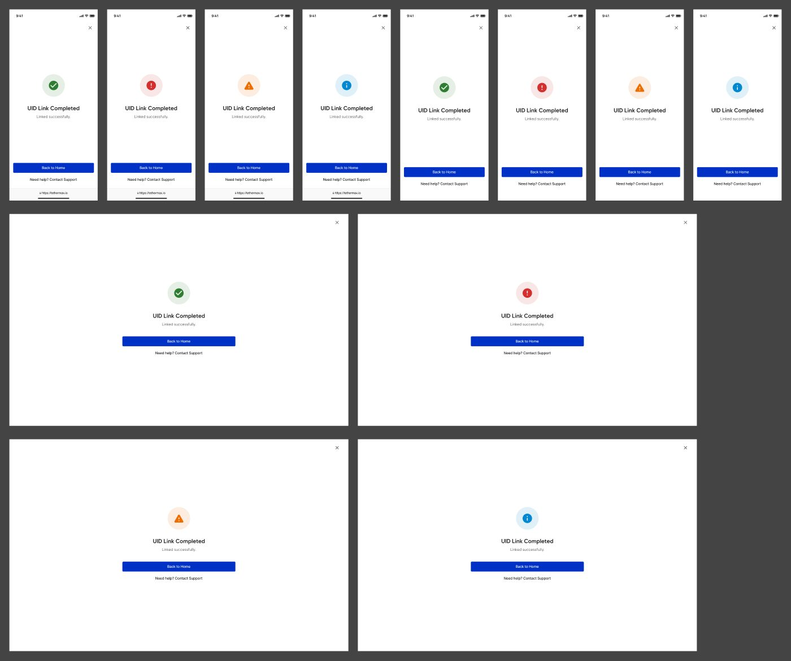

---

## 우선 1

### L-01. 연동 폼·결과 — Lighter Standard 경고 제거

| 구분 | 내용 |
|---|---|
| 우선 | 1 (정책 위반 — Standard도 경고·차단 없이 연동) |
| 지금 | PC [L10 28960:127309](https://www.figma.com/design/hsa3bSV9QmFTe2jsf6tzTm/UI-UX-Design?node-id=28960-127309): 주소 입력 폼 안 주황 경고 박스 `Standard accounts pay no trading fees, so they earn no cashback. Upgrade to Plus or Premium on Lighter to earn cashback.` · 모바일 [라이트 28969:127146](https://www.figma.com/design/hsa3bSV9QmFTe2jsf6tzTm/UI-UX-Design?node-id=28969-127146) · [다크 28969:127353](https://www.figma.com/design/hsa3bSV9QmFTe2jsf6tzTm/UI-UX-Design?node-id=28969-127353): 결과 화면 `Lighter Standard` / `Standard accounts pay no trading fees. Cashback is available on eligible paid tiers.` / `Continue` |
| 근거 | 같은 폼의 경고 없는 상태 [L3 28960:127279](https://www.figma.com/design/hsa3bSV9QmFTe2jsf6tzTm/UI-UX-Design?node-id=28960-127279). 기존 [MAX-30] 연동 흐름에도 계정 등급 경고 화면 없음 |
| 수정안 | ① L10의 경고 박스 레이어 삭제 — L10은 L3과 같은 구성이 되므로 프레임 자체를 숨김 처리(연동 흐름 목록에서 제외) ② 모바일 `Lighter Standard` 라이트·다크 프레임 숨김. 새 프레임 없음. Standard 안내는 DEX 상세 히어로 자격 안내(`Additional Notes`, G-440)에만 남긴다 |
| 근거 번호 | REQ-116 · 정책 5-9 · C-12 |

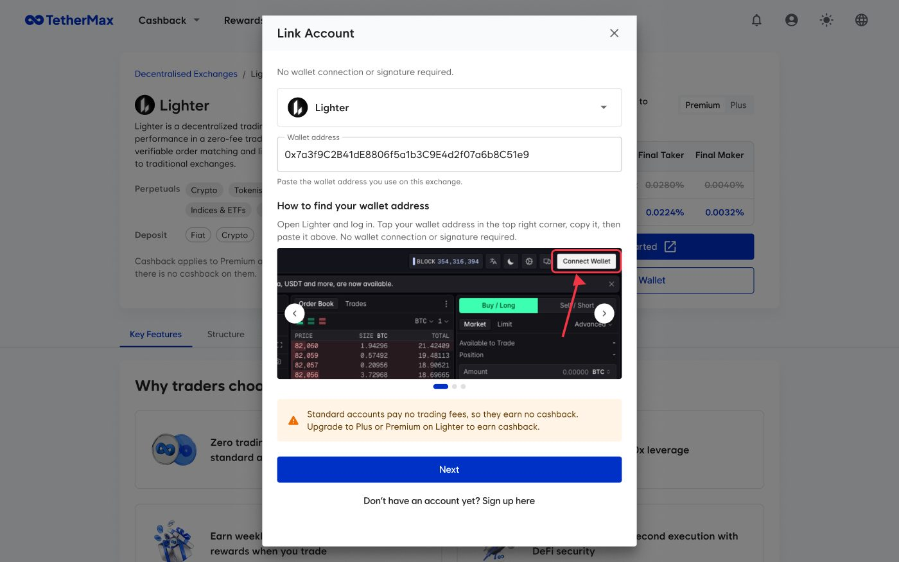
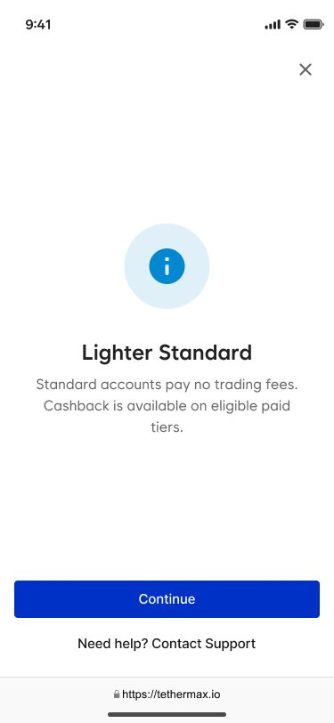
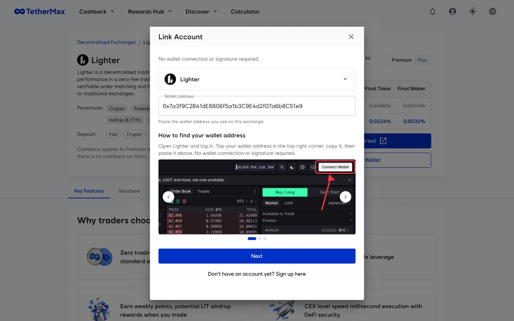

### L-02. 연동 성공 정산 카드 — Lighter `Weekly` → `Daily`

| 구분 | 내용 |
|---|---|
| 우선 | 1 (G-428로 정책 위반 — DEX 4곳 모두 일 1회) |
| 지금 | PC [L7 28960:127297](https://www.figma.com/design/hsa3bSV9QmFTe2jsf6tzTm/UI-UX-Design?node-id=28960-127297) · [S4-5 28960:127861](https://www.figma.com/design/hsa3bSV9QmFTe2jsf6tzTm/UI-UX-Design?node-id=28960-127861): `Weekly · Next update 26.11.30 09:00` · 모바일 [28969:127101](https://www.figma.com/design/hsa3bSV9QmFTe2jsf6tzTm/UI-UX-Design?node-id=28969-127101): `Weekly settlement · Monday`(다음 업데이트 시각 없음) |
| 근거 | PC L7 정산 줄 형식(`{주기} · Next update {로컬 시각}`) · MAXOP-751 Success 스플래시 |
| 수정안 | 문구만: PC 두 프레임 `Weekly` → `Daily`. 모바일 `Weekly settlement · Monday` → PC와 같은 형식 `Daily · Next update 26.11.27 09:00`(표본 값, 타임존 라벨 없음). 모바일 다크 사본도 같게 |
| 근거 번호 | REQ-095 · G-428 · 요청 #25 |

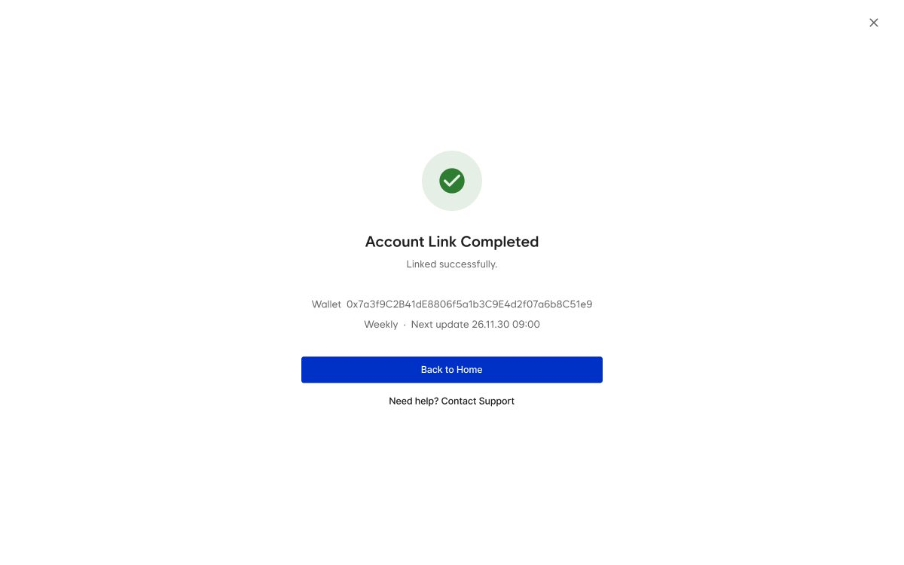
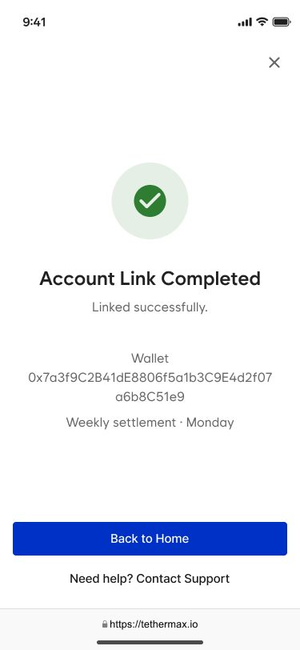

### L-03. 주소 입력 — 결과 닫은 뒤·재로그인 뒤 입력 유지, 퍼즐 실패 후 재시도

| 구분 | 내용 |
|---|---|
| 우선 | 1 (재점검 우선 1 — 보이는 프레임에 근거 없음, 숨김 보드에만 있음) |
| 지금 | 입력 완료 [L3 28960:127279](https://www.figma.com/design/hsa3bSV9QmFTe2jsf6tzTm/UI-UX-Design?node-id=28960-127279) · 퍼즐 [L5 28960:127287](https://www.figma.com/design/hsa3bSV9QmFTe2jsf6tzTm/UI-UX-Design?node-id=28960-127287) · 모바일 [28969:126996](https://www.figma.com/design/hsa3bSV9QmFTe2jsf6tzTm/UI-UX-Design?node-id=28969-126996) · [28969:127016](https://www.figma.com/design/hsa3bSV9QmFTe2jsf6tzTm/UI-UX-Design?node-id=28969-127016). 복귀 상태 프레임 없음 |
| 근거 | L3(선택 거래소 + 입력 주소 + `Next` 활성) · 기존 [MAX-30] Web 입력 모달 [9105:196091](https://www.figma.com/design/hsa3bSV9QmFTe2jsf6tzTm/UI-UX-Design?node-id=9105-196091)(UID 입력 유지 상태) |
| 수정안 | ① L3 복제 → L3 오른쪽에 `L3-R Return — input kept`(PC), 28969:126996 복제 → 오른쪽에 같은 이름(모바일). 내용은 L3과 같고, 프레임 위 기존 라벨 컴포넌트로 「결과 `Close` · 세션 만료(401) 재로그인 · 새로고침 뒤 복귀: 거래소·주소 유지, 같은 단계」를 적는다 ② 퍼즐 실패(422 `CAPTCHA_FAILED`)는 L5 재사용 — 연동 입력 메모 [29010:126471](https://www.figma.com/design/hsa3bSV9QmFTe2jsf6tzTm/UI-UX-Design?node-id=29010-126471)에 「퍼즐 실패·토큰 만료 → 주소 유지, 새 퍼즐(L5). 시도 횟수 한도 다이얼로그 없음」 한 줄 추가. 문구: 화면 문구 변경 없음 |
| 근거 번호 | REQ-064 · REQ-072 · G-380 · G-063 · A-13 · API-007 · 요청 #10 · #11 |
| 새 프레임 | 2 |

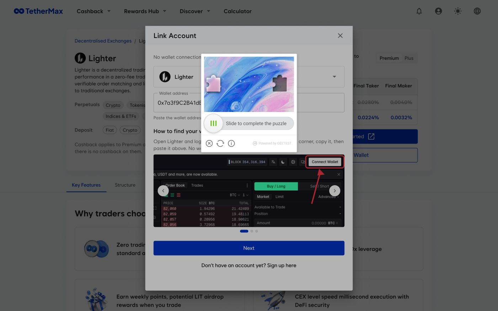
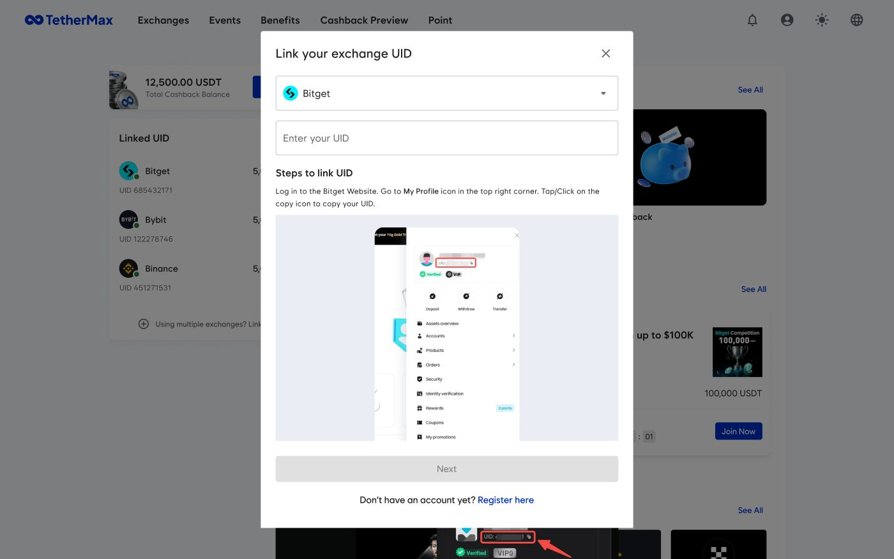

---

## 우선 2

### L-04. 연동 결과 — 한도 초과 문구·버튼

| 구분 | 내용 |
|---|---|
| 우선 | 2 |
| 지금 | PC [L15 28960:127349](https://www.figma.com/design/hsa3bSV9QmFTe2jsf6tzTm/UI-UX-Design?node-id=28960-127349) · [S4-F2 28960:127882](https://www.figma.com/design/hsa3bSV9QmFTe2jsf6tzTm/UI-UX-Design?node-id=28960-127882) · 모바일 [라이트 28969:127118](https://www.figma.com/design/hsa3bSV9QmFTe2jsf6tzTm/UI-UX-Design?node-id=28969-127118) · [다크 28969:127325](https://www.figma.com/design/hsa3bSV9QmFTe2jsf6tzTm/UI-UX-Design?node-id=28969-127325): `Trading account limit reached` / `You can link up to 12 trading accounts.` / `Close` + `Need help? Contact Support` |
| 근거 | MAXOP-751 Warning 스플래시(위 캡처) · 같은 페이지 기타 실패 모바일 [28969:127153](https://www.figma.com/design/hsa3bSV9QmFTe2jsf6tzTm/UI-UX-Design?node-id=28969-127153)(주 버튼 `Contact Support` 하나, 하단 링크 없음) · 기존 [MAX-30] `You've reached your UID limit`([13992:388676](https://www.figma.com/design/hsa3bSV9QmFTe2jsf6tzTm/UI-UX-Design?node-id=13992-388676)) |
| 수정안 | 본문 `You've linked the maximum number of accounts ({n}).`(국문 `연동할 수 있는 거래 계정을 모두 사용했어요 ({n}개)`) · 주 버튼 `Close` → `Contact Support` · 하단 `Need help? Contact Support` 레이어 삭제(28969:127153과 같은 배치). 제목은 그대로 둔다(제목 원문 없음) |
| 근거 번호 | G-091 · REQ-112 · 정책 5-7 |

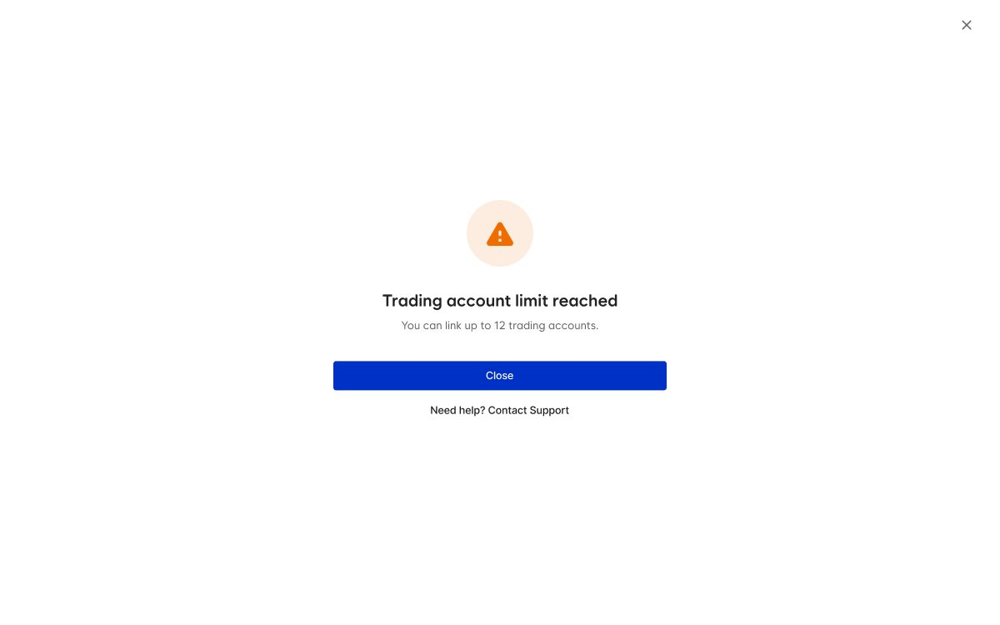
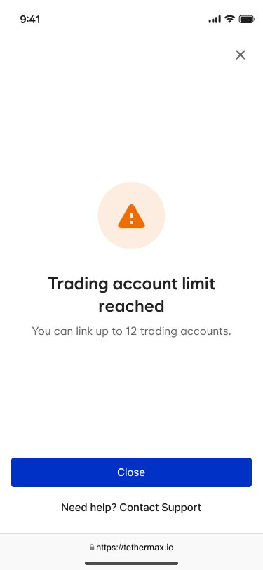
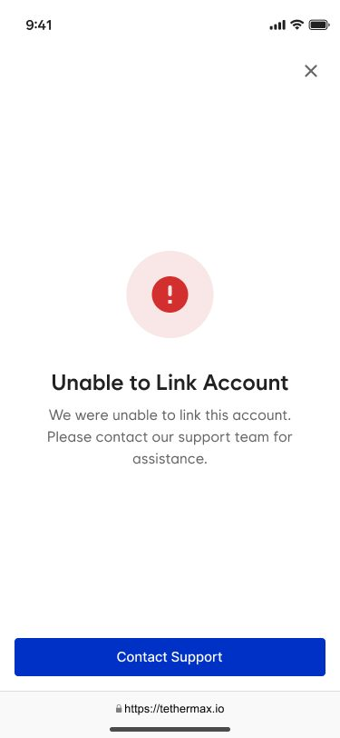
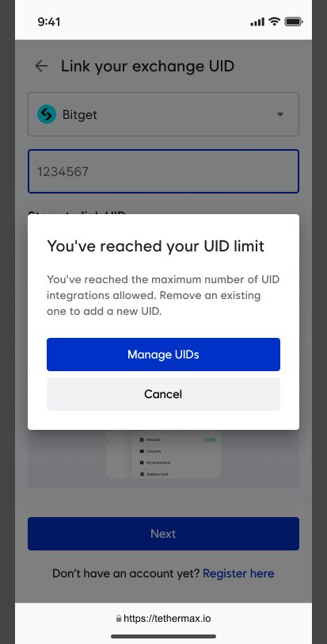

### L-05. 연동 결과 — 확인 중 대기 안내 문구

| 구분 | 내용 |
|---|---|
| 우선 | 2 |
| 지금 | PC [L11 28960:127313](https://www.figma.com/design/hsa3bSV9QmFTe2jsf6tzTm/UI-UX-Design?node-id=28960-127313) · [S4-F7 28960:127912](https://www.figma.com/design/hsa3bSV9QmFTe2jsf6tzTm/UI-UX-Design?node-id=28960-127912) · 모바일 [라이트 28969:127080](https://www.figma.com/design/hsa3bSV9QmFTe2jsf6tzTm/UI-UX-Design?node-id=28969-127080) · [다크 28969:127287](https://www.figma.com/design/hsa3bSV9QmFTe2jsf6tzTm/UI-UX-Design?node-id=28969-127287): `Checking Your Referral` / `We’ll notify you once your exchange confirms your referral.` |
| 근거 | MAXOP-751 Info 스플래시 |
| 수정안 | 문구만: 제목 `We're checking your account link` · 본문 `We'll let you know the result after checking the exchange's referral records.` 버튼 `Back to Home` 유지, 경과 시간 표시 없음 |
| 근거 번호 | G-094 · REQ-100 · A-17 |

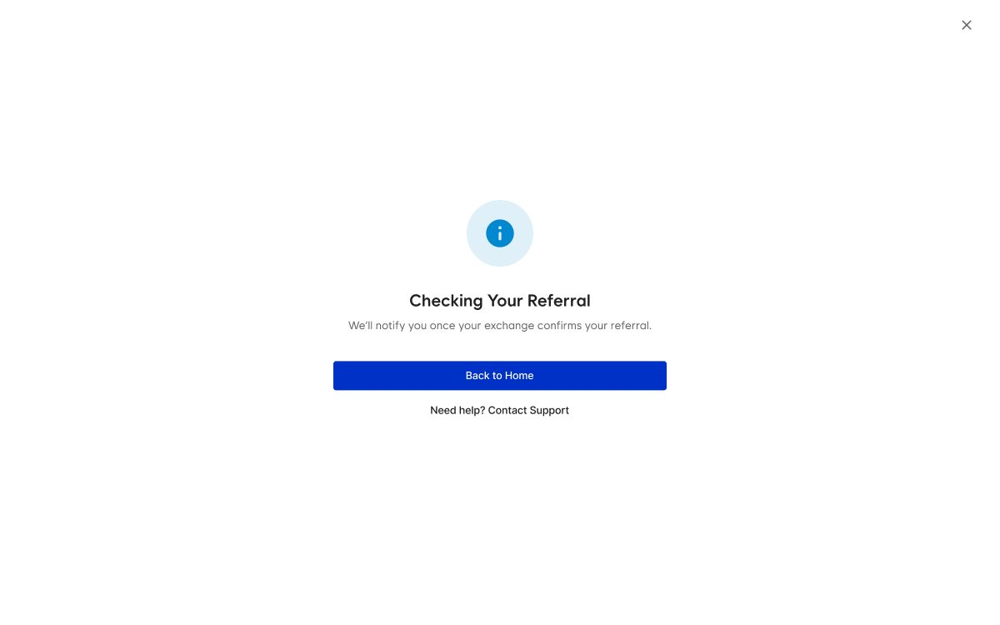
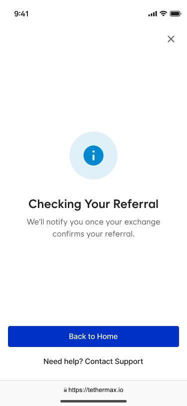

### L-06. 연동 결과 — 처리 중(L6)과 확인 중(L11) 순서 정리, 모바일 처리 중 추가

| 구분 | 내용 |
|---|---|
| 우선 | 2 |
| 지금 | PC [L6 28960:127293](https://www.figma.com/design/hsa3bSV9QmFTe2jsf6tzTm/UI-UX-Design?node-id=28960-127293) `Processing Your Account` / `Your account is being processed. You'll be notified once linking is complete.` · [S3-F5 28960:127828](https://www.figma.com/design/hsa3bSV9QmFTe2jsf6tzTm/UI-UX-Design?node-id=28960-127828). 모바일에는 L6 대응 프레임 없음 |
| 근거 | MAXOP-751 Info 스플래시 · 모바일 확인 중 [28969:127080](https://www.figma.com/design/hsa3bSV9QmFTe2jsf6tzTm/UI-UX-Design?node-id=28969-127080) |
| 수정안 | ① 순서를 L6(요청 대기, 최소 1초) → 응답별 결과(201 `PROCESSING`·`PARTNER_LOOKUP`이면 L11)로 정하고, L6 프레임 이름에 `L6 Processing (request wait ≥1s)`, L11에 `L11 Checking (PROCESSING · PARTNER_LOOKUP)`를 붙인다 ② 모바일: 28969:127080 복제 → 왼쪽에 `Processing Your Account`, 문구 REQ-091 원문(`Processing Your Account` / `Your account is being processed. You'll be notified once linking is complete.` / `Back to Home`) |
| 근거 번호 | REQ-091 · REQ-100 · G-094 |
| 새 프레임 | 1 |

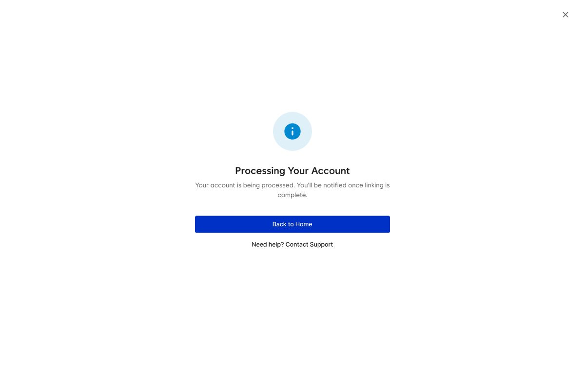

### L-07. 연동 결과 — 연동 전 잔액 출금 대기(금액 표시) · CEX용 문구

| 구분 | 내용 |
|---|---|
| 우선 | 2 |
| 지금 | PC [28966:124158](https://www.figma.com/design/hsa3bSV9QmFTe2jsf6tzTm/UI-UX-Design?node-id=28966-124158) · 모바일 [28969:127087](https://www.figma.com/design/hsa3bSV9QmFTe2jsf6tzTm/UI-UX-Design?node-id=28969-127087): `Processing Your Account` / `Your existing cashback is being paid to this wallet. Linking completes when the transfer is confirmed.` — 금액(`prelinkPayoutAmount`) 없음, CEX UID에도 `this wallet` |
| 근거 | MAXOP-751 Info 스플래시(본문 텍스트 1개) — 금액은 본문 문장 안에 넣으면 새 모양이 필요 없음 |
| 수정안 | **문구 원문 없음**(G-426 「문구표에서 확정」 — 문구표 원본 없음). 문구표가 나오면 본문 텍스트만 교체(금액 포함 문장 · 계정 중립 표기). 출금 실패 [28966:124162](https://www.figma.com/design/hsa3bSV9QmFTe2jsf6tzTm/UI-UX-Design?node-id=28966-124162) · [28969:127094](https://www.figma.com/design/hsa3bSV9QmFTe2jsf6tzTm/UI-UX-Design?node-id=28969-127094)도 같은 문구표로 대조 |
| 근거 번호 | REQ-107 · REQ-108 · A-19 · G-426 · 요청 #7 · #22 |

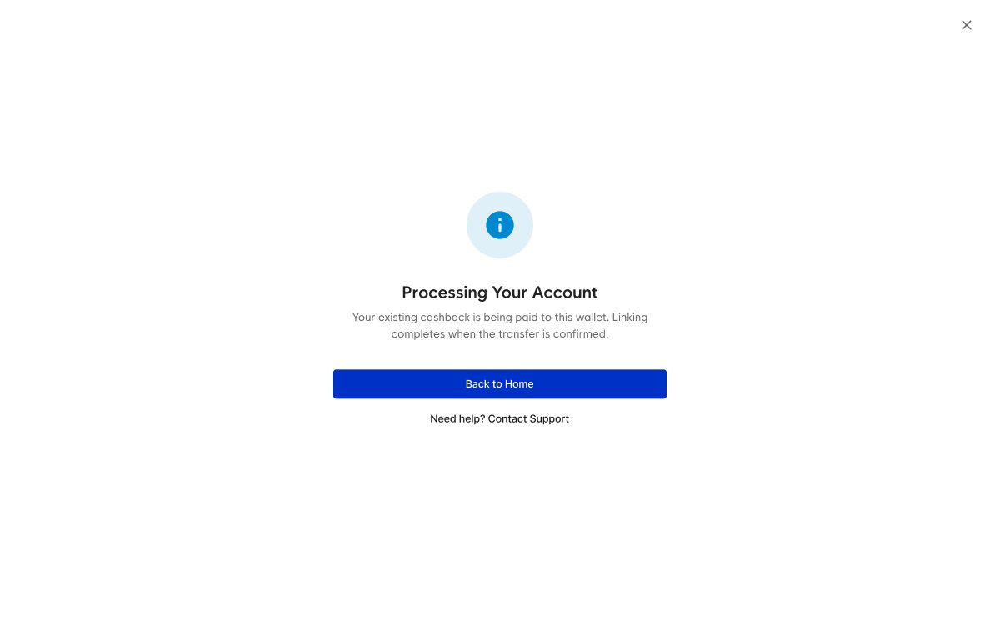
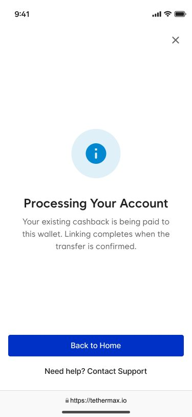

### L-08. 주소 입력 가이드 — 보안 문구

| 구분 | 내용 |
|---|---|
| 우선 | 2 |
| 지금 | PC [L2 28960:127275](https://www.figma.com/design/hsa3bSV9QmFTe2jsf6tzTm/UI-UX-Design?node-id=28960-127275)(L1~L5 · L10 · 28980:132144~132389 · S3-4 · S4-3 · Aster [29020:205838](https://www.figma.com/design/hsa3bSV9QmFTe2jsf6tzTm/UI-UX-Design?node-id=29020-205838) 공통 가이드 블록): `… No wallet connection or signature required.`만 있음 · 모바일 [28969:126986](https://www.figma.com/design/hsa3bSV9QmFTe2jsf6tzTm/UI-UX-Design?node-id=28969-126986)(28969:126996 · 127006 공통): `TetherMax never asks for your private key, recovery phrase, or wallet signature.` |
| 근거 | 모바일 가이드 본문 끝 문장 위치(같은 텍스트 레이어) |
| 수정안 | 문구만: 가이드 본문 끝 문장을 `TetherMax never asks for your private key, seed phrase, or a wallet signature.`로 — PC는 기존 문장 뒤에 이어 붙이고, 모바일은 `…recovery phrase, or wallet signature.` 문장을 교체. 가이드 블록이 인스턴스면 메인 컴포넌트 한 곳만 고친다 |
| 근거 번호 | G-392 · REQ-071 |

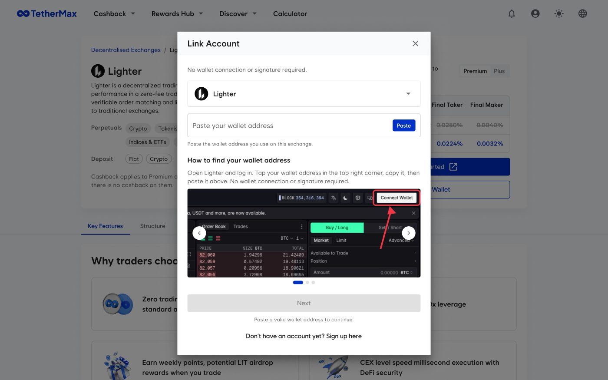
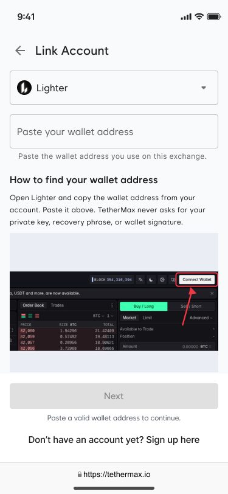

### L-09. 주소 입력 — 인라인 오류 상태 추가

| 구분 | 내용 |
|---|---|
| 우선 | 2 |
| 지금 | PC 인라인 오류 보드 [28980:132144](https://www.figma.com/design/hsa3bSV9QmFTe2jsf6tzTm/UI-UX-Design?node-id=28980-132144)~[28980:132389](https://www.figma.com/design/hsa3bSV9QmFTe2jsf6tzTm/UI-UX-Design?node-id=28980-132389)에 5종, `ADDRESS_WRONG_FORMAT_FOR_DEX` 없음 · 모바일은 공백 오류 [28969:127006](https://www.figma.com/design/hsa3bSV9QmFTe2jsf6tzTm/UI-UX-Design?node-id=28969-127006) 1종만 |
| 근거 | PC `Space within the address` [28980:132242](https://www.figma.com/design/hsa3bSV9QmFTe2jsf6tzTm/UI-UX-Design?node-id=28980-132242)(빨간 테두리 + 필드 아래 문구, `Next` 비활성) · 기존 [MAX 1216] CMT-05 Inline messages(MUI FormHelperText) |
| 수정안 | ① PC: 28980:132242 복제 → 28980:132389 오른쪽에 `Unsupported format`, 오류 문구 `This address is not supported for the selected exchange.` ② 모바일: 28969:127006 복제 5개 → 오른쪽에 차례로 `Empty`(`Enter your wallet address.`) · `Unsupported format`(위 문구) · `Couldn't verify`(`We couldn’t verify this wallet address. Copy it again from the exchange.`) · `Name instead of address`(`Paste the wallet address, not an account name.`) · `Zero address`(`This address can't be linked.`). 입력값은 PC 같은 상태 프레임의 표본을 쓴다 |
| 근거 번호 | A-12 · REQ-067 · API-007 422 |
| 새 프레임 | 6 |

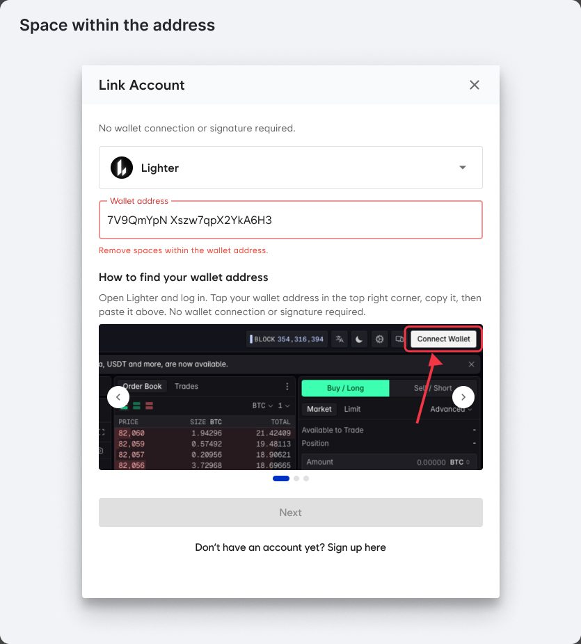
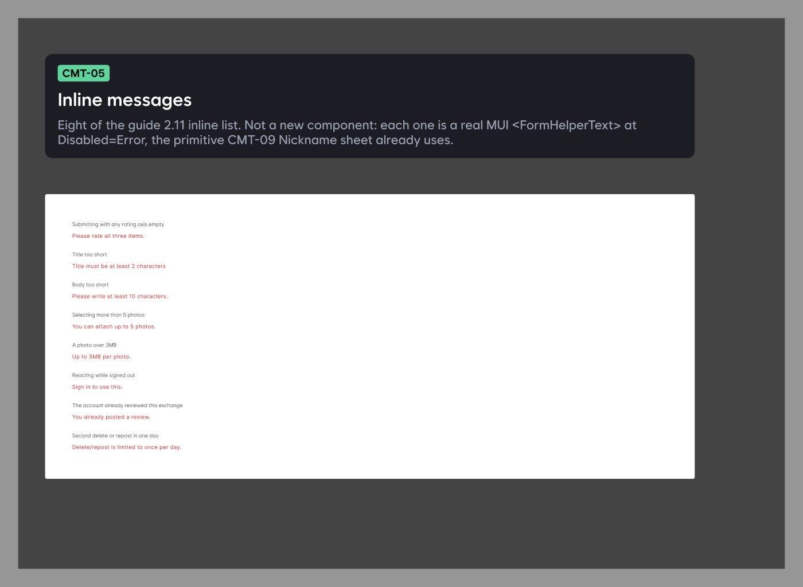

### L-10. 거래소 선택기 — 파트너 목록 로드 실패(캐시 없음)

| 구분 | 내용 |
|---|---|
| 우선 | 2 |
| 지금 | 선택기 열림 PC [L1 28960:127271](https://www.figma.com/design/hsa3bSV9QmFTe2jsf6tzTm/UI-UX-Design?node-id=28960-127271) · 모바일 [28969:126953](https://www.figma.com/design/hsa3bSV9QmFTe2jsf6tzTm/UI-UX-Design?node-id=28969-126953). 실패 상태 없음(숨김 보드 S5_05에만) |
| 근거 | 기존 [MAX 1216] S9 List failed [22442:219848](https://www.figma.com/design/hsa3bSV9QmFTe2jsf6tzTm/UI-UX-Design?node-id=22442-219848): 주황 경고 바(`Reviews didn’t load.`) + 외곽선 버튼 `Try again` |
| 수정안 | L1 · 28969:126953 복제 → 각 오른쪽에 `Partner list failed`. 검색창·칩은 두고 `Top Partner Exchanges`와 목록을 숨긴 뒤, S9의 경고 바 + 외곽선 버튼 인스턴스를 복사해 넣는다. 버튼 문구 `Retry`. 경고 바 안내문은 **문구 원문 없음** |
| 근거 번호 | G-097 · REQ-059 · API-001 503 |
| 새 프레임 | 2 |

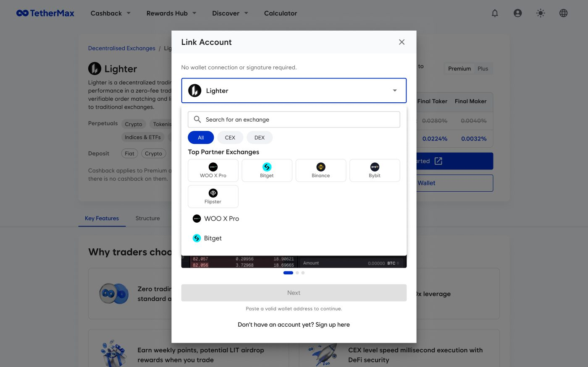
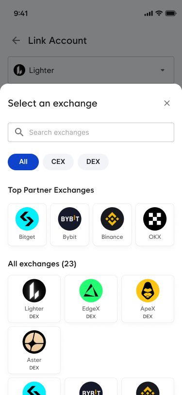
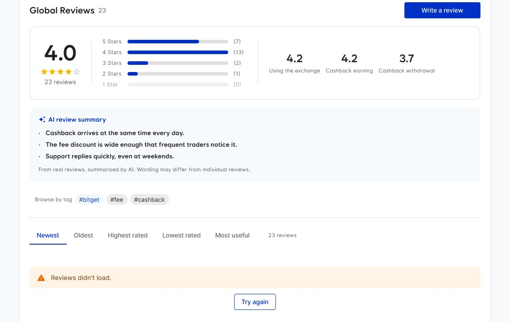

### L-11. 연동 성공 — `Cashback shown from {date}` 줄

| 구분 | 내용 |
|---|---|
| 우선 | 2 |
| 지금 | PC [L7 28960:127297](https://www.figma.com/design/hsa3bSV9QmFTe2jsf6tzTm/UI-UX-Design?node-id=28960-127297) · 모바일 [28969:127101](https://www.figma.com/design/hsa3bSV9QmFTe2jsf6tzTm/UI-UX-Design?node-id=28969-127101) — 180일로 잘린 경우의 줄 없음 |
| 근거 | L7 정산 카드의 보조 텍스트 줄(같은 스타일) · MAXOP-751 Success 스플래시 |
| 수정안 | L7 · 28969:127101 복제(L-02 반영 뒤) → 각 오른쪽에 `L7-B Cashback shown from`. 정산 줄 아래에 같은 텍스트 스타일로 `Cashback shown from 2026-05-30`(표본) 한 줄 추가 |
| 근거 번호 | REQ-119 · A-16 · API-007 `cashbackShownFrom` |
| 새 프레임 | 2 |

### L-12. 홈 Linked Accounts — 확인 중 행 · `Inactive` 행 · 칩 자리표시

| 구분 | 내용 |
|---|---|
| 우선 | 2 |
| 지금 | 홈 행에 확인 중(`연동 시도중이에요`)·오프보딩 `Inactive` 상태 없음. [O11 28960:127709](https://www.figma.com/design/hsa3bSV9QmFTe2jsf6tzTm/UI-UX-Design?node-id=28960-127709) 행 칩에 자리표시 문구 `Chip`이 그대로 보임 |
| 근거 | O11 행(금액 `-` + 상태 칩) · 기존 [MAX-561] 홈 행 [12792:2788](https://www.figma.com/design/hsa3bSV9QmFTe2jsf6tzTm/UI-UX-Design?node-id=12792-2788)(금액 `-` + 진행 안내) |
| 수정안 | ① S4 홈 [S4-6 28960:127867](https://www.figma.com/design/hsa3bSV9QmFTe2jsf6tzTm/UI-UX-Design?node-id=28960-127867) 복제 → 오른쪽에 `S4-P Checking · Inactive rows`. Linked Accounts 행 인스턴스를 복제해 2행 추가: (a) 확인 중 — 금액 `-`, 칩 `연동 시도중이에요`, 경과 시간·안내 바 없음 (b) 오프보딩 — 칩 `Inactive`, 금액은 마지막 값 유지 ② 모바일 홈 S4 프레임도 같은 방식으로 1개 ③ O11의 칩 `Chip` → `소유 확인중`(Lighter 행). 영문 칩 문구는 **문구 원문 없음**(국문 상태 라벨만 확정) |
| 근거 번호 | REQ-098 · REQ-121 · REQ-272 · REQ-273 · REQ-728 · API-008 |
| 새 프레임 | 2 |

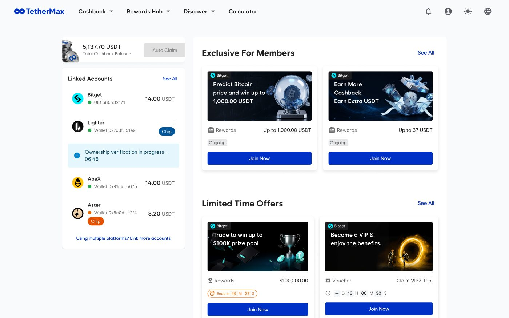
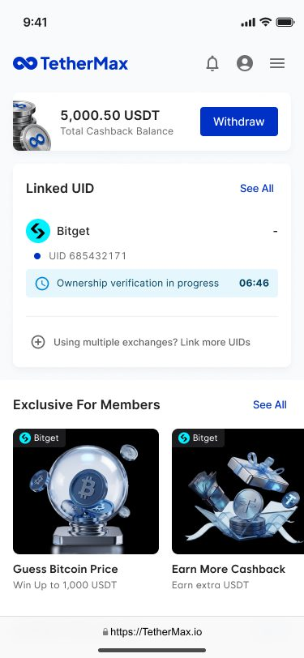

### L-13. CEX UID 연동 폼 — 제목 `Link Account` · 가입 링크 `Sign up here`

| 구분 | 내용 |
|---|---|
| 우선 | 2 (가입 링크는 요청 #31 우선 3을 같은 프레임이라 묶음) |
| 지금 | PC [29227:120903](https://www.figma.com/design/hsa3bSV9QmFTe2jsf6tzTm/UI-UX-Design?node-id=29227-120903) · 모바일 [29051:100488](https://www.figma.com/design/hsa3bSV9QmFTe2jsf6tzTm/UI-UX-Design?node-id=29051-100488) · 모바일 선택 시트 뒤 폼 [28969:126953](https://www.figma.com/design/hsa3bSV9QmFTe2jsf6tzTm/UI-UX-Design?node-id=28969-126953): 제목 `Link your exchange UID`, 링크 `Don't have an account yet? Register here` |
| 근거 | 같은 페이지 DEX 폼 [28969:126986](https://www.figma.com/design/hsa3bSV9QmFTe2jsf6tzTm/UI-UX-Design?node-id=28969-126986) — `Link Account` · `Don’t have an account yet? Sign up here` |
| 수정안 | 문구만: 제목 → `Link Account`, 링크 → `Don’t have an account yet? Sign up here`. `Enter your UID` · `Steps to link UID`는 CEX 전용 입력이라 그대로 |
| 근거 번호 | REQ-054 · REQ-053 · 결정 N10 |

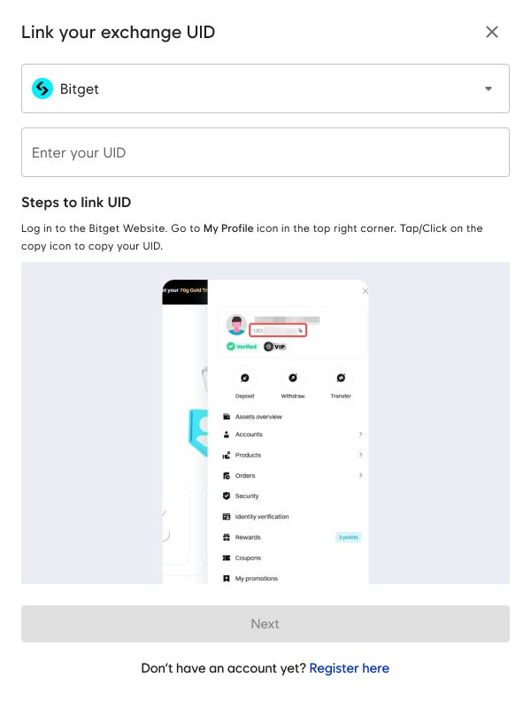
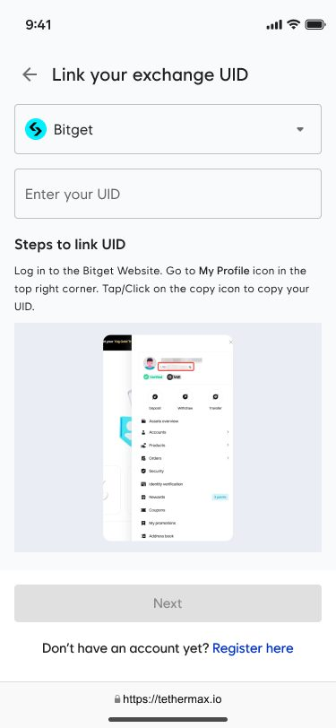

### L-14. 소유권 업로드 카드 — 경고 문구

| 구분 | 내용 |
|---|---|
| 우선 | 2 |
| 지금 | PC [O3 28960:127635](https://www.figma.com/design/hsa3bSV9QmFTe2jsf6tzTm/UI-UX-Design?node-id=28960-127635)(O3~O10 공통) · 모바일 [28982:126103](https://www.figma.com/design/hsa3bSV9QmFTe2jsf6tzTm/UI-UX-Design?node-id=28982-126103)(전 상태 공통): `Some events may be restricted during the coupon usage period. Existing coupons are non-transferable.` |
| 근거 | 기존 [MAX-561] 업로드 화면 [12773:343687](https://www.figma.com/design/hsa3bSV9QmFTe2jsf6tzTm/UI-UX-Design?node-id=12773-343687) 경고 박스 — 원문과 같은 문장 |
| 수정안 | 문구만: `Some events may be restricted during the claim period. Existing coupons cannot be transferred.` |
| 근거 번호 | REQ-726 · 정책 5-10(`OWN-4`) |

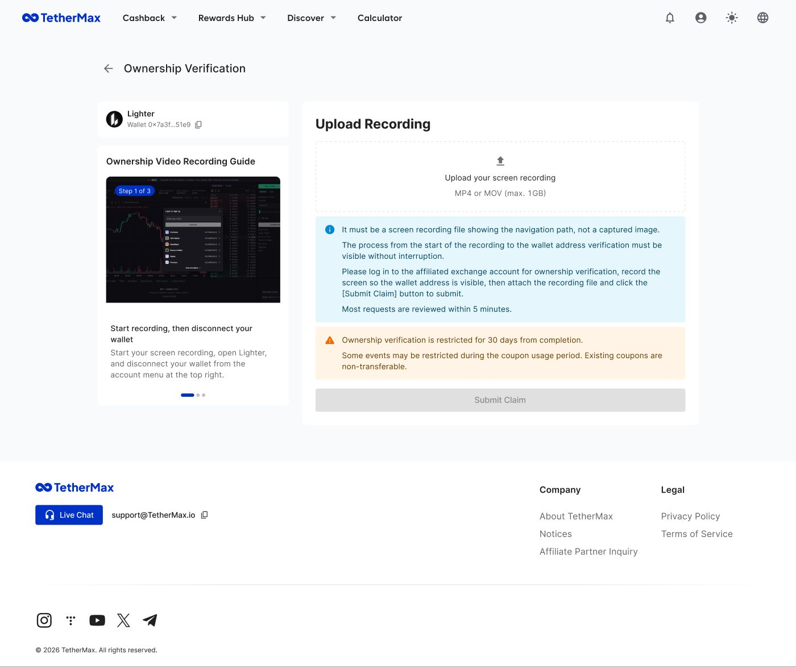
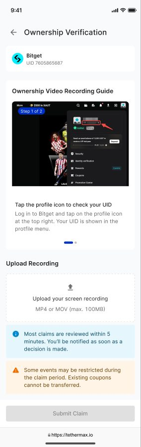

### L-15. 소유권 업로드 카드 — 심사 시간 안내

| 구분 | 내용 |
|---|---|
| 우선 | 2 |
| 지금 | O3 안내 박스 마지막 줄 `Most requests are reviewed within 5 minutes.` · 확인창 [O10 28960:127700](https://www.figma.com/design/hsa3bSV9QmFTe2jsf6tzTm/UI-UX-Design?node-id=28960-127700) · 모바일 [28982:126238](https://www.figma.com/design/hsa3bSV9QmFTe2jsf6tzTm/UI-UX-Design?node-id=28982-126238) `Average review time: ~5 minutes` |
| 근거 | 기존 [MAX-561] 업로드 [12773:343687](https://www.figma.com/design/hsa3bSV9QmFTe2jsf6tzTm/UI-UX-Design?node-id=12773-343687) `Most claims are reviewed within 5 minutes. You'll be notified as soon as a decision is made.` · 확인창 [12773:347156](https://www.figma.com/design/hsa3bSV9QmFTe2jsf6tzTm/UI-UX-Design?node-id=12773-347156) `Average review time: ~5 minutes` |
| 수정안 | 문구만: O3(PC·모바일 전 상태)의 `Most requests are reviewed within 5 minutes.` → `Most claims are reviewed within 5 minutes. You'll be notified as soon as a decision is made.` 확인창 `Average review time: ~5 minutes`는 기존 문구와 같아 둔다. 정책 5-10의 「10분 무응답 자동 실패」는 심사 규칙이며 화면 문구는 REQ-726(기존 CEX 화면 문구)을 따른다 |
| 근거 번호 | REQ-726 · 정책 5-10 · 요청 #17 |

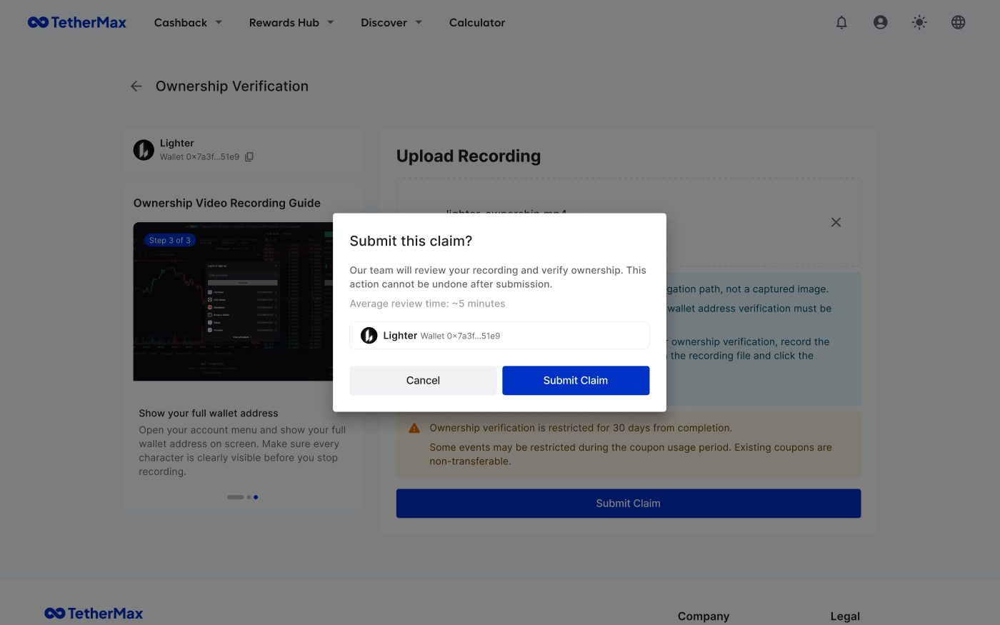
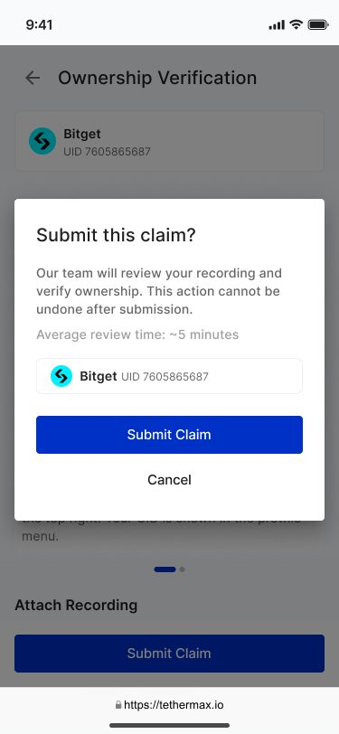

### L-16. 게스트 조회 — 지갑 주소 형식 오류 상태

| 구분 | 내용 |
|---|---|
| 우선 | 2 |
| 지금 | 빈 값 오류만 있음 — PC [29035:98401](https://www.figma.com/design/hsa3bSV9QmFTe2jsf6tzTm/UI-UX-Design?node-id=29035-98401) · 모바일 [29035:98465](https://www.figma.com/design/hsa3bSV9QmFTe2jsf6tzTm/UI-UX-Design?node-id=29035-98465) `Enter your wallet address.` |
| 근거 | 같은 프레임의 빨간 테두리 + 필드 아래 문구 · 기존 [MAX 1216] CMT-05 |
| 수정안 | PC·모바일 각각 복제 1개 → 오른쪽에 `Guest — address format errors`. 입력란에 공백 섞인 표본 주소, 오류 문구 `Remove spaces within the wallet address.` 프레임 옆 기존 라벨 컴포넌트에 같은 자리의 나머지 4종 원문(L-09와 같은 A-12 문구)을 나열 |
| 근거 번호 | API-023 · REQ-065 · REQ-067 · A-12 |
| 새 프레임 | 2 |

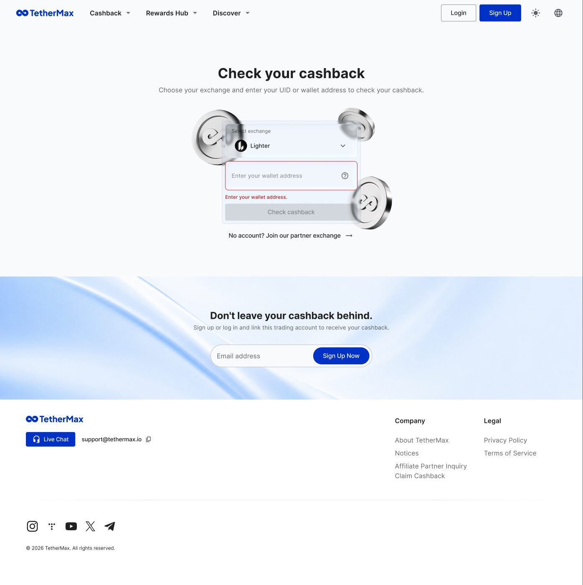

### L-17. 게스트 결과 → `Link account` → 조회한 계정이 채워진 연동 폼

| 구분 | 내용 |
|---|---|
| 우선 | 2 |
| 지금 | DEX [29035:97915](https://www.figma.com/design/hsa3bSV9QmFTe2jsf6tzTm/UI-UX-Design?node-id=29035-97915) · CEX [29037:102463](https://www.figma.com/design/hsa3bSV9QmFTe2jsf6tzTm/UI-UX-Design?node-id=29037-102463)(모바일 29035:97974 · 29037:102530) — 연결 화살표만 있고 도착 폼 없음 |
| 근거 | DEX 도착 = L3(Lighter + 주소 입력, `Next` 활성) · CEX 도착 = CEX 폼 [29227:120903](https://www.figma.com/design/hsa3bSV9QmFTe2jsf6tzTm/UI-UX-Design?node-id=29227-120903) + 기존 [MAX-30] Web 모달 [9105:196091](https://www.figma.com/design/hsa3bSV9QmFTe2jsf6tzTm/UI-UX-Design?node-id=9105-196091)(UID 입력 상태) |
| 수정안 | ① DEX: 화살표 끝을 L3 · 모바일 28969:126996으로 연결(프레임 추가 없음) ② CEX: 29227:120903 · 29051:100488 복제 → 각 오른쪽에 `CEX form — prefilled from guest`, UID 칸에 조회 UID 표본, `Next` 활성 상태로(L-13 문구 반영 뒤) |
| 근거 번호 | FU-012 · REQ-180 · REQ-178 |
| 새 프레임 | 2 |

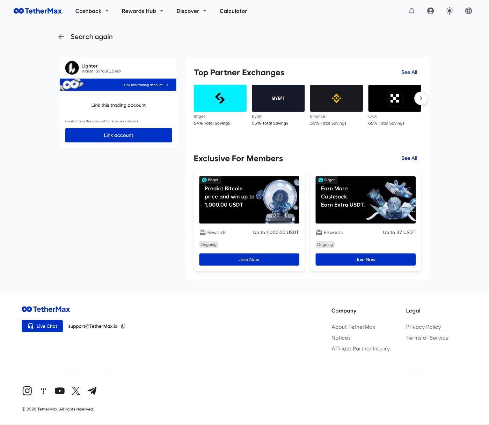

### L-18. 모바일 연동 — 아무 거래소도 선택 안 된 첫 화면

| 구분 | 내용 |
|---|---|
| 우선 | 2 |
| 지금 | 모바일은 Lighter가 선택된 폼 [28969:126986](https://www.figma.com/design/hsa3bSV9QmFTe2jsf6tzTm/UI-UX-Design?node-id=28969-126986)만 있음 |
| 근거 | PC [S3-2 28960:127765](https://www.figma.com/design/hsa3bSV9QmFTe2jsf6tzTm/UI-UX-Design?node-id=28960-127765): `Select a partner` · `Select the partner you trade on to see how to link your account.` · `Link Account` 비활성 |
| 수정안 | 28969:126986 복제 → 왼쪽에 `Link Account — nothing selected (empty_state)`. 드롭다운 값 → `Select a partner`, 주소 입력란·가이드 블록 숨김, 도움말 → `Select the partner you trade on to see how to link your account.`, 하단 버튼 → `Link Account` 비활성. 가입 링크 유지 |
| 근거 번호 | REQ-051 · ❓ G-379(빈 선택을 CEX 기본값에도 적용할지 — 화면 구성에는 영향 없음) |
| 새 프레임 | 1 |

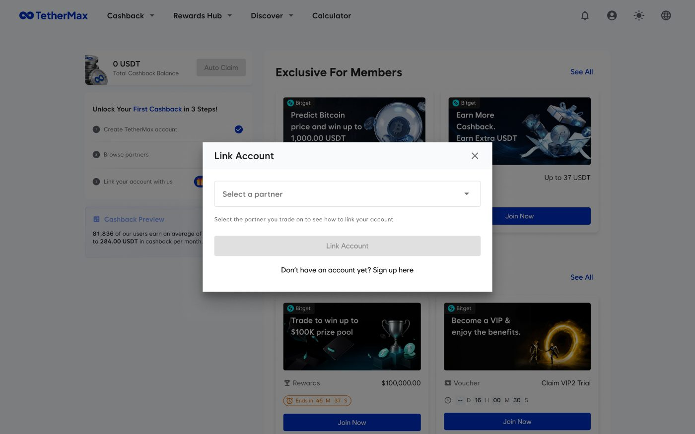

### L-19. 소유권 — 신청 시 통합 한도 도달

| 구분 | 내용 |
|---|---|
| 우선 | 2 |
| 지금 | 소유권 섹션 [28960:127634](https://www.figma.com/design/hsa3bSV9QmFTe2jsf6tzTm/UI-UX-Design?node-id=28960-127634) · 모바일 [28982:126102](https://www.figma.com/design/hsa3bSV9QmFTe2jsf6tzTm/UI-UX-Design?node-id=28982-126102)에 API-025 `INTEGRATION_MAX_COUNT_OVER` 상태 없음 |
| 근거 | 연동 결과 L15(L-04 반영본) — 같은 오류 코드 · 기존 CEX도 한도 도달 시 소유권 신청 차단(정책 5-10) |
| 수정안 | L15 · 28969:127118 복제(L-04 반영 뒤) → O2 오른쪽에 `O2-L Integration limit`. 문구는 L-04와 같음 |
| 근거 번호 | API-025 · REQ-731 · G-091 |
| 새 프레임 | 2 |

### L-20. 개발 인계 메모 — CEX 결과 화면 기준

| 구분 | 내용 |
|---|---|
| 우선 | 2 |
| 지금 | 기존 [MAX-30] 페이지에 `Unable to Link UID Yet`(`Please withdraw your accumulated cashback before linking your UID.`) 화면 [9287:185491](https://www.figma.com/design/hsa3bSV9QmFTe2jsf6tzTm/UI-UX-Design?node-id=9287-185491) · [9105:191459](https://www.figma.com/design/hsa3bSV9QmFTe2jsf6tzTm/UI-UX-Design?node-id=9105-191459) · [25963:13706](https://www.figma.com/design/hsa3bSV9QmFTe2jsf6tzTm/UI-UX-Design?node-id=25963-13706)이 남아 있고, DEX(revision)에는 CEX가 어떤 결과 화면을 쓰는지 표시가 없음 |
| 근거 | 결정 N5·N10(Account로 통일) · REQ-108(차단 화면 미사용) |
| 수정안 | 문구만: [MAX-30] 페이지는 손대지 않고, DEX(revision) 개발 인계 색인 메모 [29066:897](https://www.figma.com/design/hsa3bSV9QmFTe2jsf6tzTm/UI-UX-Design?node-id=29066-897)에 두 줄 추가 — 「CEX UID 연동 결과도 이 페이지의 `Account` 결과 스플래시를 쓴다」 · 「`Unable to Link UID Yet`(`FAILED_NEED_RECEIVE`) 차단 화면은 전 거래소에서 쓰지 않는다 — 연동 전 잔액은 `Processing Your Account`(L-07)」 |
| 근거 번호 | REQ-054 · REQ-107 · REQ-108 · REQ-122 · 결정 N5 · N10 · 요청 #22 · #37 |

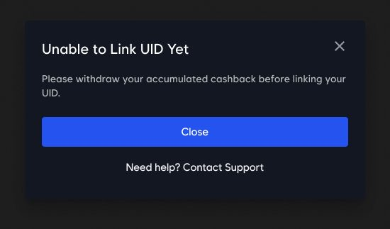

---

## 우선 3

### L-21. `Verification Success` 버튼 통일

| 구분 | 내용 |
|---|---|
| 우선 | 3 |
| 지금 | PC [28966:124154](https://www.figma.com/design/hsa3bSV9QmFTe2jsf6tzTm/UI-UX-Design?node-id=28966-124154) `Back to Home` · 모바일 [28969:127073](https://www.figma.com/design/hsa3bSV9QmFTe2jsf6tzTm/UI-UX-Design?node-id=28969-127073) `Close` |
| 근거 | MAXOP-751 스플래시 컴포넌트 기본값 `Back to Home` + `Need help? Contact Support`(현행판 확인 B10과 같은 기준) |
| 수정안 | 문구만: 모바일 `Close` → `Back to Home`(다크 사본 포함) |
| 근거 번호 | REQ-072 · REQ-094 · 현행판 확인 B10 |

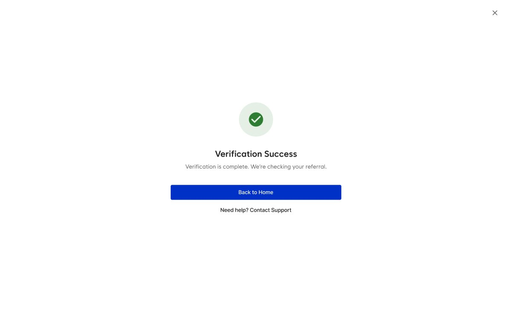
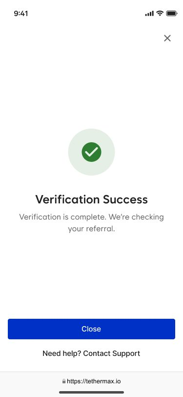

### L-22. 모바일 홈 — 연동 성공 토스트 · 새 행 · 첫 연동 S4 전환

| 구분 | 내용 |
|---|---|
| 우선 | 3 |
| 지금 | PC만 [S3-7 28960:127795](https://www.figma.com/design/hsa3bSV9QmFTe2jsf6tzTm/UI-UX-Design?node-id=28960-127795)(토스트 `Account linked successfully` · Linked Accounts 새 행 `0.00 USDT` · 체크리스트 없음) |
| 근거 | PC S3-7 · 기존 [MAX-30] mWeb 홈 토스트 [9733:177641](https://www.figma.com/design/hsa3bSV9QmFTe2jsf6tzTm/UI-UX-Design?node-id=9733-177641)(`UID added successfully`) |
| 수정안 | 모바일 S4 홈 프레임 복제 → 모바일 연동 결과 섹션 [28969:126952](https://www.figma.com/design/hsa3bSV9QmFTe2jsf6tzTm/UI-UX-Design?node-id=28969-126952)의 성공 프레임 28969:127101 오른쪽에 `Mobile S4 after first link`. Linked Accounts 맨 아래에 Lighter 행(`0.00 USDT`), 체크리스트·Preview 자리 없음, 하단에 MAX-30 토스트 인스턴스 복사 후 문구 `Account linked successfully` |
| 근거 번호 | REQ-094 · REQ-096 |
| 새 프레임 | 1 |

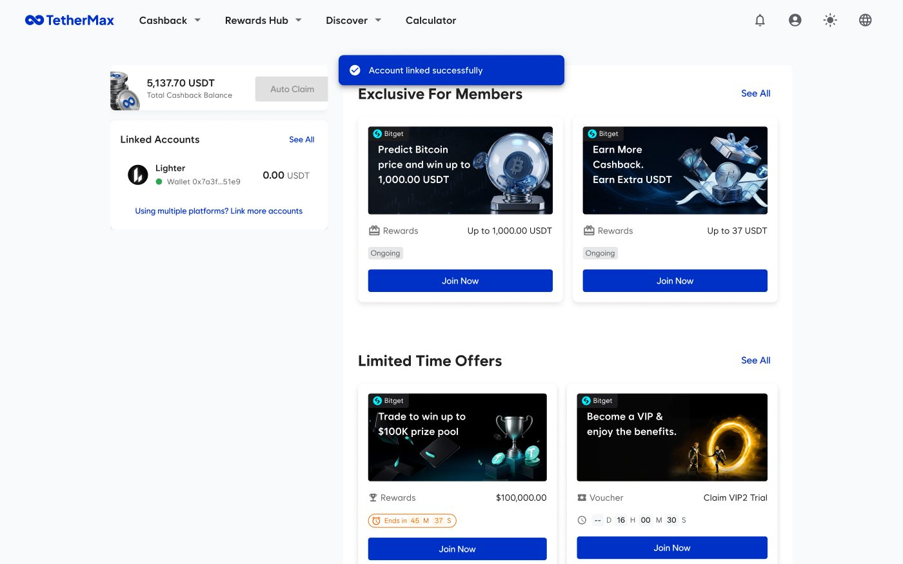
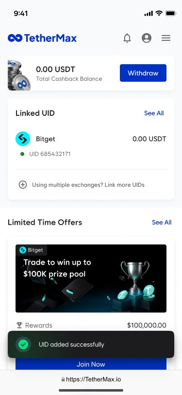

### L-23. 소유권 O2 쿨다운 — 버튼

| 구분 | 내용 |
|---|---|
| 우선 | 3 |
| 지금 | PC [O2 28960:127650](https://www.figma.com/design/hsa3bSV9QmFTe2jsf6tzTm/UI-UX-Design?node-id=28960-127650) · 모바일 [28982:126298](https://www.figma.com/design/hsa3bSV9QmFTe2jsf6tzTm/UI-UX-Design?node-id=28982-126298): `Try a different wallet` + `Need help? Contact Support` |
| 근거 | 기존 [MAX-561] `Ownership Claim Unavailable` [12783:405465](https://www.figma.com/design/hsa3bSV9QmFTe2jsf6tzTm/UI-UX-Design?node-id=12783-405465): `Try a different UID` + `Close` |
| 수정안 | 문구만: 하단 링크 `Need help? Contact Support` → `Close`(텍스트 버튼). `Try a different wallet` 유지 |
| 근거 번호 | REQ-724 · 정책 5-10(`OWN-2`) · A-15 |

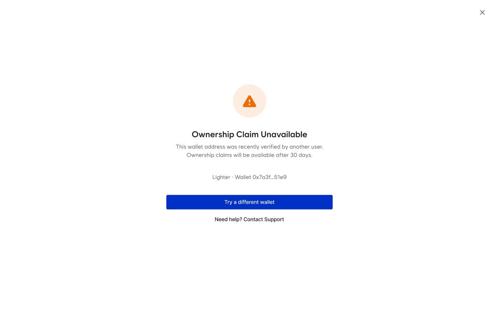
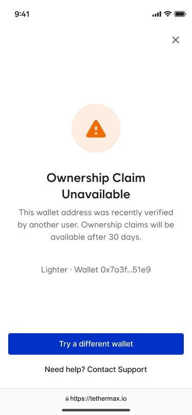
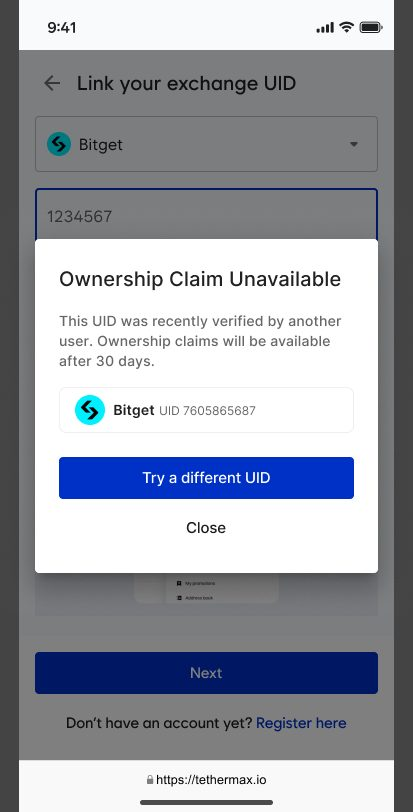

### L-24. 모바일 소유권 — 업로드 실패 다이얼로그 뒤 카드 상태

| 구분 | 내용 |
|---|---|
| 우선 | 3 |
| 지금 | [28982:126223](https://www.figma.com/design/hsa3bSV9QmFTe2jsf6tzTm/UI-UX-Design?node-id=28982-126223) — `Upload Failed` 뒤 업로드 카드가 `Complete`, `Submit Claim` 활성 |
| 근거 | PC [O8 28960:127688](https://www.figma.com/design/hsa3bSV9QmFTe2jsf6tzTm/UI-UX-Design?node-id=28960-127688) · 모바일 빈 카드 [28982:126103](https://www.figma.com/design/hsa3bSV9QmFTe2jsf6tzTm/UI-UX-Design?node-id=28982-126103) |
| 수정안 | 다이얼로그 뒤 업로드 카드 인스턴스를 빈 상태 변형(`Upload your screen recording` / `MP4 or MOV (max. 1GB)`)으로 바꾸고 `Submit Claim`을 비활성 변형으로 |
| 근거 번호 | REQ-726 · API-025 400 |

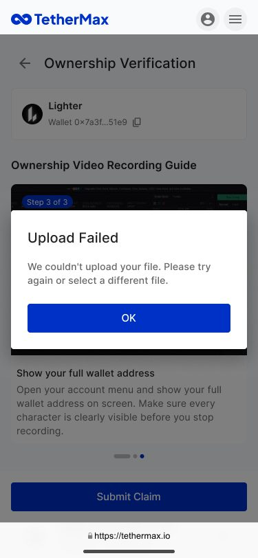

### L-25. 모바일 소유권 — 제출 확인 뒤 화면 문구

| 구분 | 내용 |
|---|---|
| 우선 | 3 |
| 지금 | [28982:126238](https://www.figma.com/design/hsa3bSV9QmFTe2jsf6tzTm/UI-UX-Design?node-id=28982-126238) · 다크 [28982:126493](https://www.figma.com/design/hsa3bSV9QmFTe2jsf6tzTm/UI-UX-Design?node-id=28982-126493) — 다이얼로그 뒤 텍스트 레이어 `How to find your UID` · `Attach Recording` |
| 근거 | 같은 섹션 다른 상태 [28982:126103](https://www.figma.com/design/hsa3bSV9QmFTe2jsf6tzTm/UI-UX-Design?node-id=28982-126103) · PC O3 |
| 수정안 | 문구만: `How to find your UID` → `Ownership Video Recording Guide`, `Attach Recording` → `Upload Recording` |
| 근거 번호 | REQ-725 · REQ-726 |

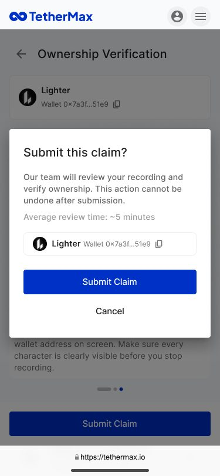

### L-26. 거래소 선택기 — PC 검색 결과 상태 · 게스트 선택기 0건

| 구분 | 내용 |
|---|---|
| 우선 | 3 |
| 지금 | PC 선택기 컴포넌트 [29225:119304](https://www.figma.com/design/hsa3bSV9QmFTe2jsf6tzTm/UI-UX-Design?node-id=29225-119304)는 All/CEX/DEX 3변형뿐. 모바일에는 [1건 29051:104415](https://www.figma.com/design/hsa3bSV9QmFTe2jsf6tzTm/UI-UX-Design?node-id=29051-104415) · [여러 건 29051:104229](https://www.figma.com/design/hsa3bSV9QmFTe2jsf6tzTm/UI-UX-Design?node-id=29051-104229) · [0건 29051:104597](https://www.figma.com/design/hsa3bSV9QmFTe2jsf6tzTm/UI-UX-Design?node-id=29051-104597)(`No results found for “bit”`)이 있음. 게스트 선택기 [29035:98030](https://www.figma.com/design/hsa3bSV9QmFTe2jsf6tzTm/UI-UX-Design?node-id=29035-98030) · [29035:98094](https://www.figma.com/design/hsa3bSV9QmFTe2jsf6tzTm/UI-UX-Design?node-id=29035-98094)에 0건 없음 |
| 근거 | 모바일 검색 상태 3종 · 기존 [MAX-30] Web 드롭다운 [9287:180087](https://www.figma.com/design/hsa3bSV9QmFTe2jsf6tzTm/UI-UX-Design?node-id=9287-180087) · mWeb 시트 [9105:194510](https://www.figma.com/design/hsa3bSV9QmFTe2jsf6tzTm/UI-UX-Design?node-id=9105-194510) `No results found for Crypto.com` |
| 수정안 | ① PC: 29225:119304에 변형 3개 추가(All 변형 복제) — `1 exchange found` · `2 exchanges found`(모바일과 같은 목록 행) · `No results found for “bit”`(Top Partner·목록 숨김) ② 게스트: 29035:98030 · 29035:98094 복제 → 각 오른쪽에 `Guest selector — no results`, 같은 0건 문구 |
| 근거 번호 | REQ-055 · REQ-056 · 결정 N13 |
| 새 프레임 | 5(변형 3 + 프레임 2) |

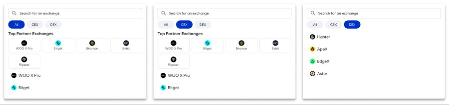
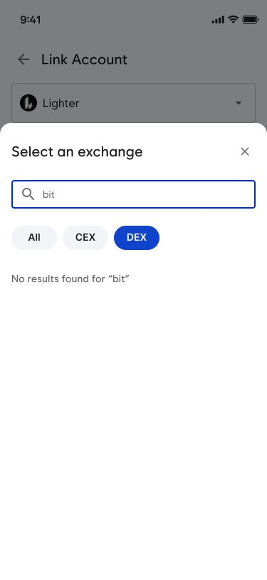
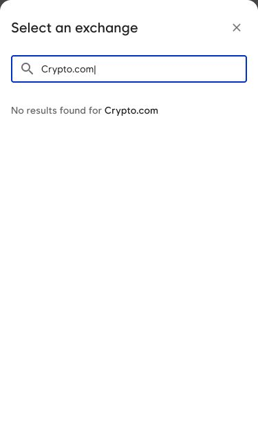
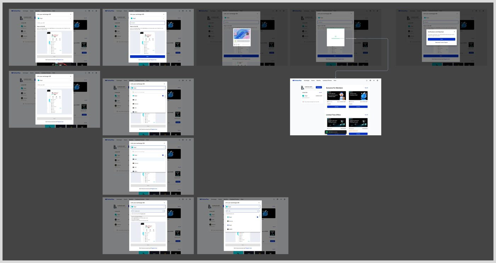

### L-27. 게스트 결과 — 10 USDT 미만 안내의 `payout`

| 구분 | 내용 |
|---|---|
| 우선 | 3 |
| 지금 | PC [29035:98631](https://www.figma.com/design/hsa3bSV9QmFTe2jsf6tzTm/UI-UX-Design?node-id=29035-98631) · 모바일 [29035:98694](https://www.figma.com/design/hsa3bSV9QmFTe2jsf6tzTm/UI-UX-Design?node-id=29035-98694) · CEX [29035:99309](https://www.figma.com/design/hsa3bSV9QmFTe2jsf6tzTm/UI-UX-Design?node-id=29035-99309): `Below the 10 USDT payout minimum.` |
| 근거 | 용어 규칙(요청·동작 = `Claim`) |
| 수정안 | **문구 원문 없음**(G-419 「문구표에서 확정」). 문구표가 나오면 이 텍스트 레이어만 교체 |
| 근거 번호 | G-418 · G-419 · API-023 |

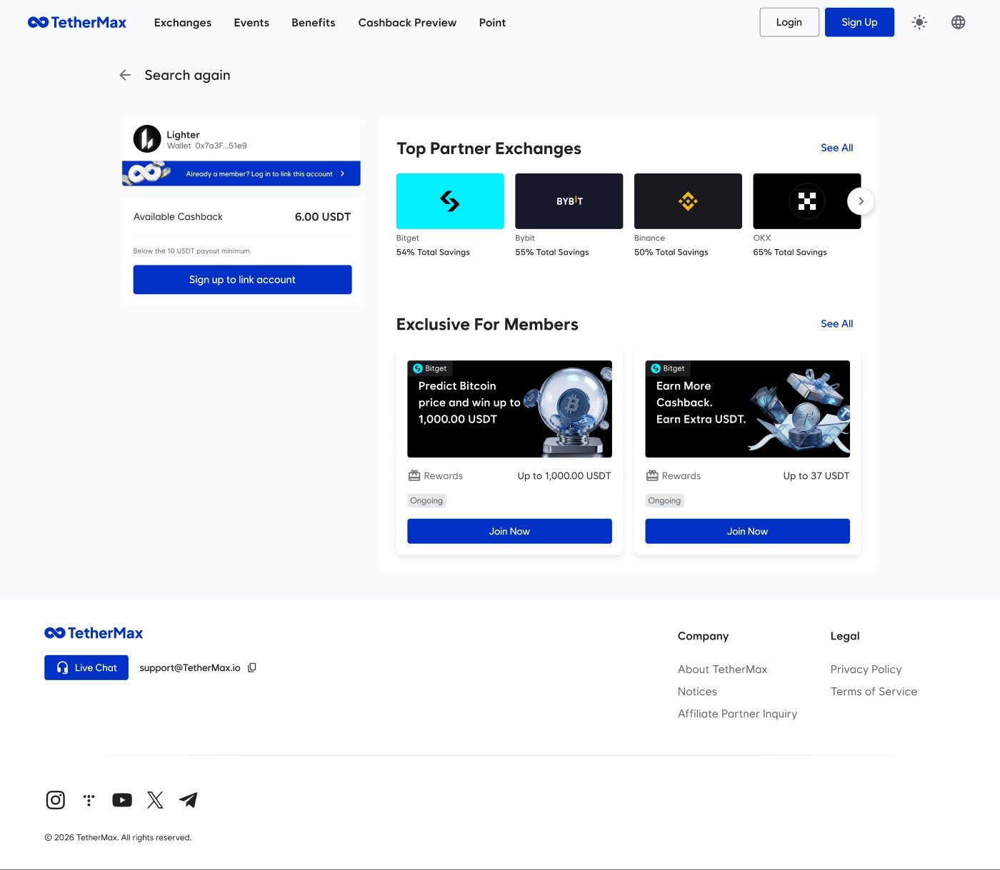

### L-28. 모바일 연동 결과 — `Linking unavailable` 프레임 이름

| 구분 | 내용 |
|---|---|
| 우선 | 3 |
| 지금 | [28969:127153](https://www.figma.com/design/hsa3bSV9QmFTe2jsf6tzTm/UI-UX-Design?node-id=28969-127153) — 프레임 이름은 `Linking unavailable`이지만 내용은 기타 실패(`Unable to Link Account` / `We were unable to link this account. Please contact our support team for assistance.` · `Contact Support`) |
| 근거 | PC 기타 실패 [L13 28960:127331](https://www.figma.com/design/hsa3bSV9QmFTe2jsf6tzTm/UI-UX-Design?node-id=28960-127331) |
| 수정안 | 레이어 이름만: `L13 Unable to Link Account (LINK_REJECTED · FAILED_ISSUE_UID)`. `EXCHANGE_NOT_LINKABLE`은 선택기에서 제외돼 도달하지 않으므로(G-161) 별도 화면 없음 |
| 근거 번호 | REQ-092 · REQ-122 · API-007 · G-161 |

---

## 이 영역 밖에서 본 것 (다른 영역 계획에서 처리)

| 화면 | 내용 | 근거 |
|---|---|---|
| 연동·소유권 웹 프레임 전반(L1 · O3 · S3-7 등) | GNB에 상단 단독 `Calculator` 메뉴 | 결정 D4(계산기는 `Cashback ▾` 하위) |
| 게스트 결과 [29035:98631](https://www.figma.com/design/hsa3bSV9QmFTe2jsf6tzTm/UI-UX-Design?node-id=29035-98631) | 구 GNB(`Exchanges · Events · Benefits · Cashback Preview · Point`) | 결정 A1 · D4 |
