# Figma 수정 계획 — rewards (리그 · 맥스보드 · 쿠폰 · 혜택 · 챌린지 · 이벤트 · 퀴즈 · TP · 친구 초대 · 파트너 허브 · 이메일)

2026-11-26 · Figma `UI-UX-Design` [DEX(revision)](https://www.figma.com/design/hsa3bSV9QmFTe2jsf6tzTm/UI-UX-Design?node-id=28960-125519) · **계획만 — Figma는 아직 고치지 않았다.** 캡처는 2026-11-26 오후 실제 Figma(라이브)에서 받았다.

입력: [디자인 상태 점검 rewards](디자인_상태점검_rewards.md)(디자이너 요청 62건) · [재점검](DEX_revision_화면상태_재점검.md) · [사용자 결정](_Figma수정_결정.md)(최우선) · [기존 디자인 카탈로그 C](기존디자인_카탈로그/C_리워드_초대_콘텐츠.md) · [현행 판 확인서](기존디자인_현행판_확인.md) · [최종 정책](../00_DEX_최종정책.md) · [요구사항정의서](../02.기획문서/요구사항정의서.md).

## 요약

| 항목 | 수 |
|---|---|
| 수정 항목 | **33** — 우선 1: **7** · 우선 2: **19** · 우선 3: **7** |
| 새 프레임 | **75** (기존 프레임 복제 후 문구·값 교체) |
| 문구만 바꾸는 항목 | **9** (R-01 · R-04 · R-07 · R-08 · R-15 · R-22 · R-24 · R-31 · R-32) |
| 문구 원문 없음(계획에 넣되 문구는 문구표 확정 대기) | R-02 CTA · R-05 금액 라벨 · R-06 본문 3문장 · R-08 완성 직후 랭킹 문구(EN) · R-13(EN) · R-15 약관 2문장 · R-16 본문 · R-25 · R-26 |
| 근거 없음 — 사용자 확인(계획에서 제외) | 9건 — 아래 「근거 없음」 표 |
| 점검 이후 Figma에 이미 반영됨(수정 안 함) | 리그 L01 · L03 · L07 · L08 · L09 · L10, 혜택 B02, 이메일 N14 |
| 결정으로 수정하지 않음 | 이벤트 3탭(D3) · Boost(N7) · Referral Details/Reward History(N11) · 출금 실적 `Withdraw` 문구(D2) |

### 근거 없음 — 사용자 확인 (계획에서 제외)

| # | 점검 ID | 상태 | 이유 |
|---|---|---|---|
| X-1 | M33 | 맥스보드 의존 시스템 장애(503) 화면 | 기존 Bingo에 오류 페이지·인라인 오류 디자인 없음 |
| X-2 | M09 · M32 | 맥스보드 `PHASE_NOT_PARTICIPATION` · `CONCURRENT_REQUEST` 안내 | 토스트 틀([28537:451987](https://www.figma.com/design/hsa3bSV9QmFTe2jsf6tzTm/UI-UX-Design?node-id=28537-451987))은 있으나 정책·명세에 문구 원문 없음. 문구가 정해지면 R-11과 같은 방식으로 추가 |
| X-3 | B09 | 캐시백 챌린지 수령 완료 PC | 기존 디자인은 MO([10981:80498](https://www.figma.com/design/hsa3bSV9QmFTe2jsf6tzTm/UI-UX-Design?node-id=10981-80498))만 있음 |
| X-4 | P03(MO) | 파트너 허브 하위 회원 연동 계정 모달 MO | 기존 MO 모달([4936:65879](https://www.figma.com/design/hsa3bSV9QmFTe2jsf6tzTm/UI-UX-Design?node-id=4936-65879))이 내용 없이 렌더됨 |
| X-5 | C06 | 쿠폰 계정 선택 — 계정 1개 분기 | 1개일 때 목록 그대로인지 자동 선택인지 정책 미정 |
| X-6 | C12 | 쿠폰 404(없는·남의 쿠폰) | 표시 정의 없음 |
| X-7 | G01 · G03 · E06 | 429 · 멱등 키 재사용 · 잘못된 범위 값 | 표시 정의 없음(정상 UI에서 도달하지 않는 것 포함) |
| X-8 | P05 | 파트너 아님(403) | 메뉴 미노출로 도달하지 않는지 명세 없음 |
| X-9 | I08 | 초대 등록 현황 — 친구 0 연동 | ❓ G-200 미정(권고만 있음) |

## 공통 작업 규칙

- 새 프레임은 같은 섹션 안 기존 짝 프레임 옆(또는 아래 새 줄)에 두고, 섹션의 기존 제목 띠(2180×158, 예: [29062:114038](https://www.figma.com/design/hsa3bSV9QmFTe2jsf6tzTm/UI-UX-Design?node-id=29062-114038))를 복제해 이름을 붙인다.
- 계정 문구는 결정 「용어 규칙」대로 CEX·DEX 공통 문맥은 `Account`, 출금 요청·동작은 `Claim`, 출금 실적은 `Withdraw`/`Withdrawn`.
- 모바일 짝 프레임이 있는 항목은 PC와 같은 수정을 MO에도 적용한다(대상 노드에 함께 적음).

---

## 우선 1 — 정책 위반·개발 막힘

### R-01 맥스보드 · 계정 문구 `Account` 통일 (자격 없음 · 참여 계정 해제 · 지급일 안내)

| 구분 | 내용 |
|---|---|
| 대상 | 사전공개 자격 없음 [29064:7679](https://www.figma.com/design/hsa3bSV9QmFTe2jsf6tzTm/UI-UX-Design?node-id=29064-7679) · [29064:7925](https://www.figma.com/design/hsa3bSV9QmFTe2jsf6tzTm/UI-UX-Design?node-id=29064-7925) / 참여 전 자격 없음 [29064:8176](https://www.figma.com/design/hsa3bSV9QmFTe2jsf6tzTm/UI-UX-Design?node-id=29064-8176) · [29064:8531](https://www.figma.com/design/hsa3bSV9QmFTe2jsf6tzTm/UI-UX-Design?node-id=29064-8531) / 해제·재선택 가능 [29064:8888](https://www.figma.com/design/hsa3bSV9QmFTe2jsf6tzTm/UI-UX-Design?node-id=29064-8888) · [29064:9244](https://www.figma.com/design/hsa3bSV9QmFTe2jsf6tzTm/UI-UX-Design?node-id=29064-9244) / 해제·선택지 없음 [29064:9601](https://www.figma.com/design/hsa3bSV9QmFTe2jsf6tzTm/UI-UX-Design?node-id=29064-9601) · [29064:9961](https://www.figma.com/design/hsa3bSV9QmFTe2jsf6tzTm/UI-UX-Design?node-id=29064-9961) / 지급일 안내 문장: 보드 완성 [29064:10322](https://www.figma.com/design/hsa3bSV9QmFTe2jsf6tzTm/UI-UX-Design?node-id=29064-10322) · [29064:10687](https://www.figma.com/design/hsa3bSV9QmFTe2jsf6tzTm/UI-UX-Design?node-id=29064-10687), 결과 발표 [29064:13201](https://www.figma.com/design/hsa3bSV9QmFTe2jsf6tzTm/UI-UX-Design?node-id=29064-13201) · [29064:13579](https://www.figma.com/design/hsa3bSV9QmFTe2jsf6tzTm/UI-UX-Design?node-id=29064-13579) |
| 지금 | 버튼 `Link UID`(참여 전·선택지 없음) · `Select a New UID`(재선택 가능), 제목 `No Eligible EdgeX wallet` · `You Can No Longer Participate with This wallet`, 지급일 `…paid to your participating wallet from Oct 31, 09:00.` |
| 근거 | 기존 Bingo 같은 상태 프레임 — 참여 UID 잃음(고를 UID 있음) [28537:448894](https://www.figma.com/design/hsa3bSV9QmFTe2jsf6tzTm/UI-UX-Design?node-id=28537-448894) · (없음) [28537:449250](https://www.figma.com/design/hsa3bSV9QmFTe2jsf6tzTm/UI-UX-Design?node-id=28537-449250) · 사전공개 자격 UID 없음 [28537:444666](https://www.figma.com/design/hsa3bSV9QmFTe2jsf6tzTm/UI-UX-Design?node-id=28537-444666) · 참여 기간 자격 UID 없음 [28537:448183](https://www.figma.com/design/hsa3bSV9QmFTe2jsf6tzTm/UI-UX-Design?node-id=28537-448183). 배너·버튼 배치는 그대로 두고 문구만 바꾼다 |
| 수정안 | 텍스트만 교체(REQ-655 원문, ○ 자리는 보드 값): · 버튼 `Link UID` → `Link Account` · 버튼 `Select a New UID` → `Select New Account` · 제목 `No Eligible EdgeX wallet` → `You have no eligible {exchange} account`(예시 값 `EdgeX`) · 둘째 문장(사전공개·참여 전) → `Only {exchange} accounts registered with TetherMax after ○○ ○, ○○:○○ can participate. Link a new {exchange} account to participate.` · 끊김 제목 → `You Can No Longer Participate with This Account`, 부제 → `This account can no longer join this board.` · 선택지 없음 주황 배너(제목 `No Eligible EdgeX wallet` + 부제 `Link a new wallet to participate again.`) → `You have no eligible {exchange} account. Link a new account to participate again.` · 지급일 → `Event Rewards will be paid to your participating account from ○○ ○, ○○:○○.` · (권장) Notes가 있는 맥스보드 프레임 22개의 하단 `Notes`의 `wallet(s)` → `account(s)` — Notes 전문은 원문 없음, 치환만 |
| 근거 번호 | REQ-655 · REQ-647 · 결정 N5(Account 통일) · 용어 규칙 |

**지금**

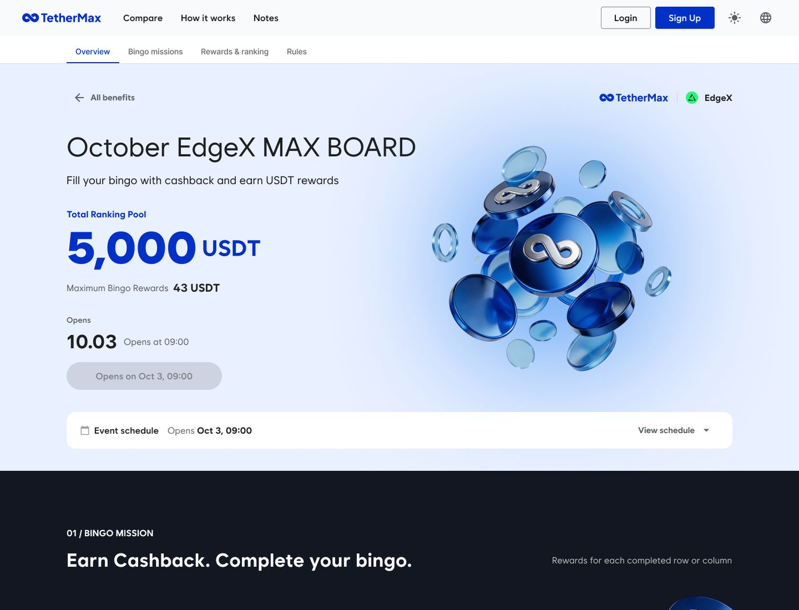

**근거(기존 Bingo)**

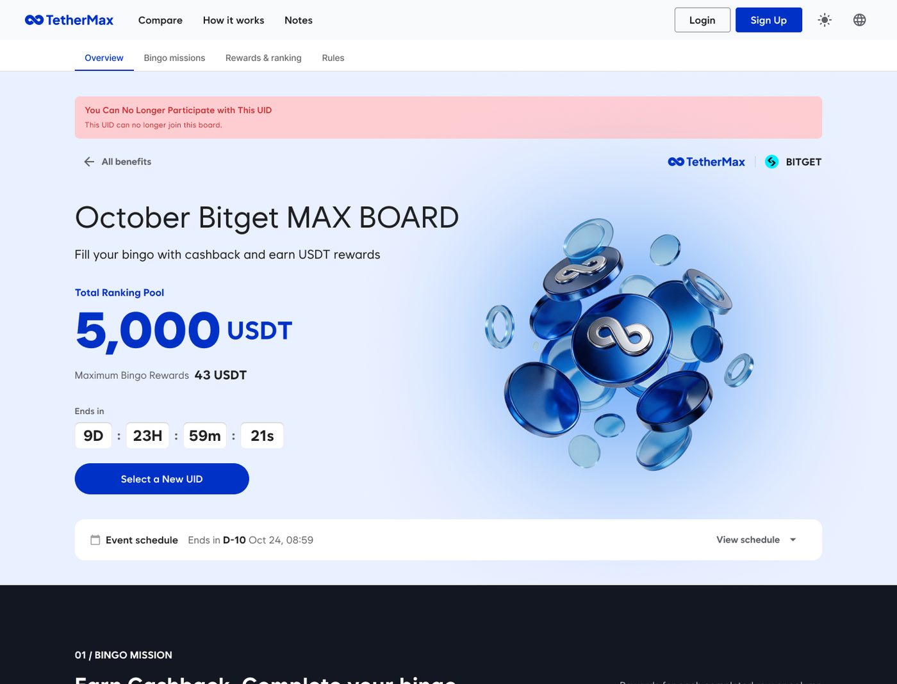
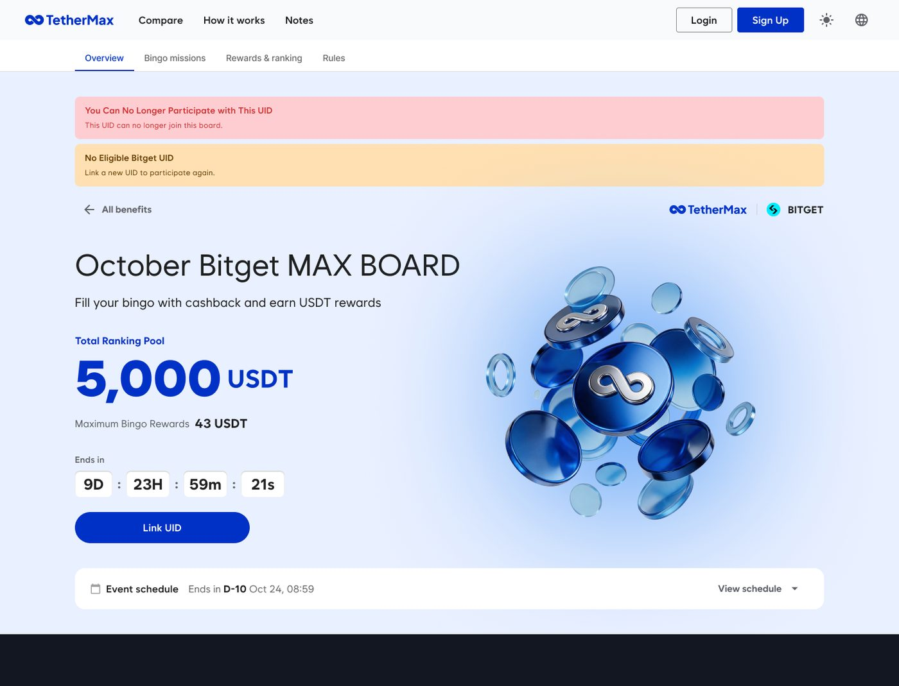
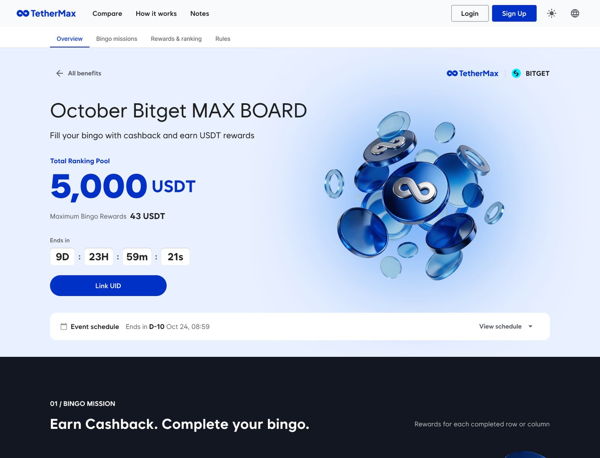

### R-02 혜택 상세 · 첫 캐시백 10 USDT — CTA 비활성 + Claim 계열, `CEX and DEX` 행

| 구분 | 내용 |
|---|---|
| 지금 | DEX(revision)에 프레임 없음. 기존 [10978:69402](https://www.figma.com/design/hsa3bSV9QmFTe2jsf6tzTm/UI-UX-Design?node-id=10978-69402)(PC) · [9622:112561](https://www.figma.com/design/hsa3bSV9QmFTe2jsf6tzTm/UI-UX-Design?node-id=9622-112561)(MO)에 활성 CTA `Withdraw Cashback and Get 10 USDT`, `Eligible Exchanges` 행 없음 |
| 근거 | 같은 기존 프레임(현행 MAX-468) — 레이아웃·`Reward Details` 표 그대로 |
| 수정안 | ① 두 프레임을 「사용자 기능 · PC와 모바일 원본 보완」의 `혜택 · 진행 중`([29062:113000](https://www.figma.com/design/hsa3bSV9QmFTe2jsf6tzTm/UI-UX-Design?node-id=29062-113000)) 오른쪽에 복제, 이름 `혜택 · 첫 캐시백 상세 / PC`·`/ 모바일` ② `Reward Details` 표 마지막 행을 복제해 `Eligible Exchanges` = `CEX and DEX` 추가 ③ CTA를 비활성 상태로 바꾸고 라벨은 Claim 계열 — **문구 원문 없음**(G-419 문구표). 비활성 버튼은 친구 초대 IF7의 비활성 `Auto Claim`([28967:127210](https://www.figma.com/design/hsa3bSV9QmFTe2jsf6tzTm/UI-UX-Design?node-id=28967-127210)) 인스턴스와 같은 상태값 ④ 제목 `First Withdrawal Reward`·부제 `Withdraw your first cashback to receive a 10 USDT coupon.`·하단 `This reward can only be claimed once per account.`는 그대로(D2: 출금 실적 = Withdraw, REQ-398 원문) |
| 근거 번호 | REQ-398 · 결정 N9 · D2 · G-418 · G-419 |

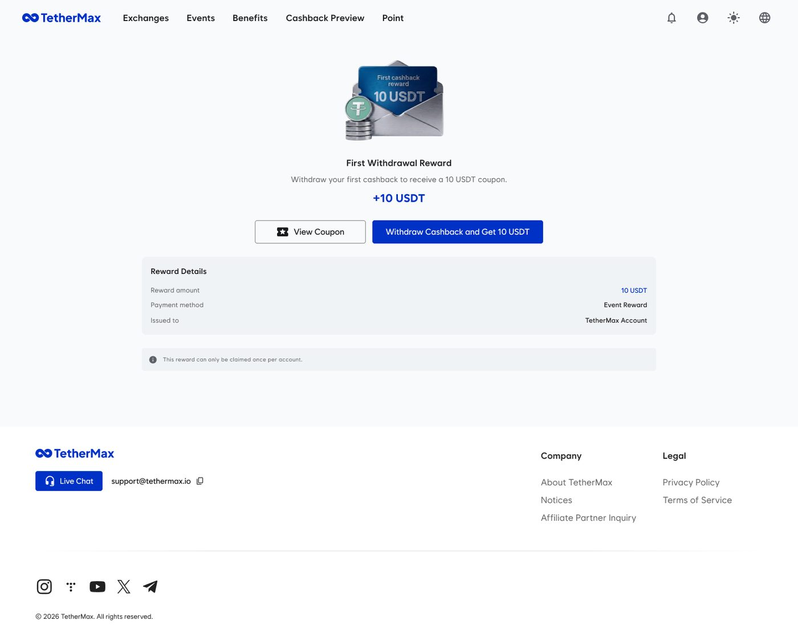

### R-03 친구 초대 모바일 · 자동 지급 표시

| 구분 | 내용 |
|---|---|
| 지금 | [29065:6175](https://www.figma.com/design/hsa3bSV9QmFTe2jsf6tzTm/UI-UX-Design?node-id=29065-6175) 활성 `Withdraw` 버튼, 표 제목 `Linked Trading Accounts` + 배지 `31`, 열 `Linked accounts`(레이어 이름은 `Exchange UID Registration Status` · `No. of Registered UIDs`), DEX 행 EdgeX 1개, 표 위 캡션 없음 |
| 근거 | 같은 화면 PC IF7 [28967:127210](https://www.figma.com/design/hsa3bSV9QmFTe2jsf6tzTm/UI-UX-Design?node-id=28967-127210)(비활성 `Auto Claim` · `Exchange Account Registration Status` · `No. of Registered Accounts` · 캡션 `Rewards include trading cashback from linked CEX and DEX accounts.` · DEX 4행) |
| 수정안 | `Withdraw` 버튼 → PC와 같은 비활성 `Auto Claim` 버튼 인스턴스로 교체 · 제목 `Exchange Account Registration Status` · 열 `No. of Registered Accounts` · PC 캡션 복제 · 행을 PC와 같이 CEX 4 + DEX 4(Lighter·ApeX·EdgeX·Aster)로 맞추고 배지는 행 합계(PC `38`) |
| 근거 번호 | REQ-414 · REQ-415 · REQ-420 · REQ-433 · 재점검 우선 2 |

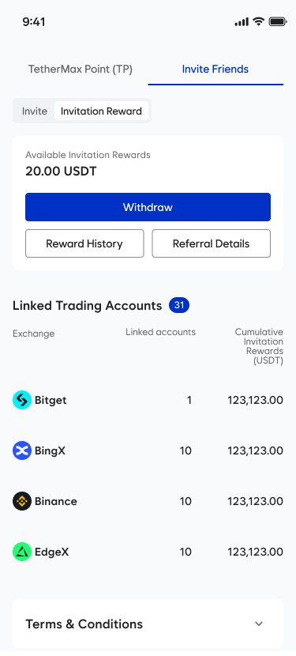
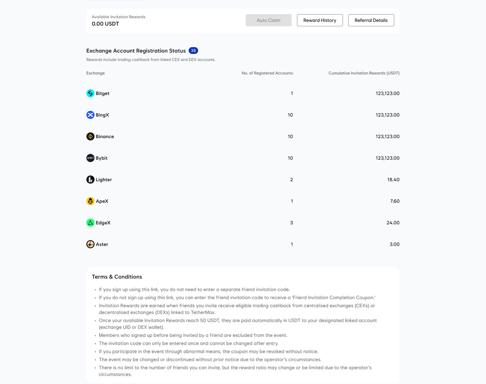

### R-04 초대 리워드 최소 10 USDT — 회원 약관 4곳 + 파트너 허브 약관

| 구분 | 내용 |
|---|---|
| 대상 | 회원 약관 bullet: IF1 [28960:126816](https://www.figma.com/design/hsa3bSV9QmFTe2jsf6tzTm/UI-UX-Design?node-id=28960-126816) · IF2 [28960:126822](https://www.figma.com/design/hsa3bSV9QmFTe2jsf6tzTm/UI-UX-Design?node-id=28960-126822) · IF3 [28960:126828](https://www.figma.com/design/hsa3bSV9QmFTe2jsf6tzTm/UI-UX-Design?node-id=28960-126828) · IF6 [28960:126846](https://www.figma.com/design/hsa3bSV9QmFTe2jsf6tzTm/UI-UX-Design?node-id=28960-126846) · IF7 [28967:127210](https://www.figma.com/design/hsa3bSV9QmFTe2jsf6tzTm/UI-UX-Design?node-id=28967-127210) · MO [29243:123606](https://www.figma.com/design/hsa3bSV9QmFTe2jsf6tzTm/UI-UX-Design?node-id=29243-123606) · [29065:5700](https://www.figma.com/design/hsa3bSV9QmFTe2jsf6tzTm/UI-UX-Design?node-id=29065-5700) · [29065:6175](https://www.figma.com/design/hsa3bSV9QmFTe2jsf6tzTm/UI-UX-Design?node-id=29065-6175)(접힘) · 메모 [29243:123768](https://www.figma.com/design/hsa3bSV9QmFTe2jsf6tzTm/UI-UX-Design?node-id=29243-123768) / 파트너 허브 PH1 [28960:127182](https://www.figma.com/design/hsa3bSV9QmFTe2jsf6tzTm/UI-UX-Design?node-id=28960-127182) |
| 지금 | 회원 `Once your available Invitation Rewards reach 50 USDT, they are paid automatically in USDT to your designated linked account (exchange UID or DEX wallet).` · 파트너 허브 첫 줄 `Invite Rewards are paid automatically from 50 USDT.` |
| 근거 | 같은 프레임의 현행 문장(숫자만 교체) |
| 수정안 | 두 문장의 `50 USDT` → `10 USDT`. 나머지 bullet(신규 2개 포함)은 그대로 — REQ-421의 DEX 이름 나열 bullet은 G-199 ④(하드코딩 제거)로 넣지 않는다 |
| 근거 번호 | 결정 D8 · REQ-414 · G-199 · G-203 |

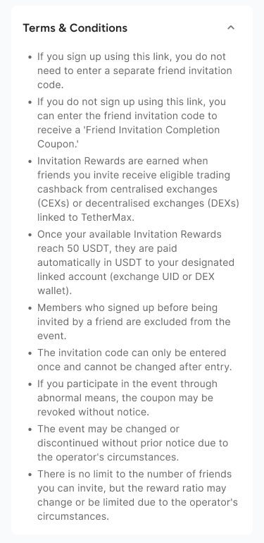
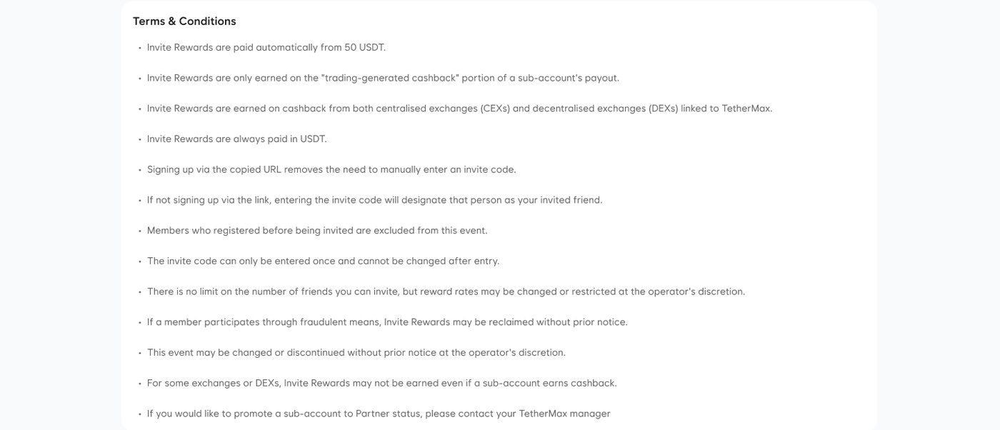

### R-05 파트너 허브 모바일 · 자동 지급 · 퍼널 · 캡션

| 구분 | 내용 |
|---|---|
| 지금 | [29065:3660](https://www.figma.com/design/hsa3bSV9QmFTe2jsf6tzTm/UI-UX-Design?node-id=29065-3660) `Available to Withdraw` + 활성 `Withdraw`, 퍼널 셋째 비율 `Payout Rate`(DEX 캡션 없음), `Linked Accounts` 카드에 USDC 캡션 없음 |
| 근거 | 같은 화면 PC PH1 [28960:127182](https://www.figma.com/design/hsa3bSV9QmFTe2jsf6tzTm/UI-UX-Design?node-id=28960-127182) — 비활성 `Auto Claim` · `Payout / Settled Rate` + `DEX: cashback settled` · `Sub-accounts' cashback in USDT (USDC shown 1:1).` |
| 수정안 | 버튼 → PC와 같은 비활성 `Auto Claim` 인스턴스 · 퍼널 라벨 `Payout / Settled Rate` + 캡션 `DEX: cashback settled` 추가 · `Linked Accounts` 제목 아래에 PC 캡션 복제. 금액 라벨은 PC `Available for payout`과 MO `Available to Withdraw`가 다름 — **문구 원문 없음**(G-418 문구표에서 하나로) |
| 근거 번호 | REQ-428 · REQ-430 · REQ-434 · G-418 |

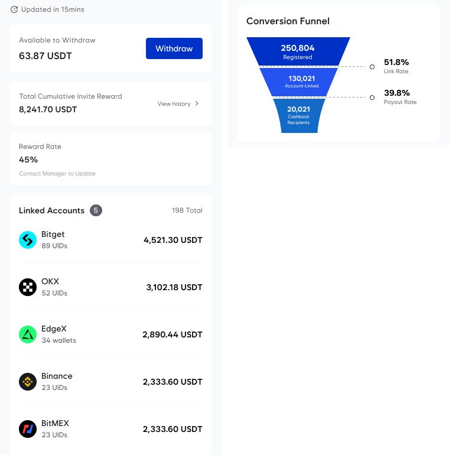

### R-06 Cashback Basics 아티클 · 본문 교체 + KEY TAKEAWAYS(Account 기준)

| 구분 | 내용 |
|---|---|
| 지금 | DEX(revision)에 프레임 없음. 기존 [19604:32207](https://www.figma.com/design/hsa3bSV9QmFTe2jsf6tzTm/UI-UX-Design?node-id=19604-32207)(PC) · [19604:31955](https://www.figma.com/design/hsa3bSV9QmFTe2jsf6tzTm/UI-UX-Design?node-id=19604-31955)(MO): `Minimum withdrawal: … for a UID reaches 10 USDT or more.` · `Event Reward Rules: … under the same UID …` · `Once requirements are met, funds land in your exchange account roughly 5 minutes to 1 hour after you request the withdrawal.` · `How: Members log in and click Withdraw from the home screen. Non-members can select their exchange, enter their UID, and withdraw from the homepage.` · `Cashback history … by exchange, UID, and reward type.` · KEY TAKEAWAYS에 마진·레버리지(다른 모듈) 내용 |
| 근거 | 같은 기존 프레임(아티클 틀·KEY TAKEAWAYS 박스), 박스 규칙 = 「정확히 bullet 3개, 각 bullet = 짧은 주장 문장 + 상세 1~2문장」(정책 B-17) |
| 수정안 | ① 두 프레임을 퀴즈 섹션([28960:130553](https://www.figma.com/design/hsa3bSV9QmFTe2jsf6tzTm/UI-UX-Design?node-id=28960-130553)) `Signed In, Module 5` 오른쪽에 복제, 이름 `Cashback Basics / PC`·`/ 모바일` ② 본문: `UID` → `account`(최소 출금·이벤트 리워드 규칙·캐시백 내역 3곳) · `How:` 첫 문장 → 10 USDT 이상 자동 지급 · `Non-members …` 문장 **삭제** · 「request the withdrawal」 문장 → 자동 지급 기준 — 교체 문장은 **문구 원문 없음**(G-419 문구표 ①②③). `Link your UID: 3 USDT`는 그대로 ③ KEY TAKEAWAYS 3개를 아래 초안으로 교체 |
| 근거 번호 | REQ-714 · REQ-444 · 결정 N12 · 정책 6-1 · 6-5 · 8-24 · G-419 |

**KEY TAKEAWAYS 초안(Account 기준 — 이 세션 작성, 승인 대상)**

| # | EN 초안 | 뜻(KO) |
|---|---|---|
| 1 | **Cashback is tracked per account.** Each linked exchange UID or DEX wallet has its own balance, and event rewards can be paid out only up to the cashback earned on the same account. | 캐시백은 계정별로 쌓인다. 이벤트 리워드는 같은 계정의 캐시백만큼만 함께 지급(매칭 `A + MIN(B, A)`) |
| 2 | **Payouts are automatic.** When an account's claimable amount reaches 10 USDT, TetherMax sends it to that account. You don't need to press Claim. | 계정별 출금 가능액 10 USDT 이상이면 자동 지급, 버튼 없음 |
| 3 | **Anyone can check, members get paid.** Guests can look up cashback with an exchange and a UID or wallet address, but you need to sign up and link the account to receive it. | 게스트는 조회만, 지급은 가입·연동 후 |

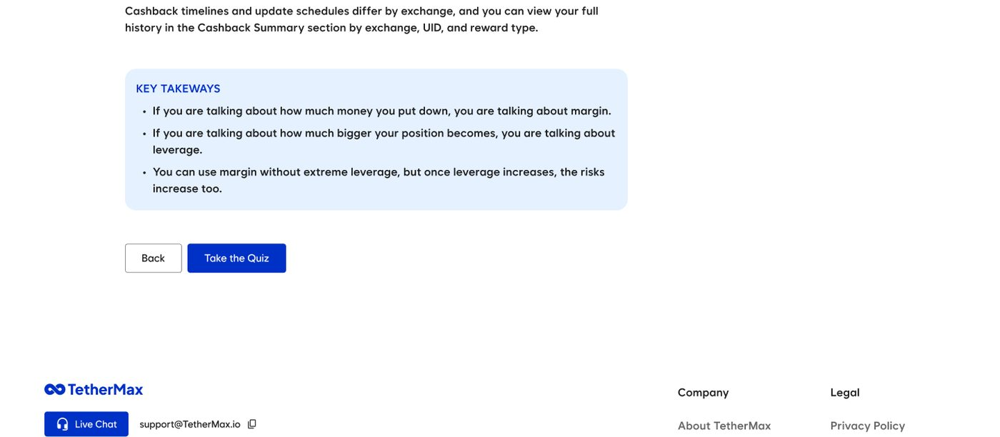

### R-07 EMAIL 29 거래소 지원 종료 · EN 「종료일 전에 출금」 문장 삭제

| 구분 | 내용 |
|---|---|
| 대상 | EN 630 [29061:1308](https://www.figma.com/design/hsa3bSV9QmFTe2jsf6tzTm/UI-UX-Design?node-id=29061-1308) · EN 375 [29064:2592](https://www.figma.com/design/hsa3bSV9QmFTe2jsf6tzTm/UI-UX-Design?node-id=29064-2592) |
| 지금 | 붉은 안내 박스 끝 문장 `Please ensure to withdraw any cashback accrued before the termination date.` |
| 근거 | 같은 메일 KO 판 [29062:118802](https://www.figma.com/design/hsa3bSV9QmFTe2jsf6tzTm/UI-UX-Design?node-id=29062-118802)(종료 후에도 지급 대상, 해당 문장 없음) |
| 수정안 | 그 문장만 삭제. 박스 앞 문장 `Notice: From the service termination date, new wallet linking and cashback accumulation will be completely halted.`은 유지 |
| 근거 번호 | REQ-669 · 정책 10장 · 이메일 문구 변경 |

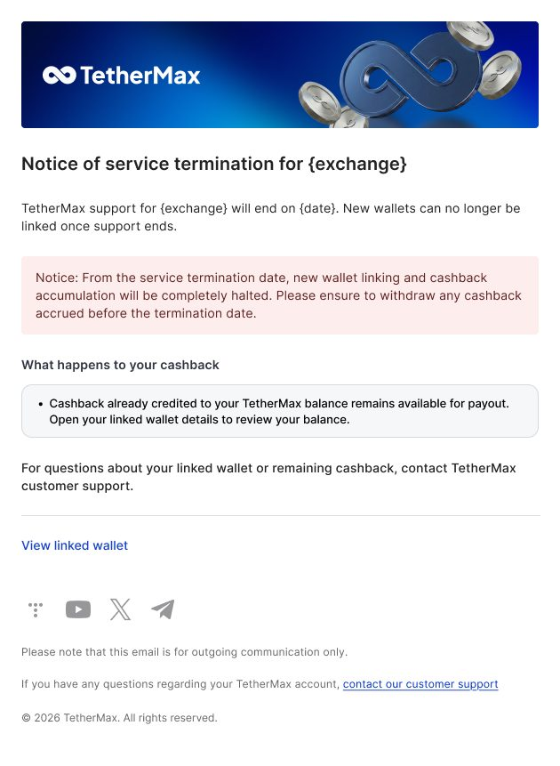
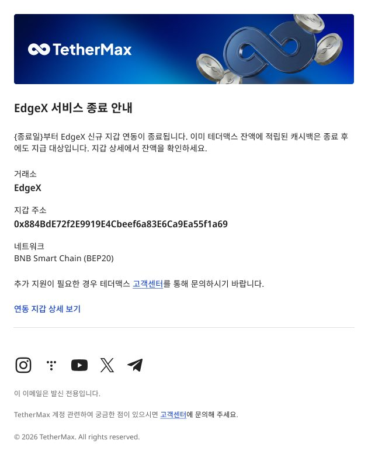

---

## 우선 2 — 개발자가 추측해야 함

### R-08 맥스보드 · `Updated once a day` 노출 정리 (지연 · 완성 직후 · 집계 이후)

| 구분 | 내용 |
|---|---|
| 대상 | 정산 지연 [29062:111741](https://www.figma.com/design/hsa3bSV9QmFTe2jsf6tzTm/UI-UX-Design?node-id=29062-111741) · [29062:112159](https://www.figma.com/design/hsa3bSV9QmFTe2jsf6tzTm/UI-UX-Design?node-id=29062-112159) / 보드 완성 [29064:10322](https://www.figma.com/design/hsa3bSV9QmFTe2jsf6tzTm/UI-UX-Design?node-id=29064-10322) · [29064:10687](https://www.figma.com/design/hsa3bSV9QmFTe2jsf6tzTm/UI-UX-Design?node-id=29064-10687) / 집계 [29064:12448](https://www.figma.com/design/hsa3bSV9QmFTe2jsf6tzTm/UI-UX-Design?node-id=29064-12448) · [29064:12826](https://www.figma.com/design/hsa3bSV9QmFTe2jsf6tzTm/UI-UX-Design?node-id=29064-12826) / 결과 발표 [29064:13201](https://www.figma.com/design/hsa3bSV9QmFTe2jsf6tzTm/UI-UX-Design?node-id=29064-13201) · [29064:13579](https://www.figma.com/design/hsa3bSV9QmFTe2jsf6tzTm/UI-UX-Design?node-id=29064-13579) / 지급 기간 [29064:13958](https://www.figma.com/design/hsa3bSV9QmFTe2jsf6tzTm/UI-UX-Design?node-id=29064-13958) · [29064:14356](https://www.figma.com/design/hsa3bSV9QmFTe2jsf6tzTm/UI-UX-Design?node-id=29064-14356) / 결과 발표·제외 [29064:14754](https://www.figma.com/design/hsa3bSV9QmFTe2jsf6tzTm/UI-UX-Design?node-id=29064-14754) · [29064:15127](https://www.figma.com/design/hsa3bSV9QmFTe2jsf6tzTm/UI-UX-Design?node-id=29064-15127) |
| 지금 | 지연 안내 `Cashback Update Delayed`와 `Updated once a day`(보드 아래 · 리더보드 위)가 함께 보임. 집계 이후에도 리더보드 위 `Updated once a day`. 보드 완성 지급일 문장 뒤에 `participating wallet from Oct 31, 09:00.` 한 줄 중복 |
| 근거 | 기존 Bingo 같은 단계 프레임(집계 참여자 [28537:450393](https://www.figma.com/design/hsa3bSV9QmFTe2jsf6tzTm/UI-UX-Design?node-id=28537-450393) 등) — 레이아웃 동일, 문구 노출 규칙은 정책 기준 |
| 수정안 | 지연: `Updated once a day` 두 곳 숨김(지연 안내만) · 집계·결과 발표·지급 기간·제외: `Updated once a day` 숨김 · 보드 완성: 리더보드 위 문구를 「랭킹은 매일 업데이트돼요」로 교체(**EN 문구 원문 없음**), 중복 줄 삭제 |
| 근거 번호 | REQ-639 · REQ-640 · REQ-654 · D-1-4 |

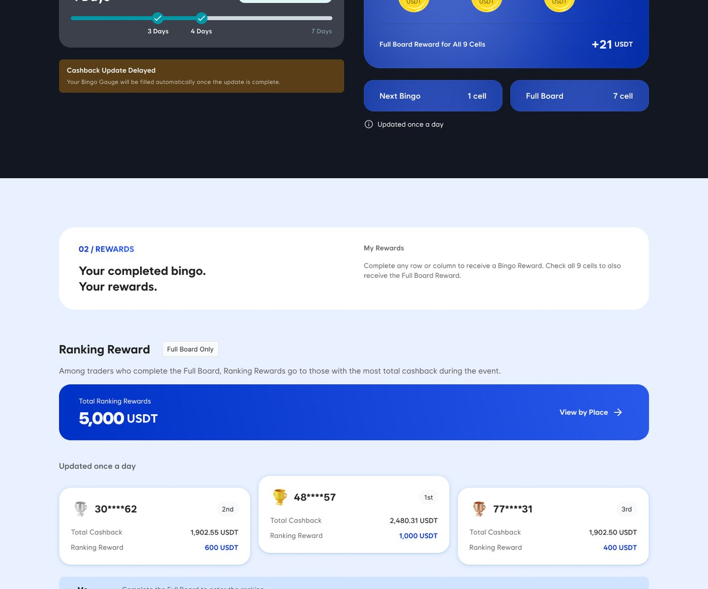
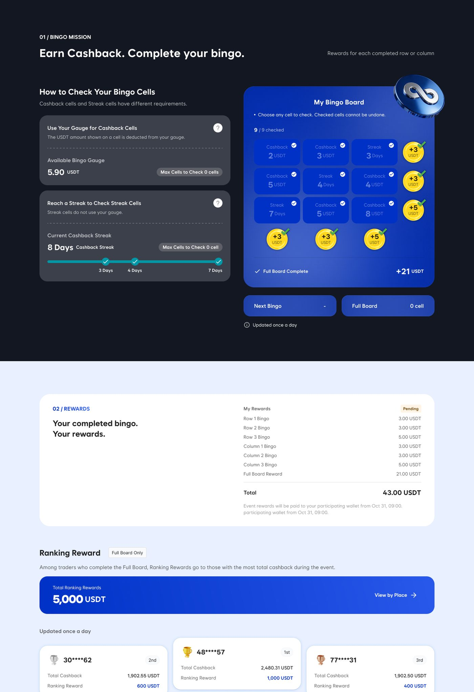
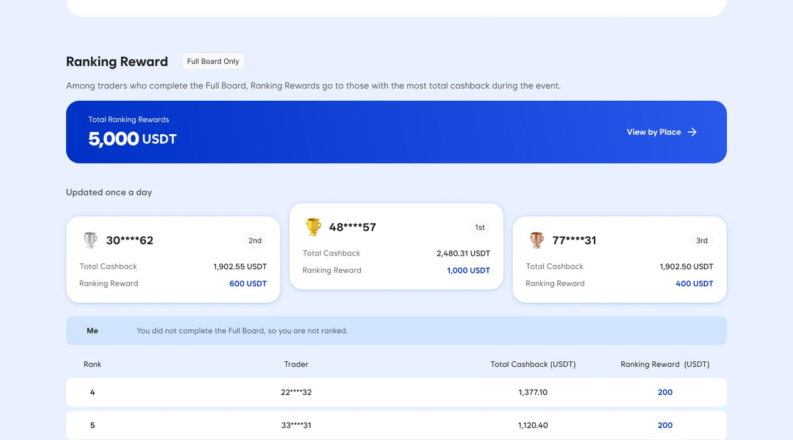

### R-09 맥스보드 · 참여 계정 선택 → 등록 확인 → 재선택 확인 모달 (시안 B)

| 구분 | 내용 |
|---|---|
| 지금 | DEX(revision)에 모달 없음. `Join NOW` 화면 [29062:111024](https://www.figma.com/design/hsa3bSV9QmFTe2jsf6tzTm/UI-UX-Design?node-id=29062-111024) · [29062:111380](https://www.figma.com/design/hsa3bSV9QmFTe2jsf6tzTm/UI-UX-Design?node-id=29062-111380)만 있음 |
| 근거 | 기존 Bingo 시안 B — 선택 [28537:463009](https://www.figma.com/design/hsa3bSV9QmFTe2jsf6tzTm/UI-UX-Design?node-id=28537-463009)(PC) · [28537:463035](https://www.figma.com/design/hsa3bSV9QmFTe2jsf6tzTm/UI-UX-Design?node-id=28537-463035)(MO), 확인·재선택 확인 [28537:462948](https://www.figma.com/design/hsa3bSV9QmFTe2jsf6tzTm/UI-UX-Design?node-id=28537-462948)(PC) · [28537:462968](https://www.figma.com/design/hsa3bSV9QmFTe2jsf6tzTm/UI-UX-Design?node-id=28537-462968) · [28537:462988](https://www.figma.com/design/hsa3bSV9QmFTe2jsf6tzTm/UI-UX-Design?node-id=28537-462988)(MO). 현행 판정 C5 = 시안 B |
| 수정안 | 시안 B 6프레임(PC·MO × 선택·등록 확인·재선택 확인)을 맥스보드 `참여 가능` 옆에 복제. 문구(REQ-655): · 선택 제목 `Select a UID to Participate` → `Select an Account to Participate`, 부제 `Only eligible Bitget UIDs are shown.` → `Only eligible {exchange} accounts are shown.` — **두 문장 원문 없음**(UID→Account 치환안) · 행: DEX 지갑은 전체 주소(`EdgeX · Wallet 0x…`, 쿠폰 계정 선택 [29062:117713](https://www.figma.com/design/hsa3bSV9QmFTe2jsf6tzTm/UI-UX-Design?node-id=29062-117713) 행과 같은 표기) · 확인 제목 `Would you like to participate with this UID?` → `…with this account?`(치환안), 본문 `You can't change it after registration.`(원문 그대로) · 재선택 본문 → `If you select a new account, your progress on this board starts over. You can't change it after registration.`(REQ-655 원문) · 등록 확인 누락(400 `CONFIRMATION_REQUIRED`)은 같은 확인 모달 재표시 — 별도 프레임 없음 |
| 근거 번호 | REQ-646 · REQ-655 · D-1-6 · 결정 N5 · 현행 판 C5 |

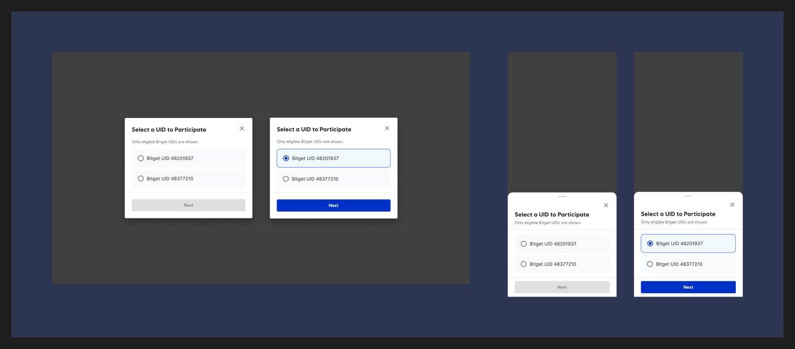
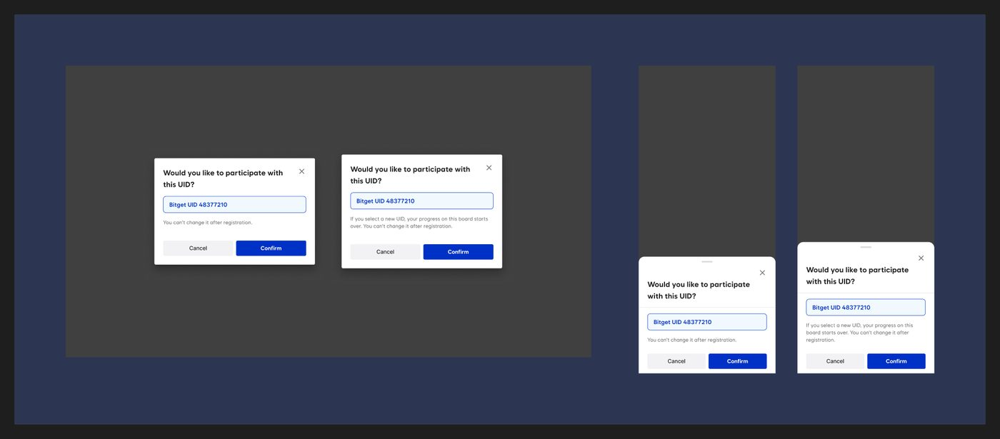
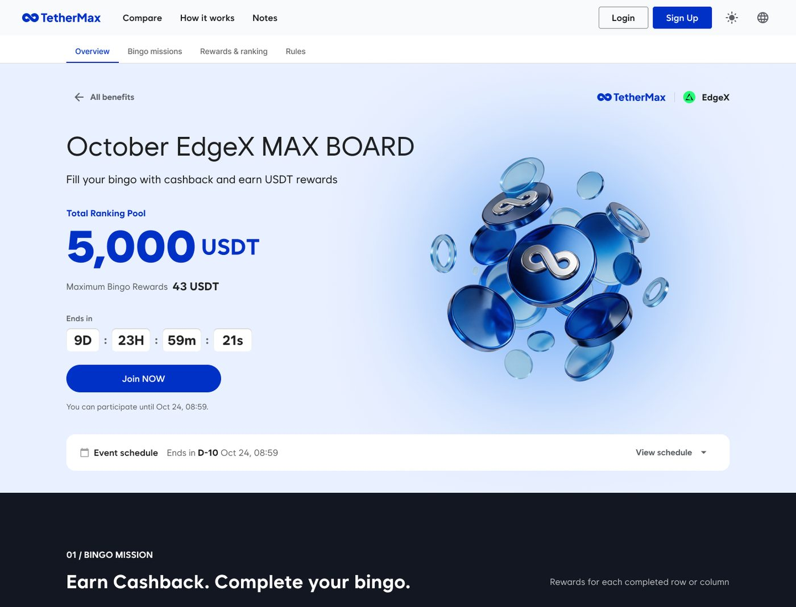

### R-10 맥스보드 · 게스트·미참여 단계 화면 5종 추가

| 구분 | 내용 |
|---|---|
| 지금 | DEX(revision)에 없음 |
| 근거 | 기존 Bingo — 사전공개·비회원 [28537:444420](https://www.figma.com/design/hsa3bSV9QmFTe2jsf6tzTm/UI-UX-Design?node-id=28537-444420) · [28537:452315](https://www.figma.com/design/hsa3bSV9QmFTe2jsf6tzTm/UI-UX-Design?node-id=28537-452315) / 참여 기간·비회원 [28537:446882](https://www.figma.com/design/hsa3bSV9QmFTe2jsf6tzTm/UI-UX-Design?node-id=28537-446882) · [28537:453097](https://www.figma.com/design/hsa3bSV9QmFTe2jsf6tzTm/UI-UX-Design?node-id=28537-453097) / 집계·미참여 [28537:445158](https://www.figma.com/design/hsa3bSV9QmFTe2jsf6tzTm/UI-UX-Design?node-id=28537-445158) · [28537:454887](https://www.figma.com/design/hsa3bSV9QmFTe2jsf6tzTm/UI-UX-Design?node-id=28537-454887) / 결과 발표·미참여 [28537:445847](https://www.figma.com/design/hsa3bSV9QmFTe2jsf6tzTm/UI-UX-Design?node-id=28537-445847) · [28537:455579](https://www.figma.com/design/hsa3bSV9QmFTe2jsf6tzTm/UI-UX-Design?node-id=28537-455579) / 지급 기간·미참여 [28537:446191](https://www.figma.com/design/hsa3bSV9QmFTe2jsf6tzTm/UI-UX-Design?node-id=28537-446191) · [28537:455925](https://www.figma.com/design/hsa3bSV9QmFTe2jsf6tzTm/UI-UX-Design?node-id=28537-455925) |
| 수정안 | 10프레임 복제, 맥스보드 3행(결과 발표·제외 · 404 줄) 아래 새 줄에 단계 순서대로. 바꿀 값: 보드 이름 `October Bitget MAX BOARD` → `October EdgeX MAX BOARD` · 거래소 로고 EdgeX · 하단 Notes를 DEX 프레임 Notes로 교체(R-01 치환 포함) · 보드 칸 구성은 DEX 프레임과 같게(금액 칸만 변형 미사용, REQ-634). 비회원 CTA·비활성 버튼 문구는 원본 그대로 |
| 근거 번호 | 결정 N4 · D-1 · REQ-634 |

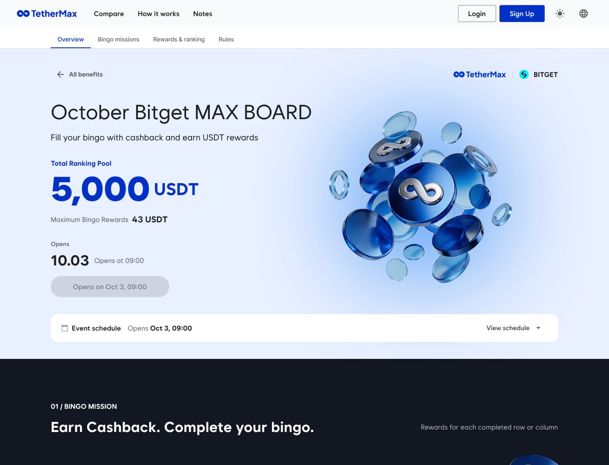

### R-11 맥스보드 · 등록 실패 토스트

| 구분 | 내용 |
|---|---|
| 지금 | 없음 |
| 근거 | 기존 Bingo toast 섹션 [28537:451987](https://www.figma.com/design/hsa3bSV9QmFTe2jsf6tzTm/UI-UX-Design?node-id=28537-451987) — `Toast - warning` |
| 수정안 | warning 토스트를 복제해 `You can't participate with this account.`(REQ-655 원문)로 교체, PC·MO 2프레임을 `참여 가능` 옆에. 트리거 422(`UID_NOT_LINKED` 등 5종) 공통, 표시 후 목록 재조회 |
| 근거 번호 | REQ-649 · REQ-655 |

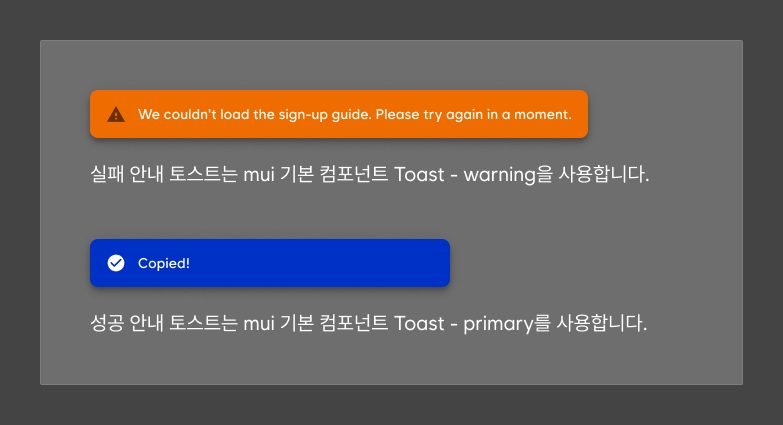

### R-12 맥스보드 · 오늘 마감 `Ends Today`

| 구분 | 내용 |
|---|---|
| 지금 | 일정 줄은 `Ends in D-10 Oct 24, 08:59` 형식만([29064:8176](https://www.figma.com/design/hsa3bSV9QmFTe2jsf6tzTm/UI-UX-Design?node-id=29064-8176) 상단) |
| 근거 | 같은 프레임의 `Event schedule` 줄(기존 Bingo `event schedule` [28537:451942](https://www.figma.com/design/hsa3bSV9QmFTe2jsf6tzTm/UI-UX-Design?node-id=28537-451942)) |
| 수정안 | `참여 가능` PC·MO 히어로를 잘라 2프레임 복제, 일정 값만 `Ends Today`(REQ-639 원문) |
| 근거 번호 | REQ-639 |

### R-13 맥스보드 · 마지막 날 Batch 후 완성

| 구분 | 내용 |
|---|---|
| 지금 | 없음 |
| 근거 | 보드 완성 [29064:10322](https://www.figma.com/design/hsa3bSV9QmFTe2jsf6tzTm/UI-UX-Design?node-id=29064-10322) · [29064:10687](https://www.figma.com/design/hsa3bSV9QmFTe2jsf6tzTm/UI-UX-Design?node-id=29064-10687)(기존 Bingo 완성 [28537:450028](https://www.figma.com/design/hsa3bSV9QmFTe2jsf6tzTm/UI-UX-Design?node-id=28537-450028)) |
| 수정안 | 2프레임 복제, 리더보드 위 문구를 「최종 순위는 결과 발표 때 확인할 수 있어요」 + 결과 발표 일시로 교체 — **EN 문구 원문 없음** |
| 근거 번호 | REQ-654 |

### R-14 쿠폰 적용 완료 · PC `Total Amount` 행 + 모바일 화면

| 구분 | 내용 |
|---|---|
| 지금 | PC [29065:7079](https://www.figma.com/design/hsa3bSV9QmFTe2jsf6tzTm/UI-UX-Design?node-id=29065-7079) 문구·`Wallet` 라벨 일치, `Total Amount` 행 없음. MO는 DEX(revision)에 없음(기존 [25994:12167](https://www.figma.com/design/hsa3bSV9QmFTe2jsf6tzTm/UI-UX-Design?node-id=25994-12167)는 `UID` 라벨 · `…withdrawn together with your cashback.`) |
| 근거 | 기존 MO 수령 화면 [25994:12167](https://www.figma.com/design/hsa3bSV9QmFTe2jsf6tzTm/UI-UX-Design?node-id=25994-12167) |
| 수정안 | PC: 표 `Amount` 행 아래에 구분선 + `Total Amount` 행 복제. MO: 25994:12167을 `쿠폰 적용 완료 · PC` 옆에 복제 → 제목 `You've received {n} USDT as a reward!` · 완료 문구 `Event rewards can be withdrawn only up to the amount of cashback you have earned.` · DEX 예시 행 라벨 `Wallet` + 전체 주소 · `Total Amount` (모두 REQ-405 원문) |
| 근거 번호 | REQ-405 |

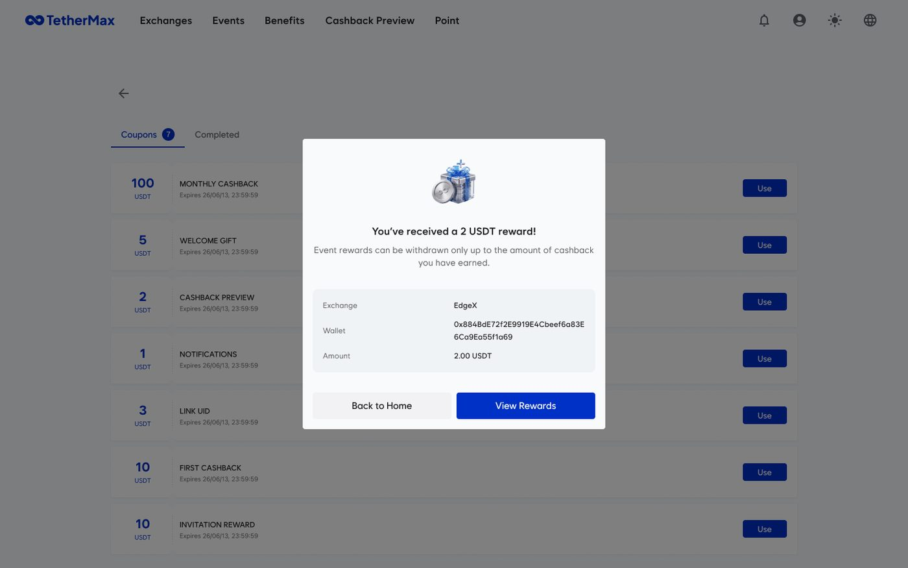
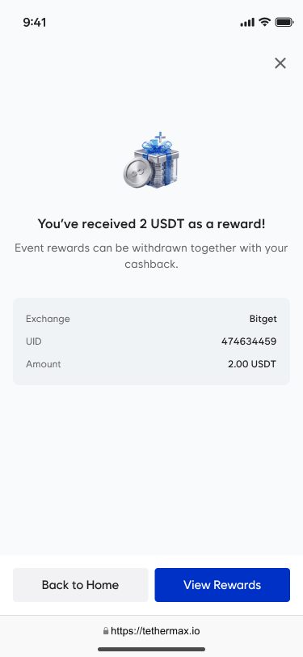

### R-15 쿠폰함 Completed · 약관 2문장

| 구분 | 내용 |
|---|---|
| 대상 | [29062:115768](https://www.figma.com/design/hsa3bSV9QmFTe2jsf6tzTm/UI-UX-Design?node-id=29062-115768) · [29062:116256](https://www.figma.com/design/hsa3bSV9QmFTe2jsf6tzTm/UI-UX-Design?node-id=29062-116256) |
| 지금 | `b. In order to use a coupon, 'UID biinding' must be completed with at least one exchange.` · `Coupon for UID binding` / `'Coupon for UID binding' is given after finishing binding exxhanges' UID for the first time.` |
| 근거 | 같은 프레임 약관 목록(구조 그대로) |
| 수정안 | 첫 문장 → 「쿠폰 사용엔 연동 계정(UID 또는 지갑) 최소 1개 필요」, `Coupon for UID binding` 항목 → 거래소 UID 첫 연동 쿠폰임이 드러나게 — 두 문장 모두 **문구 원문 없음**(REQ-404에 의미만). 오타 `biinding` · `exxhanges'`는 교체 시 함께 사라짐 |
| 근거 번호 | REQ-404 |

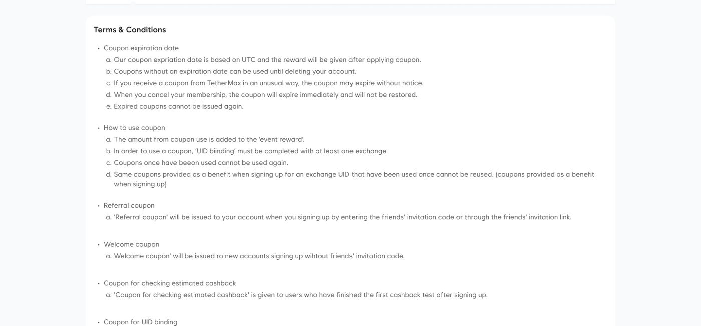

### R-16 쿠폰 · 연동 계정 없음 · 이미 사용된 쿠폰

| 구분 | 내용 |
|---|---|
| 지금 | 없음 |
| 근거 | 기존 MO `Unable to Use Coupon` 다이얼로그 [12474:164021](https://www.figma.com/design/hsa3bSV9QmFTe2jsf6tzTm/UI-UX-Design?node-id=12474-164021) · PC는 DEX 쿠폰 다이얼로그 틀([29065:7079](https://www.figma.com/design/hsa3bSV9QmFTe2jsf6tzTm/UI-UX-Design?node-id=29065-7079)의 모달 크기) |
| 수정안 | 4프레임(PC·MO × 2상태)을 `쿠폰 · 사용할 계정 선택` 옆에. 연동 계정 없음: 버튼 `Link Account`(G-196 확정) + `Cancel`, 본문 **문구 원문 없음**. 이미 사용(409): 제목·본문 **문구 원문 없음**, 버튼 `OK` |
| 근거 번호 | G-196 · API-017 |

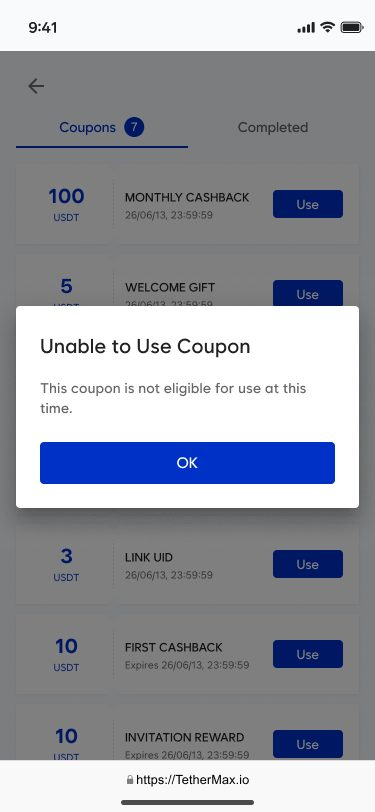

### R-17 혜택 목록(회원) · `LINK UID` 행 부제

| 구분 | 내용 |
|---|---|
| 지금 | DEX(revision) 혜택 PC [29062:113000](https://www.figma.com/design/hsa3bSV9QmFTe2jsf6tzTm/UI-UX-Design?node-id=29062-113000)는 게스트 완료 탭만(목록 행 없음). 기존 회원 목록 [10954:228708](https://www.figma.com/design/hsa3bSV9QmFTe2jsf6tzTm/UI-UX-Design?node-id=10954-228708) · [17170:172813](https://www.figma.com/design/hsa3bSV9QmFTe2jsf6tzTm/UI-UX-Design?node-id=17170-172813)의 `LINK UID` 행 부제 `Bind your exchange UID` |
| 근거 | 기존 회원 진행 중 목록 |
| 수정안 | 2프레임 복제(`혜택 · 진행 중 · 회원`), `LINK UID` 행 부제 → `Link a CEX UID to Get Cashback`(REQ-396 제목 원문). `FIRST CASHBACK` 행 부제 `Claim your first cashback` 그대로 |
| 근거 번호 | REQ-396 · REQ-400 |

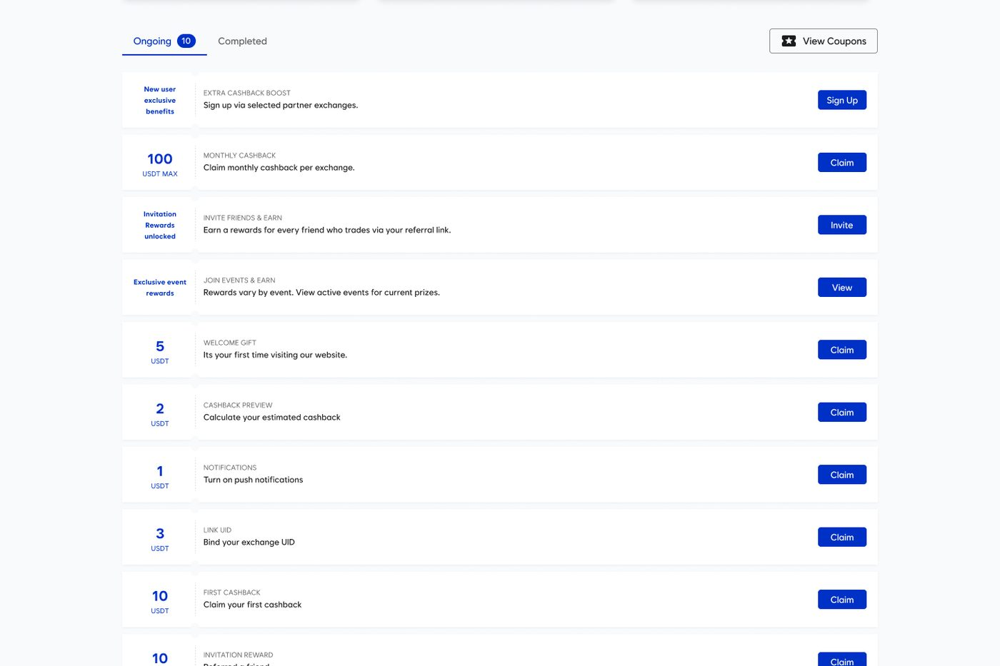

### R-18 혜택 · 회원 완료 0건 빈 상태

| 구분 | 내용 |
|---|---|
| 지금 | DEX(revision)에 없음. 기존 [10954:230325](https://www.figma.com/design/hsa3bSV9QmFTe2jsf6tzTm/UI-UX-Design?node-id=10954-230325) · [11100:221304](https://www.figma.com/design/hsa3bSV9QmFTe2jsf6tzTm/UI-UX-Design?node-id=11100-221304) `You haven't completed any benefits yet.` + `View Benefits` |
| 근거 | 같은 기존 프레임 |
| 수정안 | 2프레임 복제 → `No Completed Rewards Yet` + 버튼 `Explore Ongoing Rewards`(REQ-401 원문) |
| 근거 번호 | REQ-401 |

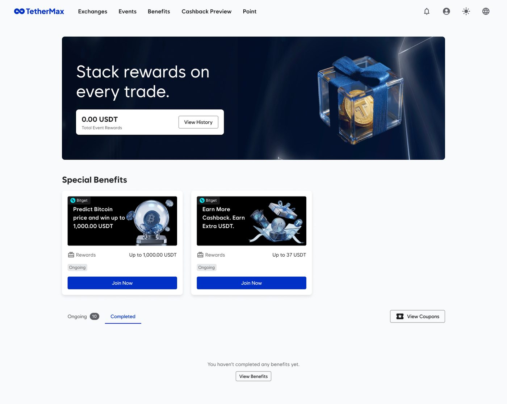

### R-19 혜택 상세 · UID 연동 3 USDT(CEX 전용)

| 구분 | 내용 |
|---|---|
| 지금 | DEX(revision)에 없음. 기존 [10976:53104](https://www.figma.com/design/hsa3bSV9QmFTe2jsf6tzTm/UI-UX-Design?node-id=10976-53104) · [11731:356403](https://www.figma.com/design/hsa3bSV9QmFTe2jsf6tzTm/UI-UX-Design?node-id=11731-356403) 제목 `Link UID to Get Cashback` |
| 근거 | 같은 기존 프레임 + `Reward Details` 표 행 |
| 수정안 | 2프레임 복제 → 제목 `Link a CEX UID to Get Cashback` · 부제 `Link a CEX exchange UID to start earning cashback and receive 3 USDT.` · 표 행 추가 `Eligible Exchanges` = `CEX only` · 하단 안내 줄 복제 `Linking a DEX wallet does not qualify for this reward.`(모두 REQ-396 원문) |
| 근거 번호 | REQ-396 |

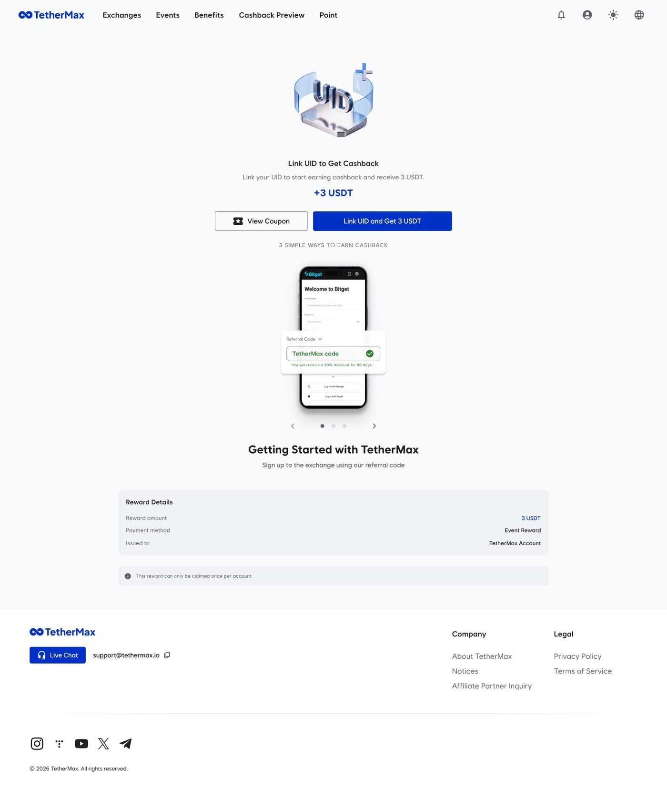

### R-20 캐시백 챌린지 · 진행 · 수령 계정 선택 · 미연동 안내 (Account)

| 구분 | 내용 |
|---|---|
| 지금 | DEX(revision)에 없음. 기존 진행 [10981:85015](https://www.figma.com/design/hsa3bSV9QmFTe2jsf6tzTm/UI-UX-Design?node-id=10981-85015) · MO [10739:232621](https://www.figma.com/design/hsa3bSV9QmFTe2jsf6tzTm/UI-UX-Design?node-id=10739-232621), 선택 [10981:85017](https://www.figma.com/design/hsa3bSV9QmFTe2jsf6tzTm/UI-UX-Design?node-id=10981-85017), 미연동 [10981:85016](https://www.figma.com/design/hsa3bSV9QmFTe2jsf6tzTm/UI-UX-Design?node-id=10981-85016) · MO [21772:102786](https://www.figma.com/design/hsa3bSV9QmFTe2jsf6tzTm/UI-UX-Design?node-id=21772-102786) |
| 근거 | 같은 기존 프레임 + DEX 쿠폰 계정 선택(전체/CEX/DEX 칩·그룹 헤더) [29062:117713](https://www.figma.com/design/hsa3bSV9QmFTe2jsf6tzTm/UI-UX-Design?node-id=29062-117713) · MO [29062:117894](https://www.figma.com/design/hsa3bSV9QmFTe2jsf6tzTm/UI-UX-Design?node-id=29062-117894) |
| 수정안 | 6프레임 복제(PC 3 · MO 3). · 부제 `Cashback history is updated daily at 13:00` → `Cashback history is updated daily at {local_time}`(REQ-410) · 유의사항 3곳 `UID` → `account`: `The account to receive event rewards cannot be changed once set.` · `Once an account is linked to participate …` · `… while your account is in issue status …`(REQ-410 KO 원문의 EN 치환안) · 선택 모달: 제목 `Select an account to receive the reward`(치환안), 목록 영역을 DEX 쿠폰 계정 선택의 칩+그룹 헤더 블록으로 교체. MO는 29062:117894 복제 · 미연동 다이얼로그: `UID Link Required` → `Account Link Required`, `Link your UID to join …` → `Link your account to join the event and start earning rewards.`(치환안), 노출은 거래 계정 0개일 때만. 카드 `Unlocks after linking UID` → `Unlocks after linking an account`(치환안) · 레벨 금액은 표본값(C2) |
| 근거 번호 | REQ-399 · REQ-410 · REQ-438 · 결정 N10 · 현행 판 C2 |

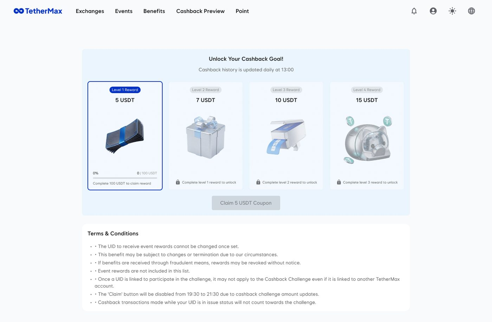
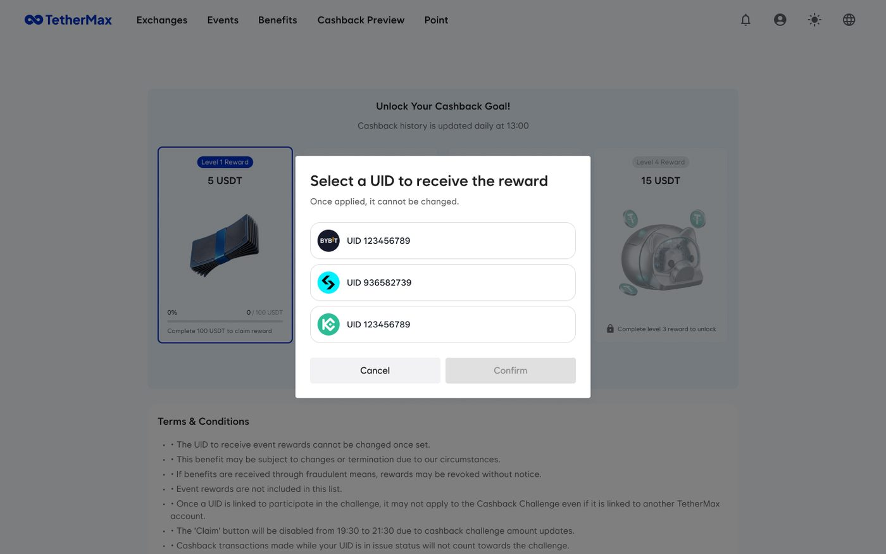
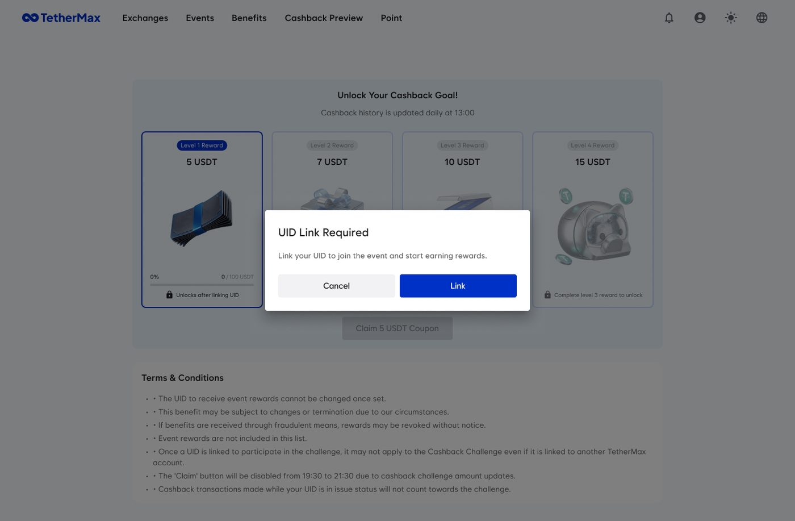
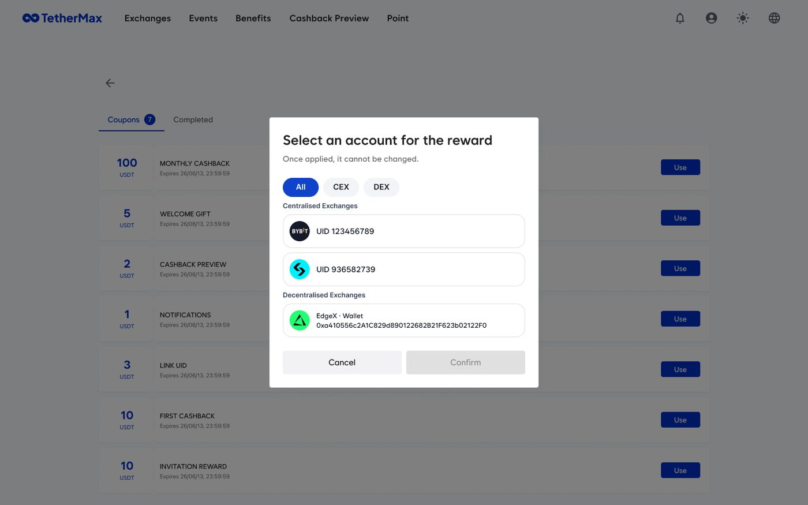

### R-21 퀴즈 모듈 4·5 · 모바일 전 상태

| 구분 | 내용 |
|---|---|
| 지금 | PC만 있음 — 아티클 [28960:130629](https://www.figma.com/design/hsa3bSV9QmFTe2jsf6tzTm/UI-UX-Design?node-id=28960-130629) · [28960:130685](https://www.figma.com/design/hsa3bSV9QmFTe2jsf6tzTm/UI-UX-Design?node-id=28960-130685), 퀴즈 [28960:130741](https://www.figma.com/design/hsa3bSV9QmFTe2jsf6tzTm/UI-UX-Design?node-id=28960-130741) · [28960:130764](https://www.figma.com/design/hsa3bSV9QmFTe2jsf6tzTm/UI-UX-Design?node-id=28960-130764), 상태 16([28978:127308](https://www.figma.com/design/hsa3bSV9QmFTe2jsf6tzTm/UI-UX-Design?node-id=28978-127308) ~ [28978:128442](https://www.figma.com/design/hsa3bSV9QmFTe2jsf6tzTm/UI-UX-Design?node-id=28978-128442)). MO는 소개 [29058:108346](https://www.figma.com/design/hsa3bSV9QmFTe2jsf6tzTm/UI-UX-Design?node-id=29058-108346)뿐 |
| 근거 | 기존 Quiz mWeb — 아티클 [19604:32020](https://www.figma.com/design/hsa3bSV9QmFTe2jsf6tzTm/UI-UX-Design?node-id=19604-32020), 퀴즈 [19604:32311](https://www.figma.com/design/hsa3bSV9QmFTe2jsf6tzTm/UI-UX-Design?node-id=19604-32311) (섹션 [19604:32287](https://www.figma.com/design/hsa3bSV9QmFTe2jsf6tzTm/UI-UX-Design?node-id=19604-32287), 결과는 엄지 일러스트판 — 현행 판 C7) |
| 수정안 | MO 20프레임(아티클 2 · 퀴즈 2 · 상태 16)을 퀴즈 섹션 MO 소개 프레임 아래 줄에, PC 프레임과 1:1로 이름 맞춤. 본문·문항·인라인 문구는 PC 프레임 텍스트를 그대로 옮김(`Select an answer to question 2.` · `Log in to submit your answers. Your selections will be kept.` · `Your answers couldn't be submitted. Your selections have been kept.` · `We couldn't check your answers` · `You’ve already completed this module. Your original result is saved.` · `Quiz coupon` · `A quiz reward alone cannot be paid out.` · `View Coupons`) |
| 근거 번호 | REQ-443~448 · 현행 판 C7 |

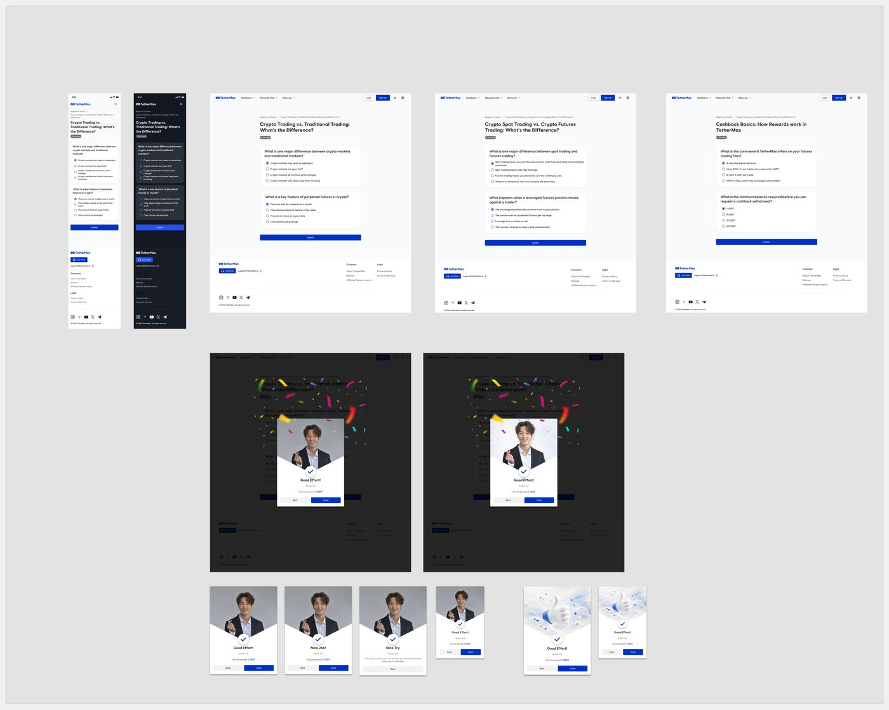
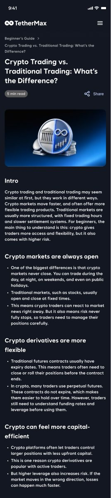

### R-22 퀴즈 모듈 5 아티클 · `rebate` 3곳

| 구분 | 내용 |
|---|---|
| 대상 | [28960:130685](https://www.figma.com/design/hsa3bSV9QmFTe2jsf6tzTm/UI-UX-Design?node-id=28960-130685) — 텍스트 [28960:130710](https://www.figma.com/design/hsa3bSV9QmFTe2jsf6tzTm/UI-UX-Design?node-id=28960-130710) · [28960:130719](https://www.figma.com/design/hsa3bSV9QmFTe2jsf6tzTm/UI-UX-Design?node-id=28960-130719) · [28960:130722](https://www.figma.com/design/hsa3bSV9QmFTe2jsf6tzTm/UI-UX-Design?node-id=28960-130722) (R-21 MO 판에도 같이) |
| 지금 | `…so your rebate stays simple to calculate…` · `…it usually saves more than the rebate does.` · KEY TAKEAWAYS `…which keeps your rebate simple to work out…` |
| 수정안 | 세 곳 `rebate` → `cashback`(용어 규칙, 나머지 문장 그대로) |
| 근거 번호 | 도메인 용어(cashback) · REQ-444 |

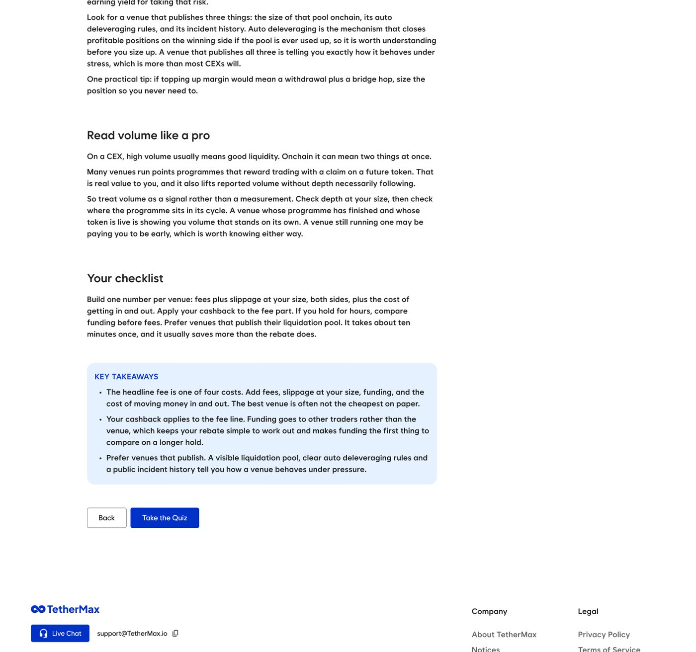

### R-23 파트너 허브 PC · 하위 회원 연동 계정 모달 그룹 헤더

| 구분 | 내용 |
|---|---|
| 지금 | [28960:127188](https://www.figma.com/design/hsa3bSV9QmFTe2jsf6tzTm/UI-UX-Design?node-id=28960-127188) CEX·DEX가 한 목록(그룹 헤더 없음) |
| 근거 | DEX 쿠폰 계정 선택의 그룹 헤더 `Centralised Exchanges` · `Decentralised Exchanges`([29062:117713](https://www.figma.com/design/hsa3bSV9QmFTe2jsf6tzTm/UI-UX-Design?node-id=29062-117713)) |
| 수정안 | 목록 위·DEX 첫 행 위에 그룹 헤더 텍스트 스타일 복제. 행 순서 CEX → DEX, 배지 없음, CEX 마스킹·DEX 전체 주소 유지. MO는 X-4(근거 없음) |
| 근거 번호 | REQ-427 · G-394 |

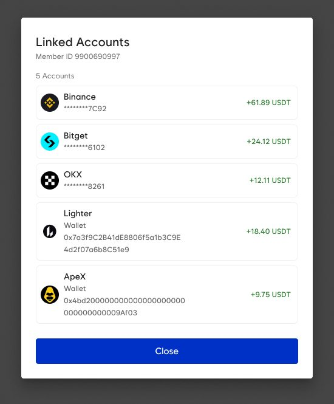

### R-24 친구 초대 랜딩 · `How it works` 3단계

| 구분 | 내용 |
|---|---|
| 대상 | IF1 [28960:126816](https://www.figma.com/design/hsa3bSV9QmFTe2jsf6tzTm/UI-UX-Design?node-id=28960-126816) |
| 지금 | `Earn a portion of your friend's cashback rewards whenever they trade.` |
| 수정안 | `whenever they trade` → `when your friends claim their cashback`(G-198 확정 구절, 문장 나머지 그대로) |
| 근거 번호 | G-198 · REQ-433 |

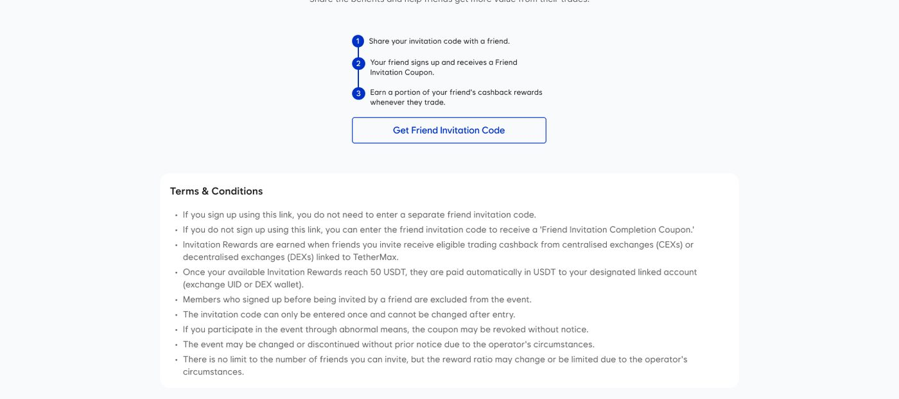

### R-25 친구 초대 · 10 USDT 미만 안내

| 구분 | 내용 |
|---|---|
| 지금 | 없음 |
| 근거 | 기존 파트너 허브 최소액 미달 인라인 경고 [5654:105991](https://www.figma.com/design/hsa3bSV9QmFTe2jsf6tzTm/UI-UX-Design?node-id=5654-105991)(주황 경고 줄 + 비활성 버튼) |
| 수정안 | IF7 PC·MO를 복제해 금액 `9.99 USDT`, `Available Invitation Rewards` 카드 아래에 경고 줄 복제. 문구는 `Just {amount} USDT more to withdraw`의 Claim 재작성 — **문구 원문 없음**. 파트너 허브 최소액 미만도 같은 줄 사용 |
| 근거 번호 | REQ-414 · 결정 D8 · G-419 |

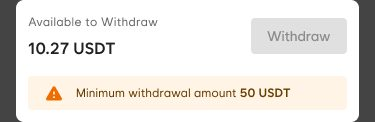

### R-26 EMAIL 31 · 연동 전 잔액 출금 실패 변형

| 구분 | 내용 |
|---|---|
| 지금 | 없음 |
| 근거 | 같은 섹션 EMAIL 31 운영자 거절 EN [29061:1106](https://www.figma.com/design/hsa3bSV9QmFTe2jsf6tzTm/UI-UX-Design?node-id=29061-1106) · KO [29062:118600](https://www.figma.com/design/hsa3bSV9QmFTe2jsf6tzTm/UI-UX-Design?node-id=29062-118600) · MO [29064:2403](https://www.figma.com/design/hsa3bSV9QmFTe2jsf6tzTm/UI-UX-Design?node-id=29064-2403) · [29064:5632](https://www.figma.com/design/hsa3bSV9QmFTe2jsf6tzTm/UI-UX-Design?node-id=29064-5632) |
| 수정안 | 4프레임(EN·KO × 630·375) 복제, 사유 블록만 `PRELINK_PAYOUT_FAILED` 사유로 — **문구 원문 없음**(G-426 「문구표에서 확정」) |
| 근거 번호 | D-5-2 · G-426 |

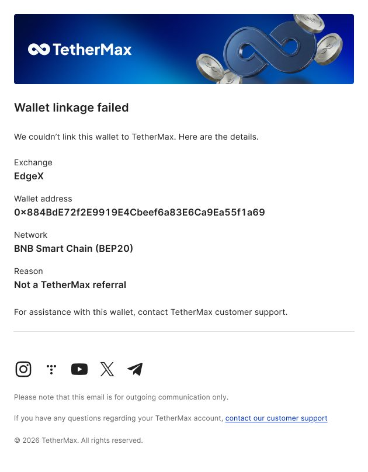

---

## 우선 3 — 다듬기

### R-27 맥스보드 · 등수별 랭킹 리워드 팝업 추가 + 서수 오타

| 구분 | 내용 |
|---|---|
| 지금 | DEX 화면에 `View by Place` 링크는 있으나 팝업 없음 |
| 근거 | 기존 Bingo 시안 B modal1 [28537:463082](https://www.figma.com/design/hsa3bSV9QmFTe2jsf6tzTm/UI-UX-Design?node-id=28537-463082) · [28537:463143](https://www.figma.com/design/hsa3bSV9QmFTe2jsf6tzTm/UI-UX-Design?node-id=28537-463143) |
| 수정안 | 2프레임 복제, `4st place`~`8st place`(및 9) → `4th place`~`9th place` |
| 근거 번호 | 원본 F-010 · 현행 판 C5 |

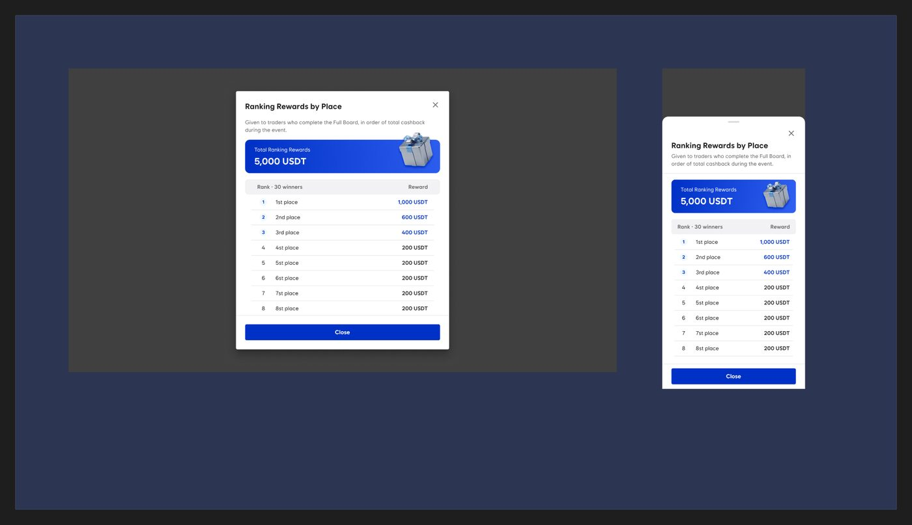

### R-28 맥스보드 · 결과 발표 · 제외 프레임 숨김

| 구분 | 내용 |
|---|---|
| 지금 | [29064:14754](https://www.figma.com/design/hsa3bSV9QmFTe2jsf6tzTm/UI-UX-Design?node-id=29064-14754) · [29064:15127](https://www.figma.com/design/hsa3bSV9QmFTe2jsf6tzTm/UI-UX-Design?node-id=29064-15127)이 결과 발표·참여자와 같은 내용인데 별도 상태처럼 보임 |
| 수정안 | 두 프레임 숨김(제외자는 참여자와 같은 화면 — D-1-8). 필요하면 이름에 `= 결과 발표 · 참여자와 같음` |
| 근거 번호 | D-1-8 |

### R-29 쿠폰함 빈 화면 · 탭 배지 0

| 구분 | 내용 |
|---|---|
| 지금 | DEX(revision)에 없음. 기존 [11982:388195](https://www.figma.com/design/hsa3bSV9QmFTe2jsf6tzTm/UI-UX-Design?node-id=11982-388195) · [11982:387214](https://www.figma.com/design/hsa3bSV9QmFTe2jsf6tzTm/UI-UX-Design?node-id=11982-387214) `No coupons available`인데 배지 `7` |
| 수정안 | 2프레임 복제, 배지 `0` |
| 근거 번호 | 결정 N8 |

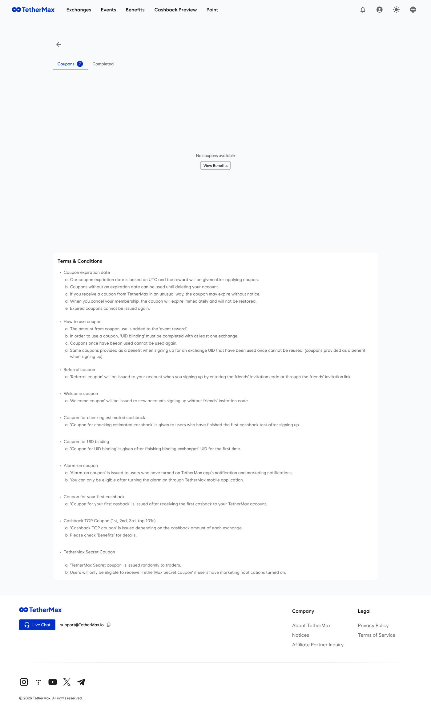

### R-30 이벤트 · 거래소 필터 결과 0건

| 구분 | 내용 |
|---|---|
| 지금 | 없음 |
| 근거 | 기존 빈 상태 [11366:318672](https://www.figma.com/design/hsa3bSV9QmFTe2jsf6tzTm/UI-UX-Design?node-id=11366-318672) · [9733:148686](https://www.figma.com/design/hsa3bSV9QmFTe2jsf6tzTm/UI-UX-Design?node-id=9733-148686) `No Events Yet` |
| 수정안 | `이벤트 · 거래소 이벤트` PC·MO를 복제해 필터 값(`EdgeX` 선택)을 둔 채 목록 자리에 기존 빈 상태 컴포넌트를 넣음. 문구는 기존 `No Events Yet` / `We don't have any events at the moment. Stay tuned for upcoming rewards and offers!` 그대로(필터 전용 문구 원문 없음) |
| 근거 번호 | REQ-437 |

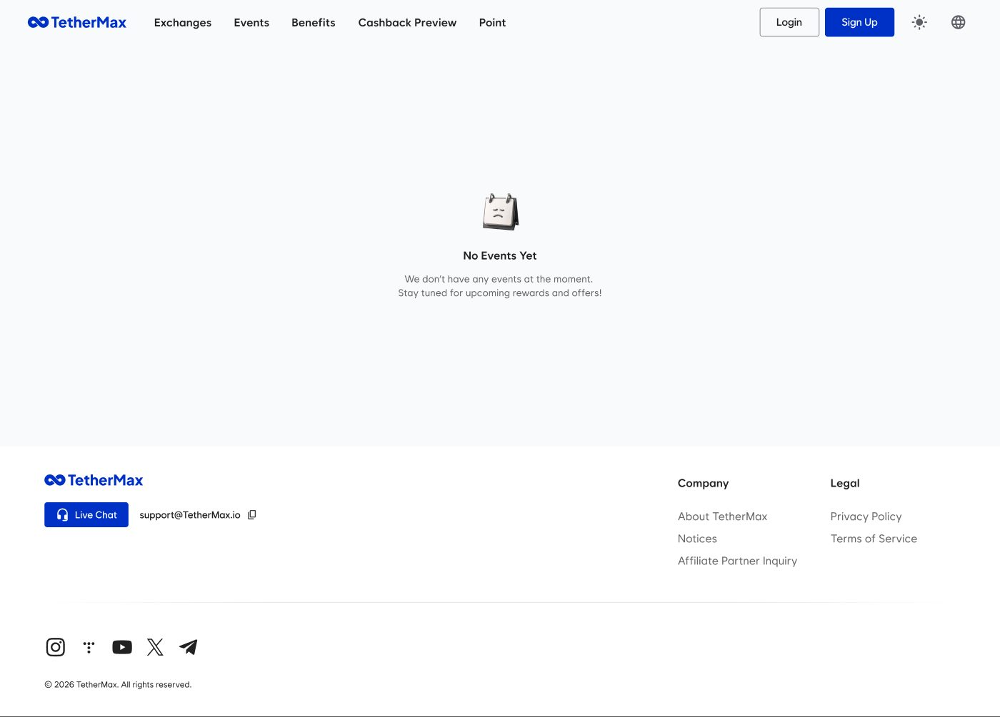

### R-31 퀴즈 모듈 4 · 같은 보기 문구 통일

| 구분 | 내용 |
|---|---|
| 대상 | Login required [28978:127406](https://www.figma.com/design/hsa3bSV9QmFTe2jsf6tzTm/UI-UX-Design?node-id=28978-127406) · Submit failed [28978:127476](https://www.figma.com/design/hsa3bSV9QmFTe2jsf6tzTm/UI-UX-Design?node-id=28978-127476) (Scoring unavailable · 결과 프레임에 같은 줄이 있으면 함께) |
| 지금 | `A published, audited way to access the funds directly` ↔ 퀴즈·Validation `A published, audited way to withdraw straight from the blockchain` |
| 수정안 | 앞의 것을 `A published, audited way to withdraw straight from the blockchain`으로(퀴즈 4 문항·모듈 4 본문 `an audited way to withdraw straight from the blockchain`과 같은 표현) |
| 근거 번호 | REQ-445 |

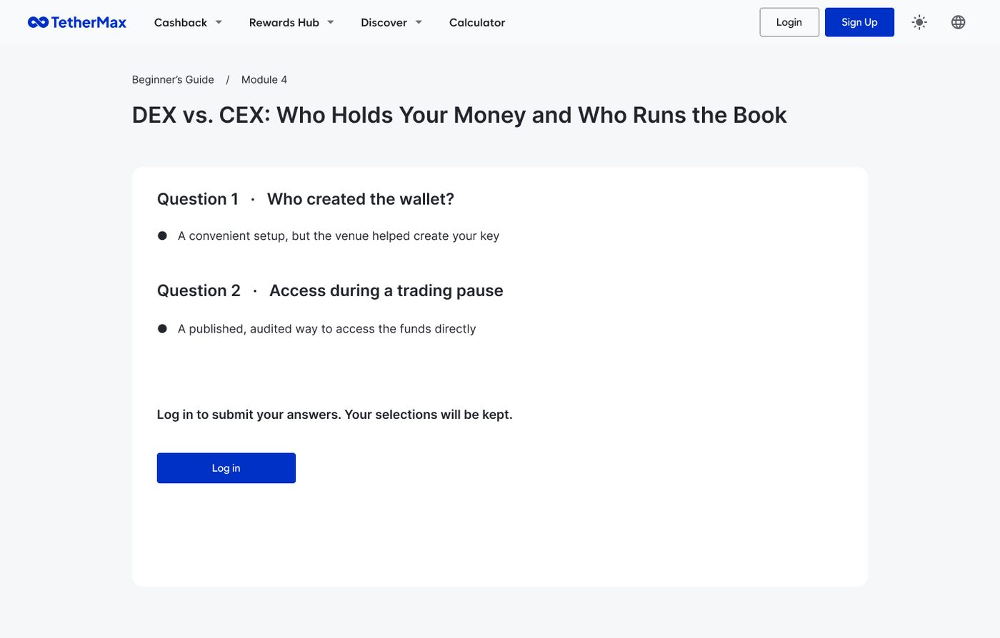
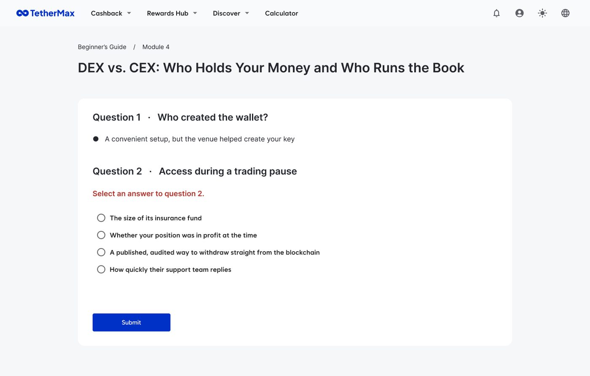

### R-32 TP · FAQ `payback`

| 구분 | 내용 |
|---|---|
| 대상 | [29062:114041](https://www.figma.com/design/hsa3bSV9QmFTe2jsf6tzTm/UI-UX-Design?node-id=29062-114041) · [29062:114572](https://www.figma.com/design/hsa3bSV9QmFTe2jsf6tzTm/UI-UX-Design?node-id=29062-114572) |
| 지금 | `While your existing 100% USDT payback benefits remain unchanged, …` |
| 수정안 | `payback` → `cashback`. `TP earned upon withdrawal`은 출금 실적이므로 그대로(D2) |
| 근거 번호 | 용어 규칙 · 결정 D2 |

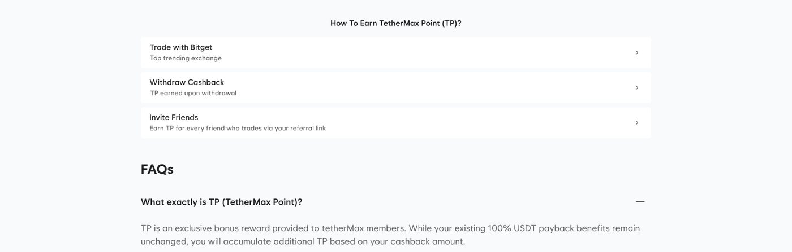

### R-33 리그 상금 수령 완료 PC · 배경 GNB

| 구분 | 내용 |
|---|---|
| 지금 | [29183:118342](https://www.figma.com/design/hsa3bSV9QmFTe2jsf6tzTm/UI-UX-Design?node-id=29183-118342) 모달 뒤 배경이 옛 GNB(`Partner Exchanges · Events · Benefits · Test Cashback · Service Introduction`)·옛 리그 히어로 |
| 근거 | 같은 섹션 팀 리더보드 [29183:117206](https://www.figma.com/design/hsa3bSV9QmFTe2jsf6tzTm/UI-UX-Design?node-id=29183-117206)의 새 GNB(`Cashback ▾` · `Rewards Hub ▾` · `Discover ▾`) |
| 수정안 | 배경 GNB 인스턴스를 29183:117206과 같은 GNB로 교체(모달은 그대로) |
| 근거 번호 | 결정 A1 · D4 |

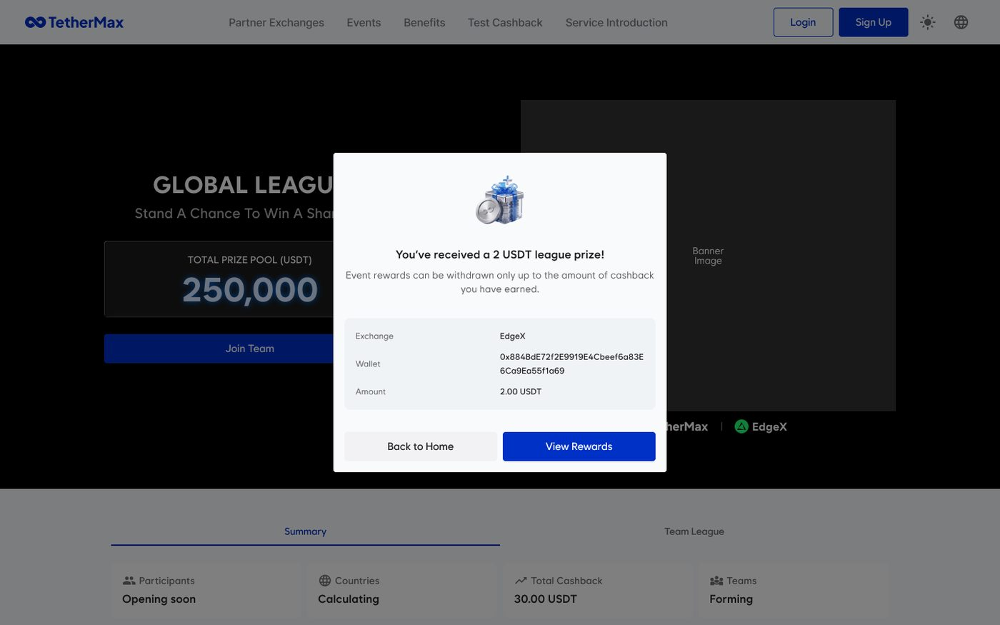

---

## 점검 이후 이미 반영된 것 (수정 안 함)

| 점검 ID | 지금 Figma | 노드 |
|---|---|---|
| L01 | 리그 갱신 표기 `Next Update: 22:30`(UTC 라벨 없음) | [29183:117206](https://www.figma.com/design/hsa3bSV9QmFTe2jsf6tzTm/UI-UX-Design?node-id=29183-117206) · [29183:117421](https://www.figma.com/design/hsa3bSV9QmFTe2jsf6tzTm/UI-UX-Design?node-id=29183-117421) |
| L03 | `Unable to create team` 자격 미충족 다이얼로그(CEX·DEX 합산 문구) | [29183:118240](https://www.figma.com/design/hsa3bSV9QmFTe2jsf6tzTm/UI-UX-Design?node-id=29183-118240) |
| L07 | `EdgeX wallet required` / `Link your EdgeX wallet to join the league.` | [29183:118258](https://www.figma.com/design/hsa3bSV9QmFTe2jsf6tzTm/UI-UX-Design?node-id=29183-118258) |
| L08 | 혜택 목록 EdgeX 리그 카드 | [29185:121040](https://www.figma.com/design/hsa3bSV9QmFTe2jsf6tzTm/UI-UX-Design?node-id=29185-121040) · [29185:121059](https://www.figma.com/design/hsa3bSV9QmFTe2jsf6tzTm/UI-UX-Design?node-id=29185-121059) |
| L09 · N6 | 개인 리더보드 · 개인전 참가 지갑 선택 | [29183:117629](https://www.figma.com/design/hsa3bSV9QmFTe2jsf6tzTm/UI-UX-Design?node-id=29183-117629) · [29183:118178](https://www.figma.com/design/hsa3bSV9QmFTe2jsf6tzTm/UI-UX-Design?node-id=29183-118178) |
| L10 | 참가 지갑 변경 불가 `Your participating wallet cannot be changed during P1–P3.` | [29185:119073](https://www.figma.com/design/hsa3bSV9QmFTe2jsf6tzTm/UI-UX-Design?node-id=29185-119073) |
| B02 | 게스트 완료 탭 `0.00 USDT`, `View History` 없음 | [29062:113000](https://www.figma.com/design/hsa3bSV9QmFTe2jsf6tzTm/UI-UX-Design?node-id=29062-113000) |
| N14 | KO 「지갑이 연동 해제되었음을」 | [29085:835](https://www.figma.com/design/hsa3bSV9QmFTe2jsf6tzTm/UI-UX-Design?node-id=29085-835) |

## 결정으로 수정하지 않는 것

| 점검 ID | 내용 | 결정 |
|---|---|---|
| E01 | 이벤트 3탭 `Special Events` · `Exclusive` · `Exchange Events` | D3 — 3탭 유지(명세를 고침) |
| T02 · S09 | Cashback Boost 상세 | N7 — 이번 범위 아님 |
| S03 · S04 | Referral Details · Reward History | N11 — 기존 기능 그대로 |
| N11(이메일) | `Auto-Cashback Withdrawal Completed` | D2 — 출금 실적은 Withdraw |
