# 기존 디자인 현행판 확인서

2026-11-26 · Figma `UI-UX Design`(`hsa3bSV9QmFTe2jsf6tzTm`) · 입력: [카탈로그 A](기존디자인_카탈로그/A_셸_랜딩_계정.md) · [B](기존디자인_카탈로그/B_거래소_연동_잔액.md) · [C](기존디자인_카탈로그/C_리워드_초대_콘텐츠.md)의 「사용자 확인 필요」 32건(A 11 · B 12 · C 9)

기존 디자인에서 같은 화면의 판이 여러 개인 32곳을 질문으로 정리했다. 항목마다 후보 판 캡처, DEX(revision)이 쓰는 판, 정책·명세가 요구하는 것, 권장안을 함께 둔다. 「권장대로」로 답하면 아래 요약 표의 권장 열로 확정한다. 정할 근거가 없는 2건만 「권장 없음」이다.

- 기준 순서: [최종 정책](../00_DEX_최종정책.md) > [요구사항 정의서](../02.기획문서/요구사항정의서.md) > [사용자 프론트 명세](../02.기획문서/프론트_기능명세서_사용자.md) > Figma.
- 「DEX(revision)이 쓰는 판」은 [DEX(revision) 페이지](https://www.figma.com/design/hsa3bSV9QmFTe2jsf6tzTm/UI-UX-Design?node-id=28960-125519)의 보이는 프레임에서 인스턴스의 main component, 레이어 이름, 텍스트 레이어 문구로 확인했다.
- 캡처는 [기존디자인_현행판_확인_img/](기존디자인_현행판_확인_img/)에 있다. 캡처 위 띠에 판 이름, 섹션, 노드, 날짜 또는 MAXOP 번호를 적었다.

## 요약

| # | 질문 | 권장 | 영향 |
|---|---|---|---|
| A1 | 웹 GNB는 기존판(`Exchanges · Events · Benefits · Cashback Preview · Point`)과 새 판(`Cashback ▾ · Rewards Hub ▾ · Discover ▾`) 중 어느 쪽인가 | **새 GNB** — `DEX / Web / Navigation`(`Cashback ▾ · Rewards Hub ▾ · Discover ▾ · Calculator`) | 웹 전 페이지 헤더. DEX(revision)에서 기존 GNB를 쓰는 프레임 12개 교체 |
| A2 | 서비스 소개 GNB에만 있는 `About Us` 메뉴를 둘 것인가 | **두지 않는다.** 서비스 소개는 `Discover ▾`과 푸터 Company `About TetherMax`로 들어간다 | 서비스 소개 웹 헤더 1곳 |
| A3 | 게스트 랜딩 현행판은 MAX-7 「Trade More, Pay Less.」인가, Renewal 「Found a higher rate? We want to hear it」인가 | **Renewal**(`update clause max-1208`) | 웹 랜딩 첫 화면 |
| A4 | Renewal 메인 헤더 우측이 회원용 아이콘인데 히어로는 가입 CTA다. 게스트 화면인가 | **게스트 화면.** 헤더 우측은 `Login` · `Sign Up` | 랜딩 헤더 우측(DEX(revision) Landing Dark 포함) |
| A5 | 로그인 문구는 「Hi, welcome back!」과 「Your cashback awaits.」 중 어느 쪽인가 | **「Hi, welcome back!」**(기본판) | 로그인 화면 |
| A6 | UID 상세 MAXOP-783 판에 `Weekly Cashback History`가 빠진 것이 의도인가 | **MAXOP-783을 기준으로 하고 `Weekly Cashback History`는 둔다** | UID 상세 · DEX 지갑 상세 |
| A7 | Web My Page는 우측 패널인가, plan B 전체 페이지인가 | **우측 패널** | Web My Page |
| A8 | mAPP S3 홈의 `Get App` 배너는 의도인가 | **실수로 보고 앱에서는 뺀다** | 앱 홈 상단 |
| A9 | 서비스 소개 개선판 모바일 두 프레임 중 어느 쪽을 쓰나 | **둘 다 쓴다.** 19224:4458은 라이트, 19224:5152는 다크다 | 없음(판 차이가 아님) |
| A10 | mWeb 가입·로그인 상단 앱 배너를 띄우나 | **띄운다.** mWeb 공통 배너 규칙(`Get App` / `Open App` / 닫으면 없음)을 가입·로그인에도 적용 | mWeb 가입·로그인 상단 |
| A11 | Renewal 비회원 페이지 1차·2차 중 현행은 | **2차**(푸터 Company에 `Claim Cashback`) | 웹 푸터 Company |
| B1 | 거래소 상세 상단 영역은 MAX 1216 S1 상단과 Hailey 시안(A · A-수정 · A-수정2 · A-수정3 · B) 중 어느 쪽인가 | **권장 없음** | CEX 거래소 상세 상단. DEX 상세는 자체 오퍼 박스라 영향 없음 |
| B2 | 거래소 상세 리뷰 영역은 MAX 1216 회의에서 「Suspended for now」다. 리뷰를 넣을 것인가 | **넣는다.** 디자인은 DEX(revision) D3(MAX 1216 리뷰 디자인) 그대로 | CEX·DEX 상세 리뷰, UID·지갑 상세 리뷰 유도 |
| B3 | 거래소 목록 현행판은 MAX-22 · MAXOP-408 · MAX 1216 CMT-08 · MAXOP-692 Live 중 어느 쪽인가 | **MAX 1216 CMT-08 구성**(`Top Centralised Exchanges` · `Rating` 열) + 새 GNB | Exchange Listings Page |
| B4 | 캐시백 요약 월 합계는 `Layout=Receipt`와 `Layout=Metrics` 중 어느 쪽인가 | **Receipt**(세로 3줄) | 캐시백 요약 월 카드 |
| B5 | 요약 기본 화면에서 앱만 월 합계를 보이는 것이 의도된 플랫폼 차이인가 | **아니다.** 웹·mWeb·앱 모두 월 합계 카드를 보인다 | 캐시백 요약 mWeb |
| B6 | 출금 확인 다이얼로그는 단일 UID 판과 다중 UID 판 중 어느 쪽인가 | **둘 다 쓰지 않는다**(CEX·DEX 자동 지급) | 출금 확인 다이얼로그 제거 |
| B7 | 출금 후 앱 리뷰 요청은 전체 화면과 바텀시트 별점 중 어느 쪽인가 | **전체 화면(`Leave a review`, APP only)** | 앱 리뷰 요청 |
| B8 | 소유권 mWeb의 흐린 「Unlinked UID detail」「Verification failed detail」은 폐기인가 | **폐기.** 재청구는 홈 행 → 다이얼로그 경로로 한다 | mWeb 소유권 상세 2화면 |
| B9 | `UID Already in Use` 스플래시에 MAX-561의 `Try a different UID`·UID 칩을 합치나 | **합치지 않는다.** MAXOP-751 그대로 | 연동 결과 스플래시 |
| B10 | `UID Link Completed` 버튼은 mWeb `Close`와 App·Desktop `Back to Home` 중 어느 쪽인가 | **`Back to Home`으로 통일** | 연동 완료 결과(mWeb) |
| B11 | MAX-601의 떨어진 큰 글씨 프레임(22592:233087)은 기준인가 | **기준 아님** | 없음 |
| B12 | MAX-146 계산기 섹션 `mWeb`(내용은 다크)을 다크로 취급하나 | **다크로 취급** | 없음 |
| C1 | Events Web Special Events는 기본판과 18 May판 중 어느 쪽인가 | **18 May판** | Events 웹 상단 배너 |
| C2 | 캐시백 챌린지 레벨 금액은 5/7/10/15 USDT와 7/10/20/30 USDT 중 어느 쪽인가 | **권장 없음** | 캐시백 챌린지 레벨 표시 |
| C3 | Cashback Boost 상세는 Benefits `For discussion`판과 `Boost Improvement` 중 어느 쪽인가 | **Boost Improvement** | 부스트 상세 |
| C4 | Global League Web Summary는 핸드오프판과 최상위 단독 Web 중 어느 쪽인가 | **최상위 단독 Web**(16399:86822) | 글로벌 리그 Summary |
| C5 | 빙고 UID 선택 모달·404는 시안 A와 시안 B 중 어느 쪽인가 | **시안 B** | 맥스보드 모달·404 |
| C6 | 초대 보상 내역은 최상위 단독 「리워드 조회」와 MAXOP-236 중 어느 쪽인가 | **MAXOP-236** | 친구 초대 보상 내역 |
| C7 | 퀴즈 랜딩은 사진 제거판(ysy removed)인가, 결과 모달도 엄지 일러스트판인가 | **둘 다 사진 없는 판**(랜딩 ysy removed · 결과 모달 엄지 일러스트) | 퀴즈 랜딩·결과 모달 |
| C8 | WOO X PRO 이벤트 메일은 파란 배경(CTA 메모)과 검은 배경(CTA 반영) 중 어느 쪽인가 | **검은 배경** | 이벤트 메일 |
| C9 | Newsletter 화면 기준은 23102 세트와 24403 세트 중 어느 쪽인가 | **24403 세트** | 없음(뉴스레터는 DEX 범위 밖) |

---

## A. 셸 · 랜딩 · 계정

### A1. 웹 GNB는 기존판과 새 판 중 어느 쪽인가

판 A: 기존 GNB · [12216:419863](https://www.figma.com/design/hsa3bSV9QmFTe2jsf6tzTm/UI-UX-Design?node-id=12216-419863) · 판 A′: [MAXOP-692] Figma (Updated) · [22649:1010](https://www.figma.com/design/hsa3bSV9QmFTe2jsf6tzTm/UI-UX-Design?node-id=22649-1010) · 판 B: [MAXOP-692] Live Site · [22598:411381](https://www.figma.com/design/hsa3bSV9QmFTe2jsf6tzTm/UI-UX-Design?node-id=22598-411381) · 2026-09-03 · 판 B′: `GNB/web/light/bar`(MAX-1039) · [28960:130556](https://www.figma.com/design/hsa3bSV9QmFTe2jsf6tzTm/UI-UX-Design?node-id=28960-130556) · 판 C: `DEX / Web / Navigation` · [28960:125543](https://www.figma.com/design/hsa3bSV9QmFTe2jsf6tzTm/UI-UX-Design?node-id=28960-125543)

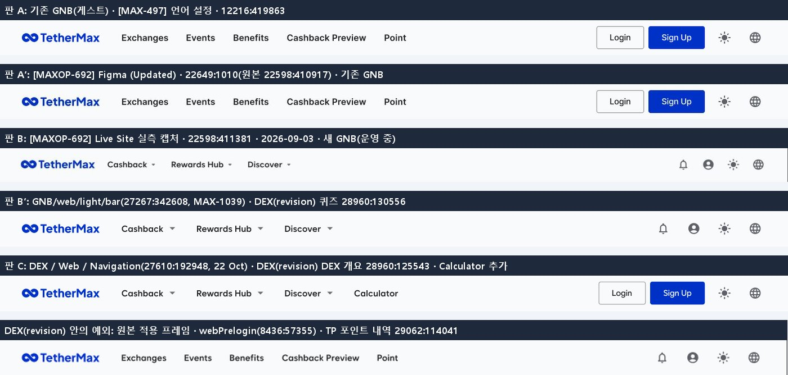

#### DEX(revision)의 프레임별 GNB

DEX(revision) 페이지에서 보이는 웹 프레임(폭 1000 이상) 202개를 모두 셌다. 프레임 상단의 헤더 인스턴스에서 main component와 보이는 메뉴 문구를 읽었다.

| 헤더 | main component | 보이는 메뉴 | 프레임 수 | 쓰는 화면(대표) |
|---|---|---|---|---|
| `GNB` · `DEX / Web / Navigation` · `Navigation` · `DEX 회원 헤더` | `DEX / Web / Navigation`(27610:192948, 설명 「John 22 Oct navigation. Calculator is separate. Cashback menu has CEX, DEX, Brokers.」) | `Cashback ▾ · Rewards Hub ▾ · Discover ▾ · Calculator` | **104** | DEX 개요 · 캐시백 허브 · DEX 상세 · 연동 · 소유권 · 홈 연동 스토리 · 잔액 표시 · 친구 초대 · 캐시백 랭킹 · 파트너 허브 · 랜딩·서비스 소개 · 퀴즈 상태 · 상세 회원 상태별 · 글로벌 리그 PC |
| `합체` · `다크합체` | `합체`(19479:45960, Renewal 페이지 컴포넌트) · `다크합체`(27559:191389) | `Cashback ▾ · Rewards Hub ▾ · Discover ▾` | **15** | 게스트 캐시백 웹 14 · Landing Dark 1([28960:127917](https://www.figma.com/design/hsa3bSV9QmFTe2jsf6tzTm/UI-UX-Design?node-id=28960-127917)) |
| `GNB/web/light/bar` | `GNB/web/light/bar`(27267:342608, 설명 「Cashback / Rewards Hub / Discover per MAX-1039」) | `Cashback ▾ · Rewards Hub ▾ · Discover ▾` | **5** | 퀴즈 모듈 4·5 |
| 분리된 프레임 `Frame 1984078430` | — | `Cashback ▾ · Rewards Hub ▾ · Discover ▾ · Calculator` | **3** | 계산기 PC([29064:934](https://www.figma.com/design/hsa3bSV9QmFTe2jsf6tzTm/UI-UX-Design?node-id=29064-934) 외) |
| **새 메뉴 합계** | | | **127** | |
| `webPrelogin` | `webPrelogin`(8436:57355) | `Exchanges · Events · Benefits · Cashback Preview · Point` | **10** | 「원본 적용」 프레임: 가입 [29037:110754](https://www.figma.com/design/hsa3bSV9QmFTe2jsf6tzTm/UI-UX-Design?node-id=29037-110754) · 로그인 [29037:110849](https://www.figma.com/design/hsa3bSV9QmFTe2jsf6tzTm/UI-UX-Design?node-id=29037-110849) · 이벤트 [29062:112586](https://www.figma.com/design/hsa3bSV9QmFTe2jsf6tzTm/UI-UX-Design?node-id=29062-112586) · 혜택 [29062:113000](https://www.figma.com/design/hsa3bSV9QmFTe2jsf6tzTm/UI-UX-Design?node-id=29062-113000) · 쿠폰 [29062:117713](https://www.figma.com/design/hsa3bSV9QmFTe2jsf6tzTm/UI-UX-Design?node-id=29062-117713) · [29062:115768](https://www.figma.com/design/hsa3bSV9QmFTe2jsf6tzTm/UI-UX-Design?node-id=29062-115768) · [29065:7079](https://www.figma.com/design/hsa3bSV9QmFTe2jsf6tzTm/UI-UX-Design?node-id=29065-7079) · TP 내역 [29062:114041](https://www.figma.com/design/hsa3bSV9QmFTe2jsf6tzTm/UI-UX-Design?node-id=29062-114041) 외 |
| 분리된 프레임 `Frame 1984078430` | — | `Exchanges · Events · Benefits · Cashback Preview · Point` | **1** | 계산기 DEX 결과 PC [29187:119248](https://www.figma.com/design/hsa3bSV9QmFTe2jsf6tzTm/UI-UX-Design?node-id=29187-119248) |
| `Frame 9285` | — | `Partner Exchanges · Events · Benefits · Test Cashback` | **1** | 리그 상금 수령 완료 PC [29183:118342](https://www.figma.com/design/hsa3bSV9QmFTe2jsf6tzTm/UI-UX-Design?node-id=29183-118342) |
| **기존 메뉴 합계** | | | **12** | |
| `header` | `webPrelogin`(8436:57356) | 메뉴 자리에 페이지 안 이동 `Compare · How it works · Notes` | **11** | 맥스보드 PC |
| 헤더 없음 | — | — | **52** | 연동·소유권 결과 전체 화면(`Top bar`) 28 · 캐시백 요약(고정 GNB 자리 `spacer`) 6 · 게스트 캐시백 하위 프레임 6 · 기타 12 |
| **합계** | | | **202** | |

카탈로그 A의 「DEX(revision)은 기존 GNB를 쓴다」는 위 「원본 적용」 프레임 12개에만 해당한다. DEX(revision)이 새로 그린 화면은 모두 새 메뉴다.

#### 운영 중 판과 비교

| 판 | 노드 | 메뉴 | 상태 |
|---|---|---|---|
| [MAXOP-692] Figma (Updated) | [22649:1010](https://www.figma.com/design/hsa3bSV9QmFTe2jsf6tzTm/UI-UX-Design?node-id=22649-1010)(원본 22598:410917) | 기존 메뉴 | Figma 원본 |
| [MAXOP-692] Live Site | [22598:411381](https://www.figma.com/design/hsa3bSV9QmFTe2jsf6tzTm/UI-UX-Design?node-id=22598-411381) | `Cashback ▾ · Rewards Hub ▾ · Discover ▾` | 2026-09-03 `/en/affiliated` 실측. **운영 사이트는 새 GNB** |
| DEX 명세 | REQ-464 · 정책 GL-1 | `Cashback ˅ · Rewards Hub ˅ · Discover ˅ · Calculator` | `Cashback` 클릭 = 허브, hover 패널 3행 |

| 구분 | 내용 |
|---|---|
| 차이 | 기존 GNB는 `Exchanges · Events · Benefits · Cashback Preview · Point` 평면 메뉴. 새 GNB는 `Cashback ▾ · Rewards Hub ▾ · Discover ▾` 드롭다운이고, DEX 판은 `Calculator`를 따로 둔다 |
| DEX(revision)이 쓰는 판 | 새 메뉴 127 · 기존 메뉴 12(「원본 적용」 프레임) · 페이지 안 이동 11 · 헤더 없음 52 |
| 명세·정책이 요구하는 것 | REQ-464 데스크톱 헤더 `Cashback ˅` · `Rewards Hub ˅` · `Discover ˅` · `Calculator`, 비로그인 `Login` · `Sign up`. REQ-466 목록 페이지도 새 GL-1 헤더. 정책 GL-1(`Cashback` 클릭 = Cashback 랜딩, hover 패널 3행) |
| 권장(근거) | **새 GNB `DEX / Web / Navigation`.** 운영 사이트가 이미 새 GNB이고(MAXOP-692 Live), 명세가 같은 구성을 요구한다. 기존 GNB 12프레임과 `Frame 9285` 구 메뉴는 교체 대상이다. `Calculator`는 운영판에 없고 DEX 작업으로 추가된다 |

### A2. 서비스 소개 GNB에만 있는 `About Us` 메뉴를 둘 것인가

판 A: [MAX-] Service Introduction · [12792:229228](https://www.figma.com/design/hsa3bSV9QmFTe2jsf6tzTm/UI-UX-Design?node-id=12792-229228) · 판 B: 기존 GNB · [12216:419863](https://www.figma.com/design/hsa3bSV9QmFTe2jsf6tzTm/UI-UX-Design?node-id=12216-419863) · 참고: DEX(revision) [29035:97622](https://www.figma.com/design/hsa3bSV9QmFTe2jsf6tzTm/UI-UX-Design?node-id=29035-97622)

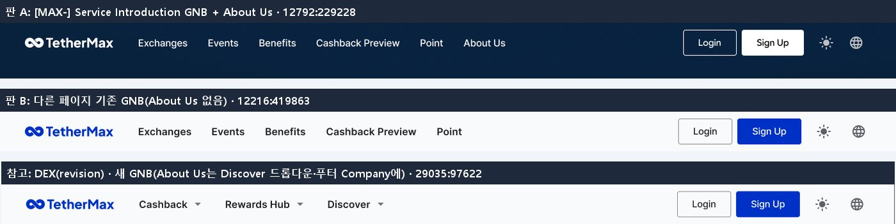

| 구분 | 내용 |
|---|---|
| 차이 | 서비스 소개 페이지 GNB만 기존 메뉴 끝에 `About Us`가 있다 |
| DEX(revision)이 쓰는 판 | 새 GNB. `About Us` 단독 메뉴 없음. `합체` 컴포넌트의 드롭다운 문구에 `Beginner's Guide` · `About TetherMax`가 있다 |
| 명세·정책이 요구하는 것 | REQ-464 메뉴는 `Cashback` · `Rewards Hub` · `Discover` · `Calculator` 넷. REQ-465 모바일 드로어 회사 행에 `About TetherMax` |
| 권장(근거) | **두지 않는다.** 기존 GNB 변형이고 새 GNB(A1)에는 자리가 없다. 서비스 소개는 `Discover ▾`와 푸터 Company `About TetherMax`로 들어간다 |

### A3. 게스트 랜딩 현행판은 MAX-7인가, Renewal인가

판 A: [MAX-7] S1/S2 · [3448:22879](https://www.figma.com/design/hsa3bSV9QmFTe2jsf6tzTm/UI-UX-Design?node-id=3448-22879) · 판 B: [MAX-] Landing Page Renewal `update clause max-1208` · [20932:96537](https://www.figma.com/design/hsa3bSV9QmFTe2jsf6tzTm/UI-UX-Design?node-id=20932-96537) · MAX-1208 · DEX(revision): [28960:127917](https://www.figma.com/design/hsa3bSV9QmFTe2jsf6tzTm/UI-UX-Design?node-id=28960-127917)

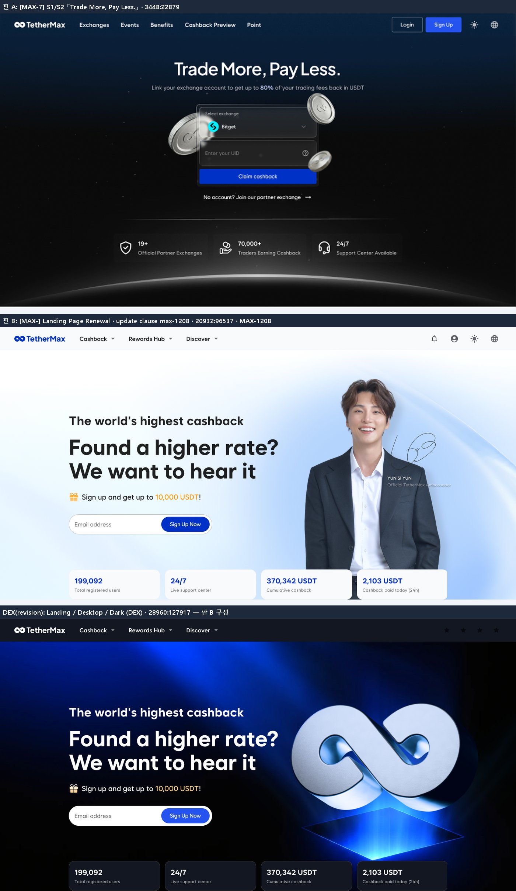

| 구분 | 내용 |
|---|---|
| 차이 | MAX-7은 「Trade More, Pay Less.」 + UID 입력 폼 히어로, 기존 GNB. Renewal은 「Found a higher rate? We want to hear it」 앰배서더 히어로 + 이메일 가입 + 지표 4칸 + `Our Partners` · `Most popular exchange` · `TOP 5 Traders`, 새 GNB |
| DEX(revision)이 쓰는 판 | **Renewal.** `Landing / Desktop / Dark (DEX)`가 Renewal 구성에 `Our Partners` 탭 `All · Exchanges · DEXs`를 넣은 판이다. 이름이 `원본 적용 · mWeb/landingPage/firstFold`(MAX-7)인 프레임 6개는 게스트 캐시백 조회(`Check your cashback`) 모바일 화면의 바탕으로만 쓰였다 |
| 명세·정책이 요구하는 것 | REQ-287 랜딩·서비스 소개에 DEX 항목 추가. REQ-288 프리로그인 랜딩 `Featured Exchanges` · `Hero Exchange`에 DEX 선택 가능 |
| 권장(근거) | **Renewal(`update clause max-1208`).** 번호가 붙은 마지막 판이고, 새 GNB와 짝이며, DEX(revision) 랜딩이 이 판 위에 DEX를 넣었다 |

### A4. Renewal 메인은 게스트 화면인가

판 A: Renewal 메인 · [20932:96537](https://www.figma.com/design/hsa3bSV9QmFTe2jsf6tzTm/UI-UX-Design?node-id=20932-96537) · 판 B: Renewal 비회원 페이지 · [19479:55984](https://www.figma.com/design/hsa3bSV9QmFTe2jsf6tzTm/UI-UX-Design?node-id=19479-55984) · DEX(revision): [28960:127917](https://www.figma.com/design/hsa3bSV9QmFTe2jsf6tzTm/UI-UX-Design?node-id=28960-127917)

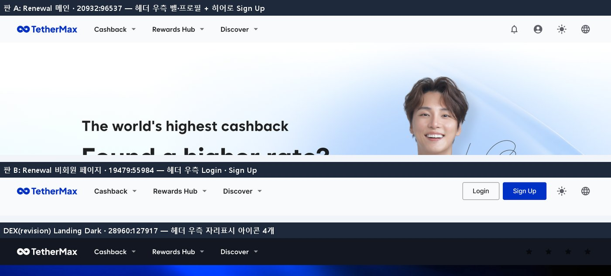

| 구분 | 내용 |
|---|---|
| 차이 | 메인 헤더 우측은 벨 · 프로필 · 테마 · 언어(회원용)인데 히어로는 `Sign up and get up to 10,000 USDT!` + `Sign Up Now`. 같은 Renewal의 비회원 페이지 헤더는 `Login` · `Sign Up` |
| DEX(revision)이 쓰는 판 | Landing Dark 헤더 우측은 자리표시 아이콘 4개(로그인 버튼 없음) |
| 명세·정책이 요구하는 것 | REQ-464 우측 로그인 = 알림 벨·아바타·테마·언어 / 비로그인 = `Login` · `Sign up` · 테마 · 언어 |
| 권장(근거) | **게스트 화면으로 보고 헤더 우측을 `Login` · `Sign Up`으로 한다.** 히어로 CTA가 가입이고, 회원은 로그인 후 홈(S3·S4)으로 간다. DEX(revision) Landing Dark 우측 아이콘도 같은 기준으로 바꾼다 |

### A5. 로그인 문구는 어느 쪽인가

판 A: [MAX-508] mWeb lightMode · [10548:207012](https://www.figma.com/design/hsa3bSV9QmFTe2jsf6tzTm/UI-UX-Design?node-id=10548-207012) · 날짜 없음 · 판 B: [MAX-508] Improvement · [18330:116709](https://www.figma.com/design/hsa3bSV9QmFTe2jsf6tzTm/UI-UX-Design?node-id=18330-116709) · 날짜 없음

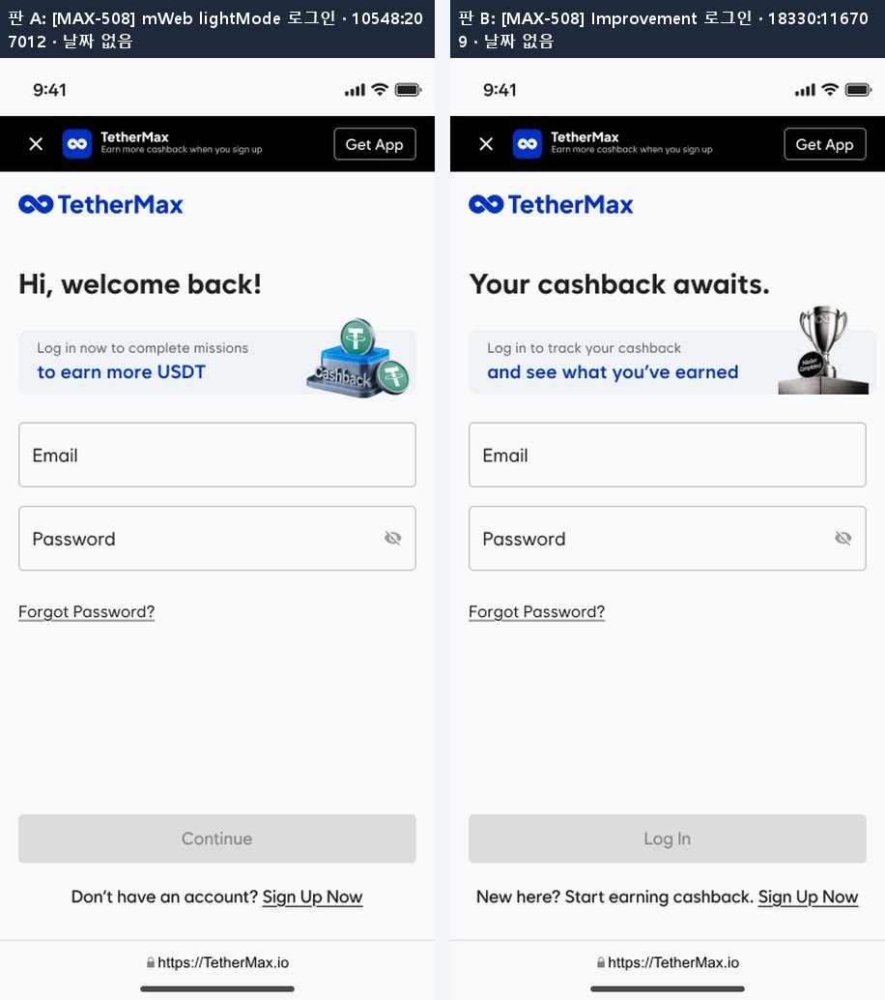

| 구분 | 내용 |
|---|---|
| 차이 | 판 A `Hi, welcome back!` · `Log in now to complete missions to earn more USDT` · `Continue` · `Don't have an account? Sign Up Now`. 판 B `Your cashback awaits.` · 트로피 · `Log In` · `New here? Start earning cashback.` |
| DEX(revision)이 쓰는 판 | **판 A.** `Web / Guest auth / login`(29037:110849)의 문구가 `Hi, welcome back!` · `Continue` · `Don't have an account? Sign Up Now` |
| 명세·정책이 요구하는 것 | 로그인 문구 변경 요구 없음 |
| 권장(근거) | **판 A(기본판).** Improvement 섹션에 날짜·MAXOP·채택 표시가 없고, DEX(revision)도 판 A를 쓴다 |

### A6. UID 상세에서 `Weekly Cashback History`가 빠진 것이 의도인가

판 A: MAXOP-476 · [18700:54657](https://www.figma.com/design/hsa3bSV9QmFTe2jsf6tzTm/UI-UX-Design?node-id=18700-54657) · 판 B: MAXOP-783 · [26047:1348691](https://www.figma.com/design/hsa3bSV9QmFTe2jsf6tzTm/UI-UX-Design?node-id=26047-1348691) · 2026-09-30

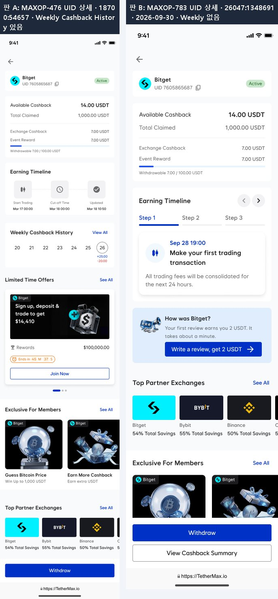

| 구분 | 내용 |
|---|---|
| 차이 | 판 A에 요일 원형 `Weekly Cashback History`가 있다. 판 B는 Earning Timeline을 Step 탭 캐러셀로 바꾸고 리뷰 유도 배너를 두며 Weekly 블록이 없다 |
| DEX(revision)이 쓰는 판 | 판 B 계열. 페이지 전체에서 `Weekly Cashback` 레이어·문구 0건, `Earning Timeline` 있음 |
| 명세·정책이 요구하는 것 | REQ-278 지갑 상세 메인 열: `Weekly Cashback History` + `View All`(7일 띠, 적립 `+25.00` · 출금 `-20.00`) · 리뷰 유도 · `Exclusive Benefit` · `Top Partner DEXs` · 캐시백 타임라인 |
| 권장(근거) | **MAXOP-783을 기준으로 하되 `Weekly Cashback History`는 둔다.** 명세가 Weekly 블록을 요구하고, MAXOP-783에 Weekly를 없앤다는 메모가 없다. DEX(revision) 지갑 상세에도 Weekly 블록을 추가해야 한다 |

### A7. Web My Page는 우측 패널인가, plan B인가

판 A: Web(12474) 우측 패널 · [17170:235039](https://www.figma.com/design/hsa3bSV9QmFTe2jsf6tzTm/UI-UX-Design?node-id=17170-235039) · 판 B: plan B · [12085:417285](https://www.figma.com/design/hsa3bSV9QmFTe2jsf6tzTm/UI-UX-Design?node-id=12085-417285)

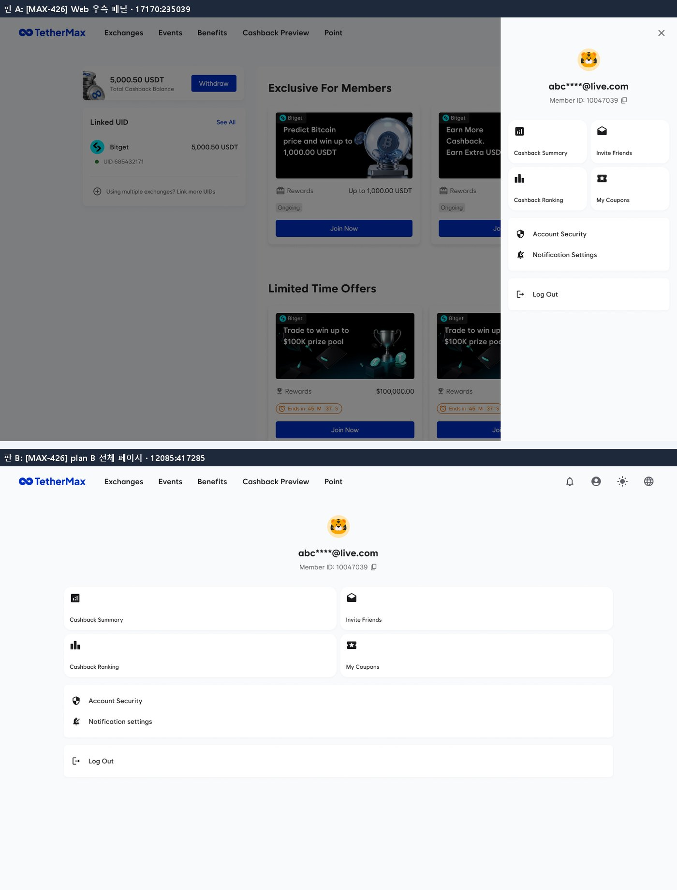

| 구분 | 내용 |
|---|---|
| 차이 | 판 A는 홈 위에 우측 슬라이드 패널. 판 B는 별도 전체 페이지 |
| DEX(revision)이 쓰는 판 | My Page 화면 없음 |
| 명세·정책이 요구하는 것 | 요구 없음 |
| 권장(근거) | **우측 패널.** `Web` 본 섹션(12474)에 있고, 판 B는 섹션 이름이 대안(`plan B`)이다. mWeb 프로필 시트·mAPP My Page와 같은 구성(2×2 + 보안·알림 + 로그아웃)이다 |

### A8. mAPP S3 홈의 `Get App` 배너는 의도인가

판 A: [MAX-7] S3 mAPP · [8582:154521](https://www.figma.com/design/hsa3bSV9QmFTe2jsf6tzTm/UI-UX-Design?node-id=8582-154521) · 판 B: [MAX-7] S3 mWeb · [4248:33574](https://www.figma.com/design/hsa3bSV9QmFTe2jsf6tzTm/UI-UX-Design?node-id=4248-33574)

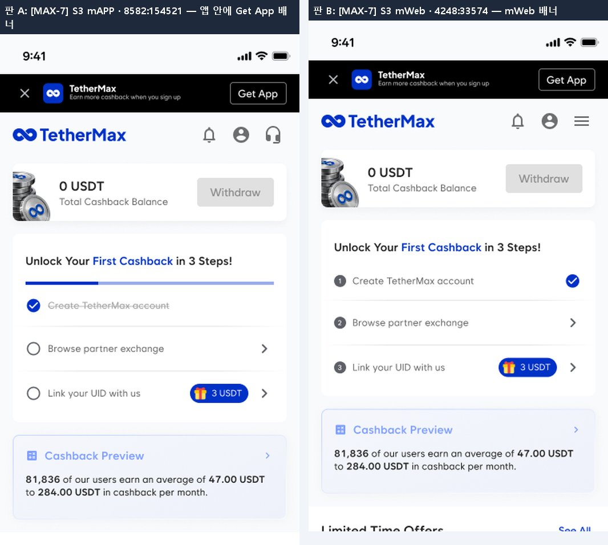

| 구분 | 내용 |
|---|---|
| 차이 | 앱 프레임 상단에 mWeb용 `Get App` 배너가 있다 |
| DEX(revision)이 쓰는 판 | 해당 없음(`Get App` 0건) |
| 명세·정책이 요구하는 것 | 요구 없음 |
| 권장(근거) | **실수로 보고 앱에서는 뺀다.** 앱 안에서 앱 설치를 권하는 것은 맞지 않고, 카탈로그 A 0-3의 mAPP 상단 바(로고 · 벨 · 프로필 · 헤드셋)에는 배너가 없다 |

### A9. 서비스 소개 개선판 모바일 두 프레임 중 어느 쪽을 쓰나

판 A: [MAX-1000] · [19224:4458](https://www.figma.com/design/hsa3bSV9QmFTe2jsf6tzTm/UI-UX-Design?node-id=19224-4458) · 판 B: [MAX-1000] · [19224:5152](https://www.figma.com/design/hsa3bSV9QmFTe2jsf6tzTm/UI-UX-Design?node-id=19224-5152)

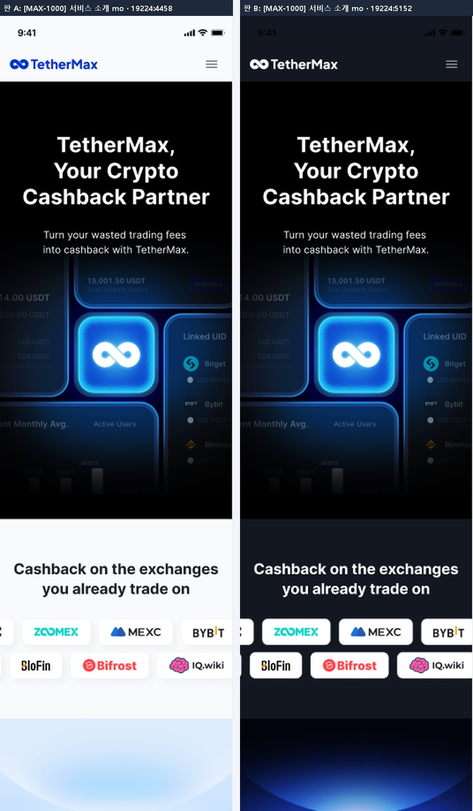

| 구분 | 내용 |
|---|---|
| 차이 | 같은 구성이고 19224:5152는 배경·카드가 다크 테마다. 섹션 캡처에서는 위쪽 히어로만 보여 차이가 드러나지 않았다 |
| DEX(revision)이 쓰는 판 | 해당 없음 |
| 명세·정책이 요구하는 것 | REQ-287 서비스 소개 DEX 항목 추가 |
| 권장(근거) | **둘 다 쓴다.** 판 차이가 아니라 라이트(4458)·다크(5152) 짝이다 |

### A10. mWeb 가입·로그인 상단 앱 배너를 띄우나

판 A: [MAX-508] mWeb 가입 · [10542:101933](https://www.figma.com/design/hsa3bSV9QmFTe2jsf6tzTm/UI-UX-Design?node-id=10542-101933) · 판 B: [MAXOP-696] mWeb 가입 · [23327:1124323](https://www.figma.com/design/hsa3bSV9QmFTe2jsf6tzTm/UI-UX-Design?node-id=23327-1124323) · 판 C: [MAX-508] mWeb 로그인 · [10548:207012](https://www.figma.com/design/hsa3bSV9QmFTe2jsf6tzTm/UI-UX-Design?node-id=10548-207012)

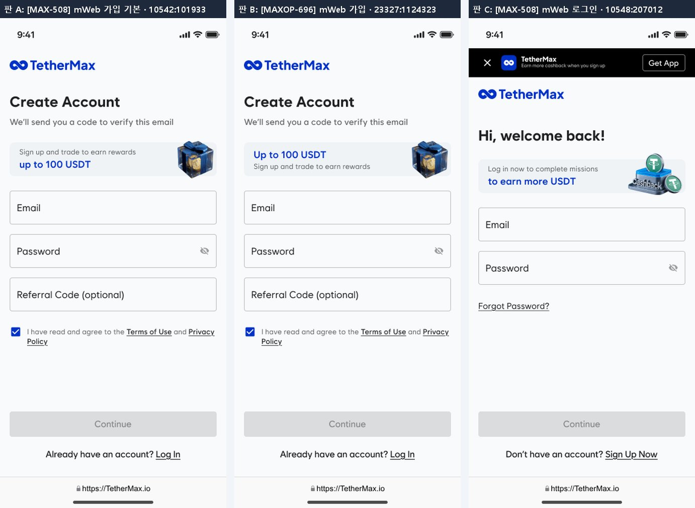

| 구분 | 내용 |
|---|---|
| 차이 | 가입·로그인 프레임마다 상단 앱 배너 유무가 다르다(같은 섹션에서도 첫 줄은 없고 오류 줄은 있음) |
| DEX(revision)이 쓰는 판 | 웹 가입·로그인만 있고 mWeb 가입·로그인 없음 |
| 명세·정책이 요구하는 것 | 요구 없음 |
| 권장(근거) | **띄운다.** mWeb 공통 배너 3종(`Get App` / 설치 사용자 `Open App` / 닫으면 없음, 4248:33574 · 8377:221056 · 8377:218393)이 상황별 규칙이므로 프레임별 차이는 상태 예시로 보고 가입·로그인에도 같은 규칙을 적용한다 |

### A11. Renewal 비회원 페이지 1차·2차 중 현행은

판 A: 1차 · [19479:48811](https://www.figma.com/design/hsa3bSV9QmFTe2jsf6tzTm/UI-UX-Design?node-id=19479-48811) · 판 B: 2차 · [19479:55984](https://www.figma.com/design/hsa3bSV9QmFTe2jsf6tzTm/UI-UX-Design?node-id=19479-55984) · DEX(revision): [29035:97622](https://www.figma.com/design/hsa3bSV9QmFTe2jsf6tzTm/UI-UX-Design?node-id=29035-97622)

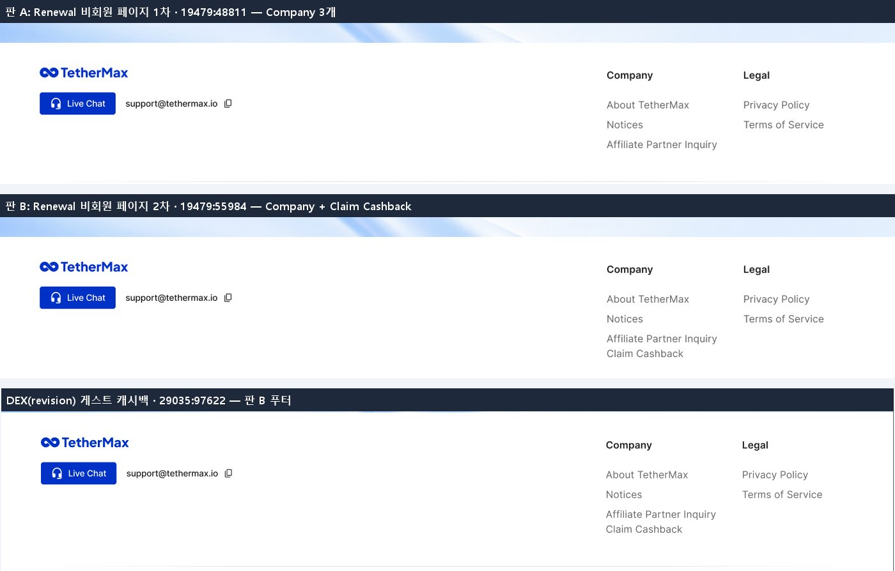

| 구분 | 내용 |
|---|---|
| 차이 | 2차는 푸터 Company에 `Claim Cashback`이 있다 |
| DEX(revision)이 쓰는 판 | **판 B.** 게스트 캐시백 화면(「원본 적용 · 비회원 페이지_라이트버전」 28개)과 `Footer / Company / Claim Cashback` 인스턴스 |
| 명세·정책이 요구하는 것 | REQ-175 홈 푸터 Company > `Claim Cashback` 또는 `/{lang}/search` → 비회원 캐시백 조회 |
| 권장(근거) | **2차.** 명세가 이 진입 경로를 요구하고 DEX(revision)도 2차를 쓴다 |

---

## B. 거래소 · 연동 · 잔액

### B1. 거래소 상세 상단 영역은 어느 판인가

판 A: [MAX 1216] S1 Guest · [22442:219455](https://www.figma.com/design/hsa3bSV9QmFTe2jsf6tzTm/UI-UX-Design?node-id=22442-219455) · 2026-09 · 판 B: Hailey 시안 A · [25978:868](https://www.figma.com/design/hsa3bSV9QmFTe2jsf6tzTm/UI-UX-Design?node-id=25978-868) · 판 C: 시안 A - 수정 3 · [25978:1407](https://www.figma.com/design/hsa3bSV9QmFTe2jsf6tzTm/UI-UX-Design?node-id=25978-1407) · 판 D: 시안 B · [25978:1273](https://www.figma.com/design/hsa3bSV9QmFTe2jsf6tzTm/UI-UX-Design?node-id=25978-1273) · DEX(revision): [28960:127445](https://www.figma.com/design/hsa3bSV9QmFTe2jsf6tzTm/UI-UX-Design?node-id=28960-127445) (시안 A-수정 25978:1003 · A-수정 2 25978:1138은 카탈로그 캡처)

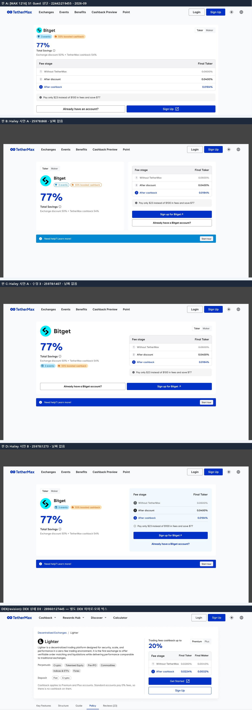

| 구분 | 내용 |
|---|---|
| 차이 | 판 A: 로고·별점 4.0(23)·77% Total Savings·칩·Taker/Maker·Fee stage 3행 한 카드 + `Already have an account?` · `Sign Up`. Hailey 시안: 2카드(왼쪽 77%·칩 / 오른쪽 Fee stage·`Sign up for Bitget ↗`) + `Need help? Learn more! Start tour` 바, 별점 없음. 수정 3은 한 카드 2열 + 하단 가로 버튼 2개, 시안 B는 수수료 영역을 연한 파랑 박스로 |
| DEX(revision)이 쓰는 판 | DEX 상세는 자체 히어로 + 오퍼 박스(`Premium`/`Plus` 토글 · `Trading fees cashback up to 20%` · `Get Started`)를 쓴다. CEX 상세 상단은 그리지 않았다 |
| 명세·정책이 요구하는 것 | DEX 상세 오퍼 박스는 REQ-364 · G-438. CEX 상세 상단은 변경 요구 없음 |
| 권장(근거) | **권장 없음.** Hailey 시안이 노드 번호상 MAX 1216 S1보다 뒤이고 MAX 1216 회의 메모(거래소명·절감 수치 키움, 이벤트 표시 명확화)에 답한 작업으로 보이지만, 시안 5개 어디에도 날짜·채택 표시가 없다. 디자인 담당 확인이 필요하다. DEX 상세에는 영향이 없다 |

### B2. 거래소 상세 리뷰 영역을 넣을 것인가

근거: [MAX 1216] Meeting Notes · [22044:762346](https://www.figma.com/design/hsa3bSV9QmFTe2jsf6tzTm/UI-UX-Design?node-id=22044-762346) · 판 A: [MAX 1216] S1 리뷰 영역 · [22442:219455](https://www.figma.com/design/hsa3bSV9QmFTe2jsf6tzTm/UI-UX-Design?node-id=22442-219455) · DEX(revision): DEX 상세 D3 · [28960:127445](https://www.figma.com/design/hsa3bSV9QmFTe2jsf6tzTm/UI-UX-Design?node-id=28960-127445)

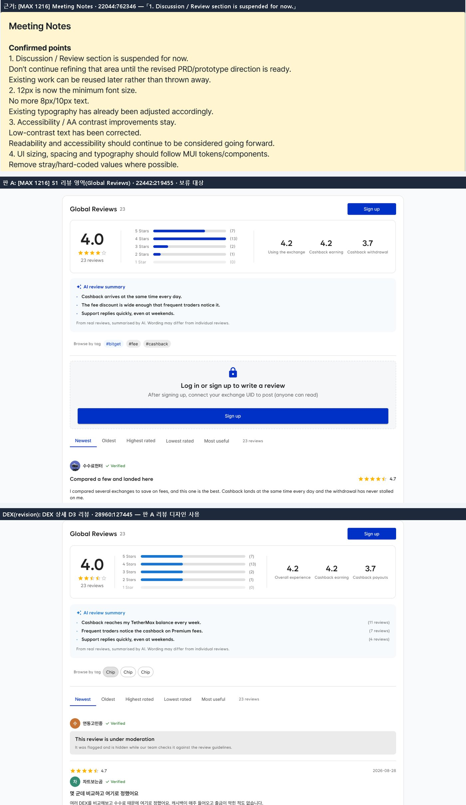

메모 원문(노드 22044:762346, 섹션 `Exchange Detail Page - Whats updated and improved` 22044:759623 안, 레이어 이름 `Change 1 / Larger text, using MUI`):

> Meeting Notes / Confirmed points
> 1. Discussion / Review section is suspended for now.
> Don't continue refining that area until the revised PRD/prototype direction is ready.
> Existing work can be reused later rather than thrown away.

같은 섹션의 범위 메모(22044:759654): `Reviews, KYC and link behavior are not signed off.`

| 구분 | 내용 |
|---|---|
| 차이 | 회의 메모는 리뷰 영역 **다듬기**를 개정 PRD·프로토타입 방향이 나올 때까지 멈추고, 이미 만든 작업은 나중에 재사용한다고 적었다. 리뷰를 없앤다는 결정은 아니다 |
| DEX(revision)이 쓰는 판 | **판 A 리뷰 디자인.** D3에 `Global Reviews` · 히스토그램 · 하위 점수 3축 · `AI review summary` · `Browse by tag` · 정렬 탭 · 검토 중 리뷰, 상세 회원 상태별 [28969:129577](https://www.figma.com/design/hsa3bSV9QmFTe2jsf6tzTm/UI-UX-Design?node-id=28969-129577)에 `Write a review`(28969:129836) |
| 명세·정책이 요구하는 것 | 정책 8-5 · REQ-352(작성 자격 = 연동 완료) · REQ-353(`✓ Verified`, 하위 점수 3축) · REQ-354 · REQ-355(빈 상태, 더미 금지) · REQ-362(리뷰 UI 세부: AI 요약·히스토그램·태그) · REQ-278(지갑 상세 리뷰 유도 `Write a review, get 2 USDT`) · FU-058 · API-022(기존 `/api/details/{id}/comments` 변경). 기존 서비스에 상세 댓글 기능과 어드민 리뷰 관리가 있다 |
| 권장(근거) | **넣는다. 화면은 DEX(revision) D3 그대로 쓴다.** 정책·명세가 리뷰를 확정했고 정책이 Figma보다 우선한다. 메모가 멈춘 것은 MAX 1216 리뷰 개편을 더 다듬는 일이므로, 이미 만든 디자인을 재사용하고 새로 다듬지 않는다. 디자인 쪽에 「DEX 명세가 리뷰를 확정했다」를 알려 보류 해제를 맞춘다. D3 하위 점수 셋째 라벨 `Cashback payouts`는 REQ-353 `Cashback withdrawal`과 다르다 |

### B3. 거래소 목록 현행판은 어느 쪽인가

판 A: [MAX-22] · [8471:65818](https://www.figma.com/design/hsa3bSV9QmFTe2jsf6tzTm/UI-UX-Design?node-id=8471-65818) · 판 B: [MAXOP-408] · [17618:333016](https://www.figma.com/design/hsa3bSV9QmFTe2jsf6tzTm/UI-UX-Design?node-id=17618-333016) · 판 C: [MAX 1216] CMT-08 table · [22799:96486](https://www.figma.com/design/hsa3bSV9QmFTe2jsf6tzTm/UI-UX-Design?node-id=22799-96486) · 판 D: [MAXOP-692] Live Site · [22598:411381](https://www.figma.com/design/hsa3bSV9QmFTe2jsf6tzTm/UI-UX-Design?node-id=22598-411381) · 2026-09-03 (darker card border 17079:47458 · CMT-08 cards 22807:98684 · mobile 26382:789181은 카탈로그 캡처)

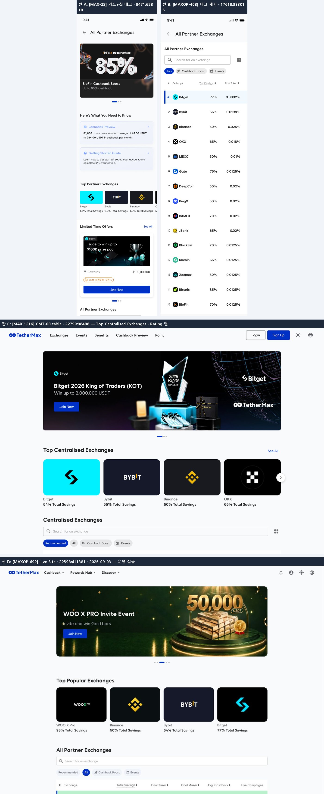

| 구분 | 내용 |
|---|---|
| 차이 | 판 A 카드 + 이름 옆 태그(🚀 55% · 이벤트 수). 판 B 행 안 태그 제거, 칩 `Top`·`Cashback Boost`·`Events`. 판 C `Top Centralised Exchanges` 캐러셀 · `Centralised Exchanges` 표에 `Rating` 열 · 상위 2행 외곽선 하이라이트. 판 D 운영 실물: 새 GNB · `Top Popular Exchanges` · 상위 2행 색 하이라이트, Rating 열 없음 |
| DEX(revision)이 쓰는 판 | Exchange Listings Page 없음 |
| 명세·정책이 요구하는 것 | REQ-466 기존 Listings Page는 재구축하지 않고 CEX만, 캐러셀 `Top Centralised Exchanges`, 표 `Avg. Cashback`과 `Live Campaigns` 사이 `Rating` 열(20개 미만 `-`, 카드 뷰 생략), 새 GL-1 헤더. REQ-475 목록 요소(검색·칩 `Recommended` · `All` · `Cashback Boost` · `Events` · 표/카드 토글) 유지 |
| 권장(근거) | **판 C(MAX 1216 CMT-08) 구성 + 새 GNB.** 명세 문구(`Top Centralised Exchanges` · `Rating` 열)가 판 C와 같다. 칩·검색 요소는 판 B·D와 같다. 헤더만 판 D(운영)처럼 새 GNB로 바꾼다 |

### B4. 캐시백 요약 월 합계 레이아웃은 어느 쪽인가

판 A: [MAXOP-732] `Layout=Receipt` · [27624:27307](https://www.figma.com/design/hsa3bSV9QmFTe2jsf6tzTm/UI-UX-Design?node-id=27624-27307) · 2026-09-29 · 판 B: `Layout=Metrics` · [27624:27320](https://www.figma.com/design/hsa3bSV9QmFTe2jsf6tzTm/UI-UX-Design?node-id=27624-27320) · 2026-09-29 · DEX(revision): CS1 · [28960:127133](https://www.figma.com/design/hsa3bSV9QmFTe2jsf6tzTm/UI-UX-Design?node-id=28960-127133)

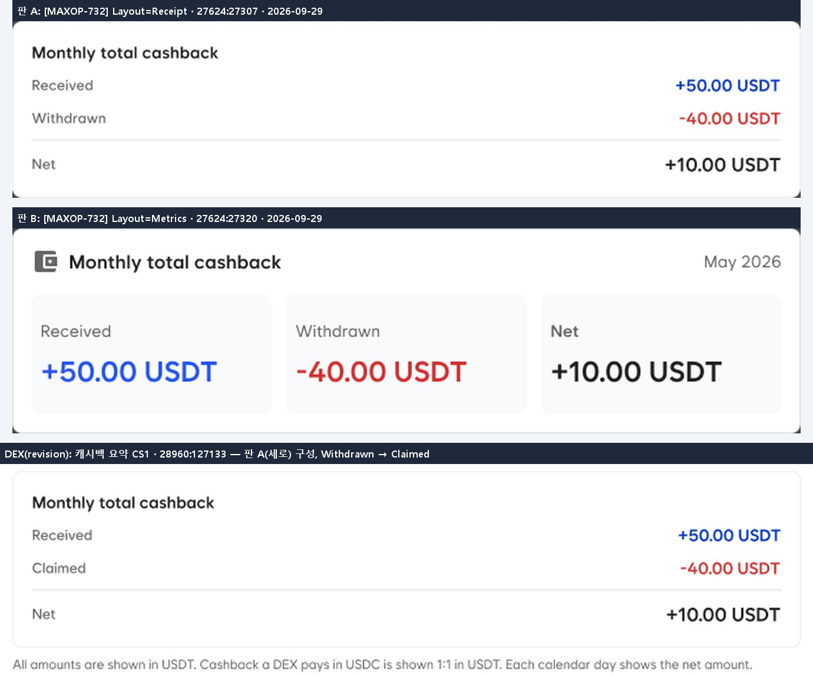

| 구분 | 내용 |
|---|---|
| 차이 | Receipt는 세로 3줄(Received · Withdrawn · Net), Metrics는 가로 3칸 |
| DEX(revision)이 쓰는 판 | **판 A.** `Monthly total cashback` 세로 3줄 `Received` · `Claimed` · `Net` |
| 명세·정책이 요구하는 것 | REQ-368 월간 카드·캘린더·일별 목록 함께 갱신. G-418 영문 출금 용어 `Claim` 계열 |
| 권장(근거) | **Receipt.** DEX(revision)이 이미 이 구성이고, 출금 줄 라벨은 `Claimed`로 쓴다 |

### B5. 요약 기본 화면에서 앱만 월 합계를 보이는 것이 의도인가

판 A: [MAX-601] mWeb Default · [12772:24573](https://www.figma.com/design/hsa3bSV9QmFTe2jsf6tzTm/UI-UX-Design?node-id=12772-24573) · 판 B: mAPP `Default show total cashback` · [12773:333079](https://www.figma.com/design/hsa3bSV9QmFTe2jsf6tzTm/UI-UX-Design?node-id=12773-333079)

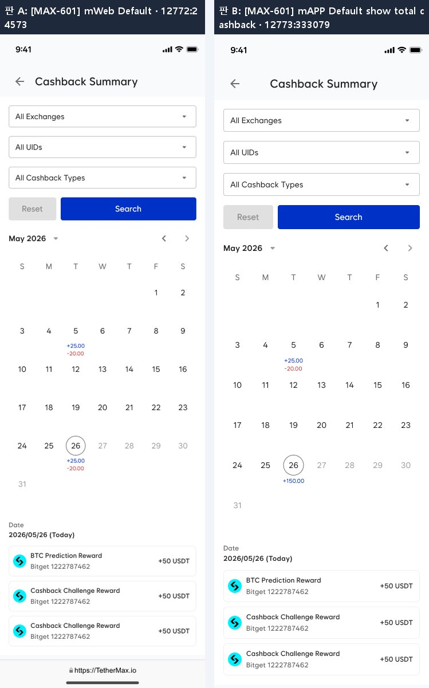

| 구분 | 내용 |
|---|---|
| 차이 | mWeb 기본 화면에는 월 합계가 없고, mAPP 기본 화면은 총 캐시백을 보인다 |
| DEX(revision)이 쓰는 판 | 웹 CS1([28960:127133](https://www.figma.com/design/hsa3bSV9QmFTe2jsf6tzTm/UI-UX-Design?node-id=28960-127133))이 기본 화면에 월 합계 카드를 보인다 |
| 명세·정책이 요구하는 것 | REQ-368 `Search` 후 월간 카드·캘린더·일별 목록이 함께 갱신(플랫폼 구분 없음) |
| 권장(근거) | **의도된 차이가 아니다. 웹·mWeb·앱 모두 월 합계 카드를 보인다.** 명세가 월간 카드를 플랫폼 구분 없이 둔다 |

### B6. 출금 확인 다이얼로그는 어느 판인가

판 A: [MAX-18] 단일 UID · [8873:164420](https://www.figma.com/design/hsa3bSV9QmFTe2jsf6tzTm/UI-UX-Design?node-id=8873-164420) · 판 B: Improvement 23rd June 다중 UID · [17023:235098](https://www.figma.com/design/hsa3bSV9QmFTe2jsf6tzTm/UI-UX-Design?node-id=17023-235098) · 23 June

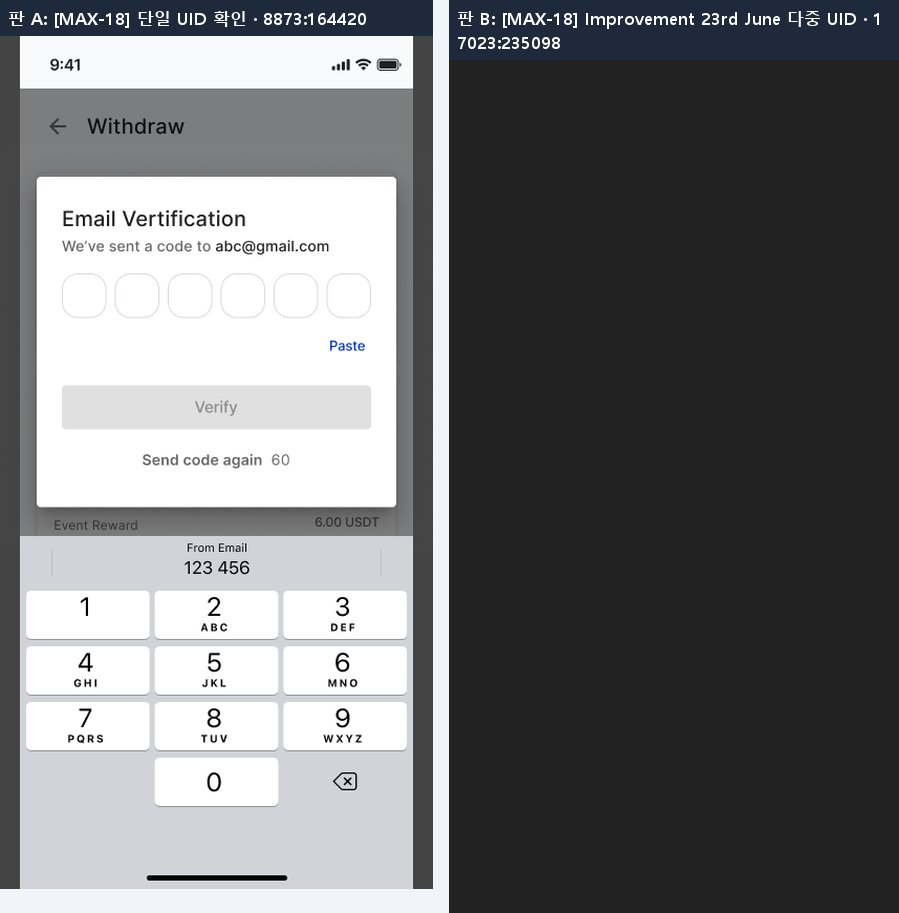

| 구분 | 내용 |
|---|---|
| 차이 | 판 A는 Exchange/UID/Amount 한 줄씩, 판 B는 거래소별 UID 목록 + Total Amount |
| DEX(revision)이 쓰는 판 | 출금 확인 다이얼로그 없음. 출금 화면은 비활성 `Auto Claim` |
| 명세·정책이 요구하는 것 | 정책 6-1 회원 출금 = 신청 없는 10분 주기 자동 지급(CEX UID · DEX 지갑 모두). 출금 화면은 기존 출금 모달 디자인 + 비활성 `Auto Claim`([Figma 수정 결정](_Figma수정_결정.md) 2026-11-26) |
| 권장(근거) | **둘 다 쓰지 않는다.** 회원이 출금을 신청하지 않으므로 확인 단계가 없다 |

### B7. 출금 후 앱 리뷰 요청은 어느 판인가

판 A: [MAX-18] `Leave a review`(APP only) · [10548:183946](https://www.figma.com/design/hsa3bSV9QmFTe2jsf6tzTm/UI-UX-Design?node-id=10548-183946) · 판 B: `for future use` 바텀시트 · [10507:113220](https://www.figma.com/design/hsa3bSV9QmFTe2jsf6tzTm/UI-UX-Design?node-id=10507-113220)

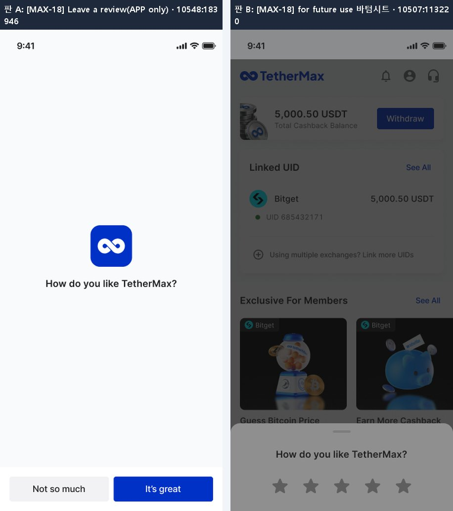

| 구분 | 내용 |
|---|---|
| 차이 | 판 A 전체 화면 「How do you like TetherMax?」 + 스토어 리뷰. 판 B 별점 바텀시트 |
| DEX(revision)이 쓰는 판 | 해당 화면 없음. 지급 후 화면은 `PS3 Received, share`(공유 카드) |
| 명세·정책이 요구하는 것 | 요구 없음. 정책 6-1 자동 지급이라 회원이 출금을 마치는 순간이 앱 안에 없다 |
| 권장(근거) | **판 A(전체 화면).** 판 B는 섹션 이름이 「for future use」인 미래안이다. 자동 지급에서 띄울 시점은 별도로 정한다 |

### B8. 소유권 mWeb의 흐린 두 화면은 폐기인가

판 A: [MAX-561] mWeb `Unlinked UID detail` · [12792:47639](https://www.figma.com/design/hsa3bSV9QmFTe2jsf6tzTm/UI-UX-Design?node-id=12792-47639) (`Verification failed detail` 12783:405078) · 판 B: mAPP 같은 두 화면 · [12881:50192](https://www.figma.com/design/hsa3bSV9QmFTe2jsf6tzTm/UI-UX-Design?node-id=12881-50192) 안

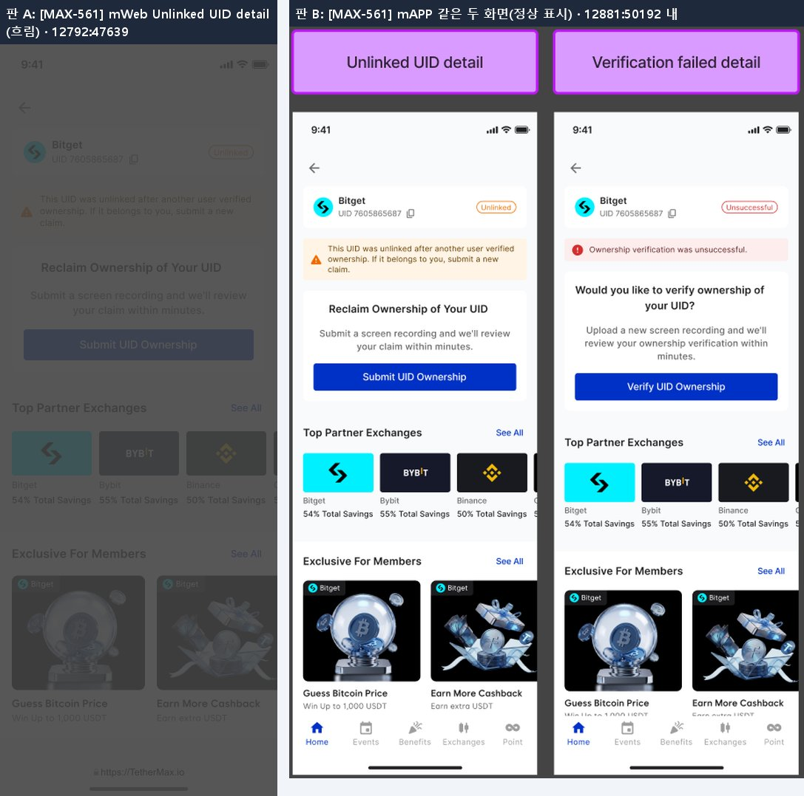

| 구분 | 내용 |
|---|---|
| 차이 | mWeb은 두 상세 화면 전체가 반투명이고, mAPP은 정상 표시 |
| DEX(revision)이 쓰는 판 | 재청구를 홈 행 → 모달로 한다(O14 · O15 `Remove Wallet` · `Submit Wallet Ownership`, O16 심사 사유 · `Apply for Ownership`). 상세 페이지형 재청구 화면 없음 |
| 명세·정책이 요구하는 것 | REQ-725~729 소유권 흐름. 상세 페이지형 재청구 요구 없음 |
| 권장(근거) | **폐기.** 흐림은 디자이너의 제외 표시로 보고, mWeb·앱 모두 홈 행 → 다이얼로그 경로로 통일한다. mAPP의 두 화면도 같은 기준으로 개발 대상에서 뺀다 |

### B9. `UID Already in Use`에 MAX-561 보조 버튼·UID 칩을 합치나

판 A: [MAX-561] · [12874:18663](https://www.figma.com/design/hsa3bSV9QmFTe2jsf6tzTm/UI-UX-Design?node-id=12874-18663) · 판 B: [MAXOP-751] 스플래시 · [25963:13832](https://www.figma.com/design/hsa3bSV9QmFTe2jsf6tzTm/UI-UX-Design?node-id=25963-13832) · 2026-09-30

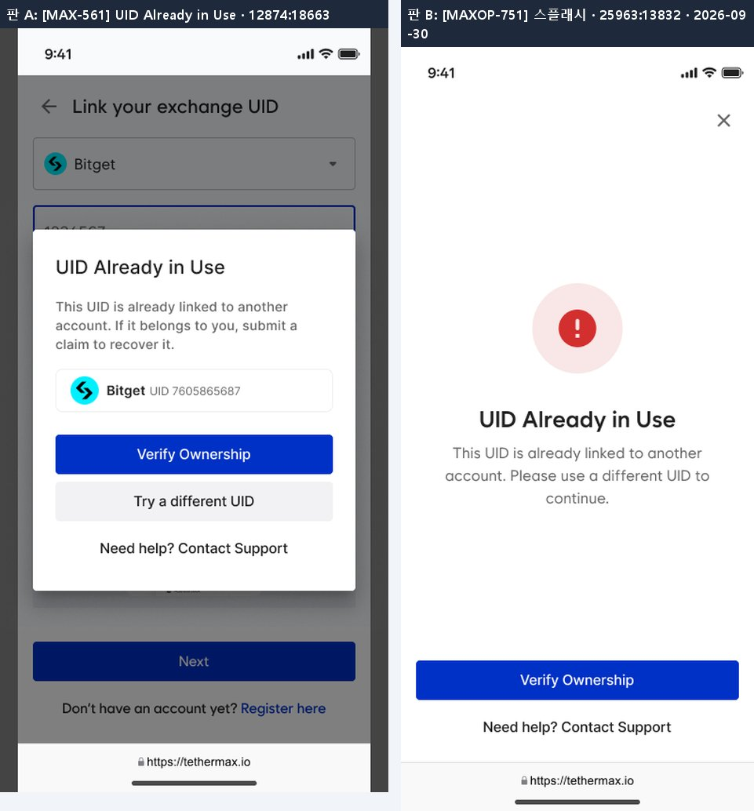

| 구분 | 내용 |
|---|---|
| 차이 | 판 A 다이얼로그에 UID 칩 + `Verify Ownership` + `Try a different UID` + `Need help? Contact Support`. 판 B 전체 화면에 `Verify Ownership` + `Need help? Contact Support`, 쿨다운은 별도 결과 `Verification Limit Reached` |
| DEX(revision)이 쓰는 판 | **판 B.** `UID link result / Splash / mWeb 375` 인스턴스 16개, 문구는 `Account Already in Use` |
| 명세·정책이 요구하는 것 | REQ-089 `Account Already in Use` · CTA `Verify Ownership` · `Need help? Contact Support`, 쿨다운이면 `Verification Limit Reached`(REQ-724). REQ-093 결과 화면 지원 경로는 MAXOP-751을 따른다. `Try a different wallet`은 소유권 단계 O2(`Ownership Claim Unavailable`)에만 |
| 권장(근거) | **합치지 않는다. MAXOP-751 그대로.** 명세가 이 구성을 확정했고, 보조 버튼은 소유권 단계에 있다 |

### B10. `UID Link Completed` 버튼은 어느 쪽인가

판 A: [MAXOP-751] mWeb 인스턴스 · [25960:1342565](https://www.figma.com/design/hsa3bSV9QmFTe2jsf6tzTm/UI-UX-Design?node-id=25960-1342565) · `Close` · 판 B: App 인스턴스 · `Back to Home` · 판 C: Desktop 인스턴스 · `Back to Home` (컴포넌트 [25960:1342528](https://www.figma.com/design/hsa3bSV9QmFTe2jsf6tzTm/UI-UX-Design?node-id=25960-1342528) 기본값 `Back to Home` + `Need help? Contact Support`)

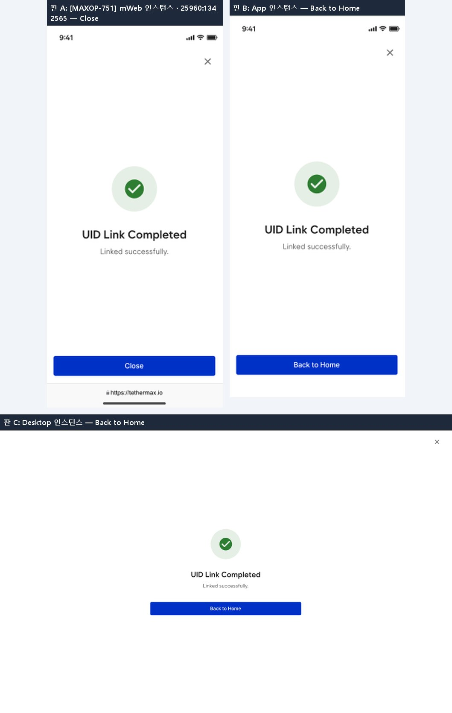

| 구분 | 내용 |
|---|---|
| 차이 | mWeb 인스턴스만 `Close` |
| DEX(revision)이 쓰는 판 | `Account Link Completed`(Wallet 전체 주소) + `Back to Home` |
| 명세·정책이 요구하는 것 | REQ-094 `Account Link Completed` / `Linked successfully.` + `Back to Home`, 이어 S4 홈 |
| 권장(근거) | **`Back to Home`으로 통일.** 명세와 컴포넌트 기본값이 같다. mWeb 인스턴스 `Close`는 덮어쓴 값으로 본다 |

### B11. MAX-601 떨어진 큰 글씨 프레임은 기준인가

판 A: `Frame 1984078537` · [22592:233087](https://www.figma.com/design/hsa3bSV9QmFTe2jsf6tzTm/UI-UX-Design?node-id=22592-233087) · 판 B: mWeb Default · [12772:24573](https://www.figma.com/design/hsa3bSV9QmFTe2jsf6tzTm/UI-UX-Design?node-id=12772-24573)

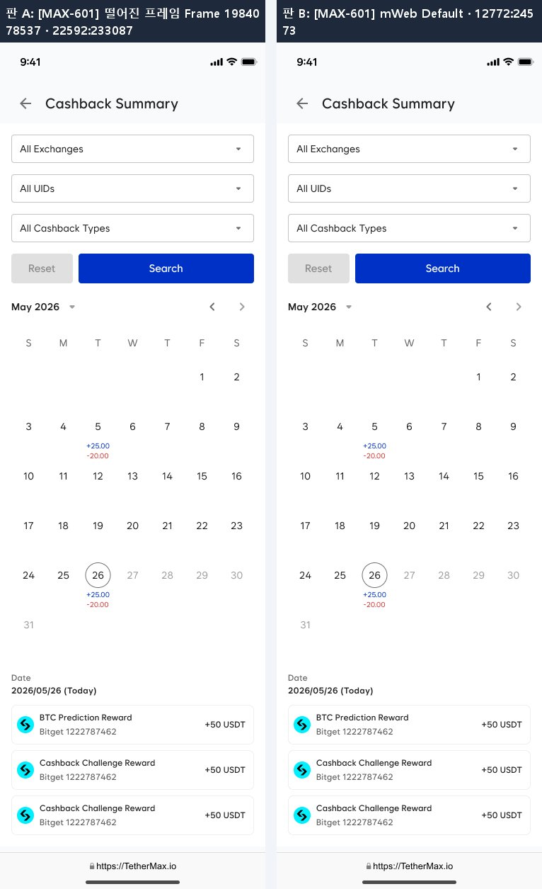

| 구분 | 내용 |
|---|---|
| 차이 | 판 A는 섹션 밖 떨어진 프레임으로 같은 화면의 글씨가 크다 |
| DEX(revision)이 쓰는 판 | 해당 없음 |
| 명세·정책이 요구하는 것 | 요구 없음. MAX 1216 회의 메모 「12px is now the minimum font size」 |
| 권장(근거) | **기준 아님.** 섹션 밖 이름 없는 프레임이다. 글씨 크기는 MUI 토큰·최소 12px 규칙으로 맞춘다 |

### B12. MAX-146 계산기 섹션 `mWeb`을 다크로 취급하나

[MAX-146] 섹션 `mWeb` · [8135:170235](https://www.figma.com/design/hsa3bSV9QmFTe2jsf6tzTm/UI-UX-Design?node-id=8135-170235)

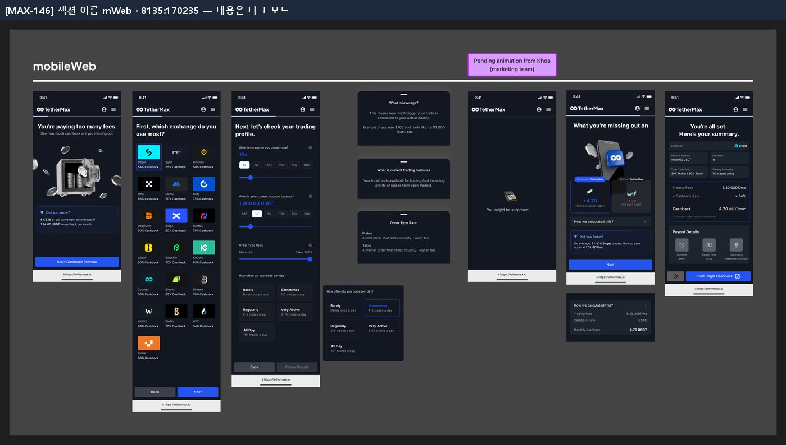

| 구분 | 내용 |
|---|---|
| 차이 | 섹션 이름은 `mWeb`(라이트·다크 표시 없음)인데 화면 전체가 다크 |
| DEX(revision)이 쓰는 판 | 계산기 PC·모바일을 새로 그림(29064:934 · 29187:119430 등) |
| 명세·정책이 요구하는 것 | 요구 없음 |
| 권장(근거) | **다크로 취급.** 내용이 다크이므로 라이트 기준 화면에서 뺀다 |

---

## C. 리워드 · 초대 · 콘텐츠

### C1. Events Web Special Events는 어느 판인가

판 A: [MAX-492] 기본판 · [11184:163371](https://www.figma.com/design/hsa3bSV9QmFTe2jsf6tzTm/UI-UX-Design?node-id=11184-163371) · 판 B: `Updated as of 18 May` · [11169:150668](https://www.figma.com/design/hsa3bSV9QmFTe2jsf6tzTm/UI-UX-Design?node-id=11169-150668) · 18 May

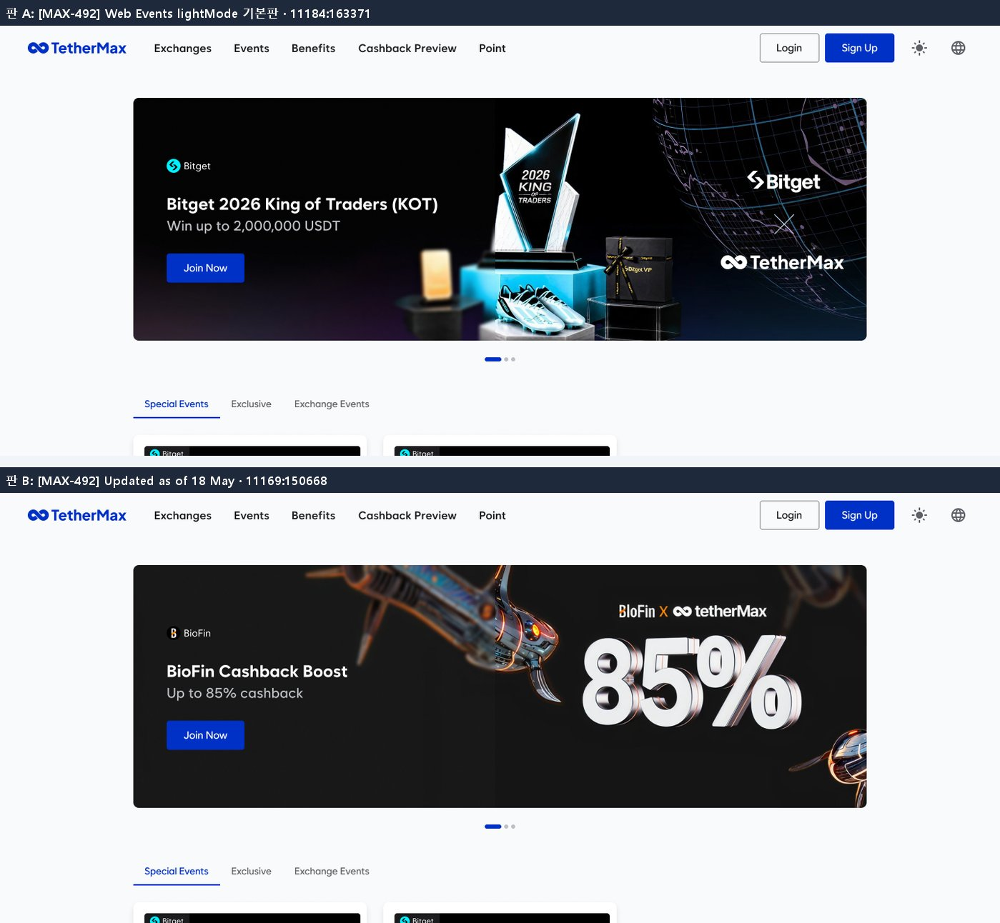

| 구분 | 내용 |
|---|---|
| 차이 | 판 B는 배너에 좌우 화살표(hover)를 추가했다(규칙 interaction 11366:321171). 배너 이미지는 샘플 |
| DEX(revision)이 쓰는 판 | 이벤트 PC 「원본 적용」 프레임([29062:112586](https://www.figma.com/design/hsa3bSV9QmFTe2jsf6tzTm/UI-UX-Design?node-id=29062-112586)) |
| 명세·정책이 요구하는 것 | 요구 없음 |
| 권장(근거) | **18 May판.** 섹션 이름에 날짜와 개정 목적(배너 화살표 추가)이 있다 |

### C2. 캐시백 챌린지 레벨 금액은 어느 쪽인가

판 A: [MAX-468] `Updated as of 25th May` ① · [15987:55661](https://www.figma.com/design/hsa3bSV9QmFTe2jsf6tzTm/UI-UX-Design?node-id=15987-55661) · 판 B: `Updated as of 25th May` ② · [15987:55664](https://www.figma.com/design/hsa3bSV9QmFTe2jsf6tzTm/UI-UX-Design?node-id=15987-55664)

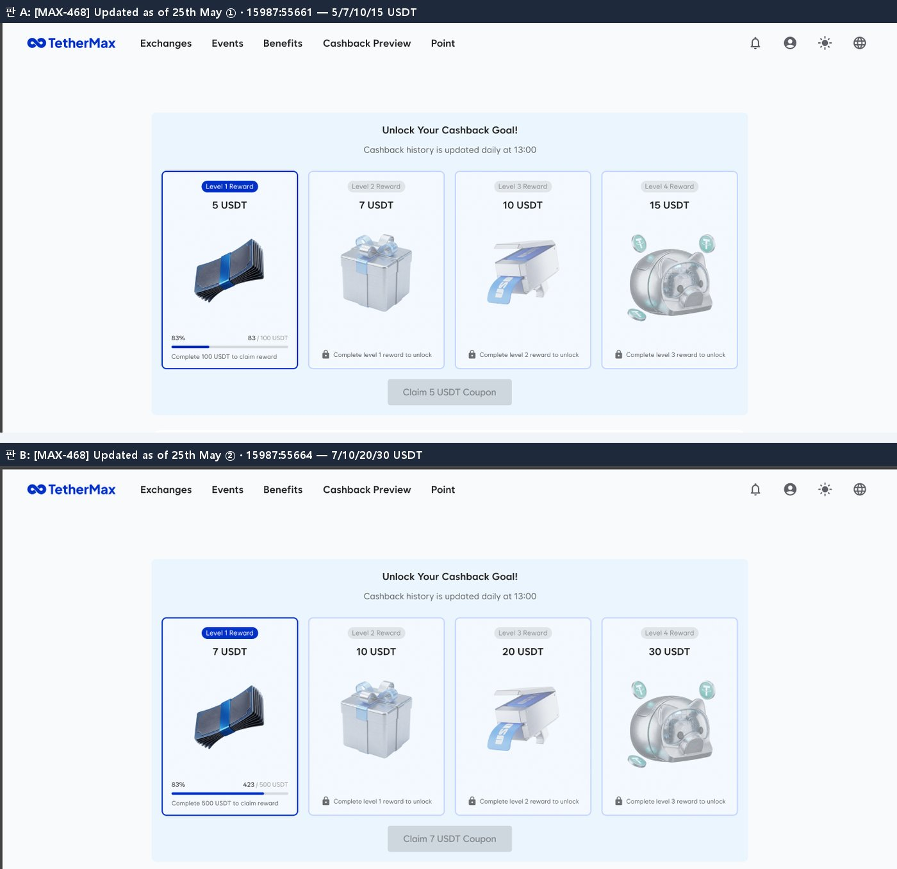

| 구분 | 내용 |
|---|---|
| 차이 | 레이아웃은 같고 레벨 금액만 다르다(5/7/10/15 USDT vs 7/10/20/30 USDT, 목표 500 USDT). mAPP MAX-503에도 같은 이름 섹션이 2개(12474:155696 · 12474:155697) |
| DEX(revision)이 쓰는 판 | `Cashback Challenge Reward` 문구만 있고 레벨 화면 없음 |
| 명세·정책이 요구하는 것 | REQ-438 · REQ-399 챌린지에 DEX 포함. 레벨 금액 요구 없음 |
| 권장(근거) | **권장 없음.** 레벨 금액은 운영(사업) 값이라 디자인 근거로 정할 수 없다. 화면 구성은 두 판이 같으므로 금액만 운영 담당이 정하면 된다 |

### C3. Cashback Boost 상세는 어느 판인가

판 A: [MAX-468] `For discussion` · [17351:190450](https://www.figma.com/design/hsa3bSV9QmFTe2jsf6tzTm/UI-UX-Design?node-id=17351-190450) · 판 B: `Boost Improvement` [PC] main · [25683:830](https://www.figma.com/design/hsa3bSV9QmFTe2jsf6tzTm/UI-UX-Design?node-id=25683-830)

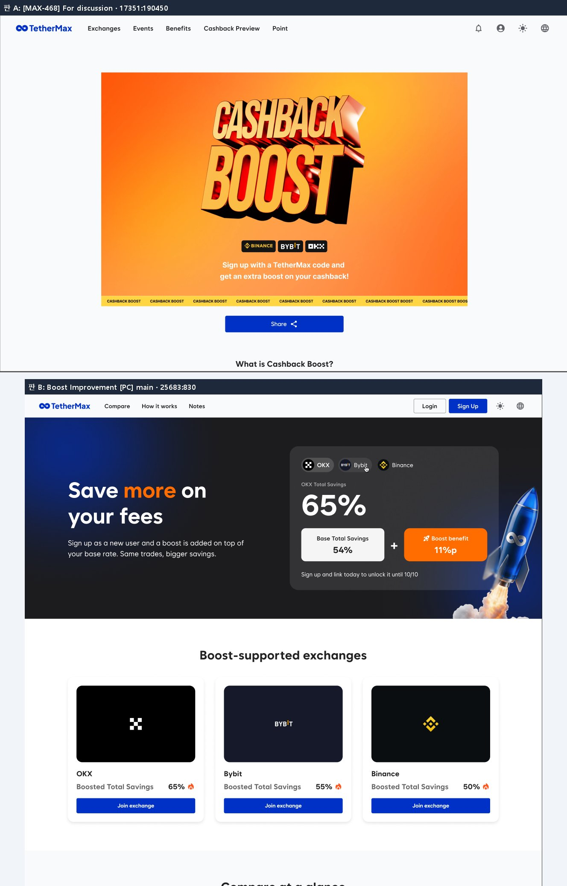

| 구분 | 내용 |
|---|---|
| 차이 | 판 A는 혜택 상세 안의 부스트(배너 + `What is Cashback Boost?` + 거래소 목록). 판 B는 전용 랜딩(`Save more on your fees` · `Boost-supported exchanges` · `Compare at a glance` · `How to get the boost` · `Notes`)과 가입 모달·거래소 1~6개 배치 규칙 |
| DEX(revision)이 쓰는 판 | `Boost` 문구 19건, 부스트 상세 화면은 그리지 않음 |
| 명세·정책이 요구하는 것 | REQ-439 부스트 거래소 목록에 DEX 행, CEX 부스트 규칙을 지갑에 적용. REQ-607 어드민 부스트 DEX 선택지 |
| 권장(근거) | **Boost Improvement.** 판 A는 섹션 이름이 논의용이고, 판 B가 노드상 뒤이며 거래소 목록(`Boost-supported exchanges`)·배치 규칙까지 갖춰 DEX 행을 넣을 자리가 분명하다 |

### C4. Global League Web Summary는 어느 판인가

판 A: [MAX-117] Web Handoff - Light · [1058:36620](https://www.figma.com/design/hsa3bSV9QmFTe2jsf6tzTm/UI-UX-Design?node-id=1058-36620) · 13 March 2026 v1.0 · 판 B: 최상위 단독 Web · [16399:86822](https://www.figma.com/design/hsa3bSV9QmFTe2jsf6tzTm/UI-UX-Design?node-id=16399-86822)

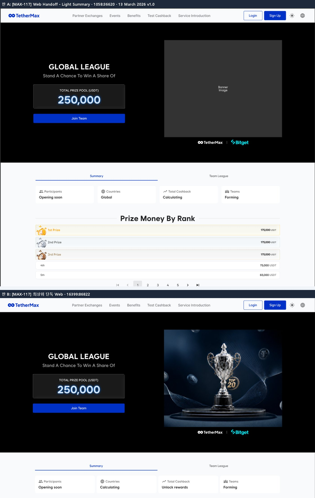

| 구분 | 내용 |
|---|---|
| 차이 | 판 A는 배너 자리표시자, Countries `Global` · Total Cashback `Calculating`. 판 B는 실배너, Countries `Calculating` · Total Cashback `Unlock rewards` |
| DEX(revision)이 쓰는 판 | 글로벌 리그 PC 3개(29183:117206 등)는 새 GNB + `TetherMax Global League with EdgeX` |
| 명세·정책이 요구하는 것 | REQ-601 리그 생성 거래소에 DEX 4곳 |
| 권장(근거) | **판 B.** 노드가 훨씬 뒤이고 실배너·실데이터 문구다 |

### C5. 빙고 UID 선택 모달·404는 어느 시안인가

판 A: [MAX-] Bingo 시안 A__modal1 · [28537:462694](https://www.figma.com/design/hsa3bSV9QmFTe2jsf6tzTm/UI-UX-Design?node-id=28537-462694) · 판 B: 시안 B__modal1 · [28537:463081](https://www.figma.com/design/hsa3bSV9QmFTe2jsf6tzTm/UI-UX-Design?node-id=28537-463081) (404: PC 28537:451920 / 28537:451930 · MO 28537:459655 / 28537:459665)

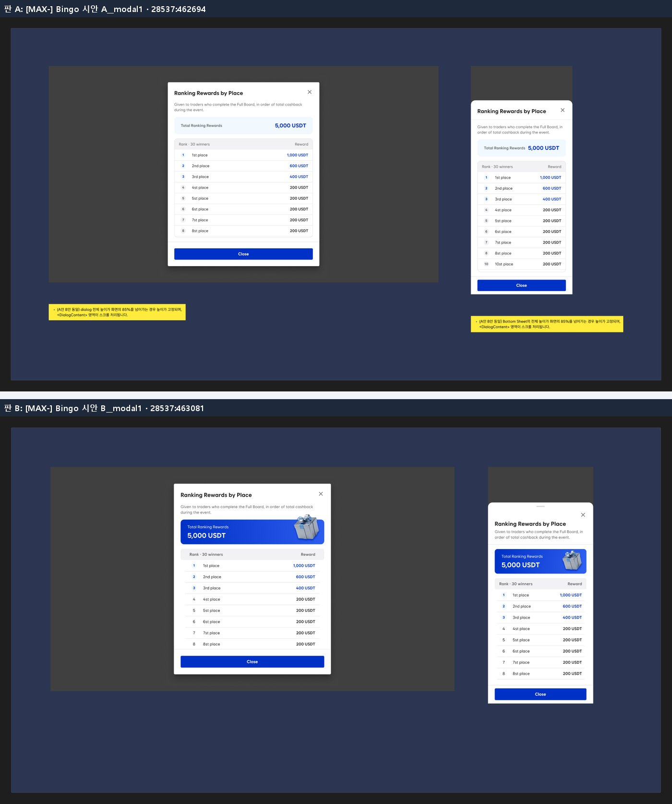

| 구분 | 내용 |
|---|---|
| 차이 | 시안 A 흰 카드 + 테두리, MO 바텀시트 핸들 없음. 시안 B 회색 채움 카드 + 총상금 강조 박스, MO 바텀시트 드래그 핸들 + X |
| DEX(revision)이 쓰는 판 | 맥스보드 PC 화면은 있고 이 모달은 없음. 기존 거래소 선택 바텀시트를 옮긴 프레임(29248:120197 등)에 `바텀시트 손잡이`가 있다 |
| 명세·정책이 요구하는 것 | REQ-603~605 맥스보드. 모달 시안 요구 없음 |
| 권장(근거) | **시안 B.** 기존 서비스 바텀시트에 드래그 핸들이 있어 같은 패턴이다 |

### C6. 초대 보상 내역은 어느 판인가

판 A: 최상위 단독 「리워드 조회」 · [15750:78334](https://www.figma.com/design/hsa3bSV9QmFTe2jsf6tzTm/UI-UX-Design?node-id=15750-78334) · 판 B: MAXOP-236 `[Added on 15th June]` · [15798:102378](https://www.figma.com/design/hsa3bSV9QmFTe2jsf6tzTm/UI-UX-Design?node-id=15798-102378) · 15 June

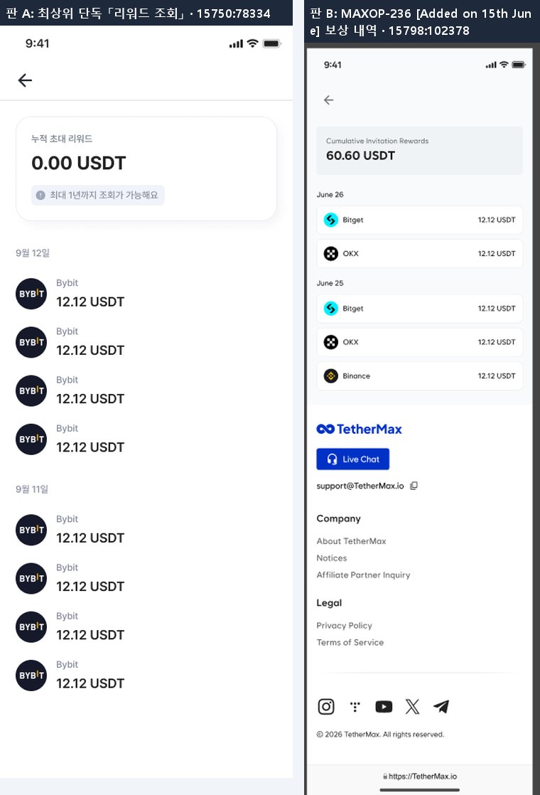

| 구분 | 내용 |
|---|---|
| 차이 | 판 A는 한국어 라벨 단독 프레임 4개(누적 초대 리워드 · 날짜별 거래소 행). 판 B는 같은 목적의 영문 화면(`Cumulative Invitation Rewards` · 날짜별 거래소 목록 · 빈 상태), Web·mWeb·mAPP |
| DEX(revision)이 쓰는 판 | 친구 초대 IF 화면(`Available Invitation Rewards` · `Reward History` · `Referral Details`) |
| 명세·정책이 요구하는 것 | REQ-414 · REQ-415 초대 리워드 요약 `Available Invitation Rewards` + 비활성 `Auto Claim` · `Reward History` · `Referral Details` |
| 권장(근거) | **MAXOP-236.** 섹션 이름에 번호·날짜가 있고 플랫폼·빈 상태가 갖춰졌다. 판 A는 섹션 밖 단독 프레임이다 |

### C7. 퀴즈 랜딩·결과 모달은 사진 없는 판인가

판 A: [MAX-] Quiz 퀴즈 · [19604:31464](https://www.figma.com/design/hsa3bSV9QmFTe2jsf6tzTm/UI-UX-Design?node-id=19604-31464) · 판 B: `ysy removed` · [27090:1357234](https://www.figma.com/design/hsa3bSV9QmFTe2jsf6tzTm/UI-UX-Design?node-id=27090-1357234) · 결과 모달 [19604:32287](https://www.figma.com/design/hsa3bSV9QmFTe2jsf6tzTm/UI-UX-Design?node-id=19604-32287) · DEX(revision): [28960:130554](https://www.figma.com/design/hsa3bSV9QmFTe2jsf6tzTm/UI-UX-Design?node-id=28960-130554)

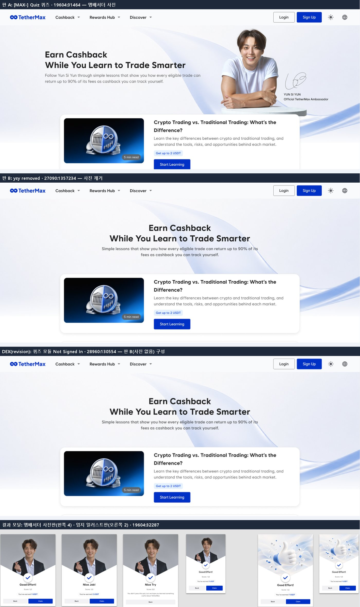

| 구분 | 내용 |
|---|---|
| 차이 | 판 A 히어로에 앰배서더 사진, 판 B 사진 제거·문구 중앙 정렬. 결과 모달은 사진판 4종과 엄지 일러스트판 2종이 같은 섹션에 있다 |
| DEX(revision)이 쓰는 판 | **판 B.** 퀴즈 모듈 랜딩 히어로가 사진 없이 「Earn Cashback While You Learn to Trade Smarter」 중앙 정렬 |
| 명세·정책이 요구하는 것 | REQ-445 · REQ-448 퀴즈·쿠폰. 사진 요구 없음 |
| 권장(근거) | **랜딩은 ysy removed, 결과 모달은 엄지 일러스트판.** 섹션 이름이 사진 제거 결정을 나타내고, 결과 모달도 같은 결정에 맞춰 사진 없는 판을 쓴다 |

### C8. WOO X PRO 이벤트 메일은 어느 판인가

판 A: [MAX-502] 파란 배경 · [21322:1090](https://www.figma.com/design/hsa3bSV9QmFTe2jsf6tzTm/UI-UX-Design?node-id=21322-1090) · 판 B: 검은 배경 · [21322:1283](https://www.figma.com/design/hsa3bSV9QmFTe2jsf6tzTm/UI-UX-Design?node-id=21322-1283)

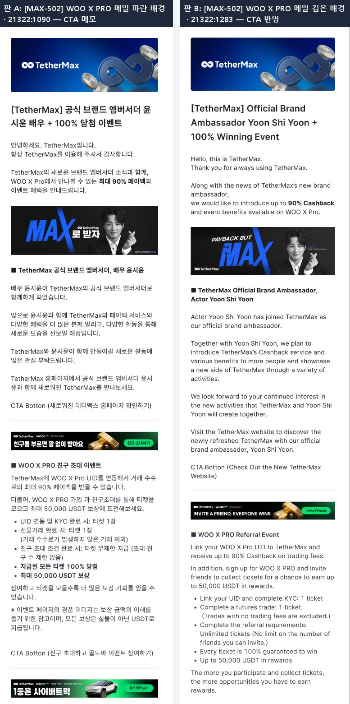

| 구분 | 내용 |
|---|---|
| 차이 | 판 A는 CTA 자리에 `CTA Botton (…)` 메모 텍스트, 이름 `Yoon Shi Yoon`. 판 B는 실제 CTA 버튼, 이름 `Yun Si Yun` |
| DEX(revision)이 쓰는 판 | 해당 없음 |
| 명세·정책이 요구하는 것 | REQ-592 이벤트 안내 이메일. WOO X 이벤트는 유지 |
| 권장(근거) | **판 B(검은 배경).** CTA 메모를 반영한 판이고, 이름 표기 `Yun Si Yun`이 Renewal 랜딩 앰배서더 표기와 같다 |

### C9. Newsletter 화면 기준은 어느 세트인가

판 A: [MAX-1244] 23102 세트 Web 1440 · [23102:1009752](https://www.figma.com/design/hsa3bSV9QmFTe2jsf6tzTm/UI-UX-Design?node-id=23102-1009752) · 판 B: 24403 세트 Web 1440 · [24403:339344](https://www.figma.com/design/hsa3bSV9QmFTe2jsf6tzTm/UI-UX-Design?node-id=24403-339344)

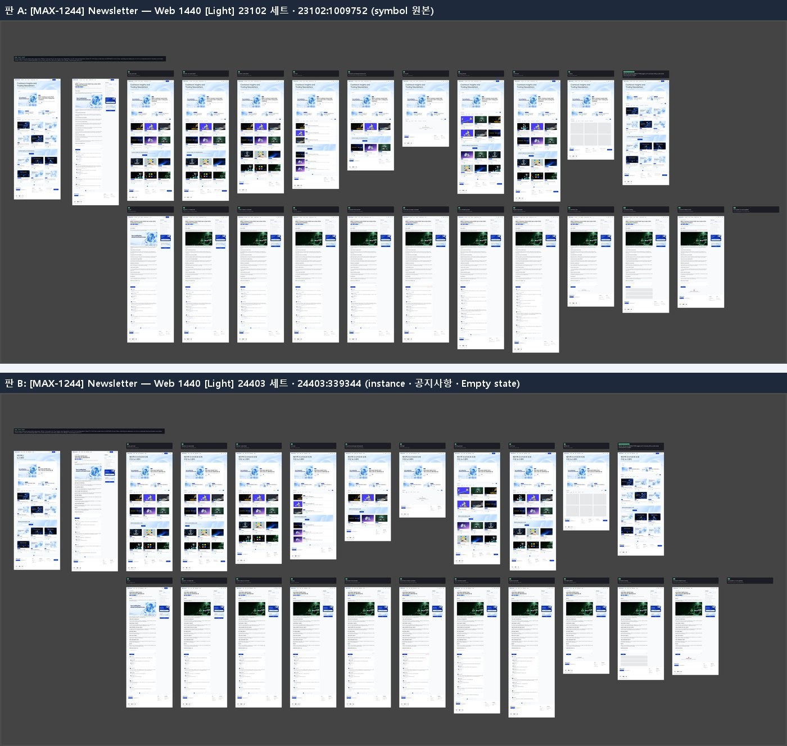

| 구분 | 내용 |
|---|---|
| 차이 | 구성은 같다. 23102 세트는 컴포넌트 원본(symbol), 24403 세트는 인스턴스 복사본에 GNB `공지사항` 텍스트·Components `Empty state`·`결과 24개`가 추가됐다 |
| DEX(revision)이 쓰는 판 | 해당 없음 |
| 명세·정책이 요구하는 것 | REQ-595 뉴스레터는 범위 밖. REQ-465 모바일 드로어 항목에 `Newsletters` |
| 권장(근거) | **24403 세트(화면 기준) · 23102 세트(컴포넌트 원본).** 24403이 뒤에 만든 세트이고 빈 상태·국문을 반영했다. DEX 작업에는 영향이 없다 |
