# TetherMax 전체 프로토타입 — 결정 항목 설명서

| 항목 | 내용 |
|---|---|
| 대상 | PM(결정) · 디자이너(Figma 수정) |
| 목적 | 결정할 항목마다 Figma 화면과 현재 프로토타입 화면을 나란히 보고, 무엇이 다르고 무엇을 정해야 하는지 한눈에 판단 |
| 다루는 범위 | 1장 = `전체프로토타입_확인필요.md` 1장 D1~D9 · 2장 = 프로토타입 재작업 중 2026-11-26에 새로 모인 질문(`_프로토타입_전체/ref/질문_*.md` · `대응_*.md`). 소유권 O16 다이얼로그 건은 별도 담당이라 뺐습니다 |
| 이미지 | `전체프로토타입_결정항목_img/` — `*_figma.jpg` = Figma(fileKey `hsa3bSV9QmFTe2jsf6tzTm`, 노드는 각 항목에 표기) · `*_proto.jpg` = 현재 프로토타입(`_latest.html`, 디자인 보기) |
| 권장 원칙 | 정책(`00_DEX_최종정책.md`) > 요구사항정의서 > Figma. 확정 결정(부록 G)이 있으면 그것을 따릅니다. 근거가 없으면 「권장 없음」 |

## 요약

| # | 항목 | 권장 | 영향 화면 |
|---|---|---|---|
| D1 | Figma 문구가 명세보다 새로운 곳 | Figma 문구 채택 + 명세 갱신(확정 결정과 다르면 결정 문구) | 허브 잔액 패널 · 라우트 행 · DEX 개요 · 리뷰 · 친구 초대 약관 |
| D2 | 캐시백 요약 월간 카드 `Claimed` / `Withdrawn` | `Claimed` 채택(G-418), 유형값은 `Claim Amount` 유지 | 캐시백 요약 |
| D3 | 이벤트 탭 구성(3탭 / 2탭) | 권장 없음 | 이벤트 목록 |
| D4 | GNB `Cashback` 동작 | hover 패널 3행 유지 + 클릭 = 허브. 패널 디자인 요청 | 웹 GNB |
| D5 | 앱 하단 탭 이름 | Figma(`Exchanges` · `Point`)로 명세 정정 | 앱 하단 탭 |
| D6 | 월간 랭킹 순위표 페이지 | 순위표 페이지 유지 + 디자인 요청 | 캐시백 랭킹 |
| D7 | DEX 개요 프로모 배너 | 1차 제외(슬라이드 0 = 렌더 안 함) | DEX 개요 |
| D8 | 최소 출금액 범위 | 현재 반영 유지(파트너 허브 10 · 회원 초대 50) | 파트너 허브 · 친구 초대 |
| D9 | `신청 가능한` / `출금 가능` 캐시백 | `출금 가능 캐시백`(REQ-150)으로 통일 | 출금 모달 · 허브 패널 국문 |
| N1 | 모바일 드로어 항목 | 명세(REQ-465) 유지 + Figma 갱신 요청 | 모바일 웹 드로어 |
| N2 | 거래소 목록 `Rating` 열 | 명세(REQ-466) 유지 + 열 디자인 요청 | Exchange Listings |
| N3 | 앱 업데이트 다이얼로그 스타일 | 권장 없음 | 앱 필수 업데이트 |
| N4 | 맥스보드 게스트·미참여 단계 | 넣음(기존 Bingo 프레임 그대로) | 맥스보드 |
| N5 | 맥스보드 참여 등록 모달 시안 A/B | 시안 B | 맥스보드 |
| N6 | 개인 리그 · 요약 탭 | DEX 반영 범위를 개인 리그에도 적용, 상태 추가 | 글로벌 리그 |
| N7 | Cashback Boost 상세 | 범위 안 — DEX 행 포함 상태 추가 | 캐시백 부스트 |
| N8 | 쿠폰 0개인데 탭 배지 7 | 배지 = 실제 개수(0) | 쿠폰함 |
| N9 | 첫 캐시백 상세 제목·CTA | `Claim` 계열로 문구표 확정, 버튼은 Claim 화면 이동 | 혜택 상세 |
| N10 | 챌린지 「UID Link Required」 | 연동 계정 0개일 때만, `Account` 문구로 넣음 | 캐시백 챌린지 |
| N11 | Referral Friends · Reward History 목록 | 화면 포함. 피초대자 지갑 표시 방식은 권장 없음 | 친구 초대 |
| N12 | Cashback Basics KEY TAKEAWAYS | 운영 콘텐츠로 교체(문구표) | Beginner's Guide |
| N13 | 빈 검색 문구 | 허브 비교표 = G-151, 기존 거래소 목록 = 기존 문구 | 허브 · Exchange Listings |
| N14 | DEX 최소액 미만 넛지 · 부분 매칭 줄 | 허브 패널 = G-139 + REQ-300 안내, 지갑 카드 문구는 지갑 상세 전용 | 허브 잔액 패널 |
| N15 | 모바일 게스트 하단 `Sign Up` 외부 링크 아이콘 | 아이콘 제거 | DEX 상세(모바일) |
| N16 | 누적 캐시백 카드 캡션 | G-191 문구 | 홈 · 지갑 상세 |
| N17 | 캐시백 타임라인 3단계 / 4단계 | 정책 4단계 유지 + 영문 단계명 원문 요청 | 홈 · 지갑 상세 |
| N18 | 출금 모달 제목 `Withdraw` | `Claim`(G-418, STG 현행) | 출금 모달 |
| N19 | 지갑 상세의 구버전 타임라인 | 기존 UID 상세와 같은 캐러셀로 통일 | 지갑 상세 |

총 28건 — 권장 있음 25건 · 일부 권장 1건(N11) · 권장 없음 2건(D3 · N3).

---

## 1. 확인필요 1장 (D1~D9)

### D1. Figma 문구가 명세보다 새로운 곳 — 어느 쪽 문구를 원본으로 삼을지

**Figma** — 허브 H8 EdgeX 잔액 패널 `28960:126926`

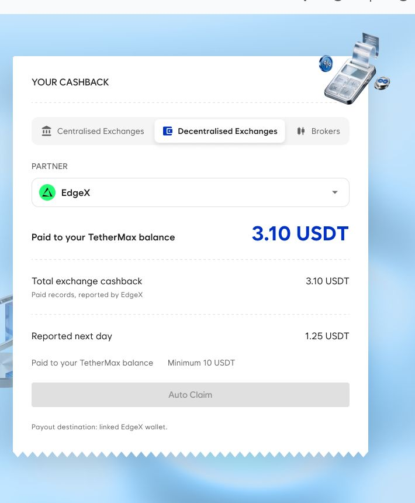

**현재 프로토타입** — `hub.main:dexPanel` (PC · EN)

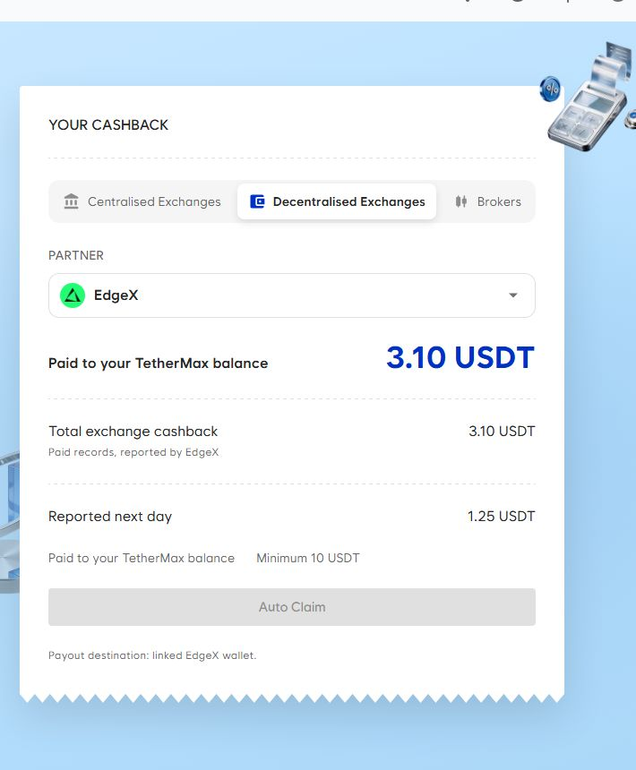

| 구분 | 내용 |
|---|---|
| Figma가 말하는 것 | 자동 지급 전환 뒤 Figma가 먼저 바꾼 문구: 허브 패널 큰 숫자 `Paid to your TetherMax balance`(H8) / `Total available cashback`(H5) · `Paid records, reported by EdgeX` · 각주 `Payout destination: linked {DEX} wallet.` · 라우트 행 `Automatic payouts from 10 USDT` · DEX 개요 Learn and Earn 본문 · 리뷰 축 `Cashback payouts` · 친구 초대 약관 bullet 2개 |
| 정책/명세가 말하는 것 | REQ-300 `Withdrawable {amount} USDT` · `Total event reward` · `You withdraw on TetherMax, to your linked {DEX} wallet.` / REQ-315 `Paid daily, withdraw from 10 USDT` / REQ-330 `Short lessons on decentralised perps, then a quiz.` / REQ-353 `Cashback withdrawal` / REQ-421 bullet 3개(DEX 이름 나열 포함) |
| 지금 프로토타입 | Figma 문구 사용(허브 패널 · 라우트 행 · 개요 · 리뷰 축). 약관은 Figma 문구 |
| 무엇이 다른가 | 명세 원문이 수동 출금(`withdraw`) 시절 문구로 남아 있고, Figma는 자동 지급에 맞춰 고쳐져 있음. H5와 H8의 큰 숫자 라벨도 서로 다름 |
| 정해야 할 것 | **A** Figma 문구 채택 + REQ-300·309·315·330·353·421 원문 갱신 / **B** 명세 원문 유지, Figma를 되돌림 |
| 권장안과 이유 | **A.** 정책 6-1(자동 지급)과 G-418(`Claim` 계열)·G-199(DEX 이름 하드코딩 제거)에 Figma 쪽이 맞습니다. 단 확정 결정 문구(G-092 · G-094 · G-198 등)와 다르면 결정 문구가 우선이고, H5·H8 큰 숫자 라벨은 하나(`Total available cashback`)로 맞춥니다 |

### D2. 캐시백 요약 월간 카드 — `Claimed`인가 `Withdrawn`인가

**Figma** — CS1 `28960:127133`

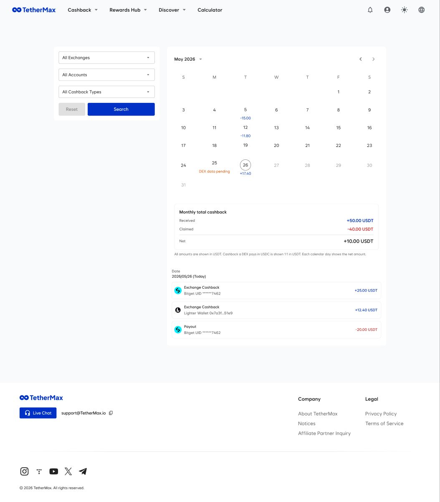

**현재 프로토타입** — `summary.main:normal`

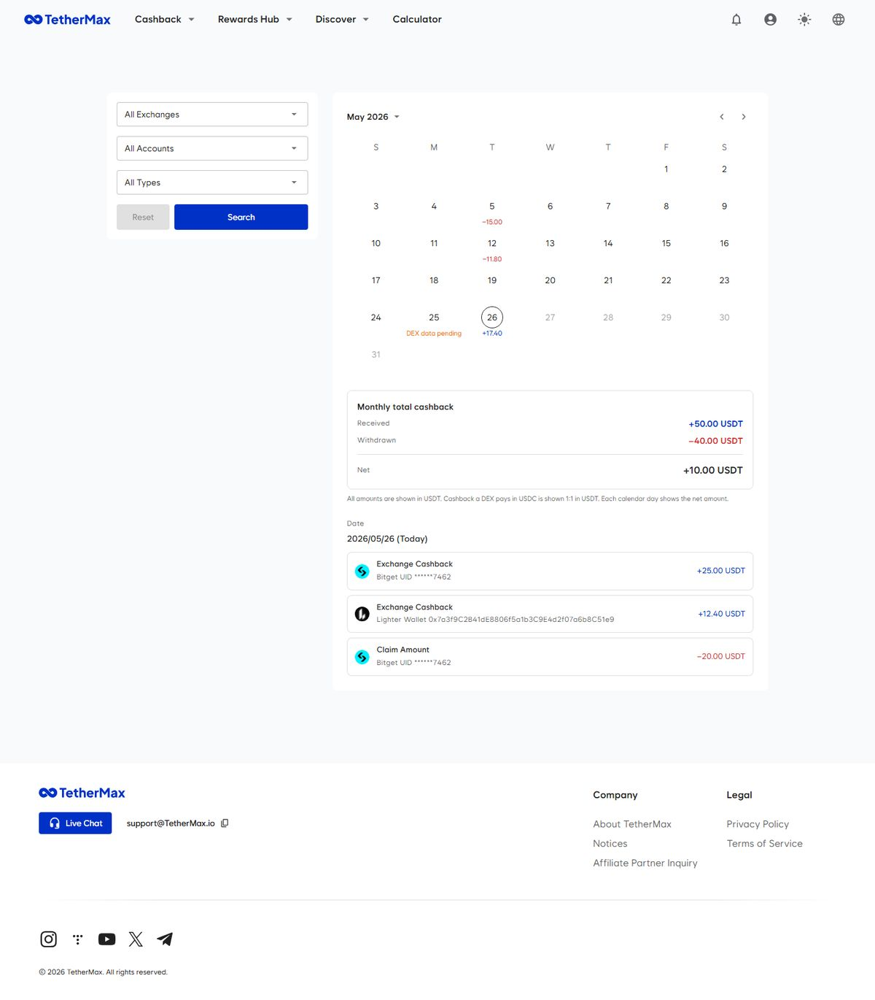

| 구분 | 내용 |
|---|---|
| Figma가 말하는 것 | 월간 카드 두 번째 줄 `Claimed`. 모바일 유형 시트는 `Trading Cashback` · `Withdrawal` |
| 정책/명세가 말하는 것 | REQ-369 `Received` / `Withdrawn` / `Net`. G-418 확정: 「영문 화면의 출금 용어를 `Claim` 계열로 통일」(유형값 `Claim Amount` 유지). G-365 확정: `Trading Cashback` → `Exchange Cashback` |
| 지금 프로토타입 | `Withdrawn`(REQ-369 원문) |
| 무엇이 다른가 | REQ-369 원문은 G-418보다 앞선 `Withdrawn`. Figma `Claimed`는 G-418 방향과 같음 |
| 정해야 할 것 | **A** `Claimed` 채택 + REQ-369 갱신 / **B** `Withdrawn` 유지 |
| 권장안과 이유 | **A.** G-418이 영문 출금 용어를 `Claim` 계열로 통일하기로 확정했습니다. 유형 필터 값은 G-418대로 `Claim Amount`, 캐시백 유형은 G-365대로 `Exchange Cashback`(모바일 시트의 `Trading Cashback` · `Withdrawal`은 Figma 수정 대상) |

### D3. 이벤트 탭 구성 — 3탭인가 2탭인가

**Figma** — 거래소 이벤트 `29062:112586`

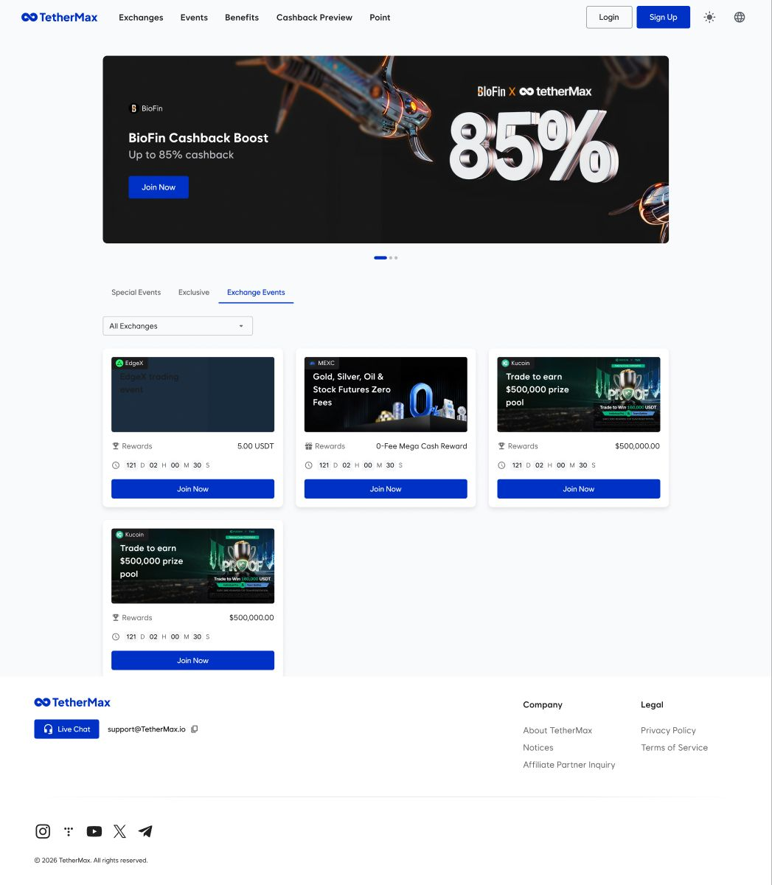

**현재 프로토타입** — `events.list:exchange`

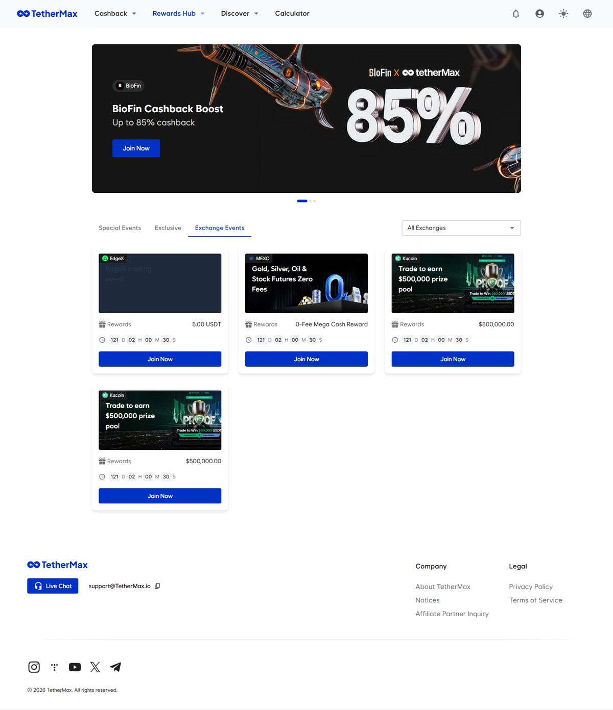

| 구분 | 내용 |
|---|---|
| Figma가 말하는 것 | 탭 3개 `Special Events` · `Exclusive` · `Exchange Events` |
| 정책/명세가 말하는 것 | REQ-437 「`테더맥스 전용 이벤트` · `거래소 이벤트` 두 탭 모두 DEX 이벤트를 노출」 |
| 지금 프로토타입 | Figma 3탭 |
| 무엇이 다른가 | `Special Events`가 명세에 없는 탭. 명세는 기존 운영 화면을 2탭으로 적었는데 Figma는 3탭 |
| 정해야 할 것 | **A** 3탭(Figma) + REQ-437 갱신(`Special Events`에도 DEX 이벤트 노출 여부 포함) / **B** 2탭(명세) |
| 권장안과 이유 | **권장 없음.** 기존 운영 화면이 몇 탭인지가 기준인데 근거 문서에서 확인되지 않습니다. 운영 화면 확인 후 정합니다 |

### D4. GNB `Cashback` — hover 패널을 둘지

**Figma** — 기존 GNB Cashback 드롭다운 `19604:32652`

**현재 프로토타입** — `cmn.header:hover`

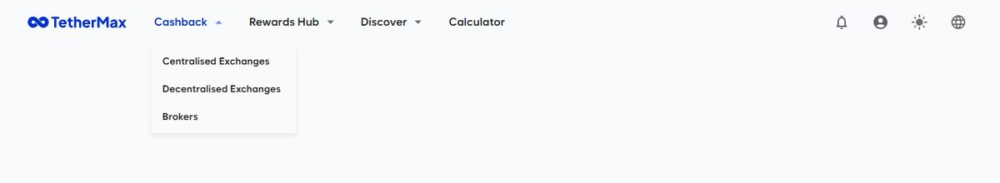

| 구분 | 내용 |
|---|---|
| Figma가 말하는 것 | 기존 드롭다운은 `Exchanges` · `Brokers` · `Cashback Calculator`. DEX 설계는 「클릭 = 허브 이동」만 있고 3행 패널 프레임 없음 |
| 정책/명세가 말하는 것 | REQ-464 · 정책 B-21-2: 「`Cashback` 클릭 = 허브 이동, hover = 패널(정확히 3행 `Centralised Exchanges` · `Decentralised Exchanges` · `Brokers`)」. 터치 동작만 ❓ G-213 |
| 지금 프로토타입 | 명세대로 3행 패널 |
| 무엇이 다른가 | 3행 패널의 디자인 프레임이 없음. 기존 드롭다운 항목과도 다름 |
| 정해야 할 것 | **A** hover 패널 유지 + 클릭 = 허브, 패널 디자인 요청 / **B** 패널 없이 클릭 = 허브만 |
| 권장안과 이유 | **A.** REQ-464(Must)가 패널과 클릭 동작을 모두 확정했습니다. 남은 것은 G-213(터치 기기에서 탭 = 패널 열기 / 라벨 이동) 하나입니다 |

### D5. 앱 하단 탭 이름 — `Exchanges`·`Point`인가 `Exchange`·`Points`인가

**Figma** — 앱 하단 탭 `8582:155585`

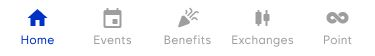

**현재 프로토타입** — `cmn.appnav:normal` (모바일)

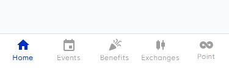

| 구분 | 내용 |
|---|---|
| Figma가 말하는 것 | `Home` · `Events` · `Benefits` · `Exchanges` · `Point` |
| 정책/명세가 말하는 것 | 명세 `Exchange` · `Points`. G-215(`Exchange` / `Exchanges`) 미정 |
| 지금 프로토타입 | Figma 라벨 |
| 무엇이 다른가 | 단수/복수 표기만 다름 |
| 정해야 할 것 | **A** Figma 라벨로 명세 정정 / **B** 명세 라벨로 앱 수정 |
| 권장안과 이유 | **A.** 현재 운영 중인 앱 라벨이라 바꾸지 않는 쪽이 변경 범위가 작습니다(G-215 종결) |

### D6. 월간 랭킹 순위표 — 별도 페이지를 둘지

**Figma** — RK2 Ranking, ranked (DEX 페이지 판 `27610:206163`. DEX(revision) `28960:127207`은 현재 파일에서 찾을 수 없음)

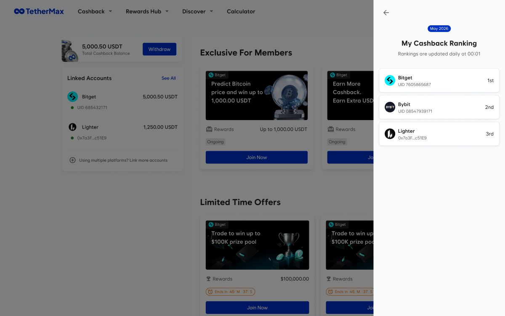

**현재 프로토타입** — `ranking.main:board` (디자인 없음, V2.2 내용을 옮김)

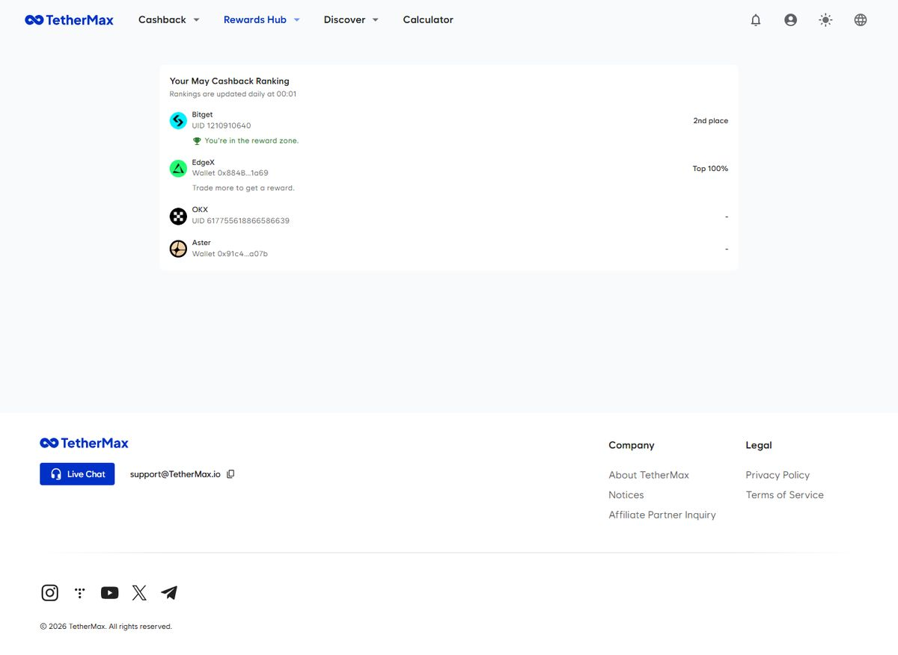

| 구분 | 내용 |
|---|---|
| Figma가 말하는 것 | 랭킹은 혜택 화면 위 사이드 패널 `My Cashback Ranking`뿐 |
| 정책/명세가 말하는 것 | REQ-379~382(Must, 확정): CEX UID와 DEX 지갑을 한 순위표로, `전체 / CEX / DEX` 칩, 0.01 USDT 하한 안내, 랭킹 리워드(1위 100 · 2위 50 · 3위 20 · 상위 10% 10 USDT) |
| 지금 프로토타입 | 패널을 기본 상태로, 순위표는 `board` 상태로 둠(디자인 없음) |
| 무엇이 다른가 | 명세의 칩 · 하한 안내 · 리워드 박스를 둘 화면이 Figma에 없음 |
| 정해야 할 것 | **A** 순위표 페이지 유지 + 디자인 요청 / **B** 패널만 두고 REQ-379~382 표시 요소를 패널에 넣음 |
| 권장안과 이유 | **A.** REQ-379~382가 Must 확정이고, 칩 필터와 리워드 안내는 사이드 패널에 들어갈 자리가 없습니다 |

### D7. DEX 개요 프로모 배너 — 1차에 넣을지

**Figma** — DEX overview Mobile `28960:130946` 배너 부분(Aster 슬라이드에 BloFin 85% 이미지)

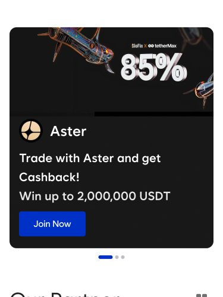

**현재 프로토타입** — `dex.overview:normal` (모바일, 배너 부분)

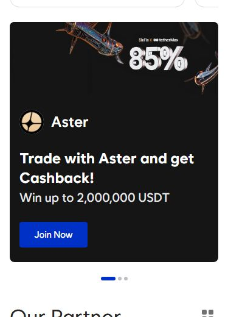

| 구분 | 내용 |
|---|---|
| Figma가 말하는 것 | glance 아래 캐러셀 배너(파트너 · 제목 · 부제 · `Join Now`) |
| 정책/명세가 말하는 것 | REQ-324(Should): 「게시된 슬라이드가 없으면 배너를 렌더하지 않고 빈 공간도 남기지 않는다」. 관리 자리는 ❓ G-156 |
| 지금 프로토타입 | 배너 표시(시안 이미지 그대로) |
| 무엇이 다른가 | 운영자가 슬라이드를 넣을 백오피스 자리가 정해지지 않아, 출시해도 배너가 채워질 길이 없음 |
| 정해야 할 것 | **A** 1차 제외(백오피스 자리 없이 출시 = 슬라이드 0) / **B** 1차 포함 + G-156 백오피스 영역 신설 |
| 권장안과 이유 | **A.** REQ-324가 Should이고, 슬라이드 0이면 렌더하지 않는 규칙이 이미 있어 화면 영향이 없습니다. G-156은 2차에서 정합니다 |

### D8. 최소 출금액 — 파트너 허브 10 USDT · 회원 초대 50 USDT 유지

**Figma** — 파트너 허브 PH1 `28960:127182`

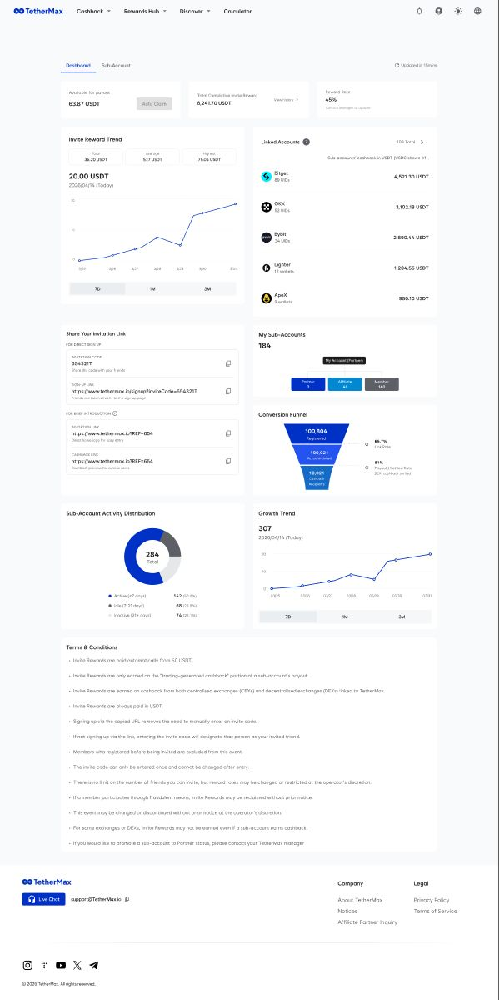

**현재 프로토타입** — `partner.hub:normal`

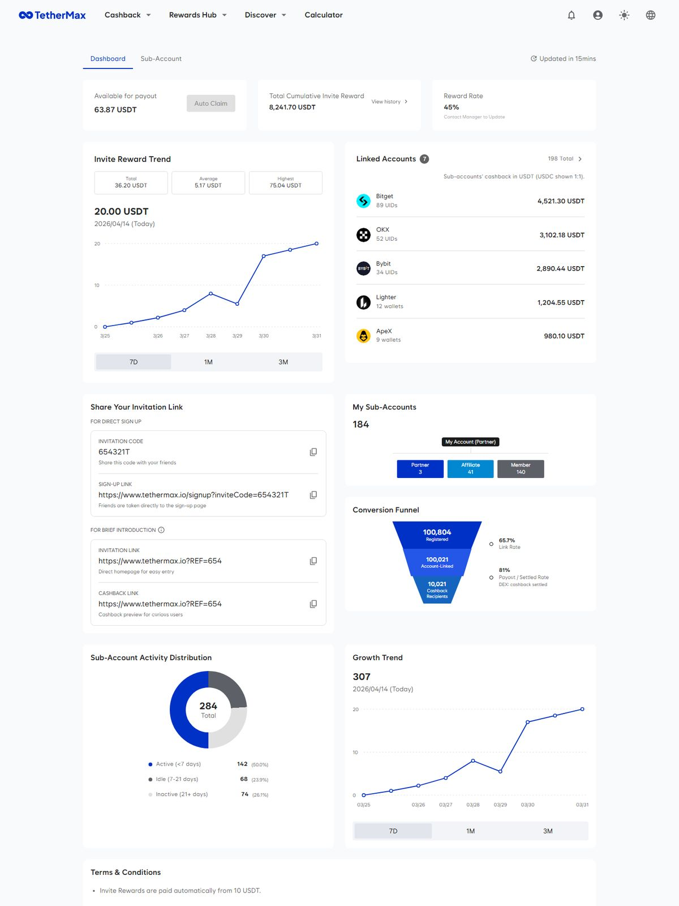

| 구분 | 내용 |
|---|---|
| Figma가 말하는 것 | 약관 첫 줄 `Invite Rewards are paid automatically from 50 USDT.` |
| 정책/명세가 말하는 것 | G-203 확정: 「설정값, 초기 10 USDT(영문 50 표기는 10으로 정정)」(파트너 허브). G-410 확정: 회원 초대 리워드 최소 50 USDT 그대로 |
| 지금 프로토타입 | 파트너 허브 `…from 10 USDT.`, 친구 초대 50 USDT |
| 무엇이 다른가 | Figma 파트너 허브 약관만 50 |
| 정해야 할 것 | **A** 현재 반영 유지 / **B** 둘 다 같은 값으로 |
| 권장안과 이유 | **A.** G-203 · G-410이 각각 확정했습니다. Figma 약관 숫자는 수정 요청 |

### D9. 국문 `신청 가능한 캐시백` / `출금 가능 캐시백` — 하나로 통일

Figma에는 국문 원문이 없어 Figma 이미지가 없습니다.

**현재 프로토타입** — `wd.claim:normal` (KO 보기 · 출금 모달은 Figma 영문 그대로)

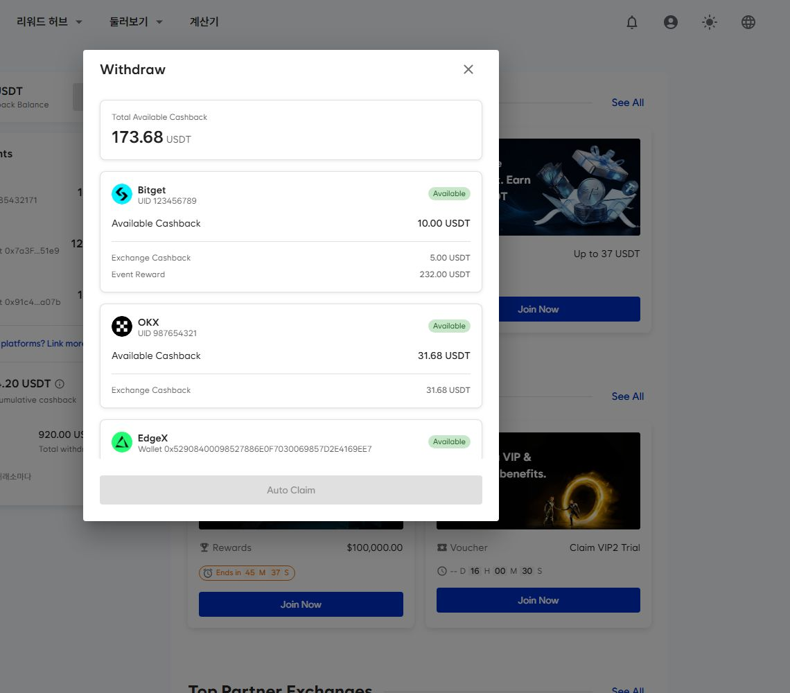

| 구분 | 내용 |
|---|---|
| Figma가 말하는 것 | 영문만(`Available Cashback` 계열) |
| 정책/명세가 말하는 것 | REQ-306 · 정책 8-3: `Available Cashback`은 「출금 화면 `신청 가능한 캐시백`과 같은 말」 / REQ-150: 「`출금 가능 페이백` → `출금 가능 캐시백`」 |
| 지금 프로토타입 | KO 보기에서도 출금 모달 라벨이 영문(국문 자리 미반영) |
| 무엇이 다른가 | 같은 금액을 가리키는 국문 라벨이 두 가지 |
| 정해야 할 것 | **A** `출금 가능 캐시백`(REQ-150) / **B** `신청 가능한 캐시백`(REQ-306) |
| 권장안과 이유 | **A.** REQ-150이 실물 출금 화면 국문 교체를 직접 정한 항목입니다. REQ-306 괄호 표현은 REQ-150에 맞춰 갱신. 최종 국문은 G-419 문구표에서 확정 |

---

## 2. 2026-11-26 새로 모인 질문

### N1. 모바일 드로어 제품 항목 — 명세 6항목인가, 최신 Figma인가

**Figma** — 최신 드로어 비로그인 `19604:33156` · 로그인 `19604:32998`

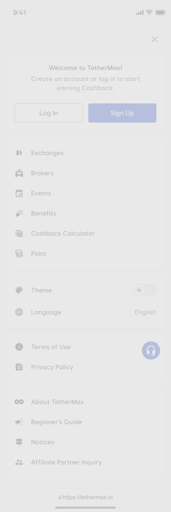

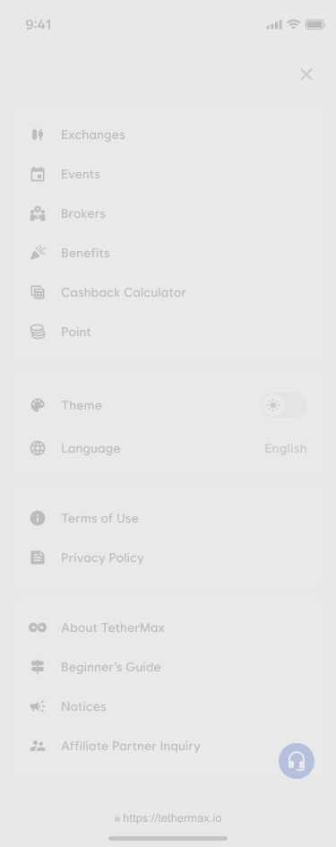

**현재 프로토타입** — `cmn.drawer:normal` (모바일)

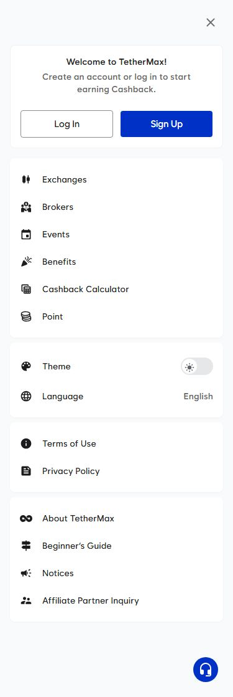

| 구분 | 내용 |
|---|---|
| Figma가 말하는 것 | `Exchanges` · `Brokers` · `Events` · `Benefits` · `Cashback Calculator` · `Point` |
| 정책/명세가 말하는 것 | REQ-465(Must, 확정) · 정책 B-21-3: 「제품 6항목 `Cashback, Events, Benefits, Calculator, Newsletters, Points`」, 데스크톱 헤더 메뉴를 대체 |
| 지금 프로토타입 | 최신 Figma 항목 |
| 무엇이 다른가 | Figma는 DEX 이전 구조(`Exchanges` · `Brokers` 따로, Cashback 허브 진입 없음). 명세는 `Cashback`(허브) · `Newsletters`가 있음 |
| 정해야 할 것 | **A** 명세 6항목 유지 + Figma 드로어 갱신(`Newsletters` 행 포함) / **B** Figma 항목으로 REQ-465 정정 |
| 권장안과 이유 | **A.** REQ-465가 확정이고, 데스크톱 GNB(REQ-464 `Cashback` = CEX · DEX · Brokers 허브)와 같은 구조여야 모바일에서 DEX로 들어갈 길이 생깁니다. A로 정하면 프로토타입 드로어를 명세대로 되돌립니다 |

### N2. 거래소 목록 `Rating` 열 — 열을 둘지

**Figma** — Exchange Listings `22598:410917`

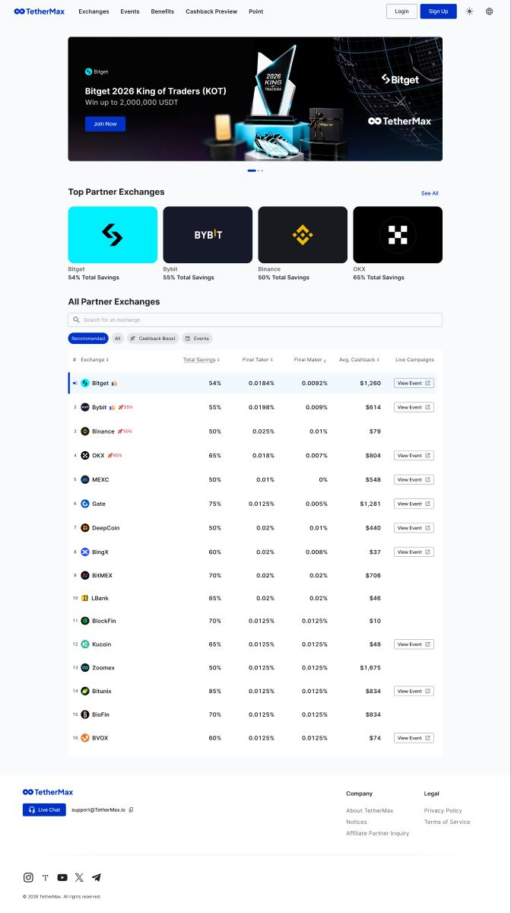

**현재 프로토타입** — `cex.list:normal`

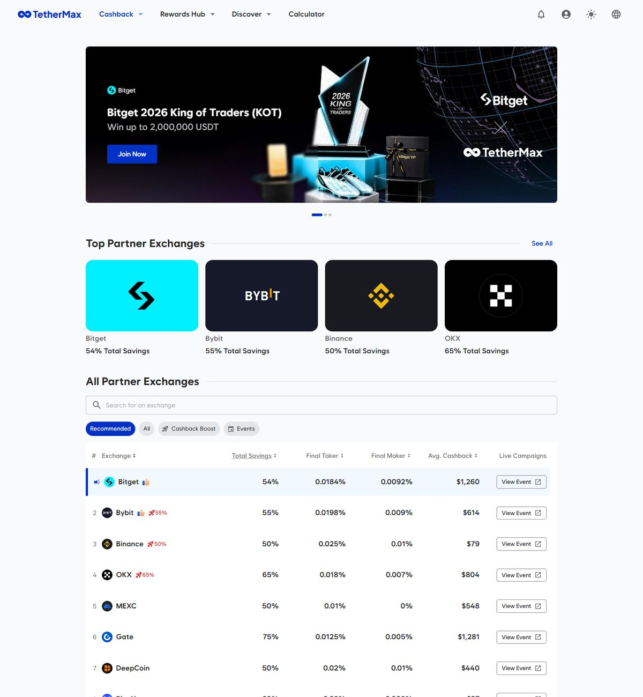

| 구분 | 내용 |
|---|---|
| Figma가 말하는 것 | 열 `Exchange` · `Total Savings` · `Final Taker` · `Final Maker` · `Avg. Cashback` · `Live Campaigns`. `Rating` 열 없음 |
| 정책/명세가 말하는 것 | REQ-466(Must, 확정) · 정책 LS-2: 「표 `Avg. Cashback`과 `Live Campaigns` 사이 `Rating` 열(별·점수·흐린 리뷰 수). 리뷰 20개 미만이면 표 `-`, 카드 뷰 평점 생략」 |
| 지금 프로토타입 | Figma대로 열 없음 |
| 무엇이 다른가 | 명세의 `Rating` 열이 화면에 없음 |
| 정해야 할 것 | **A** 명세 유지 + `Rating` 열 디자인 요청 / **B** 열 없이 명세 조정 |
| 권장안과 이유 | **A.** REQ-466 확정이고, 허브 비교표 `Rating`(정책 B-5-7)과 「같은 규칙·같은 값」으로 묶여 있어 한쪽만 빼면 규칙이 어긋납니다 |

### N3. 앱 필수 업데이트 다이얼로그 — 옛 앱 스타일을 고칠지

**Figma** — Update Required `2913:17755`

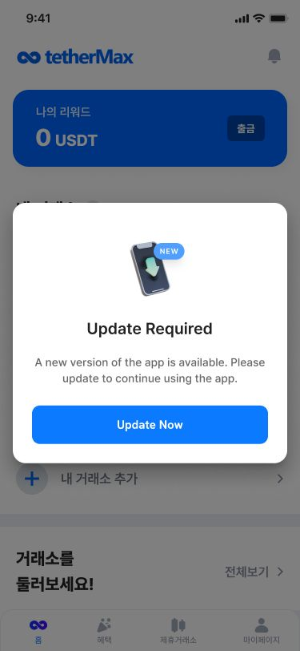

**현재 프로토타입** — `cmn.appupdate:normal`

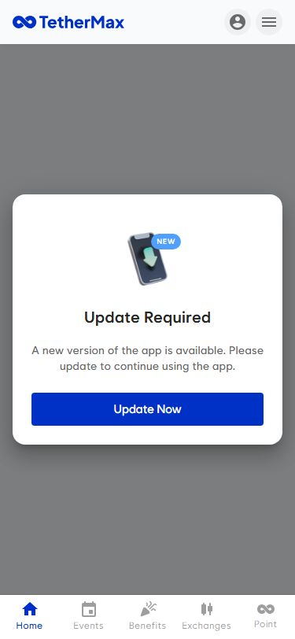

| 구분 | 내용 |
|---|---|
| Figma가 말하는 것 | 옛 앱 스타일 버튼(`#0b7aff` · radius 10 · Pretendard) |
| 정책/명세가 말하는 것 | 정책·명세에 이 다이얼로그 규정 없음 |
| 지금 프로토타입 | 현재 디자인 시스템 버튼으로 표시 |
| 무엇이 다른가 | 버튼 색·모서리·폰트만 다름. 문구는 같음 |
| 정해야 할 것 | **A** 현재 디자인 시스템으로 개정 프레임 요청 / **B** 기존 운영 다이얼로그 그대로(개정 없음) |
| 권장안과 이유 | **권장 없음.** DEX 범위 밖 기존 화면이고 근거 문서가 없습니다. 디자인 시스템 정리 범위에 넣을지 디자이너와 정합니다 |

### N4. 맥스보드 게스트·미참여 단계 화면 — 넣을지

**Figma** — Bingo 사전공개 · 비회원 `28537:444420` (같은 계열: 참여 기간 · 비회원 `446882` · 집계 · 미참여 `445158` · 결과 · 미참여 `445847` · 지급 · 미참여 `446191`)

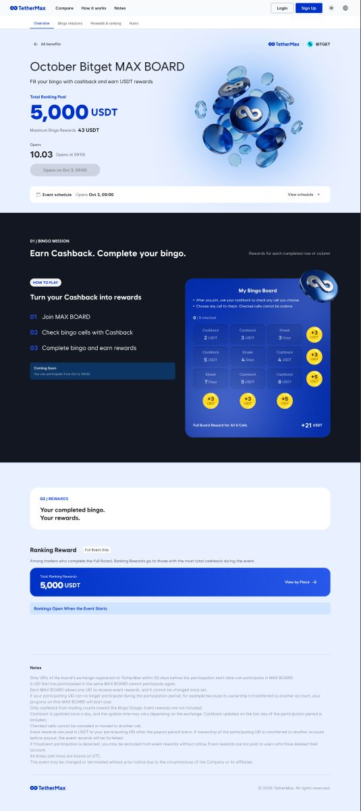

**현재 프로토타입** — `maxboard.main:join` (가장 가까운 상태 · 게스트 상태 없음)

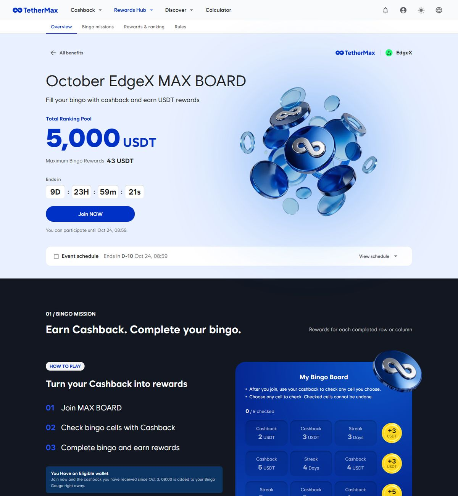

| 구분 | 내용 |
|---|---|
| Figma가 말하는 것 | 단계별(사전공개 · 참여 · 집계 · 결과 · 지급) 비회원/미참여 화면이 PC·MO 모두 있음 |
| 정책/명세가 말하는 것 | 정책 부록 D-1은 DEX 보드를 「CEX 규칙 그대로 지갑 단위로」 정함. 원본 PRD 단계(집계 · 결과 발표 · 제외)는 이미 프로토타입에 추가됨 |
| 지금 프로토타입 | 게스트·미참여 상태 없음(V2.2 상태 목록에 없었음) |
| 무엇이 다른가 | 비로그인·미참여 회원이 각 단계에서 무엇을 보는지 프로토타입에 없음 |
| 정해야 할 것 | **A** 넣음(기존 Bingo 프레임 그대로, UID 문구만 지갑으로) / **B** 넣지 않음 |
| 권장안과 이유 | **A.** DEX 보드 프레임은 기존 Bingo 프레임 복사본이고 D-1이 CEX 규칙을 그대로 쓰므로, 원본 PRD 단계를 추가한 것과 같은 기준으로 넣는 게 일관됩니다. 문구는 REQ-655(지갑 표현) |

### N5. 맥스보드 참여 등록 모달 — 시안 A인가 B인가

**Figma** — 시안 A modal2 `28537:462852`

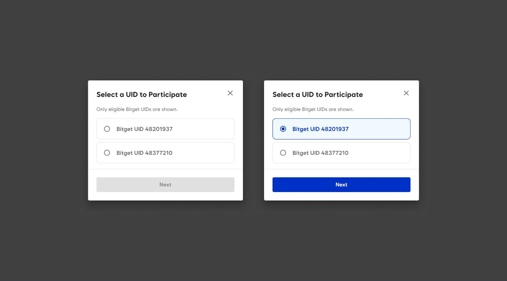

**Figma** — 시안 B modal2 `28537:463009`

**현재 프로토타입** — `maxboard.main:confirm` (시안 B modal3 기반 재선택 확인)

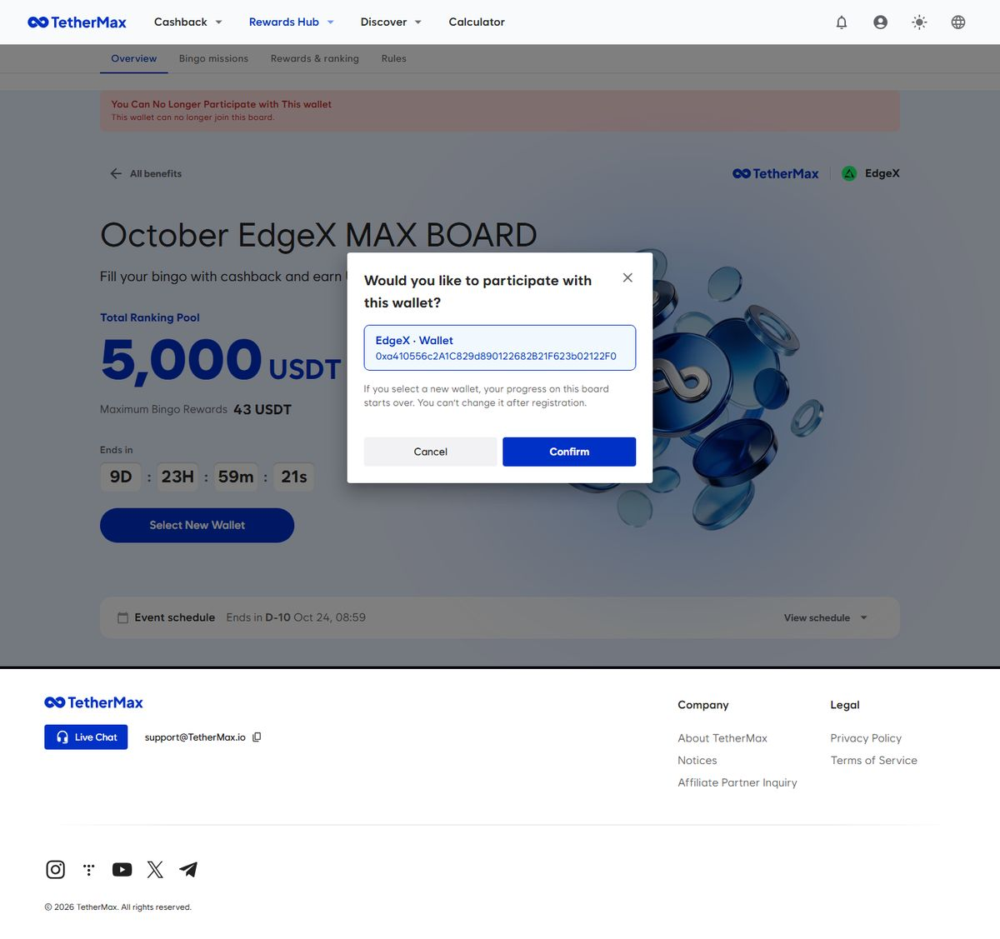

| 구분 | 내용 |
|---|---|
| Figma가 말하는 것 | `Join NOW` 뒤 계정 선택(`Select a UID to Participate` · `Only eligible Bitget UIDs are shown.`) → 등록 확인. 시안 A · B 두 벌, 확정 표시 없음 |
| 정책/명세가 말하는 것 | 부록 D-1 REQ-028: 등록 전 확인 팝업, 선택 화면에는 자격 계정 목록만, 지갑은 전체 주소. REQ-655 확인 문구 `If you select a new wallet, your progress on this board starts over. You can't change it after registration.` |
| 지금 프로토타입 | 재선택 확인 팝업만 시안 B modal3 기반으로 있음. 첫 참여 등록 모달 상태는 없음 |
| 무엇이 다른가 | 첫 참여 흐름(계정 선택 → 확인)이 프로토타입에 없고, 어느 시안을 쓸지 정해지지 않음 |
| 정해야 할 것 | **A** 시안 A / **B** 시안 B — 정한 시안으로 `join` 뒤 상태 추가(UID → 지갑) |
| 권장안과 이유 | **B.** 프로토타입의 재선택 확인 팝업이 이미 시안 B 구성에 REQ-655 문구를 넣어 쓰고 있어, 같은 시안으로 맞추면 등록·재선택 화면이 한 벌이 됩니다 |

### N6. 개인 리그 · 요약 탭 — DEX 반영 범위에 넣을지

**Figma** — Individual League Web `1095:68889`

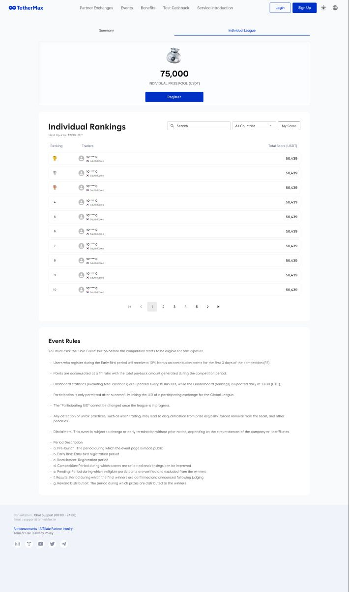

**Figma** — Summary 탭(mWeb) `1017:18063` (상단 일부)

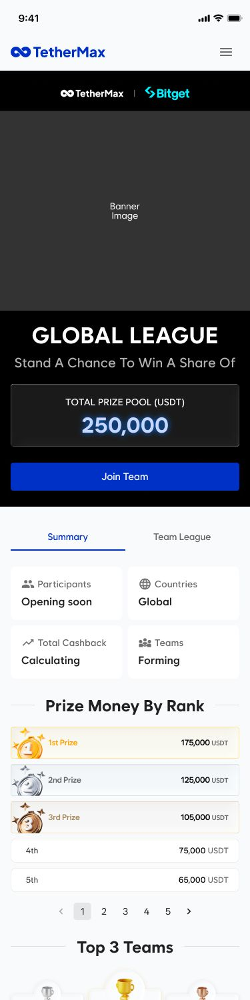

**현재 프로토타입** — `league.main:normal` (팀 리더보드만)

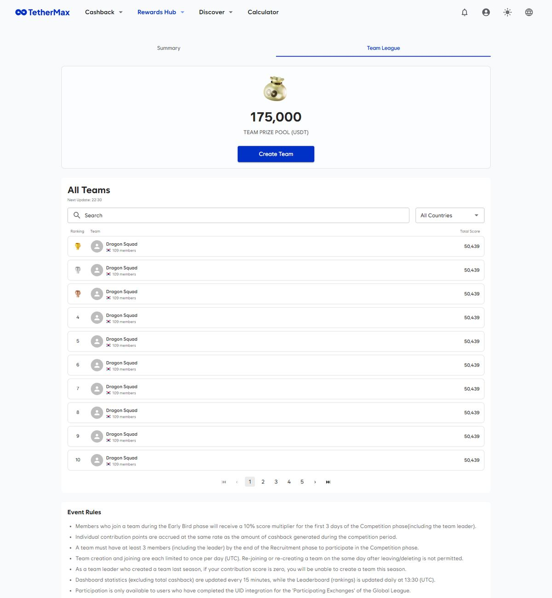

| 구분 | 내용 |
|---|---|
| Figma가 말하는 것 | 기존 리그에 개인 리그 · 요약 탭 화면이 있음 |
| 정책/명세가 말하는 것 | REQ-388~390: 팀 생성 자격 DEX 합산 · DEX만 연동한 회원 참가 가능 · 참가 계정에 DEX 지갑 포함. REQ-394: 리그 URL `_for_team_{n}` · **`_for_ind_{n}`**의 `{exchangename}` = DEX 슬러그 |
| 지금 프로토타입 | 팀 리그 상태만 |
| 무엇이 다른가 | 명세 URL에 개인 리그가 있는데 개인 리그·요약 화면에 DEX 반영 상태가 없음 |
| 정해야 할 것 | **A** REQ-388~394를 개인 리그에도 적용, 개인 리그·요약 상태 추가 / **B** 팀 리그만 DEX 대상 |
| 권장안과 이유 | **A.** REQ-394가 DEX 리그 URL에 개인 리그(`_for_ind_`)를 포함하므로 개인 리그도 DEX 리그로 열릴 수 있습니다 |

### N7. Cashback Boost 상세 — 범위에 넣을지

**Figma** — Boost Improvement `[PC] main` `25683:830`

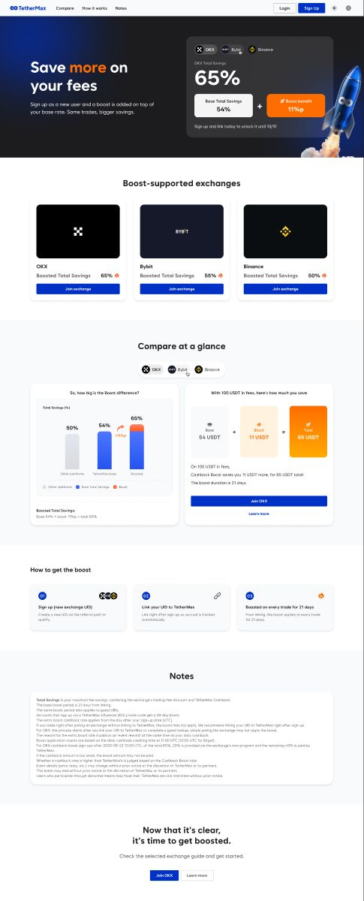

**현재 프로토타입** — `benefits.list:normal` (Boost 상세 상태 없음, 진입 화면 참고)

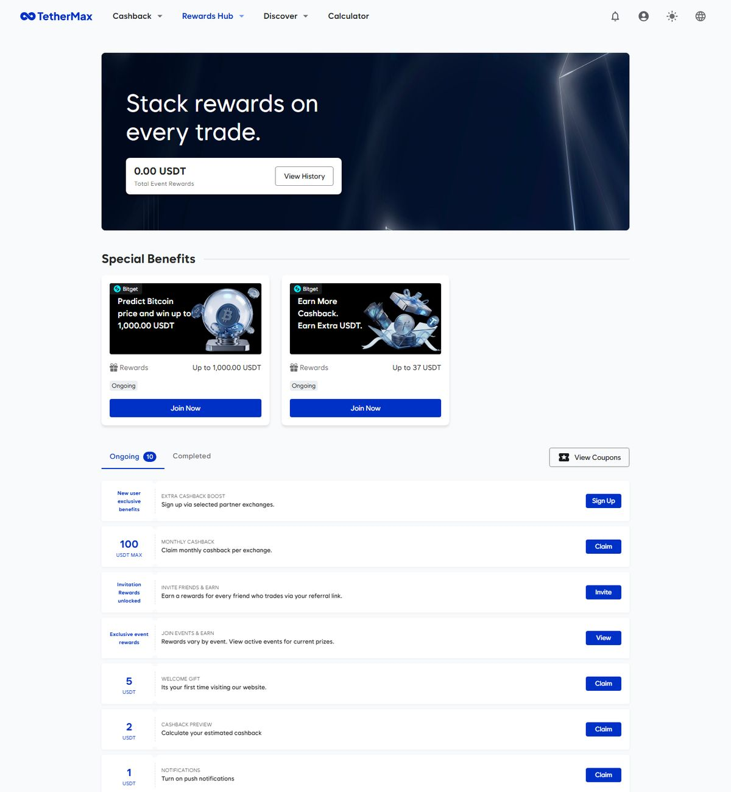

| 구분 | 내용 |
|---|---|
| Figma가 말하는 것 | 이벤트 배너·혜택 카드에서 들어가는 Cashback Boost 상세(거래소 목록 · 모달) |
| 정책/명세가 말하는 것 | 정책 8-18: 캐시백 부스트 **DEX 포함**(사용자 2026-11-24) — 「부스트 거래소 목록에 DEX 행」. G-431 확정: `타 플랫폼` 칸 `-`, 공식 파트너·부스트 값 표시(행 구조 유지). G-430 확정: 부스트 기간에는 부스트율로 직접 산정 |
| 지금 프로토타입 | Boost 상세 없음 |
| 무엇이 다른가 | 정책은 부스트 화면에 DEX 행을 두라는데 프로토타입에 화면이 없음 |
| 정해야 할 것 | **A** 범위 안 — Boost 상세 상태 추가(DEX 행 · `타 플랫폼` `-`) / **B** 범위 밖 — 링크만 |
| 권장안과 이유 | **A.** 정책 8-18과 G-430 · G-431이 DEX 행 표시까지 확정했습니다 |

### N8. 쿠폰함 빈 화면 — 쿠폰 0개인데 탭 배지 7

**Figma** — No coupons Web `11982:388195`

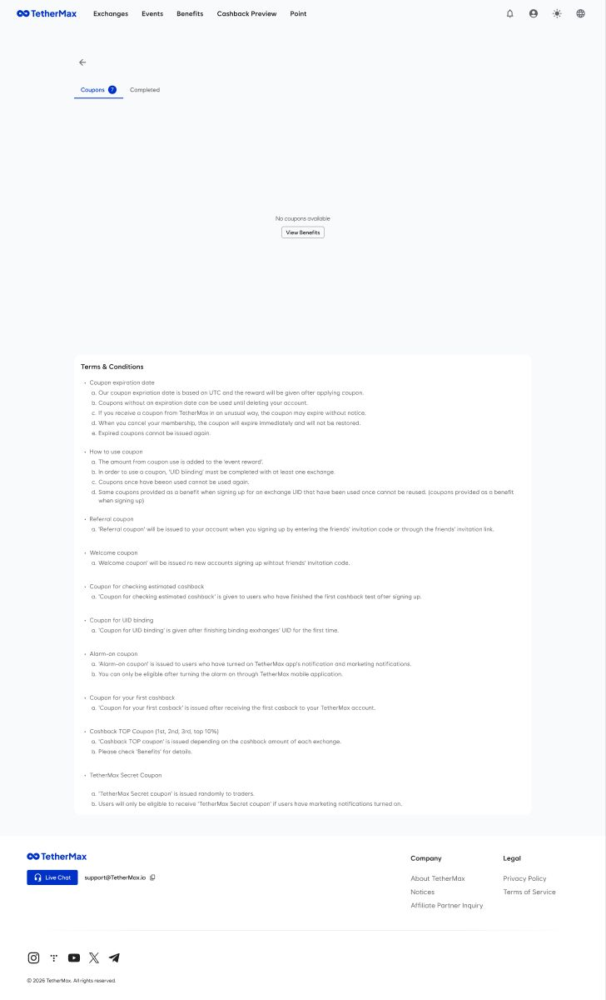

**현재 프로토타입** — `coupon.box:empty`

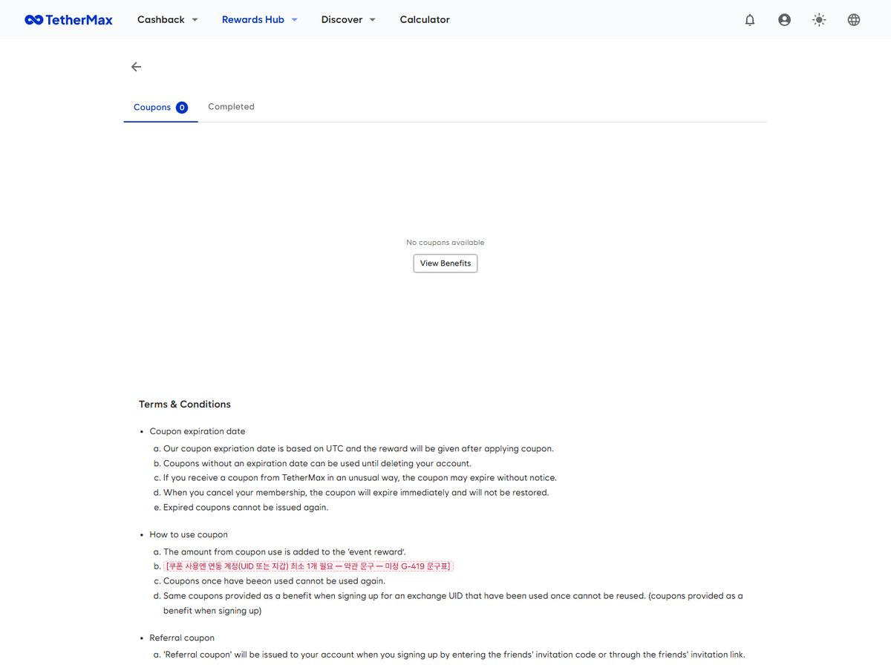

| 구분 | 내용 |
|---|---|
| Figma가 말하는 것 | `No coupons available`인데 `Coupons` 탭 배지 7 |
| 정책/명세가 말하는 것 | 규정 없음 |
| 지금 프로토타입 | 배지 0 |
| 무엇이 다른가 | 배지 숫자와 목록 개수가 어긋남 |
| 정해야 할 것 | **A** 배지 = 실제 쿠폰 개수(0) / **B** 빈 상태에서 배지 숨김 |
| 권장안과 이유 | **A.** 배지가 같은 탭 목록 개수를 나타내므로 0이 맞고, 7은 시안 표본값 오류로 봅니다. 숨길지(B)는 디자이너 선택 |

### N9. 첫 캐시백 10 USDT 상세 — 제목 `First Withdrawal Reward` · CTA `Withdraw Cashback…`

**Figma** — Claim your first cashback `10978:69402`

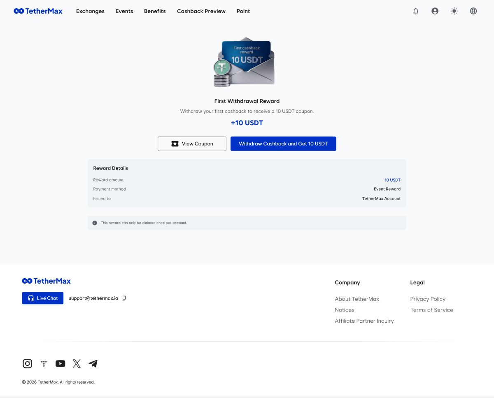

**현재 프로토타입** — `benefits.list:first`

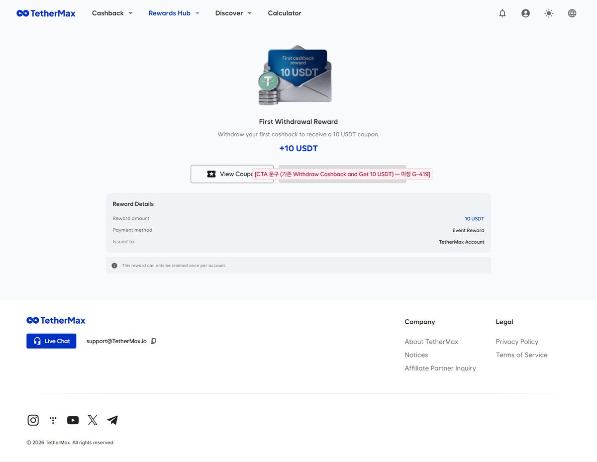

| 구분 | 내용 |
|---|---|
| Figma가 말하는 것 | 제목 `First Withdrawal Reward` · CTA `Withdraw Cashback and Get 10 USDT` |
| 정책/명세가 말하는 것 | 정책 8-13: 첫 출금 10 USDT는 CEX · DEX 모두, 「계정당 한 번만」. 부제 원문 `Withdraw your first cashback to receive a 10 USDT coupon.` G-418 확정: 영문 출금 용어 `Claim` 계열. G-419 확정: 기존 `Withdraw` 문구 재작성은 문구표에서. 출금 화면 `/withdrawal-apply`는 제목 `Claim` · `Auto Claim`(정책 8-24 STG 대조) |
| 지금 프로토타입 | 제목 Figma 그대로, CTA는 미정 표시(`G-419`) |
| 무엇이 다른가 | 자동 지급인데 「출금하고 받으세요」 문구와 출금 버튼이 남아 있음 |
| 정해야 할 것 | **A** 제목·부제·CTA를 `Claim` 계열로 문구표 확정, CTA는 Claim 화면 이동 / **B** CTA 제거, 쿠폰 보기만 |
| 권장안과 이유 | **A.** G-418 · G-419가 용어와 처리 방식을 확정했고, Claim 화면(`/withdrawal-apply`)은 자동 지급에서도 남아 있어 이동 목적지가 있습니다. 문구 원문은 문구표 대기 |

### N10. 캐시백 챌린지 「UID Link Required」 다이얼로그 — 넣을지, 누구에게 보일지

**Figma** — MAX-503 챌린지 `10981:85016`

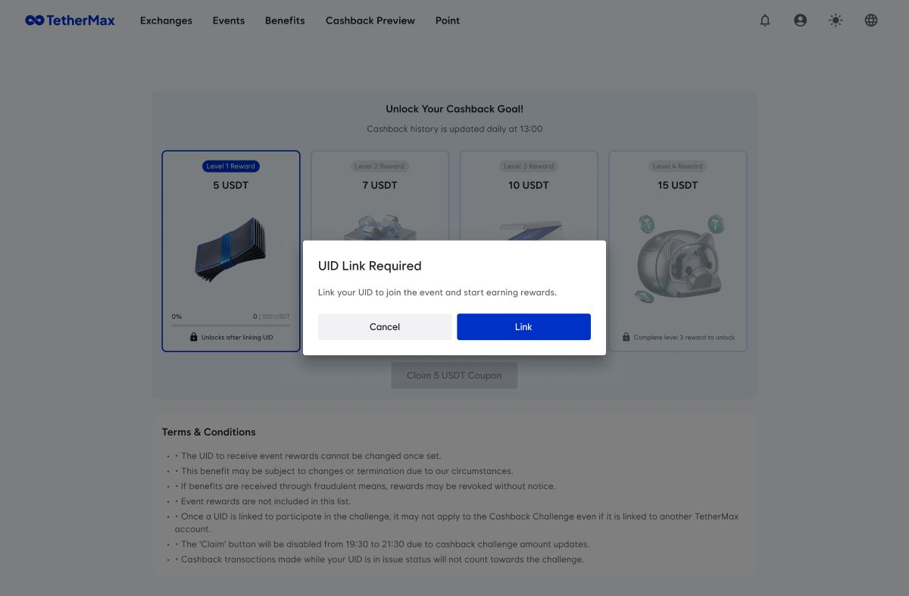

**현재 프로토타입** — `challenge.detail:normal` (다이얼로그 상태 없음)

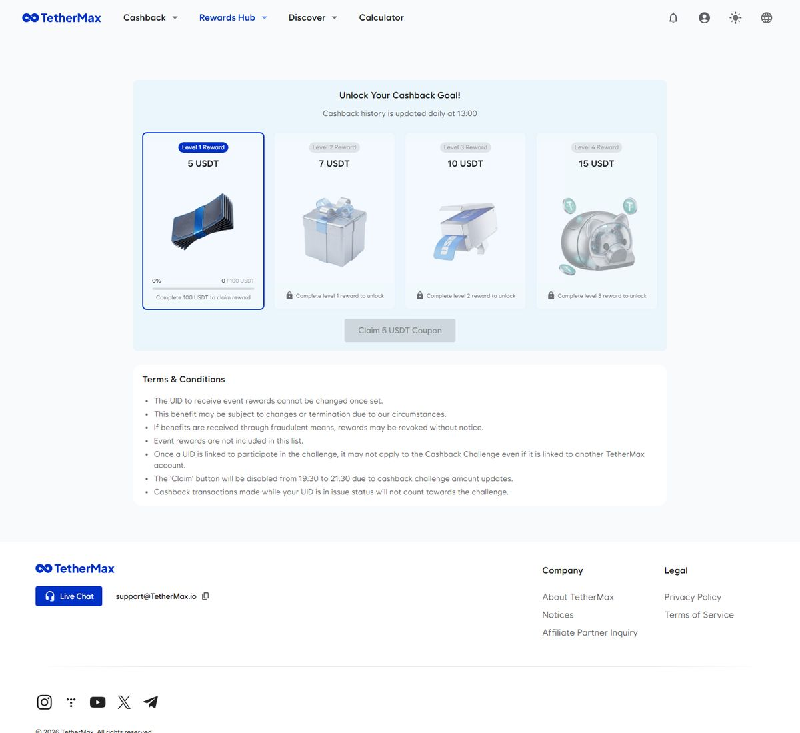

| 구분 | 내용 |
|---|---|
| Figma가 말하는 것 | 미연동 회원에게 `UID Link Required` 다이얼로그(`Cancel` · `Link`) |
| 정책/명세가 말하는 것 | 정책 8-13: 캐시백 챌린지 **CEX · DEX 모두**, 「참여 계정 표현은 `거래 계정` / `Account`(DEX 행은 지갑)」 · 게이지에 DEX 캐시백 산입 · 수령 계정 선택에 DEX 지갑 |
| 지금 프로토타입 | 다이얼로그 없음 |
| 무엇이 다른가 | Figma는 UID 기준이라 DEX 지갑만 연동한 회원도 「미연동」으로 막힐 수 있음 |
| 정해야 할 것 | **A** 넣음 — 거래 계정(UID · 지갑) 0개일 때만, 제목·버튼은 `Account` 문구 / **B** 넣지 않음 |
| 권장안과 이유 | **A.** 미연동 회원 안내는 필요하고, 정책이 챌린지 대상을 CEX · DEX로 정하고 표현을 `Account`로 확정했습니다. 영문 원문은 G-419 문구표 |

### N11. 친구 초대 Referral Friends · Reward History 목록 — 넣을지, 지갑을 어떻게 보일지

**Figma** — Referral Friends Web `15170:208042`

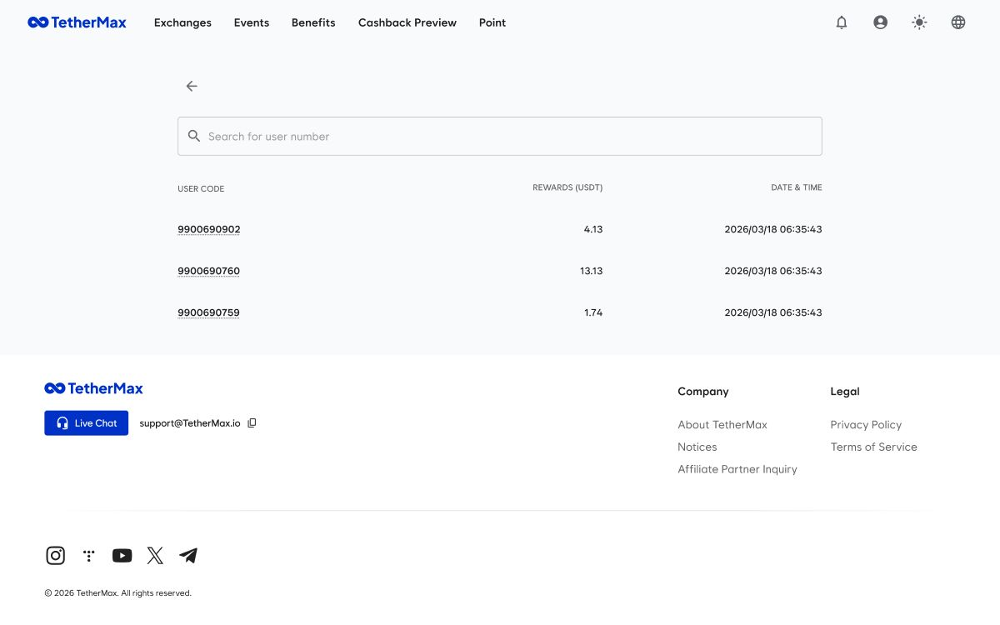

**Figma** — MAXOP-236 Reward History `15798:99716`

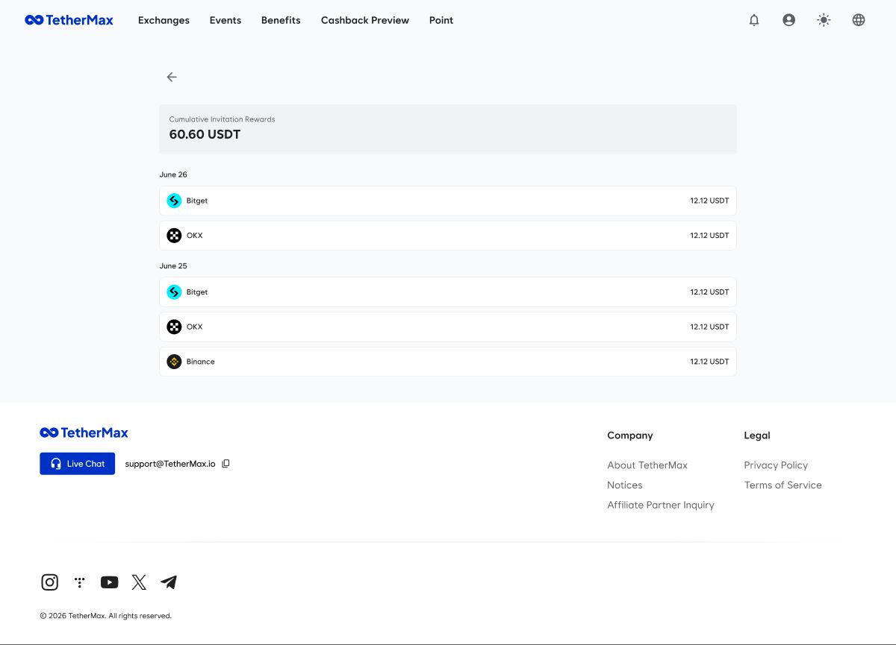

**현재 프로토타입** — `invite.main:rewards` (두 버튼은 있으나 목적지 화면 없음)

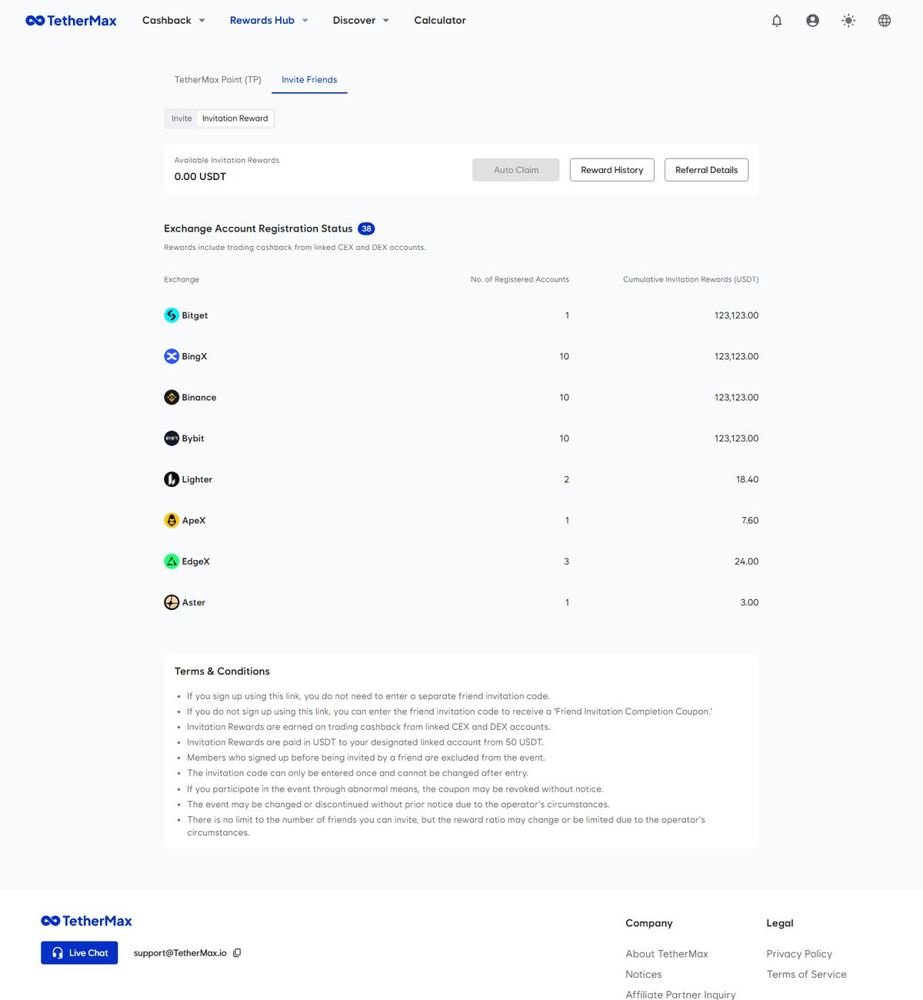

| 구분 | 내용 |
|---|---|
| Figma가 말하는 것 | `Referral Details` → 피초대자 목록(결과 · 빈 · 검색 없음 · 10명 초과), `Reward History` → 리워드 지급 목록 |
| 정책/명세가 말하는 것 | 정책 B-13-2: 요약에 `Available Invitation Rewards` + `Auto Claim`(비활성) · `Reward History` · `Referral Details`. 피초대자의 DEX 지갑 표시 규칙 · 자동 지급 이력 표시 기준은 정해진 것 없음 |
| 지금 프로토타입 | 두 버튼만 있고 화면 없음 |
| 무엇이 다른가 | 버튼의 목적지가 프로토타입에 없음. 피초대자가 지갑만 연동했을 때 무엇을 보여 줄지 미정 |
| 정해야 할 것 | ① 두 화면 상태를 넣을지(A 넣음 / B 넣지 않음) ② 피초대자 DEX 지갑 표시(A 전체 주소 / B 마스킹 / C 거래소명만) ③ 자동 지급 이력 행 기준 |
| 권장안과 이유 | ① **A 넣음** — 정책 B-13-2가 두 버튼을 요약에 둡니다. ② · ③ **권장 없음** — 정책에 근거가 없어 새로 정해야 합니다(❓ 사용자 확인) |

### N12. Cashback Basics 요약 박스(KEY TAKEAWAYS) — 내용 교체

**Figma** — [MAX-] Quiz Signed In, Module 3 `19604:32207` (KEY TAKEAWAYS 부분)

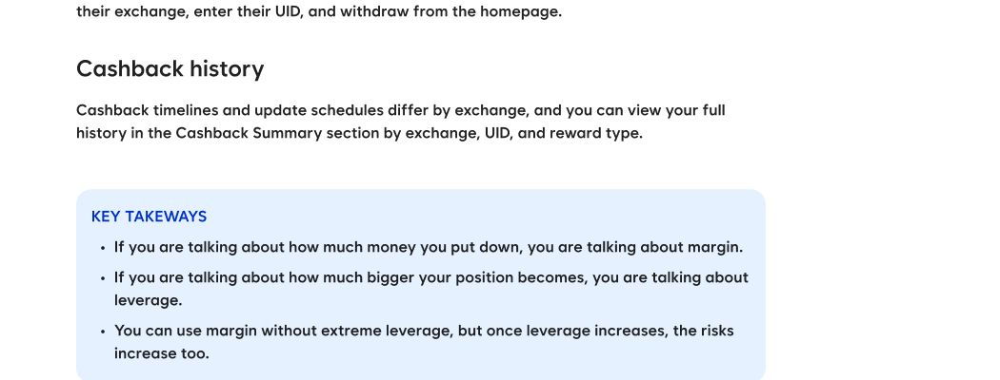

**현재 프로토타입** — `quiz.basics:normal` (KEY TAKEAWAYS 부분)

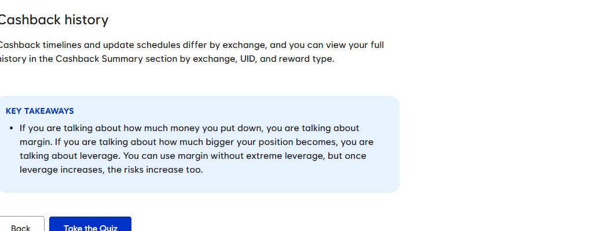

| 구분 | 내용 |
|---|---|
| Figma가 말하는 것 | Cashback Basics 글의 요약 박스에 마진·레버리지 설명(`If you are talking about how much money you put down, you are talking about margin. …`) |
| 정책/명세가 말하는 것 | 정책 6-5 · 8-24(STG 대조): Cashback Basics는 「UID → 거래 계정 · 10 USDT 이상이면 자동 지급 · 조회 가능·연동 후 지급」으로 고쳐 씀(G-419 문구표) |
| 지금 프로토타입 | Figma 박스 그대로 |
| 무엇이 다른가 | 글 주제(캐시백 기초)와 요약 내용(마진·레버리지)이 다름 — 다른 모듈 내용이 들어간 시안으로 보임 |
| 정해야 할 것 | **A** 운영 콘텐츠(Cashback Basics 요약)로 교체 / **B** 그대로 |
| 권장안과 이유 | **A.** 이 글은 정책상 재작성 대상이고, 요약 박스도 본문과 같은 내용이어야 합니다. 원문은 G-419 문구표 |

### N13. 빈 검색 결과 문구 — G-151인가 기존 `No results found for {검색어}`인가

**Figma** — 기존 MAX-22 검색 결과 없음(모바일) `5145:50887`

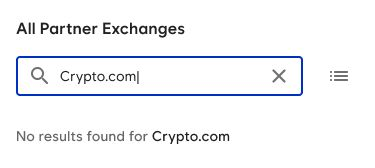

**현재 프로토타입** — `hub.main:emptySearch` (모바일, 비교표 부분)

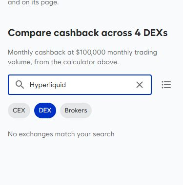

| 구분 | 내용 |
|---|---|
| Figma가 말하는 것 | 기존 제품 패턴 `No results found for {검색어}`(MAX-22 · DEX(revision) 연동 검색 모두) |
| 정책/명세가 말하는 것 | G-151 확정: 허브 비교표 「빈 검색 `No exchanges match your search` + 검색어 지우기」. REQ-466: 기존 Exchange Listings Page는 재구축하지 않음 |
| 지금 프로토타입 | 허브 비교표 `No exchanges match your search` |
| 무엇이 다른가 | 허브 비교표와 기존 화면의 빈 검색 문구가 서로 다름 |
| 정해야 할 것 | **A** 허브 비교표 = G-151, 기존 화면(거래소 목록 · 연동 검색) = 기존 문구 / **B** 모든 화면을 기존 패턴으로(G-151 재결정) / **C** 모든 화면을 G-151로 |
| 권장안과 이유 | **A.** G-151은 허브 비교표에 대한 확정 결정이고, 기존 거래소 목록은 REQ-466에 따라 손대지 않습니다. 통일을 원하면 C(기존 화면 변경 범위가 늘어남) |

### N14. DEX 최소액 미만 넛지 · 부분 매칭 줄 — 허브 패널에 어떤 문구를 쓸지

**Figma** — 지갑 잔액 카드 · 최소액 미만 `29026:97646`

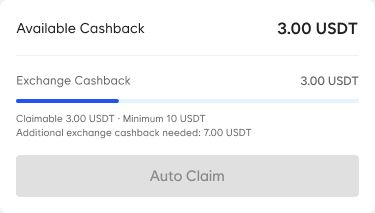

**Figma** — 허브 H4 CEX 10 USDT 미만 `28960:126902`

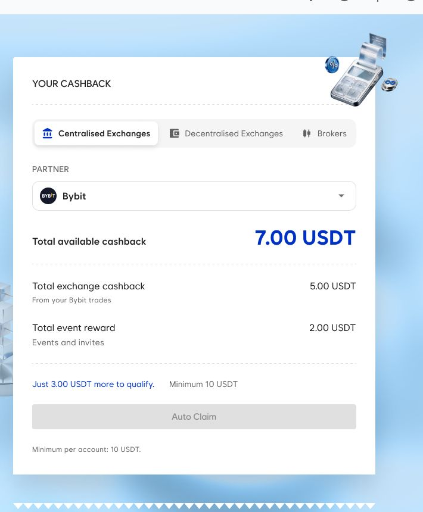

**현재 프로토타입** — `hub.main:dexBelowMin`

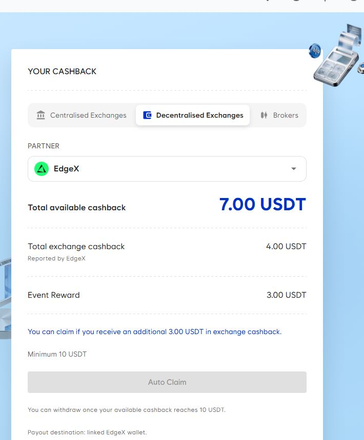

| 구분 | 내용 |
|---|---|
| Figma가 말하는 것 | 허브 H4(CEX 탭) `Just 3.00 USDT more to qualify.` / 지갑 카드 `Additional exchange cashback needed: {n} USDT` · `Matched {x} / {y} USDT in event rewards`. DEX 탭 넛지 프레임은 없음 |
| 정책/명세가 말하는 것 | G-139 확정: 허브 패널 넛지 `You can claim if you receive an additional {n} USDT in exchange cashback.`(금액은 매칭 계산값). REQ-300: 이벤트 리워드 > 캐시백이면 「일부만 출금할 수 있습니다」 안내 |
| 지금 프로토타입 | 허브 DEX 패널에 G-139 문구 |
| 무엇이 다른가 | 같은 「부족분」을 허브와 지갑 카드가 다른 문구로 말함. 부분 매칭 줄을 허브에도 둘지 미정 |
| 정해야 할 것 | ① 허브 넛지: **A** G-139 / **B** 지갑 카드 문구 ② 부분 매칭: **A** 허브는 REQ-300 안내, `Matched` 줄은 지갑 상세 전용 / **B** 허브에도 `Matched` 줄 |
| 권장안과 이유 | ① **A**, ② **A.** G-139는 허브 패널 문구로 확정됐고, REQ-300이 허브 패널 구성(부분 출금 안내 포함)을 정했습니다. 지갑 카드 문구는 지갑 상세 Figma 그대로 둡니다 |

### N15. 모바일 게스트 하단 CTA `Sign Up` — 외부 링크 아이콘을 둘지

**Figma** — DEX detail Mobile `28960:131011` 오퍼 박스 `Get Started` 부분

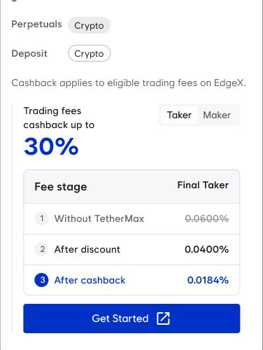

**Figma** — 같은 프레임 하단 고정 게스트 CTA

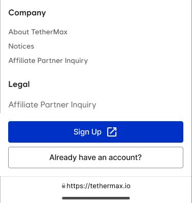

**현재 프로토타입** — `dex.detail:normal` (모바일, 하단 CTA 부분)

| 구분 | 내용 |
|---|---|
| Figma가 말하는 것 | 하단 고정 `Sign Up`에 외부 링크 아이콘(↗) |
| 정책/명세가 말하는 것 | 정책 B-7-2 오퍼 박스: 「`Get Started`(외부 링크 아이콘, 어트리뷰션 새 탭) + … `exchange_guest` = 회원가입/로그인으로 이동」. G-402 확정: 가입 후 「그 DEX가 미리 선택된 연동 모달로 복귀」 |
| 지금 프로토타입 | Figma대로 아이콘 있음 |
| 무엇이 다른가 | `Sign Up`은 테더맥스 회원가입(사이트 안 이동)인데 외부 사이트로 나가는 아이콘이 붙어 있음 |
| 정해야 할 것 | **A** 아이콘 제거 / **B** 아이콘 유지 |
| 권장안과 이유 | **A.** 외부 링크 아이콘은 DEX 어트리뷰션 새 탭(`Get Started`)에만 쓰입니다. `Sign Up`은 G-402대로 테더맥스 안에서 가입 → 연동 모달로 돌아오는 흐름입니다 |

### N16. 누적 캐시백 카드 캡션 — UID · KST 표기

**Figma** — MAXOP-731 누적 캐시백 카드 `22913:1054295`

**현재 프로토타입** — `home.timeline:normal` (아래 카드가 누적 캐시백)

| 구분 | 내용 |
|---|---|
| Figma가 말하는 것 | `Sum of 3 linked UIDs · Updated daily at 09:00 KST` |
| 정책/명세가 말하는 것 | G-191 확정: `{n}개 거래 계정 합산 · 거래소마다 갱신 시각이 달라요` / `Total of {n} accounts · Update times vary by exchange`. 사용자 화면 시각은 로컬 · 타임존 라벨 없음 |
| 지금 프로토타입 | G-191 문구 |
| 무엇이 다른가 | Figma 캡션이 UID만 세고, 고정 시각과 KST 라벨을 씀 |
| 정해야 할 것 | **A** G-191 문구 + Figma 캡션 교체 요청 / **B** Figma 캡션 유지 |
| 권장안과 이유 | **A.** G-191 확정이고, DEX는 거래소마다 갱신 시각이 달라 고정 시각을 쓸 수 없습니다 |

### N17. 캐시백 타임라인 — Figma 3단계인가 정책 4단계인가

**Figma** — MAXOP-783 Earning Timeline 캐러셀 `26047:56685`

**현재 프로토타입** — `home.timeline:normal` (위 카드가 타임라인, N16과 같은 이미지)

| 구분 | 내용 |
|---|---|
| Figma가 말하는 것 | 3단계 `Start Trading` · `Cut-off Time` · `Cashback Accumulated` |
| 정책/명세가 말하는 것 | REQ-282 · REQ-289: 단계(상세) `거래 집계 중 → 지급 대기 → 지급 처리 중 → 지급 완료` + 지급 상세 4행(`대상 거래 기간` · `지급 주기` · `지급 시각` · `지급처`). G-192 확정: 지급처 `거래 계정` / `Account`, ApeX도 같은 4단계 |
| 지금 프로토타입 | 탭 4개 + 국문 단계명(영문 원문 없음) |
| 무엇이 다른가 | 단계 수와 단계 이름이 다름. 4단계 영문 원문이 없음 |
| 정해야 할 것 | **A** 정책 4단계 유지 + 4단계 영문 원문·Figma 캐러셀 4탭 요청 / **B** Figma 3단계 채택 + REQ-282·289·G-192 재결정 |
| 권장안과 이유 | **A.** G-192가 4단계를 확정했습니다(ApeX 포함). 영문 단계명은 문구표에서 받습니다 |

### N18. 출금 모달 제목 — `Withdraw`를 유지할지

**Figma** — MAX-18 출금 모달 `12936:389796`

**현재 프로토타입** — `wd.claim:normal`

| 구분 | 내용 |
|---|---|
| Figma가 말하는 것 | 제목 `Withdraw` · `Confirm Withdraw` · 마일스톤 진행바 |
| 정책/명세가 말하는 것 | G-418 확정: 영문 출금 용어 `Claim` 계열. 정책 8-24(STG 대조): 출금 화면 `/withdrawal-apply` 「제목 `Claim` · `Total Claimable Cashback` · 칩 `Unclaimable` · … · `Auto Claim` · `Back to Home`」 |
| 지금 프로토타입 | 제목 `Withdraw`, 버튼 비활성 `Auto Claim`, 마일스톤 없음 |
| 무엇이 다른가 | 버튼은 `Claim` 계열인데 제목만 `Withdraw` |
| 정해야 할 것 | **A** 제목 `Claim`(STG 현행) / **B** `Withdraw` 유지 |
| 권장안과 이유 | **A.** G-418 확정이고 STG가 이미 `Claim`을 씁니다. 모달 안 다른 라벨도 STG 현행(`Total Claimable Cashback` 등)에 맞춥니다 |

### N19. 지갑 상세의 타임라인 — PW1 구버전(아이콘 3개)인가 MAXOP-783 캐러셀인가

**Figma** — PW1 Lighter 지갑 상세 `28960:125943` (왼쪽 아래 `Earning Timeline` 아이콘 3개)

**Figma** — 기존 UID 상세 새 타임라인 `26047:1349155` (왼쪽 캐러셀)

**현재 프로토타입** — `home.wallet:normal`

| 구분 | 내용 |
|---|---|
| Figma가 말하는 것 | DEX 지갑 상세 PW1은 구버전 타임라인(`Start Trading` · `Cut-off Time` · `Updated` 아이콘 3개). 기존 CEX UID 상세는 MAXOP-783 캐러셀로 개편됨 |
| 정책/명세가 말하는 것 | REQ-282: 「캐시백 타임라인(홈 기능)에 DEX를 포함한다. **DEX 전용 단계 없이**」. REQ-289는 지갑 상세 단계명(en) `Start Trading` · `Cut-off Time` · `Updated`를 적고 있음 |
| 지금 프로토타입 | PW1대로 구버전 |
| 무엇이 다른가 | 같은 「계정 상세」인데 CEX는 캐러셀, DEX는 구버전이라 화면이 둘로 갈림 |
| 정해야 할 것 | **A** DEX 지갑 상세도 캐러셀로 통일(N17 결정 단계 적용) + REQ-289 지갑 상세 단계명 갱신 / **B** PW1 구버전 유지 |
| 권장안과 이유 | **A.** REQ-282가 DEX 전용 구성 없이 같은 타임라인을 쓰라고 정했고, 기존 UID 상세가 캐러셀로 바뀌었으므로 지갑 상세도 같은 컴포넌트가 맞습니다. REQ-289의 3단계 영문 이름은 N17 결정에 맞춰 고칩니다 |
