# TetherMax 전체 프로토타입 — 디자인 누락 목록

| 항목 | 내용 |
|---|---|
| 대상 | 디자이너 · PM |
| 프로토타입 | `_프로토타입_전체/` 최신 빌드 `TetherMax_전체프로토타입_*.html` (화면 id로 바로 열기: `#화면id/상태`) |
| 디자인 원본 | Figma `UI-UX Design` › `DEX(revision)` + 기존 `[MAX-…]` 페이지 일부 |
| 읽는 법 | 아래 상태는 **Figma에 맞는 프레임이 없어** 기존 프로토타입(V2.2) 내용을 새 디자인 시스템으로 옮겨 그린 것입니다. 이미지는 그 상태의 현재 프로토타입 화면(디자인 보기, 한국어)이고, 「가까운 Figma」는 디자인할 때 기준으로 삼을 프레임입니다 |
| 집계 제외 | 디자인 대상이 아닌 문서 화면(규칙 원문 · 분석 이벤트 · 외부 연결 FAQ/지원/제휴) |

## 1. 요약

| 구분 | 상태 수 |
|---|---|
| 전체 상태 | 362 |
| PC·모바일 디자인 모두 있음 | 126 |
| 한쪽(PC 또는 모바일)만 있음 | 89 |
| **디자인 없음** | **147** |

| 그룹 | 화면 | 상태 | 모두 있음 | 한쪽만 | 없음 |
|---|---|---|---|---|---|
| 1. 공통 · 셸 (헤더·푸터·공지·약관) | 8 | 18 | 2 | 9 | 7 |
| 2. 랜딩 · 서비스 소개 | 3 | 11 | 0 | 3 | 8 |
| 3. 비회원 캐시백 조회 | 4 | 19 | 18 | 1 | 0 |
| 4. 홈 · 잔액 · 지갑 상세 | 7 | 64 | 0 | 17 | 47 |
| 5. 거래 계정 연동 | 7 | 43 | 14 | 14 | 15 |
| 6. 소유권 인증 | 3 | 16 | 12 | 3 | 1 |
| 7. 캐시백 허브 | 1 | 20 | 10 | 0 | 10 |
| 8. DEX 개요 · 상세 | 2 | 24 | 10 | 3 | 11 |
| 9. 계산기 (/payback) | 6 | 16 | 7 | 1 | 8 |
| 10. 캐시백 요약 · 랭킹 | 2 | 20 | 4 | 7 | 9 |
| 11. 친구 초대 · 파트너 허브 | 3 | 12 | 3 | 7 | 2 |
| 12. 리워드 (맥스보드·리그·쿠폰·혜택·이벤트·TP) | 7 | 50 | 20 | 3 | 27 |
| 13. 퀴즈 · Beginner’s Guide | 5 | 24 | 1 | 21 | 2 |
| 14. 사용자 이메일 | 7 | 22 | 22 | 0 | 0 |
| 15. 기존 테더맥스 (CEX·계정·마이) | 3 | 3 | 3 | 0 | 0 |

## 2. 디자인 없는 상태 (이미지)

### 1. 공통 · 셸 (헤더·푸터·공지·약관)

#### `cmn.header:guest` — 비로그인 — Login · Sign up

| 항목 | 내용 |
|---|---|
| 화면 | 데스크톱 헤더 (GNB) (`전 페이지`) |
| 기능 | FU-083 |
| 빠진 것 | 새 메뉴(`Cashback ˅` · `Rewards Hub ˅` · `Discover ˅` · `Calculator`)의 비로그인 우측 구성 |
| 가까운 Figma | DEX / Web / Navigation ([28967:127332](https://www.figma.com/design/hsa3bSV9QmFTe2jsf6tzTm/UI-UX-Design?node-id=28967-127332)) · 기존 로그인 화면 GNB ([10548:210709](https://www.figma.com/design/hsa3bSV9QmFTe2jsf6tzTm/UI-UX-Design?node-id=10548-210709)) |
| 보기 | PC |

#### `cmn.header:hover` — Cashback hover 패널 3행

| 항목 | 내용 |
|---|---|
| 화면 | 데스크톱 헤더 (GNB) (`전 페이지`) |
| 기능 | FU-083 |
| 빠진 것 | 패널 전체(`Centralised Exchanges` · `Decentralised Exchanges` · `Brokers`) |
| 가까운 Figma | 기존 GNB hoverState ([10343:156424](https://www.figma.com/design/hsa3bSV9QmFTe2jsf6tzTm/UI-UX-Design?node-id=10343-156424), 글자색만) · DEX 설계 파일 E1 (bqb4Y2jQwMFpbhRmMbfBK9 · [1279:499846](https://www.figma.com/design/hsa3bSV9QmFTe2jsf6tzTm/UI-UX-Design?node-id=1279-499846), 「Cashback opens the Cashback Hub」) |
| 보기 | PC |

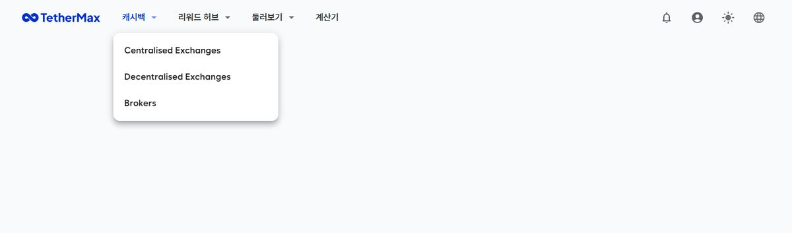

#### `cmn.header:bellFail` — 알림·아바타 로드 실패

| 항목 | 내용 |
|---|---|
| 화면 | 데스크톱 헤더 (GNB) (`전 페이지`) |
| 기능 | FU-083 |
| 빠진 것 | 안 읽음 점 숨김 · 아바타 대체 표시 |
| 가까운 Figma | DEX / Web / Navigation ([28967:127332](https://www.figma.com/design/hsa3bSV9QmFTe2jsf6tzTm/UI-UX-Design?node-id=28967-127332)) |
| 보기 | PC |

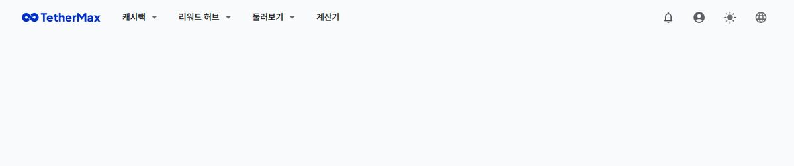

#### `cmn.drawer:promo` — 프로모 배너 (선택)

| 항목 | 내용 |
|---|---|
| 화면 | 모바일 웹 드로어 (`모바일 웹 ☰`) |
| 기능 | FU-083 |
| 빠진 것 | 배너 이미지·문구 |
| 가까운 Figma | 모바일 드로어 [12085:400249](https://www.figma.com/design/hsa3bSV9QmFTe2jsf6tzTm/UI-UX-Design?node-id=12085-400249) |
| 보기 | 모바일 |

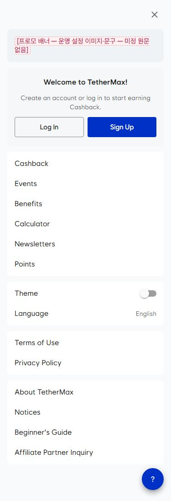

#### `cmn.appnav:inapp` — 미지원 Cashback 페이지 → 인앱 브라우저

| 항목 | 내용 |
|---|---|
| 화면 | 앱 하단 내비 (`앱`) |
| 기능 | FU-085 |
| 빠진 것 | 인앱 브라우저 화면(상단 바 · 닫기 · URL) |
| 가까운 Figma | `<BottomNavigation>` [8582:155585](https://www.figma.com/design/hsa3bSV9QmFTe2jsf6tzTm/UI-UX-Design?node-id=8582-155585) |
| 보기 | 모바일 |

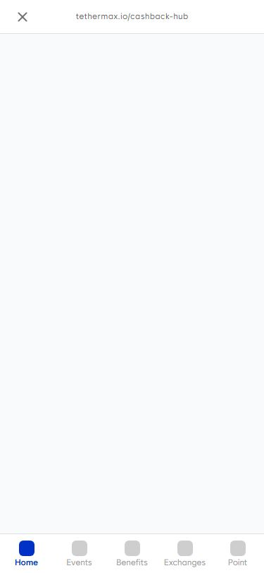

#### `cmn.appnav:linkFail` — DEX 링크 실패 — 복사 + Open {DEX}

| 항목 | 내용 |
|---|---|
| 화면 | 앱 하단 내비 (`앱`) |
| 기능 | FU-085 |
| 빠진 것 | 다이얼로그 전체(문구는 V2.2 영문만) |
| 가까운 Figma | — |
| 보기 | 모바일 |

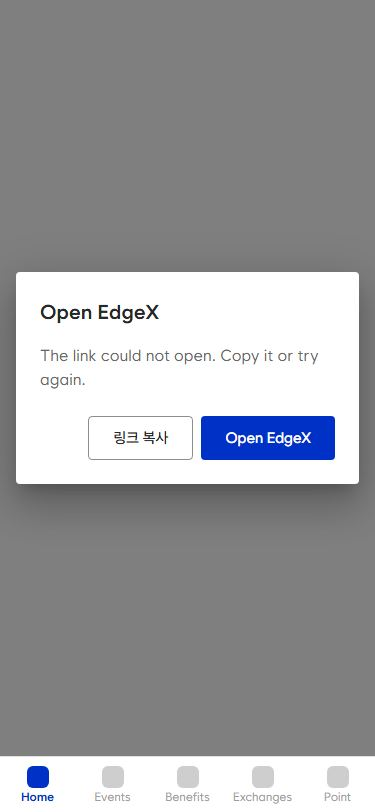

#### `notice.list:normal` — 카테고리 8개 · 신규 거래소 추가

| 항목 | 내용 |
|---|---|
| 화면 | 공지 (`/notice`) |
| 기능 | FU-086 |
| 빠진 것 | 웹 공지 목록 화면 전체(기존 앱은 Zendesk Help Center 링크) |
| 가까운 Figma | [MAX-497] 긴급 공지 팝업 ([13086:341658](https://www.figma.com/design/hsa3bSV9QmFTe2jsf6tzTm/UI-UX-Design?node-id=13086-341658)) |
| 보기 | PC |

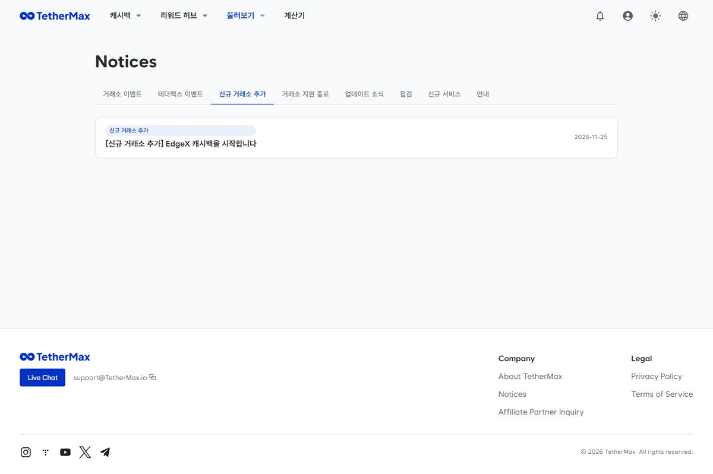

### 2. 랜딩 · 서비스 소개

#### `landing.main:heroDex` — Hero Exchange = DEX

| 항목 | 내용 |
|---|---|
| 화면 | 프리로그인 랜딩 (`/ (비로그인)`) |
| 기능 | FU-043 · FU-042 |
| 빠진 것 | DEX를 고른 변형이 없음. 운영자 입력 `Promo Tagline`·`CTA Button Title`(EN·KO) 자리, DEX의 Total Savings 표기 |
| 가까운 Figma | Landing / Desktop / Light (DEX) [28960:128375](https://www.figma.com/design/hsa3bSV9QmFTe2jsf6tzTm/UI-UX-Design?node-id=28960-128375) › 「Most popular exchange」 카드 [28960:128434](https://www.figma.com/design/hsa3bSV9QmFTe2jsf6tzTm/UI-UX-Design?node-id=28960-128434) |
| 보기 | PC |

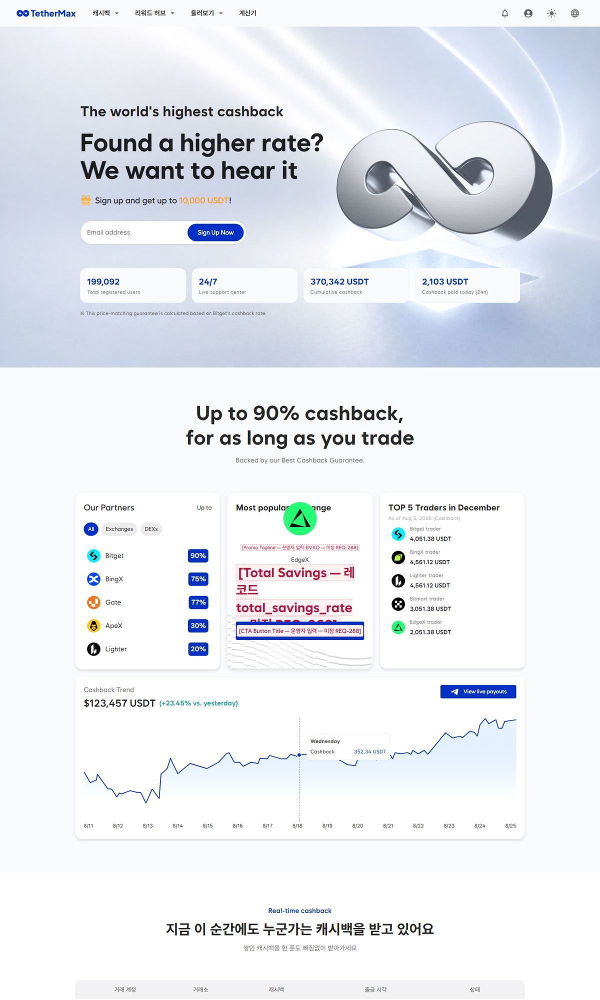

#### `landing.main:inactive` — Featured·Hero 파트너 비활성

| 항목 | 내용 |
|---|---|
| 화면 | 프리로그인 랜딩 (`/ (비로그인)`) |
| 기능 | FU-043 · FU-042 |
| 빠진 것 | 슬롯이 숨은 뒤 목록·Hero 카드가 어떻게 보이는지(G-260) |
| 가까운 Figma | 같은 프레임 › 「Our Partners」 [28960:128420](https://www.figma.com/design/hsa3bSV9QmFTe2jsf6tzTm/UI-UX-Design?node-id=28960-128420) |
| 보기 | PC |

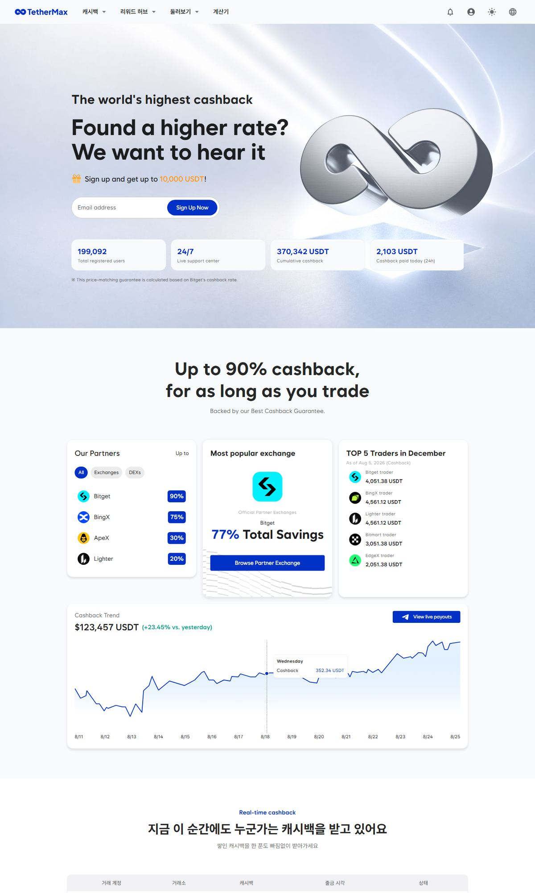

#### `about.intro:loading` — 피드 불러오는 중

| 항목 | 내용 |
|---|---|
| 화면 | 서비스 소개 (`/service-intro-new`) |
| 기능 | FU-043 · FU-042 |
| 빠진 것 | 피드 로딩(스켈레톤) |
| 가까운 Figma | Service intro / PC / Light (DEX) [28960:129521](https://www.figma.com/design/hsa3bSV9QmFTe2jsf6tzTm/UI-UX-Design?node-id=28960-129521) › 표 [28960:129611](https://www.figma.com/design/hsa3bSV9QmFTe2jsf6tzTm/UI-UX-Design?node-id=28960-129611) |
| 보기 | PC |

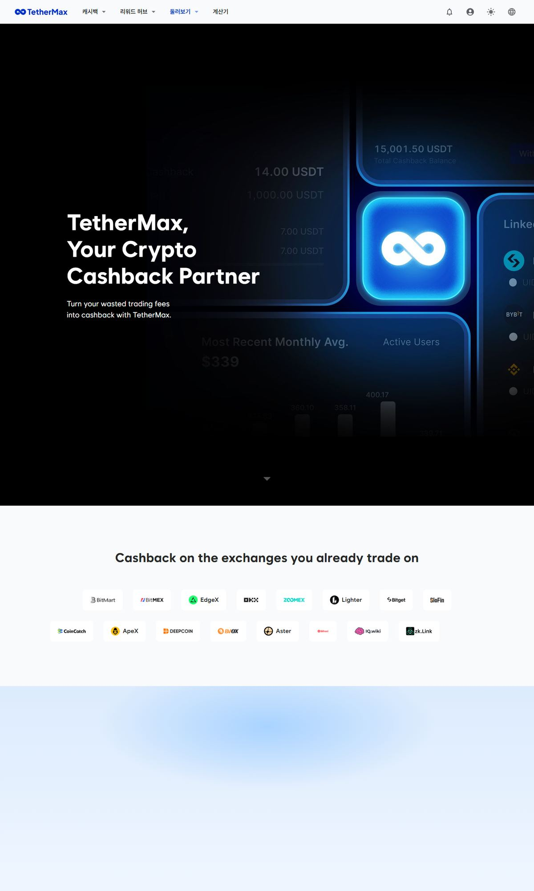

#### `about.intro:empty` — 피드 없음

| 항목 | 내용 |
|---|---|
| 화면 | 서비스 소개 (`/service-intro-new`) |
| 기능 | FU-043 · FU-042 |
| 빠진 것 | 빈 상태 화면·문구(원문 없음) |
| 가까운 Figma | 같은 표 [28960:129611](https://www.figma.com/design/hsa3bSV9QmFTe2jsf6tzTm/UI-UX-Design?node-id=28960-129611) |
| 보기 | PC |

#### `about.intro:error` — 피드 실패

| 항목 | 내용 |
|---|---|
| 화면 | 서비스 소개 (`/service-intro-new`) |
| 기능 | FU-043 · FU-042 |
| 빠진 것 | 실패 화면·문구(원문 없음) |
| 가까운 Figma | 같은 표 [28960:129611](https://www.figma.com/design/hsa3bSV9QmFTe2jsf6tzTm/UI-UX-Design?node-id=28960-129611) |
| 보기 | PC |

#### `about.feed:loading` — 불러오는 중

| 항목 | 내용 |
|---|---|
| 화면 | 실시간 출금 피드 (`게스트 홈 · 서비스 소개 섹션`) |
| 기능 | FU-042 |
| 빠진 것 | 피드 로딩(스켈레톤) |
| 가까운 Figma | 랜딩 피드 섹션 [28960:128520](https://www.figma.com/design/hsa3bSV9QmFTe2jsf6tzTm/UI-UX-Design?node-id=28960-128520) |
| 보기 | PC |

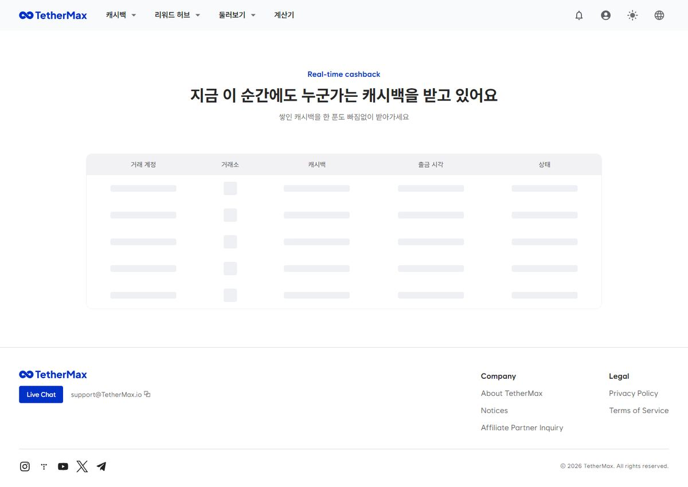

#### `about.feed:empty` — 내역 없음

| 항목 | 내용 |
|---|---|
| 화면 | 실시간 출금 피드 (`게스트 홈 · 서비스 소개 섹션`) |
| 기능 | FU-042 |
| 빠진 것 | 빈 상태 화면·문구(원문 없음) |
| 가까운 Figma | 랜딩 피드 섹션 [28960:128520](https://www.figma.com/design/hsa3bSV9QmFTe2jsf6tzTm/UI-UX-Design?node-id=28960-128520) |
| 보기 | PC |

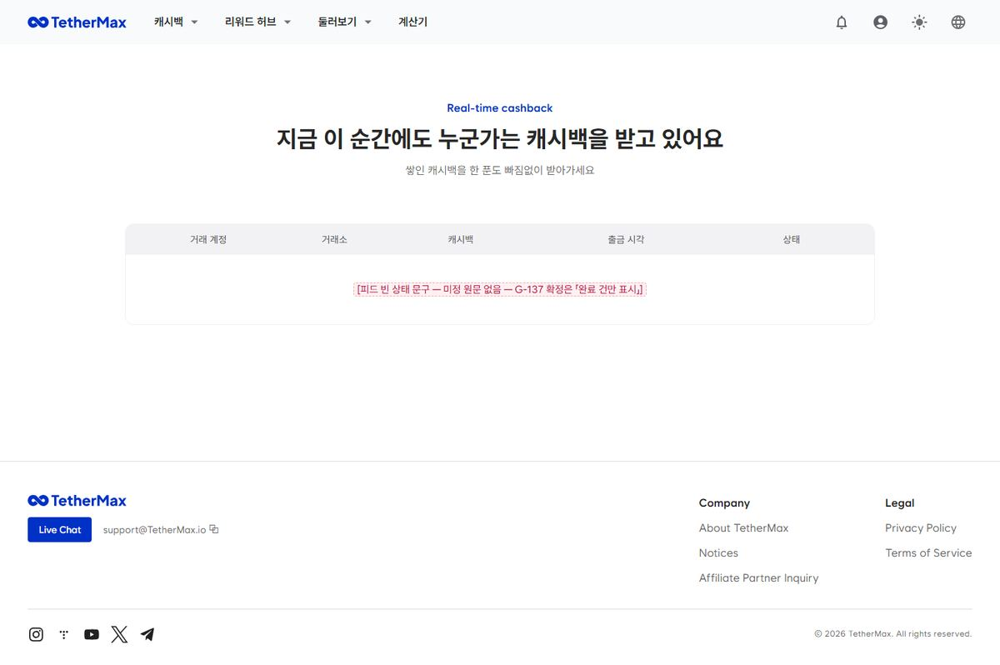

#### `about.feed:error` — 불러오기 실패

| 항목 | 내용 |
|---|---|
| 화면 | 실시간 출금 피드 (`게스트 홈 · 서비스 소개 섹션`) |
| 기능 | FU-042 |
| 빠진 것 | 실패 화면·문구(원문 없음) |
| 가까운 Figma | 랜딩 피드 섹션 [28960:128520](https://www.figma.com/design/hsa3bSV9QmFTe2jsf6tzTm/UI-UX-Design?node-id=28960-128520) |
| 보기 | PC |

### 4. 홈 · 잔액 · 지갑 상세

#### `home.main:s3App` — S3 앱·모바일웹 빈 홈 카드

| 항목 | 내용 |
|---|---|
| 화면 | 홈 (S3 · S4 · 게스트) (`/`) |
| 기능 | FU-037 · FU-038 · FU-039 · FU-029 · FU-022 · FU-011 · FU-044 |
| 빠진 것 | 빈 홈 카드(Link once and cashbacks keep coming) 레이아웃 |
| 가까운 Figma | S3-1 ([28960:127759](https://www.figma.com/design/hsa3bSV9QmFTe2jsf6tzTm/UI-UX-Design?node-id=28960-127759)) |
| 보기 | 모바일 |

#### `home.main:s3Pending` — 확인 중 계정만 있음 → S4 전환

| 항목 | 내용 |
|---|---|
| 화면 | 홈 (S3 · S4 · 게스트) (`/`) |
| 기능 | FU-037 · FU-038 · FU-039 · FU-029 · FU-022 · FU-011 · FU-044 |
| 빠진 것 | 확인 중 행 1개뿐인 S4 |
| 가까운 Figma | S4-1 ([28960:127837](https://www.figma.com/design/hsa3bSV9QmFTe2jsf6tzTm/UI-UX-Design?node-id=28960-127837)) |
| 보기 | PC |

#### `home.main:statuses` — 상태 7단계 행

| 항목 | 내용 |
|---|---|
| 화면 | 홈 (S3 · S4 · 게스트) (`/`) |
| 기능 | FU-037 · FU-038 · FU-039 · FU-029 · FU-022 · FU-011 · FU-044 |
| 빠진 것 | 소유 확인중·연동 시도중이에요·이슈·연동 실패·소유 확인 실패·연동 해제 행의 점·칩 색과 라벨(G-058 4토큰) |
| 가까운 Figma | HW1 ([28960:126108](https://www.figma.com/design/hsa3bSV9QmFTe2jsf6tzTm/UI-UX-Design?node-id=28960-126108)) |
| 보기 | PC |

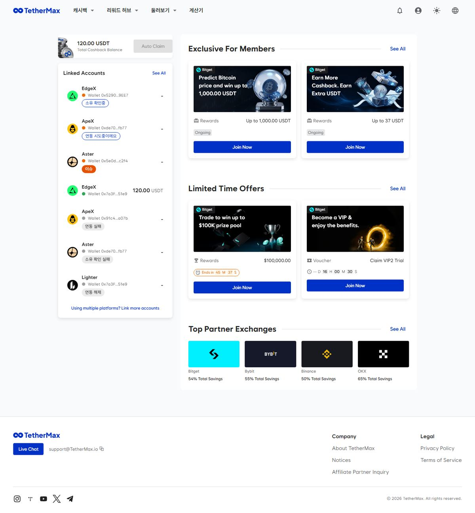

#### `home.main:chips` — DEX 칩 — No cashback yet · Data delayed · Inactive

| 항목 | 내용 |
|---|---|
| 화면 | 홈 (S3 · S4 · 게스트) (`/`) |
| 기능 | FU-037 · FU-038 · FU-039 · FU-029 · FU-022 · FU-011 · FU-044 |
| 빠진 것 | No cashback yet · Data delayed · Inactive 칩 실물(Figma는 자리표시 "Chip") |
| 가까운 Figma | HW1 ([28960:126108](https://www.figma.com/design/hsa3bSV9QmFTe2jsf6tzTm/UI-UX-Design?node-id=28960-126108)) |
| 보기 | PC |

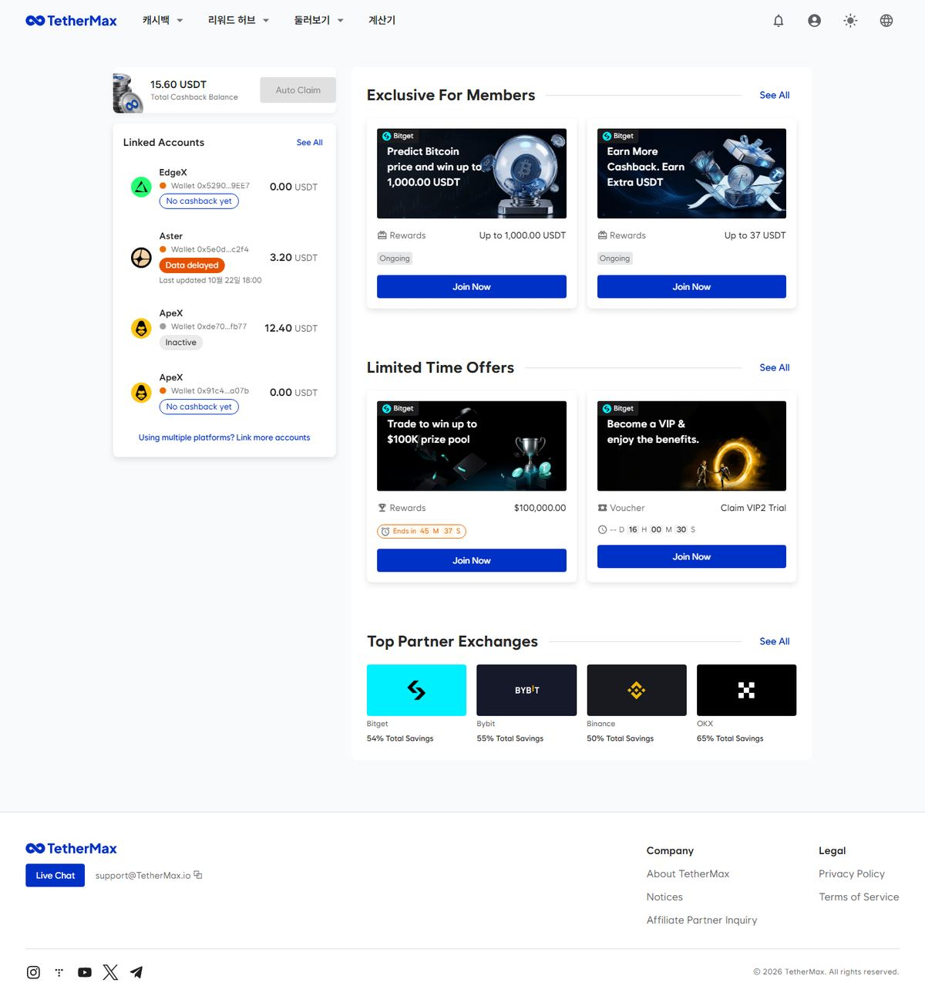

#### `home.main:loading` — 로딩 — 스켈레톤

| 항목 | 내용 |
|---|---|
| 화면 | 홈 (S3 · S4 · 게스트) (`/`) |
| 기능 | FU-037 · FU-038 · FU-039 · FU-029 · FU-022 · FU-011 · FU-044 |
| 빠진 것 | 총액 카드·행 스켈레톤 |
| 가까운 Figma | HW1 ([28960:126108](https://www.figma.com/design/hsa3bSV9QmFTe2jsf6tzTm/UI-UX-Design?node-id=28960-126108)) |
| 보기 | PC |

#### `home.main:error` — 잔액 로드 실패

| 항목 | 내용 |
|---|---|
| 화면 | 홈 (S3 · S4 · 게스트) (`/`) |
| 기능 | FU-037 · FU-038 · FU-039 · FU-029 · FU-022 · FU-011 · FU-044 |
| 빠진 것 | 오류 알림 + Try again 위치 |
| 가까운 Figma | HW1 ([28960:126108](https://www.figma.com/design/hsa3bSV9QmFTe2jsf6tzTm/UI-UX-Design?node-id=28960-126108)) |
| 보기 | PC |

#### `home.main:delayed` — DEX 원장 지연 — Last updated

| 항목 | 내용 |
|---|---|
| 화면 | 홈 (S3 · S4 · 게스트) (`/`) |
| 기능 | FU-037 · FU-038 · FU-039 · FU-029 · FU-022 · FU-011 · FU-044 |
| 빠진 것 | Last updated 위치 · 지연 배너(REQ-274 문구) |
| 가까운 Figma | HW1 ([28960:126108](https://www.figma.com/design/hsa3bSV9QmFTe2jsf6tzTm/UI-UX-Design?node-id=28960-126108)) |
| 보기 | PC |

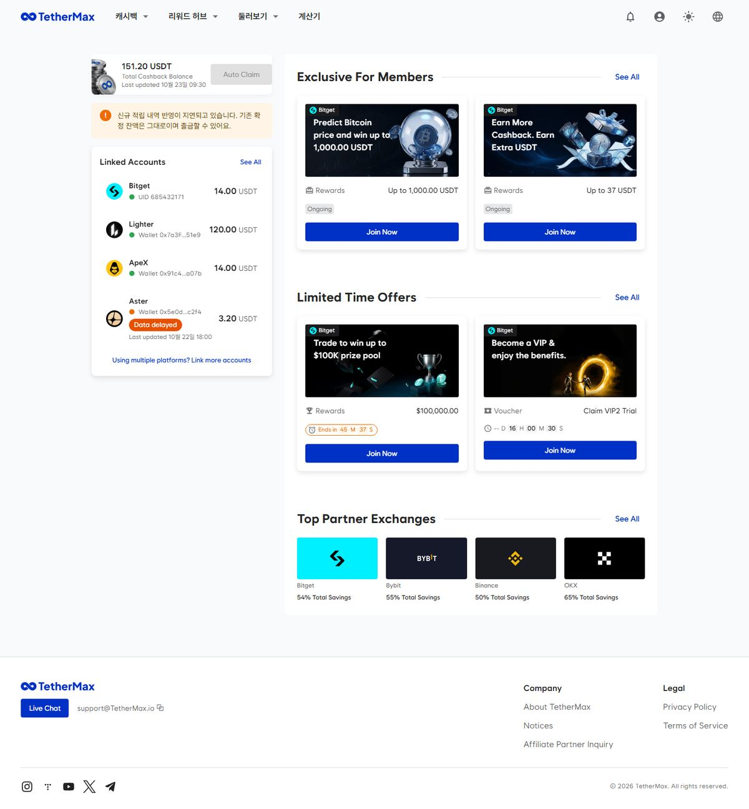

#### `home.main:many` — 계정 11개 이상 — 10개 + 더보기

| 항목 | 내용 |
|---|---|
| 화면 | 홈 (S3 · S4 · 게스트) (`/`) |
| 기능 | FU-037 · FU-038 · FU-039 · FU-029 · FU-022 · FU-011 · FU-044 |
| 빠진 것 | 10개 + 더보기 · 패널 내부 스크롤 |
| 가까운 Figma | HW1 ([28960:126108](https://www.figma.com/design/hsa3bSV9QmFTe2jsf6tzTm/UI-UX-Design?node-id=28960-126108)) |
| 보기 | PC |

#### `home.main:app` — 앱·모바일웹 — Wallet 라벨 없음 · 푸터 문구

| 항목 | 내용 |
|---|---|
| 화면 | 홈 (S3 · S4 · 게스트) (`/`) |
| 기능 | FU-037 · FU-038 · FU-039 · FU-029 · FU-022 · FU-011 · FU-044 |
| 빠진 것 | Wallet 라벨 없는 행 · 앱 푸터 문구 |
| 가까운 Figma | HW1 ([28960:126108](https://www.figma.com/design/hsa3bSV9QmFTe2jsf6tzTm/UI-UX-Design?node-id=28960-126108)) |
| 보기 | 모바일 |

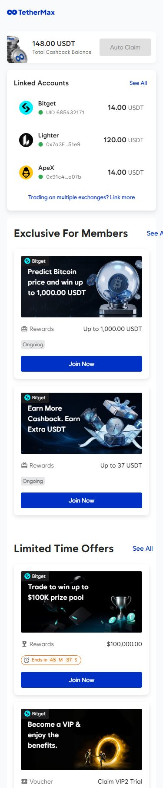

#### `home.main:full` — 지갑 전체 주소 펼침

| 항목 | 내용 |
|---|---|
| 화면 | 홈 (S3 · S4 · 게스트) (`/`) |
| 기능 | FU-037 · FU-038 · FU-039 · FU-029 · FU-022 · FU-011 · FU-044 |
| 빠진 것 | 전체 주소 줄바꿈 표시 |
| 가까운 Figma | HW1 ([28960:126108](https://www.figma.com/design/hsa3bSV9QmFTe2jsf6tzTm/UI-UX-Design?node-id=28960-126108)) |
| 보기 | PC |

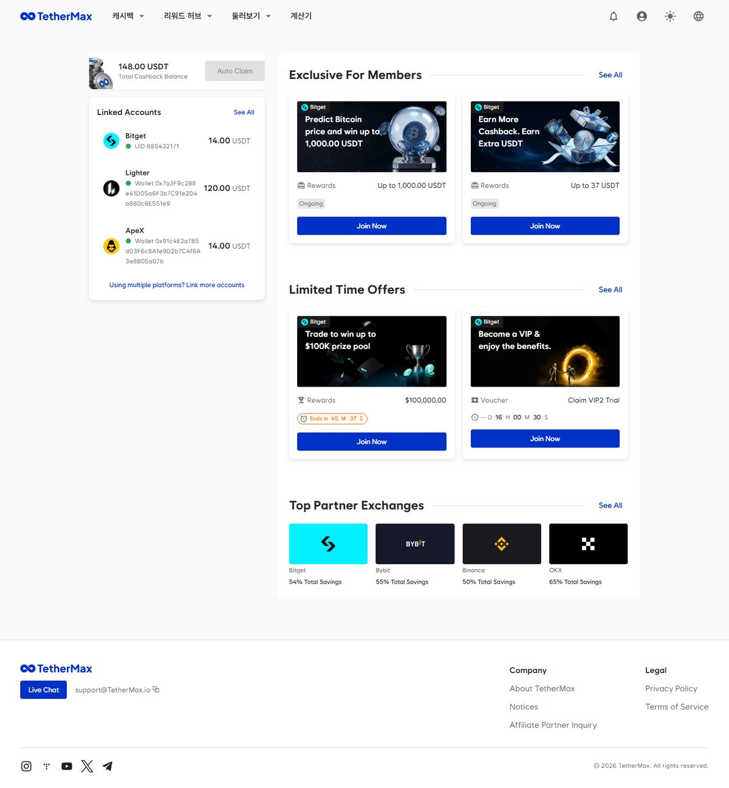

#### `home.main:transferred` — 10 USDT 미만 이관 4.00

| 항목 | 내용 |
|---|---|
| 화면 | 홈 (S3 · S4 · 게스트) (`/`) |
| 기능 | FU-037 · FU-038 · FU-039 · FU-029 · FU-022 · FU-011 · FU-044 |
| 빠진 것 | 이관 금액이 있는 새 행 |
| 가까운 Figma | S4-6 ([28960:127867](https://www.figma.com/design/hsa3bSV9QmFTe2jsf6tzTm/UI-UX-Design?node-id=28960-127867)) |
| 보기 | PC |

#### `home.main:pending` — 확인 중 — 연동 시도중이에요 · -

| 항목 | 내용 |
|---|---|
| 화면 | 홈 (S3 · S4 · 게스트) (`/`) |
| 기능 | FU-037 · FU-038 · FU-039 · FU-029 · FU-022 · FU-011 · FU-044 |
| 빠진 것 | 연동 시도중이에요 칩 · 금액 `-` |
| 가까운 Figma | S4-6 ([28960:127867](https://www.figma.com/design/hsa3bSV9QmFTe2jsf6tzTm/UI-UX-Design?node-id=28960-127867)) |
| 보기 | PC |

#### `home.main:inactive` — DEX 오프보딩 — Inactive

| 항목 | 내용 |
|---|---|
| 화면 | 홈 (S3 · S4 · 게스트) (`/`) |
| 기능 | FU-037 · FU-038 · FU-039 · FU-029 · FU-022 · FU-011 · FU-044 |
| 빠진 것 | Inactive 행 + 안내 문구(REQ-121, 문구 미정) |
| 가까운 Figma | HW1 ([28960:126108](https://www.figma.com/design/hsa3bSV9QmFTe2jsf6tzTm/UI-UX-Design?node-id=28960-126108)) |
| 보기 | PC |

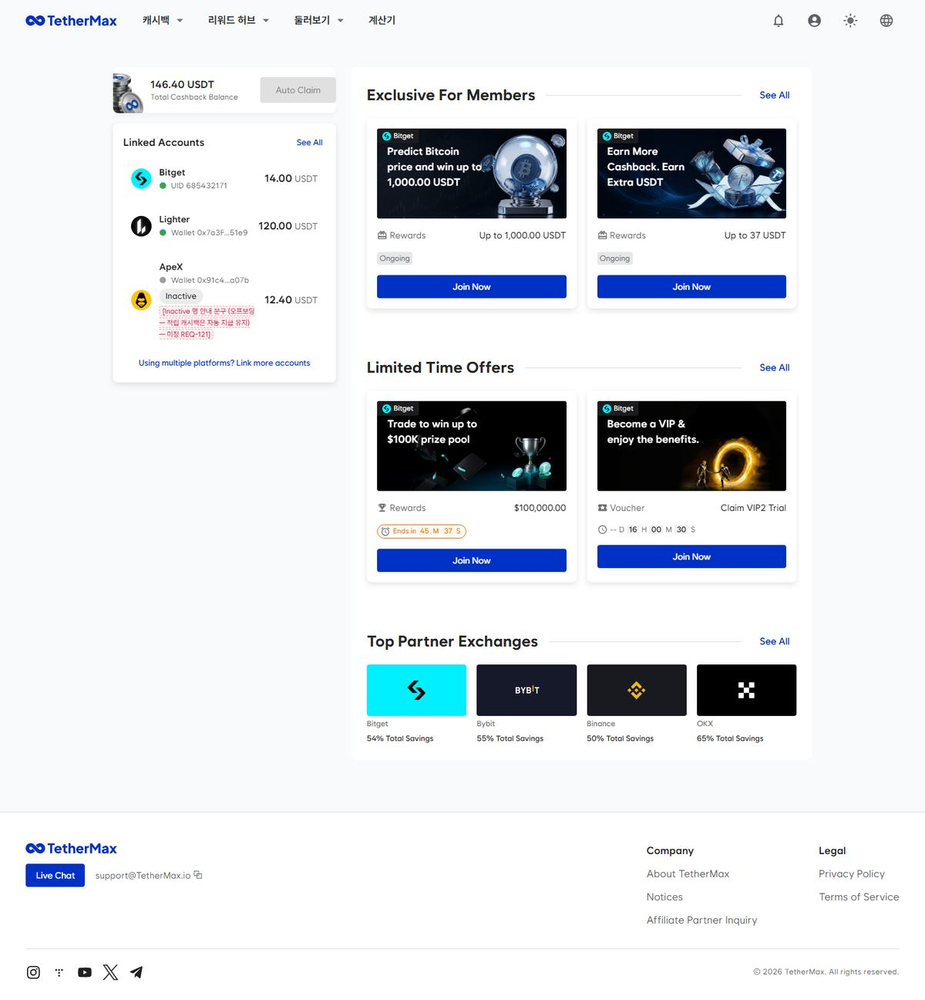

#### `home.main:multi` — 같은 DEX 지갑 3개 · Aster 하위 계정

| 항목 | 내용 |
|---|---|
| 화면 | 홈 (S3 · S4 · 게스트) (`/`) |
| 기능 | FU-037 · FU-038 · FU-039 · FU-029 · FU-022 · FU-011 · FU-044 |
| 빠진 것 | 같은 DEX 여러 행 묶음/구분 |
| 가까운 Figma | S4-6 ([28960:127867](https://www.figma.com/design/hsa3bSV9QmFTe2jsf6tzTm/UI-UX-Design?node-id=28960-127867)) |
| 보기 | PC |

#### `home.main:rejected` — 확인 중 거절 — 행 제거

| 항목 | 내용 |
|---|---|
| 화면 | 홈 (S3 · S4 · 게스트) (`/`) |
| 기능 | FU-037 · FU-038 · FU-039 · FU-029 · FU-022 · FU-011 · FU-044 |
| 빠진 것 | 행 제거 후 화면(안내 여부) |
| 가까운 Figma | S4-1 ([28960:127837](https://www.figma.com/design/hsa3bSV9QmFTe2jsf6tzTm/UI-UX-Design?node-id=28960-127837)) |
| 보기 | PC |

#### `home.main:labels` — DEX 정산 상태 라벨 (홈 행 칩)

| 항목 | 내용 |
|---|---|
| 화면 | 홈 (S3 · S4 · 게스트) (`/`) |
| 기능 | FU-037 · FU-038 · FU-039 · FU-029 · FU-022 · FU-011 · FU-044 |
| 빠진 것 | Accruing this week (estimate) · Credited · Withheld · Under the $1 minimum · Pending · DEX data pending 칩·보조 줄 |
| 가까운 Figma | HW1 ([28960:126108](https://www.figma.com/design/hsa3bSV9QmFTe2jsf6tzTm/UI-UX-Design?node-id=28960-126108)) |
| 보기 | PC |

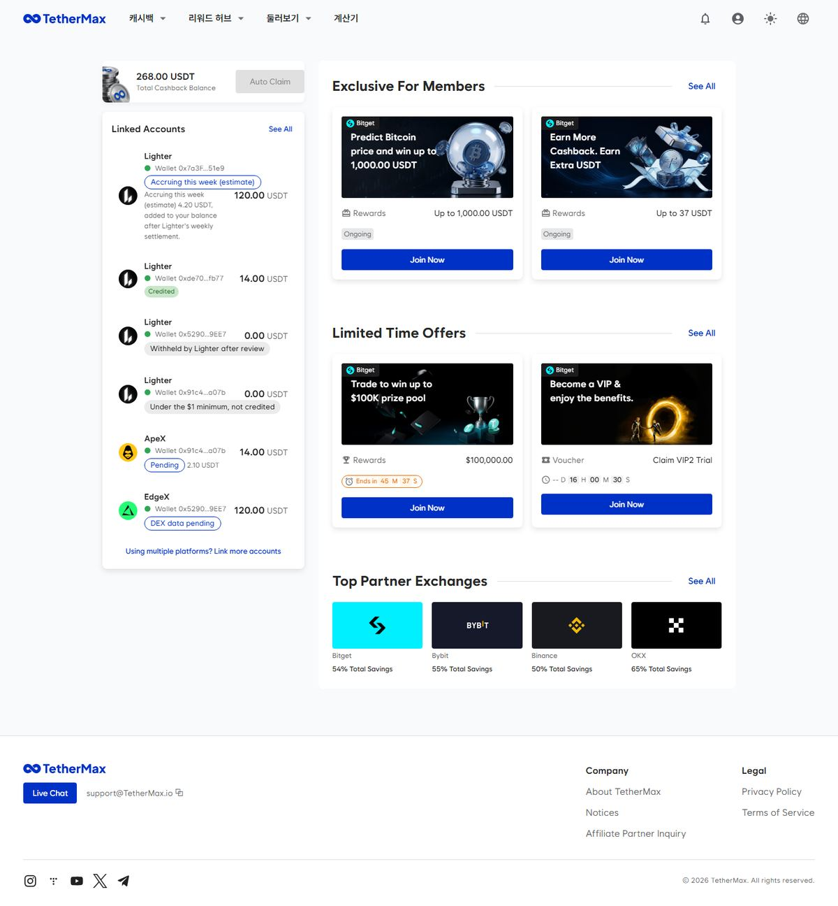

#### `home.main:faq` — 홈 FAQ — 회원 답변

| 항목 | 내용 |
|---|---|
| 화면 | 홈 (S3 · S4 · 게스트) (`/`) |
| 기능 | FU-037 · FU-038 · FU-039 · FU-029 · FU-022 · FU-011 · FU-044 |
| 빠진 것 | 홈 FAQ 섹션 |
| 가까운 Figma | HW1 ([28960:126108](https://www.figma.com/design/hsa3bSV9QmFTe2jsf6tzTm/UI-UX-Design?node-id=28960-126108)) |
| 보기 | PC |

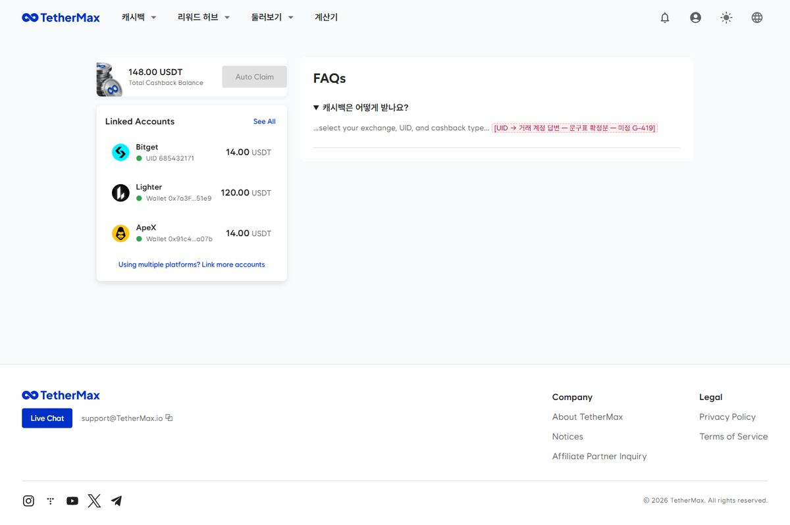

#### `home.wallet:loading` — 잔액 로딩 — 스켈레톤

| 항목 | 내용 |
|---|---|
| 화면 | DEX 지갑 상세 (`/dex/wallet (지갑 상세)`) |
| 기능 | FU-040 |
| 빠진 것 | 잔액 카드 스켈레톤 |
| 가까운 Figma | 지갑 상세 · 이벤트 리워드 매칭 상태 ([29026:97581](https://www.figma.com/design/hsa3bSV9QmFTe2jsf6tzTm/UI-UX-Design?node-id=29026-97581)) |
| 보기 | PC |

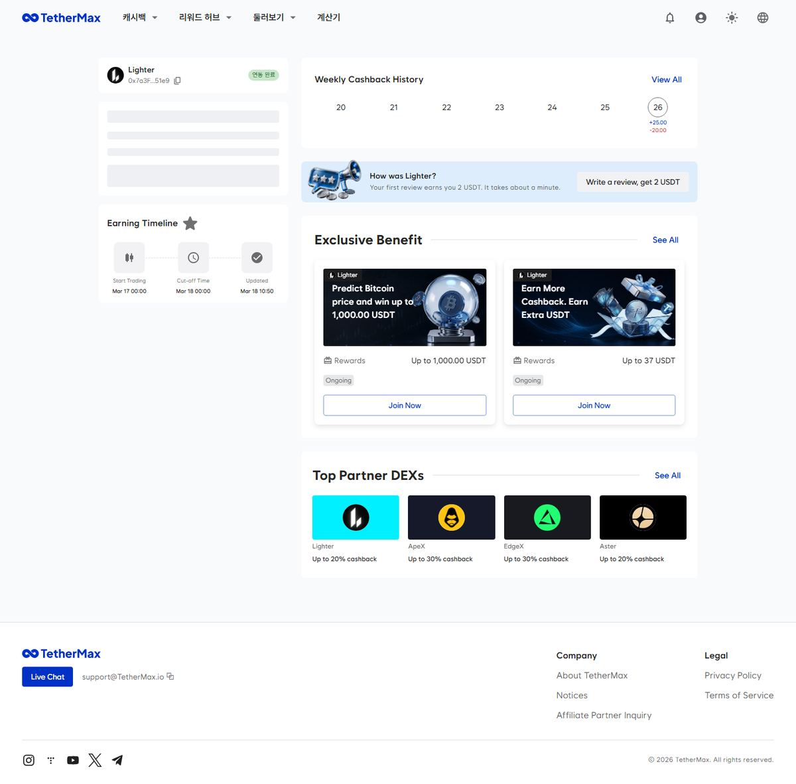

#### `home.wallet:error` — 잔액 조회 실패 — 오류 · 재시도

| 항목 | 내용 |
|---|---|
| 화면 | DEX 지갑 상세 (`/dex/wallet (지갑 상세)`) |
| 기능 | FU-040 |
| 빠진 것 | 오류·재시도 |
| 가까운 Figma | [29026:97581](https://www.figma.com/design/hsa3bSV9QmFTe2jsf6tzTm/UI-UX-Design?node-id=29026-97581) |
| 보기 | PC |

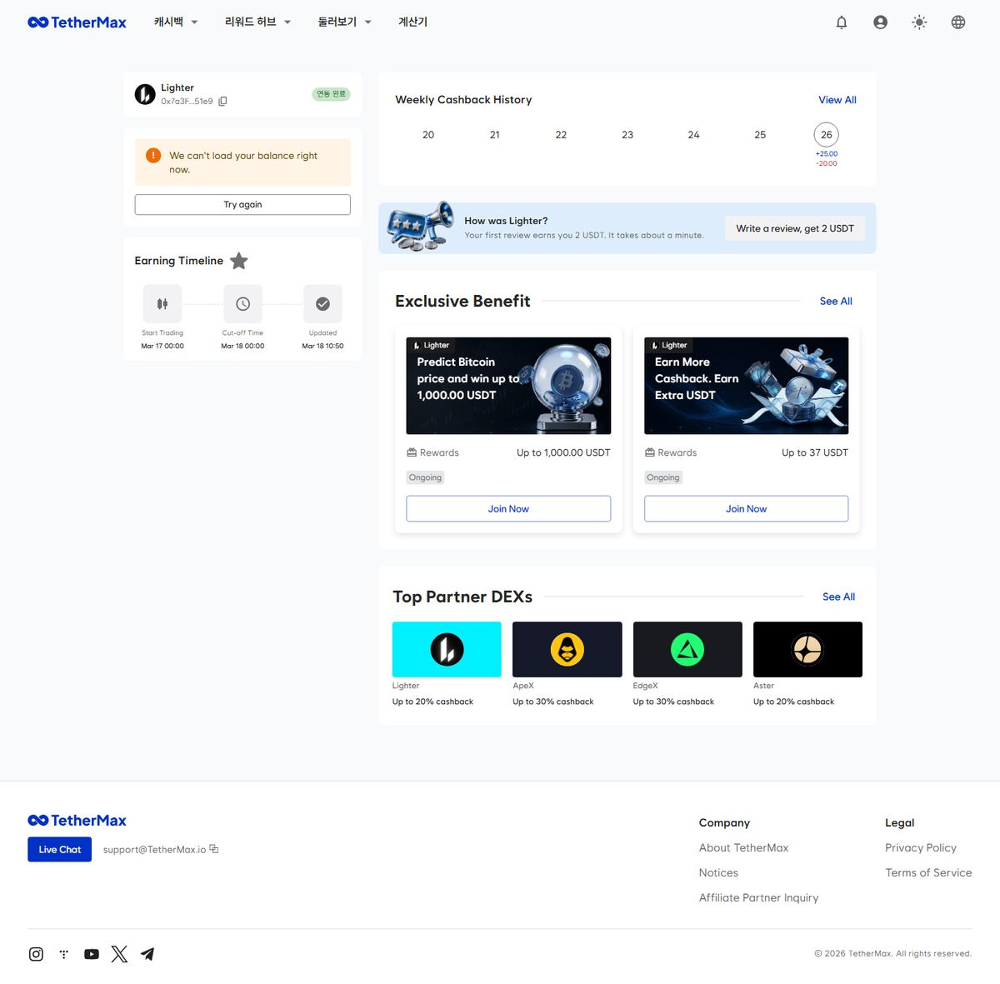

#### `home.wallet:delayed` — 파트너 지연 — 마지막 확정 금액 · Last updated

| 항목 | 내용 |
|---|---|
| 화면 | DEX 지갑 상세 (`/dex/wallet (지갑 상세)`) |
| 기능 | FU-040 |
| 빠진 것 | Last updated 위치 |
| 가까운 Figma | [29026:97581](https://www.figma.com/design/hsa3bSV9QmFTe2jsf6tzTm/UI-UX-Design?node-id=29026-97581) |
| 보기 | PC |

#### `home.wallet:reviewed` — 리뷰 작성 후 — 리뷰 유도 없음

| 항목 | 내용 |
|---|---|
| 화면 | DEX 지갑 상세 (`/dex/wallet (지갑 상세)`) |
| 기능 | FU-040 |
| 빠진 것 | 리뷰 유도 없는 우측 열(블록 제거만) |
| 가까운 Figma | PW1 ([28960:125943](https://www.figma.com/design/hsa3bSV9QmFTe2jsf6tzTm/UI-UX-Design?node-id=28960-125943)) |
| 보기 | PC |

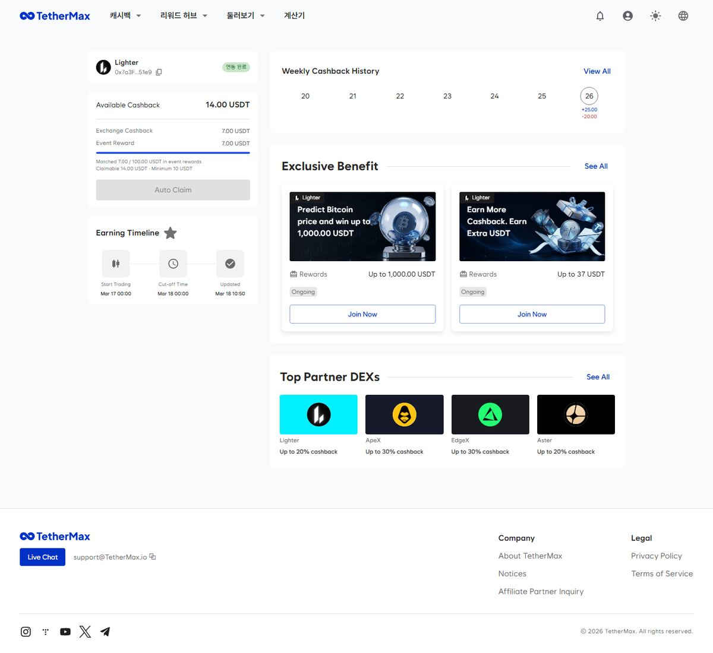

#### `home.wallet:pending` — 연동 시도중

| 항목 | 내용 |
|---|---|
| 화면 | DEX 지갑 상세 (`/dex/wallet (지갑 상세)`) |
| 기능 | FU-040 |
| 빠진 것 | 헤더 칩 · 금액 `-` 표시 |
| 가까운 Figma | PW1 ([28960:125943](https://www.figma.com/design/hsa3bSV9QmFTe2jsf6tzTm/UI-UX-Design?node-id=28960-125943)) |
| 보기 | PC |

#### `home.wallet:totalClaimed` — Total Claimed 행

| 항목 | 내용 |
|---|---|
| 화면 | DEX 지갑 상세 (`/dex/wallet (지갑 상세)`) |
| 기능 | FU-040 |
| 빠진 것 | Total Claimed 행(G-053 유지) |
| 가까운 Figma | PW1 ([28960:125943](https://www.figma.com/design/hsa3bSV9QmFTe2jsf6tzTm/UI-UX-Design?node-id=28960-125943)) |
| 보기 | PC |

#### `home.wallet:subaccounts` — 하위 계정 나열 안 함 (Lighter)

| 항목 | 내용 |
|---|---|
| 화면 | DEX 지갑 상세 (`/dex/wallet (지갑 상세)`) |
| 기능 | FU-040 |
| 빠진 것 | (G-178 미표시 — 정상과 같음) |
| 가까운 Figma | PW1 ([28960:125943](https://www.figma.com/design/hsa3bSV9QmFTe2jsf6tzTm/UI-UX-Design?node-id=28960-125943)) |
| 보기 | PC |

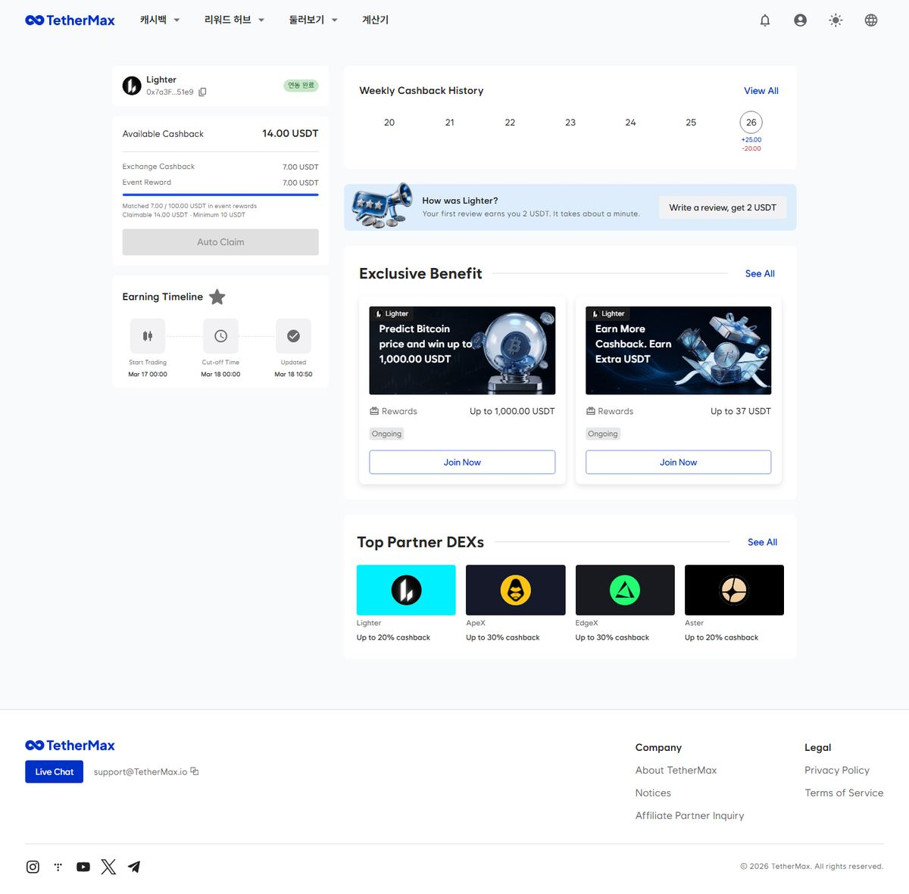

#### `home.timeline:normal` — EdgeX Daily D+1

| 항목 | 내용 |
|---|---|
| 화면 | 캐시백 타임라인 · 누적 캐시백 (`/ (홈 · 지갑 상세 섹션)`) |
| 기능 | FU-041 |
| 빠진 것 | 4단계 타임라인 · 누적 캐시백 카드 전체 |
| 가까운 Figma | PW1 Earning Timeline ([28960:125943](https://www.figma.com/design/hsa3bSV9QmFTe2jsf6tzTm/UI-UX-Design?node-id=28960-125943) 안) |
| 보기 | PC |

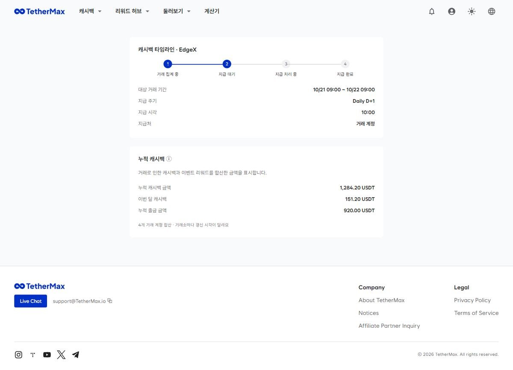

#### `home.timeline:apex` — ApeX D+2

| 항목 | 내용 |
|---|---|
| 화면 | 캐시백 타임라인 · 누적 캐시백 (`/ (홈 · 지갑 상세 섹션)`) |
| 기능 | FU-041 |
| 빠진 것 | 〃 |
| 가까운 Figma | 〃 |
| 보기 | PC |

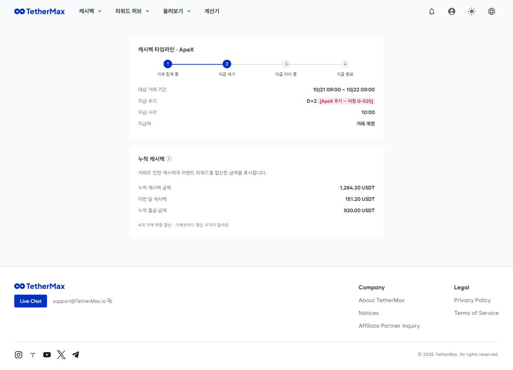

#### `home.timeline:lighter` — Lighter Weekly W+1 (온보딩 후)

| 항목 | 내용 |
|---|---|
| 화면 | 캐시백 타임라인 · 누적 캐시백 (`/ (홈 · 지갑 상세 섹션)`) |
| 기능 | FU-041 |
| 빠진 것 | 〃 |
| 가까운 Figma | 〃 |
| 보기 | PC |

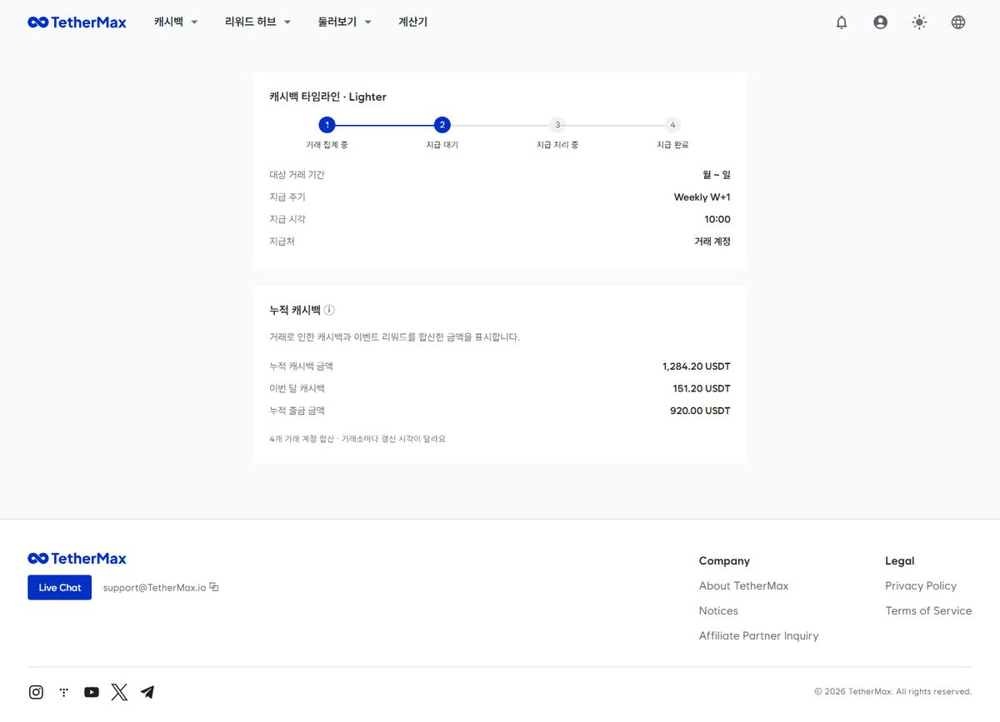

#### `home.timeline:compact` — compact 단계

| 항목 | 내용 |
|---|---|
| 화면 | 캐시백 타임라인 · 누적 캐시백 (`/ (홈 · 지갑 상세 섹션)`) |
| 기능 | FU-041 |
| 빠진 것 | 〃 |
| 가까운 Figma | 〃 |
| 보기 | PC |

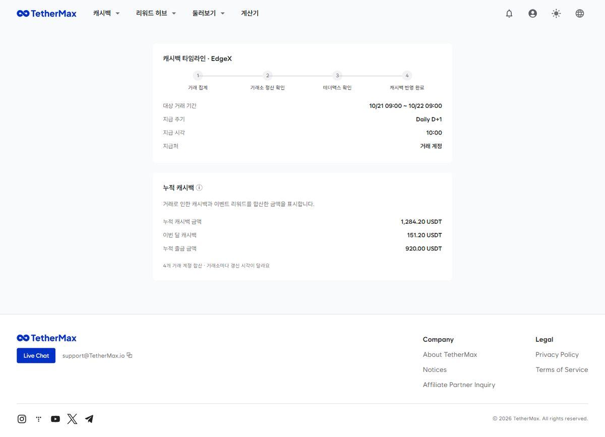

#### `home.timeline:warning` — 순차 지급 경고

| 항목 | 내용 |
|---|---|
| 화면 | 캐시백 타임라인 · 누적 캐시백 (`/ (홈 · 지갑 상세 섹션)`) |
| 기능 | FU-041 |
| 빠진 것 | 경고 배너 |
| 가까운 Figma | 〃 |
| 보기 | PC |

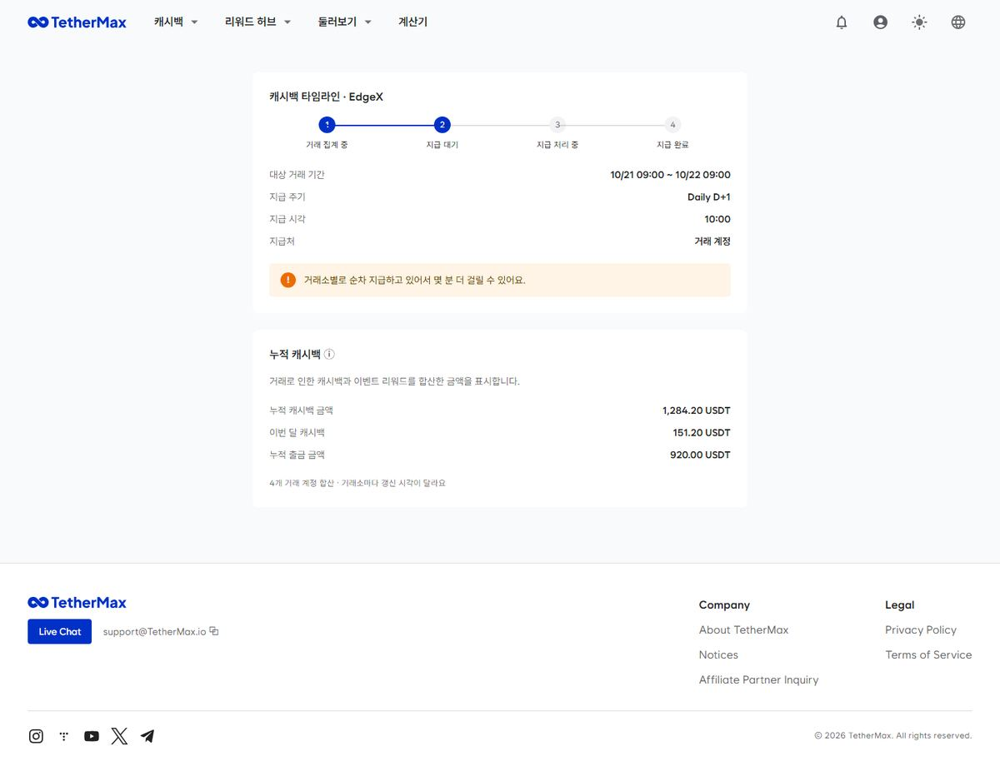

#### `wd.claim:normal` — 정상 — 가능 위 · 불가 아래, 같은 주소 DEX별 카드

| 항목 | 내용 |
|---|---|
| 화면 | 출금 화면 (/withdrawal-apply) (`/withdrawal-apply`) |
| 기능 | FU-030 · FU-031 · FU-032 · FU-033 · FU-034 |
| 빠진 것 | /withdrawal-apply 화면 전체 — 계정 카드·합계·Auto Claim |
| 가까운 Figma | (DW1·HW2·HW3·BW1은 숨김 폐기안) |
| 보기 | PC |

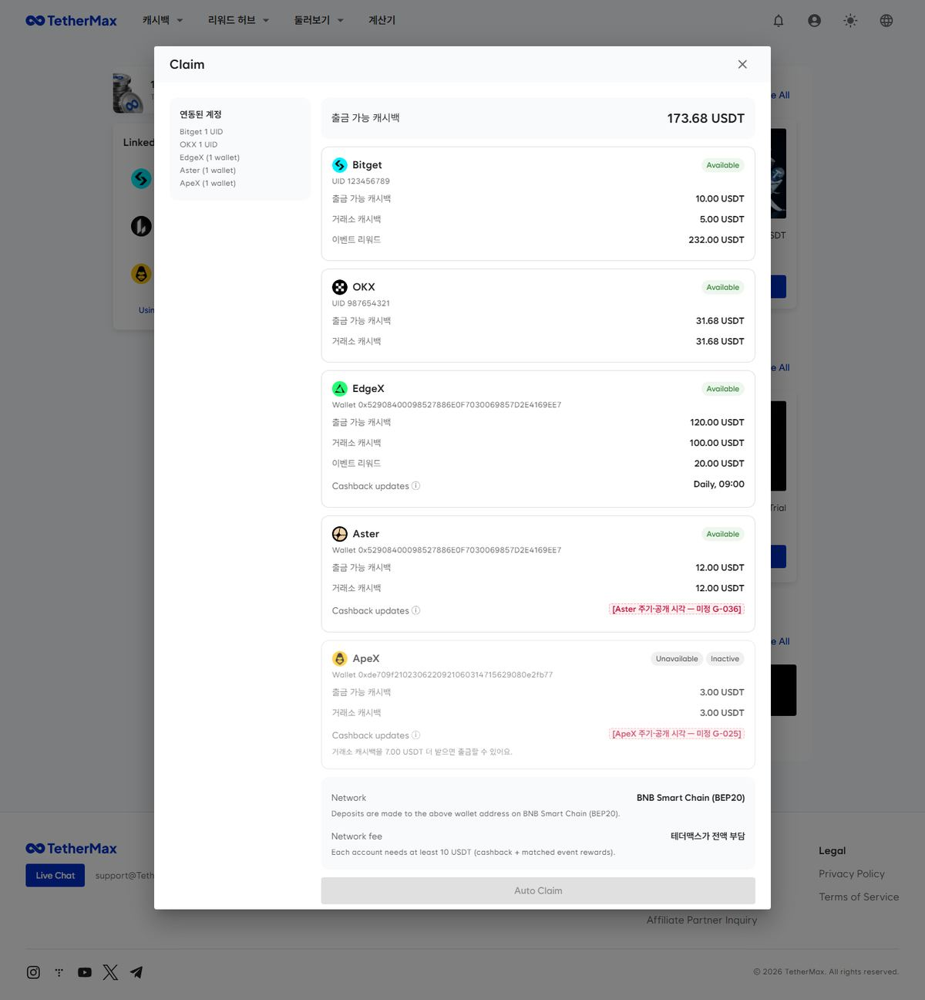

#### `wd.claim:allBlocked` — 전부 불가 — Not eligible to withdraw

| 항목 | 내용 |
|---|---|
| 화면 | 출금 화면 (/withdrawal-apply) (`/withdrawal-apply`) |
| 기능 | FU-030 · FU-031 · FU-032 · FU-033 · FU-034 |
| 빠진 것 | Not eligible to withdraw 표시 |
| 가까운 Figma | 〃 |
| 보기 | PC |

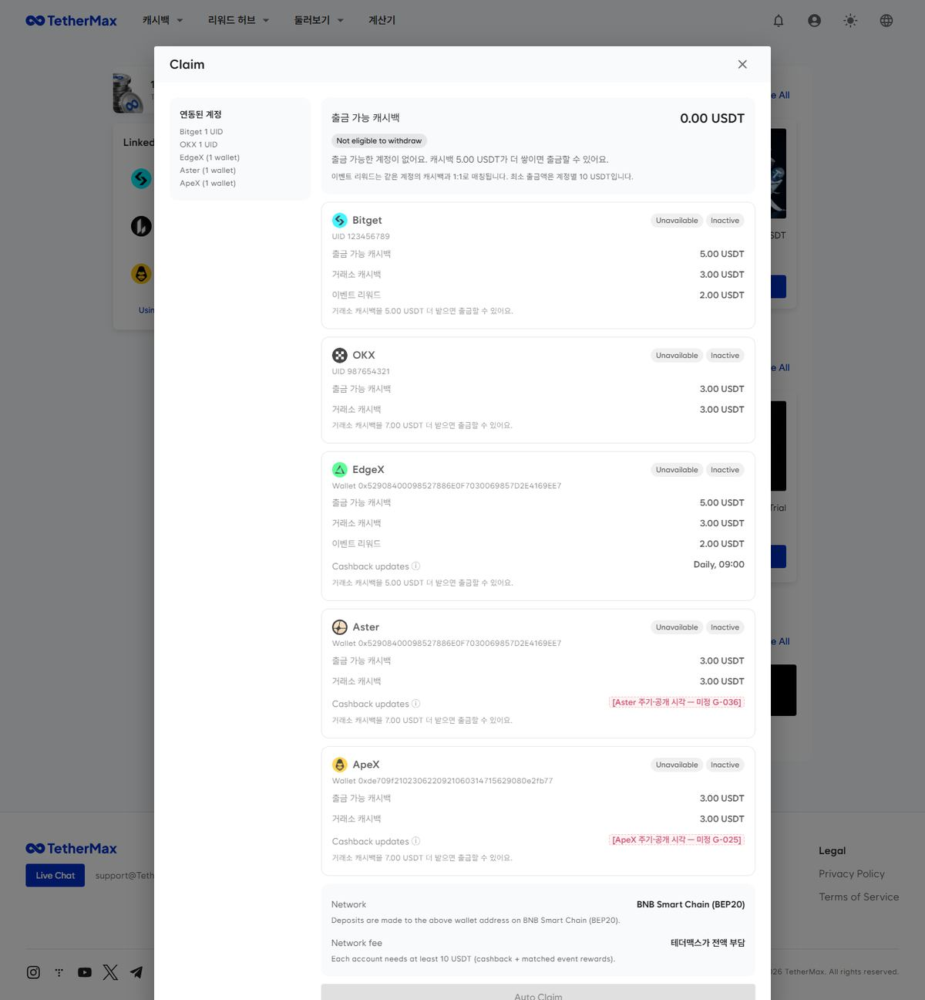

#### `wd.claim:zero` — DEX 캐시백 0 — 배너

| 항목 | 내용 |
|---|---|
| 화면 | 출금 화면 (/withdrawal-apply) (`/withdrawal-apply`) |
| 기능 | FU-030 · FU-031 · FU-032 · FU-033 · FU-034 |
| 빠진 것 | G-110 배너 |
| 가까운 Figma | 〃 |
| 보기 | PC |

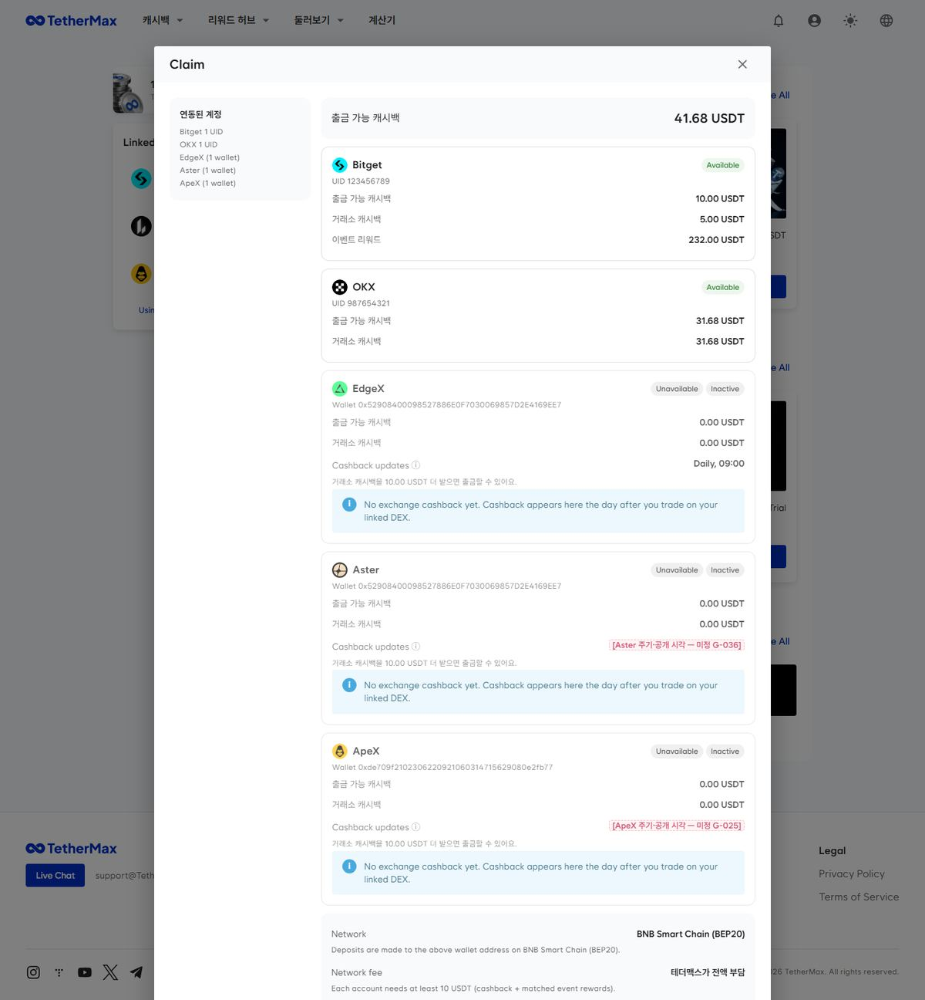

#### `wd.claim:loading` — 로딩 — 스켈레톤, 금액·버튼 없음

| 항목 | 내용 |
|---|---|
| 화면 | 출금 화면 (/withdrawal-apply) (`/withdrawal-apply`) |
| 기능 | FU-030 · FU-031 · FU-032 · FU-033 · FU-034 |
| 빠진 것 | 스켈레톤 |
| 가까운 Figma | 〃 |
| 보기 | PC |

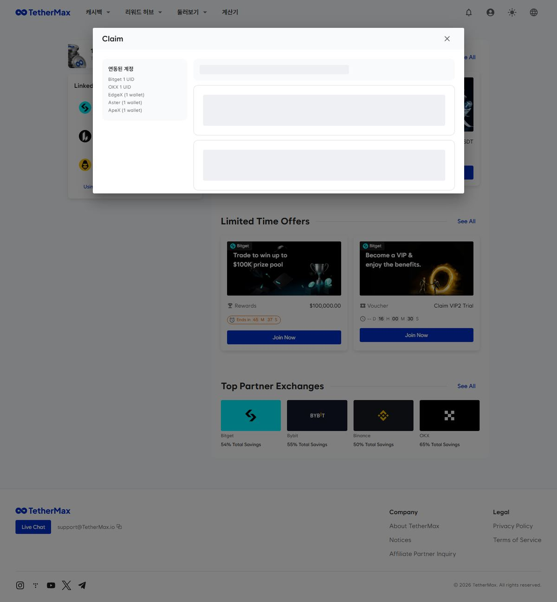

#### `wd.claim:delayed` — 데이터 지연 — Last updated

| 항목 | 내용 |
|---|---|
| 화면 | 출금 화면 (/withdrawal-apply) (`/withdrawal-apply`) |
| 기능 | FU-030 · FU-031 · FU-032 · FU-033 · FU-034 |
| 빠진 것 | Last updated |
| 가까운 Figma | 〃 |
| 보기 | PC |

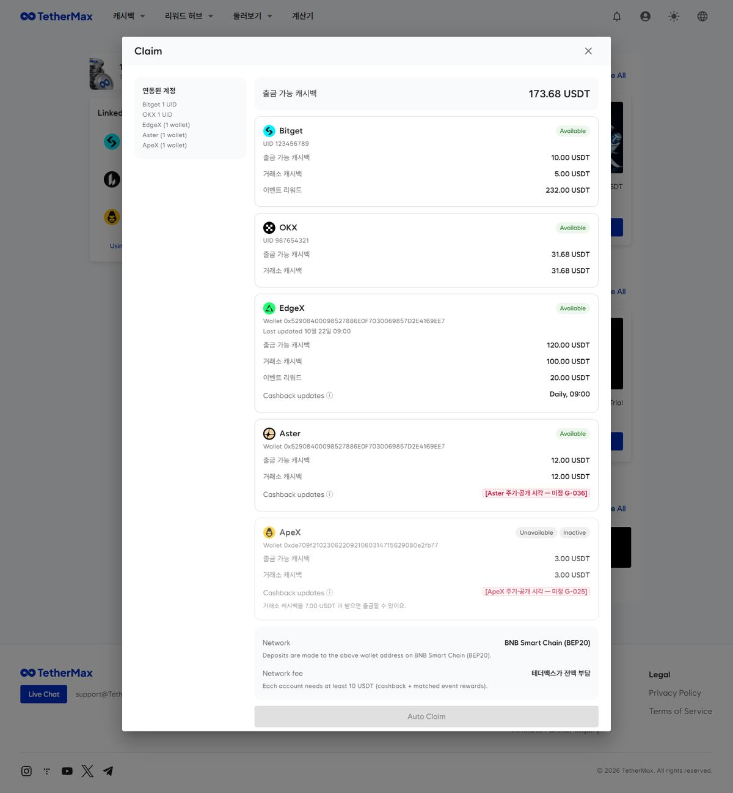

#### `wd.claim:partner` — 파트너 오류 — 그 카드만

| 항목 | 내용 |
|---|---|
| 화면 | 출금 화면 (/withdrawal-apply) (`/withdrawal-apply`) |
| 기능 | FU-030 · FU-031 · FU-032 · FU-033 · FU-034 |
| 빠진 것 | 카드 단위 오류 |
| 가까운 Figma | 〃 |
| 보기 | PC |

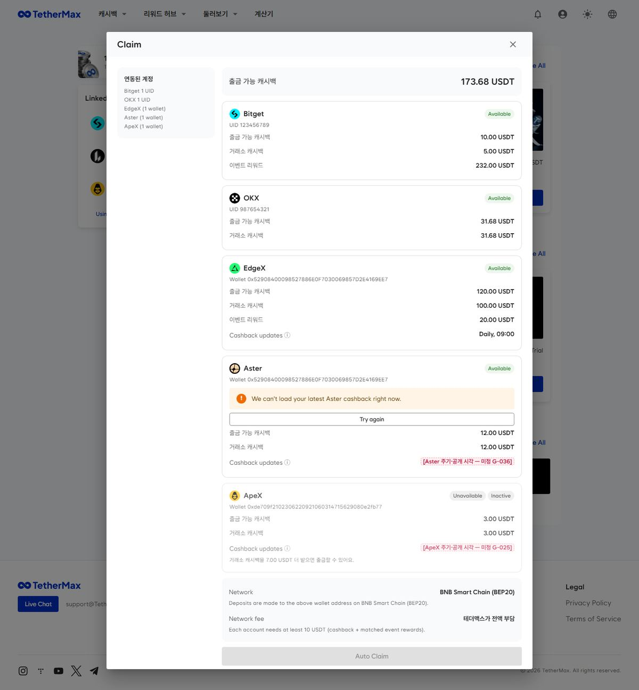

#### `wd.claim:balanceError` — 잔액 오류

| 항목 | 내용 |
|---|---|
| 화면 | 출금 화면 (/withdrawal-apply) (`/withdrawal-apply`) |
| 기능 | FU-030 · FU-031 · FU-032 · FU-033 · FU-034 |
| 빠진 것 | 합계 오류 |
| 가까운 Figma | 〃 |
| 보기 | PC |

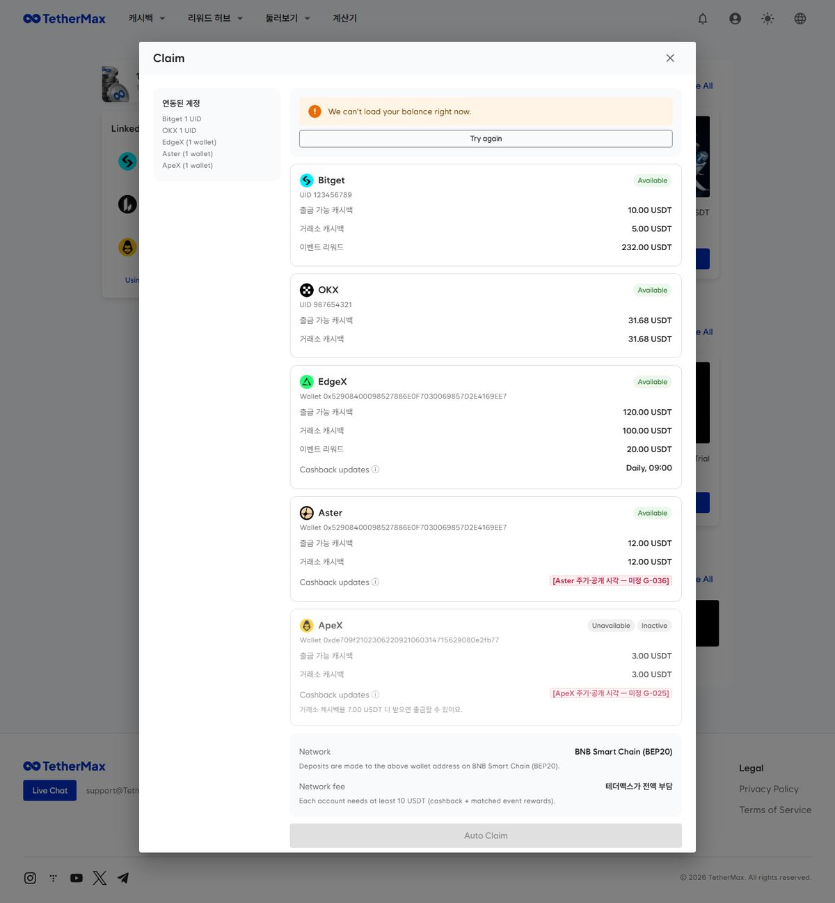

#### `wd.claim:deducted` — 선차감 반영

| 항목 | 내용 |
|---|---|
| 화면 | 출금 화면 (/withdrawal-apply) (`/withdrawal-apply`) |
| 기능 | FU-030 · FU-031 · FU-032 · FU-033 · FU-034 |
| 빠진 것 | 선차감 안내(G-112) |
| 가까운 Figma | 〃 |
| 보기 | PC |

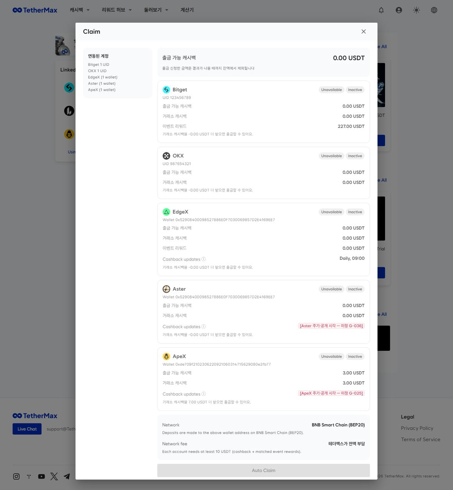

#### `wd.claim:preAccrual` — 적립 전 줄 (합계 미포함)

| 항목 | 내용 |
|---|---|
| 화면 | 출금 화면 (/withdrawal-apply) (`/withdrawal-apply`) |
| 기능 | FU-030 · FU-031 · FU-032 · FU-033 · FU-034 |
| 빠진 것 | ApeX Pending 줄 |
| 가까운 Figma | 〃 |
| 보기 | PC |

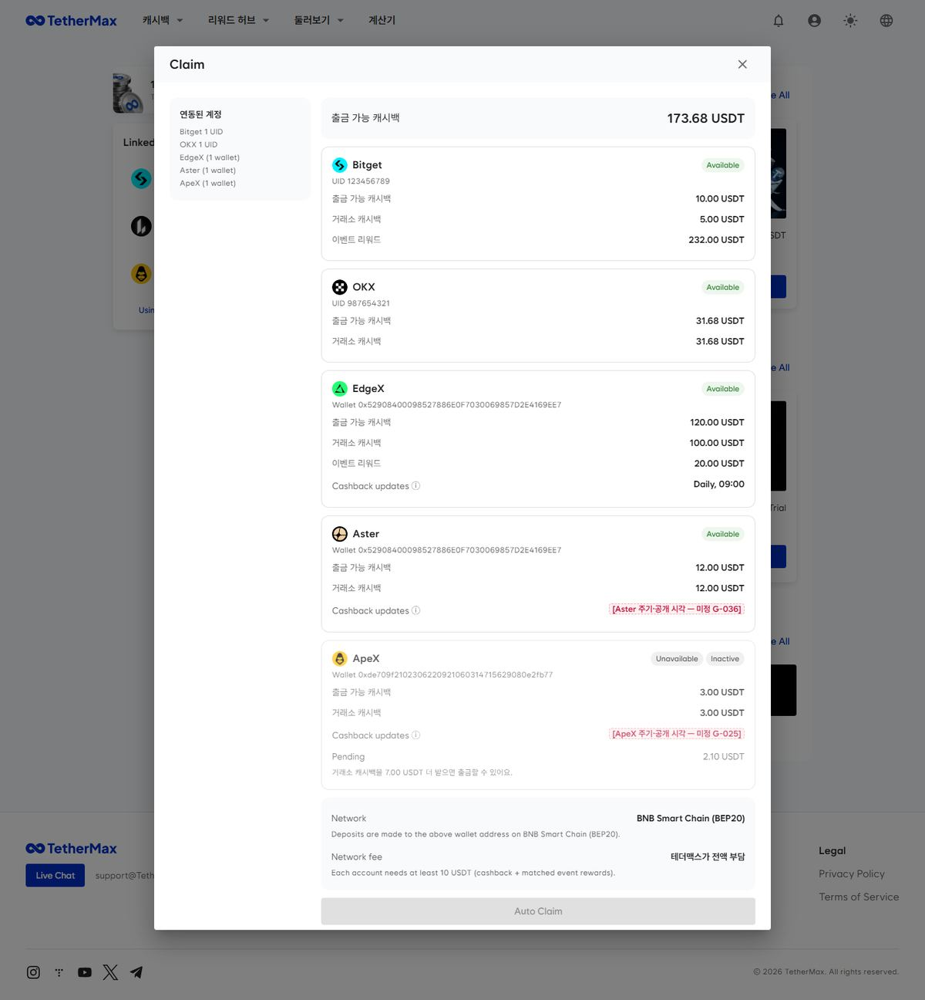

#### `wd.claim:many` — 계정 11개 이상 — 10개 + 더보기

| 항목 | 내용 |
|---|---|
| 화면 | 출금 화면 (/withdrawal-apply) (`/withdrawal-apply`) |
| 기능 | FU-030 · FU-031 · FU-032 · FU-033 · FU-034 |
| 빠진 것 | 10개 + 더보기 |
| 가까운 Figma | 〃 |
| 보기 | PC |

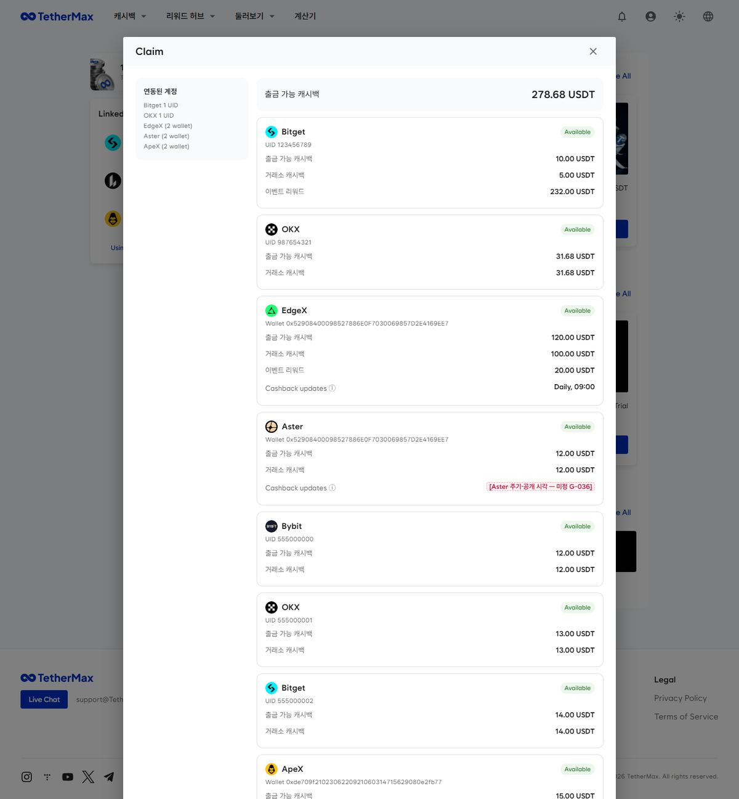

#### `wd.claim:noNetwork` — 지급 네트워크 미설정

| 항목 | 내용 |
|---|---|
| 화면 | 출금 화면 (/withdrawal-apply) (`/withdrawal-apply`) |
| 기능 | FU-030 · FU-031 · FU-032 · FU-033 · FU-034 |
| 빠진 것 | 목적지 비활성 표시(REQ-142) |
| 가까운 Figma | 〃 |
| 보기 | PC |

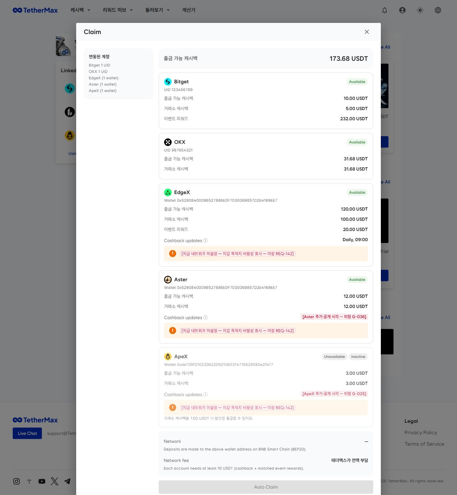

#### `wd.claim:lighter` — Lighter 카드 (온보딩 후) — Every Monday · Lighter (2 wallets)

| 항목 | 내용 |
|---|---|
| 화면 | 출금 화면 (/withdrawal-apply) (`/withdrawal-apply`) |
| 기능 | FU-030 · FU-031 · FU-032 · FU-033 · FU-034 |
| 빠진 것 | Every Monday · 2 wallets |
| 가까운 Figma | 〃 |
| 보기 | PC |

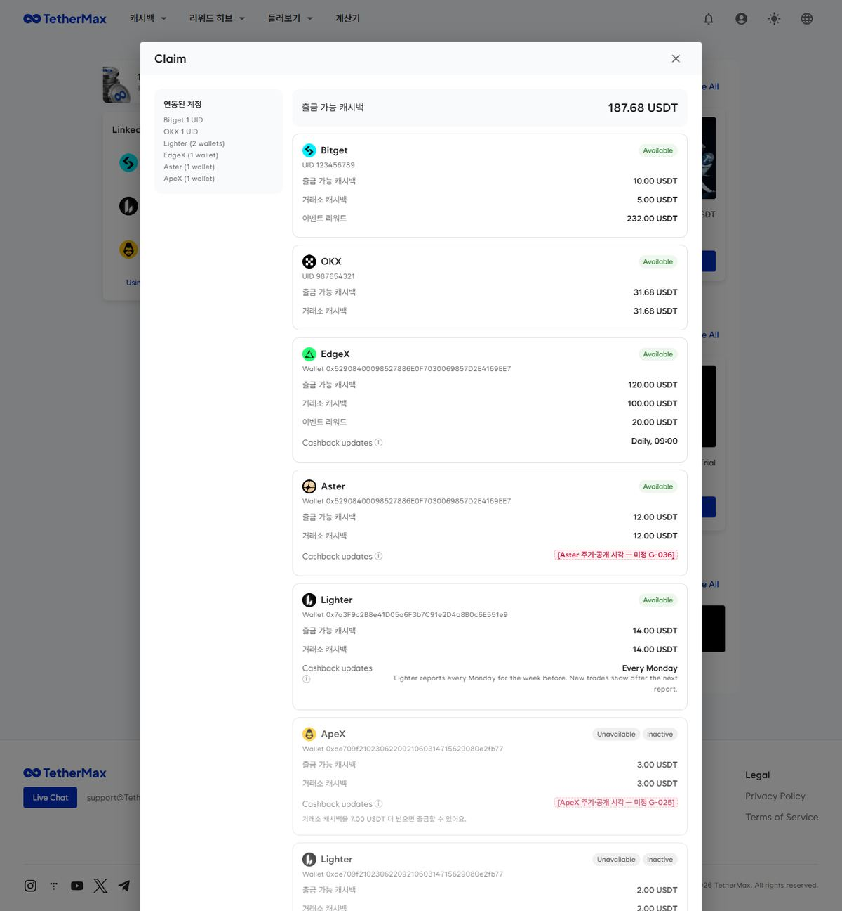

#### `wd.claim:pending` — 확인 중 계정은 목록에 없음

| 항목 | 내용 |
|---|---|
| 화면 | 출금 화면 (/withdrawal-apply) (`/withdrawal-apply`) |
| 기능 | FU-030 · FU-031 · FU-032 · FU-033 · FU-034 |
| 빠진 것 | (목록 제외만) |
| 가까운 Figma | 〃 |
| 보기 | PC |

#### `wd.second:normal` — 출금 가능 계정 없음 — STG 문구 + DEX 행

| 항목 | 내용 |
|---|---|
| 화면 | 두 번째 출금 화면 (/withdrawal) (`/withdrawal`) |
| 기능 | FU-036 |
| 빠진 것 | /withdrawal 화면 전체 |
| 가까운 Figma | 없음 |
| 보기 | PC |

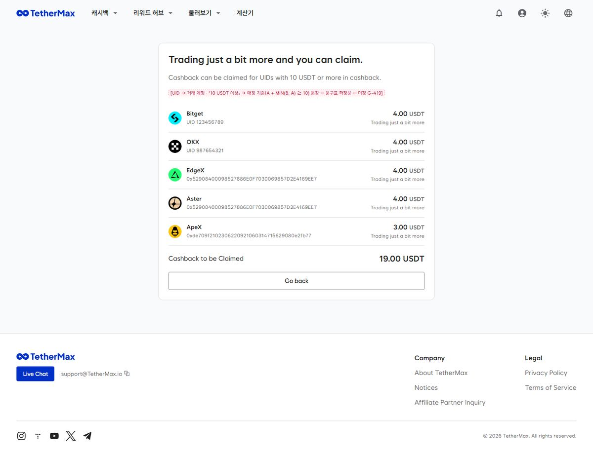

#### `wd.reflect:normal` — 지급 전

| 항목 | 내용 |
|---|---|
| 화면 | 선차감 · 복원 반영 위치 (`/ · /cashback-summary · 실시간 출금 피드`) |
| 기능 | FU-034 · FU-035 |
| 빠진 것 | 홈 · 캐시백 요약 · 피드 반영 위치 |
| 가까운 Figma | HW1 ([28960:126108](https://www.figma.com/design/hsa3bSV9QmFTe2jsf6tzTm/UI-UX-Design?node-id=28960-126108)) |
| 보기 | PC |

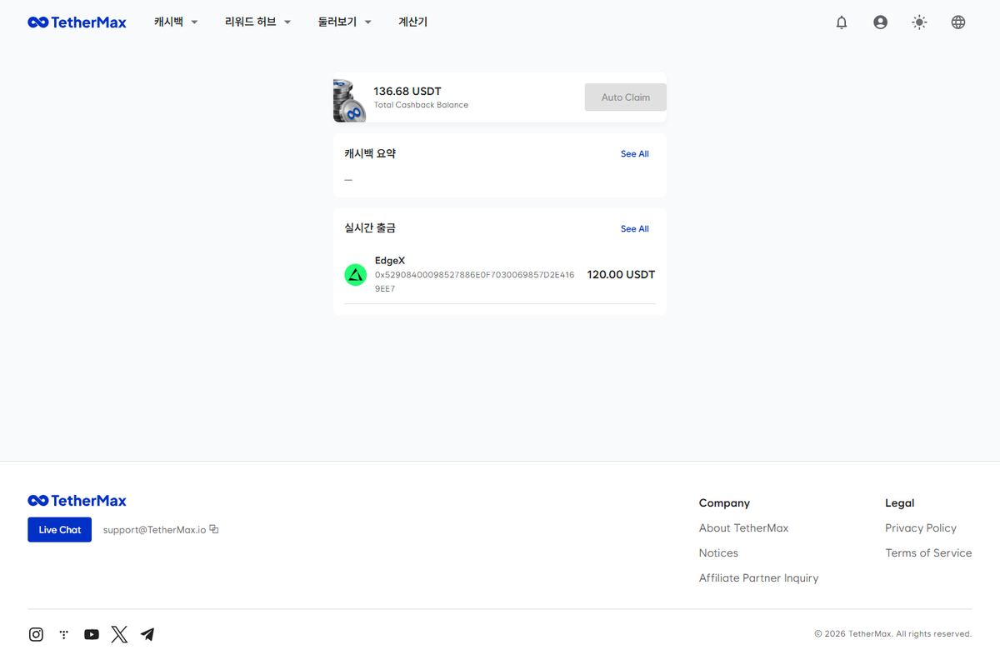

#### `wd.reflect:deducted` — 신청 생성 — 선차감 (같은 새로고침에 반영)

| 항목 | 내용 |
|---|---|
| 화면 | 선차감 · 복원 반영 위치 (`/ · /cashback-summary · 실시간 출금 피드`) |
| 기능 | FU-034 · FU-035 |
| 빠진 것 | 선차감 안내 문구 위치 |
| 가까운 Figma | 〃 |
| 보기 | PC |

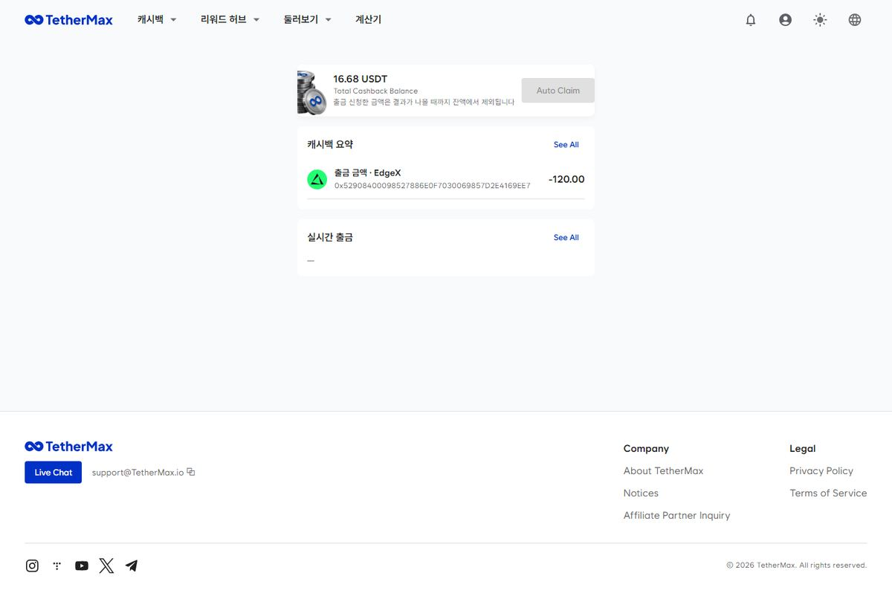

#### `wd.reflect:restored` — 최종 실패 — 복원

| 항목 | 내용 |
|---|---|
| 화면 | 선차감 · 복원 반영 위치 (`/ · /cashback-summary · 실시간 출금 피드`) |
| 기능 | FU-034 · FU-035 |
| 빠진 것 | Withdrawal returned 행 |
| 가까운 Figma | 〃 |
| 보기 | PC |

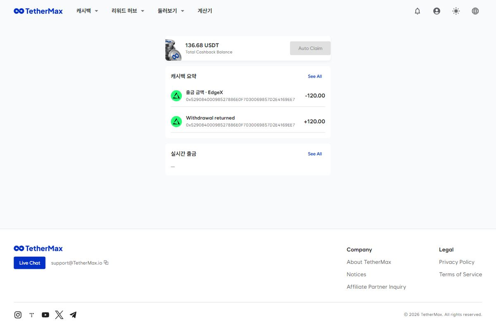

#### `my.main:normal` — 메뉴 목록 (LLM_wiki 기준)

| 항목 | 내용 |
|---|---|
| 화면 | 마이 (기존) (`mypage`) |
| 기능 | - |
| 빠진 것 | 마이 페이지 전체(기존 화면, LLM_wiki 메뉴 기준) |
| 가까운 Figma | 없음 |
| 보기 | PC |

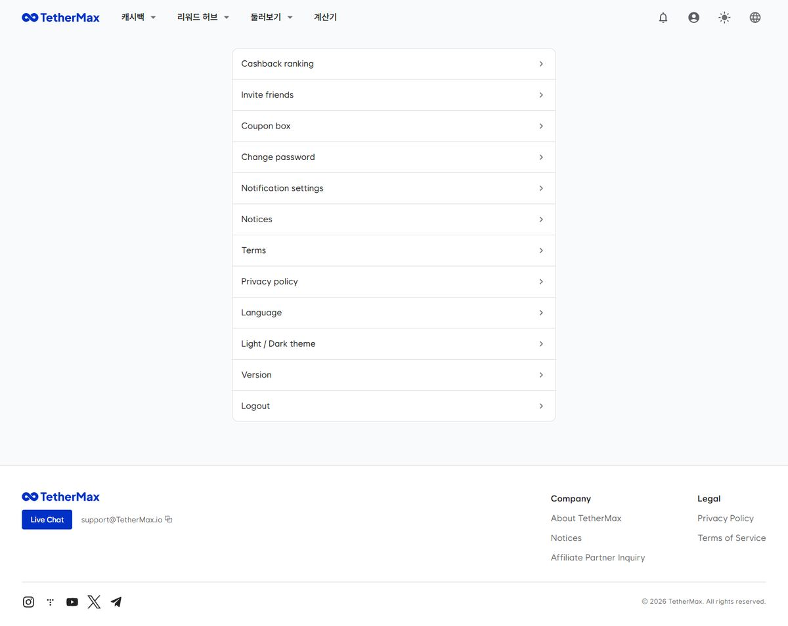

### 5. 거래 계정 연동

#### `link.select:all` — 칩 All — 웹 선택기 목록

| 항목 | 내용 |
|---|---|
| 화면 | 거래소 선택 (`/link (웹 꽉 찬 모달 · 앱 바텀시트)`) |
| 기능 | FU-013 |
| 빠진 것 | 웹 선택기의 검색 `Search partners` · `Popular partners` · 칩 3개 · 행 배지 |
| 가까운 Figma | S3-2 Link Account modal (live) ([28960:127765](https://www.figma.com/design/hsa3bSV9QmFTe2jsf6tzTm/UI-UX-Design?node-id=28960-127765)) · L1 ([28960:127271](https://www.figma.com/design/hsa3bSV9QmFTe2jsf6tzTm/UI-UX-Design?node-id=28960-127271)) |
| 보기 | PC |

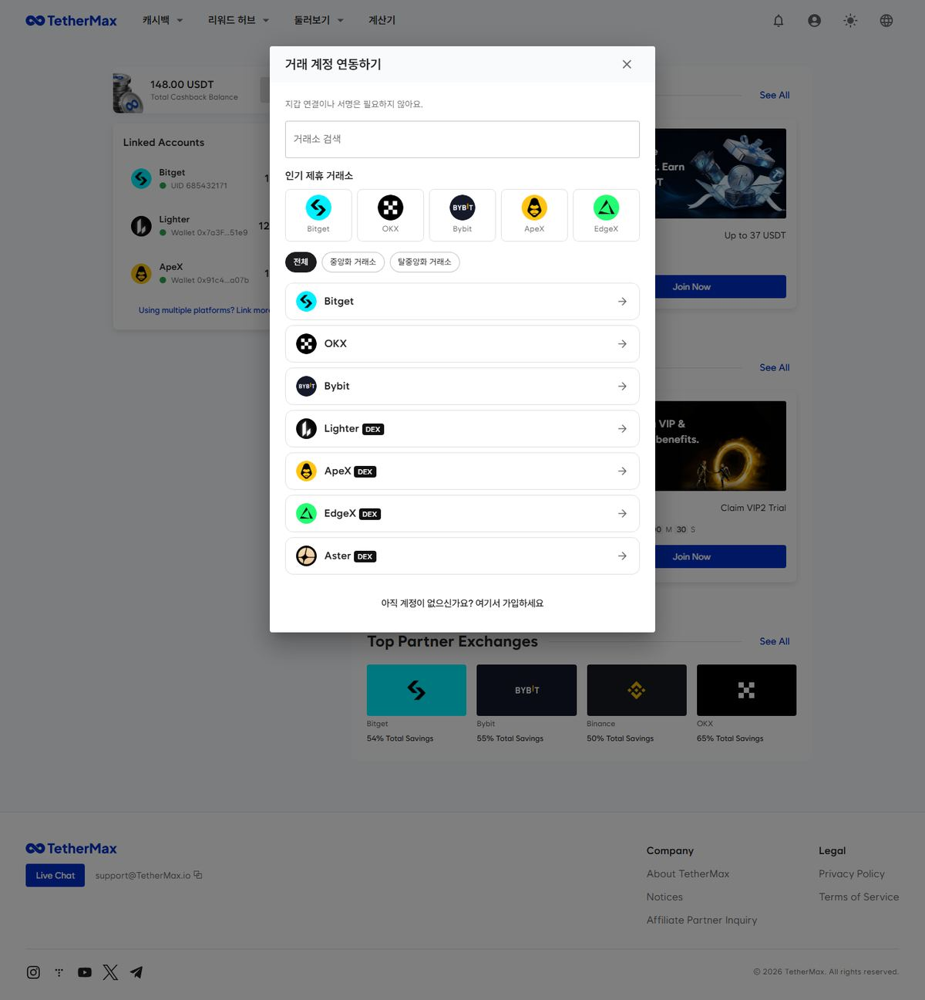

#### `link.select:dexbit` — DEX 칩에서 «bit» → 0건

| 항목 | 내용 |
|---|---|
| 화면 | 거래소 선택 (`/link (웹 꽉 찬 모달 · 앱 바텀시트)`) |
| 기능 | FU-013 |
| 빠진 것 | 웹·모바일 모두 「칩 안 검색 0건」 |
| 가까운 Figma | Link / DEX search no results ([29051:104597](https://www.figma.com/design/hsa3bSV9QmFTe2jsf6tzTm/UI-UX-Design?node-id=29051-104597), 모바일) |
| 보기 | PC |

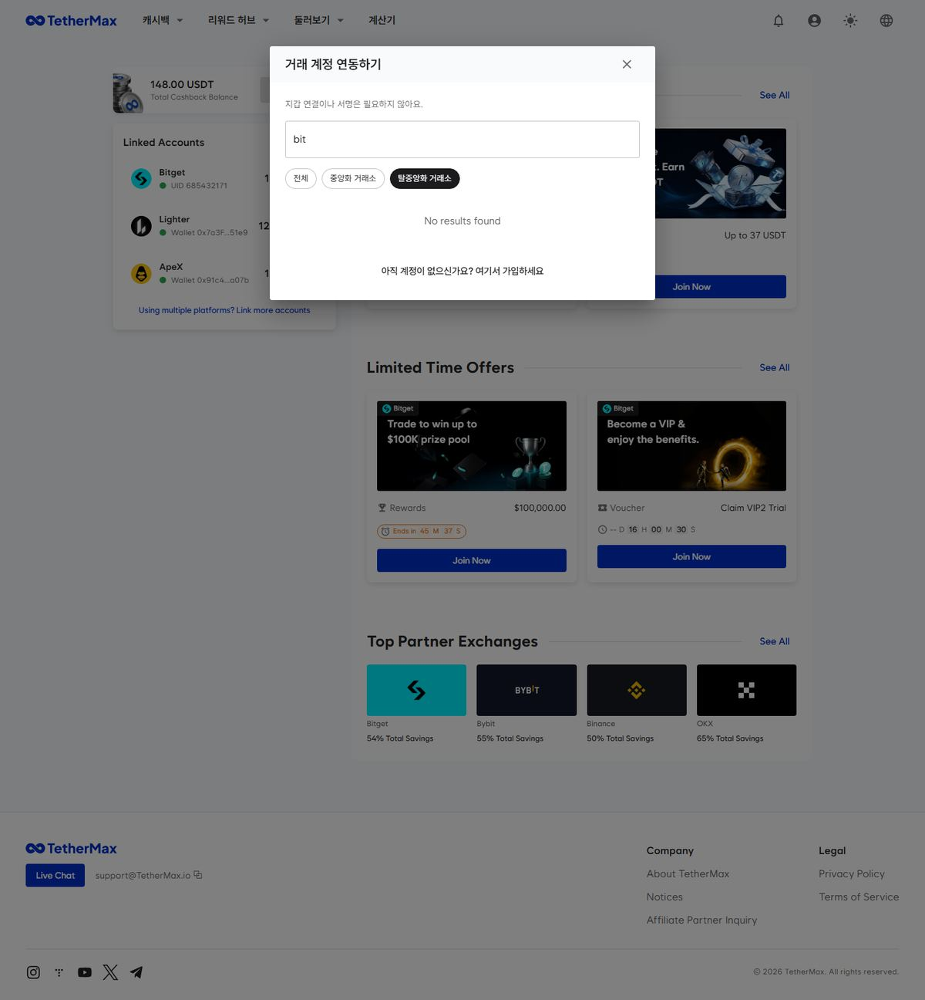

#### `link.select:region` — 지역 제한 DEX — 목록에서 제외

| 항목 | 내용 |
|---|---|
| 화면 | 거래소 선택 (`/link (웹 꽉 찬 모달 · 앱 바텀시트)`) |
| 기능 | FU-013 |
| 빠진 것 | 제외된 목록(G-161, 이유 표시 없음) |
| 가까운 Figma | L1 ([28960:127271](https://www.figma.com/design/hsa3bSV9QmFTe2jsf6tzTm/UI-UX-Design?node-id=28960-127271)) |
| 보기 | PC |

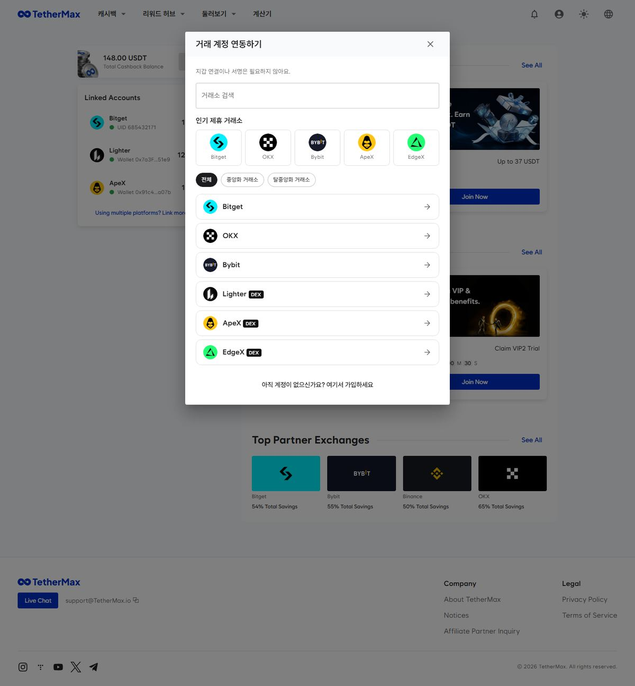

#### `link.select:fail` — 파트너 목록 로드 실패 (캐시 없음)

| 항목 | 내용 |
|---|---|
| 화면 | 거래소 선택 (`/link (웹 꽉 찬 모달 · 앱 바텀시트)`) |
| 기능 | FU-013 |
| 빠진 것 | 선택기 안 오류 + `Retry`(G-097) |
| 가까운 Figma | API 상태 보드 S5_05 `Partners couldn’t load` ([29002:128426](https://www.figma.com/design/hsa3bSV9QmFTe2jsf6tzTm/UI-UX-Design?node-id=29002-128426), 연동 섹션 밖) |
| 보기 | PC |

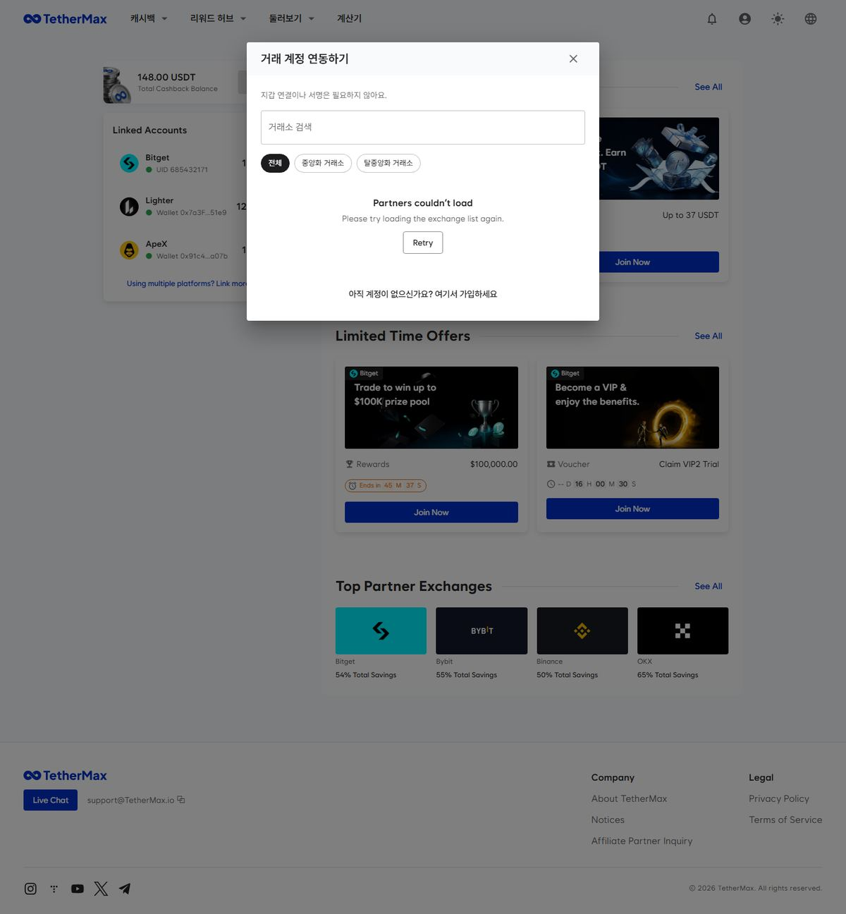

#### `link.select:intro` — STG 웹 진입 질문

| 항목 | 내용 |
|---|---|
| 화면 | 거래소 선택 (`/link (웹 꽉 찬 모달 · 앱 바텀시트)`) |
| 기능 | FU-013 |
| 빠진 것 | `/uidlinking` 첫 질문 화면 전체 |
| 가까운 Figma | — |
| 보기 | PC |

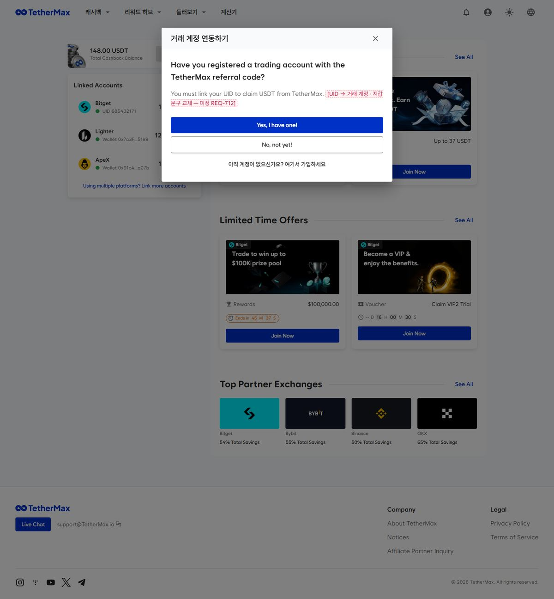

#### `link.addr:paste` — Paste 권한 거부

| 항목 | 내용 |
|---|---|
| 화면 | 지갑 주소 입력 (`/link (웹 꽉 찬 모달 · 앱 전체 화면)`) |
| 기능 | FU-015 · FU-016 |
| 빠진 것 | 직접 붙여넣기 힌트(문구도 미정 REQ-061) |
| 가까운 Figma | L2 ([28960:127275](https://www.figma.com/design/hsa3bSV9QmFTe2jsf6tzTm/UI-UX-Design?node-id=28960-127275)) |
| 보기 | PC |

#### `link.addr:kept` — 실패 후 주소 유지

| 항목 | 내용 |
|---|---|
| 화면 | 지갑 주소 입력 (`/link (웹 꽉 찬 모달 · 앱 전체 화면)`) |
| 기능 | FU-015 · FU-016 |
| 빠진 것 | 결과 화면에서 돌아온 상태(G-380) |
| 가까운 Figma | L3 ([28960:127279](https://www.figma.com/design/hsa3bSV9QmFTe2jsf6tzTm/UI-UX-Design?node-id=28960-127279)) |
| 보기 | PC |

#### `link.addr:hub` — 허브 진입 — 그 거래소 미리 선택

| 항목 | 내용 |
|---|---|
| 화면 | 지갑 주소 입력 (`/link (웹 꽉 찬 모달 · 앱 전체 화면)`) |
| 기능 | FU-015 · FU-016 |
| 빠진 것 | ApeX 선택 상태 · ApeX 지갑 주소 찾기 안내 문구·스크린샷 |
| 가까운 Figma | L2 ([28960:127275](https://www.figma.com/design/hsa3bSV9QmFTe2jsf6tzTm/UI-UX-Design?node-id=28960-127275)) |
| 보기 | PC |

#### `link.captcha:retry` — 퍼즐 실패·만료 — 주소 유지 재시도

| 항목 | 내용 |
|---|---|
| 화면 | 캡차 (`/link (모달)`) |
| 기능 | FU-017 |
| 빠진 것 | 연동 모달 안 인라인 오류 |
| 가까운 Figma | L5 ([28960:127287](https://www.figma.com/design/hsa3bSV9QmFTe2jsf6tzTm/UI-UX-Design?node-id=28960-127287)) · API 보드 S1_14 ([29002:126248](https://www.figma.com/design/hsa3bSV9QmFTe2jsf6tzTm/UI-UX-Design?node-id=29002-126248)) |
| 보기 | PC |

#### `link.captcha:scriptFail` — 캡차 스크립트 로드 실패 — Retry

| 항목 | 내용 |
|---|---|
| 화면 | 캡차 (`/link (모달)`) |
| 기능 | FU-017 |
| 빠진 것 | 연동 모달 안 인라인 오류 + `Retry` |
| 가까운 Figma | L5 ([28960:127287](https://www.figma.com/design/hsa3bSV9QmFTe2jsf6tzTm/UI-UX-Design?node-id=28960-127287)) · API 보드 S1_13 ([29002:126223](https://www.figma.com/design/hsa3bSV9QmFTe2jsf6tzTm/UI-UX-Design?node-id=29002-126223)) |
| 보기 | PC |

#### `link.done:apex` — ApeX — Daily (G-025 롤업 합의 전제)

| 항목 | 내용 |
|---|---|
| 화면 | 연동 성공 (`/link (전체 화면 모달)`) |
| 기능 | FU-023 · FU-025 |
| 빠진 것 | ApeX 정산 카드(배지 G-025 전제) |
| 가까운 Figma | L7 ([28960:127297](https://www.figma.com/design/hsa3bSV9QmFTe2jsf6tzTm/UI-UX-Design?node-id=28960-127297)) |
| 보기 | PC |

#### `link.done:weekly` — Lighter — Weekly

| 항목 | 내용 |
|---|---|
| 화면 | 연동 성공 (`/link (전체 화면 모달)`) |
| 기능 | FU-023 · FU-025 |
| 빠진 것 | Weekly 배지 · `Every Monday` 다음 업데이트 |
| 가까운 Figma | L7 ([28960:127297](https://www.figma.com/design/hsa3bSV9QmFTe2jsf6tzTm/UI-UX-Design?node-id=28960-127297)) |
| 보기 | PC |

#### `link.done:truncated` — 180일 넘는 기록 — Cashback shown from

| 항목 | 내용 |
|---|---|
| 화면 | 연동 성공 (`/link (전체 화면 모달)`) |
| 기능 | FU-023 · FU-025 |
| 빠진 것 | 성공 카드 안 안내 줄 |
| 가까운 Figma | L7 ([28960:127297](https://www.figma.com/design/hsa3bSV9QmFTe2jsf6tzTm/UI-UX-Design?node-id=28960-127297)) · API 보드 `Cashback history` |
| 보기 | PC |

#### `link.done:apexIdPending` — ApeX AccountID 미반환 — 회원에게는 연동 완료

| 항목 | 내용 |
|---|---|
| 화면 | 연동 성공 (`/link (전체 화면 모달)`) |
| 기능 | FU-023 · FU-025 |
| 빠진 것 | 없음(G-177로 일반 성공과 같음) — 확인용 상태 |
| 가까운 Figma | L7 ([28960:127297](https://www.figma.com/design/hsa3bSV9QmFTe2jsf6tzTm/UI-UX-Design?node-id=28960-127297)) |
| 보기 | PC |

#### `link.lguide:normal` — 필수 서술 4개 · 지갑 주소 찾기 예시 · Step 3 경고

| 항목 | 내용 |
|---|---|
| 화면 | Lighter 가이드 (보류) (`/exchange/lighter (가이드 영역)`) |
| 기능 | FU-016 · FU-025 |
| 빠진 것 | 필수 서술 4개 · Step 3 경고 문장(본문 안) |
| 가까운 Figma | D2 Step guide, step 3 ([28960:127444](https://www.figma.com/design/hsa3bSV9QmFTe2jsf6tzTm/UI-UX-Design?node-id=28960-127444), DEX 상세 담당) |
| 보기 | PC |

### 6. 소유권 인증

#### `own.inuse:normal` — Wallet Already in Use (O1)

| 항목 | 내용 |
|---|---|
| 화면 | 이미 사용 중 · 신청 불가(30일) (`/link (다이얼로그)`) |
| 기능 | FU-027 |
| 빠진 것 | 소유권 섹션에 O1 프레임 없음. PC·모바일 모두 V2.2 문구로 다이얼로그를 구성 |
| 가까운 Figma | 연동 결과 L9(연동 담당 `link.result` 계열) · 소유권 다이얼로그 컴포넌트 `DEX / Ownership dialog`([27559:190414](https://www.figma.com/design/hsa3bSV9QmFTe2jsf6tzTm/UI-UX-Design?node-id=27559-190414)) |
| 보기 | PC |

### 7. 캐시백 허브

#### `hub.main:dexPartial` — A=3 · B=8 — 일부만 출금

| 항목 | 내용 |
|---|---|
| 화면 | 캐시백 허브 (`/cashback-hub`) |
| 기능 | FU-045 · FU-046 · FU-047 · FU-048 |
| 빠진 것 | 이벤트 리워드 > 캐시백일 때의 「일부만 출금」 안내 줄과 그 배치 |
| 가까운 Figma | H5 [28960:126908](https://www.figma.com/design/hsa3bSV9QmFTe2jsf6tzTm/UI-UX-Design?node-id=28960-126908) |
| 보기 | PC |

#### `hub.main:dexBelowMin` — 최소액 미만 — 넛지

| 항목 | 내용 |
|---|---|
| 화면 | 캐시백 허브 (`/cashback-hub`) |
| 기능 | FU-045 · FU-046 · FU-047 · FU-048 |
| 빠진 것 | DEX 패널의 넛지(G-139 문구) · `Minimum 10 USDT` · 각주 배치 |
| 가까운 Figma | H4 [28960:126902](https://www.figma.com/design/hsa3bSV9QmFTe2jsf6tzTm/UI-UX-Design?node-id=28960-126902)(CEX 10 USDT 미만) |
| 보기 | PC |

#### `hub.main:dexLoading` — 패널 로딩

| 항목 | 내용 |
|---|---|
| 화면 | 캐시백 허브 (`/cashback-hub`) |
| 기능 | FU-045 · FU-046 · FU-047 · FU-048 |
| 빠진 것 | 로딩 스켈레톤 |
| 가까운 Figma | H5 [28960:126908](https://www.figma.com/design/hsa3bSV9QmFTe2jsf6tzTm/UI-UX-Design?node-id=28960-126908) |
| 보기 | PC |

#### `hub.main:dexMulti` — 같은 DEX 복수 지갑 +N

| 항목 | 내용 |
|---|---|
| 화면 | 캐시백 허브 (`/cashback-hub`) |
| 기능 | FU-045 · FU-046 · FU-047 · FU-048 |
| 빠진 것 | 지갑 주소 + `+N` 표시, 지갑별 자동 지급 포함/제외 안내 |
| 가까운 Figma | H5 [28960:126908](https://www.figma.com/design/hsa3bSV9QmFTe2jsf6tzTm/UI-UX-Design?node-id=28960-126908) |
| 보기 | PC |

#### `hub.main:aster` — Aster — USDT value at payout

| 항목 | 내용 |
|---|---|
| 화면 | 캐시백 허브 (`/cashback-hub`) |
| 기능 | FU-045 · FU-046 · FU-047 · FU-048 |
| 빠진 것 | Aster 패널(USDT 환산 표기 줄) |
| 가까운 Figma | H5 [28960:126908](https://www.figma.com/design/hsa3bSV9QmFTe2jsf6tzTm/UI-UX-Design?node-id=28960-126908)(H9·H10은 숨김 폐기안) |
| 보기 | PC |

#### `hub.main:totalClaimed` — Total claimed (G-053 유지)

| 항목 | 내용 |
|---|---|
| 화면 | 캐시백 허브 (`/cashback-hub`) |
| 기능 | FU-045 · FU-046 · FU-047 · FU-048 |
| 빠진 것 | `Total claimed` 줄 |
| 가까운 Figma | H5 [28960:126908](https://www.figma.com/design/hsa3bSV9QmFTe2jsf6tzTm/UI-UX-Design?node-id=28960-126908) |
| 보기 | PC |

#### `hub.main:rateFail` — 요율 서비스 실패

| 항목 | 내용 |
|---|---|
| 화면 | 캐시백 허브 (`/cashback-hub`) |
| 기능 | FU-045 · FU-046 · FU-047 · FU-048 |
| 빠진 것 | 계산기 자리의 `Estimate unavailable` + `Try again`(G-144) |
| 가까운 Figma | H1 [28960:126884](https://www.figma.com/design/hsa3bSV9QmFTe2jsf6tzTm/UI-UX-Design?node-id=28960-126884) |
| 보기 | PC |

#### `hub.main:lighterAccruing` — Lighter 주중 「집계 전」 (G-100)

| 항목 | 내용 |
|---|---|
| 화면 | 캐시백 허브 (`/cashback-hub`) |
| 기능 | FU-045 · FU-046 · FU-047 · FU-048 |
| 빠진 것 | 주중 「집계 전」 표시 자리와 영문 문구. H5의 `Accruing this week (estimate)` 추정 줄은 G-100으로 쓰지 않음 |
| 가까운 Figma | H5 [28960:126908](https://www.figma.com/design/hsa3bSV9QmFTe2jsf6tzTm/UI-UX-Design?node-id=28960-126908) |
| 보기 | PC |

#### `hub.main:cards` — 비교표 카드 뷰 (평점 생략)

| 항목 | 내용 |
|---|---|
| 화면 | 캐시백 허브 (`/cashback-hub`) |
| 기능 | FU-045 · FU-046 · FU-047 · FU-048 |
| 빠진 것 | 웹 카드 뷰 레이아웃 |
| 가까운 Figma | H1 [28960:126884](https://www.figma.com/design/hsa3bSV9QmFTe2jsf6tzTm/UI-UX-Design?node-id=28960-126884) 비교표 · 모바일 H1 [28960:130794](https://www.figma.com/design/hsa3bSV9QmFTe2jsf6tzTm/UI-UX-Design?node-id=28960-130794) 카드 |
| 보기 | PC |

#### `hub.main:emptySearch` — 비교표 빈 검색

| 항목 | 내용 |
|---|---|
| 화면 | 캐시백 허브 (`/cashback-hub`) |
| 기능 | FU-045 · FU-046 · FU-047 · FU-048 |
| 빠진 것 | 빈 결과 상태(`No exchanges match your search`)와 검색어 지우기 버튼 영문 |
| 가까운 Figma | H1 [28960:126884](https://www.figma.com/design/hsa3bSV9QmFTe2jsf6tzTm/UI-UX-Design?node-id=28960-126884) 비교표 |
| 보기 | PC |

### 8. DEX 개요 · 상세

#### `dex.overview:defiStale` — DefiLlama 실패 — 마지막 캐시값 + 기준 시각

| 항목 | 내용 |
|---|---|
| 화면 | DEX 개요 (랜딩) (`/dex`) |
| 기능 | FU-049 · FU-050 · FU-051 · FU-052 · FU-053 |
| 빠진 것 | 캐시값 표시 중임을 알리는 `Source: DefiLlama, as of {time}.` 줄의 위치·스타일 |
| 가까운 Figma | OA DEX overview, keys concept ([28960:125521](https://www.figma.com/design/hsa3bSV9QmFTe2jsf6tzTm/UI-UX-Design?node-id=28960-125521)) |
| 보기 | PC |

#### `dex.overview:defiHidden` — DefiLlama 24시간 넘게 실패 — 숨김

| 항목 | 내용 |
|---|---|
| 화면 | DEX 개요 (랜딩) (`/dex`) |
| 기능 | FU-049 · FU-050 · FU-051 · FU-052 · FU-053 |
| 빠진 것 | TVL·24H Vol 칸이 빠진 venue 카드(2칸) 레이아웃, glance 서브라인 없는 머리 |
| 가까운 Figma | [28960:125521](https://www.figma.com/design/hsa3bSV9QmFTe2jsf6tzTm/UI-UX-Design?node-id=28960-125521) |
| 보기 | PC |

#### `dex.overview:noBanner` — 게시 배너 없음 — 렌더 안 함 (G-156 답변 대기)

| 항목 | 내용 |
|---|---|
| 화면 | DEX 개요 (랜딩) (`/dex`) |
| 기능 | FU-049 · FU-050 · FU-051 · FU-052 · FU-053 |
| 빠진 것 | 배너가 빠졌을 때 glance → venue 사이 간격 |
| 가까운 Figma | [28960:125521](https://www.figma.com/design/hsa3bSV9QmFTe2jsf6tzTm/UI-UX-Design?node-id=28960-125521) |
| 보기 | PC |

#### `dex.overview:empty` — 노출 DEX 0개 — 영역 숨김 (G-160)

| 항목 | 내용 |
|---|---|
| 화면 | DEX 개요 (랜딩) (`/dex`) |
| 기능 | FU-049 · FU-050 · FU-051 · FU-052 · FU-053 |
| 빠진 것 | glance·배너·venue가 없는 페이지, 히어로 마크 줄·숫자 줄 처리 |
| 가까운 Figma | [28960:125521](https://www.figma.com/design/hsa3bSV9QmFTe2jsf6tzTm/UI-UX-Design?node-id=28960-125521) |
| 보기 | PC |

#### `dex.overview:maint` — 특정 DEX 점검·일시 연동 불가 (G-162)

| 항목 | 내용 |
|---|---|
| 화면 | DEX 개요 (랜딩) (`/dex`) |
| 기능 | FU-049 · FU-050 · FU-051 · FU-052 · FU-053 |
| 빠진 것 | 점검 중 표식이 필요한지(현재 G-162에 따라 카드 변화 없음) |
| 가까운 Figma | [28960:125521](https://www.figma.com/design/hsa3bSV9QmFTe2jsf6tzTm/UI-UX-Design?node-id=28960-125521) |
| 보기 | PC |

#### `dex.detail:maker` — Maker 토글

| 항목 | 내용 |
|---|---|
| 화면 | DEX 상세 (공용 템플릿) (`/dex/{slug}`) |
| 기능 | FU-054 · FU-055 · FU-056 · FU-057 · FU-058 · FU-059 |
| 빠진 것 | Maker 선택 시 오퍼 박스 단계 표(`Final Maker` 열)·계산기 |
| 가까운 Figma | D4 EdgeX key features ([28960:127454](https://www.figma.com/design/hsa3bSV9QmFTe2jsf6tzTm/UI-UX-Design?node-id=28960-127454)) |
| 보기 | PC |

#### `dex.detail:drawer` — How this works 드로어

| 항목 | 내용 |
|---|---|
| 화면 | DEX 상세 (공용 템플릿) (`/dex/{slug}`) |
| 기능 | FU-054 · FU-055 · FU-056 · FU-057 · FU-058 · FU-059 |
| 빠진 것 | 드로어 자체(웹 우측 드로어 / 모바일 시트) |
| 가까운 Figma | [28960:127454](https://www.figma.com/design/hsa3bSV9QmFTe2jsf6tzTm/UI-UX-Design?node-id=28960-127454) 계산기 `How this works` 링크 |
| 보기 | PC |

#### `dex.detail:mediaFail` — 가이드 미디어 실패

| 항목 | 내용 |
|---|---|
| 화면 | DEX 상세 (공용 템플릿) (`/dex/{slug}`) |
| 기능 | FU-054 · FU-055 · FU-056 · FU-057 · FU-058 · FU-059 |
| 빠진 것 | 정지 첫 프레임 + 단계 글 |
| 가까운 Figma | D1 step panel ([28960:127443](https://www.figma.com/design/hsa3bSV9QmFTe2jsf6tzTm/UI-UX-Design?node-id=28960-127443)) |
| 보기 | PC |

#### `dex.detail:moderation` — 리뷰 검토 중

| 항목 | 내용 |
|---|---|
| 화면 | DEX 상세 (공용 템플릿) (`/dex/{slug}`) |
| 기능 | FU-054 · FU-055 · FU-056 · FU-057 · FU-058 · FU-059 |
| 빠진 것 | 제목·본문 숨긴 검토 중 리뷰 카드 |
| 가까운 Figma | D3 FAQ, reviews and terms ([28960:127445](https://www.figma.com/design/hsa3bSV9QmFTe2jsf6tzTm/UI-UX-Design?node-id=28960-127445)) |
| 보기 | PC |

#### `dex.detail:reviewsEmpty` — 리뷰 없음 (G-169)

| 항목 | 내용 |
|---|---|
| 화면 | DEX 상세 (공용 템플릿) (`/dex/{slug}`) |
| 기능 | FU-054 · FU-055 · FU-056 · FU-057 · FU-058 · FU-059 |
| 빠진 것 | 요약·히스토그램 숨긴 빈 상태 `No reviews yet` |
| 가까운 Figma | [28960:127445](https://www.figma.com/design/hsa3bSV9QmFTe2jsf6tzTm/UI-UX-Design?node-id=28960-127445) |
| 보기 | PC |

#### `dex.detail:offboarded` — DEX 오프보딩 — 랜딩 리다이렉트

| 항목 | 내용 |
|---|---|
| 화면 | DEX 상세 (공용 템플릿) (`/dex/{slug}`) |
| 기능 | FU-054 · FU-055 · FU-056 · FU-057 · FU-058 · FU-059 |
| 빠진 것 | 리다이렉트 후 안내 여부(현재 랜딩 그대로) |
| 가까운 Figma | — (리다이렉트라 화면 없음) |
| 보기 | PC |

### 9. 계산기 (/payback)

#### `calc.p1:noUsers` — 사용자 수 없음 — 카드 숨김

| 항목 | 내용 |
|---|---|
| 화면 | P1 Landing (`/payback`) |
| 기능 | FU-081 |
| 빠진 것 | 카드 없는 랜딩(간격 처리) |
| 가까운 Figma | P1 Landing ([7260:88375](https://www.figma.com/design/hsa3bSV9QmFTe2jsf6tzTm/UI-UX-Design?node-id=7260-88375)) |
| 보기 | PC |

#### `calc.p2:none` — 미선택 — Next 비활성

| 항목 | 내용 |
|---|---|
| 화면 | P2 Choose platform (`/payback`) |
| 기능 | FU-081 |
| 빠진 것 | 선택 없는 그리드 + 비활성 `Next` |
| 가까운 Figma | 계산기 · 계산 과정 ([29064:934](https://www.figma.com/design/hsa3bSV9QmFTe2jsf6tzTm/UI-UX-Design?node-id=29064-934)) · MAXOP-405 ([17996:179541](https://www.figma.com/design/hsa3bSV9QmFTe2jsf6tzTm/UI-UX-Design?node-id=17996-179541)) |
| 보기 | PC |

#### `calc.p3:normal` — 카드 4장 — 빈도 선택됨

| 항목 | 내용 |
|---|---|
| 화면 | P3 Trading profile (`/payback`) |
| 기능 | FU-081 |
| 빠진 것 | 빈도 카드 선택 스타일 · 활성 `Check Results` |
| 가까운 Figma | Trading profile ([6510:88401](https://www.figma.com/design/hsa3bSV9QmFTe2jsf6tzTm/UI-UX-Design?node-id=6510-88401), 빈도 미선택) |
| 보기 | PC |

#### `calc.p4:normal` — DEX(EdgeX) — Did you know 숨김

| 항목 | 내용 |
|---|---|
| 화면 | P4 What You're Missing Out On (`/payback`) |
| 기능 | FU-082 |
| 빠진 것 | DEX 결과(카드 없는 배치) |
| 가까운 Figma | What You're Missing Out On ([6922:77328](https://www.figma.com/design/hsa3bSV9QmFTe2jsf6tzTm/UI-UX-Design?node-id=6922-77328), Bitget) |
| 보기 | PC |

#### `calc.p5:normal` — EdgeX — Daily

| 항목 | 내용 |
|---|---|
| 화면 | P5 Summary (`/payback`) |
| 기능 | FU-082 |
| 빠진 것 | DEX Summary(로고 · 각주) |
| 가까운 Figma | Summary ([6510:89041](https://www.figma.com/design/hsa3bSV9QmFTe2jsf6tzTm/UI-UX-Design?node-id=6510-89041), Bitget) |
| 보기 | PC |

#### `calc.p5:aster` — Aster 각주

| 항목 | 내용 |
|---|---|
| 화면 | P5 Summary (`/payback`) |
| 기능 | FU-082 |
| 빠진 것 | Aster 각주 |
| 가까운 Figma | Summary ([6510:89041](https://www.figma.com/design/hsa3bSV9QmFTe2jsf6tzTm/UI-UX-Design?node-id=6510-89041)) |
| 보기 | PC |

#### `calc.p5:apex` — ApeX — 표기 G-025 대기

| 항목 | 내용 |
|---|---|
| 화면 | P5 Summary (`/payback`) |
| 기능 | FU-082 |
| 빠진 것 | ApeX Schedule·Payout Time 표기(G-025 합의 시 `Daily`) |
| 가까운 Figma | Summary ([6510:89041](https://www.figma.com/design/hsa3bSV9QmFTe2jsf6tzTm/UI-UX-Design?node-id=6510-89041)) |
| 보기 | PC |

#### `calc.p5:lighter` — Lighter Weekly · Every Monday (온보딩 후)

| 항목 | 내용 |
|---|---|
| 화면 | P5 Summary (`/payback`) |
| 기능 | FU-082 |
| 빠진 것 | Weekly 표기 · Lighter Premium 플랫폼 줄 |
| 가까운 Figma | Summary ([6510:89041](https://www.figma.com/design/hsa3bSV9QmFTe2jsf6tzTm/UI-UX-Design?node-id=6510-89041)) |
| 보기 | PC |

### 10. 캐시백 요약 · 랭킹

#### `summary.main:dexRange` — 거래소 범위 DEX 전체

| 항목 | 내용 |
|---|---|
| 화면 | 캐시백 요약 (`/cashback-summary`) |
| 기능 | FU-060 · FU-061 · FU-062 |
| 빠진 것 | 거래소 드롭다운 펼침(범위 전체/CEX 전체/DEX 전체 + CEX·DEX 그룹, `Bitget (2 UIDs)`·`Aster (2 지갑)` 행) |
| 가까운 Figma | CS6 Filter dropdowns `<Select>` ([28960:127164](https://www.figma.com/design/hsa3bSV9QmFTe2jsf6tzTm/UI-UX-Design?node-id=28960-127164)) |
| 보기 | PC |

#### `summary.main:pending` — DEX data pending — 0 아님

| 항목 | 내용 |
|---|---|
| 화면 | 캐시백 요약 (`/cashback-summary`) |
| 기능 | FU-060 · FU-061 · FU-062 |
| 빠진 것 | 그날을 선택했을 때 일별 목록의 `DEX data pending` 행(금액 `—`) |
| 가까운 Figma | CS1 Month view ([28960:127133](https://www.figma.com/design/hsa3bSV9QmFTe2jsf6tzTm/UI-UX-Design?node-id=28960-127133)) — 25일 칸 라벨만 있음 |
| 보기 | PC |

#### `summary.main:returned` — Withdrawal returned 행

| 항목 | 내용 |
|---|---|
| 화면 | 캐시백 요약 (`/cashback-summary`) |
| 기능 | FU-060 · FU-061 · FU-062 |
| 빠진 것 | `Withdrawal returned` `+` 부호 행(G-113) |
| 가까운 Figma | CS1 ([28960:127133](https://www.figma.com/design/hsa3bSV9QmFTe2jsf6tzTm/UI-UX-Design?node-id=28960-127133)) |
| 보기 | PC |

#### `summary.main:lighter` — Lighter Credited · Withheld (온보딩 후)

| 항목 | 내용 |
|---|---|
| 화면 | 캐시백 요약 (`/cashback-summary`) |
| 기능 | FU-060 · FU-061 · FU-062 |
| 빠진 것 | Credited/Withheld 행 표기, Withheld 합계 제외 표시(G-059·G-181) |
| 가까운 Figma | CS1 ([28960:127133](https://www.figma.com/design/hsa3bSV9QmFTe2jsf6tzTm/UI-UX-Design?node-id=28960-127133)) |
| 보기 | PC |

#### `summary.main:oneEmpty` — 계정 1개 선택 빈 상태

| 항목 | 내용 |
|---|---|
| 화면 | 캐시백 요약 (`/cashback-summary`) |
| 기능 | FU-060 · FU-061 · FU-062 |
| 빠진 것 | 계정 선택 상태의 셀렉트 + 빈 문구 `No cashback activity for this account yet.`(G-180) |
| 가까운 Figma | CS5 Empty month ([28960:127157](https://www.figma.com/design/hsa3bSV9QmFTe2jsf6tzTm/UI-UX-Design?node-id=28960-127157)) |
| 보기 | PC |

#### `summary.main:delayed` — 데이터 지연 (허브 H6과 같음)

| 항목 | 내용 |
|---|---|
| 화면 | 캐시백 요약 (`/cashback-summary`) |
| 기능 | FU-060 · FU-061 · FU-062 |
| 빠진 것 | 요약 화면의 지연 배너 위치·문구 |
| 가까운 Figma | Hub H6 DEX data delayed ([28960:126914](https://www.figma.com/design/hsa3bSV9QmFTe2jsf6tzTm/UI-UX-Design?node-id=28960-126914)) |
| 보기 | PC |

#### `summary.main:old` — 180일 넘은 달

| 항목 | 내용 |
|---|---|
| 화면 | 캐시백 요약 (`/cashback-summary`) |
| 기능 | FU-060 · FU-061 · FU-062 |
| 빠진 것 | 오래된 달 안내 문구 위치 |
| 가까운 Figma | CS1 ([28960:127133](https://www.figma.com/design/hsa3bSV9QmFTe2jsf6tzTm/UI-UX-Design?node-id=28960-127133)) |
| 보기 | PC |

#### `ranking.main:board` — 월간 순위표 CEX+DEX 한 목록

| 항목 | 내용 |
|---|---|
| 화면 | 캐시백 랭킹 (`/benefits (My Cashback Ranking 패널)`) |
| 기능 | FU-063 |
| 빠진 것 | 순위표 페이지 전체(표 · 0.01 USDT 하한 안내 · `Monthly Top … Rewards` 박스) |
| 가까운 Figma | RK2 Ranking, ranked ([28960:127207](https://www.figma.com/design/hsa3bSV9QmFTe2jsf6tzTm/UI-UX-Design?node-id=28960-127207)) — 사이드 패널만 |
| 보기 | PC |

#### `ranking.main:dex` — 순위표 DEX 칩

| 항목 | 내용 |
|---|---|
| 화면 | 캐시백 랭킹 (`/benefits (My Cashback Ranking 패널)`) |
| 기능 | FU-063 |
| 빠진 것 | 전체/CEX/DEX 칩과 DEX만 남은 순위표 |
| 가까운 Figma | RK2 ([28960:127207](https://www.figma.com/design/hsa3bSV9QmFTe2jsf6tzTm/UI-UX-Design?node-id=28960-127207)) |
| 보기 | PC |

### 11. 친구 초대 · 파트너 허브

#### `invite.main:terms` — 약관 bullet 펼침

| 항목 | 내용 |
|---|---|
| 화면 | 친구 초대 (`/point/invite`) |
| 기능 | FU-077 · FU-078 · FU-079 |
| 빠진 것 | 모바일 약관 아코디언 펼친 상태(PC는 IF1처럼 항상 펼침) |
| 가까운 Figma | 친구 초대 · 모바일 ([29065:6175](https://www.figma.com/design/hsa3bSV9QmFTe2jsf6tzTm/UI-UX-Design?node-id=29065-6175)) — 아코디언 접힘 |
| 보기 | PC |

#### `invite.main:below50` — 50 USDT 미만

| 항목 | 내용 |
|---|---|
| 화면 | 친구 초대 (`/point/invite`) |
| 기능 | FU-077 · FU-078 · FU-079 |
| 빠진 것 | 49.99 USDT 등 50 미만일 때의 안내 문구(`Just {amount} USDT more…`를 Claim 용어로 재작성, G-419 문구 미확정) |
| 가까운 Figma | IF7 Invitation Reward tab ([28967:127210](https://www.figma.com/design/hsa3bSV9QmFTe2jsf6tzTm/UI-UX-Design?node-id=28967-127210)) |
| 보기 | PC |

### 12. 리워드 (맥스보드·리그·쿠폰·혜택·이벤트·TP)

#### `maxboard.main:normal` — 참여 중 — 하루 한 번 업데이트돼요

| 항목 | 내용 |
|---|---|
| 화면 | 맥스보드 (DEX 보드) (`/benefits/{benefitNo} (MAX BOARD)`) |
| 기능 | FU-065 · FU-066 · FU-067 · FU-068 · FU-069 |
| 빠진 것 | 지연 안내 없는 참여 중 화면 |
| 가까운 Figma | 맥스보드 · 정산 지연 ([29062:111741](https://www.figma.com/design/hsa3bSV9QmFTe2jsf6tzTm/UI-UX-Design?node-id=29062-111741)) |
| 보기 | PC |

#### `maxboard.main:today` — 참여 중 · 오늘 마감

| 항목 | 내용 |
|---|---|
| 화면 | 맥스보드 (DEX 보드) (`/benefits/{benefitNo} (MAX BOARD)`) |
| 기능 | FU-065 · FU-066 · FU-067 · FU-068 · FU-069 |
| 빠진 것 | `Ends Today` 마감 표기 |
| 가까운 Figma | 정산 지연 ([29062:111741](https://www.figma.com/design/hsa3bSV9QmFTe2jsf6tzTm/UI-UX-Design?node-id=29062-111741)) |
| 보기 | PC |

#### `maxboard.main:final` — 마지막 날 Batch 후 완성

| 항목 | 내용 |
|---|---|
| 화면 | 맥스보드 (DEX 보드) (`/benefits/{benefitNo} (MAX BOARD)`) |
| 기능 | FU-065 · FU-066 · FU-067 · FU-068 · FU-069 |
| 빠진 것 | `최종 순위는 결과 발표 때…` 안내 위치 · 영문 원문 |
| 가까운 Figma | 보드 완성 ([29064:10322](https://www.figma.com/design/hsa3bSV9QmFTe2jsf6tzTm/UI-UX-Design?node-id=29064-10322)) |
| 보기 | PC |

#### `maxboard.main:confirm` — 새 지갑 재선택 확인 팝업

| 항목 | 내용 |
|---|---|
| 화면 | 맥스보드 (DEX 보드) (`/benefits/{benefitNo} (MAX BOARD)`) |
| 기능 | FU-065 · FU-066 · FU-067 · FU-068 · FU-069 |
| 빠진 것 | 확인 팝업 전체 |
| 가까운 Figma | 참여 지갑 해제 · 재선택 가능 ([29064:8888](https://www.figma.com/design/hsa3bSV9QmFTe2jsf6tzTm/UI-UX-Design?node-id=29064-8888)) |
| 보기 | PC |

#### `maxboard.main:failToast` — 등록 실패 토스트

| 항목 | 내용 |
|---|---|
| 화면 | 맥스보드 (DEX 보드) (`/benefits/{benefitNo} (MAX BOARD)`) |
| 기능 | FU-065 · FU-066 · FU-067 · FU-068 · FU-069 |
| 빠진 것 | 토스트 |
| 가까운 Figma | 참여 가능 ([29062:111024](https://www.figma.com/design/hsa3bSV9QmFTe2jsf6tzTm/UI-UX-Design?node-id=29062-111024)) |
| 보기 | PC |

#### `coupon.box:empty` — 쿠폰 없음

| 항목 | 내용 |
|---|---|
| 화면 | 쿠폰함 (`/coupon`) |
| 기능 | FU-070 |
| 빠진 것 | 빈 상태 |
| 가까운 Figma | 쿠폰 · 사용할 계정 선택 배경 목록 ([29062:117713](https://www.figma.com/design/hsa3bSV9QmFTe2jsf6tzTm/UI-UX-Design?node-id=29062-117713)) |
| 보기 | PC |

#### `coupon.box:emptyDone` — Completed 비어 있음

| 항목 | 내용 |
|---|---|
| 화면 | 쿠폰함 (`/coupon`) |
| 기능 | FU-070 |
| 빠진 것 | 빈 상태 |
| 가까운 Figma | 쿠폰 · 사용 / 만료 이력 ([29062:115768](https://www.figma.com/design/hsa3bSV9QmFTe2jsf6tzTm/UI-UX-Design?node-id=29062-115768)) |
| 보기 | PC |

#### `coupon.box:picker1` — 계정 1개

| 항목 | 내용 |
|---|---|
| 화면 | 쿠폰함 (`/coupon`) |
| 기능 | FU-070 |
| 빠진 것 | 1개 분기 |
| 가까운 Figma | 쿠폰 · 사용할 계정 선택 ([29062:117713](https://www.figma.com/design/hsa3bSV9QmFTe2jsf6tzTm/UI-UX-Design?node-id=29062-117713)) |
| 보기 | PC |

#### `coupon.box:picker6` — 계정 5개 초과 · Deactivated

| 항목 | 내용 |
|---|---|
| 화면 | 쿠폰함 (`/coupon`) |
| 기능 | FU-070 |
| 빠진 것 | 5개 초과 분기(스크롤) · Deactivated 행 |
| 가까운 Figma | 쿠폰 · 사용할 계정 선택 ([29062:117713](https://www.figma.com/design/hsa3bSV9QmFTe2jsf6tzTm/UI-UX-Design?node-id=29062-117713)) |
| 보기 | PC |

#### `coupon.box:unable` — 사용 불가

| 항목 | 내용 |
|---|---|
| 화면 | 쿠폰함 (`/coupon`) |
| 기능 | FU-070 |
| 빠진 것 | 사용 불가 다이얼로그 |
| 가까운 Figma | 쿠폰 적용 완료 ([29065:7079](https://www.figma.com/design/hsa3bSV9QmFTe2jsf6tzTm/UI-UX-Design?node-id=29065-7079)) |
| 보기 | PC |

#### `coupon.box:noAccount` — 연동 계정 없음

| 항목 | 내용 |
|---|---|
| 화면 | 쿠폰함 (`/coupon`) |
| 기능 | FU-070 |
| 빠진 것 | 안내 다이얼로그 · 안내 문구(G-196 문구 원문 없음) |
| 가까운 Figma | — |
| 보기 | PC |

#### `league.main:normal` — 팀 리더보드

| 항목 | 내용 |
|---|---|
| 화면 | 글로벌 리그 (`/global-league`) |
| 기능 | FU-064 |
| 빠진 것 | 글로벌 리그 페이지 전체 |
| 가까운 Figma | — |
| 보기 | PC |

#### `league.main:create` — 팀 생성 자격 (CEX + DEX 합산)

| 항목 | 내용 |
|---|---|
| 화면 | 글로벌 리그 (`/global-league`) |
| 기능 | FU-064 |
| 빠진 것 | 자격 안내 다이얼로그 · 영문 원문 |
| 가까운 Figma | 리그 · 팀 생성 계정 선택 ([29062:110959](https://www.figma.com/design/hsa3bSV9QmFTe2jsf6tzTm/UI-UX-Design?node-id=29062-110959)) |
| 보기 | PC |

#### `league.main:picker` — 참가 계정 선택 — DEX 지갑 포함

| 항목 | 내용 |
|---|---|
| 화면 | 글로벌 리그 (`/global-league`) |
| 기능 | FU-064 |
| 빠진 것 | CEX/DEX 그룹 참가 계정 모달 |
| 가까운 Figma | 리그 · 팀 생성 계정 선택 ([29062:110959](https://www.figma.com/design/hsa3bSV9QmFTe2jsf6tzTm/UI-UX-Design?node-id=29062-110959)) |
| 보기 | PC |

#### `league.main:reward` — 상금 수령 계정

| 항목 | 내용 |
|---|---|
| 화면 | 글로벌 리그 (`/global-league`) |
| 기능 | FU-064 |
| 빠진 것 | 수령 계정 모달(G-187: 참가 계정과 동일) |
| 가까운 Figma | 리그 · 팀 생성 계정 선택 ([29062:110959](https://www.figma.com/design/hsa3bSV9QmFTe2jsf6tzTm/UI-UX-Design?node-id=29062-110959)) |
| 보기 | PC |

#### `league.main:dexOnly` — DEX 지갑만 연동한 회원

| 항목 | 내용 |
|---|---|
| 화면 | 글로벌 리그 (`/global-league`) |
| 기능 | FU-064 |
| 빠진 것 | DEX만 있는 목록 |
| 가까운 Figma | 리그 · 팀 생성 계정 선택 ([29062:110959](https://www.figma.com/design/hsa3bSV9QmFTe2jsf6tzTm/UI-UX-Design?node-id=29062-110959)) |
| 보기 | PC |

#### `league.main:notLinked` — DEX 리그 미연동 안내

| 항목 | 내용 |
|---|---|
| 화면 | 글로벌 리그 (`/global-league`) |
| 기능 | FU-064 |
| 빠진 것 | 미연동 안내 다이얼로그 · 국문 원문 |
| 가까운 Figma | — |
| 보기 | PC |

#### `league.main:lighter` — Lighter 리그 (보류)

| 항목 | 내용 |
|---|---|
| 화면 | 글로벌 리그 (`/global-league`) |
| 기능 | FU-064 |
| 빠진 것 | (보류 — 화면 변화 없음) |
| 가까운 Figma | — |
| 보기 | PC |

#### `league.main:card` — DEX 리그 혜택 카드 · URL

| 항목 | 내용 |
|---|---|
| 화면 | 글로벌 리그 (`/global-league`) |
| 기능 | FU-064 |
| 빠진 것 | 리그 혜택 카드 |
| 가까운 Figma | 혜택 · 진행 중 ([29062:113000](https://www.figma.com/design/hsa3bSV9QmFTe2jsf6tzTm/UI-UX-Design?node-id=29062-113000)) |
| 보기 | PC |

#### `benefits.list:normal` — 회원 · 진행 중

| 항목 | 내용 |
|---|---|
| 화면 | 혜택 (`/benefits`) |
| 기능 | FU-071 |
| 빠진 것 | 진행 중 탭 목록 항목 모양 |
| 가까운 Figma | 혜택 · 진행 중 ([29062:113000](https://www.figma.com/design/hsa3bSV9QmFTe2jsf6tzTm/UI-UX-Design?node-id=29062-113000)) |
| 보기 | PC |

#### `benefits.list:guestOn` — 게스트 · 진행 중 탭

| 항목 | 내용 |
|---|---|
| 화면 | 혜택 (`/benefits`) |
| 기능 | FU-071 |
| 빠진 것 | 진행 중 탭 목록 항목 모양 |
| 가까운 Figma | 혜택 · 진행 중 ([29062:113000](https://www.figma.com/design/hsa3bSV9QmFTe2jsf6tzTm/UI-UX-Design?node-id=29062-113000)) |
| 보기 | PC |

#### `benefits.list:doneEmpty` — 회원 · 완료 0건

| 항목 | 내용 |
|---|---|
| 화면 | 혜택 (`/benefits`) |
| 기능 | FU-071 |
| 빠진 것 | 회원 완료 빈 상태 |
| 가까운 Figma | 혜택 · 진행 중 ([29062:113000](https://www.figma.com/design/hsa3bSV9QmFTe2jsf6tzTm/UI-UX-Design?node-id=29062-113000)) |
| 보기 | PC |

#### `benefits.list:uidm` — UID 연동 3 USDT 상세 (CEX 전용)

| 항목 | 내용 |
|---|---|
| 화면 | 혜택 (`/benefits`) |
| 기능 | FU-071 |
| 빠진 것 | 혜택 상세 페이지 |
| 가까운 Figma | — |
| 보기 | PC |

#### `benefits.list:first` — 첫 출금 10 USDT 상세 (CEX · DEX)

| 항목 | 내용 |
|---|---|
| 화면 | 혜택 (`/benefits`) |
| 기능 | FU-071 |
| 빠진 것 | 혜택 상세 페이지 · 영문 문구 일부 |
| 가까운 Figma | — |
| 보기 | PC |

#### `challenge.detail:normal` — 레벨 1

| 항목 | 내용 |
|---|---|
| 화면 | 캐시백 챌린지 상세 (`/benefits/cashback-challenge`) |
| 기능 | FU-071 · FU-075 |
| 빠진 것 | 챌린지 상세 전체 · 유의사항 영문 |
| 가까운 Figma | — |
| 보기 | PC |

#### `challenge.detail:progress` — 게이지 진행

| 항목 | 내용 |
|---|---|
| 화면 | 캐시백 챌린지 상세 (`/benefits/cashback-challenge`) |
| 기능 | FU-071 · FU-075 |
| 빠진 것 | 같음 |
| 가까운 Figma | — |
| 보기 | PC |

#### `challenge.detail:pick` — 보상 받을 계정 선택

| 항목 | 내용 |
|---|---|
| 화면 | 캐시백 챌린지 상세 (`/benefits/cashback-challenge`) |
| 기능 | FU-071 · FU-075 |
| 빠진 것 | 수령 계정 모달 |
| 가까운 Figma | 쿠폰 · 사용할 계정 선택 ([29062:117713](https://www.figma.com/design/hsa3bSV9QmFTe2jsf6tzTm/UI-UX-Design?node-id=29062-117713)) |
| 보기 | PC |

### 13. 퀴즈 · Beginner’s Guide

#### `quiz.list:completed` — 완료 모듈 (Completed)

| 항목 | 내용 |
|---|---|
| 화면 | Beginner’s Guide 모듈 목록 (`/beginner-guide`) |
| 기능 | FU-073 |
| 빠진 것 | 카드의 `Completed` 표시 위치·모양 |
| 가까운 Figma | Not Signed In ([28960:130554](https://www.figma.com/design/hsa3bSV9QmFTe2jsf6tzTm/UI-UX-Design?node-id=28960-130554)) |
| 보기 | PC |

#### `quiz.basics:normal` — 본문 교체 (거래 계정 · 자동 지급)

| 항목 | 내용 |
|---|---|
| 화면 | Cashback Basics 아티클 문구 (`/beginner-guide/cashback-basics`) |
| 기능 | FU-076 |
| 빠진 것 | 아티클 화면 전체 · 교체 문장 원문(G-419 문구표) |
| 가까운 Figma | — |
| 보기 | PC |

## 3. 한쪽 뷰포트만 있는 상태

이미지는 생략합니다. 있는 쪽 프레임을 기준으로 다른 쪽을 그려야 합니다.

| 화면:상태 | 상태 | 있는 쪽 | Figma |
|---|---|---|---|
| `cmn.header:normal` | 로그인 | PC | [28967:127332](https://www.figma.com/design/hsa3bSV9QmFTe2jsf6tzTm/UI-UX-Design?node-id=28967-127332) |
| `cmn.drawer:normal` | 비로그인 — 환영 블록 | 모바일 | [12085:400249](https://www.figma.com/design/hsa3bSV9QmFTe2jsf6tzTm/UI-UX-Design?node-id=12085-400249) |
| `cmn.drawer:member` | 로그인 | 모바일 | [10061:197517](https://www.figma.com/design/hsa3bSV9QmFTe2jsf6tzTm/UI-UX-Design?node-id=10061-197517) |
| `cmn.appnav:normal` | Home 활성 | 모바일 | [8582:155585](https://www.figma.com/design/hsa3bSV9QmFTe2jsf6tzTm/UI-UX-Design?node-id=8582-155585) |
| `cmn.appnav:events` | Events 활성 | 모바일 | [8582:155585](https://www.figma.com/design/hsa3bSV9QmFTe2jsf6tzTm/UI-UX-Design?node-id=8582-155585) |
| `cmn.appnav:exchange` | Exchange 활성 | 모바일 | [8582:155585](https://www.figma.com/design/hsa3bSV9QmFTe2jsf6tzTm/UI-UX-Design?node-id=8582-155585) |
| `cmn.listing:cards` | 카드 뷰 — 평점 생략 | 모바일 | [8471:65818](https://www.figma.com/design/hsa3bSV9QmFTe2jsf6tzTm/UI-UX-Design?node-id=8471-65818) |
| `terms.use:normal` | 이용약관 — 6.8 거래 계정 기준 개정 | 모바일 | [11572:247028](https://www.figma.com/design/hsa3bSV9QmFTe2jsf6tzTm/UI-UX-Design?node-id=11572-247028) |
| `terms.privacy:normal` | 개인정보처리방침 — 지갑 주소 · DEX 거래 기록 추가 | 모바일 | [11572:247029](https://www.figma.com/design/hsa3bSV9QmFTe2jsf6tzTm/UI-UX-Design?node-id=11572-247029) |
| `summary.main:otherDay` | 다른 날 선택 (CS2) | PC | [28960:127139](https://www.figma.com/design/hsa3bSV9QmFTe2jsf6tzTm/UI-UX-Design?node-id=28960-127139) |
| `summary.main:eventDay` | 이벤트 리워드 날 · 큰 금액 축약 (CS3) | PC | [28960:127145](https://www.figma.com/design/hsa3bSV9QmFTe2jsf6tzTm/UI-UX-Design?node-id=28960-127145) |
| `summary.main:account` | 계정 필터 드롭다운 (CS6 All Accounts) | PC | [29265:120180](https://www.figma.com/design/hsa3bSV9QmFTe2jsf6tzTm/UI-UX-Design?node-id=29265-120180) |
| `summary.main:noMonth` | 활동 없는 달 (CS5) | PC | [28960:127157](https://www.figma.com/design/hsa3bSV9QmFTe2jsf6tzTm/UI-UX-Design?node-id=28960-127157) |
| `summary.main:noDay` | 활동 없는 날 · 큰 금액 (CS4) | PC | [28960:127151](https://www.figma.com/design/hsa3bSV9QmFTe2jsf6tzTm/UI-UX-Design?node-id=28960-127151) |
| `ranking.main:normal` | 순위 매겨짐 (RK2) | PC | [28960:127207](https://www.figma.com/design/hsa3bSV9QmFTe2jsf6tzTm/UI-UX-Design?node-id=28960-127207) |
| `ranking.main:wallet` | 지갑 주소 전체 보기 | PC | [28984:126296](https://www.figma.com/design/hsa3bSV9QmFTe2jsf6tzTm/UI-UX-Design?node-id=28984-126296) |
| `invite.main:normal` | 초대 랜딩 (IF1) | PC | [28960:126816](https://www.figma.com/design/hsa3bSV9QmFTe2jsf6tzTm/UI-UX-Design?node-id=28960-126816) |
| `invite.main:code` | Invite 탭 — 코드·링크 (IF3) | PC | [28960:126828](https://www.figma.com/design/hsa3bSV9QmFTe2jsf6tzTm/UI-UX-Design?node-id=28960-126828) |
| `invite.main:codeCopied` | 코드 복사 토스트 (IF4) | PC | [28960:126834](https://www.figma.com/design/hsa3bSV9QmFTe2jsf6tzTm/UI-UX-Design?node-id=28960-126834) |
| `invite.main:linkCopied` | 링크 복사 토스트 (IF5) | PC | [28960:126840](https://www.figma.com/design/hsa3bSV9QmFTe2jsf6tzTm/UI-UX-Design?node-id=28960-126840) |
| `invite.landing:normal` | 피초대자 가입 랜딩 (IF2) | PC | [28960:126822](https://www.figma.com/design/hsa3bSV9QmFTe2jsf6tzTm/UI-UX-Design?node-id=28960-126822) |
| `partner.hub:total` | Total → 거래소별 집계 모달 (PH2) | PC | [29042:100846](https://www.figma.com/design/hsa3bSV9QmFTe2jsf6tzTm/UI-UX-Design?node-id=29042-100846) |
| `partner.hub:modal` | 하위 회원별 연동 계정 모달 | PC | [28960:127188](https://www.figma.com/design/hsa3bSV9QmFTe2jsf6tzTm/UI-UX-Design?node-id=28960-127188) |
| `coupon.box:done` | 적용 완료 | PC | [29065:7079](https://www.figma.com/design/hsa3bSV9QmFTe2jsf6tzTm/UI-UX-Design?node-id=29065-7079) |
| `events.list:filterPc` | 거래소 필터 (PC 셀렉트·목록) | PC | [29069:6595](https://www.figma.com/design/hsa3bSV9QmFTe2jsf6tzTm/UI-UX-Design?node-id=29069-6595) |
| `events.list:filterMo` | 거래소 필터 (모바일 시트) | 모바일 | [29069:6544](https://www.figma.com/design/hsa3bSV9QmFTe2jsf6tzTm/UI-UX-Design?node-id=29069-6544) |
| `quiz.list:normal` | 회원 · 모듈 4·5 카드 | PC | [28960:130554](https://www.figma.com/design/hsa3bSV9QmFTe2jsf6tzTm/UI-UX-Design?node-id=28960-130554) |
| `quiz.article:guest4` | 게스트 · 모듈 4 (Login to Take Quiz) | PC | [28960:130629](https://www.figma.com/design/hsa3bSV9QmFTe2jsf6tzTm/UI-UX-Design?node-id=28960-130629) |
| `quiz.article:member5` | 회원 · 모듈 5 (Take the Quiz) | PC | [28960:130685](https://www.figma.com/design/hsa3bSV9QmFTe2jsf6tzTm/UI-UX-Design?node-id=28960-130685) |
| `quiz.play:q4` | 모듈 4 · 문항 2개 | PC | [28960:130741](https://www.figma.com/design/hsa3bSV9QmFTe2jsf6tzTm/UI-UX-Design?node-id=28960-130741) |
| `quiz.play:q5` | 모듈 5 · 문항 2개 | PC | [28960:130764](https://www.figma.com/design/hsa3bSV9QmFTe2jsf6tzTm/UI-UX-Design?node-id=28960-130764) |
| `quiz.play:val4` | 모듈 4 · 미응답 제출 차단 (Validation) | PC | [28978:127308](https://www.figma.com/design/hsa3bSV9QmFTe2jsf6tzTm/UI-UX-Design?node-id=28978-127308) |
| `quiz.play:val5` | 모듈 5 · Validation | PC | [28978:127939](https://www.figma.com/design/hsa3bSV9QmFTe2jsf6tzTm/UI-UX-Design?node-id=28978-127939) |
| `quiz.play:login4` | 모듈 4 · 게스트 제출 → 로그인 필요 | PC | [28978:127406](https://www.figma.com/design/hsa3bSV9QmFTe2jsf6tzTm/UI-UX-Design?node-id=28978-127406) |
| `quiz.play:login5` | 모듈 5 · 로그인 필요 | PC | [28978:128037](https://www.figma.com/design/hsa3bSV9QmFTe2jsf6tzTm/UI-UX-Design?node-id=28978-128037) |
| `quiz.play:fail4` | 모듈 4 · 제출 실패 | PC | [28978:127476](https://www.figma.com/design/hsa3bSV9QmFTe2jsf6tzTm/UI-UX-Design?node-id=28978-127476) |
| `quiz.play:fail5` | 모듈 5 · 제출 실패 | PC | [28978:128107](https://www.figma.com/design/hsa3bSV9QmFTe2jsf6tzTm/UI-UX-Design?node-id=28978-128107) |
| `quiz.play:score4` | 모듈 4 · 채점 불가 (정답·해설 로드 실패) | PC | [28978:127543](https://www.figma.com/design/hsa3bSV9QmFTe2jsf6tzTm/UI-UX-Design?node-id=28978-127543) |
| `quiz.play:score5` | 모듈 5 · 채점 불가 | PC | [28978:128174](https://www.figma.com/design/hsa3bSV9QmFTe2jsf6tzTm/UI-UX-Design?node-id=28978-128174) |
| `quiz.result:r0_4` | 모듈 4 · 0 / 2 | PC | [28978:127606](https://www.figma.com/design/hsa3bSV9QmFTe2jsf6tzTm/UI-UX-Design?node-id=28978-127606) |
| `quiz.result:r1_4` | 모듈 4 · 1 / 2 | PC | [28978:127673](https://www.figma.com/design/hsa3bSV9QmFTe2jsf6tzTm/UI-UX-Design?node-id=28978-127673) |
| `quiz.result:r2_4` | 모듈 4 · 2 / 2 | PC | [28978:127742](https://www.figma.com/design/hsa3bSV9QmFTe2jsf6tzTm/UI-UX-Design?node-id=28978-127742) |
| `quiz.result:done4` | 모듈 4 · 이미 완료 (재응시 없음) | PC | [28978:127811](https://www.figma.com/design/hsa3bSV9QmFTe2jsf6tzTm/UI-UX-Design?node-id=28978-127811) |
| `quiz.result:r0_5` | 모듈 5 · 0 / 2 | PC | [28978:128237](https://www.figma.com/design/hsa3bSV9QmFTe2jsf6tzTm/UI-UX-Design?node-id=28978-128237) |
| `quiz.result:r1_5` | 모듈 5 · 1 / 2 | PC | [28978:128304](https://www.figma.com/design/hsa3bSV9QmFTe2jsf6tzTm/UI-UX-Design?node-id=28978-128304) |
| `quiz.result:r2_5` | 모듈 5 · 2 / 2 | PC | [28978:128373](https://www.figma.com/design/hsa3bSV9QmFTe2jsf6tzTm/UI-UX-Design?node-id=28978-128373) |
| `quiz.result:done5` | 모듈 5 · 이미 완료 | PC | [28978:128442](https://www.figma.com/design/hsa3bSV9QmFTe2jsf6tzTm/UI-UX-Design?node-id=28978-128442) |
| `landing.main:normal` | 기본 — Our Partners·Featured에 DEX 포함 (PLP) | PC | [28960:128375](https://www.figma.com/design/hsa3bSV9QmFTe2jsf6tzTm/UI-UX-Design?node-id=28960-128375) |
| `about.intro:normal` | 기본 — 파트너 캐러셀(DEX 포함) · 출금 피드 · 거래 계정 문구 | PC | [28960:129521](https://www.figma.com/design/hsa3bSV9QmFTe2jsf6tzTm/UI-UX-Design?node-id=28960-129521) |
| `about.feed:normal` | CEX·DEX 시간순 · DEX 배지 · 마스킹 | PC | [28960:128520](https://www.figma.com/design/hsa3bSV9QmFTe2jsf6tzTm/UI-UX-Design?node-id=28960-128520) |
| `guest.entry:normal` | 모바일 홈 푸터 → Claim Cashback | 모바일 | [29037:113704](https://www.figma.com/design/hsa3bSV9QmFTe2jsf6tzTm/UI-UX-Design?node-id=29037-113704) |
| `home.main:auto` | 기본 — 로그인 상태(게스트·S3·S4)를 따름 | PC | [28960:127837](https://www.figma.com/design/hsa3bSV9QmFTe2jsf6tzTm/UI-UX-Design?node-id=28960-127837) |
| `home.main:guest` | 비로그인 — 공개 화면 (home/S4#guest) | 모바일 | [29037:113704](https://www.figma.com/design/hsa3bSV9QmFTe2jsf6tzTm/UI-UX-Design?node-id=29037-113704) |
| `home.main:s3` | S3 연동 0 — 체크리스트 · Cashback Preview (S3-1) | PC | [28960:127759](https://www.figma.com/design/hsa3bSV9QmFTe2jsf6tzTm/UI-UX-Design?node-id=28960-127759) |
| `home.main:normal` | S4 연동 있음 — CEX·DEX 한 목록 (S4-1) | PC | [28960:127837](https://www.figma.com/design/hsa3bSV9QmFTe2jsf6tzTm/UI-UX-Design?node-id=28960-127837) |
| `home.main:hw1` | 총액 카드 · 4행 + Aster 칩 (HW1) | PC | [28960:126108](https://www.figma.com/design/hsa3bSV9QmFTe2jsf6tzTm/UI-UX-Design?node-id=28960-126108) |
| `home.main:first` | 첫 연동 — 체크리스트 없는 S4 + 토스트 (S3-7) | PC | [28960:127795](https://www.figma.com/design/hsa3bSV9QmFTe2jsf6tzTm/UI-UX-Design?node-id=28960-127795) |
| `home.main:newRow` | 새 행 맨 아래 · 0.00 + No cashback yet (S4-6) | PC | [28960:127867](https://www.figma.com/design/hsa3bSV9QmFTe2jsf6tzTm/UI-UX-Design?node-id=28960-127867) |
| `home.wallet:normal` | 정상 — 부분 매칭 · 최소액 이상 (PW1) | PC | [28960:125943](https://www.figma.com/design/hsa3bSV9QmFTe2jsf6tzTm/UI-UX-Design?node-id=28960-125943) |
| `home.wallet:noReward` | 리워드 없음 · 최소액 이상 — Event Reward 행 없음 | PC | [29026:97581](https://www.figma.com/design/hsa3bSV9QmFTe2jsf6tzTm/UI-UX-Design?node-id=29026-97581) |
| `home.wallet:zero` | 모든 적립 잔액 0 | PC | [29026:97581](https://www.figma.com/design/hsa3bSV9QmFTe2jsf6tzTm/UI-UX-Design?node-id=29026-97581) |
| `home.wallet:cashBelow` | 캐시백만 보유 · 최소액 미만 | PC | [29026:97581](https://www.figma.com/design/hsa3bSV9QmFTe2jsf6tzTm/UI-UX-Design?node-id=29026-97581) |
| `home.wallet:rewardOnly` | 리워드만 보유 | PC | [29026:97581](https://www.figma.com/design/hsa3bSV9QmFTe2jsf6tzTm/UI-UX-Design?node-id=29026-97581) |
| `home.wallet:partialBelow` | 부분 매칭 · 최소액 미만 | PC | [29026:97581](https://www.figma.com/design/hsa3bSV9QmFTe2jsf6tzTm/UI-UX-Design?node-id=29026-97581) |
| `home.wallet:fullBelow` | 전액 매칭 · 최소액 미만 | PC | [29026:97581](https://www.figma.com/design/hsa3bSV9QmFTe2jsf6tzTm/UI-UX-Design?node-id=29026-97581) |
| `home.wallet:fullEqual` | 전액 매칭 · 최소액과 일치 | PC | [29026:97581](https://www.figma.com/design/hsa3bSV9QmFTe2jsf6tzTm/UI-UX-Design?node-id=29026-97581) |
| `home.wallet:fullAbove` | 전액 매칭 · 최소액 초과 | PC | [29026:97581](https://www.figma.com/design/hsa3bSV9QmFTe2jsf6tzTm/UI-UX-Design?node-id=29026-97581) |
| `home.wallet:edge` | 소수점 절삭 · 기준 직전 | PC | [29026:97581](https://www.figma.com/design/hsa3bSV9QmFTe2jsf6tzTm/UI-UX-Design?node-id=29026-97581) |
| `link.select:cex` | 칩 CEX | 모바일 | [28986:126528](https://www.figma.com/design/hsa3bSV9QmFTe2jsf6tzTm/UI-UX-Design?node-id=28986-126528) |
| `link.select:dex` | 칩 DEX (배지 없음) | 모바일 | [28986:126557](https://www.figma.com/design/hsa3bSV9QmFTe2jsf6tzTm/UI-UX-Design?node-id=28986-126557) |
| `link.select:one` | 검색 결과 1건 | 모바일 | [29051:104415](https://www.figma.com/design/hsa3bSV9QmFTe2jsf6tzTm/UI-UX-Design?node-id=29051-104415) |
| `link.select:many` | 검색 결과 여러 건 | 모바일 | [29051:104229](https://www.figma.com/design/hsa3bSV9QmFTe2jsf6tzTm/UI-UX-Design?node-id=29051-104229) |
| `link.select:none` | 검색 결과 없음 (No results found) | 모바일 | [29051:104597](https://www.figma.com/design/hsa3bSV9QmFTe2jsf6tzTm/UI-UX-Design?node-id=29051-104597) |
| `link.addr:e2` | 빈 값 제출 — Enter your wallet address. | PC | [28980:132144](https://www.figma.com/design/hsa3bSV9QmFTe2jsf6tzTm/UI-UX-Design?node-id=28980-132144) |
| `link.addr:ws` | 주소 안 공백 — Remove spaces… | PC | [28980:132242](https://www.figma.com/design/hsa3bSV9QmFTe2jsf6tzTm/UI-UX-Design?node-id=28980-132242) |
| `link.addr:case` | 다른 형식 · 대소문자 원문 유지 — 오류 없음 | PC | [28980:132193](https://www.figma.com/design/hsa3bSV9QmFTe2jsf6tzTm/UI-UX-Design?node-id=28980-132193) |
| `link.addr:rejected` | 거래소가 주소 거절 — 입력 유지 | PC | [28980:132291](https://www.figma.com/design/hsa3bSV9QmFTe2jsf6tzTm/UI-UX-Design?node-id=28980-132291) |
| `link.addr:e6` | ENS·이름 입력 | PC | [28980:132340](https://www.figma.com/design/hsa3bSV9QmFTe2jsf6tzTm/UI-UX-Design?node-id=28980-132340) |
| `link.addr:e7` | 제로 주소 | PC | [28980:132389](https://www.figma.com/design/hsa3bSV9QmFTe2jsf6tzTm/UI-UX-Design?node-id=28980-132389) |
| `link.proc:normal` | 귀속 조회 중 — 최소 1초 (L6) | PC | [28960:127293](https://www.figma.com/design/hsa3bSV9QmFTe2jsf6tzTm/UI-UX-Design?node-id=28960-127293) |
| `link.result:cooldown` | 30일 쿨다운 — Ownership Claim Unavailable | 모바일 | [28982:126298](https://www.figma.com/design/hsa3bSV9QmFTe2jsf6tzTm/UI-UX-Design?node-id=28982-126298) |
| `link.result:other` | 기타 실패 — Unable to Link Wallet (L13) | PC | [28960:127331](https://www.figma.com/design/hsa3bSV9QmFTe2jsf6tzTm/UI-UX-Design?node-id=28960-127331) |
| `own.inuse:cooldown` | Ownership Claim Unavailable — 30일 쿨다운 (O2) | 모바일 | [28982:126298](https://www.figma.com/design/hsa3bSV9QmFTe2jsf6tzTm/UI-UX-Design?node-id=28982-126298) |
| `own.verify:error` | Something Went Wrong (O9) | PC | [28960:127694](https://www.figma.com/design/hsa3bSV9QmFTe2jsf6tzTm/UI-UX-Design?node-id=28960-127694) |
| `own.home:unlinked` | 이전 보유자 · 연동 해제 행 (O14) | PC | [28960:127727](https://www.figma.com/design/hsa3bSV9QmFTe2jsf6tzTm/UI-UX-Design?node-id=28960-127727) |
| `dex.overview:overflow` | 파트너 8개 — glance 가로 넘침 (Figma 전용) | PC | [28960:125542](https://www.figma.com/design/hsa3bSV9QmFTe2jsf6tzTm/UI-UX-Design?node-id=28960-125542) |
| `dex.detail:unlinked` | 회원 · 미연동 — Link Wallet | PC | [28969:129666](https://www.figma.com/design/hsa3bSV9QmFTe2jsf6tzTm/UI-UX-Design?node-id=28969-129666) |
| `dex.detail:linked` | 회원 · 연동 완료 — Auto Claim · 리뷰 쓰기 | PC | [28969:129751](https://www.figma.com/design/hsa3bSV9QmFTe2jsf6tzTm/UI-UX-Design?node-id=28969-129751) |
| `calc.p5:mobile` | 375폭 (모바일 보기로 확인) | 모바일 | [8135:170693](https://www.figma.com/design/hsa3bSV9QmFTe2jsf6tzTm/UI-UX-Design?node-id=8135-170693) |
