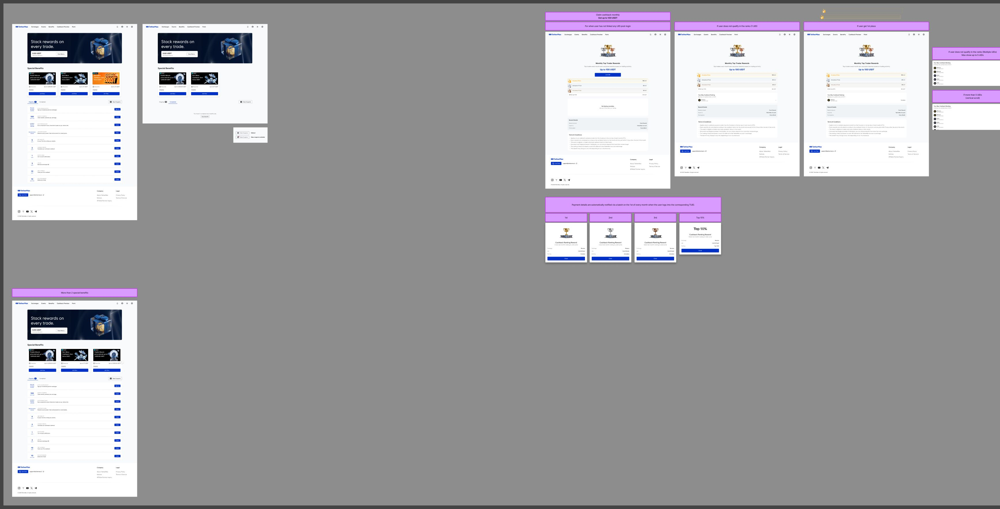
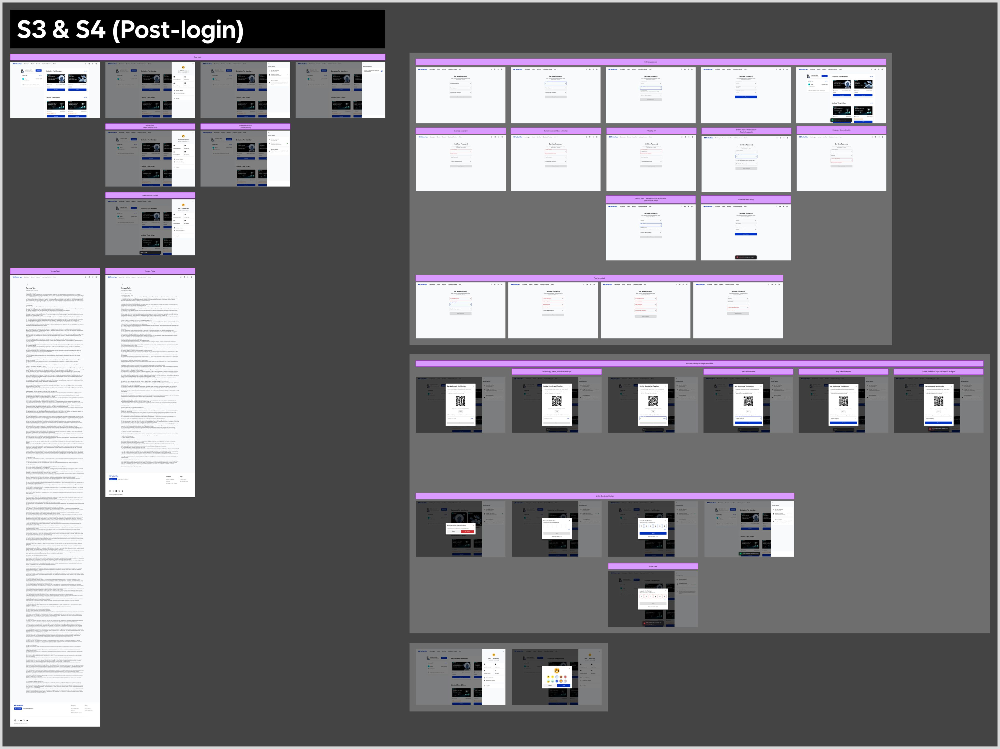
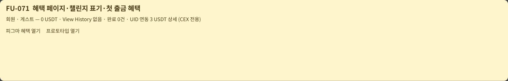
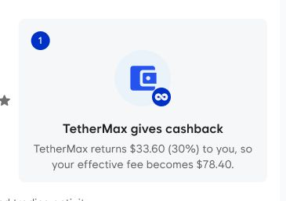
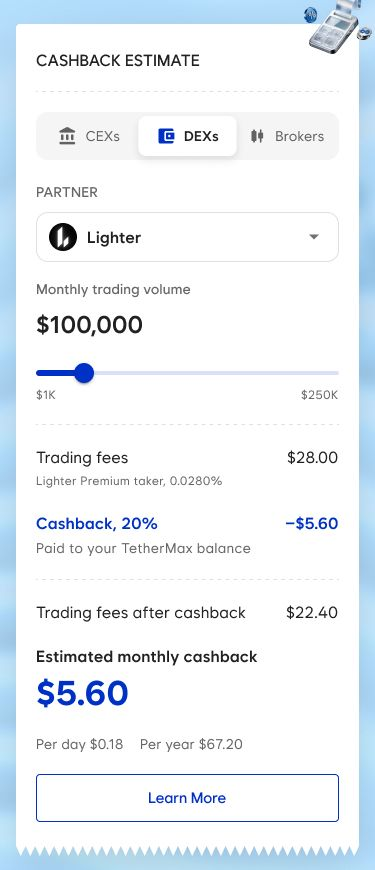

# 프로토타입 ↔ Figma 자동 대조

| 항목 | 내용 |
|---|---|
| 생성 | 2026-11-27 23:00 · `python -I _프로토타입_전체/tools/figma-diff.py` (스크립트가 이 문서를 통째로 다시 씁니다) |
| 프로토타입 | `_프로토타입_전체/_latest.html` — 모든 화면 × 상태 × PC·모바일을 실제 브라우저로 렌더(디자인 보기 · 주석 숨김 · 상태에 맞는 로그인 상태) |
| Figma 기준 | 상태의 `figma.pc` / `figma.mo` 노드. 문구 출처: 정밀 캐시 `ref/figma_text.json` 있음 439노드 → 오프라인 색인 `ref/figma_pages/*.xml`(2026-11-27 파일 기준) → 색인 이후 수정 `05.리포트/Figma수정결과_*.md` 14개(문구 교체 107 · 숨김 32 · 새 프레임 65) |
| 예외 | `_프로토타입_전체/tools/figma-diff-exceptions.json` 규칙 98개 — 결정 기록으로 의도적으로 다르게 한 것. 결과에서 빼고 8장에 따로 적음 |

## 1. 요약

| 항목 | 값 |
|---|---|
| 화면 · 상태 (문서 화면 제외) | 78 화면 · 440 상태 |
| 대조한 상태×뷰 | **569** (Figma 출처: 정밀 444 · 색인 124 · 보정 1) |
| 디자인 없음 | 상태 96 (PC·모바일 모두 없음) · 한쪽 뷰만 있음 119 — 7장 |
| **일치율** (Figma 문구 기준) | **99.6%** — Figma 문구 8776개 중 일치 8483 |
| **누락** (Figma에만) | **22** |
| **문구 다름** | **12** |
| **추가** (프로토타입에만) | **953** |
| 문제 없는 상태×뷰 | 324 / 569 |
| 예외로 뺀 건 | 311 |
| 위치·크기 (기하 모드) | 대조한 상태×뷰 113 · 2px 넘게 어긋난 요소 10건(안쪽 왼쪽 여백 10) — 5장 |
| 확인 불가 | Figma 색인에서 내부가 안 보이는 인스턴스 186개(버튼 34 · 칩 0 · 탭 2 · 입력 3 · 블록 147) · 그래서 판정을 보류한 프로토타입 문구 2329개 |

### 읽는 법

| 구분 | 뜻 | 보는 법 |
|---|---|---|
| 누락 | Figma 프레임에 보이는 문구인데 프로토타입 그 상태에 없음 | 프로토타입에 넣거나, 의도적이면 예외 파일에 근거와 함께 등록 |
| 문구 다름 | 비슷하지만 다른 문구(유사도 0.6 이상 짝) | `Figma` ⇄ `프로토타입` |
| 추가 | 프로토타입에만 있음 | Figma 쪽에 같은 종류의 요소가 인스턴스로 가려져 있으면 판정하지 않고 「확인 불가」로 셈 |
| 제외 | 숫자·금액·날짜·주소·마스킹 ID·거래소 이름 같은 표본 값, Figma의 이름뿐인 레이어(`Button`·`Label`·`Description`·`h6`·`headline (DX-1)` 등), GNB·푸터(공통 셸 화면 `cmn.*`에서만 대조 — 프로토타입은 `header.gnb`·`footer`·`.mo-top`·`.mo-nav`, Figma는 셸 레이어 하위 또는 좌표 캐시의 상단 GNB 띠(PC 64px · 모바일 56px, 상태 표시줄 있으면 +44px)·하단 푸터 영역. 문구·위치 대조 모두) | — |
| 출처 | 정밀 = Figma 실제 문구 · 색인 = 텍스트 레이어 이름(자동 이름 = 문구라서 대부분 맞지만, 이름을 바꾼 레이어는 틀릴 수 있음) · 보정 = 색인 이후 새 프레임이라 수정결과 문서의 문구로만 대조(누락만 판정) | — |

> 정밀 모드: Figma 쪽 문구는 정밀 캐시(2026-11-27T22:53 수신, 439노드 — 인스턴스 안 버튼·칩·탭 라벨까지 실제 문구)를 우선 쓰고, 캐시에 없는 노드만 색인(레이어 이름)으로 대조합니다. 출처별 수는 위 「대조한 상태×뷰」. 색인으로 남은 노드는 인스턴스 내부를 못 봐서 「확인 불가」로 셉니다.

## 2. 상위 문제 20건

누락 + 문구 다름이 많은 순(추가는 동점 정리용). 같은 Figma 프레임 · 같은 내용의 상태는 한 번만 싣고 「같은 문제」로 묶음. 캡처: 왼쪽 프로토타입(디자인 보기, 위쪽 최대 2400px) · 오른쪽 Figma(기존 캡처 재사용, 없으면 「Figma 캡처 필요(연결 후)」).

| # | 화면:상태 | 뷰 | Figma | 누락 | 다름 | 추가 | 대표 내용 |
|---|---|---|---|---|---|---|---|
| 1 | `benefits.detail:notif-member` NOTIFICATIONS · 웹 (회원) | PC | [10976:51542](https://www.figma.com/design/hsa3bSV9QmFTe2jsf6tzTm/UI-UX-Design?node-id=10976-51542) | 8 | 1 | 2 | `Cashback Withdrawal` · `Withdraw 10 USDT to Bitget UID *****1234` · `now` · 외 5 / 다름 `Total event reward`⇄`Event Reward` |
| 2 | `maxboard.main:excluded` 결과 발표 · 제외 | 모바일 | [29064:15127](https://www.figma.com/design/hsa3bSV9QmFTe2jsf6tzTm/UI-UX-Design?node-id=29064-15127) | 0 | 0 | 56 | `MAX BOARD` · [탭] `Overview` · [탭] `Bingo missions` · 외 53 |
| 3 | `hub.main:cards` 게스트 · 비교표 카드 뷰 (평점 생략) | PC | [22807:98684](https://www.figma.com/design/hsa3bSV9QmFTe2jsf6tzTm/UI-UX-Design?node-id=22807-98684) | 0 | 0 | 41 | `Trade, Earn Back. Repeat.` · `Compare cashback opportunities across exchanges and brokers in one place.` · `CASHBACK ESTIMATE` · 외 38 |
| 4 | `benefits.list:normal` 회원 · 진행 중 | 모바일 | [17170:172813](https://www.figma.com/design/hsa3bSV9QmFTe2jsf6tzTm/UI-UX-Design?node-id=17170-172813) | 0 | 0 | 39 | `Benefits` · `Stack rewards on every trade.` · `Total Event Rewards` · 외 36 |
| 5 | `hub.main:brokers` 게스트 · Brokers 칩 비교표 (H1-Broker) | 모바일 | [29515:146538](https://www.figma.com/design/hsa3bSV9QmFTe2jsf6tzTm/UI-UX-Design?node-id=29515-146538) | 2 | 1 | 1 | `Never connect a wallet` · `1 lot` / 다름 `Monthly lots traded`⇄`Monthly trading volume` |
| 6 | `my.main:normal` 회원 — Invite Friends (비파트너) | PC | [17170:235039](https://www.figma.com/design/hsa3bSV9QmFTe2jsf6tzTm/UI-UX-Design?node-id=17170-235039) | 3 | 0 | 0 | `BASIC TIER` · `Upgrade to VIP to earn 3% extra Cashback` · `Upgrade to VIP to earn +3% extra Cashback` |
| 7 | `benefits.list:doneEmpty` 회원 · 완료 0건 | PC | [10954:230325](https://www.figma.com/design/hsa3bSV9QmFTe2jsf6tzTm/UI-UX-Design?node-id=10954-230325) | 2 | 0 | 3 | `You haven’t completed any benefits yet.` · [버튼] `View Benefits` |
| 8 | `partner.hub:total` Total → 거래소별 집계 모달 (PH2) | 모바일 | [6266:13382](https://www.figma.com/design/hsa3bSV9QmFTe2jsf6tzTm/UI-UX-Design?node-id=6266-13382) | 1 | 0 | 11 | `Exchange UIDs` |
| 9 | `benefits.list:guest` 게스트 · 완료 탭 | PC | [29062:113000](https://www.figma.com/design/hsa3bSV9QmFTe2jsf6tzTm/UI-UX-Design?node-id=29062-113000) | 2 | 0 | 0 | `Cashback under 0.01 USDT isn’t included in the rankings.` · `Ranking rewards can’t be claimed on their own. They’re matched 1:1 with the same account’s` |
| 10 | `events.list:filterMoCex` 거래소 필터 · CEX 칩 (모바일) | 모바일 | [29190:123474](https://www.figma.com/design/hsa3bSV9QmFTe2jsf6tzTm/UI-UX-Design?node-id=29190-123474) | 0 | 0 | 15 | `Events` · `B BioFin` · `BioFin Cashback Boost` · 외 12 |
| 11 | `cmn.lang:sheet` 언어 바텀시트 | 모바일 | [12085:400397](https://www.figma.com/design/hsa3bSV9QmFTe2jsf6tzTm/UI-UX-Design?node-id=12085-400397) | 0 | 0 | 12 | `Cashback Hub` · `Events` · `Benefits` · 외 9 |
| 12 | `league.main:joinPick` 팀 참가 지갑 선택 | 모바일 | [29183:118141](https://www.figma.com/design/hsa3bSV9QmFTe2jsf6tzTm/UI-UX-Design?node-id=29183-118141) | 0 | 0 | 12 | `Global League` · `Summary` · `Team League` · 외 9 |
| 13 | `benefits.list:normal` 회원 · 진행 중 | PC | [10954:228708](https://www.figma.com/design/hsa3bSV9QmFTe2jsf6tzTm/UI-UX-Design?node-id=10954-228708) | 1 | 0 | 2 | `Bind your exchange UID` |
| 14 | `benefits.detail:first-before` FIRST CASHBACK · 회원 · 수행 전 (자동 지급 대기) | 모바일 | [29381:137277](https://www.figma.com/design/hsa3bSV9QmFTe2jsf6tzTm/UI-UX-Design?node-id=29381-137277) | 0 | 1 | 1 |  / 다름 `Total event reward`⇄`Event Reward` |
| 15 | `cmn.footer:normal` Live Chat · 지원 메일 · Company · Legal · 소셜 | 모바일 | [29062:118042](https://www.figma.com/design/hsa3bSV9QmFTe2jsf6tzTm/UI-UX-Design?node-id=29062-118042) | 0 | 0 | 10 | [버튼] `Live Chat` · [버튼] `support@tethermax.io` · `Company` · 외 7 |
| 16 | `dex.detail:faq2` FAQ 두 구역 펼침 — Withdrawals & Account Management | PC | [29367:138679](https://www.figma.com/design/hsa3bSV9QmFTe2jsf6tzTm/UI-UX-Design?node-id=29367-138679) | 0 | 0 | 10 | [버튼] `Auto Claim` · `My review` · `Key Features` · 외 7 |
| 17 | `home.main:guest` 비로그인 — 공개 화면 (home/S4#guest) | 모바일 | [29037:113704](https://www.figma.com/design/hsa3bSV9QmFTe2jsf6tzTm/UI-UX-Design?node-id=29037-113704) | 0 | 0 | 10 | [버튼] `Live Chat` · `support@tethermax.io` · `Company` · 외 7 |
| 18 | `partner.hub:normal` 대시보드 — Linked Accounts · 퍼널 (PH1) | PC | [28960:127182](https://www.figma.com/design/hsa3bSV9QmFTe2jsf6tzTm/UI-UX-Design?node-id=28960-127182) | 0 | 1 | 0 |  / 다름 `Claimable Amount`⇄`Available for payout` |
| 19 | `terms.privacy:normal` 개인정보처리방침 — 지갑 주소 · DEX 거래 기록 추가 | 모바일 | [11572:247029](https://www.figma.com/design/hsa3bSV9QmFTe2jsf6tzTm/UI-UX-Design?node-id=11572-247029) | 1 | 0 | 0 | `TetherMax Privacy Policy

Effective [08 28, 2023]

Last Amended [08 28, 2023]
JOO HOLDINGS` |
| 20 | `terms.use:normal` 이용약관 — 6.8 거래 계정 기준 개정 | 모바일 | [11572:247028](https://www.figma.com/design/hsa3bSV9QmFTe2jsf6tzTm/UI-UX-Design?node-id=11572-247028) | 1 | 0 | 0 | `TetherMax Terms of Service

Effective [28 08, 2023]
The purpose of these Terms of Service ` |

### 2.1 `benefits.detail:notif-member` · PC — NOTIFICATIONS · 웹 (회원)

Figma [10976:51542](https://www.figma.com/design/hsa3bSV9QmFTe2jsf6tzTm/UI-UX-Design?node-id=10976-51542) `Web` · 출처 색인

| 프로토타입 | Figma |
|---|---|
| (캡처 생략) |  기존 디자인 카탈로그(섹션 전체) |

- 누락: `Cashback Withdrawal` · `Withdraw 10 USDT to Bitget UID *****1234` · `now` · `Bitget Airdrop Live` · `Earn token rewards on Bitget. Limited time only.` · `Bitget Trading Competition Live` · `Trade on Bitget to win prize rewards.` · `Your rewards depends on your friends' trading activity. The more they trade, the more you `
- 다름: `Total event reward` ⇄ `Event Reward`
- 추가: `Reward amount` · `This reward can only be claimed once per account.`

### 2.2 `maxboard.main:excluded` · 모바일 — 결과 발표 · 제외

Figma [29064:15127](https://www.figma.com/design/hsa3bSV9QmFTe2jsf6tzTm/UI-UX-Design?node-id=29064-15127) `맥스보드 · 결과 발표 · 제외 / 모바일 = 결과 발표 · 참여자와 같음` · 출처 정밀

| 프로토타입 | Figma |
|---|---|
| (캡처 생략) | Figma 캡처 필요(연결 후) |

- 추가: `MAX BOARD` · [탭] `Overview` · [탭] `Bingo missions` · [탭] `Rewards & ranking` · [탭] `Rules` · [버튼] `All benefits` · `October EdgeX MAX BOARD` · `Fill your bingo with cashback and earn USDT rewards` · `Total Ranking Pool` · `Maximum Bingo Rewards` · `Reward Distribution` · `10.31, From 09:00` · 외 44

### 2.3 `hub.main:cards` · PC — 게스트 · 비교표 카드 뷰 (평점 생략)

Figma [22807:98684](https://www.figma.com/design/hsa3bSV9QmFTe2jsf6tzTm/UI-UX-Design?node-id=22807-98684) `MAX1216 / list / CMT-08 Exchange list — CARD view / light` · 출처 정밀

| 프로토타입 | Figma |
|---|---|
| (캡처 생략) |  기존 디자인 카탈로그(섹션 전체) |

- 추가: `Trade, Earn Back. Repeat.` · `Compare cashback opportunities across exchanges and brokers in one place.` · `CASHBACK ESTIMATE` · `Decentralised Exchanges` · `Brokers` · `PARTNER` · `Monthly trading volume` · `Trading fees` · `Lighter Premium taker, 0.0280%` · `Cashback, 20%` · `Paid to your TetherMax balance` · `Trading fees after cashback` · 외 29

### 2.4 `benefits.list:normal` · 모바일 — 회원 · 진행 중

Figma [17170:172813](https://www.figma.com/design/hsa3bSV9QmFTe2jsf6tzTm/UI-UX-Design?node-id=17170-172813) `Frame 1984078611` · 출처 색인

| 프로토타입 | Figma |
|---|---|
| (캡처 생략) |  기존 디자인 카탈로그(섹션 전체) |

- 추가: `Benefits` · `Stack rewards on every trade.` · `Total Event Rewards` · [버튼] `View History` · `Special Benefits` · `Guess Bitcoin Price` · `Win Up to 1,000 USDT` · `Earn More Cashback` · `Earn extra USDT` · [탭] `Ongoing 10` · [탭] `Completed` · `New user exclusive benefits` · 외 27

### 2.5 `hub.main:brokers` · 모바일 — 게스트 · Brokers 칩 비교표 (H1-Broker)

Figma [29515:146538](https://www.figma.com/design/hsa3bSV9QmFTe2jsf6tzTm/UI-UX-Design?node-id=29515-146538) `DEX / Mobile / Hub H1-Broker Guest, calculator on Brokers (S1) / Light` · 출처 정밀

| 프로토타입 | Figma |
|---|---|
| (캡처 생략) | Figma 캡처 필요(연결 후) |

- 누락: `Never connect a wallet` · `1 lot`
- 다름: `Monthly lots traded` ⇄ `Monthly trading volume`
- 추가: [배지] `Highest payout`

### 2.6 `my.main:normal` · PC — 회원 — Invite Friends (비파트너)

Figma [17170:235039](https://www.figma.com/design/hsa3bSV9QmFTe2jsf6tzTm/UI-UX-Design?node-id=17170-235039) `Frame 1984078598` · 출처 색인

| 프로토타입 | Figma |
|---|---|
| (캡처 생략) |  기존 디자인 카탈로그(섹션 전체) |

- 누락: `BASIC TIER` · `Upgrade to VIP to earn 3% extra Cashback` · `Upgrade to VIP to earn +3% extra Cashback`

### 2.7 `benefits.list:doneEmpty` · PC — 회원 · 완료 0건

Figma [10954:230325](https://www.figma.com/design/hsa3bSV9QmFTe2jsf6tzTm/UI-UX-Design?node-id=10954-230325) `Web` · 출처 정밀 · 같은 문제: `benefits.list:doneEmpty(모바일)`

| 프로토타입 | Figma |
|---|---|
| (캡처 생략) |  기존 디자인 카탈로그(섹션 전체) |

- 누락: `You haven’t completed any benefits yet.` · [버튼] `View Benefits`
- 추가: [탭] `Ongoing 10` · `No Completed Rewards Yet` · [버튼] `Explore Ongoing Rewards`

### 2.8 `partner.hub:total` · 모바일 — Total → 거래소별 집계 모달 (PH2)

Figma [6266:13382](https://www.figma.com/design/hsa3bSV9QmFTe2jsf6tzTm/UI-UX-Design?node-id=6266-13382) `Frame` · 출처 색인

| 프로토타입 | Figma |
|---|---|
| (캡처 생략) |  기존 디자인 카탈로그(섹션 전체) |

- 누락: `Exchange UIDs`
- 추가: `Partner Hub` · [탭] `Dashboard` · [탭] `Sub-Account` · `Updated in 15mins` · `Available for payout` · `Total Cumulative Invite Reward` · `View history` · `Reward Rate` · `Contact Manager to Update` · `Linked Accounts` · `Sub-accounts’ cashback in USDT (USDC shown 1:1).`

### 2.9 `benefits.list:guest` · PC — 게스트 · 완료 탭

Figma [29062:113000](https://www.figma.com/design/hsa3bSV9QmFTe2jsf6tzTm/UI-UX-Design?node-id=29062-113000) `색인 이후 새 프레임(Figma수정결과_2차.md)` · 출처 보정

| 프로토타입 | Figma |
|---|---|
| (캡처 생략) |  Figma 수정 후 캡처 |

- 누락: `Cashback under 0.01 USDT isn’t included in the rankings.` · `Ranking rewards can’t be claimed on their own. They’re matched 1:1 with the same account’s`

### 2.10 `events.list:filterMoCex` · 모바일 — 거래소 필터 · CEX 칩 (모바일)

Figma [29190:123474](https://www.figma.com/design/hsa3bSV9QmFTe2jsf6tzTm/UI-UX-Design?node-id=29190-123474) `거래소 이벤트 필터 / 모바일 · CEX` · 출처 정밀

| 프로토타입 | Figma |
|---|---|
| (캡처 생략) | Figma 캡처 필요(연결 후) |

- 추가: `Events` · `B BioFin` · `BioFin Cashback Boost` · `Up to 85% cashback` · [버튼] `Join Now` · `Bitget Trading Competition` · `Total 150,000 USDT Przie Pool` · `WSOT Vol & PnL Trading Competition` · `Up to 3,200,000 USDT` · [탭] `Special Events` · [탭] `Exclusive` · [탭] `Exchange Events` · 외 3

### 2.11 `cmn.lang:sheet` · 모바일 — 언어 바텀시트

Figma [12085:400397](https://www.figma.com/design/hsa3bSV9QmFTe2jsf6tzTm/UI-UX-Design?node-id=12085-400397) `bottomSheet` · 출처 정밀

| 프로토타입 | Figma |
|---|---|
| (캡처 생략) |  기존 디자인 카탈로그(섹션 전체) |

- 추가: `Cashback Hub` · `Events` · `Benefits` · `Cashback Calculator` · `Point` · `Theme` · `Terms of Use` · `Privacy Policy` · `About TetherMax` · `Beginner’s Guide` · `Notices` · `Affiliate Partner Inquiry`

### 2.12 `league.main:joinPick` · 모바일 — 팀 참가 지갑 선택

Figma [29183:118141](https://www.figma.com/design/hsa3bSV9QmFTe2jsf6tzTm/UI-UX-Design?node-id=29183-118141) `모바일 · 팀 참가 지갑 선택` · 출처 정밀

| 프로토타입 | Figma |
|---|---|
| (캡처 생략) | Figma 캡처 필요(연결 후) |

- 추가: `Global League` · `Summary` · `Team League` · `TEAM PRIZE POOL (USDT)` · [버튼] `Create Team` · `All Teams` · `Next Update: 22:30` · `Search` · `Ranking` · `Total Score` · `Dragon Squad` · `Join team`

### 2.13 `benefits.list:normal` · PC — 회원 · 진행 중

Figma [10954:228708](https://www.figma.com/design/hsa3bSV9QmFTe2jsf6tzTm/UI-UX-Design?node-id=10954-228708) `Web` · 출처 정밀

| 프로토타입 | Figma |
|---|---|
| (캡처 생략) |  기존 디자인 카탈로그(섹션 전체) |

- 누락: `Bind your exchange UID`
- 추가: [탭] `Ongoing 10` · `Link a CEX UID to Get Cashback`

### 2.14 `benefits.detail:first-before` · 모바일 — FIRST CASHBACK · 회원 · 수행 전 (자동 지급 대기)

Figma [29381:137277](https://www.figma.com/design/hsa3bSV9QmFTe2jsf6tzTm/UI-UX-Design?node-id=29381-137277) `혜택 · 첫 캐시백 상세 / 모바일 · 회원` · 출처 색인 · 같은 문제: `benefits.detail:preview-before(PC)`, `benefits.detail:preview-ready(PC)`, `benefits.detail:uid-before(PC)`, `benefits.detail:uid-before`, `benefits.detail:first-guest`, `benefits.detail:first-before(PC)`

| 프로토타입 | Figma |
|---|---|
| (캡처 생략) | Figma 캡처 필요(연결 후) |

- 다름: `Total event reward` ⇄ `Event Reward`
- 추가: [버튼] `Auto Claim`

### 2.15 `cmn.footer:normal` · 모바일 — Live Chat · 지원 메일 · Company · Legal · 소셜

Figma [29062:118042](https://www.figma.com/design/hsa3bSV9QmFTe2jsf6tzTm/UI-UX-Design?node-id=29062-118042) `Footer/mWeb` · 출처 정밀

| 프로토타입 | Figma |
|---|---|
| (캡처 생략) | Figma 캡처 필요(연결 후) |

- 추가: [버튼] `Live Chat` · [버튼] `support@tethermax.io` · `Company` · `About TetherMax` · `Notices` · `Affiliate Partner Inquiry` · `Legal` · `Privacy Policy` · `Terms of Service` · `© 2026 TetherMax. All rights reserved.`

### 2.16 `dex.detail:faq2` · PC — FAQ 두 구역 펼침 — Withdrawals & Account Management

Figma [29367:138679](https://www.figma.com/design/hsa3bSV9QmFTe2jsf6tzTm/UI-UX-Design?node-id=29367-138679) `DEX / detail / D3 FAQ, reviews and terms / light · FAQ two sections open` · 출처 정밀

| 프로토타입 | Figma |
|---|---|
| (캡처 생략) |  Figma 수정 후 캡처 |

- 추가: [버튼] `Auto Claim` · `My review` · `Key Features` · `Structure` · `Policy` · `Reviews (23)` · `A question about linking` · `Does it support ApeX too? I linked my Lighter wallet already and I am not sure whether a s` · `Translated from Korean` · `Show original`

### 2.17 `home.main:guest` · 모바일 — 비로그인 — 공개 화면 (home/S4#guest)

Figma [29037:113704](https://www.figma.com/design/hsa3bSV9QmFTe2jsf6tzTm/UI-UX-Design?node-id=29037-113704) `Mobile / Guest entry / Home` · 출처 정밀 · 같은 문제: `guest.entry:normal`

| 프로토타입 | Figma |
|---|---|
| (캡처 생략) | Figma 캡처 필요(연결 후) |

- 추가: [버튼] `Live Chat` · `support@tethermax.io` · `Company` · `About TetherMax` · `Notices` · `Claim Cashback` · `Legal` · `Privacy Policy` · `Terms of Service` · `© 2026 TetherMax. All rights reserved.`

### 2.18 `partner.hub:normal` · PC — 대시보드 — Linked Accounts · 퍼널 (PH1)

Figma [28960:127182](https://www.figma.com/design/hsa3bSV9QmFTe2jsf6tzTm/UI-UX-Design?node-id=28960-127182) `DEX / PH1 Dashboard / light` · 출처 정밀 · 같은 문제: `partner.hub:normal(모바일)`

| 프로토타입 | Figma |
|---|---|
| (캡처 생략) | Figma 캡처 필요(연결 후) |

- 다름: `Claimable Amount` ⇄ `Available for payout`

### 2.19 `terms.privacy:normal` · 모바일 — 개인정보처리방침 — 지갑 주소 · DEX 거래 기록 추가

Figma [11572:247029](https://www.figma.com/design/hsa3bSV9QmFTe2jsf6tzTm/UI-UX-Design?node-id=11572-247029) `mWeb/landingPage` · 출처 정밀

| 프로토타입 | Figma |
|---|---|
| (캡처 생략) |  기존 디자인 카탈로그(섹션 전체) |

- 누락: `TetherMax Privacy Policy

Effective [08 28, 2023]

Last Amended [08 28, 2023]
JOO HOLDINGS`

### 2.20 `terms.use:normal` · 모바일 — 이용약관 — 6.8 거래 계정 기준 개정

Figma [11572:247028](https://www.figma.com/design/hsa3bSV9QmFTe2jsf6tzTm/UI-UX-Design?node-id=11572-247028) `mWeb/landingPage` · 출처 정밀

| 프로토타입 | Figma |
|---|---|
| (캡처 생략) |  기존 디자인 카탈로그(섹션 전체) |

- 누락: `TetherMax Terms of Service

Effective [28 08, 2023]
The purpose of these Terms of Service `

## 3. 화면별 불일치 표

이 표만 보면 됩니다. 한 행 = 상태 × 뷰 × 구분. 문제 없는 상태는 4장 집계에만 나옵니다.

### 1. 공통 · 셸 (헤더·푸터·공지·약관)

| 화면:상태 | 뷰 | Figma 노드 | 구분 | 내용 |
|---|---|---|---|---|
| `cmn.lang:sheet` 언어 바텀시트 | 모바일 | [12085:400397](https://www.figma.com/design/hsa3bSV9QmFTe2jsf6tzTm/UI-UX-Design?node-id=12085-400397) (정밀) | 추가 12 | `Cashback Hub` · `Events` · `Benefits` · `Cashback Calculator` · `Point` · `Theme` · `Terms of Use` · `Privacy Policy` · 외 4 |
| `cmn.footer:normal` Live Chat · 지원 메일 · Company · Legal · 소셜 | 모바일 | [29062:118042](https://www.figma.com/design/hsa3bSV9QmFTe2jsf6tzTm/UI-UX-Design?node-id=29062-118042) (정밀) | 추가 10 | [버튼] `Live Chat` · [버튼] `support@tethermax.io` · `Company` · `About TetherMax` · `Notices` · `Affiliate Partner Inquiry` · `Legal` · `Privacy Policy` · 외 2 |
| `terms.use:normal` 이용약관 — 6.8 거래 계정 기준 개정 | 모바일 | [11572:247028](https://www.figma.com/design/hsa3bSV9QmFTe2jsf6tzTm/UI-UX-Design?node-id=11572-247028) (정밀) | 누락 1 | `TetherMax Terms of Service

Effective [28 08, 2023]
The purpose of these Terms of Service ` |
| `terms.privacy:normal` 개인정보처리방침 — 지갑 주소 · DEX 거래 기록 추가 | 모바일 | [11572:247029](https://www.figma.com/design/hsa3bSV9QmFTe2jsf6tzTm/UI-UX-Design?node-id=11572-247029) (정밀) | 누락 1 | `TetherMax Privacy Policy

Effective [08 28, 2023]

Last Amended [08 28, 2023]
JOO HOLDINGS` |

### 2. 랜딩 · 서비스 소개

| 화면:상태 | 뷰 | Figma 노드 | 구분 | 내용 |
|---|---|---|---|---|
| `landing.main:normal` 기본 — Our Partners·Featured에 DEX 포함 (PLP) | PC | [28960:128375](https://www.figma.com/design/hsa3bSV9QmFTe2jsf6tzTm/UI-UX-Design?node-id=28960-128375) (정밀) | 추가 2 | [배지] `DEX` · `Ends in 45 M 37 S` |
| `about.intro:normal` 기본 — 파트너 캐러셀(DEX 포함) · 출금 피드 · 거래 계정 문구 | PC | [28960:129521](https://www.figma.com/design/hsa3bSV9QmFTe2jsf6tzTm/UI-UX-Design?node-id=28960-129521) (정밀) | 추가 8 | [배지] `DEX` · `🔥 for new traders` · `Select a partner ▾` · `Trade Frequency ▾` · [버튼] `Calculate` · `ⓘ Actual savings may vary depending on your maker/taker ratio.` · `Events` · `Ends in 45 M 37 S` |
| `about.feed:normal` CEX·DEX 시간순 · DEX 배지 · 마스킹 | PC | [28960:128520](https://www.figma.com/design/hsa3bSV9QmFTe2jsf6tzTm/UI-UX-Design?node-id=28960-128520) (정밀) | 추가 1 | [배지] `DEX` |

### 3. 비회원 캐시백 조회

| 화면:상태 | 뷰 | Figma 노드 | 구분 | 내용 |
|---|---|---|---|---|
| `guest.search:search` 검색 · 초기 | PC | [29035:97622](https://www.figma.com/design/hsa3bSV9QmFTe2jsf6tzTm/UI-UX-Design?node-id=29035-97622) (정밀) | 추가 1 | `No account? Join our partner exchange ⟶` |
| `guest.search:search` 검색 · 초기 | 모바일 | [29035:97732](https://www.figma.com/design/hsa3bSV9QmFTe2jsf6tzTm/UI-UX-Design?node-id=29035-97732) (정밀) | 추가 1 | `No account? Join our partner exchange ⟶` |
| `guest.search:emptydex` DEX 선택 · 입력 대기 | PC | [29037:102201](https://www.figma.com/design/hsa3bSV9QmFTe2jsf6tzTm/UI-UX-Design?node-id=29037-102201) (정밀) | 추가 1 | `No account? Join our partner exchange ⟶` |
| `guest.search:emptydex` DEX 선택 · 입력 대기 | 모바일 | [29037:102272](https://www.figma.com/design/hsa3bSV9QmFTe2jsf6tzTm/UI-UX-Design?node-id=29037-102272) (정밀) | 추가 1 | `No account? Join our partner exchange ⟶` |
| `guest.search:emptycex` CEX 선택 · 입력 대기 | PC | [29037:102332](https://www.figma.com/design/hsa3bSV9QmFTe2jsf6tzTm/UI-UX-Design?node-id=29037-102332) (정밀) | 추가 1 | `No account? Join our partner exchange ⟶` |
| `guest.search:emptycex` CEX 선택 · 입력 대기 | 모바일 | [29037:102403](https://www.figma.com/design/hsa3bSV9QmFTe2jsf6tzTm/UI-UX-Design?node-id=29037-102403) (정밀) | 추가 1 | `No account? Join our partner exchange ⟶` |
| `guest.search:dex` DEX · 지갑 주소 입력 완료 | PC | [29035:98155](https://www.figma.com/design/hsa3bSV9QmFTe2jsf6tzTm/UI-UX-Design?node-id=29035-98155) (정밀) | 추가 1 | `No account? Join our partner exchange ⟶` |
| `guest.search:dex` DEX · 지갑 주소 입력 완료 | 모바일 | [29035:98218](https://www.figma.com/design/hsa3bSV9QmFTe2jsf6tzTm/UI-UX-Design?node-id=29035-98218) (정밀) | 추가 1 | `No account? Join our partner exchange ⟶` |
| `guest.search:cex` CEX · UID 입력 완료 | PC | [29035:98278](https://www.figma.com/design/hsa3bSV9QmFTe2jsf6tzTm/UI-UX-Design?node-id=29035-98278) (정밀) | 추가 1 | `No account? Join our partner exchange ⟶` |
| `guest.search:cex` CEX · UID 입력 완료 | 모바일 | [29035:98341](https://www.figma.com/design/hsa3bSV9QmFTe2jsf6tzTm/UI-UX-Design?node-id=29035-98341) (정밀) | 추가 1 | `No account? Join our partner exchange ⟶` |
| `guest.search:bad` 입력 오류 · 선택 거래소 기준 | PC | [29035:98401](https://www.figma.com/design/hsa3bSV9QmFTe2jsf6tzTm/UI-UX-Design?node-id=29035-98401) (정밀) | 추가 1 | `No account? Join our partner exchange ⟶` |
| `guest.search:bad` 입력 오류 · 선택 거래소 기준 | 모바일 | [29035:98465](https://www.figma.com/design/hsa3bSV9QmFTe2jsf6tzTm/UI-UX-Design?node-id=29035-98465) (정밀) | 추가 1 | `No account? Join our partner exchange ⟶` |
| `guest.search:loading` 거래소 조회 중 | PC | [29035:98526](https://www.figma.com/design/hsa3bSV9QmFTe2jsf6tzTm/UI-UX-Design?node-id=29035-98526) (정밀) | 추가 1 | `No account? Join our partner exchange ⟶` |
| `guest.search:loading` 거래소 조회 중 | 모바일 | [29035:98580](https://www.figma.com/design/hsa3bSV9QmFTe2jsf6tzTm/UI-UX-Design?node-id=29035-98580) (정밀) | 추가 1 | `No account? Join our partner exchange ⟶` |
| `guest.result:above` 조회 성공 · 10 USDT 이상 | PC | [29035:97792](https://www.figma.com/design/hsa3bSV9QmFTe2jsf6tzTm/UI-UX-Design?node-id=29035-97792) (정밀) | 추가 1 | [버튼] `Sign up to link account` |
| `guest.result:above` 조회 성공 · 10 USDT 이상 | 모바일 | [29035:97855](https://www.figma.com/design/hsa3bSV9QmFTe2jsf6tzTm/UI-UX-Design?node-id=29035-97855) (정밀) | 추가 3 | `Sign up in the app and earn more cashback` · [버튼] `Get the App` · [버튼] `Sign up to link account` |
| `guest.result:below` 조회 성공 · 10 USDT 미만 | PC | [29035:98631](https://www.figma.com/design/hsa3bSV9QmFTe2jsf6tzTm/UI-UX-Design?node-id=29035-98631) (정밀) | 추가 1 | [버튼] `Sign up to link account` |
| `guest.result:below` 조회 성공 · 10 USDT 미만 | 모바일 | [29035:98694](https://www.figma.com/design/hsa3bSV9QmFTe2jsf6tzTm/UI-UX-Design?node-id=29035-98694) (정밀) | 추가 3 | `Sign up in the app and earn more cashback` · [버튼] `Get the App` · [버튼] `Sign up to link account` |
| `guest.result:zero` 조회 성공 · 잔액 0 | PC | [29035:98754](https://www.figma.com/design/hsa3bSV9QmFTe2jsf6tzTm/UI-UX-Design?node-id=29035-98754) (정밀) | 추가 1 | [버튼] `Sign up to link account` |
| `guest.result:zero` 조회 성공 · 잔액 0 | 모바일 | [29035:98817](https://www.figma.com/design/hsa3bSV9QmFTe2jsf6tzTm/UI-UX-Design?node-id=29035-98817) (정밀) | 추가 3 | `Sign up in the app and earn more cashback` · [버튼] `Get the App` · [버튼] `Sign up to link account` |
| `guest.result:belowcex` CEX · UID 잔액 조회 성공 | PC | [29035:99309](https://www.figma.com/design/hsa3bSV9QmFTe2jsf6tzTm/UI-UX-Design?node-id=29035-99309) (정밀) | 추가 1 | [버튼] `Sign up to link account` |
| `guest.result:belowcex` CEX · UID 잔액 조회 성공 | 모바일 | [29035:99372](https://www.figma.com/design/hsa3bSV9QmFTe2jsf6tzTm/UI-UX-Design?node-id=29035-99372) (정밀) | 추가 3 | `Sign up in the app and earn more cashback` · [버튼] `Get the App` · [버튼] `Sign up to link account` |
| `guest.result:handoff` 로그인 후 · 계정 미연동 (DEX) | PC | [29035:97915](https://www.figma.com/design/hsa3bSV9QmFTe2jsf6tzTm/UI-UX-Design?node-id=29035-97915) (정밀) | 추가 1 | [버튼] `Link account` |
| `guest.result:handoff` 로그인 후 · 계정 미연동 (DEX) | 모바일 | [29035:97974](https://www.figma.com/design/hsa3bSV9QmFTe2jsf6tzTm/UI-UX-Design?node-id=29035-97974) (정밀) | 추가 2 | [버튼] `Get the App` · [버튼] `Link account` |
| `guest.result:handoffcex` CEX · 로그인 후 같은 UID 연동 | PC | [29037:102463](https://www.figma.com/design/hsa3bSV9QmFTe2jsf6tzTm/UI-UX-Design?node-id=29037-102463) (정밀) | 추가 1 | [버튼] `Link account` |
| `guest.result:handoffcex` CEX · 로그인 후 같은 UID 연동 | 모바일 | [29037:102530](https://www.figma.com/design/hsa3bSV9QmFTe2jsf6tzTm/UI-UX-Design?node-id=29037-102530) (정밀) | 추가 2 | [버튼] `Get the App` · [버튼] `Link account` |
| `guest.modal:picker` 거래소 선택 | PC | [29035:98030](https://www.figma.com/design/hsa3bSV9QmFTe2jsf6tzTm/UI-UX-Design?node-id=29035-98030) (정밀) | 추가 6 | `Select an exchange` · `Select an exchange first` · [버튼] `Check cashback` · `No account? Join our partner exchange ⟶` · `Don't leave your cashback behind.` · [버튼] `Lighter DEX` |
| `guest.modal:picker` 거래소 선택 | 모바일 | [29035:98094](https://www.figma.com/design/hsa3bSV9QmFTe2jsf6tzTm/UI-UX-Design?node-id=29035-98094) (정밀) | 추가 1 | [버튼] `Lighter DEX` |
| `guest.modal:pickerDex` 거래소 선택 · DEX 필터 | PC | [29179:116130](https://www.figma.com/design/hsa3bSV9QmFTe2jsf6tzTm/UI-UX-Design?node-id=29179-116130) (정밀) | 추가 5 | `Select an exchange` · `Select an exchange first` · [버튼] `Check cashback` · `No account? Join our partner exchange ⟶` · `Don't leave your cashback behind.` |

### 4. 홈 · 잔액 · 지갑 상세

| 화면:상태 | 뷰 | Figma 노드 | 구분 | 내용 |
|---|---|---|---|---|
| `home.main:guest` 비로그인 — 공개 화면 (home/S4#guest) | 모바일 | [29037:113704](https://www.figma.com/design/hsa3bSV9QmFTe2jsf6tzTm/UI-UX-Design?node-id=29037-113704) (정밀) | 추가 10 | [버튼] `Live Chat` · `support@tethermax.io` · `Company` · `About TetherMax` · `Notices` · `Claim Cashback` · `Legal` · `Privacy Policy` · 외 2 |
| `home.main:s3` S3 연동 0 — 체크리스트 · Cashback Preview (S3-1) | PC | [28960:127759](https://www.figma.com/design/hsa3bSV9QmFTe2jsf6tzTm/UI-UX-Design?node-id=28960-127759) (정밀) | 추가 1 | `Cashback Preview` |
| `home.main:app` 앱·모바일웹 — Wallet 라벨 없음 · 푸터 문구 | 모바일 | [8582:156599](https://www.figma.com/design/hsa3bSV9QmFTe2jsf6tzTm/UI-UX-Design?node-id=8582-156599) (정밀) | 추가 1 | [버튼] `Auto Claim` |
| `home.main:first` 첫 연동 — 체크리스트 없는 S4 + 토스트 (S3-7) | 모바일 | [29530:134341](https://www.figma.com/design/hsa3bSV9QmFTe2jsf6tzTm/UI-UX-Design?node-id=29530-134341) (정밀) | 추가 2 | `Win Up to 1,000 USDT` · `Earn extra USDT` |
| `home.main:multi` 같은 DEX 지갑 3개 · Aster 하위 계정 | 모바일 | [7633:92140](https://www.figma.com/design/hsa3bSV9QmFTe2jsf6tzTm/UI-UX-Design?node-id=7633-92140) (정밀) | 추가 1 | [버튼] `Auto Claim` |
| `my.main:normal` 회원 — Invite Friends (비파트너) | PC | [17170:235039](https://www.figma.com/design/hsa3bSV9QmFTe2jsf6tzTm/UI-UX-Design?node-id=17170-235039) | 누락 3 | `BASIC TIER` · `Upgrade to VIP to earn 3% extra Cashback` · `Upgrade to VIP to earn +3% extra Cashback` |

### 5. 거래 계정 연동

| 화면:상태 | 뷰 | Figma 노드 | 구분 | 내용 |
|---|---|---|---|---|
| `link.select:dexlist` 홈 Linked Accounts 푸터 → 공통 선택기 All | PC | [28960:127381](https://www.figma.com/design/hsa3bSV9QmFTe2jsf6tzTm/UI-UX-Design?node-id=28960-127381) (정밀) | 추가 6 | `Link your exchange UID` · [버튼] `Lighter DEX` · [입력] `Enter your UID` · `Steps to link UID` · `Log in to the Bitget Website. Go to My Profile icon in the top right corner. Tap/Click on ` · [버튼] `Next` |
| `link.select:dexlist` 홈 Linked Accounts 푸터 → 공통 선택기 All | 모바일 | [28969:126953](https://www.figma.com/design/hsa3bSV9QmFTe2jsf6tzTm/UI-UX-Design?node-id=28969-126953) (정밀) | 추가 3 | [버튼] `Lighter DEX` · [버튼] `Bitget 54% Total Savings` · [버튼] `BVOX 60% Total Savings` |
| `link.select:all` 기존 연동 폼의 검색 팝오버 · All | PC | [28960:127381](https://www.figma.com/design/hsa3bSV9QmFTe2jsf6tzTm/UI-UX-Design?node-id=28960-127381) (정밀) | 추가 6 | `Link your exchange UID` · [버튼] `Lighter DEX` · [입력] `Enter your UID` · `Steps to link UID` · `Log in to the Bitget Website. Go to My Profile icon in the top right corner. Tap/Click on ` · [버튼] `Next` |
| `link.select:all` 기존 연동 폼의 검색 팝오버 · All | 모바일 | [28969:126953](https://www.figma.com/design/hsa3bSV9QmFTe2jsf6tzTm/UI-UX-Design?node-id=28969-126953) (정밀) | 추가 3 | [버튼] `Lighter DEX` · [버튼] `Bitget 54% Total Savings` · [버튼] `BVOX 60% Total Savings` |
| `link.select:uid` UID 입력 화면에서 연 공통 선택기 | PC | [28960:127381](https://www.figma.com/design/hsa3bSV9QmFTe2jsf6tzTm/UI-UX-Design?node-id=28960-127381) (정밀) | 추가 6 | `Link your exchange UID` · [버튼] `Lighter DEX` · [입력] `Enter your UID` · `Steps to link UID` · `Log in to the Bitget Website. Go to My Profile icon in the top right corner. Tap/Click on ` · [버튼] `Next` |
| `link.select:uid` UID 입력 화면에서 연 공통 선택기 | 모바일 | [28969:126953](https://www.figma.com/design/hsa3bSV9QmFTe2jsf6tzTm/UI-UX-Design?node-id=28969-126953) (정밀) | 추가 3 | [버튼] `Lighter DEX` · [버튼] `Bitget 54% Total Savings` · [버튼] `BVOX 60% Total Savings` |
| `link.select:uidFilled` UID 입력 후 연 공통 선택기 | PC | [28960:127381](https://www.figma.com/design/hsa3bSV9QmFTe2jsf6tzTm/UI-UX-Design?node-id=28960-127381) (정밀) | 추가 6 | `Link your exchange UID` · [버튼] `Lighter DEX` · [입력] `Enter your UID` · `Steps to link UID` · `Log in to the Bitget Website. Go to My Profile icon in the top right corner. Tap/Click on ` · [버튼] `Next` |
| `link.select:uidFilled` UID 입력 후 연 공통 선택기 | 모바일 | [28969:126953](https://www.figma.com/design/hsa3bSV9QmFTe2jsf6tzTm/UI-UX-Design?node-id=28969-126953) (정밀) | 추가 3 | [버튼] `Lighter DEX` · [버튼] `Bitget 54% Total Savings` · [버튼] `BVOX 60% Total Savings` |
| `link.select:cex` 칩 CEX | PC | [29192:119719](https://www.figma.com/design/hsa3bSV9QmFTe2jsf6tzTm/UI-UX-Design?node-id=29192-119719) (정밀) | 추가 5 | `Link your exchange UID` · [입력] `Enter your UID` · `Steps to link UID` · `Log in to the Bitget Website. Go to My Profile icon in the top right corner. Tap/Click on ` · [버튼] `Next` |
| `link.select:cex` 칩 CEX | 모바일 | [28986:126528](https://www.figma.com/design/hsa3bSV9QmFTe2jsf6tzTm/UI-UX-Design?node-id=28986-126528) (정밀) | 추가 2 | [버튼] `Bitget 54% Total Savings` · [버튼] `BVOX 60% Total Savings` |
| `link.select:dex` 칩 DEX (배지 없음) | PC | [29192:119723](https://www.figma.com/design/hsa3bSV9QmFTe2jsf6tzTm/UI-UX-Design?node-id=29192-119723) (정밀) | 추가 5 | `Link your exchange UID` · [입력] `Enter your UID` · `Steps to link UID` · `Log in to the Bitget Website. Go to My Profile icon in the top right corner. Tap/Click on ` · [버튼] `Next` |
| `link.select:one` 검색 결과 1건 | 모바일 | [29051:104415](https://www.figma.com/design/hsa3bSV9QmFTe2jsf6tzTm/UI-UX-Design?node-id=29051-104415) (정밀) | 추가 1 | [입력] `Search exchanges` |
| `link.select:many` 검색 결과 여러 건 | 모바일 | [29051:104229](https://www.figma.com/design/hsa3bSV9QmFTe2jsf6tzTm/UI-UX-Design?node-id=29051-104229) (정밀) | 추가 1 | [입력] `Search exchanges` |
| `link.select:dexbit` DEX 칩에서 «bit» → 0건 | 모바일 | [29051:104597](https://www.figma.com/design/hsa3bSV9QmFTe2jsf6tzTm/UI-UX-Design?node-id=29051-104597) (정밀) | 추가 2 | [입력] `Search exchanges` · `0 exchanges found` |
| `link.uid:empty` 빈 값 — Next 비활성 | PC | [9105:196091](https://www.figma.com/design/hsa3bSV9QmFTe2jsf6tzTm/UI-UX-Design?node-id=9105-196091) (정밀) | 추가 1 | [버튼] `Next` |
| `link.uid:empty` 빈 값 — Next 비활성 | 모바일 | [29051:100488](https://www.figma.com/design/hsa3bSV9QmFTe2jsf6tzTm/UI-UX-Design?node-id=29051-100488) (정밀) | 추가 2 | `Link your exchange UID` · [버튼] `Next` |
| `link.uid:filled` UID 입력 완료 — Next 활성 (게스트 조회 handoffcex 포함) | PC | [9287:185462](https://www.figma.com/design/hsa3bSV9QmFTe2jsf6tzTm/UI-UX-Design?node-id=9287-185462) (정밀) | 추가 1 | [입력] `Enter your UID` |
| `link.uid:filled` UID 입력 완료 — Next 활성 (게스트 조회 handoffcex 포함) | 모바일 | [9105:188659](https://www.figma.com/design/hsa3bSV9QmFTe2jsf6tzTm/UI-UX-Design?node-id=9105-188659) (정밀) | 추가 2 | `Link your exchange UID` · [입력] `Enter your UID` |
| `link.addr:empty` 빈 값 — 안내 보임, Next 비활성 (L2) | PC | [28960:127275](https://www.figma.com/design/hsa3bSV9QmFTe2jsf6tzTm/UI-UX-Design?node-id=28960-127275) (정밀) | 추가 2 | `Link Account` · [버튼] `Next` |
| `link.addr:empty` 빈 값 — 안내 보임, Next 비활성 (L2) | 모바일 | [28969:126986](https://www.figma.com/design/hsa3bSV9QmFTe2jsf6tzTm/UI-UX-Design?node-id=28969-126986) (정밀) | 추가 2 | `Link Account` · [버튼] `Next` |
| `link.addr:valid` 유효 주소 — Next 활성 (L3) | PC | [28960:127279](https://www.figma.com/design/hsa3bSV9QmFTe2jsf6tzTm/UI-UX-Design?node-id=28960-127279) (정밀) | 추가 3 | `Link Account` · [입력] `Paste your wallet address` · [버튼] `Next` |
| `link.addr:valid` 유효 주소 — Next 활성 (L3) | 모바일 | [28969:126996](https://www.figma.com/design/hsa3bSV9QmFTe2jsf6tzTm/UI-UX-Design?node-id=28969-126996) (정밀) | 추가 3 | `Link Account` · [입력] `Paste your wallet address` · [버튼] `Next` |
| `link.addr:e2` 빈 값 제출 — Enter your wallet address. | PC | [28980:132144](https://www.figma.com/design/hsa3bSV9QmFTe2jsf6tzTm/UI-UX-Design?node-id=28980-132144) (정밀) | 추가 3 | `Link Account` · [입력] `Paste your wallet address` · [버튼] `Next` |
| `link.addr:ws` 주소 안 공백 — Remove spaces… (L4) | PC | [28980:132242](https://www.figma.com/design/hsa3bSV9QmFTe2jsf6tzTm/UI-UX-Design?node-id=28980-132242) (정밀) | 추가 3 | `Link Account` · [입력] `Paste your wallet address` · [버튼] `Next` |
| `link.addr:ws` 주소 안 공백 — Remove spaces… (L4) | 모바일 | [28969:127006](https://www.figma.com/design/hsa3bSV9QmFTe2jsf6tzTm/UI-UX-Design?node-id=28969-127006) (정밀) | 추가 3 | `Link Account` · [입력] `Paste your wallet address` · [버튼] `Next` |
| `link.addr:case` 다른 형식 · 대소문자 원문 유지 — 오류 없음 | PC | [28980:132193](https://www.figma.com/design/hsa3bSV9QmFTe2jsf6tzTm/UI-UX-Design?node-id=28980-132193) (정밀) | 추가 3 | `Link Account` · [입력] `Paste your wallet address` · [버튼] `Next` |
| `link.addr:rejected` 거래소가 주소 거절 — 입력 유지 | PC | [28980:132291](https://www.figma.com/design/hsa3bSV9QmFTe2jsf6tzTm/UI-UX-Design?node-id=28980-132291) (정밀) | 추가 3 | `Link Account` · [입력] `Paste your wallet address` · [버튼] `Next` |
| `link.addr:e6` ENS·이름 입력 | PC | [28980:132340](https://www.figma.com/design/hsa3bSV9QmFTe2jsf6tzTm/UI-UX-Design?node-id=28980-132340) (정밀) | 추가 3 | `Link Account` · [입력] `Paste your wallet address` · [버튼] `Next` |
| `link.addr:e7` 제로 주소 | PC | [28980:132389](https://www.figma.com/design/hsa3bSV9QmFTe2jsf6tzTm/UI-UX-Design?node-id=28980-132389) (정밀) | 추가 3 | `Link Account` · [입력] `Paste your wallet address` · [버튼] `Next` |
| `link.captcha:normal` GEETEST 퍼즐 (L5) | PC | [28960:127287](https://www.figma.com/design/hsa3bSV9QmFTe2jsf6tzTm/UI-UX-Design?node-id=28960-127287) (정밀) | 추가 2 | `Link Account` · [버튼] `Next` |
| `link.captcha:success` Verification Success | PC | [28966:124154](https://www.figma.com/design/hsa3bSV9QmFTe2jsf6tzTm/UI-UX-Design?node-id=28966-124154) (정밀) | 추가 1 | [버튼] `Back to Home` |
| `link.captcha:success` Verification Success | 모바일 | [28969:127073](https://www.figma.com/design/hsa3bSV9QmFTe2jsf6tzTm/UI-UX-Design?node-id=28969-127073) (정밀) | 추가 1 | [버튼] `Back to Home` |
| `link.proc:normal` 귀속 조회 중 — 최소 1초 (L6) | PC | [28960:127293](https://www.figma.com/design/hsa3bSV9QmFTe2jsf6tzTm/UI-UX-Design?node-id=28960-127293) (정밀) | 추가 1 | [버튼] `Back to Home` |
| `link.proc:normal` 귀속 조회 중 — 최소 1초 (L6) | 모바일 | [25963:14034](https://www.figma.com/design/hsa3bSV9QmFTe2jsf6tzTm/UI-UX-Design?node-id=25963-14034) (정밀) | 추가 2 | [버튼] `Back to Home` · [버튼] `Need help? Contact Support` |
| `link.proc:prelink` 연동 전 잔액 출금 대기 | PC | [28966:124158](https://www.figma.com/design/hsa3bSV9QmFTe2jsf6tzTm/UI-UX-Design?node-id=28966-124158) (정밀) | 추가 1 | [버튼] `Back to Home` |
| `link.proc:prelink` 연동 전 잔액 출금 대기 | 모바일 | [28969:127087](https://www.figma.com/design/hsa3bSV9QmFTe2jsf6tzTm/UI-UX-Design?node-id=28969-127087) (정밀) | 추가 1 | [버튼] `Back to Home` |
| `link.result:limit` 한도 초과 — Trading account limit reached (L15) | PC | [28960:127349](https://www.figma.com/design/hsa3bSV9QmFTe2jsf6tzTm/UI-UX-Design?node-id=28960-127349) (정밀) | 추가 1 | [버튼] `Need help? Contact Support` |
| `link.result:limit` 한도 초과 — Trading account limit reached (L15) | 모바일 | [28969:127118](https://www.figma.com/design/hsa3bSV9QmFTe2jsf6tzTm/UI-UX-Design?node-id=28969-127118) (정밀) | 추가 1 | [버튼] `Need help? Contact Support` |
| `link.result:pending` 확인 중 — manual_link_pending (L11) | PC | [28960:127313](https://www.figma.com/design/hsa3bSV9QmFTe2jsf6tzTm/UI-UX-Design?node-id=28960-127313) (정밀) | 추가 1 | [버튼] `Back to Home` |
| `link.result:pending` 확인 중 — manual_link_pending (L11) | 모바일 | [28969:127080](https://www.figma.com/design/hsa3bSV9QmFTe2jsf6tzTm/UI-UX-Design?node-id=28969-127080) (정밀) | 추가 1 | [버튼] `Back to Home` |
| `link.done:weekly` Lighter — Weekly (L7) | PC | [28960:127297](https://www.figma.com/design/hsa3bSV9QmFTe2jsf6tzTm/UI-UX-Design?node-id=28960-127297) (정밀) | 추가 3 | `Weekly · Next update 26.11.30 09:00` · [버튼] `Back to Home` · `Account linked successfully` |
| `link.done:weekly` Lighter — Weekly (L7) | 모바일 | [28969:127101](https://www.figma.com/design/hsa3bSV9QmFTe2jsf6tzTm/UI-UX-Design?node-id=28969-127101) (정밀) | 추가 3 | `Weekly settlement · Monday` · [버튼] `Back to Home` · `Account linked successfully` |
| `link.done:normal` EdgeX · Daily | PC | [28960:127861](https://www.figma.com/design/hsa3bSV9QmFTe2jsf6tzTm/UI-UX-Design?node-id=28960-127861) (정밀) | 추가 2 | [버튼] `Back to Home` · `Account linked successfully` |
| `link.done:apex` ApeX — Daily (G-025 롤업 합의 전제) | PC | [28960:127861](https://www.figma.com/design/hsa3bSV9QmFTe2jsf6tzTm/UI-UX-Design?node-id=28960-127861) (정밀) | 추가 2 | [버튼] `Back to Home` · `Account linked successfully` |
| `link.done:apexIdPending` ApeX AccountID 미반환 — 회원에게는 연동 완료 | PC | [28960:127861](https://www.figma.com/design/hsa3bSV9QmFTe2jsf6tzTm/UI-UX-Design?node-id=28960-127861) (정밀) | 추가 2 | [버튼] `Back to Home` · `Account linked successfully` |

### 6. 소유권 인증

| 화면:상태 | 뷰 | Figma 노드 | 구분 | 내용 |
|---|---|---|---|---|
| `own.inuse:cooldown` Ownership Claim Unavailable — 30일 쿨다운 (O2) | PC | [28960:127650](https://www.figma.com/design/hsa3bSV9QmFTe2jsf6tzTm/UI-UX-Design?node-id=28960-127650) (정밀) | 추가 1 | `Lighter Wallet 0x7a3f…51e9` |
| `own.inuse:cooldown` Ownership Claim Unavailable — 30일 쿨다운 (O2) | 모바일 | [28982:126298](https://www.figma.com/design/hsa3bSV9QmFTe2jsf6tzTm/UI-UX-Design?node-id=28982-126298) (정밀) | 추가 1 | `Lighter Wallet 0x7a3f…51e9` |
| `own.verify:normal` Step 1 · 파일 없음 (O3) | PC | [28960:127635](https://www.figma.com/design/hsa3bSV9QmFTe2jsf6tzTm/UI-UX-Design?node-id=28960-127635) (정밀) | 추가 1 | `Most requests are reviewed within 5 minutes.` |
| `own.verify:normal` Step 1 · 파일 없음 (O3) | 모바일 | [28982:126103](https://www.figma.com/design/hsa3bSV9QmFTe2jsf6tzTm/UI-UX-Design?node-id=28982-126103) (정밀) | 추가 1 | `Most requests are reviewed within 5 minutes.` |
| `own.verify:s2` Step 2 (O4) | PC | [28960:127664](https://www.figma.com/design/hsa3bSV9QmFTe2jsf6tzTm/UI-UX-Design?node-id=28960-127664) (정밀) | 추가 1 | `Most requests are reviewed within 5 minutes.` |
| `own.verify:s2` Step 2 (O4) | 모바일 | [28982:126127](https://www.figma.com/design/hsa3bSV9QmFTe2jsf6tzTm/UI-UX-Design?node-id=28982-126127) (정밀) | 추가 1 | `Most requests are reviewed within 5 minutes.` |
| `own.verify:s3` Step 3 (O5) | PC | [28960:127670](https://www.figma.com/design/hsa3bSV9QmFTe2jsf6tzTm/UI-UX-Design?node-id=28960-127670) (정밀) | 추가 1 | `Most requests are reviewed within 5 minutes.` |
| `own.verify:s3` Step 3 (O5) | 모바일 | [28982:126151](https://www.figma.com/design/hsa3bSV9QmFTe2jsf6tzTm/UI-UX-Design?node-id=28982-126151) (정밀) | 추가 1 | `Most requests are reviewed within 5 minutes.` |
| `own.verify:uploaded` 업로드 완료 · 제출 가능 (O7) | PC | [28960:127682](https://www.figma.com/design/hsa3bSV9QmFTe2jsf6tzTm/UI-UX-Design?node-id=28960-127682) (정밀) | 추가 2 | `3.2 MB • Complete` · `Most requests are reviewed within 5 minutes.` |
| `own.verify:uploaded` 업로드 완료 · 제출 가능 (O7) | 모바일 | [28982:126199](https://www.figma.com/design/hsa3bSV9QmFTe2jsf6tzTm/UI-UX-Design?node-id=28982-126199) (정밀) | 추가 2 | `3.2 MB • Complete` · `Most requests are reviewed within 5 minutes.` |
| `own.home:review` 소유 확인중 (O11) | 모바일 | [28982:126253](https://www.figma.com/design/hsa3bSV9QmFTe2jsf6tzTm/UI-UX-Design?node-id=28982-126253) (정밀) | 추가 1 | `Ownership verification in progress · 06:46` |
| `own.home:unlinked` 이전 보유자 · 연동 해제 행 (O14) | 모바일 | [12783:404139](https://www.figma.com/design/hsa3bSV9QmFTe2jsf6tzTm/UI-UX-Design?node-id=12783-404139) (정밀) | 추가 1 | [버튼] `Auto Claim` |

### 7. 캐시백 허브

| 화면:상태 | 뷰 | Figma 노드 | 구분 | 내용 |
|---|---|---|---|---|
| `hub.main:normal` 게스트 · DEX 탭 계산기 (H1) | PC | [28960:126884](https://www.figma.com/design/hsa3bSV9QmFTe2jsf6tzTm/UI-UX-Design?node-id=28960-126884) (정밀) | 추가 1 | [배지] `Highest payout` |
| `hub.main:normal` 게스트 · DEX 탭 계산기 (H1) | 모바일 | [29515:137400](https://www.figma.com/design/hsa3bSV9QmFTe2jsf6tzTm/UI-UX-Design?node-id=29515-137400) (정밀) | 추가 1 | [배지] `Highest payout` |
| `hub.main:cex` 게스트 · CEX 탭 (H1-CEX, Bybit $100,000) | PC | [28960:126944](https://www.figma.com/design/hsa3bSV9QmFTe2jsf6tzTm/UI-UX-Design?node-id=28960-126944) (정밀) | 추가 1 | [배지] `Highest payout` |
| `hub.main:cex` 게스트 · CEX 탭 (H1-CEX, Bybit $100,000) | 모바일 | [29515:144850](https://www.figma.com/design/hsa3bSV9QmFTe2jsf6tzTm/UI-UX-Design?node-id=29515-144850) (정밀) | 추가 2 | `Up to 50% cashback` · [배지] `Highest payout` |
| `hub.main:brokers` 게스트 · Brokers 칩 비교표 (H1-Broker) | PC | [28960:126950](https://www.figma.com/design/hsa3bSV9QmFTe2jsf6tzTm/UI-UX-Design?node-id=28960-126950) (정밀) | 추가 1 | [배지] `Highest payout` |
| `hub.main:brokers` 게스트 · Brokers 칩 비교표 (H1-Broker) | 모바일 | [29515:146538](https://www.figma.com/design/hsa3bSV9QmFTe2jsf6tzTm/UI-UX-Design?node-id=29515-146538) (정밀) | 누락 2 | `Never connect a wallet` · `1 lot` |
| `hub.main:brokers` 게스트 · Brokers 칩 비교표 (H1-Broker) | 모바일 | [29515:146538](https://www.figma.com/design/hsa3bSV9QmFTe2jsf6tzTm/UI-UX-Design?node-id=29515-146538) (정밀) | 다름 1 | `Monthly lots traded` ⇄ `Monthly trading volume` |
| `hub.main:brokers` 게스트 · Brokers 칩 비교표 (H1-Broker) | 모바일 | [29515:146538](https://www.figma.com/design/hsa3bSV9QmFTe2jsf6tzTm/UI-UX-Design?node-id=29515-146538) (정밀) | 추가 1 | [배지] `Highest payout` |
| `hub.main:member` 로그인 · 연동 0 — 이유 카드 없음 (H2) | PC | [28960:126890](https://www.figma.com/design/hsa3bSV9QmFTe2jsf6tzTm/UI-UX-Design?node-id=28960-126890) (정밀) | 추가 1 | [배지] `Highest payout` |
| `hub.main:member` 로그인 · 연동 0 — 이유 카드 없음 (H2) | 모바일 | [29515:138107](https://www.figma.com/design/hsa3bSV9QmFTe2jsf6tzTm/UI-UX-Design?node-id=29515-138107) (정밀) | 추가 1 | [배지] `Highest payout` |
| `hub.main:cexPanel` CEX UID 연동 — CEX 잔액 패널 (H3) | PC | [28960:126896](https://www.figma.com/design/hsa3bSV9QmFTe2jsf6tzTm/UI-UX-Design?node-id=28960-126896) (정밀) | 추가 1 | [배지] `Highest payout` |
| `hub.main:cexPanel` CEX UID 연동 — CEX 잔액 패널 (H3) | 모바일 | [29515:138815](https://www.figma.com/design/hsa3bSV9QmFTe2jsf6tzTm/UI-UX-Design?node-id=29515-138815) (정밀) | 추가 2 | `Up to 50% cashback` · [배지] `Highest payout` |
| `hub.main:cexBelowMin` CEX 잔액 10 USDT 미만 (H4) | PC | [28960:126902](https://www.figma.com/design/hsa3bSV9QmFTe2jsf6tzTm/UI-UX-Design?node-id=28960-126902) (정밀) | 추가 1 | [배지] `Highest payout` |
| `hub.main:cexBelowMin` CEX 잔액 10 USDT 미만 (H4) | 모바일 | [29515:140513](https://www.figma.com/design/hsa3bSV9QmFTe2jsf6tzTm/UI-UX-Design?node-id=29515-140513) (정밀) | 추가 2 | `Up to 50% cashback` · [배지] `Highest payout` |
| `hub.main:dexBelowMin` 최소액 미만 — 넛지 (H4 · DEX & CEX) | PC | [28960:126902](https://www.figma.com/design/hsa3bSV9QmFTe2jsf6tzTm/UI-UX-Design?node-id=28960-126902) (정밀) | 추가 6 | `Reported by EdgeX` · `Claimable 7.00 USDT` · `Total claimed` · `Cashback is sent automatically to your linked EdgeX wallet.` · `DEX` · [배지] `Highest payout` |
| `hub.main:dexBelowMin` 최소액 미만 — 넛지 (H4 · DEX & CEX) | 모바일 | [29515:140513](https://www.figma.com/design/hsa3bSV9QmFTe2jsf6tzTm/UI-UX-Design?node-id=29515-140513) (정밀) | 추가 6 | `Reported by EdgeX` · `Claimable 7.00 USDT` · `Total claimed` · `Cashback is sent automatically to your linked EdgeX wallet.` · `Up to 30% cashback` · [배지] `Highest payout` |
| `hub.main:dexError` 패널 로드 실패 (H7 — CEX 탭 시안을 DEX로) | PC | [28960:126920](https://www.figma.com/design/hsa3bSV9QmFTe2jsf6tzTm/UI-UX-Design?node-id=28960-126920) (정밀) | 추가 3 | [버튼] `Auto Claim` · `DEX` · [배지] `Highest payout` |
| `hub.main:dexError` 패널 로드 실패 (H7 — CEX 탭 시안을 DEX로) | 모바일 | [29515:142500](https://www.figma.com/design/hsa3bSV9QmFTe2jsf6tzTm/UI-UX-Design?node-id=29515-142500) (정밀) | 추가 3 | [버튼] `Auto Claim` · `Up to 30% cashback` · [배지] `Highest payout` |
| `hub.main:noLedger` 원장 미수신 DEX → 계산기 (H2와 같은 화면) | PC | [28960:126890](https://www.figma.com/design/hsa3bSV9QmFTe2jsf6tzTm/UI-UX-Design?node-id=28960-126890) (정밀) | 추가 1 | [배지] `Highest payout` |
| `hub.main:noLedger` 원장 미수신 DEX → 계산기 (H2와 같은 화면) | 모바일 | [29515:138107](https://www.figma.com/design/hsa3bSV9QmFTe2jsf6tzTm/UI-UX-Design?node-id=29515-138107) (정밀) | 추가 1 | [배지] `Highest payout` |
| `hub.main:cards` 게스트 · 비교표 카드 뷰 (평점 생략) | PC | [22807:98684](https://www.figma.com/design/hsa3bSV9QmFTe2jsf6tzTm/UI-UX-Design?node-id=22807-98684) (정밀) | 추가 41 | `Trade, Earn Back. Repeat.` · `Compare cashback opportunities across exchanges and brokers in one place.` · `CASHBACK ESTIMATE` · `Decentralised Exchanges` · `Brokers` · `PARTNER` · `Monthly trading volume` · `Trading fees` · 외 33 |
| `hub.main:cards` 게스트 · 비교표 카드 뷰 (평점 생략) | 모바일 | [29515:137400](https://www.figma.com/design/hsa3bSV9QmFTe2jsf6tzTm/UI-UX-Design?node-id=29515-137400) (정밀) | 추가 1 | [배지] `Highest payout` |

### 8. DEX 개요 · 상세

| 화면:상태 | 뷰 | Figma 노드 | 구분 | 내용 |
|---|---|---|---|---|
| `dex.detail:normal` 게스트 — EdgeX | PC | [28960:127454](https://www.figma.com/design/hsa3bSV9QmFTe2jsf6tzTm/UI-UX-Design?node-id=28960-127454) (정밀) | 추가 4 | `Key Features` · `Structure` · `Policy` · `Reviews (23)` |
| `dex.detail:normal` 게스트 — EdgeX | 모바일 | [29360:144056](https://www.figma.com/design/hsa3bSV9QmFTe2jsf6tzTm/UI-UX-Design?node-id=29360-144056) (정밀) | 추가 6 | `Key Features` · `Structure` · `Policy` · `Reviews (23)` · `Verified` · `A question about linking` |
| `dex.detail:edgex` EdgeX (회원 상태는 상단 토글) | PC | [28960:127454](https://www.figma.com/design/hsa3bSV9QmFTe2jsf6tzTm/UI-UX-Design?node-id=28960-127454) (정밀) | 추가 6 | [버튼] `Auto Claim` · `My review` · `Key Features` · `Structure` · `Policy` · `Reviews (23)` |
| `dex.detail:edgex` EdgeX (회원 상태는 상단 토글) | 모바일 | [29360:144056](https://www.figma.com/design/hsa3bSV9QmFTe2jsf6tzTm/UI-UX-Design?node-id=29360-144056) (정밀) | 추가 8 | [버튼] `Auto Claim` · `My review` · `Key Features` · `Structure` · `Policy` · `Reviews (23)` · `Verified` · `A question about linking` |
| `dex.detail:unlinked` 회원 · 미연동 — Link Wallet | PC | [28969:129666](https://www.figma.com/design/hsa3bSV9QmFTe2jsf6tzTm/UI-UX-Design?node-id=28969-129666) (정밀) | 추가 10 | `DEX` · `EdgeX is a high-performance perpetual DEX built on StarkEx, combining CEX-level speed with` · `Cashback applies to eligible trading fees on EdgeX.` · `After discount` · `Key Features` · `Structure` · `Guide` · `Policy` · 외 2 |
| `dex.detail:signupReturn` 가입 후 복귀 — Link Wallet 주 버튼 강조 | PC | [28960:127422](https://www.figma.com/design/hsa3bSV9QmFTe2jsf6tzTm/UI-UX-Design?node-id=28960-127422) (정밀) | 추가 9 | `DEX` · `✓ Trade crypto, RWAs and pre IPO perps onchain` · `✓ Earn Lighter points while you trade` · `✓ Leverage up to 50x on selected markets` · `✓ 0% maker and taker fees on Standard accounts` · `Key Features` · `Structure` · `Policy` · 외 1 |
| `dex.detail:linked` 회원 · 연동 완료 — Auto Claim · 리뷰 쓰기 | PC | [28969:129751](https://www.figma.com/design/hsa3bSV9QmFTe2jsf6tzTm/UI-UX-Design?node-id=28969-129751) (정밀) | 추가 9 | `DEX` · `EdgeX is a high-performance perpetual DEX built on StarkEx, combining CEX-level speed with` · `Cashback applies to eligible trading fees on EdgeX.` · `After discount` · `Key Features` · `Structure` · `Guide` · `Policy` · 외 1 |
| `dex.detail:aster` Aster | PC | [29357:147710](https://www.figma.com/design/hsa3bSV9QmFTe2jsf6tzTm/UI-UX-Design?node-id=29357-147710) (정밀) | 추가 6 | [버튼] `Auto Claim` · `My review` · `Key Features` · `Structure` · `Policy` · `Reviews (23)` |
| `dex.detail:aster` Aster | 모바일 | [29360:145006](https://www.figma.com/design/hsa3bSV9QmFTe2jsf6tzTm/UI-UX-Design?node-id=29360-145006) (정밀) | 추가 8 | [버튼] `Auto Claim` · `My review` · `Key Features` · `Structure` · `Policy` · `Reviews (23)` · `Verified` · `A question about linking` |
| `dex.detail:apex` ApeX | PC | [29357:148976](https://www.figma.com/design/hsa3bSV9QmFTe2jsf6tzTm/UI-UX-Design?node-id=29357-148976) (정밀) | 추가 6 | [버튼] `Auto Claim` · `My review` · `Key Features` · `Structure` · `Policy` · `Reviews (23)` |
| `dex.detail:apex` ApeX | 모바일 | [29360:145980](https://www.figma.com/design/hsa3bSV9QmFTe2jsf6tzTm/UI-UX-Design?node-id=29360-145980) (정밀) | 추가 8 | [버튼] `Auto Claim` · `My review` · `Key Features` · `Structure` · `Policy` · `Reviews (23)` · `Verified` · `A question about linking` |
| `dex.detail:lighter` Lighter — Premium/Plus (온보딩 후 — 보류) | PC | [29357:143619](https://www.figma.com/design/hsa3bSV9QmFTe2jsf6tzTm/UI-UX-Design?node-id=29357-143619) (정밀) | 추가 7 | [버튼] `Auto Claim` · `My review` · `Key Features` · `Structure` · `Policy` · `Reviews (23)` · `Start Earning Cashback with Lighter` |
| `dex.detail:lighter` Lighter — Premium/Plus (온보딩 후 — 보류) | 모바일 | [29360:146954](https://www.figma.com/design/hsa3bSV9QmFTe2jsf6tzTm/UI-UX-Design?node-id=29360-146954) (정밀) | 추가 8 | [버튼] `Auto Claim` · `My review` · `Key Features` · `Structure` · `Policy` · `Reviews (23)` · `Verified` · `A question about linking` |
| `dex.detail:step2` 단계 가이드 Step 2 (Lighter) | PC | [29386:137364](https://www.figma.com/design/hsa3bSV9QmFTe2jsf6tzTm/UI-UX-Design?node-id=29386-137364) (정밀) | 추가 6 | [버튼] `Auto Claim` · `My review` · `Key Features` · `Structure` · `Policy` · `Reviews (23)` |
| `dex.detail:step3` 단계 가이드 Step 3 (Lighter) | PC | [29357:144968](https://www.figma.com/design/hsa3bSV9QmFTe2jsf6tzTm/UI-UX-Design?node-id=29357-144968) (정밀) | 추가 6 | [버튼] `Auto Claim` · `My review` · `Key Features` · `Structure` · `Policy` · `Reviews (23)` |
| `dex.detail:step3` 단계 가이드 Step 3 (Lighter) | 모바일 | [29360:142096](https://www.figma.com/design/hsa3bSV9QmFTe2jsf6tzTm/UI-UX-Design?node-id=29360-142096) (정밀) | 추가 8 | [버튼] `Auto Claim` · `My review` · `Key Features` · `Structure` · `Policy` · `Reviews (23)` · `Verified` · `A question about linking` |
| `dex.detail:faq2` FAQ 두 구역 펼침 — Withdrawals & Account Management | PC | [29367:138679](https://www.figma.com/design/hsa3bSV9QmFTe2jsf6tzTm/UI-UX-Design?node-id=29367-138679) (정밀) | 추가 10 | [버튼] `Auto Claim` · `My review` · `Key Features` · `Structure` · `Policy` · `Reviews (23)` · `A question about linking` · `Does it support ApeX too? I linked my Lighter wallet already and I am not sure whether a s` · 외 2 |
| `dex.detail:reviewsEmpty` 리뷰 없음 (G-169) | PC | [29367:137704](https://www.figma.com/design/hsa3bSV9QmFTe2jsf6tzTm/UI-UX-Design?node-id=29367-137704) (정밀) | 추가 7 | [버튼] `Auto Claim` · `My review` · `Key Features` · `Structure` · `Policy` · `Reviews (0)` · `No reviews yet` |
| `dex.detail:reviewsEmpty` 리뷰 없음 (G-169) | 모바일 | [29369:136809](https://www.figma.com/design/hsa3bSV9QmFTe2jsf6tzTm/UI-UX-Design?node-id=29369-136809) (정밀) | 추가 7 | [버튼] `Auto Claim` · `My review` · `Key Features` · `Structure` · `Policy` · `Reviews (0)` · `No reviews yet` |

### 10. 캐시백 요약 · 랭킹

| 화면:상태 | 뷰 | Figma 노드 | 구분 | 내용 |
|---|---|---|---|---|
| `summary.main:normal` 월 보기 — 필터 · 캘린더 · 월간 카드 · 일별 목록 (CS1) | 모바일 | [29065:6687](https://www.figma.com/design/hsa3bSV9QmFTe2jsf6tzTm/UI-UX-Design?node-id=29065-6687) (정밀) | 추가 5 | `Monthly total cashback` · `Received` · `Withdrawn` · `Net` · `All amounts are shown in USDT. Cashback a DEX pays in USDC is shown 1:1 in USDT. Each cale` |
| `summary.main:otherDay` 다른 날 선택 (CS2) | PC | [28960:127139](https://www.figma.com/design/hsa3bSV9QmFTe2jsf6tzTm/UI-UX-Design?node-id=28960-127139) (정밀) | 추가 6 | `Monthly total cashback` · `Received` · `Withdrawn` · `Net` · `All amounts are shown in USDT. Cashback a DEX pays in USDC is shown 1:1 in USDT. Each cale` · `Date` |
| `summary.main:eventDay` 이벤트 리워드 날 · 큰 금액 축약 (CS3) | PC | [28960:127145](https://www.figma.com/design/hsa3bSV9QmFTe2jsf6tzTm/UI-UX-Design?node-id=28960-127145) (정밀) | 추가 5 | `Monthly total cashback` · `Received` · `Withdrawn` · `Net` · `All amounts are shown in USDT. Cashback a DEX pays in USDC is shown 1:1 in USDT. Each cale` |
| `ranking.main:cex` 거래소 유형 CEX | 모바일 | [29192:123337](https://www.figma.com/design/hsa3bSV9QmFTe2jsf6tzTm/UI-UX-Design?node-id=29192-123337) (정밀) | 추가 2 | `Cashback under 0.01 USDT isn’t included in the rankings.` · `Ranking rewards can’t be claimed on their own. They’re matched 1:1 with the same account’s` |
| `ranking.main:dex` 거래소 유형 DEX | 모바일 | [29192:123432](https://www.figma.com/design/hsa3bSV9QmFTe2jsf6tzTm/UI-UX-Design?node-id=29192-123432) (정밀) | 추가 2 | `Cashback under 0.01 USDT isn’t included in the rankings.` · `Ranking rewards can’t be claimed on their own. They’re matched 1:1 with the same account’s` |
| `ranking.main:wallet` 지갑 주소 전체 보기 — 툴팁 | 모바일 | [29415:138026](https://www.figma.com/design/hsa3bSV9QmFTe2jsf6tzTm/UI-UX-Design?node-id=29415-138026) (정밀) | 추가 4 | `1st` · `2nd` · `Wallet 0x884B…1a69 0x884B2e7f90d6a158ce0b4f7d23e9a61c58a01a69` · `3rd` |

### 11. 친구 초대 · 파트너 허브

| 화면:상태 | 뷰 | Figma 노드 | 구분 | 내용 |
|---|---|---|---|---|
| `partner.hub:normal` 대시보드 — Linked Accounts · 퍼널 (PH1) | PC | [28960:127182](https://www.figma.com/design/hsa3bSV9QmFTe2jsf6tzTm/UI-UX-Design?node-id=28960-127182) (정밀) | 다름 1 | `Claimable Amount` ⇄ `Available for payout` |
| `partner.hub:normal` 대시보드 — Linked Accounts · 퍼널 (PH1) | 모바일 | [29065:3660](https://www.figma.com/design/hsa3bSV9QmFTe2jsf6tzTm/UI-UX-Design?node-id=29065-3660) (정밀) | 다름 1 | `Claimable Amount` ⇄ `Available for payout` |
| `partner.hub:total` Total → 거래소별 집계 모달 (PH2) | 모바일 | [6266:13382](https://www.figma.com/design/hsa3bSV9QmFTe2jsf6tzTm/UI-UX-Design?node-id=6266-13382) | 누락 1 | `Exchange UIDs` |
| `partner.hub:total` Total → 거래소별 집계 모달 (PH2) | 모바일 | [6266:13382](https://www.figma.com/design/hsa3bSV9QmFTe2jsf6tzTm/UI-UX-Design?node-id=6266-13382) | 추가 11 | `Partner Hub` · [탭] `Dashboard` · [탭] `Sub-Account` · `Updated in 15mins` · `Available for payout` · `Total Cumulative Invite Reward` · `View history` · `Reward Rate` · 외 3 |
| `partner.hub:modal` 하위 회원별 연동 계정 모달 | PC | [28960:127188](https://www.figma.com/design/hsa3bSV9QmFTe2jsf6tzTm/UI-UX-Design?node-id=28960-127188) (정밀) | ⚠ 숨긴 프레임 | Figma에서 숨긴(또는 숨김 처리된 상위) 프레임을 근거로 쓰고 있음 |
| `partner.hub:modal` 하위 회원별 연동 계정 모달 | PC | [28960:127188](https://www.figma.com/design/hsa3bSV9QmFTe2jsf6tzTm/UI-UX-Design?node-id=28960-127188) (정밀) | 추가 3 | `Linked Accounts` · `5 Accounts` · [버튼] `Close` |

### 12. 리워드 (맥스보드·리그·쿠폰·혜택·이벤트·TP)

| 화면:상태 | 뷰 | Figma 노드 | 구분 | 내용 |
|---|---|---|---|---|
| `maxboard.main:join` 참여 가능 · 자격 있음 | PC | [29062:111024](https://www.figma.com/design/hsa3bSV9QmFTe2jsf6tzTm/UI-UX-Design?node-id=29062-111024) (정밀) | 추가 2 | `Notes` · `© 2026 TetherMax. All rights reserved.` |
| `maxboard.main:join` 참여 가능 · 자격 있음 | 모바일 | [29062:111380](https://www.figma.com/design/hsa3bSV9QmFTe2jsf6tzTm/UI-UX-Design?node-id=29062-111380) (정밀) | 추가 3 | `Rank` · `Notes` · `© 2026 TetherMax. All rights reserved.` |
| `maxboard.main:complete` 보드 완성 (랭킹 ON) | PC | [29064:10322](https://www.figma.com/design/hsa3bSV9QmFTe2jsf6tzTm/UI-UX-Design?node-id=29064-10322) (정밀) | 추가 14 | [탭] `Overview` · [탭] `Bingo missions` · [탭] `Rewards & ranking` · [탭] `Rules` · [버튼] `All benefits` · `October EdgeX MAX BOARD` · `Fill your bingo with cashback and earn USDT rewards` · `Maximum Bingo Rewards` · 외 6 |
| `maxboard.main:complete` 보드 완성 (랭킹 ON) | 모바일 | [29064:10687](https://www.figma.com/design/hsa3bSV9QmFTe2jsf6tzTm/UI-UX-Design?node-id=29064-10687) (정밀) | 추가 15 | `MAX BOARD` · [탭] `Overview` · [탭] `Bingo missions` · [탭] `Rewards & ranking` · [탭] `Rules` · [버튼] `All benefits` · `October EdgeX MAX BOARD` · `Fill your bingo with cashback and earn USDT rewards` · 외 7 |
| `maxboard.main:tally` 집계 · 참여자 | PC | [29064:12448](https://www.figma.com/design/hsa3bSV9QmFTe2jsf6tzTm/UI-UX-Design?node-id=29064-12448) (정밀) | 추가 3 | `i The participation period has ended, so cells can no longer be checked.` · `Notes` · `© 2026 TetherMax. All rights reserved.` |
| `maxboard.main:tally` 집계 · 참여자 | 모바일 | [29064:12826](https://www.figma.com/design/hsa3bSV9QmFTe2jsf6tzTm/UI-UX-Design?node-id=29064-12826) (정밀) | 추가 6 | `i The participation period has ended, so cells can no longer be checked.` · `My Rewards` · `You have no rewards because you did not complete a bingo.` · `Rank` · `Notes` · `© 2026 TetherMax. All rights reserved.` |
| `maxboard.main:result` 결과 발표 · 참여자 (지급일 안내) | PC | [29064:13201](https://www.figma.com/design/hsa3bSV9QmFTe2jsf6tzTm/UI-UX-Design?node-id=29064-13201) (정밀) | 추가 3 | `i The participation period has ended, so cells can no longer be checked.` · `Notes` · `© 2026 TetherMax. All rights reserved.` |
| `maxboard.main:result` 결과 발표 · 참여자 (지급일 안내) | 모바일 | [29064:13579](https://www.figma.com/design/hsa3bSV9QmFTe2jsf6tzTm/UI-UX-Design?node-id=29064-13579) (정밀) | 추가 4 | `i The participation period has ended, so cells can no longer be checked.` · `Rank` · `Notes` · `© 2026 TetherMax. All rights reserved.` |
| `maxboard.main:excluded` 결과 발표 · 제외 | PC | [29064:14754](https://www.figma.com/design/hsa3bSV9QmFTe2jsf6tzTm/UI-UX-Design?node-id=29064-14754) (정밀) | ⚠ 숨긴 프레임 | Figma에서 숨긴(또는 숨김 처리된 상위) 프레임을 근거로 쓰고 있음 |
| `maxboard.main:excluded` 결과 발표 · 제외 | PC | [29064:14754](https://www.figma.com/design/hsa3bSV9QmFTe2jsf6tzTm/UI-UX-Design?node-id=29064-14754) (정밀) | 추가 55 | [탭] `Overview` · [탭] `Bingo missions` · [탭] `Rewards & ranking` · [탭] `Rules` · [버튼] `All benefits` · `October EdgeX MAX BOARD` · `Fill your bingo with cashback and earn USDT rewards` · `Total Ranking Pool` · 외 47 |
| `maxboard.main:excluded` 결과 발표 · 제외 | 모바일 | [29064:15127](https://www.figma.com/design/hsa3bSV9QmFTe2jsf6tzTm/UI-UX-Design?node-id=29064-15127) (정밀) | ⚠ 숨긴 프레임 | Figma에서 숨긴(또는 숨김 처리된 상위) 프레임을 근거로 쓰고 있음 |
| `maxboard.main:excluded` 결과 발표 · 제외 | 모바일 | [29064:15127](https://www.figma.com/design/hsa3bSV9QmFTe2jsf6tzTm/UI-UX-Design?node-id=29064-15127) (정밀) | 추가 56 | `MAX BOARD` · [탭] `Overview` · [탭] `Bingo missions` · [탭] `Rewards & ranking` · [탭] `Rules` · [버튼] `All benefits` · `October EdgeX MAX BOARD` · `Fill your bingo with cashback and earn USDT rewards` · 외 48 |
| `maxboard.main:payout` 지급 기간 — 이벤트 리워드 확인하기 | PC | [29064:13958](https://www.figma.com/design/hsa3bSV9QmFTe2jsf6tzTm/UI-UX-Design?node-id=29064-13958) (정밀) | 추가 3 | `i The participation period has ended, so cells can no longer be checked.` · `Notes` · `© 2026 TetherMax. All rights reserved.` |
| `maxboard.main:payout` 지급 기간 — 이벤트 리워드 확인하기 | 모바일 | [29064:14356](https://www.figma.com/design/hsa3bSV9QmFTe2jsf6tzTm/UI-UX-Design?node-id=29064-14356) (정밀) | 추가 4 | `i The participation period has ended, so cells can no longer be checked.` · `Rank` · `Notes` · `© 2026 TetherMax. All rights reserved.` |
| `maxboard.main:reselect` 참여 지갑 해제 · 재선택 가능 | PC | [29064:8888](https://www.figma.com/design/hsa3bSV9QmFTe2jsf6tzTm/UI-UX-Design?node-id=29064-8888) (정밀) | 추가 2 | `Notes` · `© 2026 TetherMax. All rights reserved.` |
| `maxboard.main:reselect` 참여 지갑 해제 · 재선택 가능 | 모바일 | [29064:9244](https://www.figma.com/design/hsa3bSV9QmFTe2jsf6tzTm/UI-UX-Design?node-id=29064-9244) (정밀) | 추가 3 | `Rank` · `Notes` · `© 2026 TetherMax. All rights reserved.` |
| `maxboard.main:pick` 참여 계정 선택 레이어 (Join NOW) | PC | [29330:190799](https://www.figma.com/design/hsa3bSV9QmFTe2jsf6tzTm/UI-UX-Design?node-id=29330-190799) (정밀) | 추가 17 | [탭] `Overview` · [탭] `Bingo missions` · [탭] `Rewards & ranking` · [탭] `Rules` · [버튼] `All benefits` · `October EdgeX MAX BOARD` · `Fill your bingo with cashback and earn USDT rewards` · `Total Ranking Pool` · 외 9 |
| `maxboard.main:regConfirm` 등록 확인 팝업 | PC | [29330:190851](https://www.figma.com/design/hsa3bSV9QmFTe2jsf6tzTm/UI-UX-Design?node-id=29330-190851) (정밀) | 추가 15 | [탭] `Overview` · [탭] `Bingo missions` · [탭] `Rewards & ranking` · [탭] `Rules` · [버튼] `All benefits` · `October EdgeX MAX BOARD` · `Fill your bingo with cashback and earn USDT rewards` · `Total Ranking Pool` · 외 7 |
| `maxboard.main:repick` 참여 계정 재선택 레이어 (Select New Account) | PC | [29330:190799](https://www.figma.com/design/hsa3bSV9QmFTe2jsf6tzTm/UI-UX-Design?node-id=29330-190799) (정밀) | 추가 15 | [탭] `Overview` · [탭] `Bingo missions` · [탭] `Rewards & ranking` · [탭] `Rules` · `You Can No Longer Participate with This Account` · `This account can no longer join this board.` · [버튼] `All benefits` · `October EdgeX MAX BOARD` · 외 7 |
| `maxboard.main:reselNone` 참여 지갑 해제 · 선택지 없음 | PC | [29064:9601](https://www.figma.com/design/hsa3bSV9QmFTe2jsf6tzTm/UI-UX-Design?node-id=29064-9601) (정밀) | 추가 3 | [버튼] `Link Account` · `Notes` · `© 2026 TetherMax. All rights reserved.` |
| `maxboard.main:reselNone` 참여 지갑 해제 · 선택지 없음 | 모바일 | [29064:9961](https://www.figma.com/design/hsa3bSV9QmFTe2jsf6tzTm/UI-UX-Design?node-id=29064-9961) (정밀) | 추가 4 | [버튼] `Link Account` · `Rank` · `Notes` · `© 2026 TetherMax. All rights reserved.` |
| `maxboard.main:noEligible` 참여 전 · 자격 지갑 없음 | PC | [29064:8176](https://www.figma.com/design/hsa3bSV9QmFTe2jsf6tzTm/UI-UX-Design?node-id=29064-8176) (정밀) | 추가 3 | [버튼] `Link Account` · `Notes` · `© 2026 TetherMax. All rights reserved.` |
| `maxboard.main:noEligible` 참여 전 · 자격 지갑 없음 | 모바일 | [29064:8531](https://www.figma.com/design/hsa3bSV9QmFTe2jsf6tzTm/UI-UX-Design?node-id=29064-8531) (정밀) | 추가 4 | [버튼] `Link Account` · `Rank` · `Notes` · `© 2026 TetherMax. All rights reserved.` |
| `maxboard.main:preopen` 사전공개 · 자격 있음 | PC | [29064:7182](https://www.figma.com/design/hsa3bSV9QmFTe2jsf6tzTm/UI-UX-Design?node-id=29064-7182) (정밀) | 추가 2 | `Notes` · `© 2026 TetherMax. All rights reserved.` |
| `maxboard.main:preopen` 사전공개 · 자격 있음 | 모바일 | [29064:7428](https://www.figma.com/design/hsa3bSV9QmFTe2jsf6tzTm/UI-UX-Design?node-id=29064-7428) (정밀) | 추가 2 | `Notes` · `© 2026 TetherMax. All rights reserved.` |
| `maxboard.main:preopenNo` 사전공개 · 자격 없음 | PC | [29064:7679](https://www.figma.com/design/hsa3bSV9QmFTe2jsf6tzTm/UI-UX-Design?node-id=29064-7679) (정밀) | 추가 2 | `Notes` · `© 2026 TetherMax. All rights reserved.` |
| `maxboard.main:preopenNo` 사전공개 · 자격 없음 | 모바일 | [29064:7925](https://www.figma.com/design/hsa3bSV9QmFTe2jsf6tzTm/UI-UX-Design?node-id=29064-7925) (정밀) | 추가 2 | `Notes` · `© 2026 TetherMax. All rights reserved.` |
| `maxboard.main:ended404` 종료 · 404 | PC | [29064:15501](https://www.figma.com/design/hsa3bSV9QmFTe2jsf6tzTm/UI-UX-Design?node-id=29064-15501) (정밀) | 추가 1 | [버튼] `Back to Home` |
| `maxboard.main:ended404` 종료 · 404 | 모바일 | [29064:15511](https://www.figma.com/design/hsa3bSV9QmFTe2jsf6tzTm/UI-UX-Design?node-id=29064-15511) (정밀) | 추가 2 | `MAX BOARD` · [버튼] `Back to Home` |
| `coupon.box:normal` Coupons 탭 | PC | [11982:372438](https://www.figma.com/design/hsa3bSV9QmFTe2jsf6tzTm/UI-UX-Design?node-id=11982-372438) (정밀) | 추가 3 | [탭] `Coupons 7` · `To use a coupon, you must link at least one account (UID or wallet).` · `'Coupon for UID binding' is given the first time you link a UID from a centralised exchang` |
| `coupon.box:normal` Coupons 탭 | 모바일 | [11922:364127](https://www.figma.com/design/hsa3bSV9QmFTe2jsf6tzTm/UI-UX-Design?node-id=11922-364127) (정밀) | 추가 1 | [탭] `Coupons 7` |
| `coupon.box:empty` 쿠폰 없음 | PC | [11982:388195](https://www.figma.com/design/hsa3bSV9QmFTe2jsf6tzTm/UI-UX-Design?node-id=11982-388195) (정밀) | 추가 3 | [탭] `Coupons 0` · `To use a coupon, you must link at least one account (UID or wallet).` · `'Coupon for UID binding' is given the first time you link a UID from a centralised exchang` |
| `coupon.box:empty` 쿠폰 없음 | 모바일 | [11982:387214](https://www.figma.com/design/hsa3bSV9QmFTe2jsf6tzTm/UI-UX-Design?node-id=11982-387214) (정밀) | 추가 1 | [탭] `Coupons 0` |
| `coupon.box:emptyDone` Completed 비어 있음 | PC | [11982:389627](https://www.figma.com/design/hsa3bSV9QmFTe2jsf6tzTm/UI-UX-Design?node-id=11982-389627) (정밀) | 추가 2 | `To use a coupon, you must link at least one account (UID or wallet).` · `'Coupon for UID binding' is given the first time you link a UID from a centralised exchang` |
| `coupon.box:picker6` 계정 5개 초과 · Deactivated | 모바일 | [12474:164724](https://www.figma.com/design/hsa3bSV9QmFTe2jsf6tzTm/UI-UX-Design?node-id=12474-164724) (정밀) | 추가 3 | `Centralised Exchanges` · `Decentralised Exchanges` · `EdgeX · Wallet` |
| `coupon.box:done` 적용 완료 | PC | [29065:7079](https://www.figma.com/design/hsa3bSV9QmFTe2jsf6tzTm/UI-UX-Design?node-id=29065-7079) (정밀) | 추가 2 | [버튼] `Back to Home` · [버튼] `View Rewards` |
| `league.main:summary` Summary 탭 — 회원 · 자동 지급 차감 반영 | PC | [29184:118620](https://www.figma.com/design/hsa3bSV9QmFTe2jsf6tzTm/UI-UX-Design?node-id=29184-118620) (정밀) | 추가 4 | `👥 Participants` · `🌐 Countries` · `↗ Total Cashback` · `🏁 Teams` |
| `league.main:summary` Summary 탭 — 회원 · 자동 지급 차감 반영 | 모바일 | [29184:118995](https://www.figma.com/design/hsa3bSV9QmFTe2jsf6tzTm/UI-UX-Design?node-id=29184-118995) (정밀) | 추가 4 | `👥 Participants` · `🌐 Countries` · `↗ Total Cashback` · `🏁 Teams` |
| `league.main:normal` 팀 리더보드 (Team League) | 모바일 | [29183:117421](https://www.figma.com/design/hsa3bSV9QmFTe2jsf6tzTm/UI-UX-Design?node-id=29183-117421) (정밀) | 추가 1 | `Global League` |
| `league.main:individual` 개인 리더보드 (Individual League) | 모바일 | [29183:117845](https://www.figma.com/design/hsa3bSV9QmFTe2jsf6tzTm/UI-UX-Design?node-id=29183-117845) (정밀) | 추가 1 | `Global League` |
| `league.main:create` 팀 생성 (자격 있음 → Create Team) | 모바일 | [2913:24073](https://www.figma.com/design/hsa3bSV9QmFTe2jsf6tzTm/UI-UX-Design?node-id=2913-24073) | 추가 3 | `Global League` · [버튼] `Cancel` · [버튼] `Confirm` |
| `league.main:createPick` 팀 생성 지갑 선택 | 모바일 | [29183:118079](https://www.figma.com/design/hsa3bSV9QmFTe2jsf6tzTm/UI-UX-Design?node-id=29183-118079) (정밀) | 추가 11 | `Global League` · `Summary` · `Team League` · `TEAM PRIZE POOL (USDT)` · [버튼] `Create Team` · `All Teams` · `Next Update: 22:30` · `Search` · 외 3 |
| `league.main:joinPick` 팀 참가 지갑 선택 | 모바일 | [29183:118141](https://www.figma.com/design/hsa3bSV9QmFTe2jsf6tzTm/UI-UX-Design?node-id=29183-118141) (정밀) | 추가 12 | `Global League` · `Summary` · `Team League` · `TEAM PRIZE POOL (USDT)` · [버튼] `Create Team` · `All Teams` · `Next Update: 22:30` · `Search` · 외 4 |
| `league.main:indPick` 개인전 참가 지갑 선택 | 모바일 | [29183:118203](https://www.figma.com/design/hsa3bSV9QmFTe2jsf6tzTm/UI-UX-Design?node-id=29183-118203) (정밀) | 추가 11 | `Global League` · `Summary` · `INDIVIDUAL PRIZE POOL (USDT)` · `Individual Rankings` · [버튼] `My Score` · `Next Update: 22:30` · `Search` · `Ranking` · 외 3 |
| `league.main:lighter` Lighter 리그 (보류) | 모바일 | [29183:117421](https://www.figma.com/design/hsa3bSV9QmFTe2jsf6tzTm/UI-UX-Design?node-id=29183-117421) (정밀) | 추가 1 | `Global League` |
| `benefits.list:normal` 회원 · 진행 중 | PC | [10954:228708](https://www.figma.com/design/hsa3bSV9QmFTe2jsf6tzTm/UI-UX-Design?node-id=10954-228708) (정밀) | 누락 1 | `Bind your exchange UID` |
| `benefits.list:normal` 회원 · 진행 중 | PC | [10954:228708](https://www.figma.com/design/hsa3bSV9QmFTe2jsf6tzTm/UI-UX-Design?node-id=10954-228708) (정밀) | 추가 2 | [탭] `Ongoing 10` · `Link a CEX UID to Get Cashback` |
| `benefits.list:normal` 회원 · 진행 중 | 모바일 | [17170:172813](https://www.figma.com/design/hsa3bSV9QmFTe2jsf6tzTm/UI-UX-Design?node-id=17170-172813) | 추가 39 | `Benefits` · `Stack rewards on every trade.` · `Total Event Rewards` · [버튼] `View History` · `Special Benefits` · `Guess Bitcoin Price` · `Win Up to 1,000 USDT` · `Earn More Cashback` · 외 31 |
| `benefits.list:guest` 게스트 · 완료 탭 | PC | [29062:113000](https://www.figma.com/design/hsa3bSV9QmFTe2jsf6tzTm/UI-UX-Design?node-id=29062-113000) (보정) | 누락 2 | `Cashback under 0.01 USDT isn’t included in the rankings.` · `Ranking rewards can’t be claimed on their own. They’re matched 1:1 with the same account’s` |
| `benefits.list:guestOn` 게스트 · 진행 중 탭 | 모바일 | [29062:113469](https://www.figma.com/design/hsa3bSV9QmFTe2jsf6tzTm/UI-UX-Design?node-id=29062-113469) (정밀) | 추가 1 | [탭] `Ongoing 10` |
| `benefits.list:doneEmpty` 회원 · 완료 0건 | PC | [10954:230325](https://www.figma.com/design/hsa3bSV9QmFTe2jsf6tzTm/UI-UX-Design?node-id=10954-230325) (정밀) | 누락 2 | `You haven’t completed any benefits yet.` · [버튼] `View Benefits` |
| `benefits.list:doneEmpty` 회원 · 완료 0건 | PC | [10954:230325](https://www.figma.com/design/hsa3bSV9QmFTe2jsf6tzTm/UI-UX-Design?node-id=10954-230325) (정밀) | 추가 3 | [탭] `Ongoing 10` · `No Completed Rewards Yet` · [버튼] `Explore Ongoing Rewards` |
| `benefits.list:doneEmpty` 회원 · 완료 0건 | 모바일 | [11100:221304](https://www.figma.com/design/hsa3bSV9QmFTe2jsf6tzTm/UI-UX-Design?node-id=11100-221304) (정밀) | 누락 1 | `You haven’t completed any benefits yet.` |
| `benefits.list:doneEmpty` 회원 · 완료 0건 | 모바일 | [11100:221304](https://www.figma.com/design/hsa3bSV9QmFTe2jsf6tzTm/UI-UX-Design?node-id=11100-221304) (정밀) | 다름 1 | `View Benefits` ⇄ `Benefits` |
| `benefits.list:doneEmpty` 회원 · 완료 0건 | 모바일 | [11100:221304](https://www.figma.com/design/hsa3bSV9QmFTe2jsf6tzTm/UI-UX-Design?node-id=11100-221304) (정밀) | 추가 3 | [탭] `Ongoing 10` · `No Completed Rewards Yet` · [버튼] `Explore Ongoing Rewards` |
| `challenge.detail:normal` 레벨 1 (0%) | PC | [10981:85015](https://www.figma.com/design/hsa3bSV9QmFTe2jsf6tzTm/UI-UX-Design?node-id=10981-85015) (정밀) | 추가 1 | [버튼] `Claim 5 USDT Coupon` |
| `challenge.detail:progress` 게이지 진행 (35%) | PC | [10981:85020](https://www.figma.com/design/hsa3bSV9QmFTe2jsf6tzTm/UI-UX-Design?node-id=10981-85020) (정밀) | 추가 1 | [버튼] `Claim 5 USDT Coupon` |
| `challenge.detail:progress` 게이지 진행 (35%) | 모바일 | [10739:232621](https://www.figma.com/design/hsa3bSV9QmFTe2jsf6tzTm/UI-UX-Design?node-id=10739-232621) (정밀) | 추가 2 | `Complete level 1 reward to unlock` · [버튼] `Claim 5 USDT Coupon` |
| `challenge.detail:pick` 보상 받을 계정 선택 | PC | [10981:85017](https://www.figma.com/design/hsa3bSV9QmFTe2jsf6tzTm/UI-UX-Design?node-id=10981-85017) (정밀) | 추가 3 | `Centralised Exchanges` · `Decentralised Exchanges` · `EdgeX · Wallet` |
| `events.list:exchange` 거래소 이벤트 탭 | PC | [29062:112586](https://www.figma.com/design/hsa3bSV9QmFTe2jsf6tzTm/UI-UX-Design?node-id=29062-112586) (정밀) | 추가 5 | `B BioFin` · `Bitget Trading Competition` · `Total 150,000 USDT Przie Pool` · `WSOT Vol & PnL Trading Competition` · `Up to 3,200,000 USDT` |
| `events.list:exchange` 거래소 이벤트 탭 | 모바일 | [29194:119460](https://www.figma.com/design/hsa3bSV9QmFTe2jsf6tzTm/UI-UX-Design?node-id=29194-119460) (정밀) | 추가 3 | `B BioFin` · `Total 150,000 USDT Przie Pool` · `WSOT Vol & PnL Trading Competition` |
| `events.list:filterMo` 거래소 필터 (모바일 시트) | 모바일 | [29069:6544](https://www.figma.com/design/hsa3bSV9QmFTe2jsf6tzTm/UI-UX-Design?node-id=29069-6544) (정밀) | 추가 14 | `Events` · `B BioFin` · `BioFin Cashback Boost` · `Up to 85% cashback` · [버튼] `Join Now` · `Bitget Trading Competition` · `Total 150,000 USDT Przie Pool` · `WSOT Vol & PnL Trading Competition` · 외 6 |
| `events.list:filterMoCex` 거래소 필터 · CEX 칩 (모바일) | 모바일 | [29190:123474](https://www.figma.com/design/hsa3bSV9QmFTe2jsf6tzTm/UI-UX-Design?node-id=29190-123474) (정밀) | 추가 15 | `Events` · `B BioFin` · `BioFin Cashback Boost` · `Up to 85% cashback` · [버튼] `Join Now` · `Bitget Trading Competition` · `Total 150,000 USDT Przie Pool` · `WSOT Vol & PnL Trading Competition` · 외 7 |
| `events.list:filterMoDex` 거래소 필터 · DEX 칩 (모바일) | 모바일 | [29190:123515](https://www.figma.com/design/hsa3bSV9QmFTe2jsf6tzTm/UI-UX-Design?node-id=29190-123515) (정밀) | 추가 15 | `Events` · `B BioFin` · `BioFin Cashback Boost` · `Up to 85% cashback` · [버튼] `Join Now` · `Bitget Trading Competition` · `Total 150,000 USDT Przie Pool` · `WSOT Vol & PnL Trading Competition` · 외 7 |
| `tp.main:tp` TP 탭 — Available TP · How To Earn · FAQ | PC | [29365:134702](https://www.figma.com/design/hsa3bSV9QmFTe2jsf6tzTm/UI-UX-Design?node-id=29365-134702) (정밀) | 추가 9 | [탭] `TetherMax Points (TP)` · `What exactly is TetherMax Point (TP)?` · `Where can I use TP? Can I cash it out?` · `How do I start earning points?` · `Does a larger cashback amount mean more points?` · `Is there an extra benefit for inviting friends?` · `Why does the earning rate change depending on the timing?` · `Do accumulated points have an expiration date?` · 외 1 |
| `tp.main:tp` TP 탭 — Available TP · How To Earn · FAQ | 모바일 | [29062:114572](https://www.figma.com/design/hsa3bSV9QmFTe2jsf6tzTm/UI-UX-Design?node-id=29062-114572) (정밀) | 추가 3 | [탭] `TetherMax Points (TP)` · `What exactly is TetherMax Point (TP)?` · `TP is an exclusive bonus reward provided to TetherMax members. While your existing 100% US` |
| `benefits.detail:preview-before` CASHBACK PREVIEW · 회원 · 수행 전 | PC | [10976:50736](https://www.figma.com/design/hsa3bSV9QmFTe2jsf6tzTm/UI-UX-Design?node-id=10976-50736) | 다름 1 | `Total event reward` ⇄ `Event Reward` |
| `benefits.detail:preview-ready` CASHBACK PREVIEW · 회원 · 수행 후 쿠폰 미수령 | PC | [10976:50878](https://www.figma.com/design/hsa3bSV9QmFTe2jsf6tzTm/UI-UX-Design?node-id=10976-50878) | 다름 1 | `Total event reward` ⇄ `Event Reward` |
| `benefits.detail:notif-member` NOTIFICATIONS · 웹 (회원) | PC | [10976:51542](https://www.figma.com/design/hsa3bSV9QmFTe2jsf6tzTm/UI-UX-Design?node-id=10976-51542) | 누락 8 | `Cashback Withdrawal` · `Withdraw 10 USDT to Bitget UID *****1234` · `now` · `Bitget Airdrop Live` · `Earn token rewards on Bitget. Limited time only.` · `Bitget Trading Competition Live` · `Trade on Bitget to win prize rewards.` · `Your rewards depends on your friends' trading activity. The more they trade, the more you ` |
| `benefits.detail:notif-member` NOTIFICATIONS · 웹 (회원) | PC | [10976:51542](https://www.figma.com/design/hsa3bSV9QmFTe2jsf6tzTm/UI-UX-Design?node-id=10976-51542) | 다름 1 | `Total event reward` ⇄ `Event Reward` |
| `benefits.detail:notif-member` NOTIFICATIONS · 웹 (회원) | PC | [10976:51542](https://www.figma.com/design/hsa3bSV9QmFTe2jsf6tzTm/UI-UX-Design?node-id=10976-51542) | 추가 2 | `Reward amount` · `This reward can only be claimed once per account.` |
| `benefits.detail:uid-before` LINK UID · 회원 · 수행 전 (CEX 첫 연동 전 — DEX 지갑만 연동 · 확인 중 포함) | PC | [29327:403008](https://www.figma.com/design/hsa3bSV9QmFTe2jsf6tzTm/UI-UX-Design?node-id=29327-403008) | 다름 1 | `Total event reward` ⇄ `Event Reward` |
| `benefits.detail:uid-before` LINK UID · 회원 · 수행 전 (CEX 첫 연동 전 — DEX 지갑만 연동 · 확인 중 포함) | 모바일 | [29327:403439](https://www.figma.com/design/hsa3bSV9QmFTe2jsf6tzTm/UI-UX-Design?node-id=29327-403439) | 다름 1 | `Total event reward` ⇄ `Event Reward` |
| `benefits.detail:first-guest` FIRST CASHBACK · 게스트 | 모바일 | [29327:400148](https://www.figma.com/design/hsa3bSV9QmFTe2jsf6tzTm/UI-UX-Design?node-id=29327-400148) | 다름 1 | `Total event reward` ⇄ `Event Reward` |
| `benefits.detail:first-guest` FIRST CASHBACK · 게스트 | 모바일 | [29327:400148](https://www.figma.com/design/hsa3bSV9QmFTe2jsf6tzTm/UI-UX-Design?node-id=29327-400148) | 추가 1 | [버튼] `Sign Up to Get Started` |
| `benefits.detail:first-before` FIRST CASHBACK · 회원 · 수행 전 (자동 지급 대기) | PC | [29327:399908](https://www.figma.com/design/hsa3bSV9QmFTe2jsf6tzTm/UI-UX-Design?node-id=29327-399908) | 다름 1 | `Total event reward` ⇄ `Event Reward` |
| `benefits.detail:first-before` FIRST CASHBACK · 회원 · 수행 전 (자동 지급 대기) | 모바일 | [29381:137277](https://www.figma.com/design/hsa3bSV9QmFTe2jsf6tzTm/UI-UX-Design?node-id=29381-137277) | 다름 1 | `Total event reward` ⇄ `Event Reward` |
| `benefits.detail:first-before` FIRST CASHBACK · 회원 · 수행 전 (자동 지급 대기) | 모바일 | [29381:137277](https://www.figma.com/design/hsa3bSV9QmFTe2jsf6tzTm/UI-UX-Design?node-id=29381-137277) | 추가 1 | [버튼] `Auto Claim` |

### 13. 퀴즈 · Beginner’s Guide

| 화면:상태 | 뷰 | Figma 노드 | 구분 | 내용 |
|---|---|---|---|---|
| `quiz.list:guest` 게스트 (Not Signed In) | 모바일 | [29058:108346](https://www.figma.com/design/hsa3bSV9QmFTe2jsf6tzTm/UI-UX-Design?node-id=29058-108346) (정밀) | 추가 1 | `Beginner’s Guide` |
| `quiz.article:guest4` 게스트 · 모듈 4 (Login to Take Quiz) | PC | [28960:130629](https://www.figma.com/design/hsa3bSV9QmFTe2jsf6tzTm/UI-UX-Design?node-id=28960-130629) (정밀) | 추가 1 | [버튼] `Back` |
| `quiz.basics:normal` 본문 교체 (거래 계정 · 자동 지급) | PC | [19604:32207](https://www.figma.com/design/hsa3bSV9QmFTe2jsf6tzTm/UI-UX-Design?node-id=19604-32207) | 추가 4 | `Minimum claim: Once an account’s remaining cashback plus matched event rewards reaches 10 ` · `Event reward rule: Event rewards can only be withdrawn alongside exchange cashback for the` · `Once requirements are met, TetherMax sends the amount to that account automatically. You d` · `How: Link your account. Each account is claimed automatically once it reaches 10 USDT, wit` |

### 14. 사용자 이메일

| 화면:상태 | 뷰 | Figma 노드 | 구분 | 내용 |
|---|---|---|---|---|
| `email.link:e30` 30 · 지갑 연동 완료 | 모바일 | [29064:2151](https://www.figma.com/design/hsa3bSV9QmFTe2jsf6tzTm/UI-UX-Design?node-id=29064-2151) (정밀) | 추가 1 | `© 2026 TetherMax. All rights reserved.` |
| `email.link:e31ref` 31 · 레퍼럴 귀속 불일치 | 모바일 | [29064:2214](https://www.figma.com/design/hsa3bSV9QmFTe2jsf6tzTm/UI-UX-Design?node-id=29064-2214) (정밀) | 추가 1 | `© 2026 TetherMax. All rights reserved.` |
| `email.link:e31dup` 31 · 기존 연동 | 모바일 | [29064:2277](https://www.figma.com/design/hsa3bSV9QmFTe2jsf6tzTm/UI-UX-Design?node-id=29064-2277) (정밀) | 추가 1 | `© 2026 TetherMax. All rights reserved.` |
| `email.link:e31auto` 31 · 중복 자동 거절 | 모바일 | [29064:2340](https://www.figma.com/design/hsa3bSV9QmFTe2jsf6tzTm/UI-UX-Design?node-id=29064-2340) (정밀) | 추가 1 | `© 2026 TetherMax. All rights reserved.` |
| `email.link:e31op` 31 · 운영자 거절 | 모바일 | [29064:2403](https://www.figma.com/design/hsa3bSV9QmFTe2jsf6tzTm/UI-UX-Design?node-id=29064-2403) (정밀) | 추가 1 | `© 2026 TetherMax. All rights reserved.` |
| `email.dex:e28` 28 · ApeX 연동 이전 미수령 | 모바일 | [29064:2529](https://www.figma.com/design/hsa3bSV9QmFTe2jsf6tzTm/UI-UX-Design?node-id=29064-2529) (정밀) | 추가 1 | `© 2026 TetherMax. All rights reserved.` |
| `email.dex:e29` 29 · 거래소 지원 종료 | 모바일 | [29064:2592](https://www.figma.com/design/hsa3bSV9QmFTe2jsf6tzTm/UI-UX-Design?node-id=29064-2592) (정밀) | 추가 3 | `Notice: From the service termination date, new wallet linking and cashback accumulation wi` · `• Cashback already credited to your TetherMax balance remains available for payout. Open y` · `© 2026 TetherMax. All rights reserved.` |
| `email.pay:received` 지급 · 자동 지급 접수 | 모바일 | [29064:2655](https://www.figma.com/design/hsa3bSV9QmFTe2jsf6tzTm/UI-UX-Design?node-id=29064-2655) (정밀) | 추가 1 | `© 2026 TetherMax. All rights reserved.` |
| `email.pay:done` 지급 · 자동 지급 완료 | 모바일 | [29064:2718](https://www.figma.com/design/hsa3bSV9QmFTe2jsf6tzTm/UI-UX-Design?node-id=29064-2718) (정밀) | 추가 1 | `© 2026 TetherMax. All rights reserved.` |
| `email.pay:failed` 지급 · 자동 지급 실패 | 모바일 | [29064:2844](https://www.figma.com/design/hsa3bSV9QmFTe2jsf6tzTm/UI-UX-Design?node-id=29064-2844) (정밀) | 추가 1 | `© 2026 TetherMax. All rights reserved.` |
| `email.own:unlink` 소유권 · 이전 소유자 연동 해제 | 모바일 | [29064:2907](https://www.figma.com/design/hsa3bSV9QmFTe2jsf6tzTm/UI-UX-Design?node-id=29064-2907) (정밀) | 추가 1 | `© 2026 TetherMax. All rights reserved.` |
| `email.league:e16` 16 · 팀 리그 수상 | 모바일 | [29064:4561](https://www.figma.com/design/hsa3bSV9QmFTe2jsf6tzTm/UI-UX-Design?node-id=29064-4561) (정밀) | 추가 1 | `© 2026 TetherMax. All rights reserved.` |
| `email.league:e17` 17 · 팀 리그 참여 감사 | 모바일 | [29064:4624](https://www.figma.com/design/hsa3bSV9QmFTe2jsf6tzTm/UI-UX-Design?node-id=29064-4624) (정밀) | 추가 1 | `© 2026 TetherMax. All rights reserved.` |
| `email.league:e18` 18 · 개인 리그 수상 | 모바일 | [29064:4687](https://www.figma.com/design/hsa3bSV9QmFTe2jsf6tzTm/UI-UX-Design?node-id=29064-4687) (정밀) | 추가 1 | `© 2026 TetherMax. All rights reserved.` |
| `email.league:e19` 19 · 개인 리그 참여 감사 | 모바일 | [29064:4750](https://www.figma.com/design/hsa3bSV9QmFTe2jsf6tzTm/UI-UX-Design?node-id=29064-4750) (정밀) | 추가 1 | `© 2026 TetherMax. All rights reserved.` |
| `email.league:e20` 20 · 리그 수상 제외 | 모바일 | [29064:4813](https://www.figma.com/design/hsa3bSV9QmFTe2jsf6tzTm/UI-UX-Design?node-id=29064-4813) (정밀) | 추가 1 | `© 2026 TetherMax. All rights reserved.` |
| `email.maxboard:e24` 24 · 맥스보드 리워드 확정 | 모바일 | [29064:4876](https://www.figma.com/design/hsa3bSV9QmFTe2jsf6tzTm/UI-UX-Design?node-id=29064-4876) (정밀) | 추가 1 | `© 2026 TetherMax. All rights reserved.` |
| `email.maxboard:e25` 25 · 맥스보드 랭킹 수상 | 모바일 | [29064:4939](https://www.figma.com/design/hsa3bSV9QmFTe2jsf6tzTm/UI-UX-Design?node-id=29064-4939) (정밀) | 추가 1 | `© 2026 TetherMax. All rights reserved.` |
| `email.account:t6` T6 · 비밀번호 재설정 코드 | 모바일 | [29064:5002](https://www.figma.com/design/hsa3bSV9QmFTe2jsf6tzTm/UI-UX-Design?node-id=29064-5002) (정밀) | 추가 1 | `© 2026 TetherMax. All rights reserved.` |
| `email.account:t7` T7 · 비밀번호 재설정 완료 | 모바일 | [29064:5128](https://www.figma.com/design/hsa3bSV9QmFTe2jsf6tzTm/UI-UX-Design?node-id=29064-5128) (정밀) | 추가 1 | `© 2026 TetherMax. All rights reserved.` |
| `email.account:t34` T34 · 가입 환영 | 모바일 | [29064:5254](https://www.figma.com/design/hsa3bSV9QmFTe2jsf6tzTm/UI-UX-Design?node-id=29064-5254) (정밀) | 추가 5 | `You have registered as a member after agreeing to the terms of use and privacy policy. You` · `How to Get Started` · `1. Sign up using the link on your exchange’s detail page.` · `2. Link your exchange UID or DEX wallet to TetherMax.` · `3. When an account’s claimable cashback reaches 10 USDT, it is paid automatically to that ` |

### 15. 기존 테더맥스 (CEX·계정·마이)

| 화면:상태 | 뷰 | Figma 노드 | 구분 | 내용 |
|---|---|---|---|---|
| `auth.login:reset` 비밀번호 재설정 완료 토스트 | PC | [11073:165120](https://www.figma.com/design/hsa3bSV9QmFTe2jsf6tzTm/UI-UX-Design?node-id=11073-165120) (정밀) | 추가 1 | `✓ Password reset successfully.` |
| `brokers.main:normal` 기본 — FX 소개 · 앵커 탭 · FAQ | PC | [28537:492801](https://www.figma.com/design/hsa3bSV9QmFTe2jsf6tzTm/UI-UX-Design?node-id=28537-492801) (정밀) | 추가 1 | `No. A CFD (Contract for Difference) is an agreement between you and your broker to exchang` |
| `brokers.main:normal` 기본 — FX 소개 · 앵커 탭 · FAQ | 모바일 | [28537:494216](https://www.figma.com/design/hsa3bSV9QmFTe2jsf6tzTm/UI-UX-Design?node-id=28537-494216) (정밀) | 추가 4 | `FX is one of the world's largest financial markets, where currencies are traded in pairs. ` · `Product terms, leverage limits, and availability differ significantly by jurisdiction. Alw` · `Whether you’re new to FX or comparing brokers for the first time, this keeps you informed ` · `No. A CFD (Contract for Difference) is an agreement between you and your broker to exchang` |
| `brokers.detail:infinox` INFINOX | PC | [28537:493813](https://www.figma.com/design/hsa3bSV9QmFTe2jsf6tzTm/UI-UX-Design?node-id=28537-493813) (정밀) | 추가 1 | `Sign up on the referral link & complete your account information for passing the KYC revie` |
| `brokers.detail:infinox` INFINOX | 모바일 | [28537:495010](https://www.figma.com/design/hsa3bSV9QmFTe2jsf6tzTm/UI-UX-Design?node-id=28537-495010) (정밀) | 추가 4 | [버튼] `Sign Up for STP Account` · [버튼] `Sign Up for ECN Account` · `4 USD per lot` · `Sign up on the referral link & complete your account information for passing the KYC revie` |

## 4. 그룹별 집계

| 그룹 | 상태×뷰 | 문제 없음 | 일치율 | 누락 | 다름 | 추가 | 확인 불가 인스턴스 |
|---|---|---|---|---|---|---|---|
| 1. 공통 · 셸 (헤더·푸터·공지·약관) | 32 | 28 | 97% | 2 | 0 | 22 | 22 |
| 2. 랜딩 · 서비스 소개 | 3 | 0 | 100% | 0 | 0 | 11 | 0 |
| 3. 비회원 캐시백 조회 | 38 | 9 | 100% | 0 | 0 | 48 | 0 |
| 4. 홈 · 잔액 · 지갑 상세 | 36 | 30 | 99% | 3 | 0 | 15 | 1 |
| 5. 거래 계정 연동 | 61 | 16 | 100% | 0 | 0 | 114 | 0 |
| 6. 소유권 인증 | 32 | 20 | 100% | 0 | 0 | 14 | 0 |
| 7. 캐시백 허브 | 23 | 3 | 100% | 2 | 1 | 77 | 1 |
| 8. DEX 개요 · 상세 | 30 | 11 | 100% | 0 | 0 | 139 | 0 |
| 9. 계산기 (/payback) | 19 | 19 | 100% | 0 | 0 | 0 | 33 |
| 10. 캐시백 요약 · 랭킹 | 21 | 15 | 100% | 0 | 0 | 24 | 0 |
| 11. 친구 초대 · 파트너 허브 | 17 | 13 | 99% | 1 | 2 | 14 | 4 |
| 12. 리워드 (맥스보드·리그·쿠폰·혜택·이벤트·TP) | 165 | 97 | 99% | 14 | 9 | 431 | 121 |
| 13. 퀴즈 · Beginner’s Guide | 25 | 22 | 100% | 0 | 0 | 6 | 4 |
| 14. 사용자 이메일 | 42 | 21 | 100% | 0 | 0 | 27 | 0 |
| 15. 기존 테더맥스 (CEX·계정·마이) | 25 | 20 | 100% | 0 | 0 | 11 | 0 |

## 5. 위치·크기 대조

Figma 좌표 캐시 `ref/figma_geom.json`(주요 흐름 대표 상태 110노드)에 있는 상태×뷰만 대조합니다. 프로토타입은 같은 상태를 디자인 보기로 렌더해 프레임(모달 프레임이면 모달 상자) 원점 기준 rect를 잽니다. 허용 오차 2px.

| 비교 | 짝 짓는 법 | 무엇을 봄 |
|---|---|---|
| 버튼·칩·탭·입력 | 라벨이 같은 것(양쪽 같은 개수일 때 위→아래 순서) | 폭·높이 |
| 카드(모서리 둥근 채운 상자) | 안에 든 짝지은 문구가 가장 많이 겹치는 것 | 폭·높이 |
| 카드 안 요소 | 가장 안쪽 카드 기준 | 왼쪽 여백 · 세로 위치(문구는 중심, 버튼은 위 모서리) · 버튼은 오른쪽 여백도(예: 버튼이 카드 오른쪽 끝에 붙었는가) · 위아래 이웃 요소의 중심 사이 거리(요소 간격) |
| 카드 밖 문구 | 문구가 같은 것 | 가로 위치만(왼·가운데·오른쪽 중 가까운 기준). 세로 위치는 위쪽 구성 차이가 누적되므로 보지 않음 |

> 한계: 글자 폭은 글꼴 렌더링 차이가 있어 문구의 폭은 보지 않습니다. 배경 화면 위에 모달을 그린 Figma 프레임은 뒤 화면 요소와 겹쳐 짝이 틀어지므로 대조하지 않습니다. 같은 라벨이 양쪽 개수가 다르면 짝을 짓지 않습니다. Figma 프레임 폭과 프로토타입 프레임 폭이 다르면 표의 「폭」 열에 함께 적습니다.

| 항목 | 값 |
|---|---|
| 대조한 상태×뷰 | 113 |
| 짝지은 요소 · 카드 | 4844 · 899 |
| 어긋남(>2px) | **10** — 안쪽 왼쪽 여백 10 |
| 그중 40px 넘음 | 0 — 대개 여백이 아니라 배치 구조가 다름(다른 열·다른 카드 안에 있음). 표에 「배치 다름」으로 표시 |

### 5.1 상위 문제 7건

어긋남 크기(요소당 최대 40px로 잘라 합산) 큰 순, 같은 Figma 프레임은 한 번만. 대표 이슈 = 여백·간격 이슈 중 가장 큰 것.

| # | 화면:상태 | 뷰 | Figma | 폭(Figma/프로토) | 이슈 수 | 대표 이슈 |
|---|---|---|---|---|---|---|
| 1 | `dex.detail:normal` 게스트 — EdgeX | 모바일 | [29360:144056](https://www.figma.com/design/hsa3bSV9QmFTe2jsf6tzTm/UI-UX-Design?node-id=29360-144056) | 375/375 | 3 | 안쪽 왼쪽 여백 `#cashback` 253→248px (Δ-5) |
| 2 | `dex.detail:lighter` Lighter — Premium/Plus (온보딩 후 — 보류) | 모바일 | [29360:146954](https://www.figma.com/design/hsa3bSV9QmFTe2jsf6tzTm/UI-UX-Design?node-id=29360-146954) | 375/375 | 1 | 안쪽 왼쪽 여백 `#fee` 202→197px (Δ-5) |
| 3 | `dex.detail:step3` 단계 가이드 Step 3 (Lighter) | 모바일 | [29360:142096](https://www.figma.com/design/hsa3bSV9QmFTe2jsf6tzTm/UI-UX-Design?node-id=29360-142096) | 375/375 | 1 | 안쪽 왼쪽 여백 `#fee` 202→197px (Δ-5) |
| 4 | `hub.main:normal` 게스트 · DEX 탭 계산기 (H1) | PC | [28960:126884](https://www.figma.com/design/hsa3bSV9QmFTe2jsf6tzTm/UI-UX-Design?node-id=28960-126884) | 1440/1440 | 1 | 안쪽 왼쪽 여백 `per year $#` 144→147px (Δ+3) |
| 5 | `hub.main:cex` 게스트 · CEX 탭 (H1-CEX, Bybit $100,000) | 모바일 | [29515:144850](https://www.figma.com/design/hsa3bSV9QmFTe2jsf6tzTm/UI-UX-Design?node-id=29515-144850) | 375/375 | 1 | 안쪽 왼쪽 여백 `per year $#` 126→123px (Δ-3) |
| 6 | `dex.detail:aster` Aster | 모바일 | [29360:145006](https://www.figma.com/design/hsa3bSV9QmFTe2jsf6tzTm/UI-UX-Design?node-id=29360-145006) | 375/375 | 1 | 안쪽 왼쪽 여백 `#fee` 194→191px (Δ-3) |
| 7 | `dex.detail:apex` ApeX | 모바일 | [29360:145980](https://www.figma.com/design/hsa3bSV9QmFTe2jsf6tzTm/UI-UX-Design?node-id=29360-145980) | 375/375 | 1 | 안쪽 왼쪽 여백 `#fee` 192→189px (Δ-3) |

#### 5.1.1 `dex.detail:normal` · 모바일 — 안쪽 왼쪽 여백 `#cashback`

| 프로토타입 | Figma |
|---|---|
| (캡처 생략) |  |

| 구분 | 대상 | Figma | 프로토타입 | Δ |
|---|---|---|---|---|
| 안쪽 왼쪽 여백 | `#cashback` | 253px | 248px | -5 |
| 안쪽 왼쪽 여백 | `#fee` | 200px | 196px | -4 |
| 안쪽 왼쪽 여백 | `highest rated` | 189px | 186px | -3 |

#### 5.1.2 `dex.detail:lighter` · 모바일 — 안쪽 왼쪽 여백 `#fee`

| 프로토타입 | Figma |
|---|---|
| (캡처 생략) |  |

| 구분 | 대상 | Figma | 프로토타입 | Δ |
|---|---|---|---|---|
| 안쪽 왼쪽 여백 | `#fee` | 202px | 197px | -5 |

#### 5.1.3 `dex.detail:step3` · 모바일 — 안쪽 왼쪽 여백 `#fee`

| 프로토타입 | Figma |
|---|---|
| (캡처 생략) |  |

| 구분 | 대상 | Figma | 프로토타입 | Δ |
|---|---|---|---|---|
| 안쪽 왼쪽 여백 | `#fee` | 202px | 197px | -5 |

#### 5.1.4 `hub.main:normal` · PC — 안쪽 왼쪽 여백 `per year $#`

| 프로토타입 | Figma |
|---|---|
| (캡처 생략) |  |

| 구분 | 대상 | Figma | 프로토타입 | Δ |
|---|---|---|---|---|
| 안쪽 왼쪽 여백 | `per year $#` | 144px | 147px | +3 |

#### 5.1.5 `hub.main:cex` · 모바일 — 안쪽 왼쪽 여백 `per year $#`

| 프로토타입 | Figma |
|---|---|
| (캡처 생략) |  |

| 구분 | 대상 | Figma | 프로토타입 | Δ |
|---|---|---|---|---|
| 안쪽 왼쪽 여백 | `per year $#` | 126px | 123px | -3 |

#### 5.1.6 `dex.detail:aster` · 모바일 — 안쪽 왼쪽 여백 `#fee`

| 프로토타입 | Figma |
|---|---|
| (캡처 생략) |  |

| 구분 | 대상 | Figma | 프로토타입 | Δ |
|---|---|---|---|---|
| 안쪽 왼쪽 여백 | `#fee` | 194px | 191px | -3 |

#### 5.1.7 `dex.detail:apex` · 모바일 — 안쪽 왼쪽 여백 `#fee`

| 프로토타입 | Figma |
|---|---|
| (캡처 생략) |  |

| 구분 | 대상 | Figma | 프로토타입 | Δ |
|---|---|---|---|---|
| 안쪽 왼쪽 여백 | `#fee` | 192px | 189px | -3 |

### 5.2 상태×뷰별 어긋남

| 화면:상태 | 뷰 | Figma | 짝 | 어긋남 | 유형 |
|---|---|---|---|---|---|
| `benefits.detail:monthly-ranked` | PC | [26651:60616](https://www.figma.com/design/hsa3bSV9QmFTe2jsf6tzTm/UI-UX-Design?node-id=26651-60616) | 6 | 0 | — |
| `calc.p1:normal` | 모바일 | [8135:170663](https://www.figma.com/design/hsa3bSV9QmFTe2jsf6tzTm/UI-UX-Design?node-id=8135-170663) | 2 | 0 | — |
| `calc.p1:normal` | PC | [7260:88375](https://www.figma.com/design/hsa3bSV9QmFTe2jsf6tzTm/UI-UX-Design?node-id=7260-88375) | 2 | 0 | — |
| `calc.p2:none` | 모바일 | [29194:121368](https://www.figma.com/design/hsa3bSV9QmFTe2jsf6tzTm/UI-UX-Design?node-id=29194-121368) | 5 | 0 | — |
| `calc.p2:none` | PC | [29194:120700](https://www.figma.com/design/hsa3bSV9QmFTe2jsf6tzTm/UI-UX-Design?node-id=29194-120700) | 10 | 0 | — |
| `calc.p2:normal` | 모바일 | [29194:121368](https://www.figma.com/design/hsa3bSV9QmFTe2jsf6tzTm/UI-UX-Design?node-id=29194-121368) | 5 | 0 | — |
| `calc.p2:normal` | PC | [29194:120700](https://www.figma.com/design/hsa3bSV9QmFTe2jsf6tzTm/UI-UX-Design?node-id=29194-120700) | 10 | 0 | — |
| `dex.detail:apex` | 모바일 | [29360:145980](https://www.figma.com/design/hsa3bSV9QmFTe2jsf6tzTm/UI-UX-Design?node-id=29360-145980) | 109 | 1 | 안쪽 왼쪽 여백 1 |
| `dex.detail:apex` | PC | [29357:148976](https://www.figma.com/design/hsa3bSV9QmFTe2jsf6tzTm/UI-UX-Design?node-id=29357-148976) | 116 | 0 | — |
| `dex.detail:aster` | 모바일 | [29360:145006](https://www.figma.com/design/hsa3bSV9QmFTe2jsf6tzTm/UI-UX-Design?node-id=29360-145006) | 108 | 1 | 안쪽 왼쪽 여백 1 |
| `dex.detail:aster` | PC | [29357:147710](https://www.figma.com/design/hsa3bSV9QmFTe2jsf6tzTm/UI-UX-Design?node-id=29357-147710) | 115 | 0 | — |
| `dex.detail:edgex` | 모바일 | [29360:144056](https://www.figma.com/design/hsa3bSV9QmFTe2jsf6tzTm/UI-UX-Design?node-id=29360-144056) | 106 | 1 | 안쪽 왼쪽 여백 1 |
| `dex.detail:edgex` | PC | [28960:127454](https://www.figma.com/design/hsa3bSV9QmFTe2jsf6tzTm/UI-UX-Design?node-id=28960-127454) | 113 | 0 | — |
| `dex.detail:faq2` | PC | [29367:138679](https://www.figma.com/design/hsa3bSV9QmFTe2jsf6tzTm/UI-UX-Design?node-id=29367-138679) | 115 | 0 | — |
| `dex.detail:lighter` | 모바일 | [29360:146954](https://www.figma.com/design/hsa3bSV9QmFTe2jsf6tzTm/UI-UX-Design?node-id=29360-146954) | 117 | 1 | 안쪽 왼쪽 여백 1 |
| `dex.detail:lighter` | PC | [29357:143619](https://www.figma.com/design/hsa3bSV9QmFTe2jsf6tzTm/UI-UX-Design?node-id=29357-143619) | 122 | 0 | — |
| `dex.detail:moderation` | 모바일 | [27392:1062](https://www.figma.com/design/hsa3bSV9QmFTe2jsf6tzTm/UI-UX-Design?node-id=27392-1062) | 2 | 0 | — |
| `dex.detail:moderation` | PC | [27392:937](https://www.figma.com/design/hsa3bSV9QmFTe2jsf6tzTm/UI-UX-Design?node-id=27392-937) | 2 | 0 | — |
| `dex.detail:normal` | 모바일 | [29360:144056](https://www.figma.com/design/hsa3bSV9QmFTe2jsf6tzTm/UI-UX-Design?node-id=29360-144056) | 113 | 3 | 안쪽 왼쪽 여백 3 |
| `dex.detail:normal` | PC | [28960:127454](https://www.figma.com/design/hsa3bSV9QmFTe2jsf6tzTm/UI-UX-Design?node-id=28960-127454) | 118 | 0 | — |
| `dex.detail:reviewsEmpty` | 모바일 | [29369:136809](https://www.figma.com/design/hsa3bSV9QmFTe2jsf6tzTm/UI-UX-Design?node-id=29369-136809) | 80 | 0 | — |
| `dex.detail:reviewsEmpty` | PC | [29367:137704](https://www.figma.com/design/hsa3bSV9QmFTe2jsf6tzTm/UI-UX-Design?node-id=29367-137704) | 83 | 0 | — |
| `dex.detail:step2` | PC | [29386:137364](https://www.figma.com/design/hsa3bSV9QmFTe2jsf6tzTm/UI-UX-Design?node-id=29386-137364) | 123 | 0 | — |
| `dex.detail:step3` | 모바일 | [29360:142096](https://www.figma.com/design/hsa3bSV9QmFTe2jsf6tzTm/UI-UX-Design?node-id=29360-142096) | 117 | 1 | 안쪽 왼쪽 여백 1 |
| `dex.detail:step3` | PC | [29357:144968](https://www.figma.com/design/hsa3bSV9QmFTe2jsf6tzTm/UI-UX-Design?node-id=29357-144968) | 122 | 0 | — |
| `dex.detail:unlinked` | PC | [28969:129666](https://www.figma.com/design/hsa3bSV9QmFTe2jsf6tzTm/UI-UX-Design?node-id=28969-129666) | 12 | 0 | — |
| `dex.overview:lighter` | 모바일 | [29363:135072](https://www.figma.com/design/hsa3bSV9QmFTe2jsf6tzTm/UI-UX-Design?node-id=29363-135072) | 120 | 0 | — |
| `dex.overview:lighter` | PC | [29361:136089](https://www.figma.com/design/hsa3bSV9QmFTe2jsf6tzTm/UI-UX-Design?node-id=29361-136089) | 140 | 0 | — |
| `dex.overview:list` | 모바일 | [29363:136978](https://www.figma.com/design/hsa3bSV9QmFTe2jsf6tzTm/UI-UX-Design?node-id=29363-136978) | 92 | 0 | — |
| `dex.overview:list` | PC | [29361:138251](https://www.figma.com/design/hsa3bSV9QmFTe2jsf6tzTm/UI-UX-Design?node-id=29361-138251) | 92 | 0 | — |
| `dex.overview:member` | 모바일 | [29363:136040](https://www.figma.com/design/hsa3bSV9QmFTe2jsf6tzTm/UI-UX-Design?node-id=29363-136040) | 88 | 0 | — |
| `dex.overview:member` | PC | [29361:136789](https://www.figma.com/design/hsa3bSV9QmFTe2jsf6tzTm/UI-UX-Design?node-id=29361-136789) | 76 | 0 | — |
| `dex.overview:normal` | 모바일 | [29363:135072](https://www.figma.com/design/hsa3bSV9QmFTe2jsf6tzTm/UI-UX-Design?node-id=29363-135072) | 102 | 0 | — |
| `dex.overview:normal` | PC | [29361:137628](https://www.figma.com/design/hsa3bSV9QmFTe2jsf6tzTm/UI-UX-Design?node-id=29361-137628) | 126 | 0 | — |
| `dex.overview:overflow` | PC | [28960:125542](https://www.figma.com/design/hsa3bSV9QmFTe2jsf6tzTm/UI-UX-Design?node-id=28960-125542) | 122 | 0 | — |
| `events.list:exchange` | 모바일 | [29194:119460](https://www.figma.com/design/hsa3bSV9QmFTe2jsf6tzTm/UI-UX-Design?node-id=29194-119460) | 18 | 0 | — |
| `events.list:filterMoCex` | 모바일 | [29190:123474](https://www.figma.com/design/hsa3bSV9QmFTe2jsf6tzTm/UI-UX-Design?node-id=29190-123474) | 7 | 0 | — |
| `events.list:filterMoDex` | 모바일 | [29190:123515](https://www.figma.com/design/hsa3bSV9QmFTe2jsf6tzTm/UI-UX-Design?node-id=29190-123515) | 7 | 0 | — |
| `events.list:filterPcCex` | PC | [29190:123385](https://www.figma.com/design/hsa3bSV9QmFTe2jsf6tzTm/UI-UX-Design?node-id=29190-123385) | 5 | 0 | — |
| `events.list:filterPcDex` | PC | [29190:123416](https://www.figma.com/design/hsa3bSV9QmFTe2jsf6tzTm/UI-UX-Design?node-id=29190-123416) | 5 | 0 | — |
| `guest.modal:picker` | 모바일 | [29035:98094](https://www.figma.com/design/hsa3bSV9QmFTe2jsf6tzTm/UI-UX-Design?node-id=29035-98094) | 5 | 0 | — |
| `guest.modal:pickerCex` | 모바일 | [29179:116351](https://www.figma.com/design/hsa3bSV9QmFTe2jsf6tzTm/UI-UX-Design?node-id=29179-116351) | 6 | 0 | — |
| `guest.modal:pickerDex` | 모바일 | [29179:116630](https://www.figma.com/design/hsa3bSV9QmFTe2jsf6tzTm/UI-UX-Design?node-id=29179-116630) | 5 | 0 | — |
| `home.main:auto` | 모바일 | [29330:208569](https://www.figma.com/design/hsa3bSV9QmFTe2jsf6tzTm/UI-UX-Design?node-id=29330-208569) | 29 | 0 | — |
| `home.main:auto` | PC | [28960:127837](https://www.figma.com/design/hsa3bSV9QmFTe2jsf6tzTm/UI-UX-Design?node-id=28960-127837) | 31 | 0 | — |
| `home.main:first` | 모바일 | [29530:134341](https://www.figma.com/design/hsa3bSV9QmFTe2jsf6tzTm/UI-UX-Design?node-id=29530-134341) | 28 | 0 | — |
| `home.main:hw1` | PC | [28960:126108](https://www.figma.com/design/hsa3bSV9QmFTe2jsf6tzTm/UI-UX-Design?node-id=28960-126108) | 32 | 0 | — |
| `home.main:newRow` | 모바일 | [29381:137457](https://www.figma.com/design/hsa3bSV9QmFTe2jsf6tzTm/UI-UX-Design?node-id=29381-137457) | 30 | 0 | — |
| `home.main:normal` | 모바일 | [29330:208569](https://www.figma.com/design/hsa3bSV9QmFTe2jsf6tzTm/UI-UX-Design?node-id=29330-208569) | 29 | 0 | — |
| `home.main:normal` | PC | [28960:127837](https://www.figma.com/design/hsa3bSV9QmFTe2jsf6tzTm/UI-UX-Design?node-id=28960-127837) | 31 | 0 | — |
| `home.main:s3` | 모바일 | [29420:138295](https://www.figma.com/design/hsa3bSV9QmFTe2jsf6tzTm/UI-UX-Design?node-id=29420-138295) | 28 | 0 | — |
| `home.main:s3App` | 모바일 | [29420:138295](https://www.figma.com/design/hsa3bSV9QmFTe2jsf6tzTm/UI-UX-Design?node-id=29420-138295) | 28 | 0 | — |
| `home.timeline:normal` | 모바일 | [5947:87400](https://www.figma.com/design/hsa3bSV9QmFTe2jsf6tzTm/UI-UX-Design?node-id=5947-87400) | 3 | 0 | — |
| `home.timeline:normal` | PC | [5947:87400](https://www.figma.com/design/hsa3bSV9QmFTe2jsf6tzTm/UI-UX-Design?node-id=5947-87400) | 3 | 0 | — |
| `home.wallet:normal` | PC | [28960:125943](https://www.figma.com/design/hsa3bSV9QmFTe2jsf6tzTm/UI-UX-Design?node-id=28960-125943) | 38 | 0 | — |
| `home.wallet:reviewed` | PC | [28960:125943](https://www.figma.com/design/hsa3bSV9QmFTe2jsf6tzTm/UI-UX-Design?node-id=28960-125943) | 34 | 0 | — |
| `home.wallet:subaccounts` | PC | [28960:125943](https://www.figma.com/design/hsa3bSV9QmFTe2jsf6tzTm/UI-UX-Design?node-id=28960-125943) | 38 | 0 | — |
| `home.wallet:totalClaimed` | PC | [28960:125943](https://www.figma.com/design/hsa3bSV9QmFTe2jsf6tzTm/UI-UX-Design?node-id=28960-125943) | 38 | 0 | — |
| `hub.main:brokers` | 모바일 | [29515:146538](https://www.figma.com/design/hsa3bSV9QmFTe2jsf6tzTm/UI-UX-Design?node-id=29515-146538) | 73 | 0 | — |
| `hub.main:cards` | 모바일 | [29515:137400](https://www.figma.com/design/hsa3bSV9QmFTe2jsf6tzTm/UI-UX-Design?node-id=29515-137400) | 77 | 0 | — |
| `hub.main:cards` | PC | [22807:98684](https://www.figma.com/design/hsa3bSV9QmFTe2jsf6tzTm/UI-UX-Design?node-id=22807-98684) | 0 | 0 | — |
| `hub.main:cex` | 모바일 | [29515:144850](https://www.figma.com/design/hsa3bSV9QmFTe2jsf6tzTm/UI-UX-Design?node-id=29515-144850) | 122 | 1 | 안쪽 왼쪽 여백 1 |
| `hub.main:cexBelowMin` | 모바일 | [29515:140513](https://www.figma.com/design/hsa3bSV9QmFTe2jsf6tzTm/UI-UX-Design?node-id=29515-140513) | 109 | 0 | — |
| `hub.main:cexPanel` | 모바일 | [29515:138815](https://www.figma.com/design/hsa3bSV9QmFTe2jsf6tzTm/UI-UX-Design?node-id=29515-138815) | 110 | 0 | — |
| `hub.main:dexBelowMin` | 모바일 | [29515:140513](https://www.figma.com/design/hsa3bSV9QmFTe2jsf6tzTm/UI-UX-Design?node-id=29515-140513) | 41 | 0 | — |
| `hub.main:dexError` | 모바일 | [29515:142500](https://www.figma.com/design/hsa3bSV9QmFTe2jsf6tzTm/UI-UX-Design?node-id=29515-142500) | 37 | 0 | — |
| `hub.main:member` | 모바일 | [29515:138107](https://www.figma.com/design/hsa3bSV9QmFTe2jsf6tzTm/UI-UX-Design?node-id=29515-138107) | 66 | 0 | — |
| `hub.main:member` | PC | [28960:126890](https://www.figma.com/design/hsa3bSV9QmFTe2jsf6tzTm/UI-UX-Design?node-id=28960-126890) | 59 | 0 | — |
| `hub.main:noLedger` | 모바일 | [29515:138107](https://www.figma.com/design/hsa3bSV9QmFTe2jsf6tzTm/UI-UX-Design?node-id=29515-138107) | 66 | 0 | — |
| `hub.main:noLedger` | PC | [28960:126890](https://www.figma.com/design/hsa3bSV9QmFTe2jsf6tzTm/UI-UX-Design?node-id=28960-126890) | 59 | 0 | — |
| `hub.main:normal` | 모바일 | [29515:137400](https://www.figma.com/design/hsa3bSV9QmFTe2jsf6tzTm/UI-UX-Design?node-id=29515-137400) | 77 | 0 | — |
| `hub.main:normal` | PC | [28960:126884](https://www.figma.com/design/hsa3bSV9QmFTe2jsf6tzTm/UI-UX-Design?node-id=28960-126884) | 70 | 1 | 안쪽 왼쪽 여백 1 |
| `landing.main:normal` | PC | [28960:128375](https://www.figma.com/design/hsa3bSV9QmFTe2jsf6tzTm/UI-UX-Design?node-id=28960-128375) | 110 | 0 | — |
| `league.main:card` | 모바일 | [29185:121059](https://www.figma.com/design/hsa3bSV9QmFTe2jsf6tzTm/UI-UX-Design?node-id=29185-121059) | 1 | 0 | — |
| `league.main:card` | PC | [29185:121040](https://www.figma.com/design/hsa3bSV9QmFTe2jsf6tzTm/UI-UX-Design?node-id=29185-121040) | 4 | 0 | — |
| `league.main:createPick` | 모바일 | [29183:118079](https://www.figma.com/design/hsa3bSV9QmFTe2jsf6tzTm/UI-UX-Design?node-id=29183-118079) | 11 | 0 | — |
| `league.main:createPick` | PC | [29183:118054](https://www.figma.com/design/hsa3bSV9QmFTe2jsf6tzTm/UI-UX-Design?node-id=29183-118054) | 10 | 0 | — |
| `league.main:indPick` | 모바일 | [29183:118203](https://www.figma.com/design/hsa3bSV9QmFTe2jsf6tzTm/UI-UX-Design?node-id=29183-118203) | 11 | 0 | — |
| `league.main:indPick` | PC | [29183:118178](https://www.figma.com/design/hsa3bSV9QmFTe2jsf6tzTm/UI-UX-Design?node-id=29183-118178) | 10 | 0 | — |
| `league.main:individual` | 모바일 | [29183:117845](https://www.figma.com/design/hsa3bSV9QmFTe2jsf6tzTm/UI-UX-Design?node-id=29183-117845) | 26 | 0 | — |
| `league.main:individual` | PC | [29183:117629](https://www.figma.com/design/hsa3bSV9QmFTe2jsf6tzTm/UI-UX-Design?node-id=29183-117629) | 25 | 0 | — |
| `league.main:joinPick` | 모바일 | [29183:118141](https://www.figma.com/design/hsa3bSV9QmFTe2jsf6tzTm/UI-UX-Design?node-id=29183-118141) | 11 | 0 | — |
| `league.main:joinPick` | PC | [29183:118116](https://www.figma.com/design/hsa3bSV9QmFTe2jsf6tzTm/UI-UX-Design?node-id=29183-118116) | 10 | 0 | — |
| `league.main:lighter` | 모바일 | [29183:117421](https://www.figma.com/design/hsa3bSV9QmFTe2jsf6tzTm/UI-UX-Design?node-id=29183-117421) | 24 | 0 | — |
| `league.main:lighter` | PC | [29183:117206](https://www.figma.com/design/hsa3bSV9QmFTe2jsf6tzTm/UI-UX-Design?node-id=29183-117206) | 23 | 0 | — |
| `league.main:locked` | 모바일 | [29185:119099](https://www.figma.com/design/hsa3bSV9QmFTe2jsf6tzTm/UI-UX-Design?node-id=29185-119099) | 6 | 0 | — |
| `league.main:locked` | PC | [29185:119073](https://www.figma.com/design/hsa3bSV9QmFTe2jsf6tzTm/UI-UX-Design?node-id=29185-119073) | 6 | 0 | — |
| `league.main:normal` | 모바일 | [29183:117421](https://www.figma.com/design/hsa3bSV9QmFTe2jsf6tzTm/UI-UX-Design?node-id=29183-117421) | 24 | 0 | — |
| `league.main:normal` | PC | [29183:117206](https://www.figma.com/design/hsa3bSV9QmFTe2jsf6tzTm/UI-UX-Design?node-id=29183-117206) | 23 | 0 | — |
| `league.main:notLinked` | 모바일 | [29183:118258](https://www.figma.com/design/hsa3bSV9QmFTe2jsf6tzTm/UI-UX-Design?node-id=29183-118258) | 4 | 0 | — |
| `league.main:summary` | 모바일 | [29184:118995](https://www.figma.com/design/hsa3bSV9QmFTe2jsf6tzTm/UI-UX-Design?node-id=29184-118995) | 42 | 0 | — |
| `league.main:summary` | PC | [29184:118620](https://www.figma.com/design/hsa3bSV9QmFTe2jsf6tzTm/UI-UX-Design?node-id=29184-118620) | 44 | 0 | — |
| `league.main:unable` | 모바일 | [29183:118240](https://www.figma.com/design/hsa3bSV9QmFTe2jsf6tzTm/UI-UX-Design?node-id=29183-118240) | 2 | 0 | — |
| `link.addr:empty` | 모바일 | [28969:126986](https://www.figma.com/design/hsa3bSV9QmFTe2jsf6tzTm/UI-UX-Design?node-id=28969-126986) | 6 | 0 | — |
| `link.done:apex` | PC | [28960:127861](https://www.figma.com/design/hsa3bSV9QmFTe2jsf6tzTm/UI-UX-Design?node-id=28960-127861) | 4 | 0 | — |
| `link.done:apexIdPending` | PC | [28960:127861](https://www.figma.com/design/hsa3bSV9QmFTe2jsf6tzTm/UI-UX-Design?node-id=28960-127861) | 4 | 0 | — |
| `link.done:normal` | PC | [28960:127861](https://www.figma.com/design/hsa3bSV9QmFTe2jsf6tzTm/UI-UX-Design?node-id=28960-127861) | 4 | 0 | — |
| `link.proc:normal` | 모바일 | [25963:14034](https://www.figma.com/design/hsa3bSV9QmFTe2jsf6tzTm/UI-UX-Design?node-id=25963-14034) | 1 | 0 | — |
| `link.result:normal` | 모바일 | [28969:127125](https://www.figma.com/design/hsa3bSV9QmFTe2jsf6tzTm/UI-UX-Design?node-id=28969-127125) | 6 | 0 | — |
| `link.result:normal` | PC | [28960:127301](https://www.figma.com/design/hsa3bSV9QmFTe2jsf6tzTm/UI-UX-Design?node-id=28960-127301) | 6 | 0 | — |
| `link.select:all` | 모바일 | [28969:126953](https://www.figma.com/design/hsa3bSV9QmFTe2jsf6tzTm/UI-UX-Design?node-id=28969-126953) | 10 | 0 | — |
| `link.select:cex` | 모바일 | [28986:126528](https://www.figma.com/design/hsa3bSV9QmFTe2jsf6tzTm/UI-UX-Design?node-id=28986-126528) | 6 | 0 | — |
| `link.select:dexlist` | 모바일 | [28969:126953](https://www.figma.com/design/hsa3bSV9QmFTe2jsf6tzTm/UI-UX-Design?node-id=28969-126953) | 10 | 0 | — |
| `link.select:uid` | 모바일 | [28969:126953](https://www.figma.com/design/hsa3bSV9QmFTe2jsf6tzTm/UI-UX-Design?node-id=28969-126953) | 10 | 0 | — |
| `link.select:uidFilled` | 모바일 | [28969:126953](https://www.figma.com/design/hsa3bSV9QmFTe2jsf6tzTm/UI-UX-Design?node-id=28969-126953) | 10 | 0 | — |
| `link.uid:empty` | 모바일 | [29051:100488](https://www.figma.com/design/hsa3bSV9QmFTe2jsf6tzTm/UI-UX-Design?node-id=29051-100488) | 4 | 0 | — |
| `link.uid:filled` | 모바일 | [9105:188659](https://www.figma.com/design/hsa3bSV9QmFTe2jsf6tzTm/UI-UX-Design?node-id=9105-188659) | 5 | 0 | — |
| `own.home:review` | PC | [29453:143874](https://www.figma.com/design/hsa3bSV9QmFTe2jsf6tzTm/UI-UX-Design?node-id=29453-143874) | 34 | 0 | — |
| `own.home:unlinked` | 모바일 | [12783:404139](https://www.figma.com/design/hsa3bSV9QmFTe2jsf6tzTm/UI-UX-Design?node-id=12783-404139) | 7 | 0 | — |
| `ranking.main:board` | PC | [26651:60616](https://www.figma.com/design/hsa3bSV9QmFTe2jsf6tzTm/UI-UX-Design?node-id=26651-60616) | 6 | 0 | — |
| `summary.main:normal` | 모바일 | [29065:6687](https://www.figma.com/design/hsa3bSV9QmFTe2jsf6tzTm/UI-UX-Design?node-id=29065-6687) | 15 | 0 | — |
| `summary.main:normal` | PC | [28960:127133](https://www.figma.com/design/hsa3bSV9QmFTe2jsf6tzTm/UI-UX-Design?node-id=28960-127133) | 20 | 0 | — |
| `tp.main:tp` | PC | [29365:134702](https://www.figma.com/design/hsa3bSV9QmFTe2jsf6tzTm/UI-UX-Design?node-id=29365-134702) | 14 | 0 | — |

## 6. Figma 문구를 하나도 못 읽은 상태×뷰

86건. 프레임 전체가 인스턴스이거나 이름뿐인 레이어만 있어 색인으로는 대조할 수 없습니다. 정밀 캐시(10장)에 넣어야 대조됩니다.

| 화면:상태 | 뷰 | Figma 노드 | 프레임 이름 | 가려진 인스턴스 |
|---|---|---|---|---|
| `cmn.header:guest` 비로그인 — Login · Sign Up | PC | [19604:32578](https://www.figma.com/design/hsa3bSV9QmFTe2jsf6tzTm/UI-UX-Design?node-id=19604-32578) | Type=Pre-Login, BG=Light | content 1 |
| `cmn.header:hover` Cashback 드롭다운 열림 | PC | [19604:32652](https://www.figma.com/design/hsa3bSV9QmFTe2jsf6tzTm/UI-UX-Design?node-id=19604-32652) | Property 1=Cashback | content 1 |
| `cmn.header:rewards` Rewards Hub 드롭다운 열림 | PC | [19604:32665](https://www.figma.com/design/hsa3bSV9QmFTe2jsf6tzTm/UI-UX-Design?node-id=19604-32665) | Property 1=Rewards Hub | content 1 |
| `cmn.header:discover` Discover 드롭다운 열림 | PC | [19604:32678](https://www.figma.com/design/hsa3bSV9QmFTe2jsf6tzTm/UI-UX-Design?node-id=19604-32678) | Property 1=Discover | content 1 |
| `cmn.drawer:normal` 비로그인 — 환영 블록 | 모바일 | [19604:33156](https://www.figma.com/design/hsa3bSV9QmFTe2jsf6tzTm/UI-UX-Design?node-id=19604-33156) | mWeb/landingPage/Post-login | content 1 |
| `cmn.drawer:member` 로그인 | 모바일 | [19604:32998](https://www.figma.com/design/hsa3bSV9QmFTe2jsf6tzTm/UI-UX-Design?node-id=19604-32998) | mWeb/landingPage/Post-login | content 1 |
| `cmn.footer:normal` Live Chat · 지원 메일 · Company · Legal · 소셜 | 모바일 | [29062:118042](https://www.figma.com/design/hsa3bSV9QmFTe2jsf6tzTm/UI-UX-Design?node-id=29062-118042) | Footer/mWeb | - |
| `cmn.appnav:normal` Home 활성 | 모바일 | [8582:155585](https://www.figma.com/design/hsa3bSV9QmFTe2jsf6tzTm/UI-UX-Design?node-id=8582-155585) | <BottomNavigation> | shell 4 |
| `cmn.appnav:events` Events 활성 | 모바일 | [8582:155585](https://www.figma.com/design/hsa3bSV9QmFTe2jsf6tzTm/UI-UX-Design?node-id=8582-155585) | <BottomNavigation> | shell 4 |
| `cmn.appnav:exchange` Exchanges 활성 | 모바일 | [8582:155585](https://www.figma.com/design/hsa3bSV9QmFTe2jsf6tzTm/UI-UX-Design?node-id=8582-155585) | <BottomNavigation> | shell 4 |
| `notice.list:normal` 카테고리 · 신규 거래소 추가 | PC | [23102:1009753](https://www.figma.com/design/hsa3bSV9QmFTe2jsf6tzTm/UI-UX-Design?node-id=23102-1009753) | Newsletter / List / PC 1440 | content 1 |
| `notice.list:normal` 카테고리 · 신규 거래소 추가 | 모바일 | [23102:1010436](https://www.figma.com/design/hsa3bSV9QmFTe2jsf6tzTm/UI-UX-Design?node-id=23102-1010436) | Newsletter / List / mobile 375 | content 1 |
| `terms.use:normal` 이용약관 — 6.8 거래 계정 기준 개정 | PC | [12474:202799](https://www.figma.com/design/hsa3bSV9QmFTe2jsf6tzTm/UI-UX-Design?node-id=12474-202799) | Web | content 1 |
| `terms.privacy:normal` 개인정보처리방침 — 지갑 주소 · DEX 거래 기록 추가 | PC | [12474:202970](https://www.figma.com/design/hsa3bSV9QmFTe2jsf6tzTm/UI-UX-Design?node-id=12474-202970) | Web | content 1 |
| `notice.urgent:normal` 공지 팝업 — 오늘 하루 보지 않기 | PC | [26019:11273](https://www.figma.com/design/hsa3bSV9QmFTe2jsf6tzTm/UI-UX-Design?node-id=26019-11273) | <Paper> | content 2 · button 1 |
| `notice.urgent:normal` 공지 팝업 — 오늘 하루 보지 않기 | 모바일 | [26019:11602](https://www.figma.com/design/hsa3bSV9QmFTe2jsf6tzTm/UI-UX-Design?node-id=26019-11602) | <Dialog> | content 2 · button 1 |
| `invite.main:normal` 초대 랜딩 (IF1) | 모바일 | [12474:203982](https://www.figma.com/design/hsa3bSV9QmFTe2jsf6tzTm/UI-UX-Design?node-id=12474-203982) | mWeb/allPartnerExchange | content 1 |
| `invite.main:code` Invite 탭 — 코드·링크 (IF3) | 모바일 | [12503:260211](https://www.figma.com/design/hsa3bSV9QmFTe2jsf6tzTm/UI-UX-Design?node-id=12503-260211) | mWeb/allPartnerExchange | content 1 |
| `invite.landing:normal` 피초대자 가입 랜딩 (IF2) | 모바일 | [12565:243367](https://www.figma.com/design/hsa3bSV9QmFTe2jsf6tzTm/UI-UX-Design?node-id=12565-243367) | mWeb/allPartnerExchange | content 1 |
| `partner.hub:modal` 하위 회원별 연동 계정 모달 | PC | [28960:127188](https://www.figma.com/design/hsa3bSV9QmFTe2jsf6tzTm/UI-UX-Design?node-id=28960-127188) | DEX / Sub-Account · Member ID / Linked Accounts detail | - |
| `maxboard.main:excluded` 결과 발표 · 제외 | PC | [29064:14754](https://www.figma.com/design/hsa3bSV9QmFTe2jsf6tzTm/UI-UX-Design?node-id=29064-14754) | 맥스보드 · 결과 발표 · 제외 / PC = 결과 발표 · 참여자와 같음 | - |
| `maxboard.main:excluded` 결과 발표 · 제외 | 모바일 | [29064:15127](https://www.figma.com/design/hsa3bSV9QmFTe2jsf6tzTm/UI-UX-Design?node-id=29064-15127) | 맥스보드 · 결과 발표 · 제외 / 모바일 = 결과 발표 · 참여자와 같음 | - |
| `maxboard.main:failToast` 등록 실패 토스트 | 모바일 | [28537:459718](https://www.figma.com/design/hsa3bSV9QmFTe2jsf6tzTm/UI-UX-Design?node-id=28537-459718) | toast | content 1 |
| `coupon.box:history` Completed 탭 · 사용/만료 이력 | PC | [26648:710899](https://www.figma.com/design/hsa3bSV9QmFTe2jsf6tzTm/UI-UX-Design?node-id=26648-710899) | MAXOP-796 / Completed tab with Used and Expired / PC 1440 | content 1 |
| `coupon.box:done` 적용 완료 | 모바일 | [25994:12167](https://www.figma.com/design/hsa3bSV9QmFTe2jsf6tzTm/UI-UX-Design?node-id=25994-12167) | mWeb / Coupon claimed / with close | content 1 |
| `benefits.list:normal` 회원 · 진행 중 | 모바일 | [17170:172813](https://www.figma.com/design/hsa3bSV9QmFTe2jsf6tzTm/UI-UX-Design?node-id=17170-172813) | Frame 1984078611 | - |
| `benefits.list:guest` 게스트 · 완료 탭 | 모바일 | [9365:199934](https://www.figma.com/design/hsa3bSV9QmFTe2jsf6tzTm/UI-UX-Design?node-id=9365-199934) | mWeb/allPartnerExchange | content 1 |
| `benefits.list:guestOn` 게스트 · 진행 중 탭 | PC | [9961:168203](https://www.figma.com/design/hsa3bSV9QmFTe2jsf6tzTm/UI-UX-Design?node-id=9961-168203) | Web | content 1 |
| `benefits.detail:boost-normal` EXTRA CASHBACK BOOST · 기본 (게스트·회원 같음) | PC | [10976:50395](https://www.figma.com/design/hsa3bSV9QmFTe2jsf6tzTm/UI-UX-Design?node-id=10976-50395) | Web | content 1 |
| `benefits.detail:boost-normal` EXTRA CASHBACK BOOST · 기본 (게스트·회원 같음) | 모바일 | [10739:232256](https://www.figma.com/design/hsa3bSV9QmFTe2jsf6tzTm/UI-UX-Design?node-id=10739-232256) | mWeb/allPartnerExchange | content 1 |
| `benefits.detail:boost-share` EXTRA CASHBACK BOOST · Share → 링크 복사 (게스트·회원 같음) | PC | [10976:50394](https://www.figma.com/design/hsa3bSV9QmFTe2jsf6tzTm/UI-UX-Design?node-id=10976-50394) | Web | content 1 |
| `benefits.detail:boost-share` EXTRA CASHBACK BOOST · Share → 링크 복사 (게스트·회원 같음) | 모바일 | [10739:232255](https://www.figma.com/design/hsa3bSV9QmFTe2jsf6tzTm/UI-UX-Design?node-id=10739-232255) | mWeb/allPartnerExchange | content 1 |
| `benefits.detail:monthly-guest` MONTHLY CASHBACK · 게스트 | PC | [9814:197465](https://www.figma.com/design/hsa3bSV9QmFTe2jsf6tzTm/UI-UX-Design?node-id=9814-197465) | Web | content 1 |
| `benefits.detail:monthly-guest` MONTHLY CASHBACK · 게스트 | 모바일 | [9622:114576](https://www.figma.com/design/hsa3bSV9QmFTe2jsf6tzTm/UI-UX-Design?node-id=9622-114576) | mWeb/allPartnerExchange | content 1 |
| `benefits.detail:monthly-noacct` MONTHLY CASHBACK · 회원 연동 계정 없음 | PC | [10976:50393](https://www.figma.com/design/hsa3bSV9QmFTe2jsf6tzTm/UI-UX-Design?node-id=10976-50393) | Web | content 1 |
| `benefits.detail:monthly-noacct` MONTHLY CASHBACK · 회원 연동 계정 없음 | 모바일 | [11731:355965](https://www.figma.com/design/hsa3bSV9QmFTe2jsf6tzTm/UI-UX-Design?node-id=11731-355965) | mWeb/allPartnerExchange | content 1 |
| `benefits.detail:monthly-unranked` MONTHLY CASHBACK · 회원 · 연동 · 순위 밖(–) | PC | [10976:50392](https://www.figma.com/design/hsa3bSV9QmFTe2jsf6tzTm/UI-UX-Design?node-id=10976-50392) | Web | content 1 |
| `benefits.detail:monthly-unranked` MONTHLY CASHBACK · 회원 · 연동 · 순위 밖(–) | 모바일 | [10730:183393](https://www.figma.com/design/hsa3bSV9QmFTe2jsf6tzTm/UI-UX-Design?node-id=10730-183393) | mWeb/allPartnerExchange | content 1 |
| `benefits.detail:invite-guest` INVITE FRIENDS & EARN · 게스트 | PC | [9961:167635](https://www.figma.com/design/hsa3bSV9QmFTe2jsf6tzTm/UI-UX-Design?node-id=9961-167635) | Web | content 1 |
| `benefits.detail:invite-guest` INVITE FRIENDS & EARN · 게스트 | 모바일 | [9622:104684](https://www.figma.com/design/hsa3bSV9QmFTe2jsf6tzTm/UI-UX-Design?node-id=9622-104684) | mWeb/allPartnerExchange | content 1 |
| `benefits.detail:invite-nocode` INVITE FRIENDS & EARN · 회원 · 초대 코드 없음 | 모바일 | [12340:51395](https://www.figma.com/design/hsa3bSV9QmFTe2jsf6tzTm/UI-UX-Design?node-id=12340-51395) | mWeb/allPartnerExchange | content 1 |
| `benefits.detail:invite-issued` INVITE FRIENDS & EARN · 회원 · 코드 발급 토스트 | 모바일 | [12340:51396](https://www.figma.com/design/hsa3bSV9QmFTe2jsf6tzTm/UI-UX-Design?node-id=12340-51396) | mWeb/allPartnerExchange | content 1 |
| `benefits.detail:invite-code` INVITE FRIENDS & EARN · 회원 · 초대 코드 있음 | PC | [10976:47799](https://www.figma.com/design/hsa3bSV9QmFTe2jsf6tzTm/UI-UX-Design?node-id=10976-47799) | Web | content 1 |
| `benefits.detail:invite-code` INVITE FRIENDS & EARN · 회원 · 초대 코드 있음 | 모바일 | [10739:232634](https://www.figma.com/design/hsa3bSV9QmFTe2jsf6tzTm/UI-UX-Design?node-id=10739-232634) | mWeb/allPartnerExchange | content 1 |
| `benefits.detail:invite-codecopied` INVITE FRIENDS & EARN · 회원 · 코드 복사 토스트 | PC | [10976:50390](https://www.figma.com/design/hsa3bSV9QmFTe2jsf6tzTm/UI-UX-Design?node-id=10976-50390) | Web | content 1 |
| `benefits.detail:welcome-guest` WELCOME GIFT · 게스트 (수행 전) | PC | [9961:168195](https://www.figma.com/design/hsa3bSV9QmFTe2jsf6tzTm/UI-UX-Design?node-id=9961-168195) | Web | content 1 |
| `benefits.detail:welcome-guest` WELCOME GIFT · 게스트 (수행 전) | 모바일 | [9622:116148](https://www.figma.com/design/hsa3bSV9QmFTe2jsf6tzTm/UI-UX-Design?node-id=9622-116148) | mWeb/allPartnerExchange | content 1 |
| `benefits.detail:welcome-ready` WELCOME GIFT · 회원 · 수행 후 쿠폰 미수령 | PC | [10976:50276](https://www.figma.com/design/hsa3bSV9QmFTe2jsf6tzTm/UI-UX-Design?node-id=10976-50276) | Web | content 1 |
| `benefits.detail:welcome-ready` WELCOME GIFT · 회원 · 수행 후 쿠폰 미수령 | 모바일 | [10739:232636](https://www.figma.com/design/hsa3bSV9QmFTe2jsf6tzTm/UI-UX-Design?node-id=10739-232636) | mWeb/allPartnerExchange | content 1 |
| `benefits.detail:welcome-done` WELCOME GIFT · 회원 · 수행 후 쿠폰 수령 (Completed) | PC | [10976:50275](https://www.figma.com/design/hsa3bSV9QmFTe2jsf6tzTm/UI-UX-Design?node-id=10976-50275) | Web | content 1 |
| `benefits.detail:welcome-done` WELCOME GIFT · 회원 · 수행 후 쿠폰 수령 (Completed) | 모바일 | [10739:232637](https://www.figma.com/design/hsa3bSV9QmFTe2jsf6tzTm/UI-UX-Design?node-id=10739-232637) | mWeb/allPartnerExchange | content 1 |
| `benefits.detail:preview-guest` CASHBACK PREVIEW · 게스트 | PC | [9961:168192](https://www.figma.com/design/hsa3bSV9QmFTe2jsf6tzTm/UI-UX-Design?node-id=9961-168192) | Web | content 1 |
| `benefits.detail:preview-guest` CASHBACK PREVIEW · 게스트 | 모바일 | [9622:109468](https://www.figma.com/design/hsa3bSV9QmFTe2jsf6tzTm/UI-UX-Design?node-id=9622-109468) | mWeb/allPartnerExchange | content 1 |
| `benefits.detail:preview-ready` CASHBACK PREVIEW · 회원 · 수행 후 쿠폰 미수령 | 모바일 | [10739:232640](https://www.figma.com/design/hsa3bSV9QmFTe2jsf6tzTm/UI-UX-Design?node-id=10739-232640) | mWeb/allPartnerExchange | content 1 |
| `benefits.detail:preview-claimed` CASHBACK PREVIEW · 회원 · 수령 직후 | PC | [11100:200688](https://www.figma.com/design/hsa3bSV9QmFTe2jsf6tzTm/UI-UX-Design?node-id=11100-200688) | Frame 1984078587 | content 1 |
| `benefits.detail:preview-claimed` CASHBACK PREVIEW · 회원 · 수령 직후 | 모바일 | [10739:232639](https://www.figma.com/design/hsa3bSV9QmFTe2jsf6tzTm/UI-UX-Design?node-id=10739-232639) | mWeb/allPartnerExchange | content 1 |
| `benefits.detail:preview-done` CASHBACK PREVIEW · 회원 · 수행 후 쿠폰 수령 (Completed) | PC | [11100:200688](https://www.figma.com/design/hsa3bSV9QmFTe2jsf6tzTm/UI-UX-Design?node-id=11100-200688) | Frame 1984078587 | content 1 |
| `benefits.detail:preview-done` CASHBACK PREVIEW · 회원 · 수행 후 쿠폰 수령 (Completed) | 모바일 | [10739:232638](https://www.figma.com/design/hsa3bSV9QmFTe2jsf6tzTm/UI-UX-Design?node-id=10739-232638) | mWeb/allPartnerExchange | content 1 |
| `benefits.detail:notif-guest` NOTIFICATIONS · 웹 (게스트) | PC | [9961:168191](https://www.figma.com/design/hsa3bSV9QmFTe2jsf6tzTm/UI-UX-Design?node-id=9961-168191) | Web | content 1 |
| `benefits.detail:notif-guest` NOTIFICATIONS · 웹 (게스트) | 모바일 | [9622:105026](https://www.figma.com/design/hsa3bSV9QmFTe2jsf6tzTm/UI-UX-Design?node-id=9622-105026) | mWeb/allPartnerExchange | content 1 |
| `benefits.detail:notif-member` NOTIFICATIONS · 웹 (회원) | 모바일 | [10739:232641](https://www.figma.com/design/hsa3bSV9QmFTe2jsf6tzTm/UI-UX-Design?node-id=10739-232641) | mWeb/allPartnerExchange | content 1 |
| `benefits.detail:uid-guest` LINK UID · 게스트 | PC | [9961:168193](https://www.figma.com/design/hsa3bSV9QmFTe2jsf6tzTm/UI-UX-Design?node-id=9961-168193) | Web | content 1 |
| `benefits.detail:uid-guest` LINK UID · 게스트 | 모바일 | [9622:110779](https://www.figma.com/design/hsa3bSV9QmFTe2jsf6tzTm/UI-UX-Design?node-id=9622-110779) | mWeb/allPartnerExchange | content 1 |
| `benefits.detail:uid-ready` LINK UID · 회원 · 수행 후 쿠폰 미수령 | PC | [10976:53105](https://www.figma.com/design/hsa3bSV9QmFTe2jsf6tzTm/UI-UX-Design?node-id=10976-53105) | Web | content 1 |
| `benefits.detail:uid-ready` LINK UID · 회원 · 수행 후 쿠폰 미수령 | 모바일 | [11546:132500](https://www.figma.com/design/hsa3bSV9QmFTe2jsf6tzTm/UI-UX-Design?node-id=11546-132500) | mWeb/allPartnerExchange | content 1 |
| `benefits.detail:uid-claimed` LINK UID · 회원 · 수령 직후 | PC | [10976:53106](https://www.figma.com/design/hsa3bSV9QmFTe2jsf6tzTm/UI-UX-Design?node-id=10976-53106) | Web | content 1 |
| `benefits.detail:uid-claimed` LINK UID · 회원 · 수령 직후 | 모바일 | [11546:132501](https://www.figma.com/design/hsa3bSV9QmFTe2jsf6tzTm/UI-UX-Design?node-id=11546-132501) | mWeb/allPartnerExchange | content 1 |
| `benefits.detail:uid-done` LINK UID · 회원 · 수행 후 쿠폰 수령 (Completed) | PC | [10976:53106](https://www.figma.com/design/hsa3bSV9QmFTe2jsf6tzTm/UI-UX-Design?node-id=10976-53106) | Web | content 1 |
| `benefits.detail:uid-done` LINK UID · 회원 · 수행 후 쿠폰 수령 (Completed) | 모바일 | [11546:131473](https://www.figma.com/design/hsa3bSV9QmFTe2jsf6tzTm/UI-UX-Design?node-id=11546-131473) | mWeb/allPartnerExchange | content 1 |
| `benefits.detail:first-guest` FIRST CASHBACK · 게스트 | PC | [9814:198094](https://www.figma.com/design/hsa3bSV9QmFTe2jsf6tzTm/UI-UX-Design?node-id=9814-198094) | Web | content 1 |
| `benefits.detail:first-noacct` FIRST CASHBACK · 회원 연동 계정 없음 | 모바일 | [11446:138576](https://www.figma.com/design/hsa3bSV9QmFTe2jsf6tzTm/UI-UX-Design?node-id=11446-138576) | mWeb/allPartnerExchange | content 1 |
| `benefits.detail:first-ready` FIRST CASHBACK · 회원 · 수행 후 쿠폰 미수령 | PC | [10978:69401](https://www.figma.com/design/hsa3bSV9QmFTe2jsf6tzTm/UI-UX-Design?node-id=10978-69401) | Web | content 1 |
| `benefits.detail:first-ready` FIRST CASHBACK · 회원 · 수행 후 쿠폰 미수령 | 모바일 | [10739:232645](https://www.figma.com/design/hsa3bSV9QmFTe2jsf6tzTm/UI-UX-Design?node-id=10739-232645) | mWeb/allPartnerExchange | content 1 |
| `benefits.detail:first-claimed` FIRST CASHBACK · 회원 · 수령 직후 | PC | [10978:69403](https://www.figma.com/design/hsa3bSV9QmFTe2jsf6tzTm/UI-UX-Design?node-id=10978-69403) | Web | content 1 |
| `benefits.detail:first-done` FIRST CASHBACK · 회원 · 수행 후 쿠폰 수령 (Completed) | PC | [10978:69403](https://www.figma.com/design/hsa3bSV9QmFTe2jsf6tzTm/UI-UX-Design?node-id=10978-69403) | Web | content 1 |
| `benefits.detail:first-done` FIRST CASHBACK · 회원 · 수행 후 쿠폰 수령 (Completed) | 모바일 | [10739:232644](https://www.figma.com/design/hsa3bSV9QmFTe2jsf6tzTm/UI-UX-Design?node-id=10739-232644) | mWeb/allPartnerExchange | content 1 |
| `benefits.detail:referred-guest` INVITATION REWARD · 게스트 | PC | [9961:168194](https://www.figma.com/design/hsa3bSV9QmFTe2jsf6tzTm/UI-UX-Design?node-id=9961-168194) | Web | content 1 |
| `benefits.detail:referred-guest` INVITATION REWARD · 게스트 | 모바일 | [9622:180933](https://www.figma.com/design/hsa3bSV9QmFTe2jsf6tzTm/UI-UX-Design?node-id=9622-180933) | mWeb/allPartnerExchange | content 1 |
| `benefits.detail:referred-ready` INVITATION REWARD · 회원 · 수행 후 쿠폰 미수령 | PC | [10978:69493](https://www.figma.com/design/hsa3bSV9QmFTe2jsf6tzTm/UI-UX-Design?node-id=10978-69493) | Web | content 1 |
| `benefits.detail:referred-ready` INVITATION REWARD · 회원 · 수행 후 쿠폰 미수령 | 모바일 | [11731:358566](https://www.figma.com/design/hsa3bSV9QmFTe2jsf6tzTm/UI-UX-Design?node-id=11731-358566) | mWeb/allPartnerExchange | content 1 |
| `benefits.detail:referred-draw` INVITATION REWARD · 회원 · 쿠폰 뽑기 | 모바일 | [10978:58110](https://www.figma.com/design/hsa3bSV9QmFTe2jsf6tzTm/UI-UX-Design?node-id=10978-58110) | mWeb/allPartnerExchange | content 1 |
| `benefits.detail:referred-drawn` INVITATION REWARD · 회원 · 뽑기 결과 | 모바일 | [10978:68273](https://www.figma.com/design/hsa3bSV9QmFTe2jsf6tzTm/UI-UX-Design?node-id=10978-68273) | mWeb/allPartnerExchange | content 1 |
| `benefits.detail:referred-done` INVITATION REWARD · 회원 · 수행 후 쿠폰 수령 (Completed) | PC | [11100:200482](https://www.figma.com/design/hsa3bSV9QmFTe2jsf6tzTm/UI-UX-Design?node-id=11100-200482) | Frame 1984078585 | content 1 |
| `benefits.detail:referred-done` INVITATION REWARD · 회원 · 수행 후 쿠폰 수령 (Completed) | 모바일 | [10739:232646](https://www.figma.com/design/hsa3bSV9QmFTe2jsf6tzTm/UI-UX-Design?node-id=10739-232646) | mWeb/allPartnerExchange | content 1 |
| `cmn.notify:unread` 벨 빨간 점 — 안 읽음 있음 | PC | [8643:121393](https://www.figma.com/design/hsa3bSV9QmFTe2jsf6tzTm/UI-UX-Design?node-id=8643-121393) | Web | content 3 |
| `my.main:partner` 파트너 — Partners Hub | PC | [12474:173500](https://www.figma.com/design/hsa3bSV9QmFTe2jsf6tzTm/UI-UX-Design?node-id=12474-173500) | Web | content 1 |

## 7. 디자인 없는 상태

### 7.1 PC·모바일 모두 Figma 노드 없음 (96)

| 그룹 | 화면:상태 | 상태 |
|---|---|---|
| 1. 공통 · 셸 (헤더·푸터·공지·약관) | `cmn.appnav:inapp` | 미지원 Cashback 페이지 → 인앱 브라우저 |
| 1. 공통 · 셸 (헤더·푸터·공지·약관) | `cmn.notify:open` | 패널 열림 — 목록 (PC) · /alarm 페이지 (모바일) |
| 1. 공통 · 셸 (헤더·푸터·공지·약관) | `cmn.notify:read` | 연 뒤 — 모두 읽음 · 점 없음 |
| 1. 공통 · 셸 (헤더·푸터·공지·약관) | `cmn.notify:empty` | 빈 상태 — No Notifications |
| 1. 공통 · 셸 (헤더·푸터·공지·약관) | `cmn.notify:fail` | 목록 로드 실패 — 점 숨김 · 빈 상태 |
| 2. 랜딩 · 서비스 소개 | `landing.main:heroDex` | Hero Exchange = DEX |
| 2. 랜딩 · 서비스 소개 | `landing.main:inactive` | Featured·Hero 파트너 비활성 |
| 2. 랜딩 · 서비스 소개 | `about.intro:loading` | 피드 불러오는 중 |
| 2. 랜딩 · 서비스 소개 | `about.intro:empty` | 피드 없음 |
| 2. 랜딩 · 서비스 소개 | `about.intro:error` | 피드 실패 |
| 2. 랜딩 · 서비스 소개 | `about.feed:loading` | 불러오는 중 |
| 2. 랜딩 · 서비스 소개 | `about.feed:empty` | 내역 없음 |
| 2. 랜딩 · 서비스 소개 | `about.feed:error` | 불러오기 실패 |
| 4. 홈 · 잔액 · 지갑 상세 | `home.main:s3Pending` | 확인 중 계정만 있음 → S4 전환 |
| 4. 홈 · 잔액 · 지갑 상세 | `home.main:statuses` | 상태 행(CEX) — 점 색 · 시계(확인 중 · 소유 확인 중) · 배너(수동 연동 실패 · 소유 확인 실패 · 해제), 칩 없음 |
| 4. 홈 · 잔액 · 지갑 상세 | `home.main:walletStates` | 상태 행(DEX 지갑) — wallet 문구 분기 |
| 4. 홈 · 잔액 · 지갑 상세 | `home.main:linkFail` | 수동 연동 실패 배너 탭 → UID Linking Unsuccessful |
| 4. 홈 · 잔액 · 지갑 상세 | `home.main:linkFailWallet` | 수동 연동 실패(DEX) → Wallet Linking Unsuccessful |
| 4. 홈 · 잔액 · 지갑 상세 | `home.main:issue` | 이슈 행 탭 → 문제 안내 모달 |
| 4. 홈 · 잔액 · 지갑 상세 | `home.main:issueWallet` | 이슈(DEX) → There is a problem with this wallet. |
| 4. 홈 · 잔액 · 지갑 상세 | `home.main:loading` | 로딩 — 스켈레톤 |
| 4. 홈 · 잔액 · 지갑 상세 | `home.main:error` | 잔액 로드 실패 |
| 4. 홈 · 잔액 · 지갑 상세 | `home.main:many` | 계정 11개 이상 — 10개 + 더보기 |
| 4. 홈 · 잔액 · 지갑 상세 | `home.main:transferred` | 10 USDT 미만 이관 4.00 |
| 4. 홈 · 잔액 · 지갑 상세 | `home.main:pending` | 확인 중 — 연동 시도중이에요 · - |
| 4. 홈 · 잔액 · 지갑 상세 | `home.main:inactive` | DEX 오프보딩 — 이슈 처리(빨간 점 → 문제 안내 모달) |
| 4. 홈 · 잔액 · 지갑 상세 | `home.main:rejected` | 확인 중 거절 — 행 제거 |
| 4. 홈 · 잔액 · 지갑 상세 | `home.main:faq` | 홈 FAQ — 회원 답변 |
| 4. 홈 · 잔액 · 지갑 상세 | `home.main:seeAll` | See All — 연동 계정 목록 모달 |
| 4. 홈 · 잔액 · 지갑 상세 | `home.wallet:loading` | 잔액 로딩 — 스켈레톤 |
| 4. 홈 · 잔액 · 지갑 상세 | `home.wallet:error` | 잔액 조회 실패 — 기존 빈 상태 |
| 4. 홈 · 잔액 · 지갑 상세 | `home.timeline:apex` | ApeX D+2 |
| 4. 홈 · 잔액 · 지갑 상세 | `home.timeline:lighter` | Lighter Weekly W+1 (온보딩 후) |
| 4. 홈 · 잔액 · 지갑 상세 | `home.timeline:warning` | 순차 지급 경고 |
| 4. 홈 · 잔액 · 지갑 상세 | `wd.reflect:normal` | 지급 전 |
| 4. 홈 · 잔액 · 지갑 상세 | `wd.reflect:deducted` | 신청 생성 — 선차감 (같은 새로고침에 반영) |
| 4. 홈 · 잔액 · 지갑 상세 | `wd.reflect:restored` | 최종 실패 — 복원 |
| 5. 거래 계정 연동 | `link.select:normal` | 진입 — 첫 거래소 WOO X Pro 기본 선택 (G-379) |
| 5. 거래 계정 연동 | `link.select:none` | 검색 결과 없음 (All 칩) |
| 5. 거래 계정 연동 | `link.select:region` | 지역 제한 DEX — 목록에서 제외 |
| 5. 거래 계정 연동 | `link.select:fail` | 파트너 목록 로드 실패 (캐시 없음) |
| 5. 거래 계정 연동 | `link.select:intro` | STG 웹 진입 질문 |
| 5. 거래 계정 연동 | `link.addr:kept` | 실패 후 주소 유지 |
| 5. 거래 계정 연동 | `link.addr:hub` | 허브 진입 — 그 거래소 미리 선택 |
| 5. 거래 계정 연동 | `link.addr:lighter` | Lighter 상세 진입 — 거래소 미리 선택 |
| 5. 거래 계정 연동 | `link.addr:apex` | ApeX 상세 진입 — 거래소 미리 선택 |
| 5. 거래 계정 연동 | `link.addr:edgex` | EdgeX 상세 진입 — 거래소 미리 선택 |
| 5. 거래 계정 연동 | `link.addr:aster` | Aster 상세 진입 — 거래소 미리 선택 |
| 5. 거래 계정 연동 | `link.signup:return` | 3 Return — 상세로 돌아와 Link Wallet → 미리 선택된 연동 모달 |
| 5. 거래 계정 연동 | `link.captcha:retry` | 퍼즐 실패·만료 — 주소 유지 재시도 |
| 5. 거래 계정 연동 | `link.done:truncated` | 180일 넘는 기록 — Cashback shown from |
| 6. 소유권 인증 | `own.home:reclaimUid` | 재청구 다이얼로그 — CEX UID (기존 MAX-561) |
| 6. 소유권 인증 | `own.home:reclaimRejectedRow` | 재청구 거절 · 홈 계정 행 |
| 7. 캐시백 허브 | `hub.main:dexPartial` | A=3 · B=8 — 일부만 출금 |
| 7. 캐시백 허브 | `hub.main:dexLoading` | 패널 로딩 |
| 7. 캐시백 허브 | `hub.main:dexMulti` | 같은 DEX 복수 지갑 +N |
| 7. 캐시백 허브 | `hub.main:aster` | Aster — USDT value at payout |
| 7. 캐시백 허브 | `hub.main:totalClaimed` | Total claimed (G-053 유지) |
| 7. 캐시백 허브 | `hub.main:rateFail` | 요율 서비스 실패 |
| 7. 캐시백 허브 | `hub.main:lighterAccruing` | Lighter 주중 「집계 전」 (G-100) |
| 8. DEX 개요 · 상세 | `dex.overview:defiStale` | DefiLlama 실패 — 마지막 캐시값 + 기준 시각 |
| 8. DEX 개요 · 상세 | `dex.overview:defiHidden` | DefiLlama 24시간 넘게 실패 — 숨김 |
| 8. DEX 개요 · 상세 | `dex.overview:noBanner` | 게시 배너 없음 — 렌더 안 함 |
| 8. DEX 개요 · 상세 | `dex.overview:empty` | 노출 DEX 0개 — 영역 숨김 (G-160) |
| 8. DEX 개요 · 상세 | `dex.overview:maint` | 특정 DEX 점검·일시 연동 불가 (G-162) |
| 8. DEX 개요 · 상세 | `dex.detail:maker` | Maker 토글 (D4 토글 선택 변형 재사용) |
| 8. DEX 개요 · 상세 | `dex.detail:drawer` | How this works 드로어 (REQ-344) |
| 8. DEX 개요 · 상세 | `dex.detail:pendingLink` | 확인 중 지갑만 있음 — 연동 버튼 자리 비활성 「확인 중」 |
| 8. DEX 개요 · 상세 | `dex.detail:offboarded` | DEX 오프보딩 — 랜딩 리다이렉트 |
| 9. 계산기 (/payback) | `calc.p1:noUsers` | 사용자 수 없음 — 카드 숨김 |
| 9. 계산기 (/payback) | `calc.p3:normal` | 카드 4장 — 빈도 선택됨 |
| 9. 계산기 (/payback) | `calc.p4:normal` | DEX(EdgeX) — Did you know 숨김 |
| 9. 계산기 (/payback) | `calc.p5:normal` | EdgeX — Daily |
| 9. 계산기 (/payback) | `calc.p5:aster` | Aster 각주 |
| 9. 계산기 (/payback) | `calc.p5:apex` | ApeX — Daily |
| 9. 계산기 (/payback) | `calc.p5:lighter` | Lighter — Daily |
| 10. 캐시백 요약 · 랭킹 | `summary.main:dexRange` | 거래소 범위 DEX 전체 |
| 10. 캐시백 요약 · 랭킹 | `summary.main:returned` | Withdrawal returned 행 |
| 10. 캐시백 요약 · 랭킹 | `summary.main:lighter` | Lighter Credited · Withheld (온보딩 후) |
| 10. 캐시백 요약 · 랭킹 | `summary.main:oneEmpty` | 계정 1개 선택 빈 상태 |
| 10. 캐시백 요약 · 랭킹 | `summary.main:old` | 180일 넘은 달 |
| 10. 캐시백 요약 · 랭킹 | `ranking.main:boardDex` | 순위표 DEX 칩 |
| 11. 친구 초대 · 파트너 허브 | `invite.main:terms` | 약관 bullet 펼침 |
| 11. 친구 초대 · 파트너 허브 | `invite.main:below50` | 10 USDT 미만 |
| 12. 리워드 (맥스보드·리그·쿠폰·혜택·이벤트·TP) | `maxboard.main:today` | 참여 중 · 오늘 마감 |
| 12. 리워드 (맥스보드·리그·쿠폰·혜택·이벤트·TP) | `maxboard.main:final` | 마지막 날 Batch 후 완성 |
| 12. 리워드 (맥스보드·리그·쿠폰·혜택·이벤트·TP) | `coupon.box:picker1` | 계정 1개 |
| 12. 리워드 (맥스보드·리그·쿠폰·혜택·이벤트·TP) | `coupon.box:notFound` | 없는·남의 쿠폰 — 404 |
| 12. 리워드 (맥스보드·리그·쿠폰·혜택·이벤트·TP) | `coupon.box:noAccount` | 연동 계정 없음 |
| 12. 리워드 (맥스보드·리그·쿠폰·혜택·이벤트·TP) | `tp.intro:normal` | 소개 — 게스트·회원 같은 화면 (dev 기준) |
| 12. 리워드 (맥스보드·리그·쿠폰·혜택·이벤트·TP) | `tp.main:history` | Earning History 칩 — 기간 · 빈 상태 |
| 12. 리워드 (맥스보드·리그·쿠폰·혜택·이벤트·TP) | `benefits.detail:invite-linkcopied` | INVITE FRIENDS & EARN · 회원 · 링크 복사 토스트 |
| 15. 기존 테더맥스 (CEX·계정·마이) | `auth.login:otp` | Continue → 이메일 인증 모달 |
| 15. 기존 테더맥스 (CEX·계정·마이) | `auth.login:otpGuest` | 게스트 조회에서 로그인 → 이메일 인증 |
| 15. 기존 테더맥스 (CEX·계정·마이) | `auth.signup:otp` | Continue → Email Verification 모달 |
| 15. 기존 테더맥스 (CEX·계정·마이) | `auth.signup:otpGuest` | 게스트 조회에서 가입 → 이메일 인증 |

### 7.2 한쪽 뷰만 있음 (119)

| 화면:상태 | 상태 | 없는 쪽 | 있는 쪽 노드 |
|---|---|---|---|
| `cmn.header:normal` | 로그인 | 모바일 | [28967:127332](https://www.figma.com/design/hsa3bSV9QmFTe2jsf6tzTm/UI-UX-Design?node-id=28967-127332) |
| `cmn.header:guest` | 비로그인 — Login · Sign Up | 모바일 | [19604:32578](https://www.figma.com/design/hsa3bSV9QmFTe2jsf6tzTm/UI-UX-Design?node-id=19604-32578) |
| `cmn.header:hover` | Cashback 드롭다운 열림 | 모바일 | [19604:32652](https://www.figma.com/design/hsa3bSV9QmFTe2jsf6tzTm/UI-UX-Design?node-id=19604-32652) |
| `cmn.header:rewards` | Rewards Hub 드롭다운 열림 | 모바일 | [19604:32665](https://www.figma.com/design/hsa3bSV9QmFTe2jsf6tzTm/UI-UX-Design?node-id=19604-32665) |
| `cmn.header:discover` | Discover 드롭다운 열림 | 모바일 | [19604:32678](https://www.figma.com/design/hsa3bSV9QmFTe2jsf6tzTm/UI-UX-Design?node-id=19604-32678) |
| `cmn.header:unread` | 알림 안 읽음 (빨간 점) | 모바일 | [8643:121393](https://www.figma.com/design/hsa3bSV9QmFTe2jsf6tzTm/UI-UX-Design?node-id=8643-121393) |
| `cmn.header:bellFail` | 알림 로드 실패 — 점 숨김 | 모바일 | [28967:127332](https://www.figma.com/design/hsa3bSV9QmFTe2jsf6tzTm/UI-UX-Design?node-id=28967-127332) |
| `cmn.drawer:normal` | 비로그인 — 환영 블록 | PC | [19604:33156](https://www.figma.com/design/hsa3bSV9QmFTe2jsf6tzTm/UI-UX-Design?node-id=19604-33156) |
| `cmn.drawer:member` | 로그인 | PC | [19604:32998](https://www.figma.com/design/hsa3bSV9QmFTe2jsf6tzTm/UI-UX-Design?node-id=19604-32998) |
| `cmn.lang:sheet` | 언어 바텀시트 | PC | [12085:400397](https://www.figma.com/design/hsa3bSV9QmFTe2jsf6tzTm/UI-UX-Design?node-id=12085-400397) |
| `cmn.footer:guest` | 게스트 — Company › Claim Cashback (PC·모바일) | PC | [29072:1797](https://www.figma.com/design/hsa3bSV9QmFTe2jsf6tzTm/UI-UX-Design?node-id=29072-1797) |
| `cmn.appnav:normal` | Home 활성 | PC | [8582:155585](https://www.figma.com/design/hsa3bSV9QmFTe2jsf6tzTm/UI-UX-Design?node-id=8582-155585) |
| `cmn.appnav:events` | Events 활성 | PC | [8582:155585](https://www.figma.com/design/hsa3bSV9QmFTe2jsf6tzTm/UI-UX-Design?node-id=8582-155585) |
| `cmn.appnav:exchange` | Exchanges 활성 | PC | [8582:155585](https://www.figma.com/design/hsa3bSV9QmFTe2jsf6tzTm/UI-UX-Design?node-id=8582-155585) |
| `cmn.appupdate:normal` | Update Required 다이얼로그 | PC | [2913:17755](https://www.figma.com/design/hsa3bSV9QmFTe2jsf6tzTm/UI-UX-Design?node-id=2913-17755) |
| `summary.main:otherDay` | 다른 날 선택 (CS2) | 모바일 | [28960:127139](https://www.figma.com/design/hsa3bSV9QmFTe2jsf6tzTm/UI-UX-Design?node-id=28960-127139) |
| `summary.main:eventDay` | 이벤트 리워드 날 · 큰 금액 축약 (CS3) | 모바일 | [28960:127145](https://www.figma.com/design/hsa3bSV9QmFTe2jsf6tzTm/UI-UX-Design?node-id=28960-127145) |
| `summary.main:account` | 계정 필터 드롭다운 (CS6 All Accounts) | 모바일 | [29265:120180](https://www.figma.com/design/hsa3bSV9QmFTe2jsf6tzTm/UI-UX-Design?node-id=29265-120180) |
| `summary.main:noMonth` | 활동 없는 달 (CS5) | 모바일 | [28960:127157](https://www.figma.com/design/hsa3bSV9QmFTe2jsf6tzTm/UI-UX-Design?node-id=28960-127157) |
| `summary.main:noDay` | 활동 없는 날 · 큰 금액 (CS4) | 모바일 | [28960:127151](https://www.figma.com/design/hsa3bSV9QmFTe2jsf6tzTm/UI-UX-Design?node-id=28960-127151) |
| `ranking.main:normal` | 순위 매겨짐 (RK2) | 모바일 | [29192:123588](https://www.figma.com/design/hsa3bSV9QmFTe2jsf6tzTm/UI-UX-Design?node-id=29192-123588) |
| `ranking.main:wallet` | 지갑 주소 전체 보기 — 툴팁 | PC | [29415:138026](https://www.figma.com/design/hsa3bSV9QmFTe2jsf6tzTm/UI-UX-Design?node-id=29415-138026) |
| `invite.main:codeCopied` | 코드 복사 토스트 (IF4) | 모바일 | [28960:126834](https://www.figma.com/design/hsa3bSV9QmFTe2jsf6tzTm/UI-UX-Design?node-id=28960-126834) |
| `invite.main:linkCopied` | 링크 복사 토스트 (IF5) | 모바일 | [28960:126840](https://www.figma.com/design/hsa3bSV9QmFTe2jsf6tzTm/UI-UX-Design?node-id=28960-126840) |
| `partner.hub:modal` | 하위 회원별 연동 계정 모달 | 모바일 | [28960:127188](https://www.figma.com/design/hsa3bSV9QmFTe2jsf6tzTm/UI-UX-Design?node-id=28960-127188) |
| `maxboard.main:pick` | 참여 계정 선택 레이어 (Join NOW) | 모바일 | [29330:190799](https://www.figma.com/design/hsa3bSV9QmFTe2jsf6tzTm/UI-UX-Design?node-id=29330-190799) |
| `maxboard.main:regConfirm` | 등록 확인 팝업 | 모바일 | [29330:190851](https://www.figma.com/design/hsa3bSV9QmFTe2jsf6tzTm/UI-UX-Design?node-id=29330-190851) |
| `maxboard.main:repick` | 참여 계정 재선택 레이어 (Select New Account) | 모바일 | [29330:190799](https://www.figma.com/design/hsa3bSV9QmFTe2jsf6tzTm/UI-UX-Design?node-id=29330-190799) |
| `maxboard.main:failToast` | 등록 실패 토스트 | PC | [28537:459718](https://www.figma.com/design/hsa3bSV9QmFTe2jsf6tzTm/UI-UX-Design?node-id=28537-459718) |
| `coupon.box:picker6` | 계정 5개 초과 · Deactivated | PC | [12474:164724](https://www.figma.com/design/hsa3bSV9QmFTe2jsf6tzTm/UI-UX-Design?node-id=12474-164724) |
| `coupon.box:unable` | 사용 불가 | PC | [12474:164021](https://www.figma.com/design/hsa3bSV9QmFTe2jsf6tzTm/UI-UX-Design?node-id=12474-164021) |
| `coupon.box:pickerCex` | 사용할 계정 선택 · CEX 칩 | PC | [29190:126577](https://www.figma.com/design/hsa3bSV9QmFTe2jsf6tzTm/UI-UX-Design?node-id=29190-126577) |
| `coupon.box:pickerDex` | 사용할 계정 선택 · DEX 칩 | PC | [29190:126833](https://www.figma.com/design/hsa3bSV9QmFTe2jsf6tzTm/UI-UX-Design?node-id=29190-126833) |
| `league.main:unable` | 팀 생성 · 자격 미충족 | PC | [29183:118240](https://www.figma.com/design/hsa3bSV9QmFTe2jsf6tzTm/UI-UX-Design?node-id=29183-118240) |
| `league.main:notLinked` | 해당 거래소 지갑 미연동 | PC | [29183:118258](https://www.figma.com/design/hsa3bSV9QmFTe2jsf6tzTm/UI-UX-Design?node-id=29183-118258) |
| `challenge.detail:normal` | 레벨 1 (0%) | 모바일 | [10981:85015](https://www.figma.com/design/hsa3bSV9QmFTe2jsf6tzTm/UI-UX-Design?node-id=10981-85015) |
| `challenge.detail:pick` | 보상 받을 계정 선택 | 모바일 | [10981:85017](https://www.figma.com/design/hsa3bSV9QmFTe2jsf6tzTm/UI-UX-Design?node-id=10981-85017) |
| `events.list:filterPc` | 거래소 필터 (PC 셀렉트·목록) | 모바일 | [29069:6595](https://www.figma.com/design/hsa3bSV9QmFTe2jsf6tzTm/UI-UX-Design?node-id=29069-6595) |
| `events.list:filterMo` | 거래소 필터 (모바일 시트) | PC | [29069:6544](https://www.figma.com/design/hsa3bSV9QmFTe2jsf6tzTm/UI-UX-Design?node-id=29069-6544) |
| `events.list:filterPcCex` | 거래소 필터 · CEX 칩 (PC) | 모바일 | [29190:123385](https://www.figma.com/design/hsa3bSV9QmFTe2jsf6tzTm/UI-UX-Design?node-id=29190-123385) |
| `events.list:filterPcDex` | 거래소 필터 · DEX 칩 (PC) | 모바일 | [29190:123416](https://www.figma.com/design/hsa3bSV9QmFTe2jsf6tzTm/UI-UX-Design?node-id=29190-123416) |
| `events.list:filterMoCex` | 거래소 필터 · CEX 칩 (모바일) | PC | [29190:123474](https://www.figma.com/design/hsa3bSV9QmFTe2jsf6tzTm/UI-UX-Design?node-id=29190-123474) |
| `events.list:filterMoDex` | 거래소 필터 · DEX 칩 (모바일) | PC | [29190:123515](https://www.figma.com/design/hsa3bSV9QmFTe2jsf6tzTm/UI-UX-Design?node-id=29190-123515) |
| `benefits.detail:monthly-prize` | MONTHLY CASHBACK · 회원 · 지난달 입상 안내 모달 | 모바일 | [28972:60379](https://www.figma.com/design/hsa3bSV9QmFTe2jsf6tzTm/UI-UX-Design?node-id=28972-60379) |
| `benefits.detail:invite-nocode` | INVITE FRIENDS & EARN · 회원 · 초대 코드 없음 | PC | [12340:51395](https://www.figma.com/design/hsa3bSV9QmFTe2jsf6tzTm/UI-UX-Design?node-id=12340-51395) |
| `benefits.detail:invite-issued` | INVITE FRIENDS & EARN · 회원 · 코드 발급 토스트 | PC | [12340:51396](https://www.figma.com/design/hsa3bSV9QmFTe2jsf6tzTm/UI-UX-Design?node-id=12340-51396) |
| `benefits.detail:invite-codecopied` | INVITE FRIENDS & EARN · 회원 · 코드 복사 토스트 | 모바일 | [10976:50390](https://www.figma.com/design/hsa3bSV9QmFTe2jsf6tzTm/UI-UX-Design?node-id=10976-50390) |
| `benefits.detail:preview-before` | CASHBACK PREVIEW · 회원 · 수행 전 | 모바일 | [10976:50736](https://www.figma.com/design/hsa3bSV9QmFTe2jsf6tzTm/UI-UX-Design?node-id=10976-50736) |
| `benefits.detail:first-noacct` | FIRST CASHBACK · 회원 연동 계정 없음 | PC | [11446:138576](https://www.figma.com/design/hsa3bSV9QmFTe2jsf6tzTm/UI-UX-Design?node-id=11446-138576) |
| `benefits.detail:first-claimed` | FIRST CASHBACK · 회원 · 수령 직후 | 모바일 | [10978:69403](https://www.figma.com/design/hsa3bSV9QmFTe2jsf6tzTm/UI-UX-Design?node-id=10978-69403) |
| `quiz.list:normal` | 회원 · 모듈 4·5 카드 | 모바일 | [28960:130554](https://www.figma.com/design/hsa3bSV9QmFTe2jsf6tzTm/UI-UX-Design?node-id=28960-130554) |
| `quiz.list:completed` | 완료 모듈 (Completed) | 모바일 | [19604:31447](https://www.figma.com/design/hsa3bSV9QmFTe2jsf6tzTm/UI-UX-Design?node-id=19604-31447) |
| `quiz.article:guest4` | 게스트 · 모듈 4 (Login to Take Quiz) | 모바일 | [28960:130629](https://www.figma.com/design/hsa3bSV9QmFTe2jsf6tzTm/UI-UX-Design?node-id=28960-130629) |
| `quiz.article:member5` | 회원 · 모듈 5 (Take the Quiz) | 모바일 | [28960:130685](https://www.figma.com/design/hsa3bSV9QmFTe2jsf6tzTm/UI-UX-Design?node-id=28960-130685) |
| `quiz.play:q4` | 모듈 4 · 문항 2개 | 모바일 | [28960:130741](https://www.figma.com/design/hsa3bSV9QmFTe2jsf6tzTm/UI-UX-Design?node-id=28960-130741) |
| `quiz.play:q5` | 모듈 5 · 문항 2개 | 모바일 | [28960:130764](https://www.figma.com/design/hsa3bSV9QmFTe2jsf6tzTm/UI-UX-Design?node-id=28960-130764) |
| `quiz.play:val4` | 모듈 4 · 미응답 제출 차단 (Validation) | 모바일 | [28978:127308](https://www.figma.com/design/hsa3bSV9QmFTe2jsf6tzTm/UI-UX-Design?node-id=28978-127308) |
| `quiz.play:val5` | 모듈 5 · Validation | 모바일 | [28978:127939](https://www.figma.com/design/hsa3bSV9QmFTe2jsf6tzTm/UI-UX-Design?node-id=28978-127939) |
| `quiz.play:login4` | 모듈 4 · 게스트 제출 → 로그인 필요 | 모바일 | [28978:127406](https://www.figma.com/design/hsa3bSV9QmFTe2jsf6tzTm/UI-UX-Design?node-id=28978-127406) |
| `quiz.play:login5` | 모듈 5 · 로그인 필요 | 모바일 | [28978:128037](https://www.figma.com/design/hsa3bSV9QmFTe2jsf6tzTm/UI-UX-Design?node-id=28978-128037) |
| `quiz.play:fail4` | 모듈 4 · 제출 실패 | 모바일 | [28978:127476](https://www.figma.com/design/hsa3bSV9QmFTe2jsf6tzTm/UI-UX-Design?node-id=28978-127476) |
| `quiz.play:fail5` | 모듈 5 · 제출 실패 | 모바일 | [28978:128107](https://www.figma.com/design/hsa3bSV9QmFTe2jsf6tzTm/UI-UX-Design?node-id=28978-128107) |
| `quiz.play:score4` | 모듈 4 · 채점 불가 (정답·해설 로드 실패) | 모바일 | [28978:127543](https://www.figma.com/design/hsa3bSV9QmFTe2jsf6tzTm/UI-UX-Design?node-id=28978-127543) |
| `quiz.play:score5` | 모듈 5 · 채점 불가 | 모바일 | [28978:128174](https://www.figma.com/design/hsa3bSV9QmFTe2jsf6tzTm/UI-UX-Design?node-id=28978-128174) |
| `quiz.result:r0_4` | 모듈 4 · 0 / 2 | 모바일 | [28978:127606](https://www.figma.com/design/hsa3bSV9QmFTe2jsf6tzTm/UI-UX-Design?node-id=28978-127606) |
| `quiz.result:r1_4` | 모듈 4 · 1 / 2 | 모바일 | [28978:127673](https://www.figma.com/design/hsa3bSV9QmFTe2jsf6tzTm/UI-UX-Design?node-id=28978-127673) |
| `quiz.result:r2_4` | 모듈 4 · 2 / 2 | 모바일 | [28978:127742](https://www.figma.com/design/hsa3bSV9QmFTe2jsf6tzTm/UI-UX-Design?node-id=28978-127742) |
| `quiz.result:done4` | 모듈 4 · 이미 완료 (재응시 없음) | 모바일 | [28978:127811](https://www.figma.com/design/hsa3bSV9QmFTe2jsf6tzTm/UI-UX-Design?node-id=28978-127811) |
| `quiz.result:r0_5` | 모듈 5 · 0 / 2 | 모바일 | [28978:128237](https://www.figma.com/design/hsa3bSV9QmFTe2jsf6tzTm/UI-UX-Design?node-id=28978-128237) |
| `quiz.result:r1_5` | 모듈 5 · 1 / 2 | 모바일 | [28978:128304](https://www.figma.com/design/hsa3bSV9QmFTe2jsf6tzTm/UI-UX-Design?node-id=28978-128304) |
| `quiz.result:r2_5` | 모듈 5 · 2 / 2 | 모바일 | [28978:128373](https://www.figma.com/design/hsa3bSV9QmFTe2jsf6tzTm/UI-UX-Design?node-id=28978-128373) |
| `quiz.result:done5` | 모듈 5 · 이미 완료 | 모바일 | [28978:128442](https://www.figma.com/design/hsa3bSV9QmFTe2jsf6tzTm/UI-UX-Design?node-id=28978-128442) |
| `quiz.basics:normal` | 본문 교체 (거래 계정 · 자동 지급) | 모바일 | [19604:32207](https://www.figma.com/design/hsa3bSV9QmFTe2jsf6tzTm/UI-UX-Design?node-id=19604-32207) |
| `cmn.notify:unread` | 벨 빨간 점 — 안 읽음 있음 | 모바일 | [8643:121393](https://www.figma.com/design/hsa3bSV9QmFTe2jsf6tzTm/UI-UX-Design?node-id=8643-121393) |
| `auth.login:reset` | 비밀번호 재설정 완료 토스트 | 모바일 | [11073:165120](https://www.figma.com/design/hsa3bSV9QmFTe2jsf6tzTm/UI-UX-Design?node-id=11073-165120) |
| `landing.main:normal` | 기본 — Our Partners·Featured에 DEX 포함 (PLP) | 모바일 | [28960:128375](https://www.figma.com/design/hsa3bSV9QmFTe2jsf6tzTm/UI-UX-Design?node-id=28960-128375) |
| `about.intro:normal` | 기본 — 파트너 캐러셀(DEX 포함) · 출금 피드 · 거래 계정 문구 | 모바일 | [28960:129521](https://www.figma.com/design/hsa3bSV9QmFTe2jsf6tzTm/UI-UX-Design?node-id=28960-129521) |
| `about.feed:normal` | CEX·DEX 시간순 · DEX 배지 · 마스킹 | 모바일 | [28960:128520](https://www.figma.com/design/hsa3bSV9QmFTe2jsf6tzTm/UI-UX-Design?node-id=28960-128520) |
| `guest.modal:pickerCex` | 거래소 선택 · CEX 필터 | PC | [29179:116351](https://www.figma.com/design/hsa3bSV9QmFTe2jsf6tzTm/UI-UX-Design?node-id=29179-116351) |
| `guest.entry:normal` | 모바일 홈 푸터 → Claim Cashback | PC | [29037:113704](https://www.figma.com/design/hsa3bSV9QmFTe2jsf6tzTm/UI-UX-Design?node-id=29037-113704) |
| `home.main:guest` | 비로그인 — 공개 화면 (home/S4#guest) | PC | [29037:113704](https://www.figma.com/design/hsa3bSV9QmFTe2jsf6tzTm/UI-UX-Design?node-id=29037-113704) |
| `home.main:s3App` | S3 앱·모바일웹 빈 홈 카드 | PC | [29420:138295](https://www.figma.com/design/hsa3bSV9QmFTe2jsf6tzTm/UI-UX-Design?node-id=29420-138295) |
| `home.main:hw1` | 총액 카드 · 4행 (HW1) | 모바일 | [28960:126108](https://www.figma.com/design/hsa3bSV9QmFTe2jsf6tzTm/UI-UX-Design?node-id=28960-126108) |
| `home.main:errToast` | 공통 오류 토스트 — Something went wrong. Please try again. | 모바일 | [29449:145568](https://www.figma.com/design/hsa3bSV9QmFTe2jsf6tzTm/UI-UX-Design?node-id=29449-145568) |
| `home.main:app` | 앱·모바일웹 — Wallet 라벨 없음 · 푸터 문구 | PC | [8582:156599](https://www.figma.com/design/hsa3bSV9QmFTe2jsf6tzTm/UI-UX-Design?node-id=8582-156599) |
| `home.main:multi` | 같은 DEX 지갑 3개 · Aster 하위 계정 | PC | [7633:92140](https://www.figma.com/design/hsa3bSV9QmFTe2jsf6tzTm/UI-UX-Design?node-id=7633-92140) |
| `home.wallet:noReward` | 리워드 없음 · 최소액 이상 — Event Reward 행 없음 | 모바일 | [29026:97588](https://www.figma.com/design/hsa3bSV9QmFTe2jsf6tzTm/UI-UX-Design?node-id=29026-97588) |
| `home.wallet:zero` | 모든 적립 잔액 0 | 모바일 | [29026:97617](https://www.figma.com/design/hsa3bSV9QmFTe2jsf6tzTm/UI-UX-Design?node-id=29026-97617) |
| `home.wallet:cashBelow` | 캐시백만 보유 · 최소액 미만 | 모바일 | [29026:97646](https://www.figma.com/design/hsa3bSV9QmFTe2jsf6tzTm/UI-UX-Design?node-id=29026-97646) |
| `home.wallet:rewardOnly` | 리워드만 보유 | 모바일 | [29026:97675](https://www.figma.com/design/hsa3bSV9QmFTe2jsf6tzTm/UI-UX-Design?node-id=29026-97675) |
| `home.wallet:partialBelow` | 부분 매칭 · 최소액 미만 | 모바일 | [29026:97704](https://www.figma.com/design/hsa3bSV9QmFTe2jsf6tzTm/UI-UX-Design?node-id=29026-97704) |
| `home.wallet:fullBelow` | 전액 매칭 · 최소액 미만 | 모바일 | [29026:97762](https://www.figma.com/design/hsa3bSV9QmFTe2jsf6tzTm/UI-UX-Design?node-id=29026-97762) |
| `home.wallet:fullEqual` | 전액 매칭 · 최소액과 일치 | 모바일 | [29026:97791](https://www.figma.com/design/hsa3bSV9QmFTe2jsf6tzTm/UI-UX-Design?node-id=29026-97791) |
| `home.wallet:fullAbove` | 전액 매칭 · 최소액 초과 | 모바일 | [29026:97820](https://www.figma.com/design/hsa3bSV9QmFTe2jsf6tzTm/UI-UX-Design?node-id=29026-97820) |
| `home.wallet:edge` | 소수점 절삭 · 기준 직전 | 모바일 | [29026:97849](https://www.figma.com/design/hsa3bSV9QmFTe2jsf6tzTm/UI-UX-Design?node-id=29026-97849) |
| `home.wallet:reviewed` | 리뷰 작성 후 — 리뷰 유도 없음 | 모바일 | [28960:125943](https://www.figma.com/design/hsa3bSV9QmFTe2jsf6tzTm/UI-UX-Design?node-id=28960-125943) |
| `home.wallet:totalClaimed` | Total Claimed 행 | 모바일 | [28960:125943](https://www.figma.com/design/hsa3bSV9QmFTe2jsf6tzTm/UI-UX-Design?node-id=28960-125943) |
| `home.wallet:subaccounts` | 하위 계정 나열 안 함 (Lighter) | 모바일 | [28960:125943](https://www.figma.com/design/hsa3bSV9QmFTe2jsf6tzTm/UI-UX-Design?node-id=28960-125943) |
| `link.select:one` | 검색 결과 1건 | PC | [29051:104415](https://www.figma.com/design/hsa3bSV9QmFTe2jsf6tzTm/UI-UX-Design?node-id=29051-104415) |
| `link.select:many` | 검색 결과 여러 건 | PC | [29051:104229](https://www.figma.com/design/hsa3bSV9QmFTe2jsf6tzTm/UI-UX-Design?node-id=29051-104229) |
| `link.select:dexbit` | DEX 칩에서 «bit» → 0건 | PC | [29051:104597](https://www.figma.com/design/hsa3bSV9QmFTe2jsf6tzTm/UI-UX-Design?node-id=29051-104597) |
| `link.addr:e2` | 빈 값 제출 — Enter your wallet address. | 모바일 | [28980:132144](https://www.figma.com/design/hsa3bSV9QmFTe2jsf6tzTm/UI-UX-Design?node-id=28980-132144) |
| `link.addr:case` | 다른 형식 · 대소문자 원문 유지 — 오류 없음 | 모바일 | [28980:132193](https://www.figma.com/design/hsa3bSV9QmFTe2jsf6tzTm/UI-UX-Design?node-id=28980-132193) |
| `link.addr:rejected` | 거래소가 주소 거절 — 입력 유지 | 모바일 | [28980:132291](https://www.figma.com/design/hsa3bSV9QmFTe2jsf6tzTm/UI-UX-Design?node-id=28980-132291) |
| `link.addr:e6` | ENS·이름 입력 | 모바일 | [28980:132340](https://www.figma.com/design/hsa3bSV9QmFTe2jsf6tzTm/UI-UX-Design?node-id=28980-132340) |
| `link.addr:e7` | 제로 주소 | 모바일 | [28980:132389](https://www.figma.com/design/hsa3bSV9QmFTe2jsf6tzTm/UI-UX-Design?node-id=28980-132389) |
| `link.result:unavailable` | 선택 뒤 연동 불가로 바뀐 거래소 | PC | [28969:127153](https://www.figma.com/design/hsa3bSV9QmFTe2jsf6tzTm/UI-UX-Design?node-id=28969-127153) |
| `link.done:normal` | EdgeX · Daily | 모바일 | [28960:127861](https://www.figma.com/design/hsa3bSV9QmFTe2jsf6tzTm/UI-UX-Design?node-id=28960-127861) |
| `link.done:apex` | ApeX — Daily (G-025 롤업 합의 전제) | 모바일 | [28960:127861](https://www.figma.com/design/hsa3bSV9QmFTe2jsf6tzTm/UI-UX-Design?node-id=28960-127861) |
| `link.done:apexIdPending` | ApeX AccountID 미반환 — 회원에게는 연동 완료 | 모바일 | [28960:127861](https://www.figma.com/design/hsa3bSV9QmFTe2jsf6tzTm/UI-UX-Design?node-id=28960-127861) |
| `link.lguide:normal` | Lighter 가이드 Step 3 — Plus·Premium 안내 (D2) | 모바일 | [29357:145019](https://www.figma.com/design/hsa3bSV9QmFTe2jsf6tzTm/UI-UX-Design?node-id=29357-145019) |
| `hub.main:emptySearch` | 비교표 빈 검색 | PC | [5145:50887](https://www.figma.com/design/hsa3bSV9QmFTe2jsf6tzTm/UI-UX-Design?node-id=5145-50887) |
| `dex.overview:overflow` | 파트너 8개 — glance 가로 넘침 (Figma 전용) | 모바일 | [28960:125542](https://www.figma.com/design/hsa3bSV9QmFTe2jsf6tzTm/UI-UX-Design?node-id=28960-125542) |
| `dex.detail:unlinked` | 회원 · 미연동 — Link Wallet | 모바일 | [28969:129666](https://www.figma.com/design/hsa3bSV9QmFTe2jsf6tzTm/UI-UX-Design?node-id=28969-129666) |
| `dex.detail:signupReturn` | 가입 후 복귀 — Link Wallet 주 버튼 강조 | 모바일 | [28960:127422](https://www.figma.com/design/hsa3bSV9QmFTe2jsf6tzTm/UI-UX-Design?node-id=28960-127422) |
| `dex.detail:linked` | 회원 · 연동 완료 — Auto Claim · 리뷰 쓰기 | 모바일 | [28969:129751](https://www.figma.com/design/hsa3bSV9QmFTe2jsf6tzTm/UI-UX-Design?node-id=28969-129751) |
| `dex.detail:step2` | 단계 가이드 Step 2 (Lighter) | 모바일 | [29386:137364](https://www.figma.com/design/hsa3bSV9QmFTe2jsf6tzTm/UI-UX-Design?node-id=29386-137364) |
| `dex.detail:faq2` | FAQ 두 구역 펼침 — Withdrawals & Account Management | 모바일 | [29367:138679](https://www.figma.com/design/hsa3bSV9QmFTe2jsf6tzTm/UI-UX-Design?node-id=29367-138679) |
| `calc.p5:mobile` | 375폭 (모바일 보기로 확인) | PC | [8135:170693](https://www.figma.com/design/hsa3bSV9QmFTe2jsf6tzTm/UI-UX-Design?node-id=8135-170693) |

## 8. 예외로 뺀 것

| 규칙 | 범위 | 구분 | 대상 | 근거 | 적용 건수 |
|---|---|---|---|---|---|
| EX-01 | `calc.`  | any | `/.*/` | 계산기(/payback)는 실서비스 계산기 화면의 흐름·문구·동작을 그대로 채택 (_Figma수정_결정.md 9차 「계산기(/payback) 프로토타입 (2026-11-27)」) | 66 |
| EX-02 | `*`  | diff | `linked uid→linked accounts · uids→accounts · uid→account` | CEX·DEX 공통 문맥은 UID 대신 Account (_Figma수정_결정.md 용어 규칙(2026-11-26) · N5 · N10 · Q4 G-451) | 8 |
| EX-03 | `*`  | diff | `Using multiple platforms? Link more accounts` | 홈·마이 연동 유도 문구 확정 (_Figma수정_결정.md Q3 G-451) | 0 |
| EX-04 | `home.wallet`  | added | `/^(Earning Timeline／Start Trading／Cut-off Time／Updated)$/i` | UID·지갑 상세는 기존 Earning Timeline 3단계 디자인 그대로 (_Figma수정_결정.md N16·N17·N19 · A6) | 4 |
| EX-05 | `home.wallet`  | added | `Top Partner Exchanges` | 지갑 상세 하단은 기존 디자인 Top Partner Exchanges(CEX·DEX 공통) (_Figma수정_결정.md 「지갑 상세 하단」) | 0 |
| EX-06 | `*`  | missing | `Top Partner DEXs` | Top Partner DEXs 폐기 (_Figma수정_결정.md 「지갑 상세 하단」) | 0 |
| EX-07 | `link.`  | added | `/^Don.t have an account yet\? Register here$/i` | 연동 모달 가입 링크 문구는 실서비스 문구 (_Figma수정_결정.md 12차 「연동 모달 가입 링크 문구」) | 0 |
| EX-08 | `*`  | missing | `/^Start by signing up for /i` | 연동 모달 가입 중간 안내 없음 (_Figma수정_결정.md 12차 「연동 모달 가입 중간 안내」) | 0 |
| EX-09 | `quiz.`  | diff | `withdraw→claim` | 요청·동작은 Claim(Cashback Basics 소제목 등) (_Figma수정_결정.md 11차 · 용어 규칙(2026-11-26) D2) | 1 |
| EX-10 | `cmn.`  | diff | `exchanges events→exchange events` | GNB Rewards Hub 항목 Exchange Events (_Figma수정_결정.md 9차 「GNB Rewards Hub ▾ 항목」) | 0 |
| EX-11 | `*`  | missing | `/^(data delayed／delayed／dex data pending／cashback update delayed／last updated\b.*)$/i` | 반영 지연 표시 없음 원칙 (_Figma수정_결정.md 10차 「반영 지연 · 오프보딩」 · 11차) | 0 |
| EX-12 | `home.`  | missing | `/^(no cashback yet／inactive／trying to link／verifying ownership)$/i` | 홈 연동 행은 칩이 아니라 기존 디자인(상태 점·시계·배너) (_Figma수정_결정.md 10차 「홈 연동 계정 행 상태 표시」) | 0 |
| EX-13 | `*`  | missing | `/^(receive league prize／receive prize)$/i` | 글로벌 리그 상금 수령 화면 없음 — 참가 계정으로 지급 (_Figma수정_결정.md 12차 · REQ-391) | 0 |
| EX-14 | `*`  | missing | `/milestone/i` | Cashback Milestone은 없어진 기능 (_Figma수정_결정.md A-18) | 0 |
| EX-15 | `*`  | missing | `/verification limit reached/i` | 시도 한도 미도입 (G-063 · _프로토타입_전체/README.md 반영 원칙) | 0 |
| EX-16 | `*`  | missing | `/^real-time ranking$/i` | TP 화면 Real-Time Ranking 칩 없음(현행에 없음) (Figma수정결과_6차.md 🔴 #47·#48) | 0 |
| EX-17 | `cmn.header`  | any | `/^(events／benefits／point／cashback preview／cashback hub／discover／rewards hub／exchanges?)$/i` | 새 GNB 구성(Cashback ▾ · Rewards Hub ▾ · Discover ▾). 근거 프레임은 옛 GNB 페이지라 메뉴 이름이 다름 (_Figma수정_결정.md D4 · A1) | 7 |
| EX-A01 | `hub.main`  | diff | `/^You can claim cashback if you receive an additional/i` | 허브 패널 넛지 영문 문구는 확정 문구(금액 = 매칭 계산값) (00_DEX_최종정책.md 부록 G G-139 (사용자 2026-11-25)) | 4 |
| EX-A02 | `hub.main:dexBelowMin`  | any | `/^(From your Bybit trades／BVOX／Join BVOX／Search for a partner／Compare cashback across 16 exchanges)$/i` | H4(28960:126902)는 CEX(Bybit) 탭 시안 — 웹 라벨이 `DEX & CEX balance under 10 USDT`(28960:126903)라 DEX 탭으로 그림. CEX 표 행·Bybit 하위 줄·CEX 검색 문구는 DEX 탭에 없음 (README 반영 원칙(사용자 결정 2026-11-25: 맞는 프레임이 없으면 가장 가까운 프레임) · 정책 B-5-4 · REQ-301) | 9 |
| EX-A03 | `hub.main:dexError`  | any | `/^(Exchange／BVOX／Join BVOX／Search for a partner／Compare cashback across 16 exchanges)$/i` | H7(28960:126920)은 CEX(Bybit) 탭 시안 — 상태는 DEX 탭 잔액 로드 실패라 DEX 표·DEX 검색 문구 (README 반영 원칙(사용자 결정 2026-11-25) · REQ-301) | 8 |
| EX-A04 | `hub.main:dexPanel`  | missing | `/^Reported next day/i` | H8의 다음 날 반영 예정 금액 줄 — 추정·지연 줄을 두지 않음 (00_DEX_최종정책.md 허브 패널 줄 구성(추정 줄 없음, G-100) · _Figma수정_결정.md 11차 반영 지연 표시 없음 원칙) | 0 |
| EX-A05 | `hub.main:cards` pc | any | `/^(Bitget 2026 King of Traders \(KOT\)／Win up to 2,000,000 USDT／See All／54% Total Savings／Recommended／All／Bitget x TetherMax／View Bitget／Promoted／Limited Time Offers／Trade to win up to \$100K prize pool／Biggest Trading Competition／Rewards／Ends in／Sign up, deposit & trade to get \$14,410／New Users／Become a VIP & enjoy the benefits\.／Voucher／Claim VIP2 Trial／Search for an exchange／Cashback Boost／Join Now)$/i` | 기존 거래소 목록 카드 뷰(22807:98684)는 카드 모양만 참조 — 상단 배너·캠페인 칸·추천/부스트 칩은 허브 비교표에 없고, 버튼은 `Join {partner}`, 칩은 CEX·DEX·Brokers (정책 G-150(Live Campaigns 삭제) · _Figma수정_결정.md N7(Boost 범위 아님) · REQ-311 · D7(배너는 DEX 랜딩)) | 20 |
| EX-A06 | `hub.main:emptySearch`  | diff | `All Partner Exchanges` | 거래소 목록 페이지가 캐시백 허브로 바뀜 — 별도 Exchange Listings 페이지·제목 없음(빈 검색 배치만 기존 화면 참조) (_Figma수정_결정.md Q7 G-463 · 12차 「허브 CEX 라우트 행 목적지」) | 1 |
| EX-B1 | `home.`  | missing | `/^(total cumulative cashback／this month／total withdrawn／sum of \d+ linked (uids／accounts).*／view history)$/i` | 홈 누적 캐시백 블록(MAXOP-731) 없음 — 근거 프레임 22913:1051713은 기존 [MAX-7] 판 (_Figma수정_결정.md 12차 「홈 누적 캐시백 블록(MAXOP-731)」) | 0 |
| EX-B2 | `home.`  | missing | `/^(withdraw／withdrawable [\d.]+ \/ [\d.]+ usdt／view cashback summary)$/i` | 출금 버튼·출금 화면 없음 — 잔액 카드는 비활성 Auto Claim(근거 프레임은 기존 [MAX-7] UID 상세·홈) (_Figma수정_결정.md 4차 Q1 G-448 · 현행 판 B6 · REQ-270) | 2 |
| EX-B4 | `own.home`  | missing | `/^(verifying ownership)$/i` | 홈 연동 행은 칩이 아니라 기존 디자인(파란 점 · 시계 · 경과 시간) (_Figma수정_결정.md 10차 「확인 중 · 소유 확인 중 행 표시」) | 0 |
| EX-B5 | `home.`  | diff | `Trading on multiple exchanges? Link more` | 앱·모바일웹 연동 유도 문구(웹은 Using multiple platforms? Link more accounts) (_Figma수정_결정.md Q3 G-451 · 화면요소_정의_전수점검.md home.main 푸터 행) | 2 |
| EX-B5o | `own.home`  | diff | `Trading on multiple exchanges? Link more` | EX-B5와 같음(배경 = 회원 홈) (_Figma수정_결정.md Q3 G-451) | 2 |
| EX-B8 | `summary.`  | diff | `all cashback types→all types` | 유형 셀렉트 기본값은 정책 문구 All Types (REQ-378 · 100-summary.js 머리 주석(정책 > Figma, README 반영 원칙)) | 1 |
| EX-B9 | `home.main`  | diff | `browse partner exchange→browse partners · link your uid with us→link your account with us` | 모바일 근거 프레임은 기존 [MAX-7] 판 — DEX(revision) 웹 S3-1 문구(Account 규칙)로 통일 (_Figma수정_결정.md 용어 규칙(2026-11-26) · N5 · S3-1 28960:127759) | 0 |
| EX-A08 | `dex.detail:edgex`  | missing | `/^(Sign up／Already have an account\?／Log in or sign up to write a review／After signing up, link your \w+ wallet address to post \(anyone can read\))$/i` | 이 상태는 상단 로그인 토글을 따르는 공용 상태라 점검은 회원 기준으로 렌더 — Figma D4는 게스트 시안(게스트 리뷰 안내는 `dex.detail:normal`에서 일치) (_Figma수정_결정.md 12차 「화면 목록판 표시」(로그인 상태 전환 = 그 상태의 화면)) | 7 |
| EX-A09 | `dex.detail:step2`  | missing | `/^(DEX／Sign up／Log in or sign up to write a review／After signing up, link your \w+ wallet address to post \(anyone can read\))$/i` | EX-A08과 같음 — 단계 가이드 상태는 로그인 토글을 따르고 점검은 회원 기준 렌더 (_Figma수정_결정.md 12차 「화면 목록판 표시」) | 3 |
| EX-A10 | `dex.detail:faq2`  | missing | `/^(Log in or sign up to write a review／After signing up, link your \w+ wallet address to post \(anyone can read\))$/i` | EX-A08과 같음 — FAQ 상태는 로그인 토글을 따르고 점검은 회원 기준 렌더 (_Figma수정_결정.md 12차 「화면 목록판 표시」) | 2 |
| EX-A11 | `dex.detail:unlinked`  | any | `/^(Lighter is a decentralized trading platform.*／Tokenised Equity／Pre-IPO／Commodities／Indices & ETFs／Forex／Fiat／Cashback applies to Premium and Plus accounts.*／Premium／Plus／Final Maker)$/i` | 회원 오퍼 박스 프레임(28969:129666)은 Lighter 예시 — 상태는 공용 템플릿의 EdgeX 상세라 Lighter 소개·자산 칩·Premium/Plus 토글이 없음(오퍼 박스 CTA만 참조) (README 반영 원칙(사용자 결정 2026-11-25) · 상태 정의 S5_14(29002:128667)) | 11 |
| EX-A12 | `dex.detail:linked`  | any | `/^(Lighter is a decentralized trading platform.*／Tokenised Equity／Pre-IPO／Commodities／Indices & ETFs／Forex／Fiat／Cashback applies to Premium and Plus accounts.*／Premium／Plus／Final Maker)$/i` | EX-A11과 같음 — 회원 연동 완료 오퍼 박스 프레임(28969:129751)은 Lighter 예시 (README 반영 원칙(사용자 결정 2026-11-25) · 상태 정의 S5_15(29002:128699)) | 11 |
| EX-A14 | `dex.`  | missing | `/^content_CT-\d+_\*$/` | Figma content 계획 레이어 이름(`content_CT-nn_*`) — 화면 문구가 아님(figmaAnnotations와 같은 성격, 정밀 문구 캐시에 들어와 이름 필터가 안 걸림) (05.리포트/Figma수정결과 content 계획(CT-nn) 레이어 명명) | 0 |
| EX-A15 | `dex.detail:lighter`  | missing | `/^(Already have an account\?／Log in or sign up to write a review／After signing up, link your \w+ wallet address to post \(anyone can read\))$/i` | EX-A08과 같음 — Lighter 상태는 로그인 토글을 따르고 점검은 회원 기준 렌더 (_Figma수정_결정.md 12차 「화면 목록판 표시」) | 5 |
| EX-A16 | `dex.detail:faq2`  | missing | `/^(This review is under moderation／It was flagged and is hidden while our team checks it against the review guidelines\.?)$/i` | CT-29 ② 프레임에 함께 그려진 내 리뷰 검토 중 카드는 별도 상태 `dex.detail:moderation`(27392:937)에서 그림 — FAQ 상태는 FAQ 두 구역 펼침만 (README 반영 원칙(사용자 결정 2026-11-25) · 상태 정의 S5_20(29002:128826)) | 2 |
| EX-B01 | `brokers.`  | diff | `compare in one price→compare in one place · see the full picture committing→see the full picture before committing · experience leve→experience level · indices, , futures→indices, futures · product available→products available · 84% off→84%off · by "borrowing" from→by 'borrowing' from · using "disposable risk capital":money→using 'disposable risk capital': money · tethermax's ib link to activate your discount : registrations→tethermax`s ib link to activate your discount: registrations` | Brokers 페이지는 실서비스 문구 그대로 — Figma V2의 오탈자·띄어쓰기·따옴표 차이(실서비스가 고친 쪽) (_Figma수정_결정.md 12차 「Brokers 페이지 (2026-11-27)」 · 05.리포트/Brokers_페이지_정리안.md 1장(실서비스 = Figma V2, 다른 곳은 실서비스가 최신)) | 17 |
| EX-B02 | `brokers.main` mo | any | `/^(FX is the market where one currency is traded against another\. A CFD lets you trade price movement without owning the underlying asset . making .*／Check fees, leverage, conditions, and all disclosures carefully before making any deposit\.／A CFD gives price exposure without ownership of the underlying asset\..*／Leveraged trading can amplify both gains and losses\. Review the product carefully before opening\.／Product terms, leverage limits, and availability differ significantly by jurisdiction\.／Whether you.re new to FX or comparing brokers for the first time, this keeps you informed\.／FX is one of the world.s largest financial markets, where currencies are traded in pairs\.／How it works／Read the basics)$/i` | 모바일 Figma의 줄인 문구 — 실서비스 모바일은 PC와 같은 문구(스냅숏 PC·모바일 문구 차이는 히어로 위험 고지 한 줄뿐) (_Figma수정_결정.md 12차 「Brokers 페이지 (2026-11-27)」 · 05.리포트/Brokers_페이지_정리안.md 1장(실서비스 = Figma V2, 다른 곳은 실서비스가 최신)) | 4 |
| EX-B03 | `brokers.main`  | missing | `/^No\. FX is based on currency pairs and different market drivers\./i` | FAQ 첫 답변은 실서비스 원문(CFD 소유 설명) — Figma 답변은 옛 초안 (_Figma수정_결정.md 12차 「Brokers 페이지 (2026-11-27)」 · 05.리포트/Brokers_페이지_정리안.md 1장(실서비스 = Figma V2, 다른 곳은 실서비스가 최신)) | 2 |
| EX-B04 | `brokers.learn`  | missing | `/^(LEARN／JPY\/USD／EUR\/USD／EUR\/JPY／Quotes／Trade／Charts／History／Message／0\.90?／38／xxx)$/i` | Learn 배너 이미지 속 글자(휴대폰 화면·통화쌍 카드)와 Figma 자리표시 `xxx` — 실서비스는 이미지 한 장 (_Figma수정_결정.md 12차 「Brokers 페이지 (2026-11-27)」 · 05.리포트/Brokers_페이지_정리안.md 1장(실서비스 = Figma V2, 다른 곳은 실서비스가 최신)) | 10 |
| EX-B05 | `brokers.compare`  | missing | `/^Category$/i` | 비교표 첫 머리 칸은 실서비스에서 비어 있음 (_Figma수정_결정.md 12차 「Brokers 페이지 (2026-11-27)」 · 05.리포트/Brokers_페이지_정리안.md 1장(실서비스 = Figma V2, 다른 곳은 실서비스가 최신)) | 0 |
| EX-B06 | `brokers.detail`  | missing | `/^(View Website／Most Popular／Sign up on the referral link & complete KYC in the MY PROFILE section, under the Trader.s Menu\.／STP 10\/ ECN 0)$/i` | 실서비스 상세: 모바일도 `Sign Up`(Figma `View Website`), STP 카드 `Most Popular` 표시 없음, INFINOX 1단계 문구는 RS와 같은 실서비스 문구, 표 값 띄어쓰기 (_Figma수정_결정.md 12차 「Brokers 페이지 (2026-11-27)」 · 05.리포트/Brokers_페이지_정리안.md 1장(실서비스 = Figma V2, 다른 곳은 실서비스가 최신)) | 5 |
| EX-B10 | `home.wallet`  | missing | `Event Reward` | 이벤트 리워드가 없으면(B = null·0) Event Reward 행 없음 — 정책이 Figma(행 0.00 표시)보다 우선 (REQ-277 수용 기준 「이벤트 리워드 0 지갑 → Event Reward 행 없음」 · README 반영 원칙) | 0 |
| EX-B11 | `home.wallet:reviewed`  | missing | `/^(how was lighter\?／your first review earns you 2 usdt\. it takes about a minute\.／write a review, get 2 usdt)$/i` | 리뷰를 이미 쓴 지갑은 리뷰 유도 없음(PW1은 리뷰 전 상태) (REQ-278 · 정책 B-3-4) | 3 |
| EX-B15 | `home.wallet`  | diff | `exclusive for members→exclusive benefit` | 지갑 상세 혜택 섹션 제목은 Exclusive Benefit(DEX(revision) PW1 웹과 같게) (REQ-278 · 화면요소_정의_전수점검.md home.wallet `Exclusive Benefit` 행) | 1 |
| EX-B17 | `link.done`  | missing | `/^linked successfully\./i` | 본문을 줄 단위로 표시하고, 정산 주기는 정책 값(Lighter = Weekly · 그 밖 Daily) — Figma L7 본문은 모든 DEX를 Daily로 적음 (REQ-095 · G-099) | 3 |
| EX-B22 | `own.home` mo | missing | `/^wallet 0x[0-9a-f]{4}(…／\.\.\.)[0-9a-f]{4}$/i` | 앱·모바일웹 연동 행은 주소만(`Wallet` 라벨 없음) — 홈 행과 같은 규칙 (REQ-271 · home.main `app` 상태) | 1 |
| EX-B23 | `summary.main:otherDay`  | missing | `/^(2026\/05\/26 \(today\)／exchange cashback／lighter wallet 0x[0-9a-f]+)$/i` | CS2 프레임은 다른 날을 골라도 일별 목록이 오늘(26일) 그대로 — 선택한 날 목록을 보여 줌 (REQ-371(날짜 선택 = 그날 목록) · 100-summary.js otherDay 상태 메모) | 2 |
| EX-B24 | `home.` mo | any | `/^(get extra usdt／earn more cashback when you sign up／\d+% cashback／\d+% total savings)$/i` | 모바일 근거 프레임(기존 [MAX-7] 22913:1051713 · 4248:33574 · 8582:154521 · 29474:136690)끼리 같은 카드의 표본 문구가 다름 — 웹 DEX(revision) HW1·PW1 라벨(`Earn extra USDT` · `n% Total Savings` · 지갑 상세 DEX 타일 `Up to n% cashback`)로 통일 (_Figma수정_결정.md 8차 「홈 누적 캐시백 블록 모바일 · 기존 원본이 없는 화면 = 지금 디자인 기조」 · HW1 28960:126108 · PW1 28960:125943) | 2 |
| EX-B25 | `home.main` mo | missing | `/^\d+ uids$/i` | 같은 CEX 여러 UID 묶음 행 — 표본 계정에 같은 CEX가 둘 이상 없음(묶음 행은 연동 계정 목록 모달로, DEX는 지갑마다 행) (화면요소_정의_전수점검.md 🔴#14 · REQ-118 · REQ-271) | 1 |
| EX-B26 | `own.home:unlinked` mo | missing | `/^withdraw$/i` | 출금 버튼 없음 — 잔액 카드는 비활성 Auto Claim(근거 프레임은 기존 [MAX-561] mWeb CEX UID 해제 행) (REQ-270 · EX-B2와 같은 근거) | 1 |
| EX-B27 | `own.home:unlinked` mo | diff | `This UID has been unlinked. Tap to verify ownership and reclaim it.` | DEX 지갑 행은 지갑 문구 — 기존 모바일 프레임은 CEX UID 행(DEX 모바일 프레임 없음) (REQ-729(`This wallet has been unlinked. Tap to verify ownership and reclaim it.`)) | 1 |
| EX-A17 | `hub.main:member`  | geom | `` | 로그인 계산기에는 `Paid to your TetherMax balance · Minimum 10 USDT` 줄이 더 있음(Figma H2에는 없음) — 카드가 그만큼 높음. 모바일 H2는 Cashback 하위 글상자가 한 줄인데 높이 46으로 그려져 아래 줄이 23px 내려가 있음(Figma 그리기 차이) (정책 B-5-2(10 USDT 최소 안내 = 서버값) · REQ-298) | 0 |
| EX-A18 | `hub.main:noLedger`  | geom | `` | EX-A17과 같음 — 원장 미수신 DEX는 H2와 같은 로그인 계산기 (정책 B-5-2 · REQ-298 · REQ-299) | 0 |
| EX-A19 | `hub.main` mo | geom | `` | 모바일 비교 카드 끝 전폭 `Join {partner}` 버튼만큼 높음 — Figma 모바일 카드(버튼 없이 chevron)는 정책과 달라 Figma 수정 대상 (정책 B-5-8 모바일 · 05.리포트/화면요소_정의_전수점검.md #46) | 0 |
| EX-A21 | `dex.detail:edgex`  | geom | `` | 이 상태는 로그인 토글을 따르는 공용 상태라 점검이 회원(연동) 기준으로 렌더 — Figma D4(게스트)의 리뷰 안내 카드(1008×210 + 간격 18)가 회원에게는 없어 그 아래 정렬 탭·리뷰 항목이 234px 위에 옴. 같은 D4 배치는 게스트 상태 `dex.detail:normal`에서 어긋남 0 (_Figma수정_결정.md 12차 「화면 목록판 표시」 · 정책 B-7-8(리뷰 작성 안내는 게스트·미연동)) | 0 |
| EX-A22 | `dex.detail:unlinked`  | geom | `` | 회원 미연동 오퍼 박스 프레임(28969:129666)은 Lighter 예시 — Lighter 전용 요소(자산 칩 6개 두 줄·Premium/Plus 토글·Taker/Maker 2열 단계 표)로 히어로·단계 표 높이와 칩 위치가 다름. 상태는 EdgeX 공용 템플릿(같은 배치는 `dex.detail:normal`에서 어긋남 0) (README 반영 원칙(사용자 결정 2026-11-25) · 상태 정의 S5_14(29002:128667) · EX-A11) | 0 |
| EX-A24 | `dex.overview` mo | geom | `` | Figma 모바일 OA(29363:135072 · 29363:136040)는 Lighter 포함 4개 — 정책상 Lighter 보류라 3개로 렌더해 glance 카드(230)와 venue 카드(343)의 TVL 칸 짝이 엇갈림(칸 크기 자체는 같음) (00_DEX_최종정책.md Lighter 온보딩 보류(G-428) · dex.overview:normal 상태 메모) | 0 |
| EX-A25 | `dex.overview`  | added | `/^(Bitget Trading Competition／Total 150,000 USDT Przie Pool)$/` | 프로모 배너 캐러셀 두 번째 슬라이드 — 실사이트 거래소 목록 상단 배너(같은 어드민 배너, 원문 그대로). Figma는 첫 슬라이드(Aster)만 그림 (_Figma수정_결정.md D7 · Q7 G-463(같은 배너 사용)) | 8 |
| EX-A26 | `dex.detail:aster`  | missing | `/^(Sign up／Already have an account\?／Log in or sign up to write a review／After signing up, link your \w+ wallet address to post \(anyone can read\))$/i` | EX-A08과 같음 — 상태는 상단 로그인 토글을 따르고 점검은 회원 기준으로 렌더 — Figma D-프레임은 게스트 시안(게스트 오퍼 버튼 · 리뷰 안내 · 모바일 하단 고정 가입 띠). 같은 요소는 게스트 상태 `dex.detail:normal`에서 대조 (_Figma수정_결정.md 12차 「화면 목록판 표시」) | 7 |
| EX-A27 | `dex.detail:apex`  | missing | `/^(Sign up／Already have an account\?／Log in or sign up to write a review／After signing up, link your \w+ wallet address to post \(anyone can read\))$/i` | EX-A08과 같음 — 상태는 상단 로그인 토글을 따르고 점검은 회원 기준으로 렌더 — Figma D-프레임은 게스트 시안(게스트 오퍼 버튼 · 리뷰 안내 · 모바일 하단 고정 가입 띠). 같은 요소는 게스트 상태 `dex.detail:normal`에서 대조 (_Figma수정_결정.md 12차 「화면 목록판 표시」) | 7 |
| EX-A28 | `dex.detail:step3`  | missing | `/^(Sign up／Already have an account\?／Log in or sign up to write a review／After signing up, link your \w+ wallet address to post \(anyone can read\))$/i` | EX-A08과 같음 — 상태는 상단 로그인 토글을 따르고 점검은 회원 기준으로 렌더 — Figma D-프레임은 게스트 시안(게스트 오퍼 버튼 · 리뷰 안내 · 모바일 하단 고정 가입 띠). 같은 요소는 게스트 상태 `dex.detail:normal`에서 대조 (_Figma수정_결정.md 12차 「화면 목록판 표시」) | 5 |
| EX-A29 | `dex.detail:reviewsEmpty`  | missing | `/^(Sign up／Already have an account\?／Log in or sign up to write a review／After signing up, link your \w+ wallet address to post \(anyone can read\))$/i` | EX-A08과 같음 — 상태는 상단 로그인 토글을 따르고 점검은 회원 기준으로 렌더 — Figma D-프레임은 게스트 시안(게스트 오퍼 버튼 · 리뷰 안내 · 모바일 하단 고정 가입 띠). 같은 요소는 게스트 상태 `dex.detail:normal`에서 대조 (_Figma수정_결정.md 12차 「화면 목록판 표시」) | 5 |
| EX-A31 | `dex.detail:lighter` mo | any | `/^I linked my wallet already and I am not sure whether a second DEX needs a separate verification step\.?$/i` | Figma Lighter 모바일 D1(29360:146954)의 리뷰 본문 표본만 PC(`Does it support ApeX too? I linked my Lighter wallet…`)와 다름 — 같은 서버 데이터라 PC 표본으로 통일 (REQ-357(거래소별 콘텐츠 레코드) · 05.리포트/Figma수정결과_11차.md ③(다른 모바일 7프레임은 PC 표본)) | 1 |
| EX-A48 | `dex.detail:lighter` mo | geom | `` | EX-A31과 같음 — Figma 29360:146954 리뷰 본문 표본이 2줄이라 `Read more`가 한 줄 위(PC 표본은 3줄) (EX-A31) | 0 |
| EX-A34 | `dex.detail`  | missing | `After discount` | Aster·ApeX 표본 레코드는 할인율 0 — `After discount` 행은 할인율이 0보다 클 때만(2행 표시) (_Figma수정_결정.md 9차 「오퍼 박스 할인 단계 (2026-11-27)」 · REQ-339) | 4 |
| EX-A35 | `dex.detail:reviewsEmpty`  | missing | `Be the first to review.` | 리뷰 0건 문구는 확정 `No reviews yet` (00_DEX_최종정책.md 부록 G G-169(사용자 2026-11-25)) | 2 |
| EX-A37 | `dex.detail:aster`  | geom | `` | EX-A21과 같음 — 로그인 토글을 따르는 상태라 회원 기준 렌더, Figma(게스트)의 리뷰 안내 카드가 없어 그 아래 정렬 탭·리뷰 항목이 위로 옴. 같은 배치는 게스트 상태 `dex.detail:normal`에서 대조 (_Figma수정_결정.md 12차 「화면 목록판 표시」 · 정책 B-7-8(리뷰 작성 안내는 게스트·미연동)) | 0 |
| EX-A38 | `dex.detail:apex`  | geom | `` | EX-A21과 같음 — 로그인 토글을 따르는 상태라 회원 기준 렌더, Figma(게스트)의 리뷰 안내 카드가 없어 그 아래 정렬 탭·리뷰 항목이 위로 옴. 같은 배치는 게스트 상태 `dex.detail:normal`에서 대조 (_Figma수정_결정.md 12차 「화면 목록판 표시」 · 정책 B-7-8(리뷰 작성 안내는 게스트·미연동)) | 0 |
| EX-A39 | `dex.detail:lighter`  | geom | `` | EX-A21과 같음 — 로그인 토글을 따르는 상태라 회원 기준 렌더, Figma(게스트)의 리뷰 안내 카드가 없어 그 아래 정렬 탭·리뷰 항목이 위로 옴. 같은 배치는 게스트 상태 `dex.detail:normal`에서 대조 (_Figma수정_결정.md 12차 「화면 목록판 표시」 · 정책 B-7-8(리뷰 작성 안내는 게스트·미연동)) | 0 |
| EX-A40 | `dex.detail:step3`  | geom | `` | EX-A21과 같음 — 로그인 토글을 따르는 상태라 회원 기준 렌더, Figma(게스트)의 리뷰 안내 카드가 없어 그 아래 정렬 탭·리뷰 항목이 위로 옴. 같은 배치는 게스트 상태 `dex.detail:normal`에서 대조 (_Figma수정_결정.md 12차 「화면 목록판 표시」 · 정책 B-7-8(리뷰 작성 안내는 게스트·미연동)) | 0 |
| EX-A41 | `dex.detail`  | geom | `` | Aster·ApeX 표본 레코드는 할인율 0이라 오퍼 박스 단계 표가 2행(Figma D5·D6는 `After discount` 포함 3행) — 단계 표·히어로 카드가 44px 낮고 `After cashback` 행이 44px 위 (_Figma수정_결정.md 9차 「오퍼 박스 할인 단계 (2026-11-27)」 · EX-A34) | 0 |
| EX-A43 | `dex.detail:step2`  | geom | `` | EX-A21과 같음 — 로그인 토글을 따르는 상태라 회원 기준 렌더, Figma(게스트)의 리뷰 안내 카드가 없어 그 아래 정렬 탭·리뷰 항목이 위로 옴. 같은 배치는 게스트 상태 `dex.detail:normal`에서 대조 (_Figma수정_결정.md 12차 「화면 목록판 표시」 · 정책 B-7-8(리뷰 작성 안내는 게스트·미연동)) | 0 |
| EX-A44 | `dex.detail:faq2`  | geom | `` | EX-A21과 같음(회원 기준 렌더라 게스트 리뷰 안내 카드 없음) + 이 Figma 프레임(29367:138679)은 리뷰 목록에 내 리뷰 검토 중 카드를 함께 그림 — 그 카드는 별도 상태 `dex.detail:moderation`에서 대조(EX-A16) (_Figma수정_결정.md 12차 「화면 목록판 표시」 · 정책 B-7-8(리뷰 작성 안내는 게스트·미연동) · README 반영 원칙(사용자 결정 2026-11-25) · 상태 정의 S5_20(29002:128826)) | 0 |
| EX-A45 | `dex.detail:reviewsEmpty`  | geom | `` | EX-A21과 같음 — 로그인 토글을 따르는 상태라 회원 기준 렌더, Figma(게스트)의 리뷰 작성 안내 카드(가입 버튼 포함)가 없어 리뷰 구역이 그만큼 낮음. 같은 배치는 게스트 상태 `dex.detail:normal`에서 대조 (_Figma수정_결정.md 12차 「화면 목록판 표시」 · 정책 B-7-8(리뷰 작성 안내는 게스트·미연동)) | 0 |
| EX-A46 | `hub.main:dexBelowMin` mo | geom | `` | EX-A02와 같음 — H4(29515:140513)는 CEX 탭 시안이라 DEX 탭은 H5 줄 구성(거래소·이벤트 줄 사이 구분선 · `Claimable` · `Total claimed`(G-053) · 지급 지갑 각주)으로 그림 — 패널이 그만큼 높고 아래 줄이 내려감 (README 반영 원칙(사용자 결정 2026-11-25: 맞는 프레임이 없으면 가장 가까운 프레임) · 정책 B-5-4 · REQ-301 · 00_DEX_최종정책.md 부록 G G-053 · REQ-307) | 0 |
| EX-A47 | `hub.main:dexError` mo | geom | `` | H7(29515:142500)은 CEX 탭 시안이고 `Auto Claim` 버튼이 없음 — REQ-301 「버튼은 항상 비활성 `Auto Claim`」에 따라 버튼을 둬 패널이 버튼만큼 높음 (REQ-301 · EX-A03) | 0 |
| EX-C01 | `invite.main`  | missing | `View Coupons` | Figma 친구 초대·포인트 프레임의 `View Coupons` 버튼은 레이어 불투명도 0(화면에 보이지 않음) — 보이는 요소가 아님 (Figma 28960:126816 · 29365:134702 (버튼 Frame opacity 0, 2026-11-27 MCP 확인)) | 0 |
| EX-C02 | `tp.main`  | missing | `View Coupons` | EX-C01과 같음 — 포인트 PC 프레임의 투명(불투명도 0) 버튼 (Figma 29365:134702 (opacity 0)) | 0 |
| EX-C03 | `invite.main`  | diff | `Earn a portion of your friend's cashback rewards whenever they trade.` | How it works 3단계 끝 문구 확정 — 코드·링크 복사 토스트 프레임 2개만 옛 문구가 남아 있음 (ref/decisions_1125.json G-198 확정) | 2 |
| EX-C04 | `maxboard.main:normal`  | missing | `Total Ranking Pool` | 참여 중 상태 근거 프레임은 기존 CEX 빙고판([MAX-] 28537:449610·458145). DEX(revision) 진행·완성 프레임(29064:10322·10687)의 히어로는 `Maximum Bingo Rewards`만 크게 표시 — DEX 프레임 기준 (README 반영 원칙(Figma DEX(revision) 우선) · Figma 29064:10322) | 2 |
| EX-C05 | `maxboard.main:normal`  | diff | `/^Only UIDs of the board's exchange registered/i` | 유의사항은 Account 용어(DEX(revision) 22프레임 `Only accounts…`) — 기존 CEX 프레임만 `Only UIDs…` (_Figma수정_결정.md 용어 규칙(2026-11-26) · N5 · 05.리포트/Figma_최신변경_대조.md B1) | 2 |
| EX-C06 | `maxboard.main:confirm`  | missing | `/^Bitget UID \d+$/i` | 재선택 확인 근거 프레임은 기존 CEX 빙고판(Bitget UID 표본) — DEX 보드는 선택한 EdgeX 지갑 박스(`EdgeX · Wallet` + 주소, DEX(revision) 29330:190851과 같은 모양) (REQ-655 · Figma 29330:190851) | 2 |
| EX-C07 | `maxboard.main:regConfirm`  | missing | `/^If you select a new account, your progress on this board starts over/i` | 29330:190851 프레임에 등록 확인·재선택 확인 대화상자 2개가 같이 있음 — 재선택 문구는 `maxboard.main:confirm` 상태에 있음 (Figma 29330:190851 · 화면 상태 maxboard.main:confirm) | 1 |
| EX-C08 | `league.main`  | missing | `/^(Consultation ?: Chat Support／Announcements \／ Affiliate Partner Inquiry)/i` | 리그 프레임(A10)에 옛 푸터가 페이지 안에 그려져 있음 — 프로토타입은 공통 셸 푸터(FooterA · Footer/mWeb)를 씀 (_Figma수정_결정.md A1(새 GNB) · DEX(revision) FooterA 28967:127334) | 6 |
| EX-C09 | `league.main:summary`  | missing | `Optimize Your Institutional Trading Strategies` | Summary 배너 자리(`Banner Image`) 안 예시 레이어 이름 — 배너 이미지는 운영 등록값 (Figma 29185:121228 리그 예시 메모(배너 이미지는 운영 등록값)) | 0 |
| EX-C10 | `coupon.box`  | diff | `a uid→an account` | 쿠폰 계정 선택 제목 — CEX·DEX 공통 문맥은 UID 대신 Account(기존 [MAX-499] 프레임의 `Select a UID…`) (_Figma수정_결정.md 용어 규칙(2026-11-26) · N5 · N10) | 1 |
| EX-C11 | `challenge.detail`  | diff | `a uid→an account` | 챌린지 보상 계정 선택 제목 — CEX·DEX 공통 문맥은 Account(기존 MAX-503 프레임의 `Select a UID…`) (_Figma수정_결정.md 용어 규칙(2026-11-26) · N5 · N10) | 1 |
| EX-C12 | `challenge.detail:progress`  | missing | `Unlocks after signing up` | 모바일 35% 프레임(10739:232621)은 게스트용 잠금 문구가 남은 옛 변형 — 회원 진행 상태는 PC 10981:85020과 같은 `Complete level {n} reward to unlock` (Figma 10981:85020(PC 같은 상태) · 기존 [MAX-468] MAX-503) | 1 |
| EX-C13 | `quiz.basics`  | missing | `/^\$200 in fees → \$160 back in USDT → your net cost \$40 \$500 in fees/i` | 같은 세 줄(`$200 …` · `$500 …` · `$1,000 …`)을 줄마다 따로 그림 — 색인 레이어 이름이 세 줄을 한 덩어리로 가짐 (Figma 19604:32207 같은 문구) | 1 |
| EX-C14 | `quiz.basics`  | missing | `/^• Minimum withdrawal: You can request a withdrawal once the combined balance/i` | Cashback Basics 요약·조건 문구는 Account 기준 · 자동 지급(Claim) 문구로 교체 확정 (_Figma수정_결정.md Q8 · N12 · 11차(Claim cashback and rewards) · 용어 규칙 D2) | 1 |
| EX-C15 | `cmn.footer`  | diff | `Terms of Use` | 푸터 Legal 링크 이름은 실서비스 푸터 원문 `Terms of Service`(→ /terms/use). 드로어는 `Terms of Use` 유지 (05.리포트/화면요소_정의_전수점검.md cmn.footer `Terms of Service`(🔁 IA 1.1 TRM) · 실서비스 푸터 스냅숏) | 2 |
| EX-C16 | `cmn.notfound`  | any | `/^(events／benefits／point／cashback preview／cashback hub／discover／rewards hub／exchanges?)$/i` | 404 근거 프레임([MAX-497])은 옛 GNB — 새 GNB 구성(Cashback ▾ · Rewards Hub ▾ · Discover ▾) (_Figma수정_결정.md D4 · A1 (EX-17과 같은 근거)) | 12 |
| EX-C17 | `league.main:card`  | geom | `` | Figma 프레임(29185:121040 · 121059)은 혜택 카드 한 장만 그린 것 — 프로토타입은 같은 카드를 혜택 목록 자리(페이지 안 여백 포함)에 그려서 카드 안 배치는 같고 프레임 원점만 다름 (Figma 29185:121040 · 121059(카드 단독 프레임) · 29185:121232 리그 혜택 메모) | 0 |
| EX-C18 | `tp.main`  | diff | `/^(How To Earn TetherMax Point \(TP\)\?／Top trending exchange／Trade with Bitget／Withdraw Cashback／Why are earning rates different by exchange\?)$/i` | 포인트 페이지는 실서비스 웹(dev /en/tethermax-point) 문구 그대로 — 웹에 있는 문구는 웹 우선 (사용자 확정 문구 기준(2026-11-27): ① 실제 웹 ② Figma ③ 정책 · _Figma수정_결정.md 12차 「테더맥스 포인트(TP) 진입」(dev 실측)) | 9 |
| EX-C19 | `events.list`  | geom | `` | Figma 유형 칩은 글상자가 칩 폭(64)에 고정된 가운데 정렬이라 글상자 왼쪽 = 칩 왼쪽, 대조 도구는 프로토타입 글자 범위(가운데)를 잼 → 칩 3개의 차이가 중앙값 보정에 섞여 같은 패널의 행 글자까지 밀려 보임. 칩(64×32 · 간격 8 · 패널 안쪽 12)과 행 위치는 실측 일치(패널 왼쪽 +12) (Figma 29190:123385 · 123416(칩 글상자 64) · 프로토타입 실측(패널 889 → 칩·행 901)) | 0 |

## 9. 실행 방법

| 할 일 | 명령 (`_프로토타입_전체/`에서) |
|---|---|
| 최신 프로토타입 빌드 | `node build.cjs` (→ `_latest.html`) |
| 전체 대조 + 이 문서 갱신 | `python -I tools/figma-diff.py` |
| 일부 화면만 (문서는 그 범위로 다시 씀) | `python -I tools/figma-diff.py events.` |
| 캡처 없이 빠르게 | `python -I tools/figma-diff.py --no-shots` |
| 다른 빌드 파일로 | `python -I tools/figma-diff.py --html TetherMax_전체프로토타입_YYYYMMDD_HHMM.html` |
| 위치·크기 대조 끄기 · 허용 오차 | `--no-geom` · `--geom-tol 2` (기본 2px). Figma 좌표 캐시 `ref/figma_geom.json`에 있는 노드만 대조 |
| 기계용 결과 | 전체 실행 `tools/out/figma-diff.json` · 접두사 실행 `tools/out/figma-diff.<접두사>.json`(담당별 동시 실행이 덮어쓰지 않게) — 상태×뷰별 누락·추가·다름·예외·위치 이슈·`below_frame`(부분 프레임 높이 아래라 「추가」에서 뺀 수) |
| 예외 추가 | `tools/figma-diff-exceptions.json`의 `rules`에 `{"id","scope","vp","type","figma"/"proto"/"equiv","reason","ref"}` 추가. `scope` = `*` · `화면id` · `화면id:상태` · `그룹접두사.` · `접두사*` / `type` = `missing`·`added`·`diff`·`any` / 문구는 정규화 후 같거나 포함(6자 이상), `/정규식/i`도 됨. **근거(결정 기록 위치)가 없으면 넣지 않는다** |

## 10. Figma 최신 색인으로 다시 돌리는 법

| 단계 | 방법 |
|---|---|
| A. 정밀 문구 캐시 — REST (권장) | Figma 개인 액세스 토큰을 환경 변수로: `set FIGMA_TOKEN=...`(PowerShell `$env:FIGMA_TOKEN='...'`) → `python -I tools/figma-fetch.py` → 프로토타입이 참조하는 모든 노드의 실제 문구(인스턴스 내부 포함, 숨김 반영)를 `ref/figma_text.json`에 저장. 토큰은 파일에 저장하지 않음 |
| A2. 정밀 문구·좌표 캐시 — Figma MCP | `python -I tools/figma-fetch.py --ids`로 노드 목록 → `tools/figma-text-dump.js`의 `IDS`(좌표까지 받으려면 `GEO = true`)를 채워 `use_figma`로 실행. `use_figma` 반환은 48KB 한도라 결과를 LZ 압축(`{"s","n","next","z"}`)해 돌려주고, 다 못 담으면 `START = next`로 이어서 다시 실행(한도 오류 시 60초 대기). 반환 문자열들을 한 파일에 줄 단위로 모아 `python -I tools/figma-fetch.py --merge 받은파일.txt` → `ref/figma_text.json`·`ref/figma_geom.json` |
| B. 색인(레이어 이름) 갱신 | 페이지마다 `get_metadata(fileKey=hsa3bSV9QmFTe2jsf6tzTm, nodeId=페이지 id)` 결과를 `ref/figma_pages/<페이지id 콜론→하이픈>.xml`로 덮어쓰기 → `python tools/figindex.py` |
| C. 다시 대조 | `python -I tools/figma-diff.py` — 정밀 캐시에 있는 노드는 정밀, 없는 노드는 색인으로 자동 선택. 수정결과 문서의 보정은 색인 노드에만 적용(정밀 캐시는 이미 최신이므로) |
| 캡처 | Figma 이미지는 `Figma수정결과_img`·`기존디자인_카탈로그/img` 중 그 노드(또는 상위·하위 프레임)를 찍은 것을 재사용. 없으면 「Figma 캡처 필요(연결 후)」 — 연결 후 `get_screenshot`으로 받아 `Figma수정결과_img/<이름>_after.jpg`로 두고 수정결과 문서 행에 노드 id와 함께 적으면 다음 실행부터 붙음 |
