# 프로토타입 ↔ Figma 자동 대조

| 항목 | 내용 |
|---|---|
| 생성 | 2026-11-27 16:47 · `python -I _프로토타입_전체/tools/figma-diff.py` (스크립트가 이 문서를 통째로 다시 씁니다) |
| 프로토타입 | `_프로토타입_전체/_latest.html` — 모든 화면 × 상태 × PC·모바일을 실제 브라우저로 렌더(디자인 보기 · 주석 숨김 · 상태에 맞는 로그인 상태) |
| Figma 기준 | 상태의 `figma.pc` / `figma.mo` 노드. 문구 출처: 정밀 캐시 `ref/figma_text.json` 없음 → 오프라인 색인 `ref/figma_pages/*.xml`(2026-11-26 파일 기준) → 색인 이후 수정 `05.리포트/Figma수정결과_*.md` 9개(문구 교체 101 · 숨김 28 · 새 프레임 311) |
| 예외 | `_프로토타입_전체/tools/figma-diff-exceptions.json` 규칙 17개 — 결정 기록으로 의도적으로 다르게 한 것. 결과에서 빼고 7장에 따로 적음 |

## 1. 요약

| 항목 | 값 |
|---|---|
| 화면 · 상태 (문서 화면 제외) | 73 화면 · 380 상태 |
| 대조한 상태×뷰 | **473** (Figma 출처: 색인 451 · 보정 14 · 없음 8) |
| 디자인 없음 | 상태 91 (PC·모바일 모두 없음) · 한쪽 뷰만 있음 105 — 6장 |
| **일치율** (Figma 문구 기준) | **91.2%** — Figma 문구 3021개 중 일치 2700 |
| **누락** (Figma에만) | **197** |
| **문구 다름** | **62** |
| **추가** (프로토타입에만) | **428** |
| 문제 없는 상태×뷰 | 316 / 473 |
| 예외로 뺀 건 | 122 |
| 확인 불가 | Figma 색인에서 내부가 안 보이는 인스턴스 1150개(버튼 491 · 칩 43 · 탭 29 · 입력 28 · 블록 559) · 그래서 판정을 보류한 프로토타입 문구 7812개 |

### 읽는 법

| 구분 | 뜻 | 보는 법 |
|---|---|---|
| 누락 | Figma 프레임에 보이는 문구인데 프로토타입 그 상태에 없음 | 프로토타입에 넣거나, 의도적이면 예외 파일에 근거와 함께 등록 |
| 문구 다름 | 비슷하지만 다른 문구(유사도 0.6 이상 짝) | `Figma` ⇄ `프로토타입` |
| 추가 | 프로토타입에만 있음 | Figma 쪽에 같은 종류의 요소가 인스턴스로 가려져 있으면 판정하지 않고 「확인 불가」로 셈 |
| 제외 | 숫자·금액·날짜·주소·마스킹 ID·거래소 이름 같은 표본 값, Figma의 이름뿐인 레이어(`Button`·`Label`·`Description`·`h6`·`headline (DX-1)` 등), GNB·푸터(공통 셸 화면 `cmn.*`에서만 대조) | — |
| 출처 | 정밀 = Figma 실제 문구 · 색인 = 텍스트 레이어 이름(자동 이름 = 문구라서 대부분 맞지만, 이름을 바꾼 레이어는 틀릴 수 있음) · 보정 = 색인 이후 새 프레임이라 수정결과 문서의 문구로만 대조(누락만 판정) | — |

> 한계: 지금 Figma 쪽은 **색인(레이어 이름)** 기준입니다. 버튼·칩·탭 라벨처럼 컴포넌트 인스턴스 안에 있는 문구는 색인에 없어서 그 부분은 누락을 잡지 못합니다(위 「확인 불가」). Figma 연결 후 9장 방법으로 정밀 캐시를 만들면 같은 명령으로 인스턴스 내부까지 대조합니다.

## 2. 상위 문제 20건

누락 + 문구 다름이 많은 순(추가는 동점 정리용). 같은 Figma 프레임 · 같은 내용의 상태는 한 번만 싣고 「같은 문제」로 묶음. 캡처: 왼쪽 프로토타입(디자인 보기, 위쪽 최대 2400px) · 오른쪽 Figma(기존 캡처 재사용, 없으면 「Figma 캡처 필요(연결 후)」).

| # | 화면:상태 | 뷰 | Figma | 누락 | 다름 | 추가 | 대표 내용 |
|---|---|---|---|---|---|---|---|
| 1 | `home.main:s3App` S3 앱·모바일웹 빈 홈 카드 | 모바일 | [8582:154521](https://www.figma.com/design/hsa3bSV9QmFTe2jsf6tzTm/UI-UX-Design?node-id=8582-154521) | 10 | 1 | 0 | `BASIC` · `Unlock Your First Cashback in 3 Steps!` · `Add Characters` · 외 7 / 다름 `Earn more cashback when you sign up`⇄`Earn More Cashback` |
| 2 | `dex.overview:lighter` Lighter 카드 (온보딩 후 — 보류) | PC | [28960:125521](https://www.figma.com/design/hsa3bSV9QmFTe2jsf6tzTm/UI-UX-Design?node-id=28960-125521) | 5 | 2 | 0 | `No KYC checks. Connect a wallet, and start trading!` · `On TetherMax, from 10 USDT, to your linked wallet` · `Quiz rewards only, claimed to an exchang` · 외 2 / 다름 `The DEX pays your cashback into your own`⇄`TetherMax credits your cashback to your balance. E` · `Where you withdraw`⇄`Where payouts go` |
| 3 | `dex.overview:member` 로그인 — Learn and Earn 띠로 끝 | PC | [28960:125522](https://www.figma.com/design/hsa3bSV9QmFTe2jsf6tzTm/UI-UX-Design?node-id=28960-125522) | 4 | 2 | 0 | `No KYC checks. Connect a wallet, and start trading!` · `On TetherMax, from 10 USDT, to your linked wallet` · `Quiz rewards only, claimed to an exchang` · 외 1 / 다름 `The DEX pays your cashback into your own`⇄`TetherMax credits your cashback to your balance. E` · `Where you withdraw`⇄`Where payouts go` |
| 4 | `home.main:auto` 기본 — 로그인 상태(게스트·S3·S4)를 따름 | 모바일 | [22913:1051713](https://www.figma.com/design/hsa3bSV9QmFTe2jsf6tzTm/UI-UX-Design?node-id=22913-1051713) | 5 | 1 | 0 | `BASIC` · `2 UIDs` · `Total cumulative cashback` · 외 2 / 다름 `Using multiple exchanges? Link more UIDs`⇄`Trading on multiple exchanges? Link more` |
| 5 | `home.main:s3` S3 연동 0 — 체크리스트 · Cashback Preview (S3-1) | 모바일 | [4248:33574](https://www.figma.com/design/hsa3bSV9QmFTe2jsf6tzTm/UI-UX-Design?node-id=4248-33574) | 4 | 2 | 0 | `BASIC` · `Biggest Trading Competition` · [칩] `Ends in` · 외 1 / 다름 `Browse partner exchange`⇄`Browse partners` · `Earn more cashback when you sign up`⇄`Earn More Cashback` |
| 6 | `link.select:normal` 진입 — 첫 거래소 WOO X Pro 기본 선택 (G-379) | 모바일 | [28969:126953](https://www.figma.com/design/hsa3bSV9QmFTe2jsf6tzTm/UI-UX-Design?node-id=28969-126953) | 6 | 0 | 0 | `Top Partner Exchanges` · `All exchanges (23)` · `DEX` · 외 3 |
| 7 | `partner.hub:total` Total → 거래소별 집계 모달 (PH2) | 모바일 | [6266:13382](https://www.figma.com/design/hsa3bSV9QmFTe2jsf6tzTm/UI-UX-Design?node-id=6266-13382) | 1 | 0 | 46 | `Exchange UIDs` |
| 8 | `about.intro:normal` 기본 — 파트너 캐러셀(DEX 포함) · 출금 피드 · 거래 계정 문구 | PC | [28960:129521](https://www.figma.com/design/hsa3bSV9QmFTe2jsf6tzTm/UI-UX-Design?node-id=28960-129521) | 4 | 1 | 0 | `Someone just got paid. Watch it happen.` · `Eligible account balances are paid automatically from 10 USDT.` · `Join a partner through your TetherMax referral and link your exchange UID or DEX wallet ad` · 외 1 / 다름 `Every time a trader you invite links their account`⇄`Every time a trader you invite links an account an` |
| 9 | `cmn.listing:normal` 표 — Recommended | 모바일 | [5145:52544](https://www.figma.com/design/hsa3bSV9QmFTe2jsf6tzTm/UI-UX-Design?node-id=5145-52544) | 5 | 0 | 0 | `Limited Time Offers` · `Trade to win up to $100K prize pool` · `Biggest Trading Competition` · 외 2 |
| 10 | `email.pay:done` 지급 · 자동 지급 완료 | PC | [29061:1451](https://www.figma.com/design/hsa3bSV9QmFTe2jsf6tzTm/UI-UX-Design?node-id=29061-1451) | 4 | 1 | 0 | `Total Claimed Amount 100.00 USDT ※ Cashback Reward : 80.00` · `Starting November 4, 2026, TetherMax automatically processes` · `1. TetherMax will never contact you via phone, SMS, etc., an` · 외 1 / 다름 `Your automatic cashback withdrawal has been succes`⇄`Your Auto Cashback withdrawal has been successfull` |
| 11 | `home.main:app` 앱·모바일웹 — Wallet 라벨 없음 · 푸터 문구 | 모바일 | [8582:156599](https://www.figma.com/design/hsa3bSV9QmFTe2jsf6tzTm/UI-UX-Design?node-id=8582-156599) | 4 | 1 | 0 | `BASIC` · `Biggest Trading Competition` · [칩] `Ends in` · 외 1 / 다름 `Using multiple exchanges? Link more UIDs`⇄`Trading on multiple exchanges? Link more` |
| 12 | `league.main:lighter` Lighter 리그 (보류) | PC | [1095:64518](https://www.figma.com/design/hsa3bSV9QmFTe2jsf6tzTm/UI-UX-Design?node-id=1095-64518) | 5 | 0 | 0 | `Partner Exchanges` · `Events` · `Benefits` · 외 2 |
| 13 | `email.pay:done` 지급 · 자동 지급 완료 | 모바일 | [29064:2718](https://www.figma.com/design/hsa3bSV9QmFTe2jsf6tzTm/UI-UX-Design?node-id=29064-2718) | 3 | 1 | 7 | `Total Claimed Amount 100.00 USDT ※ Cashback Reward : 80.00` · `Starting November 4, 2026, TetherMax automatically processes` · `1. TetherMax will never contact you via phone, SMS, etc., an` / 다름 `Your automatic cashback withdrawal has been succes`⇄`Your Auto Cashback withdrawal has been successfull` |
| 14 | `ranking.main:unranked` 순위 미집계 – (RK1) | 모바일 | [29065:6980](https://www.figma.com/design/hsa3bSV9QmFTe2jsf6tzTm/UI-UX-Design?node-id=29065-6980) | 4 | 0 | 2 | `Cashback Balance` · `BASIC TIER` · `Upgrade to VIP to earn 3% extra Cashback` · 외 1 |
| 15 | `dex.overview:overflow` 파트너 8개 — glance 가로 넘침 (Figma 전용) | PC | [28960:125542](https://www.figma.com/design/hsa3bSV9QmFTe2jsf6tzTm/UI-UX-Design?node-id=28960-125542) | 3 | 1 | 0 | `Quiz rewards only, claimed to an exchang` · `Short lessons on decentralised perps, th` · `Join TetherMax, pick a partner DEX, and` / 다름 `The DEX pays your cashback into your own`⇄`TetherMax credits your cashback to your balance. E` |
| 16 | `landing.main:normal` 기본 — Our Partners·Featured에 DEX 포함 (PLP) | PC | [28960:128375](https://www.figma.com/design/hsa3bSV9QmFTe2jsf6tzTm/UI-UX-Design?node-id=28960-128375) | 4 | 0 | 0 | `Payout Time` · `Wallet ********...51e9` · `Biggest Trading Competition` · 외 1 |
| 17 | `benefits.list:normal` 회원 · 진행 중 | 모바일 | [17170:172813](https://www.figma.com/design/hsa3bSV9QmFTe2jsf6tzTm/UI-UX-Design?node-id=17170-172813) | 0 | 0 | 39 | `Benefits` · `Stack rewards on every trade.` · `Total Event Rewards` · 외 36 |
| 18 | `league.main:createPick` 팀 생성 계정 선택 | 모바일 | [29062:110984](https://www.figma.com/design/hsa3bSV9QmFTe2jsf6tzTm/UI-UX-Design?node-id=29062-110984) | 0 | 0 | 32 | `Global League` · `Summary` · `Team League` · 외 29 |
| 19 | `quiz.article:member5` 회원 · 모듈 5 (Take the Quiz) | PC | [28960:130685](https://www.figma.com/design/hsa3bSV9QmFTe2jsf6tzTm/UI-UX-Design?node-id=28960-130685) | 2 | 1 | 2 | `Funding is the payment between longs and shorts that keeps the perp price near spot. It go` · `The headline fee is one of four costs. Add fees, slippage at your size, funding, and the c` / 다름 `Build one number per venue: fees plus slippage at `⇄`Build one number per venue: fees plus slippage at ` |
| 20 | `home.main:multi` 같은 DEX 지갑 3개 · Aster 하위 계정 | 모바일 | [7633:92140](https://www.figma.com/design/hsa3bSV9QmFTe2jsf6tzTm/UI-UX-Design?node-id=7633-92140) | 2 | 1 | 0 | `BASIC` · `2 UIDs` / 다름 `Using multiple exchanges? Link more UIDs`⇄`Trading on multiple exchanges? Link more` |

### 2.1 `home.main:s3App` · 모바일 — S3 앱·모바일웹 빈 홈 카드

Figma [8582:154521](https://www.figma.com/design/hsa3bSV9QmFTe2jsf6tzTm/UI-UX-Design?node-id=8582-154521) `mWeb/landingPage` · 출처 색인

| 프로토타입 | Figma |
|---|---|
|  | 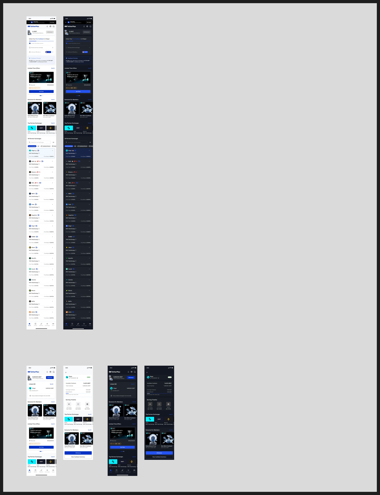 기존 디자인 카탈로그(섹션 전체) |

- 누락: `BASIC` · `Unlock Your First Cashback in 3 Steps!` · `Add Characters` · `Create TetherMax account` · `Browse partner exchange` · `Link your UID with us` · `81,836 of our users earn an average of 47.00 USDT to 284.00 USDT in cashback per month.` · `Biggest Trading Competition` · [칩] `Ends in` · `55% Total Savings`
- 다름: `Earn more cashback when you sign up` ⇄ `Earn More Cashback`

### 2.2 `dex.overview:lighter` · PC — Lighter 카드 (온보딩 후 — 보류)

Figma [28960:125521](https://www.figma.com/design/hsa3bSV9QmFTe2jsf6tzTm/UI-UX-Design?node-id=28960-125521) `DEX / Web / OA DEX overview, keys concept / Light` · 출처 색인 · 같은 문제: `dex.overview:normal`, `dex.overview:normal(모바일)`, `dex.overview:list`, `dex.overview:list(모바일)`, `dex.overview:lighter(모바일)`

| 프로토타입 | Figma |
|---|---|
| 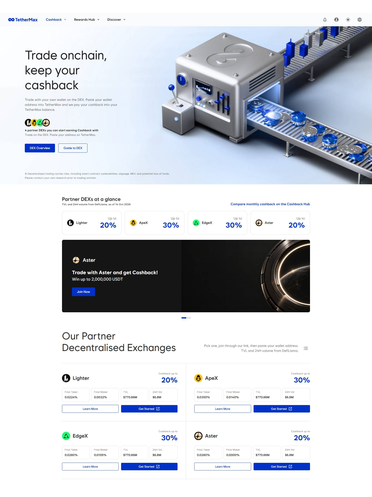 | Figma 캡처 필요(연결 후) |

- 누락: `No KYC checks. Connect a wallet, and start trading!` · `On TetherMax, from 10 USDT, to your linked wallet` · `Quiz rewards only, claimed to an exchang` · `Short lessons on decentralised perps, th` · `Join TetherMax, pick a partner DEX, and`
- 다름: `The DEX pays your cashback into your own` ⇄ `TetherMax credits your cashback to your balance. Eligible balances of 10 USDT or more are paid to your linked wallet.` · `Where you withdraw` ⇄ `Where payouts go`

### 2.3 `dex.overview:member` · PC — 로그인 — Learn and Earn 띠로 끝

Figma [28960:125522](https://www.figma.com/design/hsa3bSV9QmFTe2jsf6tzTm/UI-UX-Design?node-id=28960-125522) `DEX / Web / OA DEX overview, keys concept / Light` · 출처 색인 · 같은 문제: `dex.overview:member(모바일)`

| 프로토타입 | Figma |
|---|---|
| 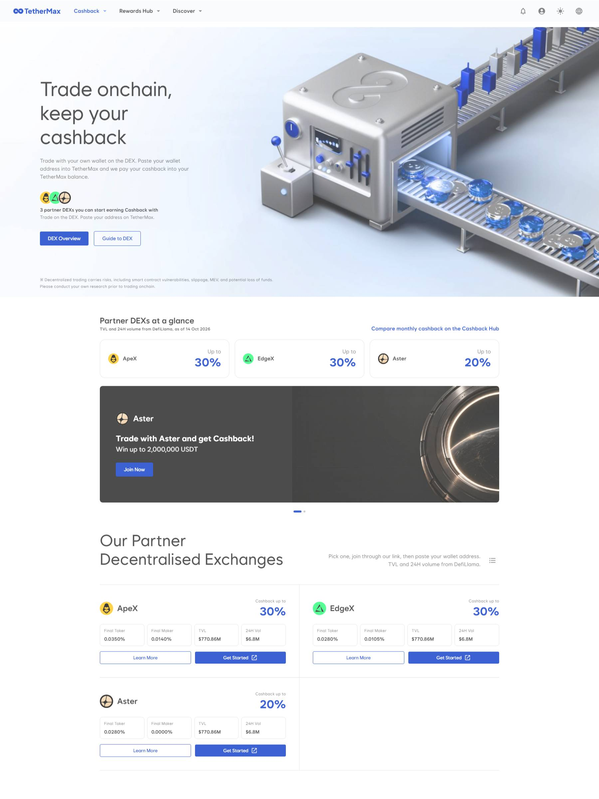 | Figma 캡처 필요(연결 후) |

- 누락: `No KYC checks. Connect a wallet, and start trading!` · `On TetherMax, from 10 USDT, to your linked wallet` · `Quiz rewards only, claimed to an exchang` · `Short lessons on decentralised perps, th`
- 다름: `The DEX pays your cashback into your own` ⇄ `TetherMax credits your cashback to your balance. Eligible balances of 10 USDT or more are paid to your linked wallet.` · `Where you withdraw` ⇄ `Where payouts go`

### 2.4 `home.main:auto` · 모바일 — 기본 — 로그인 상태(게스트·S3·S4)를 따름

Figma [22913:1051713](https://www.figma.com/design/hsa3bSV9QmFTe2jsf6tzTm/UI-UX-Design?node-id=22913-1051713) `mWeb/landingPage` · 출처 색인 · 같은 문제: `home.main:normal`

| 프로토타입 | Figma |
|---|---|
| 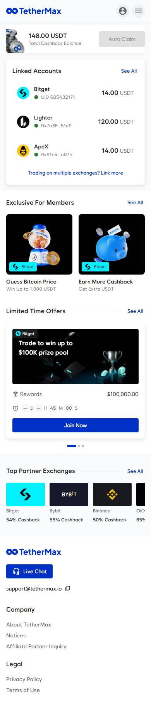 |  기존 디자인 카탈로그(섹션 전체) |

- 누락: `BASIC` · `2 UIDs` · `Total cumulative cashback` · `This month` · `Total withdrawn`
- 다름: `Using multiple exchanges? Link more UIDs` ⇄ `Trading on multiple exchanges? Link more`

### 2.5 `home.main:s3` · 모바일 — S3 연동 0 — 체크리스트 · Cashback Preview (S3-1)

Figma [4248:33574](https://www.figma.com/design/hsa3bSV9QmFTe2jsf6tzTm/UI-UX-Design?node-id=4248-33574) `mWeb/landingPage` · 출처 색인

| 프로토타입 | Figma |
|---|---|
| 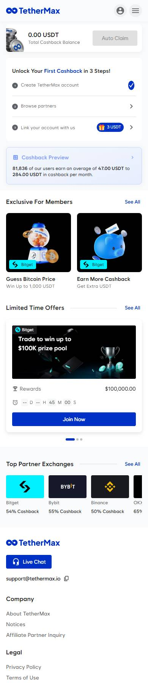 | 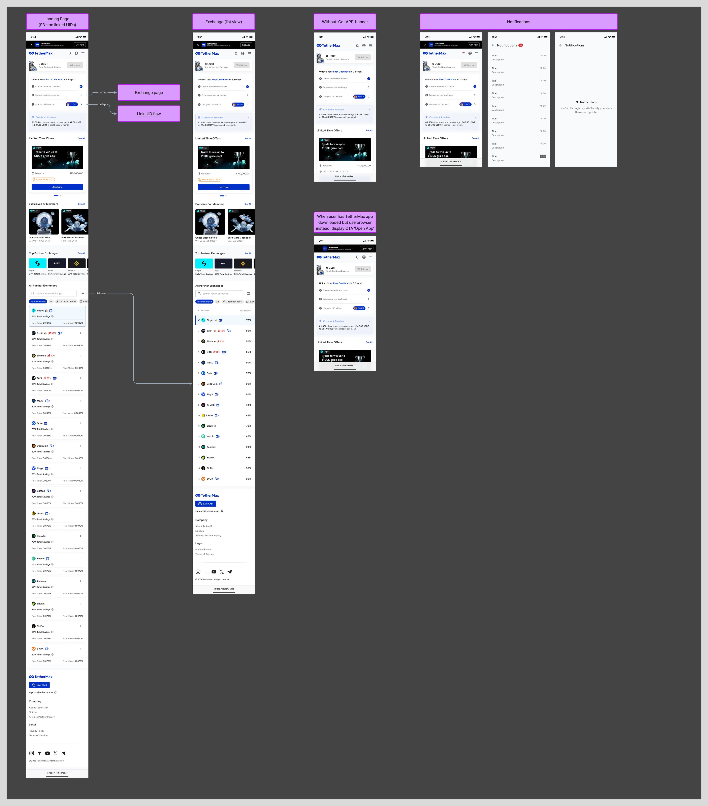 기존 디자인 카탈로그(섹션 전체) |

- 누락: `BASIC` · `Biggest Trading Competition` · [칩] `Ends in` · `55% Total Savings`
- 다름: `Browse partner exchange` ⇄ `Browse partners` · `Earn more cashback when you sign up` ⇄ `Earn More Cashback`

### 2.6 `link.select:normal` · 모바일 — 진입 — 첫 거래소 WOO X Pro 기본 선택 (G-379)

Figma [28969:126953](https://www.figma.com/design/hsa3bSV9QmFTe2jsf6tzTm/UI-UX-Design?node-id=28969-126953) `Link / Select an exchange / Light` · 출처 색인 · 같은 문제: `link.select:dexlist`, `link.select:all`, `link.select:uid`, `link.select:uidFilled`

| 프로토타입 | Figma |
|---|---|
| 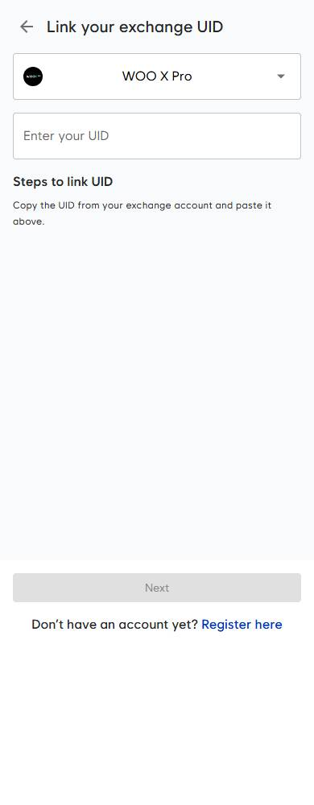 | Figma 캡처 필요(연결 후) |

- 누락: `Top Partner Exchanges` · `All exchanges (23)` · `DEX` · `54% Total Savings` · `BVOX` · `60% Total Savingst`

### 2.7 `partner.hub:total` · 모바일 — Total → 거래소별 집계 모달 (PH2)

Figma [6266:13382](https://www.figma.com/design/hsa3bSV9QmFTe2jsf6tzTm/UI-UX-Design?node-id=6266-13382) `Frame` · 출처 색인

| 프로토타입 | Figma |
|---|---|
| 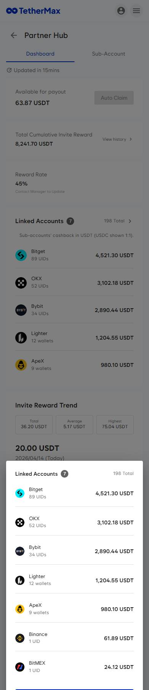 | 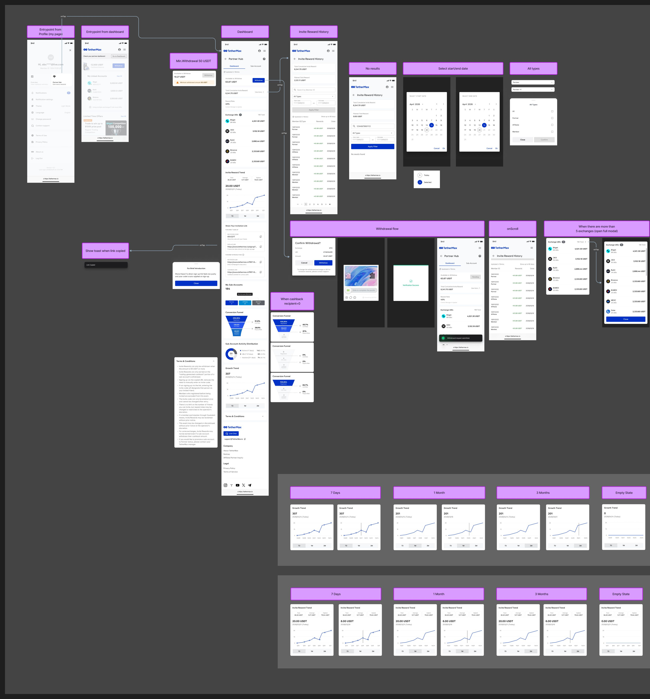 기존 디자인 카탈로그(섹션 전체) |

- 누락: `Exchange UIDs`
- 추가: `Partner Hub` · [탭] `Dashboard` · [탭] `Sub-Account` · `Updated in 15mins` · `Available for payout` · `Total Cumulative Invite Reward` · `View history` · `Reward Rate` · `Contact Manager to Update` · `Linked Accounts` · `Sub-accounts’ cashback in USDT (USDC shown 1:1).` · `12 wallets` · 외 34

### 2.8 `about.intro:normal` · PC — 기본 — 파트너 캐러셀(DEX 포함) · 출금 피드 · 거래 계정 문구

Figma [28960:129521](https://www.figma.com/design/hsa3bSV9QmFTe2jsf6tzTm/UI-UX-Design?node-id=28960-129521) `Service intro / PC / Light (DEX)` · 출처 색인

| 프로토타입 | Figma |
|---|---|
| 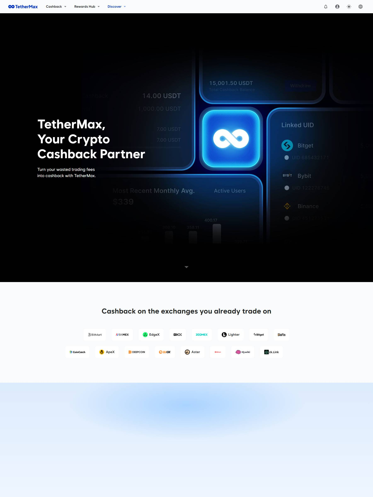 | 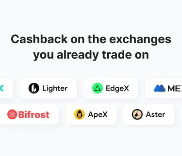 Figma 수정 후 캡처 |

- 누락: `Someone just got paid. Watch it happen.` · `Eligible account balances are paid automatically from 10 USDT.` · `Join a partner through your TetherMax referral and link your exchange UID or DEX wallet ad` · `Biggest Trading Competition`
- 다름: `Every time a trader you invite links their account and trades, you earn rewards.` ⇄ `Every time a trader you invite links an account and trades, you earn rewards.`

### 2.9 `cmn.listing:normal` · 모바일 — 표 — Recommended

Figma [5145:52544](https://www.figma.com/design/hsa3bSV9QmFTe2jsf6tzTm/UI-UX-Design?node-id=5145-52544) `mWeb/LP` · 출처 색인

| 프로토타입 | Figma |
|---|---|
| 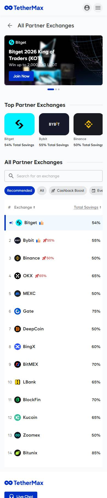 | 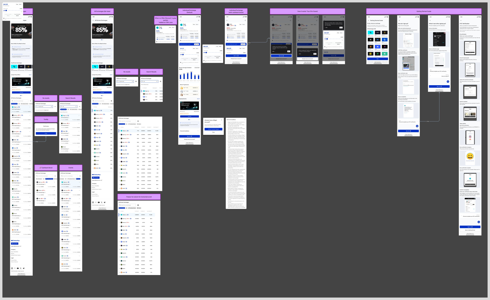 기존 디자인 카탈로그(섹션 전체) |

- 누락: `Limited Time Offers` · `Trade to win up to $100K prize pool` · `Biggest Trading Competition` · `Rewards` · [칩] `Ends in`

### 2.10 `email.pay:done` · PC — 지급 · 자동 지급 완료

Figma [29061:1451](https://www.figma.com/design/hsa3bSV9QmFTe2jsf6tzTm/UI-UX-Design?node-id=29061-1451) `지급 · 자동 지급 완료 · EN` · 출처 색인

| 프로토타입 | Figma |
|---|---|
| 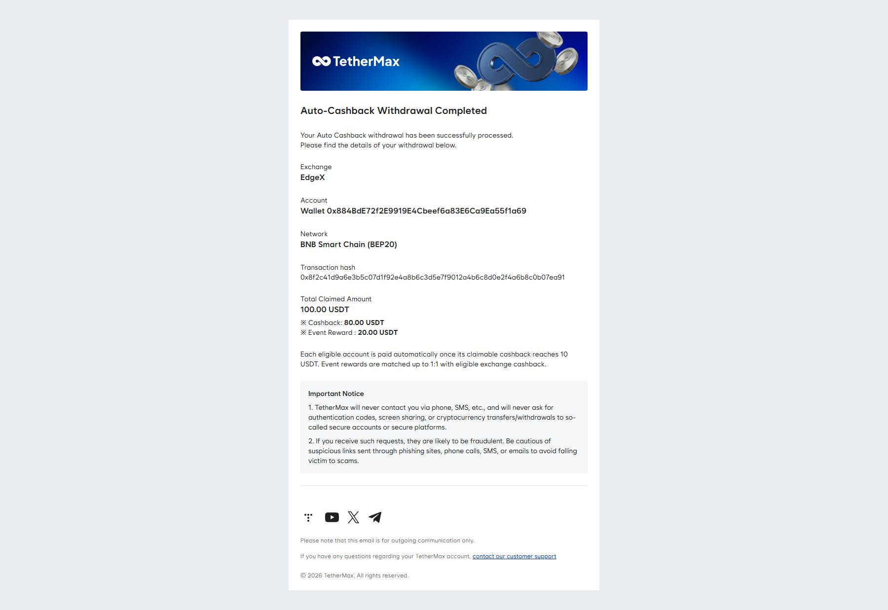 | Figma 캡처 필요(연결 후) |

- 누락: `Total Claimed Amount 100.00 USDT ※ Cashback Reward : 80.00` · `Starting November 4, 2026, TetherMax automatically processes` · `1. TetherMax will never contact you via phone, SMS, etc., an` · `Please note that this email is for outgoing communication on`
- 다름: `Your automatic cashback withdrawal has been successfully pro` ⇄ `Your Auto Cashback withdrawal has been successfully processed. Please find the details of your withdrawal below.`

### 2.11 `home.main:app` · 모바일 — 앱·모바일웹 — Wallet 라벨 없음 · 푸터 문구

Figma [8582:156599](https://www.figma.com/design/hsa3bSV9QmFTe2jsf6tzTm/UI-UX-Design?node-id=8582-156599) `mWeb/landingPage` · 출처 색인

| 프로토타입 | Figma |
|---|---|
| 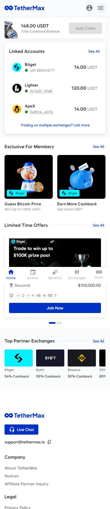 |  기존 디자인 카탈로그(섹션 전체) |

- 누락: `BASIC` · `Biggest Trading Competition` · [칩] `Ends in` · `55% Total Savings`
- 다름: `Using multiple exchanges? Link more UIDs` ⇄ `Trading on multiple exchanges? Link more`

### 2.12 `league.main:lighter` · PC — Lighter 리그 (보류)

Figma [1095:64518](https://www.figma.com/design/hsa3bSV9QmFTe2jsf6tzTm/UI-UX-Design?node-id=1095-64518) `Web` · 출처 색인 · 같은 문제: `league.main:normal`

| 프로토타입 | Figma |
|---|---|
| 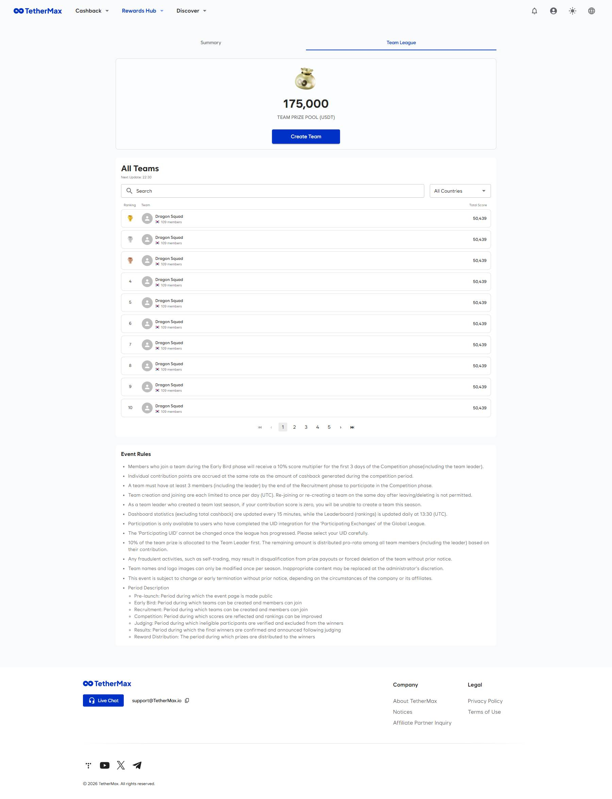 | 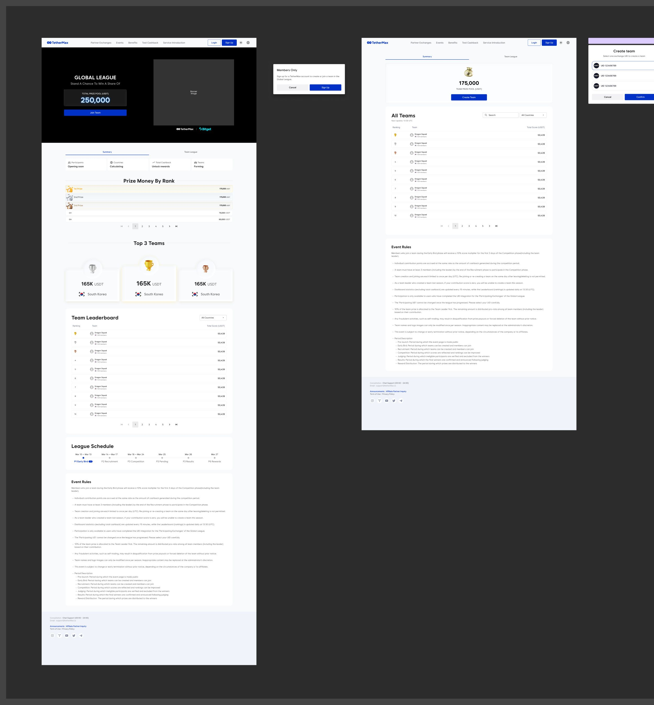 기존 디자인 카탈로그(섹션 전체) |

- 누락: `Partner Exchanges` · `Events` · `Benefits` · `Test Cashback` · `Service Introduction`

### 2.13 `email.pay:done` · 모바일 — 지급 · 자동 지급 완료

Figma [29064:2718](https://www.figma.com/design/hsa3bSV9QmFTe2jsf6tzTm/UI-UX-Design?node-id=29064-2718) `지급 · 자동 지급 완료 · EN / 모바일 375` · 출처 색인

| 프로토타입 | Figma |
|---|---|
| 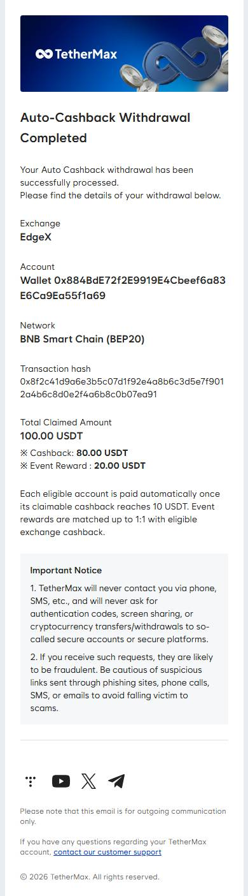 | Figma 캡처 필요(연결 후) |

- 누락: `Total Claimed Amount 100.00 USDT ※ Cashback Reward : 80.00` · `Starting November 4, 2026, TetherMax automatically processes` · `1. TetherMax will never contact you via phone, SMS, etc., an`
- 다름: `Your automatic cashback withdrawal has been successfully pro` ⇄ `Your Auto Cashback withdrawal has been successfully processed. Please find the details of your withdrawal below.`
- 추가: `BNB Smart Chain (BEP20)` · `Transaction hash` · `※ Cashback: 80.00 USDT ※ Event Reward : 20.00 USDT` · `Each eligible account is paid automatically once its claimable cashback reaches 10 USDT. E` · `1. TetherMax will never contact you via phone, SMS, etc., and will never ask for authentic` · `2. If you receive such requests, they are likely to be fraudulent. Be cautious of suspicio` · `© 2026 TetherMax. All rights reserved.`

### 2.14 `ranking.main:unranked` · 모바일 — 순위 미집계 – (RK1)

Figma [29065:6980](https://www.figma.com/design/hsa3bSV9QmFTe2jsf6tzTm/UI-UX-Design?node-id=29065-6980) `내 캐시백 랭킹 · 모바일` · 출처 색인

| 프로토타입 | Figma |
|---|---|
| 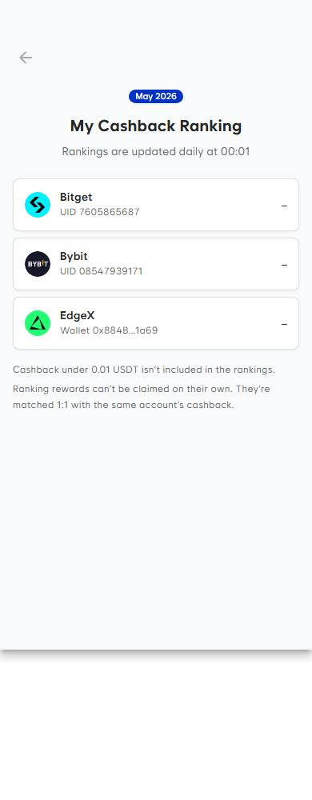 |  Figma 수정 후 캡처 |

- 누락: `Cashback Balance` · `BASIC TIER` · `Upgrade to VIP to earn 3% extra Cashback` · `Upgrade to VIP to earn +3% extra Cashback`
- 추가: `Cashback under 0.01 USDT isn’t included in the rankings.` · `Ranking rewards can’t be claimed on their own. They’re matched 1:1 with the same account’s`

### 2.15 `dex.overview:overflow` · PC — 파트너 8개 — glance 가로 넘침 (Figma 전용)

Figma [28960:125542](https://www.figma.com/design/hsa3bSV9QmFTe2jsf6tzTm/UI-UX-Design?node-id=28960-125542) `DEX / Web / OA DEX overview, 8 partner DEXs (overflow) / Light` · 출처 색인

| 프로토타입 | Figma |
|---|---|
| 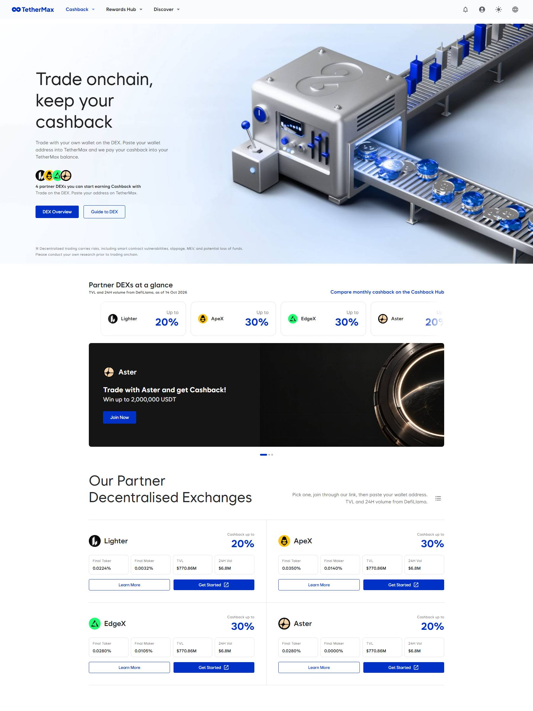 |  Figma 수정 후 캡처 |

- 누락: `Quiz rewards only, claimed to an exchang` · `Short lessons on decentralised perps, th` · `Join TetherMax, pick a partner DEX, and`
- 다름: `The DEX pays your cashback into your own` ⇄ `TetherMax credits your cashback to your balance. Eligible balances of 10 USDT or more are paid to your linked wallet.`

### 2.16 `landing.main:normal` · PC — 기본 — Our Partners·Featured에 DEX 포함 (PLP)

Figma [28960:128375](https://www.figma.com/design/hsa3bSV9QmFTe2jsf6tzTm/UI-UX-Design?node-id=28960-128375) `Landing / Desktop / Light (DEX)` · 출처 색인

| 프로토타입 | Figma |
|---|---|
| 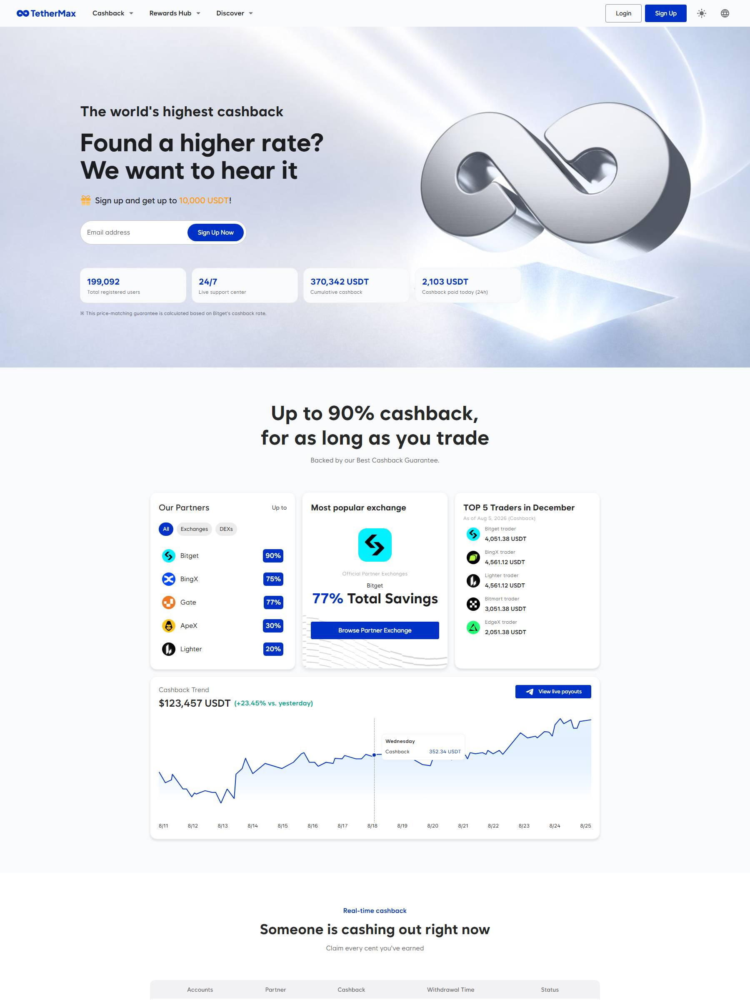 | 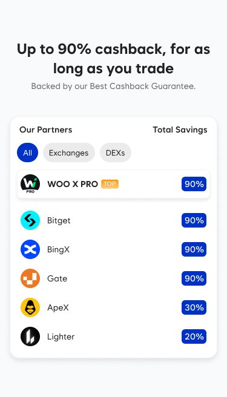 Figma 수정 후 캡처 |

- 누락: `Payout Time` · `Wallet ********...51e9` · `Biggest Trading Competition` · `#Title`

### 2.17 `benefits.list:normal` · 모바일 — 회원 · 진행 중

Figma [17170:172813](https://www.figma.com/design/hsa3bSV9QmFTe2jsf6tzTm/UI-UX-Design?node-id=17170-172813) `Frame 1984078611` · 출처 색인

| 프로토타입 | Figma |
|---|---|
| 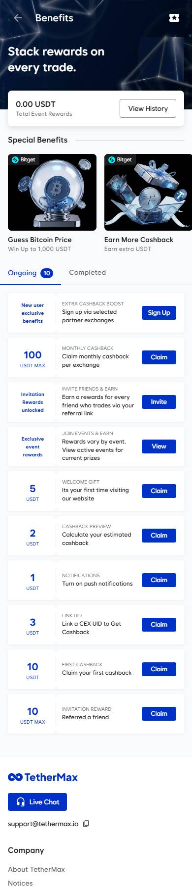 | 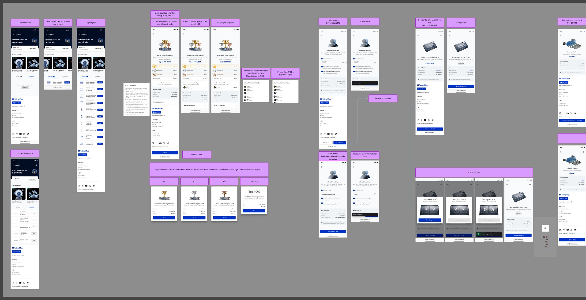 기존 디자인 카탈로그(섹션 전체) |

- 추가: `Benefits` · `Stack rewards on every trade.` · `Total Event Rewards` · [버튼] `View History` · `Special Benefits` · `Guess Bitcoin Price` · `Win Up to 1,000 USDT` · `Earn More Cashback` · `Earn extra USDT` · [탭] `Ongoing 10` · [탭] `Completed` · `New user exclusive benefits` · 외 27

### 2.18 `league.main:createPick` · 모바일 — 팀 생성 계정 선택

Figma [29062:110984](https://www.figma.com/design/hsa3bSV9QmFTe2jsf6tzTm/UI-UX-Design?node-id=29062-110984) `리그 · 팀 생성 계정 선택 / 모바일` · 출처 색인

| 프로토타입 | Figma |
|---|---|
| 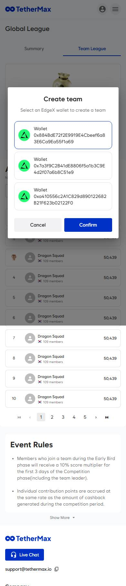 | Figma 캡처 필요(연결 후) |

- 추가: `Global League` · `Summary` · `Team League` · `TEAM PRIZE POOL (USDT)` · `All Teams` · `Next Update: 22:30` · `Search` · `Ranking` · `Total Score` · `Dragon Squad` · `Event Rules` · `Members who join a team during the Early Bird phase will receive a 10% score multiplier fo` · 외 20

### 2.19 `quiz.article:member5` · PC — 회원 · 모듈 5 (Take the Quiz)

Figma [28960:130685](https://www.figma.com/design/hsa3bSV9QmFTe2jsf6tzTm/UI-UX-Design?node-id=28960-130685) `Signed In, Module 5` · 출처 색인

| 프로토타입 | Figma |
|---|---|
| 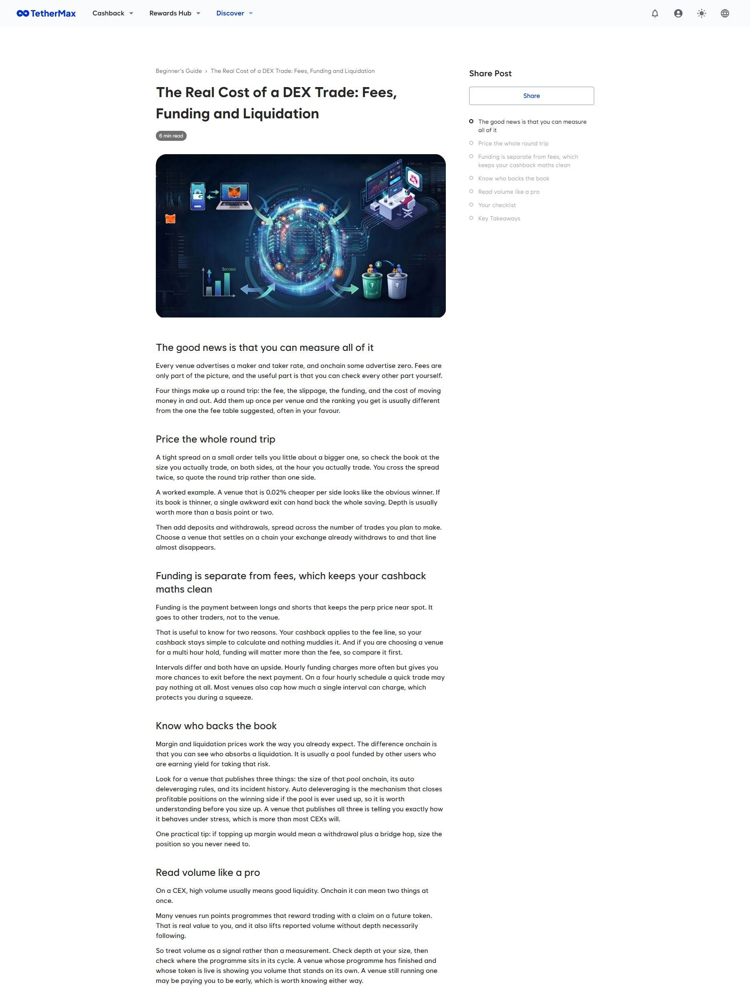 | Figma 캡처 필요(연결 후) |

- 누락: `Funding is the payment between longs and shorts that keeps the perp price near spot. It go` · `The headline fee is one of four costs. Add fees, slippage at your size, funding, and the c`
- 다름: `Build one number per venue: fees plus slippage at your size, both sides, plus the cost of getting in and out. Apply your cashback to the fee part. If you hold for hours, compare funding before fees. Prefer venues that publish their liquidation pool. It takes about ten minutes once, and it usually saves more than the rebate does.` ⇄ `Build one number per venue: fees plus slippage at your size, both sides, plus the cost of getting in and out. Apply your cashback to the fee part. If you hold for hours, compare funding before fees. Prefer venues that publish their liquidation pool. It takes about ten minutes once, and it usually saves more than the cashback does.`
- 추가: `That is useful to know for two reasons. Your cashback applies to the fee line, so your cas` · `Your cashback applies to the fee line. Funding goes to other traders rather than the venue`

### 2.20 `home.main:multi` · 모바일 — 같은 DEX 지갑 3개 · Aster 하위 계정

Figma [7633:92140](https://www.figma.com/design/hsa3bSV9QmFTe2jsf6tzTm/UI-UX-Design?node-id=7633-92140) `mWeb/landingPage` · 출처 색인

| 프로토타입 | Figma |
|---|---|
| 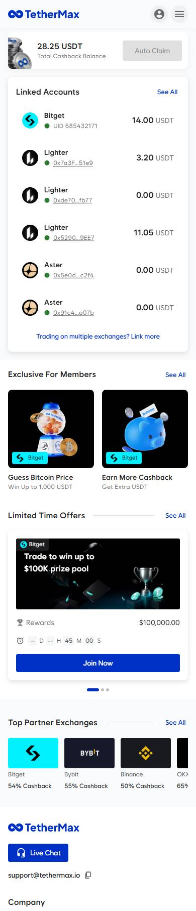 |  기존 디자인 카탈로그(섹션 전체) |

- 누락: `BASIC` · `2 UIDs`
- 다름: `Using multiple exchanges? Link more UIDs` ⇄ `Trading on multiple exchanges? Link more`

## 3. 화면별 불일치 표

이 표만 보면 됩니다. 한 행 = 상태 × 뷰 × 구분. 문제 없는 상태는 4장 집계에만 나옵니다.

### 1. 공통 · 셸 (헤더·푸터·공지·약관)

| 화면:상태 | 뷰 | Figma 노드 | 구분 | 내용 |
|---|---|---|---|---|
| `cmn.listing:normal` 표 — Recommended | PC | [22598:410917](https://www.figma.com/design/hsa3bSV9QmFTe2jsf6tzTm/UI-UX-Design?node-id=22598-410917) (없음) | ⚠ 노드 없음 | 색인·수정결과 어디에도 없는 노드 — 노드 id 확인 또는 Figma 연결 후 재실행 |
| `cmn.listing:normal` 표 — Recommended | 모바일 | [5145:52544](https://www.figma.com/design/hsa3bSV9QmFTe2jsf6tzTm/UI-UX-Design?node-id=5145-52544) | 누락 5 | `Limited Time Offers` · `Trade to win up to $100K prize pool` · `Biggest Trading Competition` · `Rewards` · [칩] `Ends in` |

### 2. 랜딩 · 서비스 소개

| 화면:상태 | 뷰 | Figma 노드 | 구분 | 내용 |
|---|---|---|---|---|
| `landing.main:normal` 기본 — Our Partners·Featured에 DEX 포함 (PLP) | PC | [28960:128375](https://www.figma.com/design/hsa3bSV9QmFTe2jsf6tzTm/UI-UX-Design?node-id=28960-128375) | 누락 4 | `Payout Time` · `Wallet ********...51e9` · `Biggest Trading Competition` · `#Title` |
| `about.intro:normal` 기본 — 파트너 캐러셀(DEX 포함) · 출금 피드 · 거래 계정 문구 | PC | [28960:129521](https://www.figma.com/design/hsa3bSV9QmFTe2jsf6tzTm/UI-UX-Design?node-id=28960-129521) | 누락 4 | `Someone just got paid. Watch it happen.` · `Eligible account balances are paid automatically from 10 USDT.` · `Join a partner through your TetherMax referral and link your exchange UID or DEX wallet ad` · `Biggest Trading Competition` |
| `about.intro:normal` 기본 — 파트너 캐러셀(DEX 포함) · 출금 피드 · 거래 계정 문구 | PC | [28960:129521](https://www.figma.com/design/hsa3bSV9QmFTe2jsf6tzTm/UI-UX-Design?node-id=28960-129521) | 다름 1 | `Every time a trader you invite links their account and trades, you ear` ⇄ `Every time a trader you invite links an account and trades, you earn r` |
| `about.feed:normal` CEX·DEX 시간순 · DEX 배지 · 마스킹 | PC | [28960:128520](https://www.figma.com/design/hsa3bSV9QmFTe2jsf6tzTm/UI-UX-Design?node-id=28960-128520) | 누락 2 | `Payout Time` · `Wallet ********...51e9` |

### 3. 비회원 캐시백 조회

| 화면:상태 | 뷰 | Figma 노드 | 구분 | 내용 |
|---|---|---|---|---|
| `guest.search:search` 검색 · 초기 | PC | [29035:97622](https://www.figma.com/design/hsa3bSV9QmFTe2jsf6tzTm/UI-UX-Design?node-id=29035-97622) | 추가 4 | `No account? Join our partner exchange ⟶` · `Don't leave your cashback behind.` · `Sign up or log in and link this trading account to receive your cashback.` · `Email address` |
| `guest.search:search` 검색 · 초기 | 모바일 | [29035:97732](https://www.figma.com/design/hsa3bSV9QmFTe2jsf6tzTm/UI-UX-Design?node-id=29035-97732) | 누락 1 | `Sign up in the app and earn more cashback` |
| `guest.search:emptydex` DEX 선택 · 입력 대기 | PC | [29037:102201](https://www.figma.com/design/hsa3bSV9QmFTe2jsf6tzTm/UI-UX-Design?node-id=29037-102201) | 추가 4 | `No account? Join our partner exchange ⟶` · `Don't leave your cashback behind.` · `Sign up or log in and link this trading account to receive your cashback.` · `Email address` |
| `guest.search:emptydex` DEX 선택 · 입력 대기 | 모바일 | [29037:102272](https://www.figma.com/design/hsa3bSV9QmFTe2jsf6tzTm/UI-UX-Design?node-id=29037-102272) | 누락 1 | `Sign up in the app and earn more cashback` |
| `guest.search:emptycex` CEX 선택 · 입력 대기 | PC | [29037:102332](https://www.figma.com/design/hsa3bSV9QmFTe2jsf6tzTm/UI-UX-Design?node-id=29037-102332) | 추가 4 | `No account? Join our partner exchange ⟶` · `Don't leave your cashback behind.` · `Sign up or log in and link this trading account to receive your cashback.` · `Email address` |
| `guest.search:emptycex` CEX 선택 · 입력 대기 | 모바일 | [29037:102403](https://www.figma.com/design/hsa3bSV9QmFTe2jsf6tzTm/UI-UX-Design?node-id=29037-102403) | 누락 1 | `Sign up in the app and earn more cashback` |
| `guest.search:dex` DEX · 지갑 주소 입력 완료 | PC | [29035:98155](https://www.figma.com/design/hsa3bSV9QmFTe2jsf6tzTm/UI-UX-Design?node-id=29035-98155) | 추가 4 | `No account? Join our partner exchange ⟶` · `Don't leave your cashback behind.` · `Sign up or log in and link this trading account to receive your cashback.` · `Email address` |
| `guest.search:dex` DEX · 지갑 주소 입력 완료 | 모바일 | [29035:98218](https://www.figma.com/design/hsa3bSV9QmFTe2jsf6tzTm/UI-UX-Design?node-id=29035-98218) | 누락 1 | `Sign up in the app and earn more cashback` |
| `guest.search:cex` CEX · UID 입력 완료 | PC | [29035:98278](https://www.figma.com/design/hsa3bSV9QmFTe2jsf6tzTm/UI-UX-Design?node-id=29035-98278) | 추가 4 | `No account? Join our partner exchange ⟶` · `Don't leave your cashback behind.` · `Sign up or log in and link this trading account to receive your cashback.` · `Email address` |
| `guest.search:cex` CEX · UID 입력 완료 | 모바일 | [29035:98341](https://www.figma.com/design/hsa3bSV9QmFTe2jsf6tzTm/UI-UX-Design?node-id=29035-98341) | 누락 1 | `Sign up in the app and earn more cashback` |
| `guest.search:bad` 입력 오류 · 선택 거래소 기준 | PC | [29035:98401](https://www.figma.com/design/hsa3bSV9QmFTe2jsf6tzTm/UI-UX-Design?node-id=29035-98401) | 추가 4 | `No account? Join our partner exchange ⟶` · `Don't leave your cashback behind.` · `Sign up or log in and link this trading account to receive your cashback.` · `Email address` |
| `guest.search:bad` 입력 오류 · 선택 거래소 기준 | 모바일 | [29035:98465](https://www.figma.com/design/hsa3bSV9QmFTe2jsf6tzTm/UI-UX-Design?node-id=29035-98465) | 누락 1 | `Sign up in the app and earn more cashback` |
| `guest.search:loading` 거래소 조회 중 | PC | [29035:98526](https://www.figma.com/design/hsa3bSV9QmFTe2jsf6tzTm/UI-UX-Design?node-id=29035-98526) | 추가 4 | `No account? Join our partner exchange ⟶` · `Don't leave your cashback behind.` · `Sign up or log in and link this trading account to receive your cashback.` · `Email address` |
| `guest.search:loading` 거래소 조회 중 | 모바일 | [29035:98580](https://www.figma.com/design/hsa3bSV9QmFTe2jsf6tzTm/UI-UX-Design?node-id=29035-98580) | 누락 1 | `Sign up in the app and earn more cashback` |
| `guest.result:above` 조회 성공 · 10 USDT 이상 | PC | [29035:97792](https://www.figma.com/design/hsa3bSV9QmFTe2jsf6tzTm/UI-UX-Design?node-id=29035-97792) | 다름 1 | `10 USDT minimum reached. Link to receive payouts.` ⇄ `10 USDT minimum reached. Link this account to receive it.` |
| `guest.result:above` 조회 성공 · 10 USDT 이상 | PC | [29035:97792](https://www.figma.com/design/hsa3bSV9QmFTe2jsf6tzTm/UI-UX-Design?node-id=29035-97792) | 추가 1 | `Search again` |
| `guest.result:above` 조회 성공 · 10 USDT 이상 | 모바일 | [29035:97855](https://www.figma.com/design/hsa3bSV9QmFTe2jsf6tzTm/UI-UX-Design?node-id=29035-97855) | 다름 2 | `10 USDT minimum reached. Link to receive payouts.` ⇄ `10 USDT minimum reached. Link this account to receive it.` · `Earn more cashback when you sign up` ⇄ `Earn More Cashback` |
| `guest.result:below` 조회 성공 · 10 USDT 미만 | PC | [29035:98631](https://www.figma.com/design/hsa3bSV9QmFTe2jsf6tzTm/UI-UX-Design?node-id=29035-98631) | 추가 1 | `Search again` |
| `guest.result:below` 조회 성공 · 10 USDT 미만 | 모바일 | [29035:98694](https://www.figma.com/design/hsa3bSV9QmFTe2jsf6tzTm/UI-UX-Design?node-id=29035-98694) | 다름 1 | `Earn more cashback when you sign up` ⇄ `Earn More Cashback` |
| `guest.result:zero` 조회 성공 · 잔액 0 | PC | [29035:98754](https://www.figma.com/design/hsa3bSV9QmFTe2jsf6tzTm/UI-UX-Design?node-id=29035-98754) | 추가 1 | `Search again` |
| `guest.result:zero` 조회 성공 · 잔액 0 | 모바일 | [29035:98817](https://www.figma.com/design/hsa3bSV9QmFTe2jsf6tzTm/UI-UX-Design?node-id=29035-98817) | 다름 1 | `Earn more cashback when you sign up` ⇄ `Earn More Cashback` |
| `guest.result:belowcex` CEX · UID 잔액 조회 성공 | PC | [29035:99309](https://www.figma.com/design/hsa3bSV9QmFTe2jsf6tzTm/UI-UX-Design?node-id=29035-99309) | 추가 1 | `Search again` |
| `guest.result:belowcex` CEX · UID 잔액 조회 성공 | 모바일 | [29035:99372](https://www.figma.com/design/hsa3bSV9QmFTe2jsf6tzTm/UI-UX-Design?node-id=29035-99372) | 다름 1 | `Earn more cashback when you sign up` ⇄ `Earn More Cashback` |
| `guest.result:handoff` 로그인 후 · 계정 미연동 (DEX) | PC | [29035:97915](https://www.figma.com/design/hsa3bSV9QmFTe2jsf6tzTm/UI-UX-Design?node-id=29035-97915) | 추가 1 | `Search again` |
| `guest.result:handoff` 로그인 후 · 계정 미연동 (DEX) | 모바일 | [29035:97974](https://www.figma.com/design/hsa3bSV9QmFTe2jsf6tzTm/UI-UX-Design?node-id=29035-97974) | 누락 1 | `Manage your cashback in the TetherMax app` |
| `guest.result:handoffcex` CEX · 로그인 후 같은 UID 연동 | PC | [29037:102463](https://www.figma.com/design/hsa3bSV9QmFTe2jsf6tzTm/UI-UX-Design?node-id=29037-102463) | 추가 1 | `Search again` |
| `guest.result:handoffcex` CEX · 로그인 후 같은 UID 연동 | 모바일 | [29037:102530](https://www.figma.com/design/hsa3bSV9QmFTe2jsf6tzTm/UI-UX-Design?node-id=29037-102530) | 누락 1 | `Manage your cashback in the TetherMax app` |
| `guest.modal:picker` 거래소 선택 | 모바일 | [29035:98094](https://www.figma.com/design/hsa3bSV9QmFTe2jsf6tzTm/UI-UX-Design?node-id=29035-98094) | 누락 1 | `Sign up in the app and earn more cashback` |
| `guest.entry:normal` 모바일 홈 푸터 → Claim Cashback | 모바일 | [29037:113704](https://www.figma.com/design/hsa3bSV9QmFTe2jsf6tzTm/UI-UX-Design?node-id=29037-113704) | 추가 8 | `YUN SI YUN` · `Official TetherMax Ambassador` · `Found a higher rate? We want to hear it` · `Sign up and get up to 10,000 USDT !` · `Email address` · [버튼] `Sign Up Now` · `Total registered users` · `Live support center` |

### 4. 홈 · 잔액 · 지갑 상세

| 화면:상태 | 뷰 | Figma 노드 | 구분 | 내용 |
|---|---|---|---|---|
| `home.main:auto` 기본 — 로그인 상태(게스트·S3·S4)를 따름 | 모바일 | [22913:1051713](https://www.figma.com/design/hsa3bSV9QmFTe2jsf6tzTm/UI-UX-Design?node-id=22913-1051713) | 누락 5 | `BASIC` · `2 UIDs` · `Total cumulative cashback` · `This month` · `Total withdrawn` |
| `home.main:auto` 기본 — 로그인 상태(게스트·S3·S4)를 따름 | 모바일 | [22913:1051713](https://www.figma.com/design/hsa3bSV9QmFTe2jsf6tzTm/UI-UX-Design?node-id=22913-1051713) | 다름 1 | `Using multiple exchanges? Link more UIDs` ⇄ `Trading on multiple exchanges? Link more` |
| `home.main:guest` 비로그인 — 공개 화면 (home/S4#guest) | 모바일 | [29037:113704](https://www.figma.com/design/hsa3bSV9QmFTe2jsf6tzTm/UI-UX-Design?node-id=29037-113704) | 추가 20 | `YUN SI YUN` · `Official TetherMax Ambassador` · `Found a higher rate? We want to hear it` · `Sign up and get up to 10,000 USDT!` · `Email address` · [버튼] `Sign Up Now` · `Total registered users` · `Live support center` · 외 12 |
| `home.main:s3` S3 연동 0 — 체크리스트 · Cashback Preview (S3-1) | 모바일 | [4248:33574](https://www.figma.com/design/hsa3bSV9QmFTe2jsf6tzTm/UI-UX-Design?node-id=4248-33574) | 누락 4 | `BASIC` · `Biggest Trading Competition` · [칩] `Ends in` · `55% Total Savings` |
| `home.main:s3` S3 연동 0 — 체크리스트 · Cashback Preview (S3-1) | 모바일 | [4248:33574](https://www.figma.com/design/hsa3bSV9QmFTe2jsf6tzTm/UI-UX-Design?node-id=4248-33574) | 다름 2 | `Browse partner exchange` ⇄ `Browse partners` · `Earn more cashback when you sign up` ⇄ `Earn More Cashback` |
| `home.main:s3App` S3 앱·모바일웹 빈 홈 카드 | 모바일 | [8582:154521](https://www.figma.com/design/hsa3bSV9QmFTe2jsf6tzTm/UI-UX-Design?node-id=8582-154521) | 누락 10 | `BASIC` · `Unlock Your First Cashback in 3 Steps!` · `Add Characters` · `Create TetherMax account` · `Browse partner exchange` · `Link your UID with us` · `81,836 of our users earn an average of 47.00 USDT to 284.00 USDT in cashback per month.` · `Biggest Trading Competition` · [칩] `Ends in` · `55% Total Savings` |
| `home.main:s3App` S3 앱·모바일웹 빈 홈 카드 | 모바일 | [8582:154521](https://www.figma.com/design/hsa3bSV9QmFTe2jsf6tzTm/UI-UX-Design?node-id=8582-154521) | 다름 1 | `Earn more cashback when you sign up` ⇄ `Earn More Cashback` |
| `home.main:normal` S4 연동 있음 — CEX·DEX 한 목록 (S4-1) | 모바일 | [22913:1051713](https://www.figma.com/design/hsa3bSV9QmFTe2jsf6tzTm/UI-UX-Design?node-id=22913-1051713) | 누락 5 | `BASIC` · `2 UIDs` · `Total cumulative cashback` · `This month` · `Total withdrawn` |
| `home.main:normal` S4 연동 있음 — CEX·DEX 한 목록 (S4-1) | 모바일 | [22913:1051713](https://www.figma.com/design/hsa3bSV9QmFTe2jsf6tzTm/UI-UX-Design?node-id=22913-1051713) | 다름 1 | `Using multiple exchanges? Link more UIDs` ⇄ `Trading on multiple exchanges? Link more` |
| `home.main:errToast` 공통 오류 토스트 — Something went wrong. Please try again. | PC | [29449:145568](https://www.figma.com/design/hsa3bSV9QmFTe2jsf6tzTm/UI-UX-Design?node-id=29449-145568) (보정) | 누락 1 | `Error` |
| `home.main:app` 앱·모바일웹 — Wallet 라벨 없음 · 푸터 문구 | 모바일 | [8582:156599](https://www.figma.com/design/hsa3bSV9QmFTe2jsf6tzTm/UI-UX-Design?node-id=8582-156599) | 누락 4 | `BASIC` · `Biggest Trading Competition` · [칩] `Ends in` · `55% Total Savings` |
| `home.main:app` 앱·모바일웹 — Wallet 라벨 없음 · 푸터 문구 | 모바일 | [8582:156599](https://www.figma.com/design/hsa3bSV9QmFTe2jsf6tzTm/UI-UX-Design?node-id=8582-156599) | 다름 1 | `Using multiple exchanges? Link more UIDs` ⇄ `Trading on multiple exchanges? Link more` |
| `home.main:multi` 같은 DEX 지갑 3개 · Aster 하위 계정 | 모바일 | [7633:92140](https://www.figma.com/design/hsa3bSV9QmFTe2jsf6tzTm/UI-UX-Design?node-id=7633-92140) | 누락 2 | `BASIC` · `2 UIDs` |
| `home.main:multi` 같은 DEX 지갑 3개 · Aster 하위 계정 | 모바일 | [7633:92140](https://www.figma.com/design/hsa3bSV9QmFTe2jsf6tzTm/UI-UX-Design?node-id=7633-92140) | 다름 1 | `Using multiple exchanges? Link more UIDs` ⇄ `Trading on multiple exchanges? Link more` |
| `home.wallet:noReward` 리워드 없음 · 최소액 이상 — Event Reward 행 없음 | PC | [29026:97581](https://www.figma.com/design/hsa3bSV9QmFTe2jsf6tzTm/UI-UX-Design?node-id=29026-97581) | 누락 2 | `Total event reward` · `Matched 0.00 / 8.00 USDT in event rewards Claimable 0.00 USDT · Minimum 10 USDT Additional` |
| `home.wallet:noReward` 리워드 없음 · 최소액 이상 — Event Reward 행 없음 | PC | [29026:97581](https://www.figma.com/design/hsa3bSV9QmFTe2jsf6tzTm/UI-UX-Design?node-id=29026-97581) | 추가 9 | `Active` · `How was Lighter?` · `Your first review earns you 2 USDT. It takes about a minute.` · `Exclusive Benefit` · `Predict Bitcoin price and win up to 1,000.00 USDT` · `Up to 1,000.00 USDT` · `Ongoing` · `Earn More Cashback. Earn Extra USDT` · 외 1 |
| `home.wallet:zero` 모든 적립 잔액 0 | PC | [29026:97581](https://www.figma.com/design/hsa3bSV9QmFTe2jsf6tzTm/UI-UX-Design?node-id=29026-97581) | 누락 2 | `Total event reward` · `Matched 7.00 / 100.00 USDT in event rewards Claimable 14.00 USDT · Minimum 10 USDT` |
| `home.wallet:zero` 모든 적립 잔액 0 | PC | [29026:97581](https://www.figma.com/design/hsa3bSV9QmFTe2jsf6tzTm/UI-UX-Design?node-id=29026-97581) | 추가 9 | `Active` · `How was Lighter?` · `Your first review earns you 2 USDT. It takes about a minute.` · `Exclusive Benefit` · `Predict Bitcoin price and win up to 1,000.00 USDT` · `Up to 1,000.00 USDT` · `Ongoing` · `Earn More Cashback. Earn Extra USDT` · 외 1 |
| `home.wallet:cashBelow` 캐시백만 보유 · 최소액 미만 | PC | [29026:97581](https://www.figma.com/design/hsa3bSV9QmFTe2jsf6tzTm/UI-UX-Design?node-id=29026-97581) | 누락 2 | `Total event reward` · `Matched 7.00 / 100.00 USDT in event rewards Claimable 14.00 USDT · Minimum 10 USDT` |
| `home.wallet:cashBelow` 캐시백만 보유 · 최소액 미만 | PC | [29026:97581](https://www.figma.com/design/hsa3bSV9QmFTe2jsf6tzTm/UI-UX-Design?node-id=29026-97581) | 추가 9 | `Active` · `How was Lighter?` · `Your first review earns you 2 USDT. It takes about a minute.` · `Exclusive Benefit` · `Predict Bitcoin price and win up to 1,000.00 USDT` · `Up to 1,000.00 USDT` · `Ongoing` · `Earn More Cashback. Earn Extra USDT` · 외 1 |
| `home.wallet:rewardOnly` 리워드만 보유 | PC | [29026:97581](https://www.figma.com/design/hsa3bSV9QmFTe2jsf6tzTm/UI-UX-Design?node-id=29026-97581) | 다름 1 | `Total event reward` ⇄ `Event Reward` |
| `home.wallet:rewardOnly` 리워드만 보유 | PC | [29026:97581](https://www.figma.com/design/hsa3bSV9QmFTe2jsf6tzTm/UI-UX-Design?node-id=29026-97581) | 추가 9 | `Active` · `How was Lighter?` · `Your first review earns you 2 USDT. It takes about a minute.` · `Exclusive Benefit` · `Predict Bitcoin price and win up to 1,000.00 USDT` · `Up to 1,000.00 USDT` · `Ongoing` · `Earn More Cashback. Earn Extra USDT` · 외 1 |
| `home.wallet:partialBelow` 부분 매칭 · 최소액 미만 | PC | [29026:97581](https://www.figma.com/design/hsa3bSV9QmFTe2jsf6tzTm/UI-UX-Design?node-id=29026-97581) | 다름 1 | `Total event reward` ⇄ `Event Reward` |
| `home.wallet:partialBelow` 부분 매칭 · 최소액 미만 | PC | [29026:97581](https://www.figma.com/design/hsa3bSV9QmFTe2jsf6tzTm/UI-UX-Design?node-id=29026-97581) | 추가 9 | `Active` · `How was Lighter?` · `Your first review earns you 2 USDT. It takes about a minute.` · `Exclusive Benefit` · `Predict Bitcoin price and win up to 1,000.00 USDT` · `Up to 1,000.00 USDT` · `Ongoing` · `Earn More Cashback. Earn Extra USDT` · 외 1 |
| `home.wallet:fullBelow` 전액 매칭 · 최소액 미만 | PC | [29026:97581](https://www.figma.com/design/hsa3bSV9QmFTe2jsf6tzTm/UI-UX-Design?node-id=29026-97581) | 다름 1 | `Total event reward` ⇄ `Event Reward` |
| `home.wallet:fullBelow` 전액 매칭 · 최소액 미만 | PC | [29026:97581](https://www.figma.com/design/hsa3bSV9QmFTe2jsf6tzTm/UI-UX-Design?node-id=29026-97581) | 추가 9 | `Active` · `How was Lighter?` · `Your first review earns you 2 USDT. It takes about a minute.` · `Exclusive Benefit` · `Predict Bitcoin price and win up to 1,000.00 USDT` · `Up to 1,000.00 USDT` · `Ongoing` · `Earn More Cashback. Earn Extra USDT` · 외 1 |
| `home.wallet:fullEqual` 전액 매칭 · 최소액과 일치 | PC | [29026:97581](https://www.figma.com/design/hsa3bSV9QmFTe2jsf6tzTm/UI-UX-Design?node-id=29026-97581) | 누락 1 | `Claimable 0.00 USDT · Minimum 10 USDT Additional exchange cashback needed: 10.00 USDT` |
| `home.wallet:fullEqual` 전액 매칭 · 최소액과 일치 | PC | [29026:97581](https://www.figma.com/design/hsa3bSV9QmFTe2jsf6tzTm/UI-UX-Design?node-id=29026-97581) | 다름 1 | `Total event reward` ⇄ `Event Reward` |
| `home.wallet:fullEqual` 전액 매칭 · 최소액과 일치 | PC | [29026:97581](https://www.figma.com/design/hsa3bSV9QmFTe2jsf6tzTm/UI-UX-Design?node-id=29026-97581) | 추가 9 | `Active` · `How was Lighter?` · `Your first review earns you 2 USDT. It takes about a minute.` · `Exclusive Benefit` · `Predict Bitcoin price and win up to 1,000.00 USDT` · `Up to 1,000.00 USDT` · `Ongoing` · `Earn More Cashback. Earn Extra USDT` · 외 1 |
| `home.wallet:fullAbove` 전액 매칭 · 최소액 초과 | PC | [29026:97581](https://www.figma.com/design/hsa3bSV9QmFTe2jsf6tzTm/UI-UX-Design?node-id=29026-97581) | 누락 1 | `Claimable 0.00 USDT · Minimum 10 USDT Additional exchange cashback needed: 10.00 USDT` |
| `home.wallet:fullAbove` 전액 매칭 · 최소액 초과 | PC | [29026:97581](https://www.figma.com/design/hsa3bSV9QmFTe2jsf6tzTm/UI-UX-Design?node-id=29026-97581) | 다름 1 | `Total event reward` ⇄ `Event Reward` |
| `home.wallet:fullAbove` 전액 매칭 · 최소액 초과 | PC | [29026:97581](https://www.figma.com/design/hsa3bSV9QmFTe2jsf6tzTm/UI-UX-Design?node-id=29026-97581) | 추가 9 | `Active` · `How was Lighter?` · `Your first review earns you 2 USDT. It takes about a minute.` · `Exclusive Benefit` · `Predict Bitcoin price and win up to 1,000.00 USDT` · `Up to 1,000.00 USDT` · `Ongoing` · `Earn More Cashback. Earn Extra USDT` · 외 1 |
| `home.wallet:edge` 소수점 절삭 · 기준 직전 | PC | [29026:97581](https://www.figma.com/design/hsa3bSV9QmFTe2jsf6tzTm/UI-UX-Design?node-id=29026-97581) | 누락 2 | `Total event reward` · `Matched 7.00 / 100.00 USDT in event rewards Claimable 14.00 USDT · Minimum 10 USDT` |
| `home.wallet:edge` 소수점 절삭 · 기준 직전 | PC | [29026:97581](https://www.figma.com/design/hsa3bSV9QmFTe2jsf6tzTm/UI-UX-Design?node-id=29026-97581) | 추가 9 | `Active` · `How was Lighter?` · `Your first review earns you 2 USDT. It takes about a minute.` · `Exclusive Benefit` · `Predict Bitcoin price and win up to 1,000.00 USDT` · `Up to 1,000.00 USDT` · `Ongoing` · `Earn More Cashback. Earn Extra USDT` · 외 1 |
| `home.wallet:totalClaimed` Total Claimed 행 | 모바일 | [8582:157676](https://www.figma.com/design/hsa3bSV9QmFTe2jsf6tzTm/UI-UX-Design?node-id=8582-157676) | 누락 1 | `Withdrawable 7.00 / 100.00 USDT` |
| `home.wallet:totalClaimed` Total Claimed 행 | 모바일 | [8582:157676](https://www.figma.com/design/hsa3bSV9QmFTe2jsf6tzTm/UI-UX-Design?node-id=8582-157676) | 다름 2 | `Total event reward` ⇄ `Event Reward` · `Exclusive For Members` ⇄ `Exclusive Benefit` |
| `my.main:normal` 회원 — Invite Friends (비파트너) | PC | [17170:235039](https://www.figma.com/design/hsa3bSV9QmFTe2jsf6tzTm/UI-UX-Design?node-id=17170-235039) | 누락 3 | `BASIC TIER` · `Upgrade to VIP to earn 3% extra Cashback` · `Upgrade to VIP to earn +3% extra Cashback` |

### 5. 거래 계정 연동

| 화면:상태 | 뷰 | Figma 노드 | 구분 | 내용 |
|---|---|---|---|---|
| `link.select:normal` 진입 — 첫 거래소 WOO X Pro 기본 선택 (G-379) | PC | [28960:127765](https://www.figma.com/design/hsa3bSV9QmFTe2jsf6tzTm/UI-UX-Design?node-id=28960-127765) | ⚠ 숨긴 프레임 | Figma에서 숨긴(또는 숨김 처리된 상위) 프레임을 근거로 쓰고 있음 |
| `link.select:normal` 진입 — 첫 거래소 WOO X Pro 기본 선택 (G-379) | 모바일 | [28969:126953](https://www.figma.com/design/hsa3bSV9QmFTe2jsf6tzTm/UI-UX-Design?node-id=28969-126953) | 누락 6 | `Top Partner Exchanges` · `All exchanges (23)` · `DEX` · `54% Total Savings` · `BVOX` · `60% Total Savingst` |
| `link.select:dexlist` 홈 Linked Accounts 푸터 → 공통 선택기 All | 모바일 | [28969:126953](https://www.figma.com/design/hsa3bSV9QmFTe2jsf6tzTm/UI-UX-Design?node-id=28969-126953) | 다름 1 | `60% Total Savingst` ⇄ `Bitget 54% Total Savings` |
| `link.select:dexlist` 홈 Linked Accounts 푸터 → 공통 선택기 All | 모바일 | [28969:126953](https://www.figma.com/design/hsa3bSV9QmFTe2jsf6tzTm/UI-UX-Design?node-id=28969-126953) | 추가 5 | `Select an exchange` · [버튼] `All` · [버튼] `CEX` · [버튼] `Lighter DEX` · [버튼] `BVOX 60% Total Savings` |
| `link.select:all` 기존 연동 폼의 검색 팝오버 · All | 모바일 | [28969:126953](https://www.figma.com/design/hsa3bSV9QmFTe2jsf6tzTm/UI-UX-Design?node-id=28969-126953) | 다름 1 | `60% Total Savingst` ⇄ `Bitget 54% Total Savings` |
| `link.select:all` 기존 연동 폼의 검색 팝오버 · All | 모바일 | [28969:126953](https://www.figma.com/design/hsa3bSV9QmFTe2jsf6tzTm/UI-UX-Design?node-id=28969-126953) | 추가 5 | `Select an exchange` · [버튼] `All` · [버튼] `CEX` · [버튼] `Lighter DEX` · [버튼] `BVOX 60% Total Savings` |
| `link.select:uid` UID 입력 화면에서 연 공통 선택기 | 모바일 | [28969:126953](https://www.figma.com/design/hsa3bSV9QmFTe2jsf6tzTm/UI-UX-Design?node-id=28969-126953) | 다름 1 | `60% Total Savingst` ⇄ `Bitget 54% Total Savings` |
| `link.select:uid` UID 입력 화면에서 연 공통 선택기 | 모바일 | [28969:126953](https://www.figma.com/design/hsa3bSV9QmFTe2jsf6tzTm/UI-UX-Design?node-id=28969-126953) | 추가 5 | `Select an exchange` · [버튼] `All` · [버튼] `CEX` · [버튼] `Lighter DEX` · [버튼] `BVOX 60% Total Savings` |
| `link.select:uidFilled` UID 입력 후 연 공통 선택기 | 모바일 | [28969:126953](https://www.figma.com/design/hsa3bSV9QmFTe2jsf6tzTm/UI-UX-Design?node-id=28969-126953) | 다름 1 | `60% Total Savingst` ⇄ `Bitget 54% Total Savings` |
| `link.select:uidFilled` UID 입력 후 연 공통 선택기 | 모바일 | [28969:126953](https://www.figma.com/design/hsa3bSV9QmFTe2jsf6tzTm/UI-UX-Design?node-id=28969-126953) | 추가 5 | `Select an exchange` · [버튼] `All` · [버튼] `CEX` · [버튼] `Lighter DEX` · [버튼] `BVOX 60% Total Savings` |
| `link.select:cex` 칩 CEX | PC | [29192:119719](https://www.figma.com/design/hsa3bSV9QmFTe2jsf6tzTm/UI-UX-Design?node-id=29192-119719) (없음) | ⚠ 노드 없음 | 색인·수정결과 어디에도 없는 노드 — 노드 id 확인 또는 Figma 연결 후 재실행 |
| `link.select:cex` 칩 CEX | 모바일 | [28986:126528](https://www.figma.com/design/hsa3bSV9QmFTe2jsf6tzTm/UI-UX-Design?node-id=28986-126528) | 다름 1 | `60% Total Savingst` ⇄ `Bitget 54% Total Savings` |
| `link.select:cex` 칩 CEX | 모바일 | [28986:126528](https://www.figma.com/design/hsa3bSV9QmFTe2jsf6tzTm/UI-UX-Design?node-id=28986-126528) | 추가 5 | `Select an exchange` · [버튼] `All` · [버튼] `CEX` · [버튼] `DEX` · [버튼] `BVOX 60% Total Savings` |
| `link.select:dex` 칩 DEX (배지 없음) | PC | [29192:119723](https://www.figma.com/design/hsa3bSV9QmFTe2jsf6tzTm/UI-UX-Design?node-id=29192-119723) (없음) | ⚠ 노드 없음 | 색인·수정결과 어디에도 없는 노드 — 노드 id 확인 또는 Figma 연결 후 재실행 |
| `link.select:dex` 칩 DEX (배지 없음) | 모바일 | [28986:126557](https://www.figma.com/design/hsa3bSV9QmFTe2jsf6tzTm/UI-UX-Design?node-id=28986-126557) | 추가 4 | `Select an exchange` · [버튼] `All` · [버튼] `CEX` · [버튼] `DEX` |
| `link.select:one` 검색 결과 1건 | 모바일 | [29051:104415](https://www.figma.com/design/hsa3bSV9QmFTe2jsf6tzTm/UI-UX-Design?node-id=29051-104415) | 추가 4 | `Select an exchange` · [버튼] `All` · [버튼] `CEX` · [버튼] `DEX` |
| `link.select:many` 검색 결과 여러 건 | 모바일 | [29051:104229](https://www.figma.com/design/hsa3bSV9QmFTe2jsf6tzTm/UI-UX-Design?node-id=29051-104229) | 추가 4 | `Select an exchange` · [버튼] `All` · [버튼] `CEX` · [버튼] `DEX` |
| `link.select:dexbit` DEX 칩에서 «bit» → 0건 | 모바일 | [29051:104597](https://www.figma.com/design/hsa3bSV9QmFTe2jsf6tzTm/UI-UX-Design?node-id=29051-104597) | 다름 1 | `No results found for "bit"` ⇄ `No results found` |
| `link.select:dexbit` DEX 칩에서 «bit» → 0건 | 모바일 | [29051:104597](https://www.figma.com/design/hsa3bSV9QmFTe2jsf6tzTm/UI-UX-Design?node-id=29051-104597) | 추가 5 | `Select an exchange` · [버튼] `All` · [버튼] `CEX` · [버튼] `DEX` · `0 exchanges found` |
| `link.addr:empty` 빈 값 — 안내 보임, Next 비활성 (L2) | 모바일 | [28969:126986](https://www.figma.com/design/hsa3bSV9QmFTe2jsf6tzTm/UI-UX-Design?node-id=28969-126986) | 누락 2 | `Log in to the Bitget Website. Go to My Profile icon in the top right corner. Tap/Click on ` · `Next · disabled guidance` |
| `link.addr:empty` 빈 값 — 안내 보임, Next 비활성 (L2) | 모바일 | [28969:126986](https://www.figma.com/design/hsa3bSV9QmFTe2jsf6tzTm/UI-UX-Design?node-id=28969-126986) | 추가 4 | `Link Account` · `How to find your wallet address` · `Open Lighter and copy the wallet address from your account. Paste it above. TetherMax neve` · `Paste a valid wallet address to continue.` |
| `link.addr:valid` 유효 주소 — Next 활성 (L3) | 모바일 | [28969:126996](https://www.figma.com/design/hsa3bSV9QmFTe2jsf6tzTm/UI-UX-Design?node-id=28969-126996) | 누락 1 | `Log in to the Bitget Website. Go to My Profile icon in the top right corner. Tap/Click on ` |
| `link.addr:valid` 유효 주소 — Next 활성 (L3) | 모바일 | [28969:126996](https://www.figma.com/design/hsa3bSV9QmFTe2jsf6tzTm/UI-UX-Design?node-id=28969-126996) | 추가 3 | `Link Account` · `How to find your wallet address` · `Open Lighter and copy the wallet address from your account. Paste it above. TetherMax neve` |
| `link.addr:ws` 주소 안 공백 — Remove spaces… (L4) | 모바일 | [28969:127006](https://www.figma.com/design/hsa3bSV9QmFTe2jsf6tzTm/UI-UX-Design?node-id=28969-127006) | 누락 2 | `Log in to the Bitget Website. Go to My Profile icon in the top right corner. Tap/Click on ` · `Next · disabled guidance` |
| `link.addr:ws` 주소 안 공백 — Remove spaces… (L4) | 모바일 | [28969:127006](https://www.figma.com/design/hsa3bSV9QmFTe2jsf6tzTm/UI-UX-Design?node-id=28969-127006) | 추가 4 | `Link Account` · `How to find your wallet address` · `Open Lighter and copy the wallet address from your account. Paste it above. TetherMax neve` · `Paste a valid wallet address to continue.` |

### 6. 소유권 인증

| 화면:상태 | 뷰 | Figma 노드 | 구분 | 내용 |
|---|---|---|---|---|
| `own.verify:uploading` 업로드 중 (O6) | 모바일 | [28982:126175](https://www.figma.com/design/hsa3bSV9QmFTe2jsf6tzTm/UI-UX-Design?node-id=28982-126175) | 누락 3 | `Wallet 0x7a3f...51e9` · `Our team will review your recording and verify ownership. This action cannot be undone aft` · `Average review time: ~5 minutes` |
| `own.home:review` 소유 확인중 (O11) | 모바일 | [28982:126253](https://www.figma.com/design/hsa3bSV9QmFTe2jsf6tzTm/UI-UX-Design?node-id=28982-126253) | 누락 2 | `Wallet address` · `Status` |
| `own.home:approved` 승인 — Ownership Verification Complete (O12) | PC | [29205:124141](https://www.figma.com/design/hsa3bSV9QmFTe2jsf6tzTm/UI-UX-Design?node-id=29205-124141) (없음) | ⚠ 노드 없음 | 색인·수정결과 어디에도 없는 노드 — 노드 id 확인 또는 Figma 연결 후 재실행 |
| `own.home:approved` 승인 — Ownership Verification Complete (O12) | 모바일 | [28982:126268](https://www.figma.com/design/hsa3bSV9QmFTe2jsf6tzTm/UI-UX-Design?node-id=28982-126268) | 누락 1 | `Status` |
| `own.home:approved` 승인 — Ownership Verification Complete (O12) | 모바일 | [28982:126268](https://www.figma.com/design/hsa3bSV9QmFTe2jsf6tzTm/UI-UX-Design?node-id=28982-126268) | 다름 1 | `Wallet address` ⇄ `Wallet 0x7a3f…51e9` |
| `own.home:rejected` 거절 — Ownership Verification Unsuccessful (O13) | PC | [29205:124663](https://www.figma.com/design/hsa3bSV9QmFTe2jsf6tzTm/UI-UX-Design?node-id=29205-124663) (없음) | ⚠ 노드 없음 | 색인·수정결과 어디에도 없는 노드 — 노드 id 확인 또는 Figma 연결 후 재실행 |
| `own.home:rejected` 거절 — Ownership Verification Unsuccessful (O13) | 모바일 | [28982:126283](https://www.figma.com/design/hsa3bSV9QmFTe2jsf6tzTm/UI-UX-Design?node-id=28982-126283) | 누락 1 | `Status` |
| `own.home:rejected` 거절 — Ownership Verification Unsuccessful (O13) | 모바일 | [28982:126283](https://www.figma.com/design/hsa3bSV9QmFTe2jsf6tzTm/UI-UX-Design?node-id=28982-126283) | 다름 1 | `Wallet address` ⇄ `Wallet 0x7a3f…51e9` |
| `own.home:reclaim` 재청구 다이얼로그 (O15) | 모바일 | [28982:126318](https://www.figma.com/design/hsa3bSV9QmFTe2jsf6tzTm/UI-UX-Design?node-id=28982-126318) | 누락 1 | `Status` |
| `own.home:reclaimRejectedRow` 재청구 거절 · 홈 계정 행 | 모바일 | [28982:126338](https://www.figma.com/design/hsa3bSV9QmFTe2jsf6tzTm/UI-UX-Design?node-id=28982-126338) | 누락 2 | `Wallet address` · `Status` |
| `own.home:reclaimRejected` 재청구 거절 · 사유 (O16) | 모바일 | [28982:126338](https://www.figma.com/design/hsa3bSV9QmFTe2jsf6tzTm/UI-UX-Design?node-id=28982-126338) | 누락 1 | `Status` |

### 7. 캐시백 허브

| 화면:상태 | 뷰 | Figma 노드 | 구분 | 내용 |
|---|---|---|---|---|
| `hub.main:emptySearch` 비교표 빈 검색 | 모바일 | [5145:50887](https://www.figma.com/design/hsa3bSV9QmFTe2jsf6tzTm/UI-UX-Design?node-id=5145-50887) | 다름 2 | `No results found for Crypto.com` ⇄ `No results found for “Hyperliquid”` · `All Partner Exchanges` ⇄ `Centralised exchanges` |

### 8. DEX 개요 · 상세

| 화면:상태 | 뷰 | Figma 노드 | 구분 | 내용 |
|---|---|---|---|---|
| `dex.overview:normal` 게스트 — 이유 카드 · 마지막 CTA 띠까지 | PC | [28960:125521](https://www.figma.com/design/hsa3bSV9QmFTe2jsf6tzTm/UI-UX-Design?node-id=28960-125521) | 누락 5 | `No KYC checks. Connect a wallet, and start trading!` · `On TetherMax, from 10 USDT, to your linked wallet` · `Quiz rewards only, claimed to an exchang` · `Short lessons on decentralised perps, th` · `Join TetherMax, pick a partner DEX, and` |
| `dex.overview:normal` 게스트 — 이유 카드 · 마지막 CTA 띠까지 | PC | [28960:125521](https://www.figma.com/design/hsa3bSV9QmFTe2jsf6tzTm/UI-UX-Design?node-id=28960-125521) | 다름 2 | `The DEX pays your cashback into your own` ⇄ `TetherMax credits your cashback to your balance. Eligible balances of ` · `Where you withdraw` ⇄ `Where payouts go` |
| `dex.overview:normal` 게스트 — 이유 카드 · 마지막 CTA 띠까지 | 모바일 | [28960:130946](https://www.figma.com/design/hsa3bSV9QmFTe2jsf6tzTm/UI-UX-Design?node-id=28960-130946) | 누락 5 | `No KYC checks. Connect a wallet, and start trading!` · `On TetherMax, from 10 USDT, to your linked wallet` · `Quiz rewards only, claimed to an exchang` · `Short lessons on decentralised perps, th` · `Join TetherMax, pick a partner DEX, and` |
| `dex.overview:normal` 게스트 — 이유 카드 · 마지막 CTA 띠까지 | 모바일 | [28960:130946](https://www.figma.com/design/hsa3bSV9QmFTe2jsf6tzTm/UI-UX-Design?node-id=28960-130946) | 다름 2 | `The DEX pays your cashback into your own` ⇄ `TetherMax credits your cashback to your balance. Eligible balances of ` · `Where you withdraw` ⇄ `Where payouts go` |
| `dex.overview:member` 로그인 — Learn and Earn 띠로 끝 | PC | [28960:125522](https://www.figma.com/design/hsa3bSV9QmFTe2jsf6tzTm/UI-UX-Design?node-id=28960-125522) | 누락 4 | `No KYC checks. Connect a wallet, and start trading!` · `On TetherMax, from 10 USDT, to your linked wallet` · `Quiz rewards only, claimed to an exchang` · `Short lessons on decentralised perps, th` |
| `dex.overview:member` 로그인 — Learn and Earn 띠로 끝 | PC | [28960:125522](https://www.figma.com/design/hsa3bSV9QmFTe2jsf6tzTm/UI-UX-Design?node-id=28960-125522) | 다름 2 | `The DEX pays your cashback into your own` ⇄ `TetherMax credits your cashback to your balance. Eligible balances of ` · `Where you withdraw` ⇄ `Where payouts go` |
| `dex.overview:member` 로그인 — Learn and Earn 띠로 끝 | 모바일 | [28960:130952](https://www.figma.com/design/hsa3bSV9QmFTe2jsf6tzTm/UI-UX-Design?node-id=28960-130952) | 누락 4 | `No KYC checks. Connect a wallet, and start trading!` · `On TetherMax, from 10 USDT, to your linked wallet` · `Quiz rewards only, claimed to an exchang` · `Short lessons on decentralised perps, th` |
| `dex.overview:member` 로그인 — Learn and Earn 띠로 끝 | 모바일 | [28960:130952](https://www.figma.com/design/hsa3bSV9QmFTe2jsf6tzTm/UI-UX-Design?node-id=28960-130952) | 다름 2 | `The DEX pays your cashback into your own` ⇄ `TetherMax credits your cashback to your balance. Eligible balances of ` · `Where you withdraw` ⇄ `Where payouts go` |
| `dex.overview:list` Venue 리스트 뷰 | PC | [28960:125536](https://www.figma.com/design/hsa3bSV9QmFTe2jsf6tzTm/UI-UX-Design?node-id=28960-125536) | 누락 5 | `No KYC checks. Connect a wallet, and start trading!` · `On TetherMax, from 10 USDT, to your linked wallet` · `Quiz rewards only, claimed to an exchang` · `Short lessons on decentralised perps, th` · `Join TetherMax, pick a partner DEX, and` |
| `dex.overview:list` Venue 리스트 뷰 | PC | [28960:125536](https://www.figma.com/design/hsa3bSV9QmFTe2jsf6tzTm/UI-UX-Design?node-id=28960-125536) | 다름 2 | `The DEX pays your cashback into your own` ⇄ `TetherMax credits your cashback to your balance. Eligible balances of ` · `Where you withdraw` ⇄ `Where payouts go` |
| `dex.overview:list` Venue 리스트 뷰 | 모바일 | [28960:130958](https://www.figma.com/design/hsa3bSV9QmFTe2jsf6tzTm/UI-UX-Design?node-id=28960-130958) | 누락 5 | `No KYC checks. Connect a wallet, and start trading!` · `On TetherMax, from 10 USDT, to your linked wallet` · `Quiz rewards only, claimed to an exchang` · `Short lessons on decentralised perps, th` · `Join TetherMax, pick a partner DEX, and` |
| `dex.overview:list` Venue 리스트 뷰 | 모바일 | [28960:130958](https://www.figma.com/design/hsa3bSV9QmFTe2jsf6tzTm/UI-UX-Design?node-id=28960-130958) | 다름 2 | `The DEX pays your cashback into your own` ⇄ `TetherMax credits your cashback to your balance. Eligible balances of ` · `Where you withdraw` ⇄ `Where payouts go` |
| `dex.overview:lighter` Lighter 카드 (온보딩 후 — 보류) | PC | [28960:125521](https://www.figma.com/design/hsa3bSV9QmFTe2jsf6tzTm/UI-UX-Design?node-id=28960-125521) | 누락 5 | `No KYC checks. Connect a wallet, and start trading!` · `On TetherMax, from 10 USDT, to your linked wallet` · `Quiz rewards only, claimed to an exchang` · `Short lessons on decentralised perps, th` · `Join TetherMax, pick a partner DEX, and` |
| `dex.overview:lighter` Lighter 카드 (온보딩 후 — 보류) | PC | [28960:125521](https://www.figma.com/design/hsa3bSV9QmFTe2jsf6tzTm/UI-UX-Design?node-id=28960-125521) | 다름 2 | `The DEX pays your cashback into your own` ⇄ `TetherMax credits your cashback to your balance. Eligible balances of ` · `Where you withdraw` ⇄ `Where payouts go` |
| `dex.overview:lighter` Lighter 카드 (온보딩 후 — 보류) | 모바일 | [28960:130946](https://www.figma.com/design/hsa3bSV9QmFTe2jsf6tzTm/UI-UX-Design?node-id=28960-130946) | 누락 5 | `No KYC checks. Connect a wallet, and start trading!` · `On TetherMax, from 10 USDT, to your linked wallet` · `Quiz rewards only, claimed to an exchang` · `Short lessons on decentralised perps, th` · `Join TetherMax, pick a partner DEX, and` |
| `dex.overview:lighter` Lighter 카드 (온보딩 후 — 보류) | 모바일 | [28960:130946](https://www.figma.com/design/hsa3bSV9QmFTe2jsf6tzTm/UI-UX-Design?node-id=28960-130946) | 다름 2 | `The DEX pays your cashback into your own` ⇄ `TetherMax credits your cashback to your balance. Eligible balances of ` · `Where you withdraw` ⇄ `Where payouts go` |
| `dex.overview:overflow` 파트너 8개 — glance 가로 넘침 (Figma 전용) | PC | [28960:125542](https://www.figma.com/design/hsa3bSV9QmFTe2jsf6tzTm/UI-UX-Design?node-id=28960-125542) | 누락 3 | `Quiz rewards only, claimed to an exchang` · `Short lessons on decentralised perps, th` · `Join TetherMax, pick a partner DEX, and` |
| `dex.overview:overflow` 파트너 8개 — glance 가로 넘침 (Figma 전용) | PC | [28960:125542](https://www.figma.com/design/hsa3bSV9QmFTe2jsf6tzTm/UI-UX-Design?node-id=28960-125542) | 다름 1 | `The DEX pays your cashback into your own` ⇄ `TetherMax credits your cashback to your balance. Eligible balances of ` |
| `dex.detail:normal` 게스트 — EdgeX | PC | [28960:127454](https://www.figma.com/design/hsa3bSV9QmFTe2jsf6tzTm/UI-UX-Design?node-id=28960-127454) | 누락 1 | `Lighter is a decentralized trading platform designed for security, scale, and performance ` |
| `dex.detail:edgex` EdgeX (회원 상태는 상단 토글) | PC | [28960:127454](https://www.figma.com/design/hsa3bSV9QmFTe2jsf6tzTm/UI-UX-Design?node-id=28960-127454) | 누락 1 | `Lighter is a decentralized trading platform designed for security, scale, and performance ` |
| `dex.detail:unlinked` 회원 · 미연동 — Link Wallet | PC | [28969:129666](https://www.figma.com/design/hsa3bSV9QmFTe2jsf6tzTm/UI-UX-Design?node-id=28969-129666) | 누락 1 | `Lighter is a decentralized trading platform designed for security, scale, and performance ` |
| `dex.detail:linked` 회원 · 연동 완료 — Auto Claim · 리뷰 쓰기 | PC | [28969:129751](https://www.figma.com/design/hsa3bSV9QmFTe2jsf6tzTm/UI-UX-Design?node-id=28969-129751) | 누락 1 | `Lighter is a decentralized trading platform designed for security, scale, and performance ` |

### 9. 계산기 (/payback)

| 화면:상태 | 뷰 | Figma 노드 | 구분 | 내용 |
|---|---|---|---|---|
| `calc.p2:cexChip` CEX 필터 | PC | [29194:120979](https://www.figma.com/design/hsa3bSV9QmFTe2jsf6tzTm/UI-UX-Design?node-id=29194-120979) (없음) | ⚠ 노드 없음 | 색인·수정결과 어디에도 없는 노드 — 노드 id 확인 또는 Figma 연결 후 재실행 |
| `calc.p2:cexChip` CEX 필터 | 모바일 | [29194:121473](https://www.figma.com/design/hsa3bSV9QmFTe2jsf6tzTm/UI-UX-Design?node-id=29194-121473) (없음) | ⚠ 노드 없음 | 색인·수정결과 어디에도 없는 노드 — 노드 id 확인 또는 Figma 연결 후 재실행 |

### 10. 캐시백 요약 · 랭킹

| 화면:상태 | 뷰 | Figma 노드 | 구분 | 내용 |
|---|---|---|---|---|
| `summary.main:normal` 월 보기 — 필터 · 캘린더 · 월간 카드 · 일별 목록 (CS1) | 모바일 | [29065:6687](https://www.figma.com/design/hsa3bSV9QmFTe2jsf6tzTm/UI-UX-Design?node-id=29065-6687) | 누락 2 | `BTC Prediction Reward` · `Cashback Challenge Reward` |
| `summary.main:normal` 월 보기 — 필터 · 캘린더 · 월간 카드 · 일별 목록 (CS1) | 모바일 | [29065:6687](https://www.figma.com/design/hsa3bSV9QmFTe2jsf6tzTm/UI-UX-Design?node-id=29065-6687) | 추가 9 | `Cashback Summary` · `Monthly total cashback` · `Received` · `Withdrawn` · `Net` · `All amounts are shown in USDT. Cashback a DEX pays in USDC is shown 1:1 in USDT. Each cale` · `Date` · `Exchange Cashback` · 외 1 |
| `summary.main:account` 계정 필터 드롭다운 (CS6 All Accounts) | PC | [29265:120180](https://www.figma.com/design/hsa3bSV9QmFTe2jsf6tzTm/UI-UX-Design?node-id=29265-120180) (보정) | 누락 2 | `Wallet address` · `Close` |
| `summary.main:types` 유형 다중 선택 (CS6 All Types) | PC | [29265:120387](https://www.figma.com/design/hsa3bSV9QmFTe2jsf6tzTm/UI-UX-Design?node-id=29265-120387) (없음) | ⚠ 노드 없음 | 색인·수정결과 어디에도 없는 노드 — 노드 id 확인 또는 Figma 연결 후 재실행 |
| `summary.main:types` 유형 다중 선택 (CS6 All Types) | 모바일 | [29065:6366](https://www.figma.com/design/hsa3bSV9QmFTe2jsf6tzTm/UI-UX-Design?node-id=29065-6366) | 다름 1 | `Total event reward` ⇄ `Event Reward` |
| `ranking.main:unranked` 순위 미집계 – (RK1) | 모바일 | [29065:6980](https://www.figma.com/design/hsa3bSV9QmFTe2jsf6tzTm/UI-UX-Design?node-id=29065-6980) | 누락 4 | `Cashback Balance` · `BASIC TIER` · `Upgrade to VIP to earn 3% extra Cashback` · `Upgrade to VIP to earn +3% extra Cashback` |
| `ranking.main:unranked` 순위 미집계 – (RK1) | 모바일 | [29065:6980](https://www.figma.com/design/hsa3bSV9QmFTe2jsf6tzTm/UI-UX-Design?node-id=29065-6980) | 추가 2 | `Cashback under 0.01 USDT isn’t included in the rankings.` · `Ranking rewards can’t be claimed on their own. They’re matched 1:1 with the same account’s` |
| `ranking.main:wallet` 지갑 주소 전체 보기 | PC | [28984:126296](https://www.figma.com/design/hsa3bSV9QmFTe2jsf6tzTm/UI-UX-Design?node-id=28984-126296) | 누락 1 | `Dismiss` |
| `ranking.main:wallet` 지갑 주소 전체 보기 | PC | [28984:126296](https://www.figma.com/design/hsa3bSV9QmFTe2jsf6tzTm/UI-UX-Design?node-id=28984-126296) | 추가 1 | [버튼] `Close` |
| `ranking.main:board` 월간 순위 CEX+DEX 한 목록 (혜택 랭킹 카드) | 모바일 | [25849:1340946](https://www.figma.com/design/hsa3bSV9QmFTe2jsf6tzTm/UI-UX-Design?node-id=25849-1340946) | 누락 1 | `Reward message` |

### 11. 친구 초대 · 파트너 허브

| 화면:상태 | 뷰 | Figma 노드 | 구분 | 내용 |
|---|---|---|---|---|
| `invite.main:rewards` Invitation Reward 탭 — 자동 지급 (IF7) | PC | [28967:127210](https://www.figma.com/design/hsa3bSV9QmFTe2jsf6tzTm/UI-UX-Design?node-id=28967-127210) | 누락 2 | `CEX-only note` · `If you sign up using this link, you do not need to enter a separate friend invitation code` |
| `invite.main:rewards` Invitation Reward 탭 — 자동 지급 (IF7) | PC | [28967:127210](https://www.figma.com/design/hsa3bSV9QmFTe2jsf6tzTm/UI-UX-Design?node-id=28967-127210) | 추가 4 | `Invitation Reward` · `Rewards include trading cashback from linked CEX and DEX accounts.` · `Invitation Rewards are earned on trading cashback from linked CEX and DEX accounts.` · `Invitation Rewards are paid in USDT to your designated linked account from 50 USDT.` |
| `partner.hub:normal` 대시보드 — Linked Accounts · 퍼널 (PH1) | 모바일 | [29065:3660](https://www.figma.com/design/hsa3bSV9QmFTe2jsf6tzTm/UI-UX-Design?node-id=29065-3660) | 누락 1 | `Available to Withdraw` |
| `partner.hub:normal` 대시보드 — Linked Accounts · 퍼널 (PH1) | 모바일 | [29065:3660](https://www.figma.com/design/hsa3bSV9QmFTe2jsf6tzTm/UI-UX-Design?node-id=29065-3660) | 다름 1 | `Payout Rate` ⇄ `Payout / Settled Rate` |
| `partner.hub:total` Total → 거래소별 집계 모달 (PH2) | 모바일 | [6266:13382](https://www.figma.com/design/hsa3bSV9QmFTe2jsf6tzTm/UI-UX-Design?node-id=6266-13382) | 누락 1 | `Exchange UIDs` |
| `partner.hub:total` Total → 거래소별 집계 모달 (PH2) | 모바일 | [6266:13382](https://www.figma.com/design/hsa3bSV9QmFTe2jsf6tzTm/UI-UX-Design?node-id=6266-13382) | 추가 46 | `Partner Hub` · [탭] `Dashboard` · [탭] `Sub-Account` · `Updated in 15mins` · `Available for payout` · `Total Cumulative Invite Reward` · `View history` · `Reward Rate` · 외 38 |
| `partner.hub:modal` 하위 회원별 연동 계정 모달 | PC | [28960:127188](https://www.figma.com/design/hsa3bSV9QmFTe2jsf6tzTm/UI-UX-Design?node-id=28960-127188) | ⚠ 숨긴 프레임 | Figma에서 숨긴(또는 숨김 처리된 상위) 프레임을 근거로 쓰고 있음 |

### 12. 리워드 (맥스보드·리그·쿠폰·혜택·이벤트·TP)

| 화면:상태 | 뷰 | Figma 노드 | 구분 | 내용 |
|---|---|---|---|---|
| `maxboard.main:normal` 참여 중 — 하루 한 번 업데이트돼요 | PC | [28537:449610](https://www.figma.com/design/hsa3bSV9QmFTe2jsf6tzTm/UI-UX-Design?node-id=28537-449610) | 누락 1 | `Total Ranking Pool` |
| `maxboard.main:normal` 참여 중 — 하루 한 번 업데이트돼요 | PC | [28537:449610](https://www.figma.com/design/hsa3bSV9QmFTe2jsf6tzTm/UI-UX-Design?node-id=28537-449610) | 다름 1 | `Only UIDs of the board's exchange registered on TetherMax within 30 da` ⇄ `Only wallets of the board's exchange registered on TetherMax within 30` |
| `maxboard.main:normal` 참여 중 — 하루 한 번 업데이트돼요 | 모바일 | [28537:458145](https://www.figma.com/design/hsa3bSV9QmFTe2jsf6tzTm/UI-UX-Design?node-id=28537-458145) | 누락 1 | `Total Ranking Pool` |
| `maxboard.main:normal` 참여 중 — 하루 한 번 업데이트돼요 | 모바일 | [28537:458145](https://www.figma.com/design/hsa3bSV9QmFTe2jsf6tzTm/UI-UX-Design?node-id=28537-458145) | 다름 1 | `Only UIDs of the board's exchange registered on TetherMax within 30 da` ⇄ `Only wallets of the board's exchange registered on TetherMax within 30` |
| `maxboard.main:complete` 보드 완성 (랭킹 ON) | PC | [29064:10322](https://www.figma.com/design/hsa3bSV9QmFTe2jsf6tzTm/UI-UX-Design?node-id=29064-10322) | 다름 1 | `Event rewards will be paid to your participating wallet from Oct 31, 0` ⇄ `Event rewards will be paid to your participating wallet from Oct 31, 0` |
| `maxboard.main:complete` 보드 완성 (랭킹 ON) | 모바일 | [29064:10687](https://www.figma.com/design/hsa3bSV9QmFTe2jsf6tzTm/UI-UX-Design?node-id=29064-10687) | 다름 1 | `Event rewards will be paid to your participating wallet from Oct 31, 0` ⇄ `Event rewards will be paid to your participating wallet from Oct 31, 0` |
| `maxboard.main:tally` 집계 · 참여자 | 모바일 | [29064:12826](https://www.figma.com/design/hsa3bSV9QmFTe2jsf6tzTm/UI-UX-Design?node-id=29064-12826) | 누락 1 | `Max Cells to Check 0 cells` |
| `maxboard.main:result` 결과 발표 · 참여자 (지급일 안내) | 모바일 | [29064:13579](https://www.figma.com/design/hsa3bSV9QmFTe2jsf6tzTm/UI-UX-Design?node-id=29064-13579) | 누락 1 | `Max Cells to Check 0 cells` |
| `maxboard.main:pick` 참여 계정 선택 레이어 (Join NOW) | PC | [29330:190799](https://www.figma.com/design/hsa3bSV9QmFTe2jsf6tzTm/UI-UX-Design?node-id=29330-190799) (보정) | 누락 1 | `Would you like to participate with this account?` |
| `maxboard.main:regConfirm` 등록 확인 팝업 | PC | [29330:190851](https://www.figma.com/design/hsa3bSV9QmFTe2jsf6tzTm/UI-UX-Design?node-id=29330-190851) (보정) | 누락 2 | `Select an Account to Participate` · `Only eligible EdgeX accounts are shown.` |
| `maxboard.main:repick` 참여 계정 재선택 레이어 (Select New Account) | PC | [29330:190799](https://www.figma.com/design/hsa3bSV9QmFTe2jsf6tzTm/UI-UX-Design?node-id=29330-190799) (보정) | 다름 1 | `Would you like to participate with this account?` ⇄ `You Can No Longer Participate with This wallet` |
| `maxboard.main:confirm` 새 지갑 재선택 확인 팝업 | PC | [28537:462948](https://www.figma.com/design/hsa3bSV9QmFTe2jsf6tzTm/UI-UX-Design?node-id=28537-462948) | 누락 1 | `Bitget UID 48377210` |
| `maxboard.main:confirm` 새 지갑 재선택 확인 팝업 | PC | [28537:462948](https://www.figma.com/design/hsa3bSV9QmFTe2jsf6tzTm/UI-UX-Design?node-id=28537-462948) | 다름 1 | `If you select a new UID, your progress on this board starts over. You ` ⇄ `If you select a new wallet, your progress on this board starts over. Y` |
| `maxboard.main:confirm` 새 지갑 재선택 확인 팝업 | 모바일 | [28537:462988](https://www.figma.com/design/hsa3bSV9QmFTe2jsf6tzTm/UI-UX-Design?node-id=28537-462988) | 누락 1 | `Bitget UID 48377210` |
| `maxboard.main:confirm` 새 지갑 재선택 확인 팝업 | 모바일 | [28537:462988](https://www.figma.com/design/hsa3bSV9QmFTe2jsf6tzTm/UI-UX-Design?node-id=28537-462988) | 다름 1 | `If you select a new UID, your progress on this board starts over. You ` ⇄ `If you select a new wallet, your progress on this board starts over. Y` |
| `maxboard.main:preopen` 사전공개 · 자격 있음 | PC | [29064:7182](https://www.figma.com/design/hsa3bSV9QmFTe2jsf6tzTm/UI-UX-Design?node-id=29064-7182) | 추가 3 | `You can participate from Oct 3, 09:00. Cashback you receive during the event is added to y` · [칩] `Full Board Only` · `View by Place` |
| `maxboard.main:preopen` 사전공개 · 자격 있음 | 모바일 | [29064:7428](https://www.figma.com/design/hsa3bSV9QmFTe2jsf6tzTm/UI-UX-Design?node-id=29064-7428) | 추가 3 | `You can participate from Oct 3, 09:00. Cashback you receive during the event is added to y` · [칩] `Full Board Only` · `View by Place` |
| `maxboard.main:preopenNo` 사전공개 · 자격 없음 | PC | [29064:7679](https://www.figma.com/design/hsa3bSV9QmFTe2jsf6tzTm/UI-UX-Design?node-id=29064-7679) | 추가 3 | `Only EdgeX wallets registered on TetherMax on or after Sep 3, 09:00 can participate. Link ` · [칩] `Full Board Only` · `View by Place` |
| `maxboard.main:preopenNo` 사전공개 · 자격 없음 | 모바일 | [29064:7925](https://www.figma.com/design/hsa3bSV9QmFTe2jsf6tzTm/UI-UX-Design?node-id=29064-7925) | 추가 3 | `Only EdgeX wallets registered on TetherMax on or after Sep 3, 09:00 can participate. Link ` · [칩] `Full Board Only` · `View by Place` |
| `maxboard.main:ended404` 종료 · 404 | PC | [29064:15501](https://www.figma.com/design/hsa3bSV9QmFTe2jsf6tzTm/UI-UX-Design?node-id=29064-15501) | 누락 1 | `This page has ended or does not exist.` |
| `maxboard.main:ended404` 종료 · 404 | PC | [29064:15501](https://www.figma.com/design/hsa3bSV9QmFTe2jsf6tzTm/UI-UX-Design?node-id=29064-15501) | 추가 1 | `If you need help, contact our support team at support@tethermax.io and we’ll point you in ` |
| `maxboard.main:ended404` 종료 · 404 | 모바일 | [29064:15511](https://www.figma.com/design/hsa3bSV9QmFTe2jsf6tzTm/UI-UX-Design?node-id=29064-15511) | 누락 1 | `This page has ended or does not exist.` |
| `maxboard.main:ended404` 종료 · 404 | 모바일 | [29064:15511](https://www.figma.com/design/hsa3bSV9QmFTe2jsf6tzTm/UI-UX-Design?node-id=29064-15511) | 추가 2 | `MAX BOARD` · `If you need help, contact our support team at support@tethermax.io and we’ll point you in ` |
| `coupon.box:done` 적용 완료 | PC | [29065:7079](https://www.figma.com/design/hsa3bSV9QmFTe2jsf6tzTm/UI-UX-Design?node-id=29065-7079) | 다름 1 | `Your event rewards can be withdrawn together with your cashback balanc` ⇄ `Event rewards can be withdrawn only up to the amount of cashback you h` |
| `coupon.box:done` 적용 완료 | PC | [29065:7079](https://www.figma.com/design/hsa3bSV9QmFTe2jsf6tzTm/UI-UX-Design?node-id=29065-7079) | 추가 3 | `Amount` · [버튼] `Back to Home` · [버튼] `View Rewards` |
| `league.main:normal` 팀 리더보드 | PC | [1095:64518](https://www.figma.com/design/hsa3bSV9QmFTe2jsf6tzTm/UI-UX-Design?node-id=1095-64518) | 누락 5 | `Partner Exchanges` · `Events` · `Benefits` · `Test Cashback` · `Service Introduction` |
| `league.main:normal` 팀 리더보드 | 모바일 | [1017:17857](https://www.figma.com/design/hsa3bSV9QmFTe2jsf6tzTm/UI-UX-Design?node-id=1017-17857) | 누락 2 | `Consultation: Chat Support (00:00 - 24:00) Email: support@tetherMax.io` · `Announcements ／ Affiliate Partner Inquiry Term of Use ／ Privacy Policy` |
| `league.main:create` 팀 생성 (자격 있음 → Create Team) | 모바일 | [2913:24073](https://www.figma.com/design/hsa3bSV9QmFTe2jsf6tzTm/UI-UX-Design?node-id=2913-24073) | 추가 3 | `Global League` · [버튼] `Cancel` · [버튼] `Confirm` |
| `league.main:createPick` 팀 생성 계정 선택 | 모바일 | [29062:110984](https://www.figma.com/design/hsa3bSV9QmFTe2jsf6tzTm/UI-UX-Design?node-id=29062-110984) | 추가 32 | `Global League` · `Summary` · `Team League` · `TEAM PRIZE POOL (USDT)` · `All Teams` · `Next Update: 22:30` · `Search` · `Ranking` · 외 24 |
| `league.main:picker` 참가 계정 선택 — DEX 지갑 포함 | 모바일 | [2913:21161](https://www.figma.com/design/hsa3bSV9QmFTe2jsf6tzTm/UI-UX-Design?node-id=2913-21161) | 누락 2 | `Consultation: Chat Support (00:00 - 24:00) Email: support@tetherMax.io` · `Announcements ／ Affiliate Partner Inquiry Term of Use ／ Privacy Policy` |
| `league.main:lighter` Lighter 리그 (보류) | PC | [1095:64518](https://www.figma.com/design/hsa3bSV9QmFTe2jsf6tzTm/UI-UX-Design?node-id=1095-64518) | 누락 5 | `Partner Exchanges` · `Events` · `Benefits` · `Test Cashback` · `Service Introduction` |
| `league.main:lighter` Lighter 리그 (보류) | 모바일 | [1017:17857](https://www.figma.com/design/hsa3bSV9QmFTe2jsf6tzTm/UI-UX-Design?node-id=1017-17857) | 누락 2 | `Consultation: Chat Support (00:00 - 24:00) Email: support@tetherMax.io` · `Announcements ／ Affiliate Partner Inquiry Term of Use ／ Privacy Policy` |
| `benefits.list:normal` 회원 · 진행 중 | 모바일 | [17170:172813](https://www.figma.com/design/hsa3bSV9QmFTe2jsf6tzTm/UI-UX-Design?node-id=17170-172813) | 추가 39 | `Benefits` · `Stack rewards on every trade.` · `Total Event Rewards` · [버튼] `View History` · `Special Benefits` · `Guess Bitcoin Price` · `Win Up to 1,000 USDT` · `Earn More Cashback` · 외 31 |

### 13. 퀴즈 · Beginner’s Guide

| 화면:상태 | 뷰 | Figma 노드 | 구분 | 내용 |
|---|---|---|---|---|
| `quiz.list:guest` 게스트 (Not Signed In) | PC | [28960:130554](https://www.figma.com/design/hsa3bSV9QmFTe2jsf6tzTm/UI-UX-Design?node-id=28960-130554) | 추가 2 | `5 min read` · `Get up to 2 USDT` |
| `quiz.list:guest` 게스트 (Not Signed In) | 모바일 | [29058:108346](https://www.figma.com/design/hsa3bSV9QmFTe2jsf6tzTm/UI-UX-Design?node-id=29058-108346) | 추가 7 | `Beginner’s Guide` · `5 min read` · `Get up to 2 USDT` · `DEX vs. CEX: Who Holds Your Money and Who Runs the Book` · `Learn how custody, order matching and price feeds change when you trade onchain, and what ` · `The Real Cost of a DEX Trade: Fees, Funding and Liquidation` · `Covers why the headline fee is the smallest cost, why cashback never applies to funding, a` |
| `quiz.list:normal` 회원 · 모듈 4·5 카드 | PC | [28960:130554](https://www.figma.com/design/hsa3bSV9QmFTe2jsf6tzTm/UI-UX-Design?node-id=28960-130554) | 추가 2 | `5 min read` · `Get up to 2 USDT` |
| `quiz.article:member5` 회원 · 모듈 5 (Take the Quiz) | PC | [28960:130685](https://www.figma.com/design/hsa3bSV9QmFTe2jsf6tzTm/UI-UX-Design?node-id=28960-130685) | 누락 2 | `Funding is the payment between longs and shorts that keeps the perp price near spot. It go` · `The headline fee is one of four costs. Add fees, slippage at your size, funding, and the c` |
| `quiz.article:member5` 회원 · 모듈 5 (Take the Quiz) | PC | [28960:130685](https://www.figma.com/design/hsa3bSV9QmFTe2jsf6tzTm/UI-UX-Design?node-id=28960-130685) | 다름 1 | `Build one number per venue: fees plus slippage at your size, both side` ⇄ `Build one number per venue: fees plus slippage at your size, both side` |
| `quiz.article:member5` 회원 · 모듈 5 (Take the Quiz) | PC | [28960:130685](https://www.figma.com/design/hsa3bSV9QmFTe2jsf6tzTm/UI-UX-Design?node-id=28960-130685) | 추가 2 | `That is useful to know for two reasons. Your cashback applies to the fee line, so your cas` · `Your cashback applies to the fee line. Funding goes to other traders rather than the venue` |
| `quiz.play:q4` 모듈 4 · 문항 2개 | PC | [28960:130741](https://www.figma.com/design/hsa3bSV9QmFTe2jsf6tzTm/UI-UX-Design?node-id=28960-130741) | 추가 8 | [입력] `Full self custody, because the wallet belongs to you` · [입력] `A convenient setup, but the venue helped create your key` · [입력] `The same as a CEX account, since you can recover it by email` · [입력] `Stronger protection, because the venue keeps a backup key for you` · [입력] `The size of its insurance fund` · [입력] `Whether your position was in profit at the time` · [입력] `A published, audited way to withdraw straight from the blockchain` · [입력] `How quickly their support team replies` |
| `quiz.play:q5` 모듈 5 · 문항 2개 | PC | [28960:130764](https://www.figma.com/design/hsa3bSV9QmFTe2jsf6tzTm/UI-UX-Design?node-id=28960-130764) | 추가 8 | [입력] `Fees and funding together` · [입력] `Funding only` · [입력] `The fee line only, because funding is paid to other traders and not to the venue` · [입력] `Every cost of the round trip, including gas` · [입력] `Nothing, auto deleveraging only touches positions close to liquidation` · [입력] `Auto deleveraging can close your position early, even in profit` · [입력] `Your position is frozen until the venue refills the pool` · [입력] `Your leverage drops but the position stays open` |
| `quiz.play:val4` 모듈 4 · 미응답 제출 차단 (Validation) | PC | [28978:127308](https://www.figma.com/design/hsa3bSV9QmFTe2jsf6tzTm/UI-UX-Design?node-id=28978-127308) | 누락 1 | `Unanswered` |
| `quiz.play:val5` 모듈 5 · Validation | PC | [28978:127939](https://www.figma.com/design/hsa3bSV9QmFTe2jsf6tzTm/UI-UX-Design?node-id=28978-127939) | 누락 1 | `Unanswered` |
| `quiz.play:score4` 모듈 4 · 채점 불가 (정답·해설 로드 실패) | PC | [28978:127543](https://www.figma.com/design/hsa3bSV9QmFTe2jsf6tzTm/UI-UX-Design?node-id=28978-127543) | 누락 1 | `Error` |
| `quiz.play:score5` 모듈 5 · 채점 불가 | PC | [28978:128174](https://www.figma.com/design/hsa3bSV9QmFTe2jsf6tzTm/UI-UX-Design?node-id=28978-128174) | 누락 1 | `Error` |
| `quiz.result:done4` 모듈 4 · 이미 완료 (재응시 없음) | PC | [28978:127811](https://www.figma.com/design/hsa3bSV9QmFTe2jsf6tzTm/UI-UX-Design?node-id=28978-127811) | 누락 1 | `Status` |
| `quiz.result:done5` 모듈 5 · 이미 완료 | PC | [28978:128442](https://www.figma.com/design/hsa3bSV9QmFTe2jsf6tzTm/UI-UX-Design?node-id=28978-128442) | 누락 1 | `Status` |
| `quiz.basics:normal` 본문 교체 (거래 계정 · 자동 지급) | PC | [19604:32207](https://www.figma.com/design/hsa3bSV9QmFTe2jsf6tzTm/UI-UX-Design?node-id=19604-32207) | 누락 2 | `$200 in fees → $160 back in USDT → your net cost $40 $500 in fees → $400 back in USDT → yo` · `• Minimum withdrawal: You can request a withdrawal once the combined balance of remaining ` |
| `quiz.basics:normal` 본문 교체 (거래 계정 · 자동 지급) | PC | [19604:32207](https://www.figma.com/design/hsa3bSV9QmFTe2jsf6tzTm/UI-UX-Design?node-id=19604-32207) | 추가 4 | `Minimum claim: Once an account’s remaining cashback plus matched event rewards reaches 10 ` · `Event reward rule: Event rewards can only be withdrawn alongside exchange cashback for the` · `Once requirements are met, TetherMax sends the amount to that account automatically. You d` · `How: Link your account. Each account is claimed automatically once it reaches 10 USDT, wit` |

### 14. 사용자 이메일

| 화면:상태 | 뷰 | Figma 노드 | 구분 | 내용 |
|---|---|---|---|---|
| `email.link:e30` 30 · 지갑 연동 완료 | 모바일 | [29064:2151](https://www.figma.com/design/hsa3bSV9QmFTe2jsf6tzTm/UI-UX-Design?node-id=29064-2151) | 추가 3 | `BNB Smart Chain (BEP20)` · `View linked wallet` · `© 2026 TetherMax. All rights reserved.` |
| `email.link:e31ref` 31 · 레퍼럴 귀속 불일치 | 모바일 | [29064:2214](https://www.figma.com/design/hsa3bSV9QmFTe2jsf6tzTm/UI-UX-Design?node-id=29064-2214) | 추가 2 | `BNB Smart Chain (BEP20)` · `© 2026 TetherMax. All rights reserved.` |
| `email.link:e31dup` 31 · 기존 연동 | 모바일 | [29064:2277](https://www.figma.com/design/hsa3bSV9QmFTe2jsf6tzTm/UI-UX-Design?node-id=29064-2277) | 추가 2 | `BNB Smart Chain (BEP20)` · `© 2026 TetherMax. All rights reserved.` |
| `email.link:e31auto` 31 · 중복 자동 거절 | 모바일 | [29064:2340](https://www.figma.com/design/hsa3bSV9QmFTe2jsf6tzTm/UI-UX-Design?node-id=29064-2340) | 추가 2 | `BNB Smart Chain (BEP20)` · `© 2026 TetherMax. All rights reserved.` |
| `email.link:e31op` 31 · 운영자 거절 | 모바일 | [29064:2403](https://www.figma.com/design/hsa3bSV9QmFTe2jsf6tzTm/UI-UX-Design?node-id=29064-2403) | 추가 2 | `BNB Smart Chain (BEP20)` · `© 2026 TetherMax. All rights reserved.` |
| `email.dex:e28` 28 · ApeX 연동 이전 미수령 | 모바일 | [29064:2529](https://www.figma.com/design/hsa3bSV9QmFTe2jsf6tzTm/UI-UX-Design?node-id=29064-2529) | 추가 2 | `BNB Smart Chain (BEP20)` · `© 2026 TetherMax. All rights reserved.` |
| `email.dex:e29` 29 · 거래소 지원 종료 | PC | [29061:1308](https://www.figma.com/design/hsa3bSV9QmFTe2jsf6tzTm/UI-UX-Design?node-id=29061-1308) | 누락 1 | `Service termination date: May 10, 2026 Withdrawal application deadline: May 10, 2026 (appl` |
| `email.dex:e29` 29 · 거래소 지원 종료 | 모바일 | [29064:2592](https://www.figma.com/design/hsa3bSV9QmFTe2jsf6tzTm/UI-UX-Design?node-id=29064-2592) | 누락 1 | `Service termination date: May 10, 2026 Withdrawal application deadline: May 10, 2026 (appl` |
| `email.pay:received` 지급 · 자동 지급 접수 | 모바일 | [29064:2655](https://www.figma.com/design/hsa3bSV9QmFTe2jsf6tzTm/UI-UX-Design?node-id=29064-2655) | 추가 2 | `BNB Smart Chain (BEP20)` · `© 2026 TetherMax. All rights reserved.` |
| `email.pay:done` 지급 · 자동 지급 완료 | PC | [29061:1451](https://www.figma.com/design/hsa3bSV9QmFTe2jsf6tzTm/UI-UX-Design?node-id=29061-1451) | 누락 4 | `Total Claimed Amount 100.00 USDT ※ Cashback Reward : 80.00` · `Starting November 4, 2026, TetherMax automatically processes` · `1. TetherMax will never contact you via phone, SMS, etc., an` · `Please note that this email is for outgoing communication on` |
| `email.pay:done` 지급 · 자동 지급 완료 | PC | [29061:1451](https://www.figma.com/design/hsa3bSV9QmFTe2jsf6tzTm/UI-UX-Design?node-id=29061-1451) | 다름 1 | `Your automatic cashback withdrawal has been successfully pro` ⇄ `Your Auto Cashback withdrawal has been successfully processed. Please ` |
| `email.pay:done` 지급 · 자동 지급 완료 | 모바일 | [29064:2718](https://www.figma.com/design/hsa3bSV9QmFTe2jsf6tzTm/UI-UX-Design?node-id=29064-2718) | 누락 3 | `Total Claimed Amount 100.00 USDT ※ Cashback Reward : 80.00` · `Starting November 4, 2026, TetherMax automatically processes` · `1. TetherMax will never contact you via phone, SMS, etc., an` |
| `email.pay:done` 지급 · 자동 지급 완료 | 모바일 | [29064:2718](https://www.figma.com/design/hsa3bSV9QmFTe2jsf6tzTm/UI-UX-Design?node-id=29064-2718) | 다름 1 | `Your automatic cashback withdrawal has been successfully pro` ⇄ `Your Auto Cashback withdrawal has been successfully processed. Please ` |
| `email.pay:done` 지급 · 자동 지급 완료 | 모바일 | [29064:2718](https://www.figma.com/design/hsa3bSV9QmFTe2jsf6tzTm/UI-UX-Design?node-id=29064-2718) | 추가 7 | `BNB Smart Chain (BEP20)` · `Transaction hash` · `※ Cashback: 80.00 USDT ※ Event Reward : 20.00 USDT` · `Each eligible account is paid automatically once its claimable cashback reaches 10 USDT. E` · `1. TetherMax will never contact you via phone, SMS, etc., and will never ask for authentic` · `2. If you receive such requests, they are likely to be fraudulent. Be cautious of suspicio` · `© 2026 TetherMax. All rights reserved.` |
| `email.pay:failed` 지급 · 자동 지급 실패 | 모바일 | [29064:2844](https://www.figma.com/design/hsa3bSV9QmFTe2jsf6tzTm/UI-UX-Design?node-id=29064-2844) | 추가 3 | `Network` · `BNB Smart Chain (BEP20)` · `© 2026 TetherMax. All rights reserved.` |
| `email.own:unlink` 소유권 · 이전 소유자 연동 해제 | 모바일 | [29064:2907](https://www.figma.com/design/hsa3bSV9QmFTe2jsf6tzTm/UI-UX-Design?node-id=29064-2907) | 추가 2 | `BNB Smart Chain (BEP20)` · `© 2026 TetherMax. All rights reserved.` |
| `email.league:e16` 16 · 팀 리그 수상 | 모바일 | [29064:4561](https://www.figma.com/design/hsa3bSV9QmFTe2jsf6tzTm/UI-UX-Design?node-id=29064-4561) | 추가 1 | `© 2026 TetherMax. All rights reserved.` |
| `email.league:e17` 17 · 팀 리그 참여 감사 | 모바일 | [29064:4624](https://www.figma.com/design/hsa3bSV9QmFTe2jsf6tzTm/UI-UX-Design?node-id=29064-4624) | 추가 1 | `© 2026 TetherMax. All rights reserved.` |
| `email.league:e18` 18 · 개인 리그 수상 | 모바일 | [29064:4687](https://www.figma.com/design/hsa3bSV9QmFTe2jsf6tzTm/UI-UX-Design?node-id=29064-4687) | 추가 1 | `© 2026 TetherMax. All rights reserved.` |
| `email.league:e19` 19 · 개인 리그 참여 감사 | 모바일 | [29064:4750](https://www.figma.com/design/hsa3bSV9QmFTe2jsf6tzTm/UI-UX-Design?node-id=29064-4750) | 추가 1 | `© 2026 TetherMax. All rights reserved.` |
| `email.league:e20` 20 · 리그 수상 제외 | 모바일 | [29064:4813](https://www.figma.com/design/hsa3bSV9QmFTe2jsf6tzTm/UI-UX-Design?node-id=29064-4813) | 추가 1 | `© 2026 TetherMax. All rights reserved.` |
| `email.maxboard:e24` 24 · 맥스보드 리워드 확정 | 모바일 | [29064:4876](https://www.figma.com/design/hsa3bSV9QmFTe2jsf6tzTm/UI-UX-Design?node-id=29064-4876) | 추가 2 | `View MAX BOARD` · `© 2026 TetherMax. All rights reserved.` |
| `email.maxboard:e25` 25 · 맥스보드 랭킹 수상 | 모바일 | [29064:4939](https://www.figma.com/design/hsa3bSV9QmFTe2jsf6tzTm/UI-UX-Design?node-id=29064-4939) | 추가 2 | `View MAX BOARD` · `© 2026 TetherMax. All rights reserved.` |
| `email.account:t6` T6 · 비밀번호 재설정 코드 | 모바일 | [29064:5002](https://www.figma.com/design/hsa3bSV9QmFTe2jsf6tzTm/UI-UX-Design?node-id=29064-5002) | 추가 1 | `© 2026 TetherMax. All rights reserved.` |
| `email.account:t7` T7 · 비밀번호 재설정 완료 | 모바일 | [29064:5128](https://www.figma.com/design/hsa3bSV9QmFTe2jsf6tzTm/UI-UX-Design?node-id=29064-5128) | 추가 1 | `© 2026 TetherMax. All rights reserved.` |
| `email.account:t34` T34 · 가입 환영 | PC | [29062:9367](https://www.figma.com/design/hsa3bSV9QmFTe2jsf6tzTm/UI-UX-Design?node-id=29062-9367) | 다름 1 | `You have registered as a member after agreeing to the terms of use and` ⇄ `You have registered as a member after agreeing to the terms of use and` |
| `email.account:t34` T34 · 가입 환영 | 모바일 | [29064:5254](https://www.figma.com/design/hsa3bSV9QmFTe2jsf6tzTm/UI-UX-Design?node-id=29064-5254) | 추가 7 | `You have registered as a member after agreeing to the terms of use and privacy policy. You` · `How to Get Started` · `1. Sign up using the link on your exchange’s detail page.` · `2. Link your exchange UID or DEX wallet to TetherMax.` · `3. When an account’s claimable cashback reaches 10 USDT, it is paid automatically to that ` · `4. Open the TetherMax app to check your cashback.` · `© 2026 TetherMax. All rights reserved.` |

## 4. 그룹별 집계

| 그룹 | 상태×뷰 | 문제 없음 | 일치율 | 누락 | 다름 | 추가 | 확인 불가 인스턴스 |
|---|---|---|---|---|---|---|---|
| 1. 공통 · 셸 (헤더·푸터·공지·약관) | 34 | 33 | 71% | 5 | 0 | 0 | 45 |
| 2. 랜딩 · 서비스 소개 | 3 | 0 | 91% | 10 | 1 | 0 | 45 |
| 3. 비회원 캐시백 조회 | 35 | 7 | 91% | 10 | 6 | 42 | 153 |
| 4. 홈 · 잔액 · 지갑 상세 | 36 | 17 | 65% | 45 | 14 | 101 | 180 |
| 5. 거래 계정 연동 | 64 | 51 | 62% | 11 | 6 | 53 | 69 |
| 6. 소유권 인증 | 34 | 27 | 72% | 11 | 2 | 0 | 60 |
| 7. 캐시백 허브 | 23 | 22 | 0% | 0 | 2 | 0 | 23 |
| 8. DEX 개요 · 상세 | 32 | 19 | 90% | 45 | 17 | 0 | 189 |
| 9. 계산기 (/payback) | 19 | 19 | 100% | 0 | 0 | 0 | 42 |
| 10. 캐시백 요약 · 랭킹 | 17 | 11 | 56% | 10 | 1 | 12 | 18 |
| 11. 친구 초대 · 파트너 허브 | 17 | 14 | 91% | 4 | 1 | 50 | 31 |
| 12. 리워드 (맥스보드·리그·쿠폰·혜택·이벤트·TP) | 77 | 51 | 97% | 27 | 8 | 92 | 225 |
| 13. 퀴즈 · Beginner’s Guide | 25 | 12 | 93% | 10 | 1 | 33 | 43 |
| 14. 사용자 이메일 | 42 | 18 | 96% | 9 | 3 | 45 | 12 |
| 15. 기존 테더맥스 (CEX·계정·마이) | 15 | 15 | — (Figma 문구 못 읽음) | 0 | 0 | 0 | 15 |

## 5. Figma 문구를 하나도 못 읽은 상태×뷰

226건. 프레임 전체가 인스턴스이거나 이름뿐인 레이어만 있어 색인으로는 대조할 수 없습니다. 정밀 캐시(9장)가 있어야 대조됩니다.

| 화면:상태 | 뷰 | Figma 노드 | 프레임 이름 | 가려진 인스턴스 |
|---|---|---|---|---|
| `cmn.header:normal` 로그인 | PC | [28967:127332](https://www.figma.com/design/hsa3bSV9QmFTe2jsf6tzTm/UI-UX-Design?node-id=28967-127332) | DEX / Web / Navigation | content 1 |
| `cmn.header:guest` 비로그인 — Login · Sign Up | PC | [19604:32578](https://www.figma.com/design/hsa3bSV9QmFTe2jsf6tzTm/UI-UX-Design?node-id=19604-32578) | Type=Pre-Login, BG=Light | content 1 |
| `cmn.header:hover` Cashback 드롭다운 열림 | PC | [19604:32652](https://www.figma.com/design/hsa3bSV9QmFTe2jsf6tzTm/UI-UX-Design?node-id=19604-32652) | Property 1=Cashback | content 1 |
| `cmn.header:rewards` Rewards Hub 드롭다운 열림 | PC | [19604:32665](https://www.figma.com/design/hsa3bSV9QmFTe2jsf6tzTm/UI-UX-Design?node-id=19604-32665) | Property 1=Rewards Hub | content 1 |
| `cmn.header:discover` Discover 드롭다운 열림 | PC | [19604:32678](https://www.figma.com/design/hsa3bSV9QmFTe2jsf6tzTm/UI-UX-Design?node-id=19604-32678) | Property 1=Discover | content 1 |
| `cmn.header:bellFail` 알림 로드 실패 — 점 숨김 | PC | [28967:127332](https://www.figma.com/design/hsa3bSV9QmFTe2jsf6tzTm/UI-UX-Design?node-id=28967-127332) | DEX / Web / Navigation | content 1 |
| `cmn.drawer:normal` 비로그인 — 환영 블록 | 모바일 | [19604:33156](https://www.figma.com/design/hsa3bSV9QmFTe2jsf6tzTm/UI-UX-Design?node-id=19604-33156) | mWeb/landingPage/Post-login | content 1 |
| `cmn.drawer:member` 로그인 | 모바일 | [19604:32998](https://www.figma.com/design/hsa3bSV9QmFTe2jsf6tzTm/UI-UX-Design?node-id=19604-32998) | mWeb/landingPage/Post-login | content 1 |
| `cmn.lang:sheet` 언어 바텀시트 | 모바일 | [12085:400397](https://www.figma.com/design/hsa3bSV9QmFTe2jsf6tzTm/UI-UX-Design?node-id=12085-400397) | bottomSheet | content 1 |
| `cmn.footer:normal` Live Chat · 지원 메일 · Company · Legal · 소셜 | PC | [28967:127334](https://www.figma.com/design/hsa3bSV9QmFTe2jsf6tzTm/UI-UX-Design?node-id=28967-127334) | FooterA | button 2 |
| `cmn.footer:guest` 모바일 게스트 — Company › Claim Cashback | 모바일 | [29072:1797](https://www.figma.com/design/hsa3bSV9QmFTe2jsf6tzTm/UI-UX-Design?node-id=29072-1797) | Footer / Company / Claim Cashback | content 1 |
| `cmn.appnav:normal` Home 활성 | 모바일 | [8582:155585](https://www.figma.com/design/hsa3bSV9QmFTe2jsf6tzTm/UI-UX-Design?node-id=8582-155585) | <BottomNavigation> | shell 4 |
| `cmn.appnav:events` Events 활성 | 모바일 | [8582:155585](https://www.figma.com/design/hsa3bSV9QmFTe2jsf6tzTm/UI-UX-Design?node-id=8582-155585) | <BottomNavigation> | shell 4 |
| `cmn.appnav:exchange` Exchanges 활성 | 모바일 | [8582:155585](https://www.figma.com/design/hsa3bSV9QmFTe2jsf6tzTm/UI-UX-Design?node-id=8582-155585) | <BottomNavigation> | shell 4 |
| `cmn.listing:cards` 카드 뷰 (모바일) | 모바일 | [8471:65818](https://www.figma.com/design/hsa3bSV9QmFTe2jsf6tzTm/UI-UX-Design?node-id=8471-65818) | mWeb/LP | content 1 |
| `notice.list:normal` 카테고리 · 신규 거래소 추가 | PC | [23102:1009753](https://www.figma.com/design/hsa3bSV9QmFTe2jsf6tzTm/UI-UX-Design?node-id=23102-1009753) | Newsletter / List / PC 1440 | content 1 |
| `notice.list:normal` 카테고리 · 신규 거래소 추가 | 모바일 | [23102:1010436](https://www.figma.com/design/hsa3bSV9QmFTe2jsf6tzTm/UI-UX-Design?node-id=23102-1010436) | Newsletter / List / mobile 375 | content 1 |
| `terms.use:normal` 이용약관 — 6.8 거래 계정 기준 개정 | PC | [12474:202799](https://www.figma.com/design/hsa3bSV9QmFTe2jsf6tzTm/UI-UX-Design?node-id=12474-202799) | Web | content 1 |
| `terms.use:normal` 이용약관 — 6.8 거래 계정 기준 개정 | 모바일 | [11572:247028](https://www.figma.com/design/hsa3bSV9QmFTe2jsf6tzTm/UI-UX-Design?node-id=11572-247028) | mWeb/landingPage | content 1 |
| `terms.privacy:normal` 개인정보처리방침 — 지갑 주소 · DEX 거래 기록 추가 | PC | [12474:202970](https://www.figma.com/design/hsa3bSV9QmFTe2jsf6tzTm/UI-UX-Design?node-id=12474-202970) | Web | content 1 |
| `terms.privacy:normal` 개인정보처리방침 — 지갑 주소 · DEX 거래 기록 추가 | 모바일 | [11572:247029](https://www.figma.com/design/hsa3bSV9QmFTe2jsf6tzTm/UI-UX-Design?node-id=11572-247029) | mWeb/landingPage | content 1 |
| `cmn.notfound:guest` 비로그인 | PC | [12216:419863](https://www.figma.com/design/hsa3bSV9QmFTe2jsf6tzTm/UI-UX-Design?node-id=12216-419863) | Web | content 1 |
| `cmn.notfound:guest` 비로그인 | 모바일 | [12085:401487](https://www.figma.com/design/hsa3bSV9QmFTe2jsf6tzTm/UI-UX-Design?node-id=12085-401487) | mWeb/landingPage/Post-login | content 1 |
| `cmn.notfound:member` 로그인 | PC | [12216:421961](https://www.figma.com/design/hsa3bSV9QmFTe2jsf6tzTm/UI-UX-Design?node-id=12216-421961) | Web | content 1 |
| `cmn.notfound:member` 로그인 | 모바일 | [12216:421112](https://www.figma.com/design/hsa3bSV9QmFTe2jsf6tzTm/UI-UX-Design?node-id=12216-421112) | mWeb/landingPage/Post-login | content 1 |
| `notice.urgent:normal` 공지 팝업 — 오늘 하루 보지 않기 | PC | [26019:11273](https://www.figma.com/design/hsa3bSV9QmFTe2jsf6tzTm/UI-UX-Design?node-id=26019-11273) | <Paper> | content 2 · button 1 |
| `notice.urgent:normal` 공지 팝업 — 오늘 하루 보지 않기 | 모바일 | [26019:11602](https://www.figma.com/design/hsa3bSV9QmFTe2jsf6tzTm/UI-UX-Design?node-id=26019-11602) | <Dialog> | content 2 · button 1 |
| `summary.main:normal` 월 보기 — 필터 · 캘린더 · 월간 카드 · 일별 목록 (CS1) | PC | [28960:127133](https://www.figma.com/design/hsa3bSV9QmFTe2jsf6tzTm/UI-UX-Design?node-id=28960-127133) | DEX / CS1 Month view / light | content 1 |
| `summary.main:otherDay` 다른 날 선택 (CS2) | PC | [28960:127139](https://www.figma.com/design/hsa3bSV9QmFTe2jsf6tzTm/UI-UX-Design?node-id=28960-127139) | DEX / CS2 Month view, other day selected / light | content 1 |
| `summary.main:eventDay` 이벤트 리워드 날 · 큰 금액 축약 (CS3) | PC | [28960:127145](https://www.figma.com/design/hsa3bSV9QmFTe2jsf6tzTm/UI-UX-Design?node-id=28960-127145) | DEX / CS3 Event reward day / light | content 1 |
| `summary.main:noMonth` 활동 없는 달 (CS5) | PC | [28960:127157](https://www.figma.com/design/hsa3bSV9QmFTe2jsf6tzTm/UI-UX-Design?node-id=28960-127157) | DEX / CS5 Empty month / light | content 1 |
| `summary.main:noDay` 활동 없는 날 · 큰 금액 (CS4) | PC | [28960:127151](https://www.figma.com/design/hsa3bSV9QmFTe2jsf6tzTm/UI-UX-Design?node-id=28960-127151) | DEX / CS4 Large amounts, empty day / light | content 1 |
| `ranking.main:normal` 순위 매겨짐 (RK2) | PC | [28960:127207](https://www.figma.com/design/hsa3bSV9QmFTe2jsf6tzTm/UI-UX-Design?node-id=28960-127207) | DEX / RK2 Ranking, ranked / light | content 1 |
| `ranking.main:unranked` 순위 미집계 – (RK1) | PC | [28960:127201](https://www.figma.com/design/hsa3bSV9QmFTe2jsf6tzTm/UI-UX-Design?node-id=28960-127201) | DEX / RK1 Ranking, rows / light | content 1 |
| `ranking.main:empty` 자격 계정 없음 (RK3) | PC | [28960:127213](https://www.figma.com/design/hsa3bSV9QmFTe2jsf6tzTm/UI-UX-Design?node-id=28960-127213) | DEX / RK3 Ranking, empty / light | content 1 |
| `ranking.main:empty` 자격 계정 없음 (RK3) | 모바일 | [29065:4998](https://www.figma.com/design/hsa3bSV9QmFTe2jsf6tzTm/UI-UX-Design?node-id=29065-4998) | 내 캐시백 랭킹 · 대상 없음 | content 1 |
| `ranking.main:board` 월간 순위 CEX+DEX 한 목록 (혜택 랭킹 카드) | PC | [26651:60616](https://www.figma.com/design/hsa3bSV9QmFTe2jsf6tzTm/UI-UX-Design?node-id=26651-60616) | MAXOP-805 / Ranking card with reward messages / PC 1440 (card width 928) | content 1 |
| `invite.main:normal` 초대 랜딩 (IF1) | PC | [28960:126816](https://www.figma.com/design/hsa3bSV9QmFTe2jsf6tzTm/UI-UX-Design?node-id=28960-126816) | DEX / IF1 Invite landing / light | content 1 |
| `invite.main:normal` 초대 랜딩 (IF1) | 모바일 | [12474:203982](https://www.figma.com/design/hsa3bSV9QmFTe2jsf6tzTm/UI-UX-Design?node-id=12474-203982) | mWeb/allPartnerExchange | content 1 |
| `invite.main:code` Invite 탭 — 코드·링크 (IF3) | PC | [28960:126828](https://www.figma.com/design/hsa3bSV9QmFTe2jsf6tzTm/UI-UX-Design?node-id=28960-126828) | DEX / IF3 Invite tab, code and link / light | content 1 |
| `invite.main:code` Invite 탭 — 코드·링크 (IF3) | 모바일 | [12503:260211](https://www.figma.com/design/hsa3bSV9QmFTe2jsf6tzTm/UI-UX-Design?node-id=12503-260211) | mWeb/allPartnerExchange | content 1 |
| `invite.main:codeCopied` 코드 복사 토스트 (IF4) | PC | [28960:126834](https://www.figma.com/design/hsa3bSV9QmFTe2jsf6tzTm/UI-UX-Design?node-id=28960-126834) | DEX / IF4 Code copied / light | content 1 |
| `invite.main:linkCopied` 링크 복사 토스트 (IF5) | PC | [28960:126840](https://www.figma.com/design/hsa3bSV9QmFTe2jsf6tzTm/UI-UX-Design?node-id=28960-126840) | DEX / IF5 Link copied / light | content 1 |
| `invite.main:empty` Invitation Reward 탭 — 0명 빈 상태 (IF6) | PC | [28960:126846](https://www.figma.com/design/hsa3bSV9QmFTe2jsf6tzTm/UI-UX-Design?node-id=28960-126846) | DEX / IF6 Invitation Reward tab, empty / light | content 1 |
| `invite.main:empty` Invitation Reward 탭 — 0명 빈 상태 (IF6) | 모바일 | [29065:5700](https://www.figma.com/design/hsa3bSV9QmFTe2jsf6tzTm/UI-UX-Design?node-id=29065-5700) | 친구 초대 · 초대 이력 없음 | content 1 |
| `invite.landing:normal` 피초대자 가입 랜딩 (IF2) | PC | [28960:126822](https://www.figma.com/design/hsa3bSV9QmFTe2jsf6tzTm/UI-UX-Design?node-id=28960-126822) | DEX / IF2 Invitee sign up landing / light | content 1 |
| `invite.landing:normal` 피초대자 가입 랜딩 (IF2) | 모바일 | [12565:243367](https://www.figma.com/design/hsa3bSV9QmFTe2jsf6tzTm/UI-UX-Design?node-id=12565-243367) | mWeb/allPartnerExchange | content 1 |
| `partner.hub:normal` 대시보드 — Linked Accounts · 퍼널 (PH1) | PC | [28960:127182](https://www.figma.com/design/hsa3bSV9QmFTe2jsf6tzTm/UI-UX-Design?node-id=28960-127182) | DEX / PH1 Dashboard / light | content 1 |
| `partner.hub:modal` 하위 회원별 연동 계정 모달 | PC | [28960:127188](https://www.figma.com/design/hsa3bSV9QmFTe2jsf6tzTm/UI-UX-Design?node-id=28960-127188) | DEX / Sub-Account · Member ID / Linked Accounts detail | content 1 |
| `maxboard.main:failToast` 등록 실패 토스트 | 모바일 | [28537:459718](https://www.figma.com/design/hsa3bSV9QmFTe2jsf6tzTm/UI-UX-Design?node-id=28537-459718) | toast | content 1 |
| `coupon.box:normal` Coupons 탭 | PC | [11982:372438](https://www.figma.com/design/hsa3bSV9QmFTe2jsf6tzTm/UI-UX-Design?node-id=11982-372438) | Web | content 1 |
| `coupon.box:normal` Coupons 탭 | 모바일 | [11922:364127](https://www.figma.com/design/hsa3bSV9QmFTe2jsf6tzTm/UI-UX-Design?node-id=11922-364127) | mWeb/allPartnerExchange | content 1 |
| `coupon.box:empty` 쿠폰 없음 | PC | [11982:388195](https://www.figma.com/design/hsa3bSV9QmFTe2jsf6tzTm/UI-UX-Design?node-id=11982-388195) | Web | content 1 |
| `coupon.box:empty` 쿠폰 없음 | 모바일 | [11982:387214](https://www.figma.com/design/hsa3bSV9QmFTe2jsf6tzTm/UI-UX-Design?node-id=11982-387214) | mWeb/allPartnerExchange | content 1 |
| `coupon.box:history` Completed 탭 · 사용/만료 이력 | PC | [26648:710899](https://www.figma.com/design/hsa3bSV9QmFTe2jsf6tzTm/UI-UX-Design?node-id=26648-710899) | MAXOP-796 / Completed tab with Used and Expired / PC 1440 | content 1 |
| `coupon.box:emptyDone` Completed 비어 있음 | PC | [11982:389627](https://www.figma.com/design/hsa3bSV9QmFTe2jsf6tzTm/UI-UX-Design?node-id=11982-389627) | Web | content 1 |
| `coupon.box:emptyDone` Completed 비어 있음 | 모바일 | [11982:388898](https://www.figma.com/design/hsa3bSV9QmFTe2jsf6tzTm/UI-UX-Design?node-id=11982-388898) | mWeb/allPartnerExchange | content 1 |
| `coupon.box:picker6` 계정 5개 초과 · Deactivated | 모바일 | [12474:164724](https://www.figma.com/design/hsa3bSV9QmFTe2jsf6tzTm/UI-UX-Design?node-id=12474-164724) | mWeb/allPartnerExchange | content 1 |
| `coupon.box:done` 적용 완료 | 모바일 | [25994:12167](https://www.figma.com/design/hsa3bSV9QmFTe2jsf6tzTm/UI-UX-Design?node-id=25994-12167) | mWeb / Coupon claimed / with close | content 1 |
| `coupon.box:unable` 사용 불가 | 모바일 | [12474:164021](https://www.figma.com/design/hsa3bSV9QmFTe2jsf6tzTm/UI-UX-Design?node-id=12474-164021) | mWeb/allPartnerExchange | content 1 |
| `benefits.list:normal` 회원 · 진행 중 | PC | [10954:228708](https://www.figma.com/design/hsa3bSV9QmFTe2jsf6tzTm/UI-UX-Design?node-id=10954-228708) | Web | content 1 |
| `benefits.list:normal` 회원 · 진행 중 | 모바일 | [17170:172813](https://www.figma.com/design/hsa3bSV9QmFTe2jsf6tzTm/UI-UX-Design?node-id=17170-172813) | Frame 1984078611 | - |
| `benefits.list:guest` 게스트 · 완료 탭 | PC | [29062:113000](https://www.figma.com/design/hsa3bSV9QmFTe2jsf6tzTm/UI-UX-Design?node-id=29062-113000) | 혜택 · 진행 중 / PC | content 1 |
| `benefits.list:guest` 게스트 · 완료 탭 | 모바일 | [9365:199934](https://www.figma.com/design/hsa3bSV9QmFTe2jsf6tzTm/UI-UX-Design?node-id=9365-199934) | mWeb/allPartnerExchange | content 1 |
| `benefits.list:guestOn` 게스트 · 진행 중 탭 | PC | [9961:168203](https://www.figma.com/design/hsa3bSV9QmFTe2jsf6tzTm/UI-UX-Design?node-id=9961-168203) | Web | content 1 |
| `benefits.list:guestOn` 게스트 · 진행 중 탭 | 모바일 | [29062:113469](https://www.figma.com/design/hsa3bSV9QmFTe2jsf6tzTm/UI-UX-Design?node-id=29062-113469) | 혜택 · 진행 중 / 모바일 | content 1 |
| `benefits.list:doneEmpty` 회원 · 완료 0건 | PC | [10954:230325](https://www.figma.com/design/hsa3bSV9QmFTe2jsf6tzTm/UI-UX-Design?node-id=10954-230325) | Web | content 1 |
| `benefits.list:doneEmpty` 회원 · 완료 0건 | 모바일 | [11100:221304](https://www.figma.com/design/hsa3bSV9QmFTe2jsf6tzTm/UI-UX-Design?node-id=11100-221304) | mWeb/allPartnerExchange | content 1 |
| `benefits.list:uidm` UID 연동 3 USDT 상세 (CEX 전용) | PC | [10976:53104](https://www.figma.com/design/hsa3bSV9QmFTe2jsf6tzTm/UI-UX-Design?node-id=10976-53104) | Web | content 1 |
| `benefits.list:uidm` UID 연동 3 USDT 상세 (CEX 전용) | 모바일 | [11731:356403](https://www.figma.com/design/hsa3bSV9QmFTe2jsf6tzTm/UI-UX-Design?node-id=11731-356403) | mWeb/allPartnerExchange | content 1 |
| `benefits.list:first` 첫 캐시백 10 USDT 상세 (CEX · DEX) | PC | [10978:69402](https://www.figma.com/design/hsa3bSV9QmFTe2jsf6tzTm/UI-UX-Design?node-id=10978-69402) | Web | content 1 |
| `benefits.list:first` 첫 캐시백 10 USDT 상세 (CEX · DEX) | 모바일 | [9622:112561](https://www.figma.com/design/hsa3bSV9QmFTe2jsf6tzTm/UI-UX-Design?node-id=9622-112561) | mWeb/allPartnerExchange | content 1 |
| `challenge.detail:normal` 레벨 1 (0%) | PC | [10981:85015](https://www.figma.com/design/hsa3bSV9QmFTe2jsf6tzTm/UI-UX-Design?node-id=10981-85015) | Web | content 1 |
| `challenge.detail:progress` 게이지 진행 (35%) | PC | [10981:85020](https://www.figma.com/design/hsa3bSV9QmFTe2jsf6tzTm/UI-UX-Design?node-id=10981-85020) | Web | content 1 |
| `challenge.detail:progress` 게이지 진행 (35%) | 모바일 | [10739:232621](https://www.figma.com/design/hsa3bSV9QmFTe2jsf6tzTm/UI-UX-Design?node-id=10739-232621) | mWeb/allPartnerExchange | content 1 |
| `challenge.detail:pick` 보상 받을 계정 선택 | PC | [10981:85017](https://www.figma.com/design/hsa3bSV9QmFTe2jsf6tzTm/UI-UX-Design?node-id=10981-85017) | Web | content 1 |
| `events.list:exchange` 거래소 이벤트 탭 | 모바일 | [29062:112729](https://www.figma.com/design/hsa3bSV9QmFTe2jsf6tzTm/UI-UX-Design?node-id=29062-112729) | 이벤트 · 거래소 이벤트 / 모바일 | content 1 |
| `tp.main:tp` TP 탭 | PC | [29062:114041](https://www.figma.com/design/hsa3bSV9QmFTe2jsf6tzTm/UI-UX-Design?node-id=29062-114041) | TP · 포인트 내역 / PC | content 1 |
| `tp.main:tp` TP 탭 | 모바일 | [29062:114572](https://www.figma.com/design/hsa3bSV9QmFTe2jsf6tzTm/UI-UX-Design?node-id=29062-114572) | TP · 포인트 내역 / 모바일 | content 1 |
| `auth.login:normal` 기본 — 빈 입력 | PC | [10548:210709](https://www.figma.com/design/hsa3bSV9QmFTe2jsf6tzTm/UI-UX-Design?node-id=10548-210709) | Web | content 1 |
| `auth.login:normal` 기본 — 빈 입력 | 모바일 | [10548:207012](https://www.figma.com/design/hsa3bSV9QmFTe2jsf6tzTm/UI-UX-Design?node-id=10548-207012) | mAPP/createAccount/email | content 1 |
| `auth.login:guest` 게스트 조회 결과에서 로그인 | PC | [29037:110849](https://www.figma.com/design/hsa3bSV9QmFTe2jsf6tzTm/UI-UX-Design?node-id=29037-110849) | Web / Guest auth / login | content 1 |
| `auth.login:guest` 게스트 조회 결과에서 로그인 | 모바일 | [29037:110880](https://www.figma.com/design/hsa3bSV9QmFTe2jsf6tzTm/UI-UX-Design?node-id=29037-110880) | Mobile / Guest auth / login | content 1 |
| `auth.login:error` 입력 오류 — This field is required | PC | [11049:154170](https://www.figma.com/design/hsa3bSV9QmFTe2jsf6tzTm/UI-UX-Design?node-id=11049-154170) | Web | content 1 |
| `auth.login:error` 입력 오류 — This field is required | 모바일 | [10548:215467](https://www.figma.com/design/hsa3bSV9QmFTe2jsf6tzTm/UI-UX-Design?node-id=10548-215467) | mAPP/createAccount/email | content 1 |
| `auth.login:reset` 비밀번호 재설정 완료 토스트 | PC | [11073:165120](https://www.figma.com/design/hsa3bSV9QmFTe2jsf6tzTm/UI-UX-Design?node-id=11073-165120) | Web | content 1 |
| `auth.signup:normal` 기본 — 첫 단계 | PC | [10548:103656](https://www.figma.com/design/hsa3bSV9QmFTe2jsf6tzTm/UI-UX-Design?node-id=10548-103656) | Web | content 1 |
| `auth.signup:normal` 기본 — 첫 단계 | 모바일 | [10542:101933](https://www.figma.com/design/hsa3bSV9QmFTe2jsf6tzTm/UI-UX-Design?node-id=10542-101933) | mWeb/landingPage | content 1 |
| `auth.signup:guest` 게스트 조회 결과에서 가입 | PC | [29037:110754](https://www.figma.com/design/hsa3bSV9QmFTe2jsf6tzTm/UI-UX-Design?node-id=29037-110754) | Web / Guest auth / signup | content 1 |
| `auth.signup:guest` 게스트 조회 결과에서 가입 | 모바일 | [29037:110789](https://www.figma.com/design/hsa3bSV9QmFTe2jsf6tzTm/UI-UX-Design?node-id=29037-110789) | Mobile / Guest auth / signup | content 1 |
| `auth.signup:invite` 초대 코드로 가입 | PC | [10548:199108](https://www.figma.com/design/hsa3bSV9QmFTe2jsf6tzTm/UI-UX-Design?node-id=10548-199108) | Web | content 1 |
| `auth.signup:invite` 초대 코드로 가입 | 모바일 | [10548:191334](https://www.figma.com/design/hsa3bSV9QmFTe2jsf6tzTm/UI-UX-Design?node-id=10548-191334) | mWeb/landingPage | content 1 |
| `auth.signup:error` 입력 오류 | PC | [11049:147536](https://www.figma.com/design/hsa3bSV9QmFTe2jsf6tzTm/UI-UX-Design?node-id=11049-147536) | Web | content 1 |
| `auth.signup:error` 입력 오류 | 모바일 | [10548:205271](https://www.figma.com/design/hsa3bSV9QmFTe2jsf6tzTm/UI-UX-Design?node-id=10548-205271) | mWeb/landingPage | content 1 |
| `guest.modal:none` 공개 조회 결과 없음 | PC | [29035:98877](https://www.figma.com/design/hsa3bSV9QmFTe2jsf6tzTm/UI-UX-Design?node-id=29035-98877) | Web / Guest / none · 공개 조회 결과 없음 | content 4 |
| `guest.modal:none` 공개 조회 결과 없음 | 모바일 | [29035:98933](https://www.figma.com/design/hsa3bSV9QmFTe2jsf6tzTm/UI-UX-Design?node-id=29035-98933) | Mobile / Guest / none · 공개 조회 결과 없음 | content 4 |
| `guest.modal:error` 일시 오류 · 재조회 | PC | [29035:99091](https://www.figma.com/design/hsa3bSV9QmFTe2jsf6tzTm/UI-UX-Design?node-id=29035-99091) | Web / Guest / error · 일시 오류 · 재조회 | content 4 |
| `guest.modal:error` 일시 오류 · 재조회 | 모바일 | [29035:99147](https://www.figma.com/design/hsa3bSV9QmFTe2jsf6tzTm/UI-UX-Design?node-id=29035-99147) | Mobile / Guest / error · 일시 오류 · 재조회 | content 4 |
| `guest.modal:limit` 조회 제한 · 대기 | PC | [29035:99200](https://www.figma.com/design/hsa3bSV9QmFTe2jsf6tzTm/UI-UX-Design?node-id=29035-99200) | Web / Guest / limit · 조회 제한 · 대기 | content 3 |
| `guest.modal:limit` 조회 제한 · 대기 | 모바일 | [29035:99256](https://www.figma.com/design/hsa3bSV9QmFTe2jsf6tzTm/UI-UX-Design?node-id=29035-99256) | Mobile / Guest / limit · 조회 제한 · 대기 | content 3 |
| `guest.entry:normal` 모바일 홈 푸터 → Claim Cashback | 모바일 | [29037:113704](https://www.figma.com/design/hsa3bSV9QmFTe2jsf6tzTm/UI-UX-Design?node-id=29037-113704) | Mobile / Guest entry / Home | shell 2 |
| `home.main:auto` 기본 — 로그인 상태(게스트·S3·S4)를 따름 | PC | [28960:127837](https://www.figma.com/design/hsa3bSV9QmFTe2jsf6tzTm/UI-UX-Design?node-id=28960-127837) | DEX / story / S4-1 Home with linked accounts / light | content 1 |
| `home.main:guest` 비로그인 — 공개 화면 (home/S4#guest) | 모바일 | [29037:113704](https://www.figma.com/design/hsa3bSV9QmFTe2jsf6tzTm/UI-UX-Design?node-id=29037-113704) | Mobile / Guest entry / Home | shell 2 |
| `home.main:s3` S3 연동 0 — 체크리스트 · Cashback Preview (S3-1) | PC | [28960:127759](https://www.figma.com/design/hsa3bSV9QmFTe2jsf6tzTm/UI-UX-Design?node-id=28960-127759) | DEX / story / S3-1 Home, nothing linked / light | content 1 |
| `home.main:normal` S4 연동 있음 — CEX·DEX 한 목록 (S4-1) | PC | [28960:127837](https://www.figma.com/design/hsa3bSV9QmFTe2jsf6tzTm/UI-UX-Design?node-id=28960-127837) | DEX / story / S4-1 Home with linked accounts / light | content 1 |
| `home.main:hw1` 총액 카드 · 4행 (HW1) | PC | [28960:126108](https://www.figma.com/design/hsa3bSV9QmFTe2jsf6tzTm/UI-UX-Design?node-id=28960-126108) | DEX / Web / DEX withdraw HW1 Home, Total Cashback Balance / Light | content 1 |
| `home.main:first` 첫 연동 — 체크리스트 없는 S4 + 토스트 (S3-7) | PC | [28960:127795](https://www.figma.com/design/hsa3bSV9QmFTe2jsf6tzTm/UI-UX-Design?node-id=28960-127795) | DEX / story / S3-7 Back on home, now S4 / light | content 1 |
| `home.main:newRow` 새 행 맨 아래 · 0.00 USDT (S4-6) | PC | [28960:127867](https://www.figma.com/design/hsa3bSV9QmFTe2jsf6tzTm/UI-UX-Design?node-id=28960-127867) | DEX / story / S4-6 Back on home, new row / light | content 1 |
| `home.wallet:normal` 정상 — 부분 매칭 · 최소액 이상 (PW1) | PC | [28960:125943](https://www.figma.com/design/hsa3bSV9QmFTe2jsf6tzTm/UI-UX-Design?node-id=28960-125943) | DEX / Web / DEX withdraw PW1 My Cashback, Lighter selected / Light | content 1 |
| `home.wallet:normal` 정상 — 부분 매칭 · 최소액 이상 (PW1) | 모바일 | [26047:1348691](https://www.figma.com/design/hsa3bSV9QmFTe2jsf6tzTm/UI-UX-Design?node-id=26047-1348691) | UID detail / mobile / new timeline | content 1 |
| `home.wallet:reviewed` 리뷰 작성 후 — 리뷰 유도 없음 | PC | [25867:1348199](https://www.figma.com/design/hsa3bSV9QmFTe2jsf6tzTm/UI-UX-Design?node-id=25867-1348199) | UID detail / Web / Review already written (Plain) | content 1 |
| `home.wallet:reviewed` 리뷰 작성 후 — 리뷰 유도 없음 | 모바일 | [25867:1348944](https://www.figma.com/design/hsa3bSV9QmFTe2jsf6tzTm/UI-UX-Design?node-id=25867-1348944) | UID detail / Mobile / Review already written (Plain) | content 1 |
| `home.wallet:totalClaimed` Total Claimed 행 | PC | [26047:1349155](https://www.figma.com/design/hsa3bSV9QmFTe2jsf6tzTm/UI-UX-Design?node-id=26047-1349155) | UID detail / web / new timeline | content 1 |
| `home.wallet:subaccounts` 하위 계정 나열 안 함 (Lighter) | PC | [28960:125943](https://www.figma.com/design/hsa3bSV9QmFTe2jsf6tzTm/UI-UX-Design?node-id=28960-125943) | DEX / Web / DEX withdraw PW1 My Cashback, Lighter selected / Light | content 1 |
| `home.timeline:normal` EdgeX Daily D+1 | PC | [26047:56579](https://www.figma.com/design/hsa3bSV9QmFTe2jsf6tzTm/UI-UX-Design?node-id=26047-56579) | Step=1 | content 1 |
| `home.timeline:normal` EdgeX Daily D+1 | 모바일 | [26047:56579](https://www.figma.com/design/hsa3bSV9QmFTe2jsf6tzTm/UI-UX-Design?node-id=26047-56579) | Step=1 | content 1 |
| `my.main:normal` 회원 — Invite Friends (비파트너) | 모바일 | [10061:197518](https://www.figma.com/design/hsa3bSV9QmFTe2jsf6tzTm/UI-UX-Design?node-id=10061-197518) | mWeb/landingPage/Post-login | content 1 |
| `my.main:partner` 파트너 — Partners Hub | PC | [12474:173500](https://www.figma.com/design/hsa3bSV9QmFTe2jsf6tzTm/UI-UX-Design?node-id=12474-173500) | Web | content 1 |
| `my.main:partner` 파트너 — Partners Hub | 모바일 | [10981:110987](https://www.figma.com/design/hsa3bSV9QmFTe2jsf6tzTm/UI-UX-Design?node-id=10981-110987) | mWeb/landingPage/Post-login | content 1 |
| `link.select:normal` 진입 — 첫 거래소 WOO X Pro 기본 선택 (G-379) | PC | [28960:127765](https://www.figma.com/design/hsa3bSV9QmFTe2jsf6tzTm/UI-UX-Design?node-id=28960-127765) | DEX / story / S3-2 Link Account, choose a partner / light | content 1 |
| `link.select:dexlist` 홈 Linked Accounts 푸터 → 공통 선택기 All | PC | [28960:127381](https://www.figma.com/design/hsa3bSV9QmFTe2jsf6tzTm/UI-UX-Design?node-id=28960-127381) | DEX / link / L17 S4 Member, link another account / light | content 1 |
| `link.select:all` 기존 연동 폼의 검색 팝오버 · All | PC | [28960:127381](https://www.figma.com/design/hsa3bSV9QmFTe2jsf6tzTm/UI-UX-Design?node-id=28960-127381) | DEX / link / L17 S4 Member, link another account / light | content 1 |
| `link.select:uid` UID 입력 화면에서 연 공통 선택기 | PC | [28960:127381](https://www.figma.com/design/hsa3bSV9QmFTe2jsf6tzTm/UI-UX-Design?node-id=28960-127381) | DEX / link / L17 S4 Member, link another account / light | content 1 |
| `link.select:uidFilled` UID 입력 후 연 공통 선택기 | PC | [28960:127381](https://www.figma.com/design/hsa3bSV9QmFTe2jsf6tzTm/UI-UX-Design?node-id=28960-127381) | DEX / link / L17 S4 Member, link another account / light | content 1 |
| `link.uid:empty` 빈 값 — Next 비활성 | PC | [9105:196091](https://www.figma.com/design/hsa3bSV9QmFTe2jsf6tzTm/UI-UX-Design?node-id=9105-196091) | Link UID | content 1 |
| `link.uid:empty` 빈 값 — Next 비활성 | 모바일 | [29051:100488](https://www.figma.com/design/hsa3bSV9QmFTe2jsf6tzTm/UI-UX-Design?node-id=29051-100488) | Link / Bitget UID · existing mobile form / Light | content 1 |
| `link.uid:filled` UID 입력 완료 — Next 활성 (게스트 조회 handoffcex 포함) | PC | [9287:185462](https://www.figma.com/design/hsa3bSV9QmFTe2jsf6tzTm/UI-UX-Design?node-id=9287-185462) | Web | content 1 |
| `link.uid:filled` UID 입력 완료 — Next 활성 (게스트 조회 handoffcex 포함) | 모바일 | [9105:188659](https://www.figma.com/design/hsa3bSV9QmFTe2jsf6tzTm/UI-UX-Design?node-id=9105-188659) | mWeb/LP | content 1 |
| `link.addr:empty` 빈 값 — 안내 보임, Next 비활성 (L2) | PC | [28960:127275](https://www.figma.com/design/hsa3bSV9QmFTe2jsf6tzTm/UI-UX-Design?node-id=28960-127275) | DEX / link / L2 Paste address, empty / light | content 1 |
| `link.addr:valid` 유효 주소 — Next 활성 (L3) | PC | [28960:127279](https://www.figma.com/design/hsa3bSV9QmFTe2jsf6tzTm/UI-UX-Design?node-id=28960-127279) | DEX / link / L3 Valid address / light | content 1 |
| `link.addr:e2` 빈 값 제출 — Enter your wallet address. | PC | [28980:132144](https://www.figma.com/design/hsa3bSV9QmFTe2jsf6tzTm/UI-UX-Design?node-id=28980-132144) | Address validation / Empty | content 1 |
| `link.addr:ws` 주소 안 공백 — Remove spaces… (L4) | PC | [28980:132242](https://www.figma.com/design/hsa3bSV9QmFTe2jsf6tzTm/UI-UX-Design?node-id=28980-132242) | Address validation / Internal whitespace | content 1 |
| `link.addr:case` 다른 형식 · 대소문자 원문 유지 — 오류 없음 | PC | [28980:132193](https://www.figma.com/design/hsa3bSV9QmFTe2jsf6tzTm/UI-UX-Design?node-id=28980-132193) | Address input / Preserve original case | content 1 |
| `link.addr:rejected` 거래소가 주소 거절 — 입력 유지 | PC | [28980:132291](https://www.figma.com/design/hsa3bSV9QmFTe2jsf6tzTm/UI-UX-Design?node-id=28980-132291) | Address validation / Partner rejected address | content 1 |
| `link.addr:e6` ENS·이름 입력 | PC | [28980:132340](https://www.figma.com/design/hsa3bSV9QmFTe2jsf6tzTm/UI-UX-Design?node-id=28980-132340) | Address validation / Name instead of address | content 1 |
| `link.addr:e7` 제로 주소 | PC | [28980:132389](https://www.figma.com/design/hsa3bSV9QmFTe2jsf6tzTm/UI-UX-Design?node-id=28980-132389) | Address validation / Zero address | content 1 |
| `link.signup:return` 3 Return — 상세로 돌아와 Link Wallet → 미리 선택된 연동 모달 | PC | [28960:127422](https://www.figma.com/design/hsa3bSV9QmFTe2jsf6tzTm/UI-UX-Design?node-id=28960-127422) | Signup + Link UID / 3 Return / Light | content 1 |
| `link.captcha:normal` GEETEST 퍼즐 (L5) | PC | [28960:127287](https://www.figma.com/design/hsa3bSV9QmFTe2jsf6tzTm/UI-UX-Design?node-id=28960-127287) | DEX / link / L5 Captcha / light | content 3 |
| `link.captcha:success` Verification Success | PC | [28966:124154](https://www.figma.com/design/hsa3bSV9QmFTe2jsf6tzTm/UI-UX-Design?node-id=28966-124154) | Link Account / Verification success | content 1 |
| `link.captcha:success` Verification Success | 모바일 | [28969:127073](https://www.figma.com/design/hsa3bSV9QmFTe2jsf6tzTm/UI-UX-Design?node-id=28969-127073) | Link / Verification success / Light | content 1 |
| `link.proc:normal` 귀속 조회 중 — 최소 1초 (L6) | PC | [28960:127293](https://www.figma.com/design/hsa3bSV9QmFTe2jsf6tzTm/UI-UX-Design?node-id=28960-127293) | DEX / link / L6 Processing your wallet / light | content 1 |
| `link.proc:normal` 귀속 조회 중 — 최소 1초 (L6) | 모바일 | [25963:14034](https://www.figma.com/design/hsa3bSV9QmFTe2jsf6tzTm/UI-UX-Design?node-id=25963-14034) | mWeb/LP/SPLASH/INTEGRATION_PROCESSING | content 1 |
| `link.proc:prelink` 연동 전 잔액 출금 대기 | PC | [28966:124158](https://www.figma.com/design/hsa3bSV9QmFTe2jsf6tzTm/UI-UX-Design?node-id=28966-124158) | Link Account / Pre-link payout pending | content 1 |
| `link.proc:prelink` 연동 전 잔액 출금 대기 | 모바일 | [28969:127087](https://www.figma.com/design/hsa3bSV9QmFTe2jsf6tzTm/UI-UX-Design?node-id=28969-127087) | Link / Pre-link payout pending / Light | content 1 |
| `link.result:normal` 레퍼럴 아님 — Unable to Link Account (L8) | PC | [28960:127301](https://www.figma.com/design/hsa3bSV9QmFTe2jsf6tzTm/UI-UX-Design?node-id=28960-127301) | DEX / link / L8 Not joined through TetherMax / light | content 1 |
| `link.result:normal` 레퍼럴 아님 — Unable to Link Account (L8) | 모바일 | [28969:127125](https://www.figma.com/design/hsa3bSV9QmFTe2jsf6tzTm/UI-UX-Design?node-id=28969-127125) | Link / Referral not eligible / Light | content 1 |
| `link.result:inuse` 타인 사용 중 — Account Already in Use (L9) | PC | [28960:127305](https://www.figma.com/design/hsa3bSV9QmFTe2jsf6tzTm/UI-UX-Design?node-id=28960-127305) | DEX / link / L9 Wallet already in use / light | content 1 |
| `link.result:inuse` 타인 사용 중 — Account Already in Use (L9) | 모바일 | [28969:127109](https://www.figma.com/design/hsa3bSV9QmFTe2jsf6tzTm/UI-UX-Design?node-id=28969-127109) | Link / Wallet already in use / Light | content 1 |
| `link.result:cooldown` 최근 소유권 인증 — Verification Limit Reached (L12) | PC | [28960:127322](https://www.figma.com/design/hsa3bSV9QmFTe2jsf6tzTm/UI-UX-Design?node-id=28960-127322) | DEX / link / L12 Verification limit reached / light | content 1 |
| `link.result:cooldown` 최근 소유권 인증 — Verification Limit Reached (L12) | 모바일 | [28969:127132](https://www.figma.com/design/hsa3bSV9QmFTe2jsf6tzTm/UI-UX-Design?node-id=28969-127132) | Link / Verification limit / Light | content 1 |
| `link.result:mine` 본인 이미 추가 — You’ve Already Added This Account (L14) | PC | [28960:127340](https://www.figma.com/design/hsa3bSV9QmFTe2jsf6tzTm/UI-UX-Design?node-id=28960-127340) | DEX / link / L14 Wallet already added / light | content 1 |
| `link.result:mine` 본인 이미 추가 — You’ve Already Added This Account (L14) | 모바일 | [28969:127139](https://www.figma.com/design/hsa3bSV9QmFTe2jsf6tzTm/UI-UX-Design?node-id=28969-127139) | Link / Wallet already added / Light | content 1 |
| `link.result:other` 기타 실패 — Unable to Link Account (L13) | PC | [28960:127331](https://www.figma.com/design/hsa3bSV9QmFTe2jsf6tzTm/UI-UX-Design?node-id=28960-127331) | DEX / link / L13 Unable to link wallet, contact support / light | content 1 |
| `link.result:other` 기타 실패 — Unable to Link Account (L13) | 모바일 | [28969:127153](https://www.figma.com/design/hsa3bSV9QmFTe2jsf6tzTm/UI-UX-Design?node-id=28969-127153) | Link / Linking unavailable / Light | content 1 |
| `link.result:unavailable` 선택 뒤 연동 불가로 바뀐 거래소 | 모바일 | [28969:127153](https://www.figma.com/design/hsa3bSV9QmFTe2jsf6tzTm/UI-UX-Design?node-id=28969-127153) | Link / Linking unavailable / Light | content 1 |
| `link.result:limit` 한도 초과 — Trading account limit reached (L15) | PC | [28960:127349](https://www.figma.com/design/hsa3bSV9QmFTe2jsf6tzTm/UI-UX-Design?node-id=28960-127349) | DEX / link / L15 Wallet limit reached / light | content 1 |
| `link.result:limit` 한도 초과 — Trading account limit reached (L15) | 모바일 | [28969:127118](https://www.figma.com/design/hsa3bSV9QmFTe2jsf6tzTm/UI-UX-Design?node-id=28969-127118) | Link / Trading account limit / Light | content 1 |
| `link.result:pending` 확인 중 — manual_link_pending (L11) | PC | [28960:127313](https://www.figma.com/design/hsa3bSV9QmFTe2jsf6tzTm/UI-UX-Design?node-id=28960-127313) | DEX / link / L11 Checking your referral (pending) / light | content 1 |
| `link.result:pending` 확인 중 — manual_link_pending (L11) | 모바일 | [28969:127080](https://www.figma.com/design/hsa3bSV9QmFTe2jsf6tzTm/UI-UX-Design?node-id=28969-127080) | Link / Checking referral / Light | content 1 |
| `link.result:prelinkFail` 연동 전 잔액 출금 실패 = 연동 실패 | PC | [28966:124162](https://www.figma.com/design/hsa3bSV9QmFTe2jsf6tzTm/UI-UX-Design?node-id=28966-124162) | Link Account / Pre-link payout failed | content 1 |
| `link.result:prelinkFail` 연동 전 잔액 출금 실패 = 연동 실패 | 모바일 | [28969:127094](https://www.figma.com/design/hsa3bSV9QmFTe2jsf6tzTm/UI-UX-Design?node-id=28969-127094) | Link / Pre-link payout failed / Light | content 1 |
| `link.done:weekly` Lighter — Weekly (L7) | PC | [28960:127297](https://www.figma.com/design/hsa3bSV9QmFTe2jsf6tzTm/UI-UX-Design?node-id=28960-127297) | DEX / link / L7 Wallet linked / light | content 1 |
| `link.done:weekly` Lighter — Weekly (L7) | 모바일 | [28969:127101](https://www.figma.com/design/hsa3bSV9QmFTe2jsf6tzTm/UI-UX-Design?node-id=28969-127101) | Link / Wallet linked / Light | content 1 |
| `link.done:normal` EdgeX · Daily | PC | [28960:127861](https://www.figma.com/design/hsa3bSV9QmFTe2jsf6tzTm/UI-UX-Design?node-id=28960-127861) | UID link result / Splash / mWeb 375 | content 1 |
| `link.done:apex` ApeX — Daily (G-025 롤업 합의 전제) | PC | [28960:127861](https://www.figma.com/design/hsa3bSV9QmFTe2jsf6tzTm/UI-UX-Design?node-id=28960-127861) | UID link result / Splash / mWeb 375 | content 1 |
| `link.done:apexIdPending` ApeX AccountID 미반환 — 회원에게는 연동 완료 | PC | [28960:127861](https://www.figma.com/design/hsa3bSV9QmFTe2jsf6tzTm/UI-UX-Design?node-id=28960-127861) | UID link result / Splash / mWeb 375 | content 1 |
| `link.lguide:normal` Lighter 가이드 Step 3 — Plus·Premium 안내 (D2) | PC | [28960:127444](https://www.figma.com/design/hsa3bSV9QmFTe2jsf6tzTm/UI-UX-Design?node-id=28960-127444) | DEX / detail / D2 Step guide, step 3 / light | content 1 |
| `own.inuse:normal` Account Already in Use (O1) | PC | [28960:127644](https://www.figma.com/design/hsa3bSV9QmFTe2jsf6tzTm/UI-UX-Design?node-id=28960-127644) | UID link result / Splash / mWeb 375 | content 1 |
| `own.inuse:normal` Account Already in Use (O1) | 모바일 | [28969:127109](https://www.figma.com/design/hsa3bSV9QmFTe2jsf6tzTm/UI-UX-Design?node-id=28969-127109) | Link / Wallet already in use / Light | content 1 |
| `own.inuse:cooldown` Ownership Claim Unavailable — 30일 쿨다운 (O2) | PC | [28960:127650](https://www.figma.com/design/hsa3bSV9QmFTe2jsf6tzTm/UI-UX-Design?node-id=28960-127650) | UID link result / Splash / mWeb 375 | content 1 |
| `own.inuse:cooldown` Ownership Claim Unavailable — 30일 쿨다운 (O2) | 모바일 | [28982:126298](https://www.figma.com/design/hsa3bSV9QmFTe2jsf6tzTm/UI-UX-Design?node-id=28982-126298) | Ownership / Cooldown / Light | content 1 |
| `own.verify:normal` Step 1 · 파일 없음 (O3) | PC | [28960:127635](https://www.figma.com/design/hsa3bSV9QmFTe2jsf6tzTm/UI-UX-Design?node-id=28960-127635) | Web | content 1 |
| `own.verify:s2` Step 2 (O4) | PC | [28960:127664](https://www.figma.com/design/hsa3bSV9QmFTe2jsf6tzTm/UI-UX-Design?node-id=28960-127664) | DEX / own / O4 Guide step 2 / light | content 1 |
| `own.verify:s3` Step 3 (O5) | PC | [28960:127670](https://www.figma.com/design/hsa3bSV9QmFTe2jsf6tzTm/UI-UX-Design?node-id=28960-127670) | DEX / own / O5 Guide step 3 / light | content 1 |
| `own.verify:uploading` 업로드 중 (O6) | PC | [28960:127676](https://www.figma.com/design/hsa3bSV9QmFTe2jsf6tzTm/UI-UX-Design?node-id=28960-127676) | DEX / own / O6 Uploading / light | content 1 |
| `own.verify:uploaded` 업로드 완료 · 제출 가능 (O7) | PC | [28960:127682](https://www.figma.com/design/hsa3bSV9QmFTe2jsf6tzTm/UI-UX-Design?node-id=28960-127682) | DEX / own / O7 Uploaded / light | content 1 |
| `own.verify:failed` Upload Failed (O8) | PC | [28960:127688](https://www.figma.com/design/hsa3bSV9QmFTe2jsf6tzTm/UI-UX-Design?node-id=28960-127688) | Web | content 1 |
| `own.verify:failed` Upload Failed (O8) | 모바일 | [28982:126223](https://www.figma.com/design/hsa3bSV9QmFTe2jsf6tzTm/UI-UX-Design?node-id=28982-126223) | Ownership / Upload failed / Light | content 1 |
| `own.verify:error` Something Went Wrong (O9) | PC | [28960:127694](https://www.figma.com/design/hsa3bSV9QmFTe2jsf6tzTm/UI-UX-Design?node-id=28960-127694) | 소유권 인증 원본 상태 · O9 Something went wrong | content 1 |
| `own.verify:error` Something Went Wrong (O9) | 모바일 | [29102:132023](https://www.figma.com/design/hsa3bSV9QmFTe2jsf6tzTm/UI-UX-Design?node-id=29102-132023) | Ownership / Unexpected error / Light | content 1 |
| `own.verify:confirm` Submit this claim? (O10) | PC | [28960:127700](https://www.figma.com/design/hsa3bSV9QmFTe2jsf6tzTm/UI-UX-Design?node-id=28960-127700) | DEX / own / O10 Submit this claim? / light | content 1 |
| `own.home:review` 소유 확인중 (O11) | PC | [28960:127709](https://www.figma.com/design/hsa3bSV9QmFTe2jsf6tzTm/UI-UX-Design?node-id=28960-127709) | DEX / own / O11 Review in progress / light | content 1 |
| `own.home:unlinked` 이전 보유자 · 연동 해제 행 (O14) | PC | [28960:127727](https://www.figma.com/design/hsa3bSV9QmFTe2jsf6tzTm/UI-UX-Design?node-id=28960-127727) | DEX / own / O14 Wallet unlinked by another claim / light | content 1 |
| `own.home:unlinked` 이전 보유자 · 연동 해제 행 (O14) | 모바일 | [12783:404139](https://www.figma.com/design/hsa3bSV9QmFTe2jsf6tzTm/UI-UX-Design?node-id=12783-404139) | mWeb/landingPage | content 1 |
| `own.home:reclaim` 재청구 다이얼로그 (O15) | PC | [29202:120092](https://www.figma.com/design/hsa3bSV9QmFTe2jsf6tzTm/UI-UX-Design?node-id=29202-120092) | 색인 이후 새 프레임(Figma수정결과_5차.md) | - |
| `own.home:reclaimRejectedRow` 재청구 거절 · 홈 계정 행 | PC | [29202:120644](https://www.figma.com/design/hsa3bSV9QmFTe2jsf6tzTm/UI-UX-Design?node-id=29202-120644) | 색인 이후 새 프레임(Figma수정결과_5차.md) | - |
| `own.home:reclaimRejected` 재청구 거절 · 사유 (O16) | PC | [29202:120644](https://www.figma.com/design/hsa3bSV9QmFTe2jsf6tzTm/UI-UX-Design?node-id=29202-120644) | 색인 이후 새 프레임(Figma수정결과_5차.md) | - |
| `hub.main:normal` 게스트 · DEX 탭 계산기 (H1) | PC | [28960:126884](https://www.figma.com/design/hsa3bSV9QmFTe2jsf6tzTm/UI-UX-Design?node-id=28960-126884) | DEX / Web / Hub H1 Guest, DEX route (S1) / Light (main) | content 1 |
| `hub.main:normal` 게스트 · DEX 탭 계산기 (H1) | 모바일 | [28960:130794](https://www.figma.com/design/hsa3bSV9QmFTe2jsf6tzTm/UI-UX-Design?node-id=28960-130794) | DEX / Mobile / Hub H1 Guest, DEX route (S1) / Light (main) | content 1 |
| `hub.main:cex` 게스트 · CEX 탭 (H1-CEX, Bybit $100,000) | PC | [28960:126944](https://www.figma.com/design/hsa3bSV9QmFTe2jsf6tzTm/UI-UX-Design?node-id=28960-126944) | DEX / Web / Hub H1-CEX Guest, calculator on Exchanges (S1) / Light | content 1 |
| `hub.main:cex` 게스트 · CEX 탭 (H1-CEX, Bybit $100,000) | 모바일 | [28960:130854](https://www.figma.com/design/hsa3bSV9QmFTe2jsf6tzTm/UI-UX-Design?node-id=28960-130854) | DEX / Mobile / Hub H1-CEX Guest, calculator on Exchanges (S1) / Light | content 1 |
| `hub.main:brokers` 게스트 · Brokers 칩 비교표 (H1-Broker) | PC | [28960:126950](https://www.figma.com/design/hsa3bSV9QmFTe2jsf6tzTm/UI-UX-Design?node-id=28960-126950) | DEX / Web / Hub H1-Broker Guest, calculator on Brokers (S1) / Light | content 1 |
| `hub.main:brokers` 게스트 · Brokers 칩 비교표 (H1-Broker) | 모바일 | [28960:130860](https://www.figma.com/design/hsa3bSV9QmFTe2jsf6tzTm/UI-UX-Design?node-id=28960-130860) | DEX / Mobile / Hub H1-Broker Guest, calculator on Brokers (S1) / Light | content 1 |
| `hub.main:member` 로그인 · 연동 0 — 이유 카드 없음 (H2) | PC | [28960:126890](https://www.figma.com/design/hsa3bSV9QmFTe2jsf6tzTm/UI-UX-Design?node-id=28960-126890) | DEX / Web / Hub H2 Signed in, nothing linked (S3) / Light | content 1 |
| `hub.main:member` 로그인 · 연동 0 — 이유 카드 없음 (H2) | 모바일 | [28960:130800](https://www.figma.com/design/hsa3bSV9QmFTe2jsf6tzTm/UI-UX-Design?node-id=28960-130800) | DEX / Mobile / Hub H2 Signed in, nothing linked (S3) / Light | content 1 |
| `hub.main:cexPanel` CEX UID 연동 — CEX 잔액 패널 (H3) | PC | [28960:126896](https://www.figma.com/design/hsa3bSV9QmFTe2jsf6tzTm/UI-UX-Design?node-id=28960-126896) | DEX / Web / Hub H3 Signed in, exchange UID linked (S4) / Light | content 1 |
| `hub.main:cexPanel` CEX UID 연동 — CEX 잔액 패널 (H3) | 모바일 | [28960:130806](https://www.figma.com/design/hsa3bSV9QmFTe2jsf6tzTm/UI-UX-Design?node-id=28960-130806) | DEX / Mobile / Hub H3 Signed in, exchange UID linked (S4) / Light | content 1 |
| `hub.main:cexBelowMin` CEX 잔액 10 USDT 미만 (H4) | PC | [28960:126902](https://www.figma.com/design/hsa3bSV9QmFTe2jsf6tzTm/UI-UX-Design?node-id=28960-126902) | DEX / Web / Hub H4 Exchange balance under 10 USDT (S4) / Light | content 1 |
| `hub.main:cexBelowMin` CEX 잔액 10 USDT 미만 (H4) | 모바일 | [28960:130812](https://www.figma.com/design/hsa3bSV9QmFTe2jsf6tzTm/UI-UX-Design?node-id=28960-130812) | DEX / Mobile / Hub H4 Exchange balance under 10 USDT (S4) / Light | content 1 |
| `hub.main:dexPanel` DEX 잔액 패널 — EdgeX 지갑 연동 (H8) | PC | [28960:126926](https://www.figma.com/design/hsa3bSV9QmFTe2jsf6tzTm/UI-UX-Design?node-id=28960-126926) | DEX / Web / Hub H8 EdgeX wallet linked (S4) / Light | content 1 |
| `hub.main:dexPanel` DEX 잔액 패널 — EdgeX 지갑 연동 (H8) | 모바일 | [28960:130836](https://www.figma.com/design/hsa3bSV9QmFTe2jsf6tzTm/UI-UX-Design?node-id=28960-130836) | DEX / Mobile / Hub H8 EdgeX wallet linked (S4) / Light | content 1 |
| `hub.main:dexBelowMin` 최소액 미만 — 넛지 (H4 · DEX & CEX) | PC | [28960:126902](https://www.figma.com/design/hsa3bSV9QmFTe2jsf6tzTm/UI-UX-Design?node-id=28960-126902) | DEX / Web / Hub H4 Exchange balance under 10 USDT (S4) / Light | content 1 |
| `hub.main:dexBelowMin` 최소액 미만 — 넛지 (H4 · DEX & CEX) | 모바일 | [28960:130812](https://www.figma.com/design/hsa3bSV9QmFTe2jsf6tzTm/UI-UX-Design?node-id=28960-130812) | DEX / Mobile / Hub H4 Exchange balance under 10 USDT (S4) / Light | content 1 |
| `hub.main:dexError` 패널 로드 실패 (H7 — CEX 탭 시안을 DEX로) | PC | [28960:126920](https://www.figma.com/design/hsa3bSV9QmFTe2jsf6tzTm/UI-UX-Design?node-id=28960-126920) | DEX / Web / Hub H7 Balance did not load (S4) / Light | content 1 |
| `hub.main:dexError` 패널 로드 실패 (H7 — CEX 탭 시안을 DEX로) | 모바일 | [28960:130830](https://www.figma.com/design/hsa3bSV9QmFTe2jsf6tzTm/UI-UX-Design?node-id=28960-130830) | DEX / Mobile / Hub H7 Balance did not load (S4) / Light | content 1 |
| `hub.main:noLedger` 원장 미수신 DEX → 계산기 (H2와 같은 화면) | PC | [28960:126890](https://www.figma.com/design/hsa3bSV9QmFTe2jsf6tzTm/UI-UX-Design?node-id=28960-126890) | DEX / Web / Hub H2 Signed in, nothing linked (S3) / Light | content 1 |
| `hub.main:noLedger` 원장 미수신 DEX → 계산기 (H2와 같은 화면) | 모바일 | [28960:130800](https://www.figma.com/design/hsa3bSV9QmFTe2jsf6tzTm/UI-UX-Design?node-id=28960-130800) | DEX / Mobile / Hub H2 Signed in, nothing linked (S3) / Light | content 1 |
| `hub.main:cards` 비교표 카드 뷰 (평점 생략) | PC | [22807:98684](https://www.figma.com/design/hsa3bSV9QmFTe2jsf6tzTm/UI-UX-Design?node-id=22807-98684) | MAX1216 / list / CMT-08 Exchange list - CARD view / light | content 1 |
| `hub.main:cards` 비교표 카드 뷰 (평점 생략) | 모바일 | [28960:130794](https://www.figma.com/design/hsa3bSV9QmFTe2jsf6tzTm/UI-UX-Design?node-id=28960-130794) | DEX / Mobile / Hub H1 Guest, DEX route (S1) / Light (main) | content 1 |
| `dex.detail:normal` 게스트 — EdgeX | 모바일 | [28960:131011](https://www.figma.com/design/hsa3bSV9QmFTe2jsf6tzTm/UI-UX-Design?node-id=28960-131011) | DEX / Mobile / detail / D4 EdgeX key features / light | content 1 |
| `dex.detail:edgex` EdgeX (회원 상태는 상단 토글) | 모바일 | [28960:131011](https://www.figma.com/design/hsa3bSV9QmFTe2jsf6tzTm/UI-UX-Design?node-id=28960-131011) | DEX / Mobile / detail / D4 EdgeX key features / light | content 1 |
| `dex.detail:signupReturn` 가입 후 복귀 — Link Wallet 주 버튼 강조 | PC | [28960:127422](https://www.figma.com/design/hsa3bSV9QmFTe2jsf6tzTm/UI-UX-Design?node-id=28960-127422) | Signup + Link UID / 3 Return / Light | content 1 |
| `dex.detail:aster` Aster | PC | [28960:127627](https://www.figma.com/design/hsa3bSV9QmFTe2jsf6tzTm/UI-UX-Design?node-id=28960-127627) | DEX / detail / D5 Aster key features / light | content 1 |
| `dex.detail:aster` Aster | 모바일 | [28960:131017](https://www.figma.com/design/hsa3bSV9QmFTe2jsf6tzTm/UI-UX-Design?node-id=28960-131017) | DEX / Mobile / detail / D5 Aster key features / light | content 1 |
| `dex.detail:apex` ApeX | PC | [28960:127633](https://www.figma.com/design/hsa3bSV9QmFTe2jsf6tzTm/UI-UX-Design?node-id=28960-127633) | DEX / detail / D6 ApeX key features / light | content 1 |
| `dex.detail:apex` ApeX | 모바일 | [28960:131023](https://www.figma.com/design/hsa3bSV9QmFTe2jsf6tzTm/UI-UX-Design?node-id=28960-131023) | DEX / Mobile / detail / D6 ApeX key features / light | content 1 |
| `dex.detail:lighter` Lighter — Premium/Plus (온보딩 후 — 보류) | PC | [28960:127443](https://www.figma.com/design/hsa3bSV9QmFTe2jsf6tzTm/UI-UX-Design?node-id=28960-127443) | DEX / detail / D1 Key features / light | content 1 |
| `dex.detail:lighter` Lighter — Premium/Plus (온보딩 후 — 보류) | 모바일 | [28960:130990](https://www.figma.com/design/hsa3bSV9QmFTe2jsf6tzTm/UI-UX-Design?node-id=28960-130990) | DEX / Detail mobile 375 | content 1 |
| `dex.detail:drawer` How this works 드로어 (REQ-344) | PC | [22544:808136](https://www.figma.com/design/hsa3bSV9QmFTe2jsf6tzTm/UI-UX-Design?node-id=22544-808136) | MAX1216 / detail / S21 How this works modal / light | content 1 |
| `dex.detail:drawer` How this works 드로어 (REQ-344) | 모바일 | [22988:114502](https://www.figma.com/design/hsa3bSV9QmFTe2jsf6tzTm/UI-UX-Design?node-id=22988-114502) | MAX1216 / detail / S21 How this works modal / mobile 375 | content 1 |
| `dex.detail:step3` 단계 가이드 Step 3 (Lighter) | PC | [28960:127444](https://www.figma.com/design/hsa3bSV9QmFTe2jsf6tzTm/UI-UX-Design?node-id=28960-127444) | DEX / detail / D2 Step guide, step 3 / light | content 1 |
| `dex.detail:step3` 단계 가이드 Step 3 (Lighter) | 모바일 | [28960:130999](https://www.figma.com/design/hsa3bSV9QmFTe2jsf6tzTm/UI-UX-Design?node-id=28960-130999) | DEX / Mobile / detail / D2 Step guide, step 3 / light | content 1 |
| `dex.detail:moderation` 리뷰 검토 중 | PC | [27392:937](https://www.figma.com/design/hsa3bSV9QmFTe2jsf6tzTm/UI-UX-Design?node-id=27392-937) | Translation=Done, State=In moderation | content 1 |
| `dex.detail:moderation` 리뷰 검토 중 | 모바일 | [27392:1062](https://www.figma.com/design/hsa3bSV9QmFTe2jsf6tzTm/UI-UX-Design?node-id=27392-1062) | Translation=Done, State=In moderation | content 1 |
| `dex.detail:reviewsEmpty` 리뷰 없음 (G-169) | PC | [22442:219830](https://www.figma.com/design/hsa3bSV9QmFTe2jsf6tzTm/UI-UX-Design?node-id=22442-219830) | MAX1216 / detail / S6 Empty - 0 reviews / light | content 1 |
| `dex.detail:reviewsEmpty` 리뷰 없음 (G-169) | 모바일 | [22956:84690](https://www.figma.com/design/hsa3bSV9QmFTe2jsf6tzTm/UI-UX-Design?node-id=22956-84690) | MAX1216 / detail / S6 Empty - 0 reviews / mobile 375 | content 1 |

## 6. 디자인 없는 상태

### 6.1 PC·모바일 모두 Figma 노드 없음 (91)

| 그룹 | 화면:상태 | 상태 |
|---|---|---|
| 1. 공통 · 셸 (헤더·푸터·공지·약관) | `cmn.appnav:inapp` | 미지원 Cashback 페이지 → 인앱 브라우저 |
| 2. 랜딩 · 서비스 소개 | `landing.main:heroDex` | Hero Exchange = DEX |
| 2. 랜딩 · 서비스 소개 | `landing.main:inactive` | Featured·Hero 파트너 비활성 |
| 2. 랜딩 · 서비스 소개 | `about.intro:loading` | 피드 불러오는 중 |
| 2. 랜딩 · 서비스 소개 | `about.intro:empty` | 피드 없음 |
| 2. 랜딩 · 서비스 소개 | `about.intro:error` | 피드 실패 |
| 2. 랜딩 · 서비스 소개 | `about.feed:loading` | 불러오는 중 |
| 2. 랜딩 · 서비스 소개 | `about.feed:empty` | 내역 없음 |
| 2. 랜딩 · 서비스 소개 | `about.feed:error` | 불러오기 실패 |
| 4. 홈 · 잔액 · 지갑 상세 | `home.main:s3Pending` | 확인 중 계정만 있음 → S4 전환 |
| 4. 홈 · 잔액 · 지갑 상세 | `home.main:statuses` | 상태 행(CEX) — 점 색 · 시계(확인 중 · 소유 확인 중) · 배너(수동 연동 실패 · 소유 확인 실패 · 해제), 칩 없음 |
| 4. 홈 · 잔액 · 지갑 상세 | `home.main:walletStates` | 상태 행(DEX 지갑) — wallet 문구 분기 |
| 4. 홈 · 잔액 · 지갑 상세 | `home.main:linkFail` | 수동 연동 실패 배너 탭 → UID Linking Unsuccessful |
| 4. 홈 · 잔액 · 지갑 상세 | `home.main:linkFailWallet` | 수동 연동 실패(DEX) → Wallet Linking Unsuccessful |
| 4. 홈 · 잔액 · 지갑 상세 | `home.main:issue` | 이슈 행 탭 → 문제 안내 모달 |
| 4. 홈 · 잔액 · 지갑 상세 | `home.main:issueWallet` | 이슈(DEX) → There is a problem with this wallet. |
| 4. 홈 · 잔액 · 지갑 상세 | `home.main:loading` | 로딩 — 스켈레톤 |
| 4. 홈 · 잔액 · 지갑 상세 | `home.main:error` | 잔액 로드 실패 |
| 4. 홈 · 잔액 · 지갑 상세 | `home.main:many` | 계정 11개 이상 — 10개 + 더보기 |
| 4. 홈 · 잔액 · 지갑 상세 | `home.main:full` | 지갑 전체 주소 펼침 |
| 4. 홈 · 잔액 · 지갑 상세 | `home.main:transferred` | 10 USDT 미만 이관 4.00 |
| 4. 홈 · 잔액 · 지갑 상세 | `home.main:pending` | 확인 중 — 연동 시도중이에요 · - |
| 4. 홈 · 잔액 · 지갑 상세 | `home.main:inactive` | DEX 오프보딩 — 이슈 처리(빨간 점 → 문제 안내 모달) |
| 4. 홈 · 잔액 · 지갑 상세 | `home.main:rejected` | 확인 중 거절 — 행 제거 |
| 4. 홈 · 잔액 · 지갑 상세 | `home.main:faq` | 홈 FAQ — 회원 답변 |
| 4. 홈 · 잔액 · 지갑 상세 | `home.main:seeAll` | See All — 연동 계정 목록 모달 |
| 4. 홈 · 잔액 · 지갑 상세 | `home.wallet:loading` | 잔액 로딩 — 스켈레톤 |
| 4. 홈 · 잔액 · 지갑 상세 | `home.wallet:error` | 잔액 조회 실패 — 기존 빈 상태 |
| 4. 홈 · 잔액 · 지갑 상세 | `home.wallet:pending` | 연동 시도중 |
| 4. 홈 · 잔액 · 지갑 상세 | `home.timeline:apex` | ApeX D+2 |
| 4. 홈 · 잔액 · 지갑 상세 | `home.timeline:lighter` | Lighter Weekly W+1 (온보딩 후) |
| 4. 홈 · 잔액 · 지갑 상세 | `home.timeline:warning` | 순차 지급 경고 |
| 4. 홈 · 잔액 · 지갑 상세 | `wd.reflect:normal` | 지급 전 |
| 4. 홈 · 잔액 · 지갑 상세 | `wd.reflect:deducted` | 신청 생성 — 선차감 (같은 새로고침에 반영) |
| 4. 홈 · 잔액 · 지갑 상세 | `wd.reflect:restored` | 최종 실패 — 복원 |
| 5. 거래 계정 연동 | `link.select:none` | 검색 결과 없음 (All 칩) |
| 5. 거래 계정 연동 | `link.select:region` | 지역 제한 DEX — 목록에서 제외 |
| 5. 거래 계정 연동 | `link.select:fail` | 파트너 목록 로드 실패 (캐시 없음) |
| 5. 거래 계정 연동 | `link.select:intro` | STG 웹 진입 질문 |
| 5. 거래 계정 연동 | `link.addr:kept` | 실패 후 주소 유지 |
| 5. 거래 계정 연동 | `link.addr:hub` | 허브 진입 — 그 거래소 미리 선택 |
| 5. 거래 계정 연동 | `link.addr:lighter` | Lighter 상세 진입 — 거래소 미리 선택 |
| 5. 거래 계정 연동 | `link.addr:apex` | ApeX 상세 진입 — 거래소 미리 선택 |
| 5. 거래 계정 연동 | `link.addr:edgex` | EdgeX 상세 진입 — 거래소 미리 선택 |
| 5. 거래 계정 연동 | `link.addr:aster` | Aster 상세 진입 — 거래소 미리 선택 |
| 5. 거래 계정 연동 | `link.captcha:retry` | 퍼즐 실패·만료 — 주소 유지 재시도 |
| 5. 거래 계정 연동 | `link.done:truncated` | 180일 넘는 기록 — Cashback shown from |
| 6. 소유권 인증 | `own.home:reclaimUid` | 재청구 다이얼로그 — CEX UID (기존 MAX-561) |
| 7. 캐시백 허브 | `hub.main:dexPartial` | A=3 · B=8 — 일부만 출금 |
| 7. 캐시백 허브 | `hub.main:dexLoading` | 패널 로딩 |
| 7. 캐시백 허브 | `hub.main:dexMulti` | 같은 DEX 복수 지갑 +N |
| 7. 캐시백 허브 | `hub.main:aster` | Aster — USDT value at payout |
| 7. 캐시백 허브 | `hub.main:totalClaimed` | Total claimed (G-053 유지) |
| 7. 캐시백 허브 | `hub.main:rateFail` | 요율 서비스 실패 |
| 7. 캐시백 허브 | `hub.main:lighterAccruing` | Lighter 주중 「집계 전」 (G-100) |
| 8. DEX 개요 · 상세 | `dex.overview:defiStale` | DefiLlama 실패 — 마지막 캐시값 + 기준 시각 |
| 8. DEX 개요 · 상세 | `dex.overview:defiHidden` | DefiLlama 24시간 넘게 실패 — 숨김 |
| 8. DEX 개요 · 상세 | `dex.overview:noBanner` | 게시 배너 없음 — 렌더 안 함 |
| 8. DEX 개요 · 상세 | `dex.overview:empty` | 노출 DEX 0개 — 영역 숨김 (G-160) |
| 8. DEX 개요 · 상세 | `dex.overview:maint` | 특정 DEX 점검·일시 연동 불가 (G-162) |
| 8. DEX 개요 · 상세 | `dex.detail:maker` | Maker 토글 (D4 토글 선택 변형 재사용) |
| 8. DEX 개요 · 상세 | `dex.detail:pendingLink` | 확인 중 지갑만 있음 — 연동 버튼 자리 비활성 「확인 중」 |
| 8. DEX 개요 · 상세 | `dex.detail:offboarded` | DEX 오프보딩 — 랜딩 리다이렉트 |
| 9. 계산기 (/payback) | `calc.p1:noUsers` | 사용자 수 없음 — 카드 숨김 |
| 9. 계산기 (/payback) | `calc.p3:normal` | 카드 4장 — 빈도 선택됨 |
| 9. 계산기 (/payback) | `calc.p4:normal` | DEX(EdgeX) — Did you know 숨김 |
| 9. 계산기 (/payback) | `calc.p5:normal` | EdgeX — Daily |
| 9. 계산기 (/payback) | `calc.p5:aster` | Aster 각주 |
| 9. 계산기 (/payback) | `calc.p5:apex` | ApeX — Daily |
| 9. 계산기 (/payback) | `calc.p5:lighter` | Lighter — Daily |
| 10. 캐시백 요약 · 랭킹 | `summary.main:dexRange` | 거래소 범위 DEX 전체 |
| 10. 캐시백 요약 · 랭킹 | `summary.main:returned` | Withdrawal returned 행 |
| 10. 캐시백 요약 · 랭킹 | `summary.main:lighter` | Lighter Credited · Withheld (온보딩 후) |
| 10. 캐시백 요약 · 랭킹 | `summary.main:oneEmpty` | 계정 1개 선택 빈 상태 |
| 10. 캐시백 요약 · 랭킹 | `summary.main:old` | 180일 넘은 달 |
| 10. 캐시백 요약 · 랭킹 | `ranking.main:dex` | 순위표 DEX 칩 |
| 11. 친구 초대 · 파트너 허브 | `invite.main:terms` | 약관 bullet 펼침 |
| 11. 친구 초대 · 파트너 허브 | `invite.main:below50` | 10 USDT 미만 |
| 12. 리워드 (맥스보드·리그·쿠폰·혜택·이벤트·TP) | `maxboard.main:today` | 참여 중 · 오늘 마감 |
| 12. 리워드 (맥스보드·리그·쿠폰·혜택·이벤트·TP) | `maxboard.main:final` | 마지막 날 Batch 후 완성 |
| 12. 리워드 (맥스보드·리그·쿠폰·혜택·이벤트·TP) | `coupon.box:picker1` | 계정 1개 |
| 12. 리워드 (맥스보드·리그·쿠폰·혜택·이벤트·TP) | `coupon.box:notFound` | 없는·남의 쿠폰 — 404 |
| 12. 리워드 (맥스보드·리그·쿠폰·혜택·이벤트·TP) | `coupon.box:noAccount` | 연동 계정 없음 |
| 12. 리워드 (맥스보드·리그·쿠폰·혜택·이벤트·TP) | `league.main:dexOnly` | DEX 지갑만 연동한 회원 |
| 12. 리워드 (맥스보드·리그·쿠폰·혜택·이벤트·TP) | `league.main:notLinked` | DEX 리그 미연동 안내 |
| 12. 리워드 (맥스보드·리그·쿠폰·혜택·이벤트·TP) | `league.main:card` | DEX 리그 혜택 카드 · URL |
| 12. 리워드 (맥스보드·리그·쿠폰·혜택·이벤트·TP) | `tp.intro:normal` | 소개 — 게스트·회원 같은 화면 (dev 기준) |
| 15. 기존 테더맥스 (CEX·계정·마이) | `auth.login:otp` | Continue → 이메일 인증 모달 |
| 15. 기존 테더맥스 (CEX·계정·마이) | `auth.login:otpGuest` | 게스트 조회에서 로그인 → 이메일 인증 |
| 15. 기존 테더맥스 (CEX·계정·마이) | `auth.signup:otp` | Continue → Email Verification 모달 |
| 15. 기존 테더맥스 (CEX·계정·마이) | `auth.signup:otpGuest` | 게스트 조회에서 가입 → 이메일 인증 |

### 6.2 한쪽 뷰만 있음 (105)

| 화면:상태 | 상태 | 없는 쪽 | 있는 쪽 노드 |
|---|---|---|---|
| `cmn.header:normal` | 로그인 | 모바일 | [28967:127332](https://www.figma.com/design/hsa3bSV9QmFTe2jsf6tzTm/UI-UX-Design?node-id=28967-127332) |
| `cmn.header:guest` | 비로그인 — Login · Sign Up | 모바일 | [19604:32578](https://www.figma.com/design/hsa3bSV9QmFTe2jsf6tzTm/UI-UX-Design?node-id=19604-32578) |
| `cmn.header:hover` | Cashback 드롭다운 열림 | 모바일 | [19604:32652](https://www.figma.com/design/hsa3bSV9QmFTe2jsf6tzTm/UI-UX-Design?node-id=19604-32652) |
| `cmn.header:rewards` | Rewards Hub 드롭다운 열림 | 모바일 | [19604:32665](https://www.figma.com/design/hsa3bSV9QmFTe2jsf6tzTm/UI-UX-Design?node-id=19604-32665) |
| `cmn.header:discover` | Discover 드롭다운 열림 | 모바일 | [19604:32678](https://www.figma.com/design/hsa3bSV9QmFTe2jsf6tzTm/UI-UX-Design?node-id=19604-32678) |
| `cmn.header:unread` | 알림 안 읽음 (빨간 점) | 모바일 | [8643:121393](https://www.figma.com/design/hsa3bSV9QmFTe2jsf6tzTm/UI-UX-Design?node-id=8643-121393) |
| `cmn.header:bellFail` | 알림 로드 실패 — 점 숨김 | 모바일 | [28967:127332](https://www.figma.com/design/hsa3bSV9QmFTe2jsf6tzTm/UI-UX-Design?node-id=28967-127332) |
| `cmn.drawer:normal` | 비로그인 — 환영 블록 | PC | [19604:33156](https://www.figma.com/design/hsa3bSV9QmFTe2jsf6tzTm/UI-UX-Design?node-id=19604-33156) |
| `cmn.drawer:member` | 로그인 | PC | [19604:32998](https://www.figma.com/design/hsa3bSV9QmFTe2jsf6tzTm/UI-UX-Design?node-id=19604-32998) |
| `cmn.lang:sheet` | 언어 바텀시트 | PC | [12085:400397](https://www.figma.com/design/hsa3bSV9QmFTe2jsf6tzTm/UI-UX-Design?node-id=12085-400397) |
| `cmn.footer:guest` | 모바일 게스트 — Company › Claim Cashback | PC | [29072:1797](https://www.figma.com/design/hsa3bSV9QmFTe2jsf6tzTm/UI-UX-Design?node-id=29072-1797) |
| `cmn.appnav:normal` | Home 활성 | PC | [8582:155585](https://www.figma.com/design/hsa3bSV9QmFTe2jsf6tzTm/UI-UX-Design?node-id=8582-155585) |
| `cmn.appnav:events` | Events 활성 | PC | [8582:155585](https://www.figma.com/design/hsa3bSV9QmFTe2jsf6tzTm/UI-UX-Design?node-id=8582-155585) |
| `cmn.appnav:exchange` | Exchanges 활성 | PC | [8582:155585](https://www.figma.com/design/hsa3bSV9QmFTe2jsf6tzTm/UI-UX-Design?node-id=8582-155585) |
| `cmn.listing:cards` | 카드 뷰 (모바일) | PC | [8471:65818](https://www.figma.com/design/hsa3bSV9QmFTe2jsf6tzTm/UI-UX-Design?node-id=8471-65818) |
| `cmn.appupdate:normal` | Update Required 다이얼로그 | PC | [2913:17755](https://www.figma.com/design/hsa3bSV9QmFTe2jsf6tzTm/UI-UX-Design?node-id=2913-17755) |
| `summary.main:otherDay` | 다른 날 선택 (CS2) | 모바일 | [28960:127139](https://www.figma.com/design/hsa3bSV9QmFTe2jsf6tzTm/UI-UX-Design?node-id=28960-127139) |
| `summary.main:eventDay` | 이벤트 리워드 날 · 큰 금액 축약 (CS3) | 모바일 | [28960:127145](https://www.figma.com/design/hsa3bSV9QmFTe2jsf6tzTm/UI-UX-Design?node-id=28960-127145) |
| `summary.main:account` | 계정 필터 드롭다운 (CS6 All Accounts) | 모바일 | [29265:120180](https://www.figma.com/design/hsa3bSV9QmFTe2jsf6tzTm/UI-UX-Design?node-id=29265-120180) |
| `summary.main:noMonth` | 활동 없는 달 (CS5) | 모바일 | [28960:127157](https://www.figma.com/design/hsa3bSV9QmFTe2jsf6tzTm/UI-UX-Design?node-id=28960-127157) |
| `summary.main:noDay` | 활동 없는 날 · 큰 금액 (CS4) | 모바일 | [28960:127151](https://www.figma.com/design/hsa3bSV9QmFTe2jsf6tzTm/UI-UX-Design?node-id=28960-127151) |
| `ranking.main:normal` | 순위 매겨짐 (RK2) | 모바일 | [28960:127207](https://www.figma.com/design/hsa3bSV9QmFTe2jsf6tzTm/UI-UX-Design?node-id=28960-127207) |
| `ranking.main:wallet` | 지갑 주소 전체 보기 | 모바일 | [28984:126296](https://www.figma.com/design/hsa3bSV9QmFTe2jsf6tzTm/UI-UX-Design?node-id=28984-126296) |
| `invite.main:codeCopied` | 코드 복사 토스트 (IF4) | 모바일 | [28960:126834](https://www.figma.com/design/hsa3bSV9QmFTe2jsf6tzTm/UI-UX-Design?node-id=28960-126834) |
| `invite.main:linkCopied` | 링크 복사 토스트 (IF5) | 모바일 | [28960:126840](https://www.figma.com/design/hsa3bSV9QmFTe2jsf6tzTm/UI-UX-Design?node-id=28960-126840) |
| `partner.hub:modal` | 하위 회원별 연동 계정 모달 | 모바일 | [28960:127188](https://www.figma.com/design/hsa3bSV9QmFTe2jsf6tzTm/UI-UX-Design?node-id=28960-127188) |
| `maxboard.main:pick` | 참여 계정 선택 레이어 (Join NOW) | 모바일 | [29330:190799](https://www.figma.com/design/hsa3bSV9QmFTe2jsf6tzTm/UI-UX-Design?node-id=29330-190799) |
| `maxboard.main:regConfirm` | 등록 확인 팝업 | 모바일 | [29330:190851](https://www.figma.com/design/hsa3bSV9QmFTe2jsf6tzTm/UI-UX-Design?node-id=29330-190851) |
| `maxboard.main:repick` | 참여 계정 재선택 레이어 (Select New Account) | 모바일 | [29330:190799](https://www.figma.com/design/hsa3bSV9QmFTe2jsf6tzTm/UI-UX-Design?node-id=29330-190799) |
| `maxboard.main:failToast` | 등록 실패 토스트 | PC | [28537:459718](https://www.figma.com/design/hsa3bSV9QmFTe2jsf6tzTm/UI-UX-Design?node-id=28537-459718) |
| `coupon.box:picker6` | 계정 5개 초과 · Deactivated | PC | [12474:164724](https://www.figma.com/design/hsa3bSV9QmFTe2jsf6tzTm/UI-UX-Design?node-id=12474-164724) |
| `coupon.box:unable` | 사용 불가 | PC | [12474:164021](https://www.figma.com/design/hsa3bSV9QmFTe2jsf6tzTm/UI-UX-Design?node-id=12474-164021) |
| `league.main:picker` | 참가 계정 선택 — DEX 지갑 포함 | PC | [2913:21161](https://www.figma.com/design/hsa3bSV9QmFTe2jsf6tzTm/UI-UX-Design?node-id=2913-21161) |
| `challenge.detail:normal` | 레벨 1 (0%) | 모바일 | [10981:85015](https://www.figma.com/design/hsa3bSV9QmFTe2jsf6tzTm/UI-UX-Design?node-id=10981-85015) |
| `challenge.detail:pick` | 보상 받을 계정 선택 | 모바일 | [10981:85017](https://www.figma.com/design/hsa3bSV9QmFTe2jsf6tzTm/UI-UX-Design?node-id=10981-85017) |
| `events.list:filterPc` | 거래소 필터 (PC 셀렉트·목록) | 모바일 | [29069:6595](https://www.figma.com/design/hsa3bSV9QmFTe2jsf6tzTm/UI-UX-Design?node-id=29069-6595) |
| `events.list:filterMo` | 거래소 필터 (모바일 시트) | PC | [29069:6544](https://www.figma.com/design/hsa3bSV9QmFTe2jsf6tzTm/UI-UX-Design?node-id=29069-6544) |
| `quiz.list:normal` | 회원 · 모듈 4·5 카드 | 모바일 | [28960:130554](https://www.figma.com/design/hsa3bSV9QmFTe2jsf6tzTm/UI-UX-Design?node-id=28960-130554) |
| `quiz.list:completed` | 완료 모듈 (Completed) | 모바일 | [19604:31447](https://www.figma.com/design/hsa3bSV9QmFTe2jsf6tzTm/UI-UX-Design?node-id=19604-31447) |
| `quiz.article:guest4` | 게스트 · 모듈 4 (Login to Take Quiz) | 모바일 | [28960:130629](https://www.figma.com/design/hsa3bSV9QmFTe2jsf6tzTm/UI-UX-Design?node-id=28960-130629) |
| `quiz.article:member5` | 회원 · 모듈 5 (Take the Quiz) | 모바일 | [28960:130685](https://www.figma.com/design/hsa3bSV9QmFTe2jsf6tzTm/UI-UX-Design?node-id=28960-130685) |
| `quiz.play:q4` | 모듈 4 · 문항 2개 | 모바일 | [28960:130741](https://www.figma.com/design/hsa3bSV9QmFTe2jsf6tzTm/UI-UX-Design?node-id=28960-130741) |
| `quiz.play:q5` | 모듈 5 · 문항 2개 | 모바일 | [28960:130764](https://www.figma.com/design/hsa3bSV9QmFTe2jsf6tzTm/UI-UX-Design?node-id=28960-130764) |
| `quiz.play:val4` | 모듈 4 · 미응답 제출 차단 (Validation) | 모바일 | [28978:127308](https://www.figma.com/design/hsa3bSV9QmFTe2jsf6tzTm/UI-UX-Design?node-id=28978-127308) |
| `quiz.play:val5` | 모듈 5 · Validation | 모바일 | [28978:127939](https://www.figma.com/design/hsa3bSV9QmFTe2jsf6tzTm/UI-UX-Design?node-id=28978-127939) |
| `quiz.play:login4` | 모듈 4 · 게스트 제출 → 로그인 필요 | 모바일 | [28978:127406](https://www.figma.com/design/hsa3bSV9QmFTe2jsf6tzTm/UI-UX-Design?node-id=28978-127406) |
| `quiz.play:login5` | 모듈 5 · 로그인 필요 | 모바일 | [28978:128037](https://www.figma.com/design/hsa3bSV9QmFTe2jsf6tzTm/UI-UX-Design?node-id=28978-128037) |
| `quiz.play:fail4` | 모듈 4 · 제출 실패 | 모바일 | [28978:127476](https://www.figma.com/design/hsa3bSV9QmFTe2jsf6tzTm/UI-UX-Design?node-id=28978-127476) |
| `quiz.play:fail5` | 모듈 5 · 제출 실패 | 모바일 | [28978:128107](https://www.figma.com/design/hsa3bSV9QmFTe2jsf6tzTm/UI-UX-Design?node-id=28978-128107) |
| `quiz.play:score4` | 모듈 4 · 채점 불가 (정답·해설 로드 실패) | 모바일 | [28978:127543](https://www.figma.com/design/hsa3bSV9QmFTe2jsf6tzTm/UI-UX-Design?node-id=28978-127543) |
| `quiz.play:score5` | 모듈 5 · 채점 불가 | 모바일 | [28978:128174](https://www.figma.com/design/hsa3bSV9QmFTe2jsf6tzTm/UI-UX-Design?node-id=28978-128174) |
| `quiz.result:r0_4` | 모듈 4 · 0 / 2 | 모바일 | [28978:127606](https://www.figma.com/design/hsa3bSV9QmFTe2jsf6tzTm/UI-UX-Design?node-id=28978-127606) |
| `quiz.result:r1_4` | 모듈 4 · 1 / 2 | 모바일 | [28978:127673](https://www.figma.com/design/hsa3bSV9QmFTe2jsf6tzTm/UI-UX-Design?node-id=28978-127673) |
| `quiz.result:r2_4` | 모듈 4 · 2 / 2 | 모바일 | [28978:127742](https://www.figma.com/design/hsa3bSV9QmFTe2jsf6tzTm/UI-UX-Design?node-id=28978-127742) |
| `quiz.result:done4` | 모듈 4 · 이미 완료 (재응시 없음) | 모바일 | [28978:127811](https://www.figma.com/design/hsa3bSV9QmFTe2jsf6tzTm/UI-UX-Design?node-id=28978-127811) |
| `quiz.result:r0_5` | 모듈 5 · 0 / 2 | 모바일 | [28978:128237](https://www.figma.com/design/hsa3bSV9QmFTe2jsf6tzTm/UI-UX-Design?node-id=28978-128237) |
| `quiz.result:r1_5` | 모듈 5 · 1 / 2 | 모바일 | [28978:128304](https://www.figma.com/design/hsa3bSV9QmFTe2jsf6tzTm/UI-UX-Design?node-id=28978-128304) |
| `quiz.result:r2_5` | 모듈 5 · 2 / 2 | 모바일 | [28978:128373](https://www.figma.com/design/hsa3bSV9QmFTe2jsf6tzTm/UI-UX-Design?node-id=28978-128373) |
| `quiz.result:done5` | 모듈 5 · 이미 완료 | 모바일 | [28978:128442](https://www.figma.com/design/hsa3bSV9QmFTe2jsf6tzTm/UI-UX-Design?node-id=28978-128442) |
| `quiz.basics:normal` | 본문 교체 (거래 계정 · 자동 지급) | 모바일 | [19604:32207](https://www.figma.com/design/hsa3bSV9QmFTe2jsf6tzTm/UI-UX-Design?node-id=19604-32207) |
| `auth.login:reset` | 비밀번호 재설정 완료 토스트 | 모바일 | [11073:165120](https://www.figma.com/design/hsa3bSV9QmFTe2jsf6tzTm/UI-UX-Design?node-id=11073-165120) |
| `landing.main:normal` | 기본 — Our Partners·Featured에 DEX 포함 (PLP) | 모바일 | [28960:128375](https://www.figma.com/design/hsa3bSV9QmFTe2jsf6tzTm/UI-UX-Design?node-id=28960-128375) |
| `about.intro:normal` | 기본 — 파트너 캐러셀(DEX 포함) · 출금 피드 · 거래 계정 문구 | 모바일 | [28960:129521](https://www.figma.com/design/hsa3bSV9QmFTe2jsf6tzTm/UI-UX-Design?node-id=28960-129521) |
| `about.feed:normal` | CEX·DEX 시간순 · DEX 배지 · 마스킹 | 모바일 | [28960:128520](https://www.figma.com/design/hsa3bSV9QmFTe2jsf6tzTm/UI-UX-Design?node-id=28960-128520) |
| `guest.entry:normal` | 모바일 홈 푸터 → Claim Cashback | PC | [29037:113704](https://www.figma.com/design/hsa3bSV9QmFTe2jsf6tzTm/UI-UX-Design?node-id=29037-113704) |
| `home.main:guest` | 비로그인 — 공개 화면 (home/S4#guest) | PC | [29037:113704](https://www.figma.com/design/hsa3bSV9QmFTe2jsf6tzTm/UI-UX-Design?node-id=29037-113704) |
| `home.main:s3App` | S3 앱·모바일웹 빈 홈 카드 | PC | [8582:154521](https://www.figma.com/design/hsa3bSV9QmFTe2jsf6tzTm/UI-UX-Design?node-id=8582-154521) |
| `home.main:hw1` | 총액 카드 · 4행 (HW1) | 모바일 | [28960:126108](https://www.figma.com/design/hsa3bSV9QmFTe2jsf6tzTm/UI-UX-Design?node-id=28960-126108) |
| `home.main:errToast` | 공통 오류 토스트 — Something went wrong. Please try again. | 모바일 | [29449:145568](https://www.figma.com/design/hsa3bSV9QmFTe2jsf6tzTm/UI-UX-Design?node-id=29449-145568) |
| `home.main:app` | 앱·모바일웹 — Wallet 라벨 없음 · 푸터 문구 | PC | [8582:156599](https://www.figma.com/design/hsa3bSV9QmFTe2jsf6tzTm/UI-UX-Design?node-id=8582-156599) |
| `home.main:first` | 첫 연동 — 체크리스트 없는 S4 + 토스트 (S3-7) | 모바일 | [28960:127795](https://www.figma.com/design/hsa3bSV9QmFTe2jsf6tzTm/UI-UX-Design?node-id=28960-127795) |
| `home.main:newRow` | 새 행 맨 아래 · 0.00 USDT (S4-6) | 모바일 | [28960:127867](https://www.figma.com/design/hsa3bSV9QmFTe2jsf6tzTm/UI-UX-Design?node-id=28960-127867) |
| `home.main:multi` | 같은 DEX 지갑 3개 · Aster 하위 계정 | PC | [7633:92140](https://www.figma.com/design/hsa3bSV9QmFTe2jsf6tzTm/UI-UX-Design?node-id=7633-92140) |
| `home.wallet:noReward` | 리워드 없음 · 최소액 이상 — Event Reward 행 없음 | 모바일 | [29026:97581](https://www.figma.com/design/hsa3bSV9QmFTe2jsf6tzTm/UI-UX-Design?node-id=29026-97581) |
| `home.wallet:zero` | 모든 적립 잔액 0 | 모바일 | [29026:97581](https://www.figma.com/design/hsa3bSV9QmFTe2jsf6tzTm/UI-UX-Design?node-id=29026-97581) |
| `home.wallet:cashBelow` | 캐시백만 보유 · 최소액 미만 | 모바일 | [29026:97581](https://www.figma.com/design/hsa3bSV9QmFTe2jsf6tzTm/UI-UX-Design?node-id=29026-97581) |
| `home.wallet:rewardOnly` | 리워드만 보유 | 모바일 | [29026:97581](https://www.figma.com/design/hsa3bSV9QmFTe2jsf6tzTm/UI-UX-Design?node-id=29026-97581) |
| `home.wallet:partialBelow` | 부분 매칭 · 최소액 미만 | 모바일 | [29026:97581](https://www.figma.com/design/hsa3bSV9QmFTe2jsf6tzTm/UI-UX-Design?node-id=29026-97581) |
| `home.wallet:fullBelow` | 전액 매칭 · 최소액 미만 | 모바일 | [29026:97581](https://www.figma.com/design/hsa3bSV9QmFTe2jsf6tzTm/UI-UX-Design?node-id=29026-97581) |
| `home.wallet:fullEqual` | 전액 매칭 · 최소액과 일치 | 모바일 | [29026:97581](https://www.figma.com/design/hsa3bSV9QmFTe2jsf6tzTm/UI-UX-Design?node-id=29026-97581) |
| `home.wallet:fullAbove` | 전액 매칭 · 최소액 초과 | 모바일 | [29026:97581](https://www.figma.com/design/hsa3bSV9QmFTe2jsf6tzTm/UI-UX-Design?node-id=29026-97581) |
| `home.wallet:edge` | 소수점 절삭 · 기준 직전 | 모바일 | [29026:97581](https://www.figma.com/design/hsa3bSV9QmFTe2jsf6tzTm/UI-UX-Design?node-id=29026-97581) |
| `home.wallet:subaccounts` | 하위 계정 나열 안 함 (Lighter) | 모바일 | [28960:125943](https://www.figma.com/design/hsa3bSV9QmFTe2jsf6tzTm/UI-UX-Design?node-id=28960-125943) |
| `link.select:one` | 검색 결과 1건 | PC | [29051:104415](https://www.figma.com/design/hsa3bSV9QmFTe2jsf6tzTm/UI-UX-Design?node-id=29051-104415) |
| `link.select:many` | 검색 결과 여러 건 | PC | [29051:104229](https://www.figma.com/design/hsa3bSV9QmFTe2jsf6tzTm/UI-UX-Design?node-id=29051-104229) |
| `link.select:dexbit` | DEX 칩에서 «bit» → 0건 | PC | [29051:104597](https://www.figma.com/design/hsa3bSV9QmFTe2jsf6tzTm/UI-UX-Design?node-id=29051-104597) |
| `link.addr:e2` | 빈 값 제출 — Enter your wallet address. | 모바일 | [28980:132144](https://www.figma.com/design/hsa3bSV9QmFTe2jsf6tzTm/UI-UX-Design?node-id=28980-132144) |
| `link.addr:case` | 다른 형식 · 대소문자 원문 유지 — 오류 없음 | 모바일 | [28980:132193](https://www.figma.com/design/hsa3bSV9QmFTe2jsf6tzTm/UI-UX-Design?node-id=28980-132193) |
| `link.addr:rejected` | 거래소가 주소 거절 — 입력 유지 | 모바일 | [28980:132291](https://www.figma.com/design/hsa3bSV9QmFTe2jsf6tzTm/UI-UX-Design?node-id=28980-132291) |
| `link.addr:e6` | ENS·이름 입력 | 모바일 | [28980:132340](https://www.figma.com/design/hsa3bSV9QmFTe2jsf6tzTm/UI-UX-Design?node-id=28980-132340) |
| `link.addr:e7` | 제로 주소 | 모바일 | [28980:132389](https://www.figma.com/design/hsa3bSV9QmFTe2jsf6tzTm/UI-UX-Design?node-id=28980-132389) |
| `link.signup:return` | 3 Return — 상세로 돌아와 Link Wallet → 미리 선택된 연동 모달 | 모바일 | [28960:127422](https://www.figma.com/design/hsa3bSV9QmFTe2jsf6tzTm/UI-UX-Design?node-id=28960-127422) |
| `link.result:unavailable` | 선택 뒤 연동 불가로 바뀐 거래소 | PC | [28969:127153](https://www.figma.com/design/hsa3bSV9QmFTe2jsf6tzTm/UI-UX-Design?node-id=28969-127153) |
| `link.done:normal` | EdgeX · Daily | 모바일 | [28960:127861](https://www.figma.com/design/hsa3bSV9QmFTe2jsf6tzTm/UI-UX-Design?node-id=28960-127861) |
| `link.done:apex` | ApeX — Daily (G-025 롤업 합의 전제) | 모바일 | [28960:127861](https://www.figma.com/design/hsa3bSV9QmFTe2jsf6tzTm/UI-UX-Design?node-id=28960-127861) |
| `link.done:apexIdPending` | ApeX AccountID 미반환 — 회원에게는 연동 완료 | 모바일 | [28960:127861](https://www.figma.com/design/hsa3bSV9QmFTe2jsf6tzTm/UI-UX-Design?node-id=28960-127861) |
| `link.lguide:normal` | Lighter 가이드 Step 3 — Plus·Premium 안내 (D2) | 모바일 | [28960:127444](https://www.figma.com/design/hsa3bSV9QmFTe2jsf6tzTm/UI-UX-Design?node-id=28960-127444) |
| `hub.main:emptySearch` | 비교표 빈 검색 | PC | [5145:50887](https://www.figma.com/design/hsa3bSV9QmFTe2jsf6tzTm/UI-UX-Design?node-id=5145-50887) |
| `dex.overview:overflow` | 파트너 8개 — glance 가로 넘침 (Figma 전용) | 모바일 | [28960:125542](https://www.figma.com/design/hsa3bSV9QmFTe2jsf6tzTm/UI-UX-Design?node-id=28960-125542) |
| `dex.detail:unlinked` | 회원 · 미연동 — Link Wallet | 모바일 | [28969:129666](https://www.figma.com/design/hsa3bSV9QmFTe2jsf6tzTm/UI-UX-Design?node-id=28969-129666) |
| `dex.detail:signupReturn` | 가입 후 복귀 — Link Wallet 주 버튼 강조 | 모바일 | [28960:127422](https://www.figma.com/design/hsa3bSV9QmFTe2jsf6tzTm/UI-UX-Design?node-id=28960-127422) |
| `dex.detail:linked` | 회원 · 연동 완료 — Auto Claim · 리뷰 쓰기 | 모바일 | [28969:129751](https://www.figma.com/design/hsa3bSV9QmFTe2jsf6tzTm/UI-UX-Design?node-id=28969-129751) |
| `dex.detail:step2` | 단계 가이드 Step 2 (Lighter) | 모바일 | [29386:137364](https://www.figma.com/design/hsa3bSV9QmFTe2jsf6tzTm/UI-UX-Design?node-id=29386-137364) |
| `dex.detail:faq2` | FAQ 두 구역 펼침 — Withdrawals & Account Management | 모바일 | [29367:138679](https://www.figma.com/design/hsa3bSV9QmFTe2jsf6tzTm/UI-UX-Design?node-id=29367-138679) |
| `calc.p5:mobile` | 375폭 (모바일 보기로 확인) | PC | [8135:170693](https://www.figma.com/design/hsa3bSV9QmFTe2jsf6tzTm/UI-UX-Design?node-id=8135-170693) |

## 7. 예외로 뺀 것

| 규칙 | 범위 | 구분 | 대상 | 근거 | 적용 건수 |
|---|---|---|---|---|---|
| EX-01 | `calc.`  | any | `/.*/` | 계산기(/payback)는 실서비스 계산기 화면의 흐름·문구·동작을 그대로 채택 (_Figma수정_결정.md 9차 「계산기(/payback) 프로토타입 (2026-11-27)」) | 57 |
| EX-02 | `*`  | diff | `linked uid→linked accounts · uids→accounts · uid→account` | CEX·DEX 공통 문맥은 UID 대신 Account (_Figma수정_결정.md 용어 규칙(2026-11-26) · N5 · N10 · Q4 G-451) | 10 |
| EX-03 | `*`  | diff | `Using multiple platforms? Link more accounts` | 홈·마이 연동 유도 문구 확정 (_Figma수정_결정.md Q3 G-451) | 0 |
| EX-04 | `home.wallet`  | added | `/^(Earning Timeline／Start Trading／Cut-off Time／Updated)$/i` | UID·지갑 상세는 기존 Earning Timeline 3단계 디자인 그대로 (_Figma수정_결정.md N16·N17·N19 · A6) | 36 |
| EX-05 | `home.wallet`  | added | `Top Partner Exchanges` | 지갑 상세 하단은 기존 디자인 Top Partner Exchanges(CEX·DEX 공통) (_Figma수정_결정.md 「지갑 상세 하단」) | 9 |
| EX-06 | `*`  | missing | `Top Partner DEXs` | Top Partner DEXs 폐기 (_Figma수정_결정.md 「지갑 상세 하단」) | 0 |
| EX-07 | `link.`  | added | `/^Don.t have an account yet\? Register here$/i` | 연동 모달 가입 링크 문구는 실서비스 문구 (_Figma수정_결정.md 12차 「연동 모달 가입 링크 문구」) | 3 |
| EX-08 | `*`  | missing | `/^Start by signing up for /i` | 연동 모달 가입 중간 안내 없음 (_Figma수정_결정.md 12차 「연동 모달 가입 중간 안내」) | 0 |
| EX-09 | `quiz.`  | diff | `withdraw→claim` | 요청·동작은 Claim(Cashback Basics 소제목 등) (_Figma수정_결정.md 11차 · 용어 규칙(2026-11-26) D2) | 0 |
| EX-10 | `cmn.`  | diff | `exchanges events→exchange events` | GNB Rewards Hub 항목 Exchange Events (_Figma수정_결정.md 9차 「GNB Rewards Hub ▾ 항목」) | 0 |
| EX-11 | `*`  | missing | `/^(data delayed／delayed／dex data pending／cashback update delayed／last updated\b.*)$/i` | 반영 지연 표시 없음 원칙 (_Figma수정_결정.md 10차 「반영 지연 · 오프보딩」 · 11차) | 0 |
| EX-12 | `home.`  | missing | `/^(no cashback yet／inactive／trying to link／verifying ownership)$/i` | 홈 연동 행은 칩이 아니라 기존 디자인(상태 점·시계·배너) (_Figma수정_결정.md 10차 「홈 연동 계정 행 상태 표시」) | 0 |
| EX-13 | `*`  | missing | `/^(receive league prize／receive prize)$/i` | 글로벌 리그 상금 수령 화면 없음 — 참가 계정으로 지급 (_Figma수정_결정.md 12차 · REQ-391) | 0 |
| EX-14 | `*`  | missing | `/milestone/i` | Cashback Milestone은 없어진 기능 (_Figma수정_결정.md A-18) | 0 |
| EX-15 | `*`  | missing | `/verification limit reached/i` | 시도 한도 미도입 (G-063 · _프로토타입_전체/README.md 반영 원칙) | 0 |
| EX-16 | `*`  | missing | `/^real-time ranking$/i` | TP 화면 Real-Time Ranking 칩 없음(현행에 없음) (Figma수정결과_6차.md 🔴 #47·#48) | 0 |
| EX-17 | `cmn.header`  | any | `/^(events／benefits／point／cashback preview／cashback hub／discover／rewards hub／exchanges?)$/i` | 새 GNB 구성(Cashback ▾ · Rewards Hub ▾ · Discover ▾). 근거 프레임은 옛 GNB 페이지라 메뉴 이름이 다름 (_Figma수정_결정.md D4 · A1) | 7 |

## 8. 실행 방법

| 할 일 | 명령 (`_프로토타입_전체/`에서) |
|---|---|
| 최신 프로토타입 빌드 | `node build.cjs` (→ `_latest.html`) |
| 전체 대조 + 이 문서 갱신 | `python -I tools/figma-diff.py` |
| 일부 화면만 (문서는 그 범위로 다시 씀) | `python -I tools/figma-diff.py events.` |
| 캡처 없이 빠르게 | `python -I tools/figma-diff.py --no-shots` |
| 다른 빌드 파일로 | `python -I tools/figma-diff.py --html TetherMax_전체프로토타입_YYYYMMDD_HHMM.html` |
| 기계용 결과 | `tools/out/figma-diff.json` (상태×뷰별 누락·추가·다름·예외) |
| 예외 추가 | `tools/figma-diff-exceptions.json`의 `rules`에 `{"id","scope","vp","type","figma"/"proto"/"equiv","reason","ref"}` 추가. `scope` = `*` · `화면id` · `화면id:상태` · `그룹접두사.` · `접두사*` / `type` = `missing`·`added`·`diff`·`any` / 문구는 정규화 후 같거나 포함(6자 이상), `/정규식/i`도 됨. **근거(결정 기록 위치)가 없으면 넣지 않는다** |

## 9. Figma 최신 색인으로 다시 돌리는 법

| 단계 | 방법 |
|---|---|
| A. 정밀 문구 캐시 — REST (권장) | Figma 개인 액세스 토큰을 환경 변수로: `set FIGMA_TOKEN=...`(PowerShell `$env:FIGMA_TOKEN='...'`) → `python -I tools/figma-fetch.py` → 프로토타입이 참조하는 모든 노드의 실제 문구(인스턴스 내부 포함, 숨김 반영)를 `ref/figma_text.json`에 저장. 토큰은 파일에 저장하지 않음 |
| A'. 정밀 문구 캐시 — Figma MCP | MCP가 연결되면 `python -I tools/figma-fetch.py --ids` 로 노드 목록을 뽑고, `tools/figma-text-dump.js` 내용의 `IDS`에 넣어 `use_figma`로 실행 → 반환 JSON을 `ref/figma_text.json`으로 저장(`python -I tools/figma-fetch.py --merge 받은파일.json`). 노드가 많으면 100개씩 나눠 실행 |
| B. 색인(레이어 이름) 갱신 | 페이지마다 `get_metadata(fileKey=hsa3bSV9QmFTe2jsf6tzTm, nodeId=페이지 id)` 결과를 `ref/figma_pages/<페이지id 콜론→하이픈>.xml`로 덮어쓰기 → `python tools/figindex.py` |
| C. 다시 대조 | `python -I tools/figma-diff.py` — 정밀 캐시에 있는 노드는 정밀, 없는 노드는 색인으로 자동 선택. 수정결과 문서의 보정은 색인 노드에만 적용(정밀 캐시는 이미 최신이므로) |
| 캡처 | Figma 이미지는 `Figma수정결과_img`·`기존디자인_카탈로그/img` 중 그 노드(또는 상위·하위 프레임)를 찍은 것을 재사용. 없으면 「Figma 캡처 필요(연결 후)」 — 연결 후 `get_screenshot`으로 받아 `Figma수정결과_img/<이름>_after.jpg`로 두고 수정결과 문서 행에 노드 id와 함께 적으면 다음 실행부터 붙음 |
