# 프로토타입 ↔ Figma 자동 대조

| 항목 | 내용 |
|---|---|
| 생성 | 2026-11-27 17:50 · `python -I _프로토타입_전체/tools/figma-diff.py` (스크립트가 이 문서를 통째로 다시 씁니다) |
| 프로토타입 | `_프로토타입_전체/_latest.html` — 모든 화면 × 상태 × PC·모바일을 실제 브라우저로 렌더(디자인 보기 · 주석 숨김 · 상태에 맞는 로그인 상태) |
| Figma 기준 | 상태의 `figma.pc` / `figma.mo` 노드. 문구 출처: 정밀 캐시 `ref/figma_text.json` 있음 339노드 → 오프라인 색인 `ref/figma_pages/*.xml`(2026-11-27 파일 기준) → 색인 이후 수정 `05.리포트/Figma수정결과_*.md` 10개(문구 교체 102 · 숨김 29 · 새 프레임 42) |
| 예외 | `_프로토타입_전체/tools/figma-diff-exceptions.json` 규칙 17개 — 결정 기록으로 의도적으로 다르게 한 것. 결과에서 빼고 8장에 따로 적음 |

## 1. 요약

| 항목 | 값 |
|---|---|
| 화면 · 상태 (문서 화면 제외) | 73 화면 · 380 상태 |
| 대조한 상태×뷰 | **473** (Figma 출처: 정밀 378 · 색인 66 · 보정 15 · 없음 14) |
| 디자인 없음 | 상태 91 (PC·모바일 모두 없음) · 한쪽 뷰만 있음 105 — 7장 |
| **일치율** (Figma 문구 기준) | **87.6%** — Figma 문구 6496개 중 일치 5649 |
| **누락** (Figma에만) | **623** |
| **문구 다름** | **176** |
| **추가** (프로토타입에만) | **1477** |
| 문제 없는 상태×뷰 | 177 / 473 |
| 예외로 뺀 건 | 149 |
| 위치·크기 (기하 모드) | 대조한 상태×뷰 47 · 2px 넘게 어긋난 요소 857건(안쪽 세로 위치(중심) 300 · 요소 간격 140 · 안쪽 왼쪽 여백 131 · 카드 높이 122 · 가로 위치 58 · 카드 폭 36 · 버튼 폭 29 · 버튼 높이 20 · 안쪽 위 여백 19 · 안쪽 오른쪽 여백 2) — 5장 |
| 확인 불가 | Figma 색인에서 내부가 안 보이는 인스턴스 172개(버튼 57 · 칩 3 · 탭 3 · 입력 4 · 블록 105) · 그래서 판정을 보류한 프로토타입 문구 2307개 |

### 읽는 법

| 구분 | 뜻 | 보는 법 |
|---|---|---|
| 누락 | Figma 프레임에 보이는 문구인데 프로토타입 그 상태에 없음 | 프로토타입에 넣거나, 의도적이면 예외 파일에 근거와 함께 등록 |
| 문구 다름 | 비슷하지만 다른 문구(유사도 0.6 이상 짝) | `Figma` ⇄ `프로토타입` |
| 추가 | 프로토타입에만 있음 | Figma 쪽에 같은 종류의 요소가 인스턴스로 가려져 있으면 판정하지 않고 「확인 불가」로 셈 |
| 제외 | 숫자·금액·날짜·주소·마스킹 ID·거래소 이름 같은 표본 값, Figma의 이름뿐인 레이어(`Button`·`Label`·`Description`·`h6`·`headline (DX-1)` 등), GNB·푸터(공통 셸 화면 `cmn.*`에서만 대조) | — |
| 출처 | 정밀 = Figma 실제 문구 · 색인 = 텍스트 레이어 이름(자동 이름 = 문구라서 대부분 맞지만, 이름을 바꾼 레이어는 틀릴 수 있음) · 보정 = 색인 이후 새 프레임이라 수정결과 문서의 문구로만 대조(누락만 판정) | — |

> 정밀 모드: Figma 쪽 문구는 정밀 캐시(2026-11-27T17:42 수신, 339노드 — 인스턴스 안 버튼·칩·탭 라벨까지 실제 문구)를 우선 쓰고, 캐시에 없는 노드만 색인(레이어 이름)으로 대조합니다. 출처별 수는 위 「대조한 상태×뷰」. 색인으로 남은 노드는 인스턴스 내부를 못 봐서 「확인 불가」로 셉니다.

## 2. 상위 문제 20건

누락 + 문구 다름이 많은 순(추가는 동점 정리용). 같은 Figma 프레임 · 같은 내용의 상태는 한 번만 싣고 「같은 문제」로 묶음. 캡처: 왼쪽 프로토타입(디자인 보기, 위쪽 최대 2400px) · 오른쪽 Figma(기존 캡처 재사용, 없으면 「Figma 캡처 필요(연결 후)」).

| # | 화면:상태 | 뷰 | Figma | 누락 | 다름 | 추가 | 대표 내용 |
|---|---|---|---|---|---|---|---|
| 1 | `dex.detail:drawer` How this works 드로어 (REQ-344) | PC | [22544:808136](https://www.figma.com/design/hsa3bSV9QmFTe2jsf6tzTm/UI-UX-Design?node-id=22544-808136) | 35 | 12 | 54 | `Total Savings` · `Exchange discount 50% + TetherMax cashback 54%` · `Final Maker` · 외 32 / 다름 `TetherMax returns $41.51 to you, so your effective`⇄`TetherMax returns $48.00 (30%) to you, so your eff` · `Your selected $400K volume generates an estimated `⇄`Your selected $400K volume generates an estimated ` |
| 2 | `dex.detail:drawer` How this works 드로어 (REQ-344) | 모바일 | [22988:114502](https://www.figma.com/design/hsa3bSV9QmFTe2jsf6tzTm/UI-UX-Design?node-id=22988-114502) | 28 | 7 | 69 | `Total Savings` · `Exchange discount 50% + Cashback 54%` · `Pay only $3 instead of $100 in fees and save 95.5%` · 외 25 / 다름 `Cashback comes from eligible partner settlements. `⇄`Cashback comes from eligible exchange partner sett` · `Does it support Bybit too? I linked one UID alread`⇄`Does it support ApeX too? I linked my Lighter wall` |
| 3 | `dex.detail:reviewsEmpty` 리뷰 없음 (G-169) | PC | [22442:219830](https://www.figma.com/design/hsa3bSV9QmFTe2jsf6tzTm/UI-UX-Design?node-id=22442-219830) | 31 | 6 | 41 | [칩] `3 events` · `Total Savings` · `Exchange discount 50% + TetherMax cashback 54%` · 외 28 / 다름 `TetherMax returns $41.51 to you, so your effective`⇄`TetherMax returns $48.00 (30%) to you, so your eff` · `Your selected $400K volume generates an estimated `⇄`Your selected $400K volume generates an estimated ` |
| 4 | `dex.detail:reviewsEmpty` 리뷰 없음 (G-169) | 모바일 | [22956:84690](https://www.figma.com/design/hsa3bSV9QmFTe2jsf6tzTm/UI-UX-Design?node-id=22956-84690) | 21 | 5 | 52 | `Total Savings` · `Exchange discount 50% + Cashback 54%` · `Pay only $3 instead of $100 in fees and save 95.5%` · 외 18 / 다름 `Cashback comes from eligible partner settlements. `⇄`Cashback comes from eligible exchange partner sett` · `Terms & Conditions`⇄`Terms and conditions` |
| 5 | `hub.main:cards` 비교표 카드 뷰 (평점 생략) | PC | [22807:98684](https://www.figma.com/design/hsa3bSV9QmFTe2jsf6tzTm/UI-UX-Design?node-id=22807-98684) | 19 | 3 | 22 | `Bitget 2026 King of Traders (KOT)` · `Win up to 2,000,000 USDT` · [버튼] `See All` · 외 16 / 다름 `Search for an exchange`⇄`Search for a DEX` · `Cashback Boost`⇄`cashback` |
| 6 | `dex.detail:unlinked` 회원 · 미연동 — Link Wallet | PC | [28969:129666](https://www.figma.com/design/hsa3bSV9QmFTe2jsf6tzTm/UI-UX-Design?node-id=28969-129666) | 10 | 1 | 91 | `Lighter is a decentralized trading platform designed for security, scale, and performance ` · [칩] `Tokenised Equity` · [칩] `Pre-IPO` · 외 7 / 다름 `Final Maker`⇄`Maker` |
| 7 | `hub.main:cards` 비교표 카드 뷰 (평점 생략) | 모바일 | [28960:130794](https://www.figma.com/design/hsa3bSV9QmFTe2jsf6tzTm/UI-UX-Design?node-id=28960-130794) | 18 | 0 | 3 | `CASHBACK ESTIMATE` · `Lighter Premium taker, 0.0280%` · `Paid to your TetherMax balance` · 외 15 |
| 8 | `home.wallet:reviewed` 리뷰 작성 후 — 리뷰 유도 없음 | PC | [25867:1348199](https://www.figma.com/design/hsa3bSV9QmFTe2jsf6tzTm/UI-UX-Design?node-id=25867-1348199) | 10 | 2 | 1 | `Withdrawable 7.00 / 100.00 USDT` · [버튼] `Withdraw` · [버튼] `View Cashback Summary` · 외 7 / 다름 `Total Claimed`⇄`Auto Claim` · `Exclusive For Members`⇄`Exclusive Benefit` |
| 9 | `home.wallet:totalClaimed` Total Claimed 행 | PC | [26047:1349155](https://www.figma.com/design/hsa3bSV9QmFTe2jsf6tzTm/UI-UX-Design?node-id=26047-1349155) | 10 | 1 | 2 | `Withdrawable 7.00 / 100.00 USDT` · [버튼] `Withdraw` · [버튼] `View Cashback Summary` · 외 7 / 다름 `Exclusive For Members`⇄`Exclusive Benefit` |
| 10 | `home.main:s3App` S3 앱·모바일웹 빈 홈 카드 | 모바일 | [8582:154521](https://www.figma.com/design/hsa3bSV9QmFTe2jsf6tzTm/UI-UX-Design?node-id=8582-154521) | 10 | 1 | 0 | `BASIC` · `Unlock Your First Cashback in 3 Steps!` · `Add Characters` · 외 7 / 다름 `Earn more cashback when you sign up`⇄`Earn More Cashback` |
| 11 | `guest.modal:picker` 거래소 선택 | PC | [29035:98030](https://www.figma.com/design/hsa3bSV9QmFTe2jsf6tzTm/UI-UX-Design?node-id=29035-98030) | 9 | 1 | 2 | `Brokers` · `Cashback Calculator` · `Exchange Events` · 외 6 / 다름 `All Exchanges (17)`⇄`Centralised exchanges` |
| 12 | `home.main:auto` 기본 — 로그인 상태(게스트·S3·S4)를 따름 | 모바일 | [22913:1051713](https://www.figma.com/design/hsa3bSV9QmFTe2jsf6tzTm/UI-UX-Design?node-id=22913-1051713) | 9 | 1 | 1 | `BASIC` · [버튼] `Withdraw` · `2 UIDs` · 외 6 / 다름 `Using multiple exchanges? Link more UIDs`⇄`Trading on multiple exchanges? Link more` |
| 13 | `home.wallet:normal` 정상 — 부분 매칭 · 최소액 이상 (PW1) | 모바일 | [26047:1348691](https://www.figma.com/design/hsa3bSV9QmFTe2jsf6tzTm/UI-UX-Design?node-id=26047-1348691) | 7 | 3 | 1 | `Withdrawable 7.00 / 100.00 USDT` · `Step 1` · `Make your first trading transaction` · 외 4 / 다름 `Earn extra USDT`⇄`Get Extra USDT` · `Total Claimed`⇄`Auto Claim` |
| 14 | `home.wallet:reviewed` 리뷰 작성 후 — 리뷰 유도 없음 | 모바일 | [25867:1348944](https://www.figma.com/design/hsa3bSV9QmFTe2jsf6tzTm/UI-UX-Design?node-id=25867-1348944) | 7 | 3 | 1 | `Withdrawable 7.00 / 100.00 USDT` · `Share your Bitget experience` · `Traders weighing up this exchange are waiting to hear from you.` · 외 4 / 다름 `Earn extra USDT`⇄`Get Extra USDT` · `Total Claimed`⇄`Auto Claim` |
| 15 | `link.select:normal` 진입 — 첫 거래소 WOO X Pro 기본 선택 (G-379) | 모바일 | [28969:126953](https://www.figma.com/design/hsa3bSV9QmFTe2jsf6tzTm/UI-UX-Design?node-id=28969-126953) | 10 | 0 | 0 | [입력] `Select an exchange` · [입력] `Search exchanges` · `All` · 외 7 |
| 16 | `dex.detail:edgex` EdgeX (회원 상태는 상단 토글) | PC | [28960:127454](https://www.figma.com/design/hsa3bSV9QmFTe2jsf6tzTm/UI-UX-Design?node-id=28960-127454) | 4 | 3 | 9 | [칩] `DEX` · `Sign up` · `Log in or sign up to write a review` · 외 1 / 다름 `Frequent traders notice the cashback on Premium fe`⇄`Frequent traders notice the cashback on fees.` · `Install a self-custody wallet such as MetaMask. Ke`⇄`Install a self-custody wallet such as MetaMask and` |
| 17 | `about.intro:normal` 기본 — 파트너 캐러셀(DEX 포함) · 출금 피드 · 거래 계정 문구 | PC | [28960:129521](https://www.figma.com/design/hsa3bSV9QmFTe2jsf6tzTm/UI-UX-Design?node-id=28960-129521) | 7 | 0 | 8 | `07/23/26, 07:36 PM real-time` · `Final cashback rate` · `Up to 90%` · 외 4 |
| 18 | `guest.modal:picker` 거래소 선택 | 모바일 | [29035:98094](https://www.figma.com/design/hsa3bSV9QmFTe2jsf6tzTm/UI-UX-Design?node-id=29035-98094) | 6 | 1 | 2 | `Sign up in the app and earn more cashback` · [버튼] `Get the App` · `All` · 외 3 / 다름 `All Exchanges (17)`⇄`Centralised exchanges` |
| 19 | `own.home:review` 소유 확인중 (O11) | 모바일 | [28982:126253](https://www.figma.com/design/hsa3bSV9QmFTe2jsf6tzTm/UI-UX-Design?node-id=28982-126253) | 5 | 2 | 2 | `BASIC` · `Wallet 0x7a3f…51e9` · `Biggest Trading Competition` · 외 2 / 다름 `Earn extra USDT`⇄`Get Extra USDT` · `Using multiple platforms? Link more accounts`⇄`Trading on multiple exchanges? Link more` |
| 20 | `maxboard.main:regConfirm` 등록 확인 팝업 | PC | [29330:190851](https://www.figma.com/design/hsa3bSV9QmFTe2jsf6tzTm/UI-UX-Design?node-id=29330-190851) | 2 | 0 | 50 | `You can't change it after registration.` · `If you select a new account, your progress on this board starts over. You can't change it ` |

### 2.1 `dex.detail:drawer` · PC — How this works 드로어 (REQ-344)

Figma [22544:808136](https://www.figma.com/design/hsa3bSV9QmFTe2jsf6tzTm/UI-UX-Design?node-id=22544-808136) `MAX1216 / detail / S21 How this works modal / light` · 출처 정밀

| 프로토타입 | Figma |
|---|---|
| 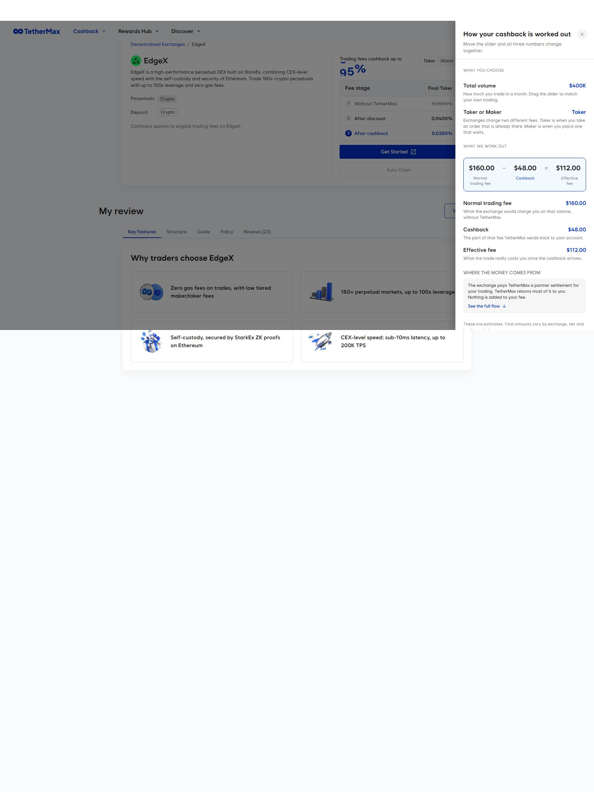 | 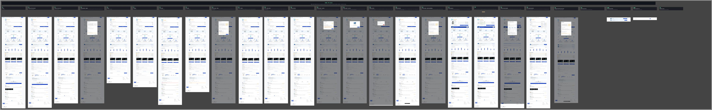 기존 디자인 카탈로그(섹션 전체) |

- 누락: `Total Savings` · `Exchange discount 50% + TetherMax cashback 54%` · `Final Maker` · `Pay only $23 instead of $100 in fees and save 77%` · [버튼] `Already have an account?` · `Need a hand getting started?` · `Take a quick tour of the essentials` · `Learn how to get started, set up your account, and complete KYC verification. ` · `Recent Average Cashback` · [칩] `Active Users` · `per active user · last 6 months` · `March Top Earners` · [버튼] `See All` · `Ongoing Events` · `Trade to win up to $100K prize pool` · `Biggest Trading Competition` · [칩] `Ends in` · `45% cashback rate applies when trading through copy trading or API. The cashback is calcul` · `Payout timing` · `The 54% cashback from trading on Bitget are paid to the trader's tetherMax account at 12:0` · 외 15
- 다름: `TetherMax returns $41.51 to you, so your effective fee becomes $18.49.` ⇄ `TetherMax returns $48.00 (30%) to you, so your effective fee becomes $112.00.` · `Your selected $400K volume generates an estimated $60 in trading fees.` ⇄ `Your selected $400K volume generates an estimated $160 in taker fees.` · `Does it support Bybit too? I linked one UID already and I am not sure whether a second exchange needs a separate verification step.` ⇄ `Does it support ApeX too? I linked my Lighter wallet already and I am not sure whether a second DEX needs a separate verification step.` · `Terms & Conditions` ⇄ `Terms and conditions` · `Trading activity generates a settlement amount for the partner.` ⇄ `Eligible trading activity generates a settlement for the referring partner.` · `55% boosted cashback` ⇄ `3 After cashback` · `Existing account eligibility` ⇄ `Account Types & Eligibility` · `Getting Started Guide` ⇄ `Get Started` · `Cashback calculation` ⇄ `Cashback payouts` · `Cashback arrives at the same time every day.` ⇄ `Cashback reaches my TetherMax balance every day.` · `Start Tour` ⇄ `Structure` · `3 events` ⇄ `(11 reviews)`
- 추가: `Decentralised Exchanges` · `EdgeX is a high-performance perpetual DEX built on StarkEx, combining CEX-level speed with` · `Perpetuals` · `Crypto` · `Deposit` · `Cashback applies to eligible trading fees on EdgeX.` · `Trading fees cashback up to` · `Fee stage` · `1 Without TetherMax` · `2 After discount` · [버튼] `Auto Claim` · `My review` · 외 42

### 2.2 `dex.detail:drawer` · 모바일 — How this works 드로어 (REQ-344)

Figma [22988:114502](https://www.figma.com/design/hsa3bSV9QmFTe2jsf6tzTm/UI-UX-Design?node-id=22988-114502) `MAX1216 / detail / S21 How this works modal / mobile 375` · 출처 정밀

| 프로토타입 | Figma |
|---|---|
| 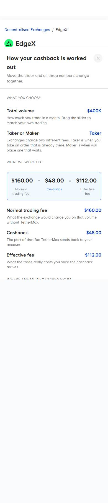 | 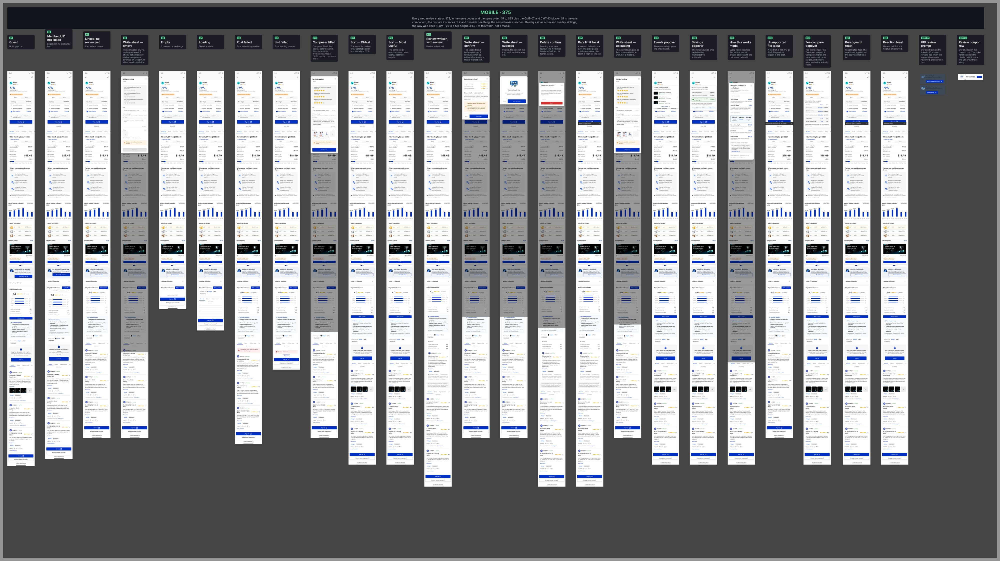 기존 디자인 카탈로그(섹션 전체) |

- 누락: `Total Savings` · `Exchange discount 50% + Cashback 54%` · `Pay only $3 instead of $100 in fees and save 95.5%` · [버튼] `Link UID` · [탭] `User Data` · `About $112 in fees on $400K volume` · `Bitget pays TetherMax` · `A share of those fees, as a partner` · `You get $41.51 back` · [칩] `Active Users` · `March Top Earners` · `Ongoing Events` · [버튼] `See All` · `Trade to win up to $100K prize pool` · `Biggest Trading Competition` · [칩] `Ends in` · `Stuck on KYC verification?` · `Walk back through ID check, camera capture and confirmation step by step.` · [버튼] `Check the steps` · `Using the exchange` · 외 8
- 다름: `Cashback comes from eligible partner settlements. Final amounts vary by partner, tier and trading activity.` ⇄ `Cashback comes from eligible exchange partner settlements. Final amounts vary by exchange, tier and trading activity.` · `Does it support Bybit too? I linked one UID already and I am not sure whether a second exchange needs a separate verification step.` ⇄ `Does it support ApeX too? I linked my Lighter wallet already and I am not sure whether a second DEX needs a separate verification step.` · `Terms & Conditions` ⇄ `Terms and conditions` · `20% of the fee, paid to your TetherMax balance` ⇄ `Paid to your TetherMax balance.` · `95% boosted cashback` ⇄ `3 After cashback` · `Cashback arrives at the same time every day.` ⇄ `Cashback reaches my TetherMax balance every day.` · `Recent Average Cashback` ⇄ `TetherMax gives cashback`
- 추가: `Decentralised Exchanges` · `EdgeX is a high-performance perpetual DEX built on StarkEx, combining CEX-level speed with` · `Perpetuals` · `Crypto` · `Deposit` · `Cashback applies to eligible trading fees on EdgeX.` · `Trading fees cashback up to` · `1 Without TetherMax` · `2 After discount` · [버튼] `Get Started` · [버튼] `Auto Claim` · `My review` · 외 57

### 2.3 `dex.detail:reviewsEmpty` · PC — 리뷰 없음 (G-169)

Figma [22442:219830](https://www.figma.com/design/hsa3bSV9QmFTe2jsf6tzTm/UI-UX-Design?node-id=22442-219830) `MAX1216 / detail / S6 Empty — 0 reviews / light` · 출처 정밀

| 프로토타입 | Figma |
|---|---|
| 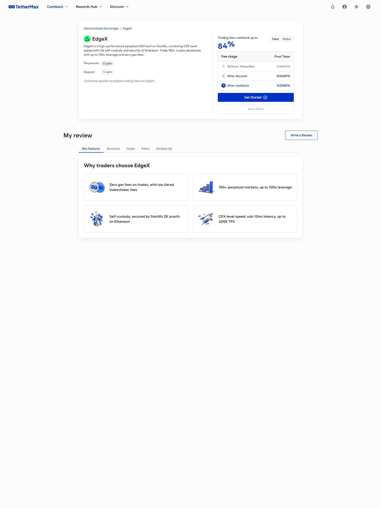 | 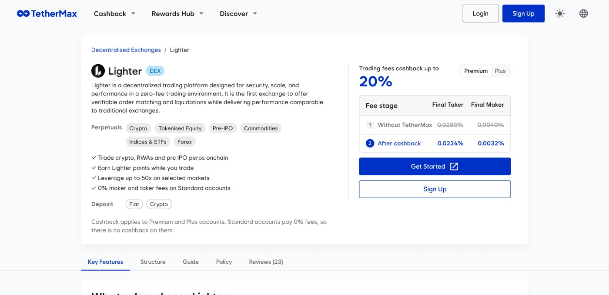 Figma 수정 후 캡처 |

- 누락: [칩] `3 events` · `Total Savings` · `Exchange discount 50% + TetherMax cashback 54%` · `Pay only $23 instead of $100 in fees and save $77` · [버튼] `Already have an account?` · [탭] `User Data` · `Normal trading fee` · `Stuck on KYC verification?` · `Walk back through ID check, camera capture and confirmation step by step.` · [버튼] `Check the steps` · `Recent Average Cashback` · [칩] `Active Users` · `per active user · last 6 months` · `March Top Earners` · [버튼] `See All` · `Ongoing Events` · `Trade to win up to $100K prize pool` · `Biggest Trading Competition` · [칩] `Ends in` · `Cashback calculation` · 외 11
- 다름: `TetherMax returns $41.51 to you, so your effective fee becomes $18.49.` ⇄ `TetherMax returns $48.00 (30%) to you, so your effective fee becomes $112.00.` · `Your selected $400K volume generates an estimated $60 in trading fees.` ⇄ `Your selected $400K volume generates an estimated $160 in taker fees.` · `Terms & Conditions` ⇄ `Terms and conditions` · `Trading activity generates a settlement amount for the partner.` ⇄ `Eligible trading activity generates a settlement for the referring partner.` · `55% boosted cashback` ⇄ `3 After cashback` · `Existing account eligibility` ⇄ `Account Types & Eligibility`
- 추가: `Decentralised Exchanges` · `EdgeX is a high-performance perpetual DEX built on StarkEx, combining CEX-level speed with` · `Perpetuals` · `Crypto` · `Deposit` · `Cashback applies to eligible trading fees on EdgeX.` · `Trading fees cashback up to` · `1 Without TetherMax` · `2 After discount` · [버튼] `Get Started` · [버튼] `Auto Claim` · `My review` · 외 29

### 2.4 `dex.detail:reviewsEmpty` · 모바일 — 리뷰 없음 (G-169)

Figma [22956:84690](https://www.figma.com/design/hsa3bSV9QmFTe2jsf6tzTm/UI-UX-Design?node-id=22956-84690) `MAX1216 / detail / S6 Empty — 0 reviews / mobile 375` · 출처 정밀

| 프로토타입 | Figma |
|---|---|
| 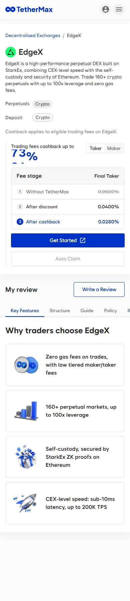 | 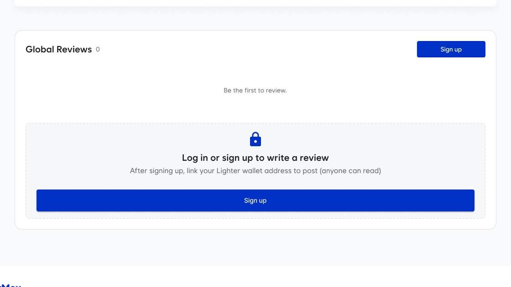 Figma 수정 후 캡처 |

- 누락: `Total Savings` · `Exchange discount 50% + Cashback 54%` · `Pay only $3 instead of $100 in fees and save 95.5%` · [버튼] `Link UID` · [탭] `User Data` · `About $112 in fees on $400K volume` · `Bitget pays TetherMax` · `A share of those fees, as a partner` · `You get $41.51 back` · [칩] `Active Users` · `March Top Earners` · `Ongoing Events` · [버튼] `See All` · `Trade to win up to $100K prize pool` · `Biggest Trading Competition` · [칩] `Ends in` · `Stuck on KYC verification?` · `Walk back through ID check, camera capture and confirmation step by step.` · [버튼] `Check the steps` · `Be the first to review.` · 외 1
- 다름: `Cashback comes from eligible partner settlements. Final amounts vary by partner, tier and trading activity.` ⇄ `Cashback comes from eligible exchange partner settlements. Final amounts vary by exchange, tier and trading activity.` · `Terms & Conditions` ⇄ `Terms and conditions` · `20% of the fee, paid to your TetherMax balance` ⇄ `Paid to your TetherMax balance.` · `95% boosted cashback` ⇄ `3 After cashback` · `Recent Average Cashback` ⇄ `TetherMax gives cashback`
- 추가: `Decentralised Exchanges` · `EdgeX is a high-performance perpetual DEX built on StarkEx, combining CEX-level speed with` · `Perpetuals` · `Crypto` · `Deposit` · `Cashback applies to eligible trading fees on EdgeX.` · `Trading fees cashback up to` · `1 Without TetherMax` · `2 After discount` · [버튼] `Get Started` · [버튼] `Auto Claim` · `My review` · 외 40

### 2.5 `hub.main:cards` · PC — 비교표 카드 뷰 (평점 생략)

Figma [22807:98684](https://www.figma.com/design/hsa3bSV9QmFTe2jsf6tzTm/UI-UX-Design?node-id=22807-98684) `MAX1216 / list / CMT-08 Exchange list — CARD view / light` · 출처 정밀

| 프로토타입 | Figma |
|---|---|
| 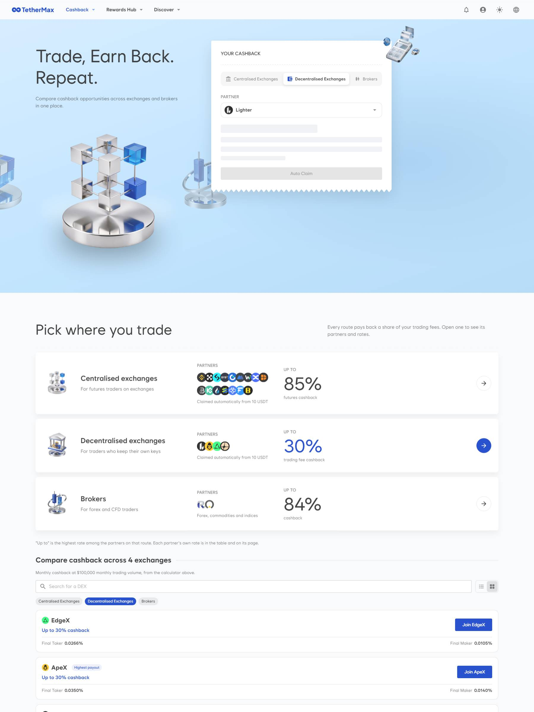 | 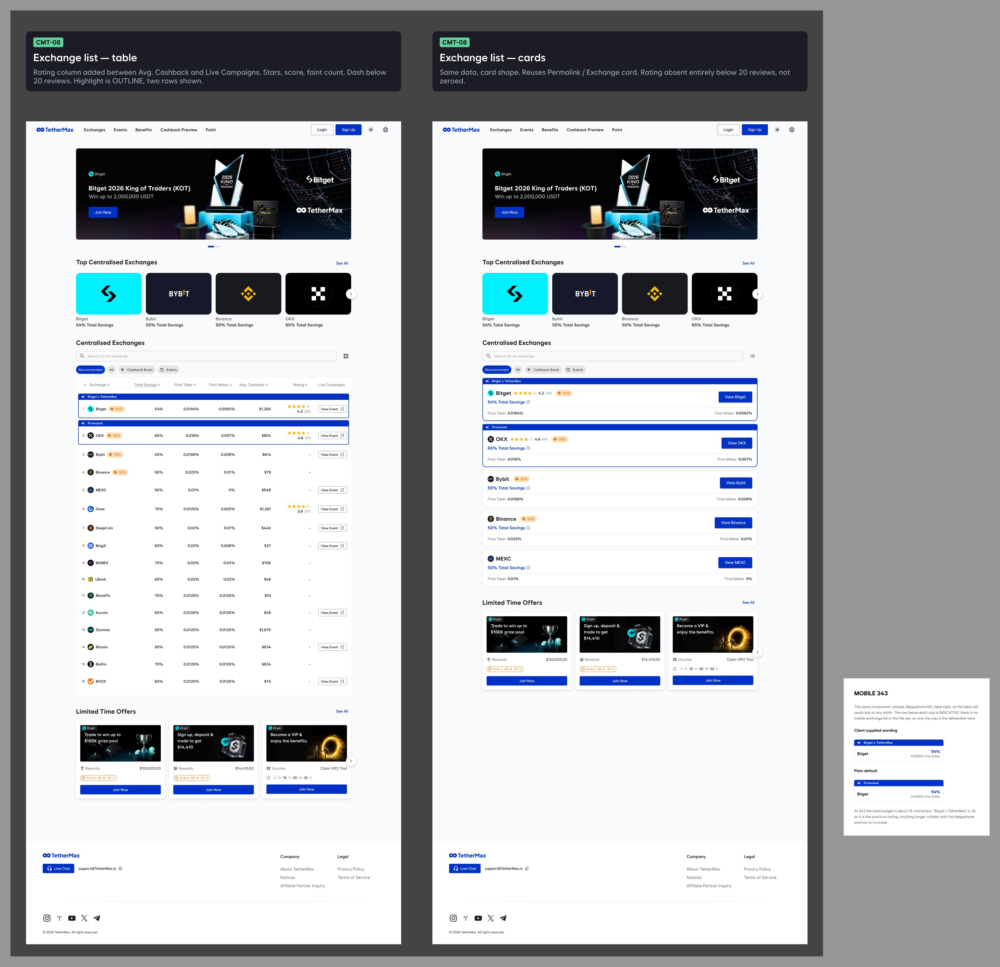 기존 디자인 카탈로그(섹션 전체) |

- 누락: `Bitget 2026 King of Traders (KOT)` · `Win up to 2,000,000 USDT` · [버튼] `See All` · `54% Total Savings` · [칩] `Recommended` · [칩] `All` · `Bitget x TetherMax` · [버튼] `View Bitget` · `Promoted` · `Limited Time Offers` · `Trade to win up to $100K prize pool` · `Biggest Trading Competition` · `Rewards` · [칩] `Ends in` · `Sign up, deposit & trade to get $14,410` · `New Users` · `Become a VIP & enjoy the benefits.` · `Voucher` · `Claim VIP2 Trial`
- 다름: `Search for an exchange` ⇄ `Search for a DEX` · `Cashback Boost` ⇄ `cashback` · `Join Now` ⇄ `Join EdgeX`
- 추가: `Trade, Earn Back. Repeat.` · `Compare cashback opportunities across exchanges and brokers in one place.` · `YOUR CASHBACK` · `Decentralised Exchanges` · `Brokers` · `PARTNER` · [버튼] `Auto Claim` · `Pick where you trade` · `Every route pays back a share of your trading fees. Open one to see its partners and rates` · `For futures traders on exchanges` · `PARTNERS` · `Claimed automatically from 10 USDT` · 외 10

### 2.6 `dex.detail:unlinked` · PC — 회원 · 미연동 — Link Wallet

Figma [28969:129666](https://www.figma.com/design/hsa3bSV9QmFTe2jsf6tzTm/UI-UX-Design?node-id=28969-129666) `DEX detail / Member without a linked wallet` · 출처 정밀 · 같은 문제: `dex.detail:linked`

| 프로토타입 | Figma |
|---|---|
| 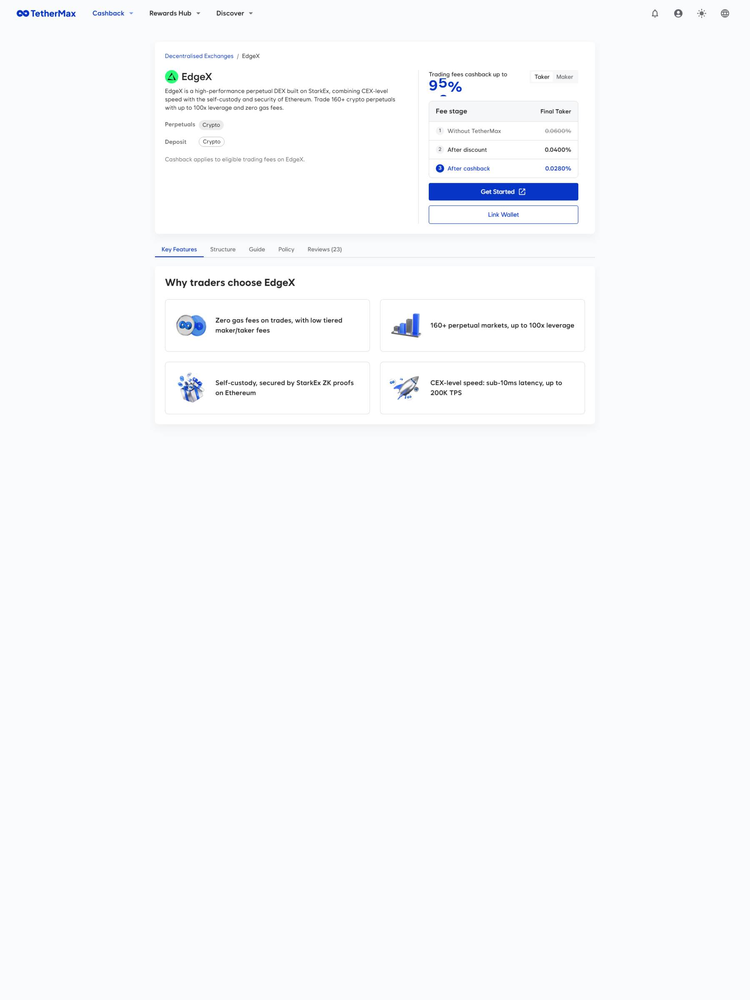 | Figma 캡처 필요(연결 후) |

- 누락: `Lighter is a decentralized trading platform designed for security, scale, and performance ` · [칩] `Tokenised Equity` · [칩] `Pre-IPO` · [칩] `Commodities` · [칩] `Indices & ETFs` · [칩] `Forex` · [칩] `Fiat` · `Cashback applies to Premium and Plus accounts. Standard accounts pay 0% fees, so there is ` · [버튼] `Premium` · [버튼] `Plus`
- 다름: `Final Maker` ⇄ `Maker`
- 추가: `EdgeX is a high-performance perpetual DEX built on StarkEx, combining CEX-level speed with` · `Cashback applies to eligible trading fees on EdgeX.` · `1 Without TetherMax` · `2 After discount` · `3 After cashback` · `Key Features` · `Structure` · `Guide` · `Policy` · `Reviews (23)` · `Why traders choose EdgeX` · `Zero gas fees on trades, with low tiered maker/taker fees` · 외 79

### 2.7 `hub.main:cards` · 모바일 — 비교표 카드 뷰 (평점 생략)

Figma [28960:130794](https://www.figma.com/design/hsa3bSV9QmFTe2jsf6tzTm/UI-UX-Design?node-id=28960-130794) `DEX / Mobile / Hub H1 Guest, DEX route (S1) / Light (main)` · 출처 정밀 · 같은 문제: `hub.main:normal`

| 프로토타입 | Figma |
|---|---|
| 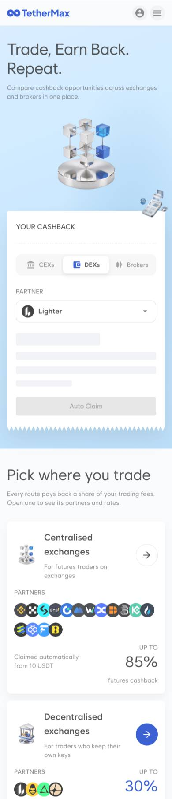 | Figma 캡처 필요(연결 후) |

- 누락: `CASHBACK ESTIMATE` · `Lighter Premium taker, 0.0280%` · `Paid to your TetherMax balance` · `Trading fees after cashback` · `Estimated monthly cashback` · `Per day $0.18` · `Per year $67.20` · [입력] `Learn More` · `Why sign up with TetherMax?` · `Support in 2 minutes` · `Responsive customer support, query attended in 2 minutes.` · `Speak to us  →` · `More cashback from events` · `Earn more cashbacks by completing tasks and exchange event challenges.` · `See Benefits  →` · `Invite friends, earn more` · `Grow your cashback when you invite partners and friends.` · `Find out more  →`
- 추가: [버튼] `Auto Claim` · [버튼] `Join EdgeX` · [배지] `Highest payout`

### 2.8 `home.wallet:reviewed` · PC — 리뷰 작성 후 — 리뷰 유도 없음

Figma [25867:1348199](https://www.figma.com/design/hsa3bSV9QmFTe2jsf6tzTm/UI-UX-Design?node-id=25867-1348199) `UID detail / Web / Review already written (Plain)` · 출처 정밀

| 프로토타입 | Figma |
|---|---|
| 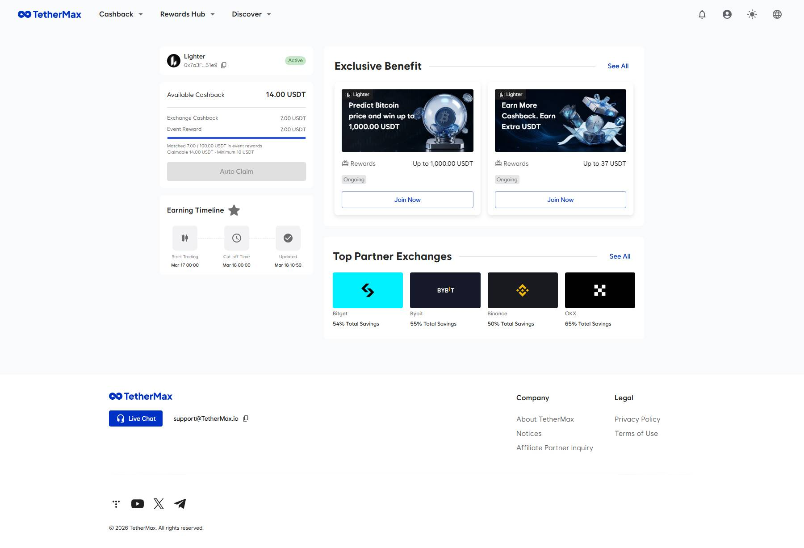 | 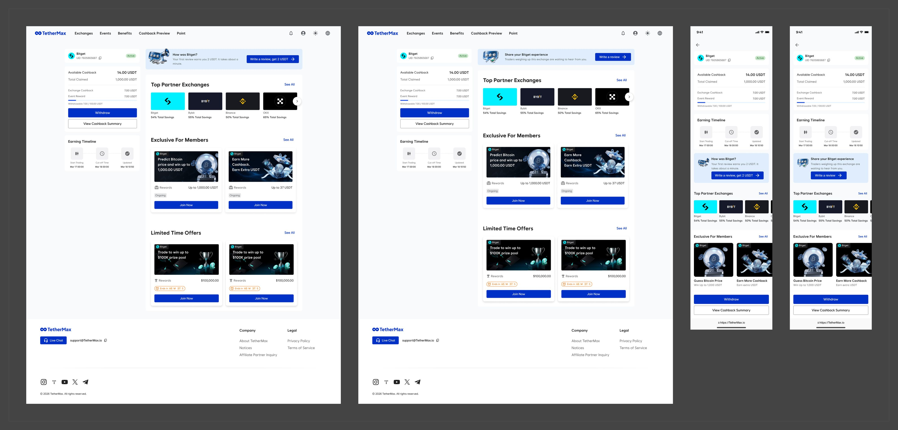 기존 디자인 카탈로그(섹션 전체) |

- 누락: `Withdrawable 7.00 / 100.00 USDT` · [버튼] `Withdraw` · [버튼] `View Cashback Summary` · `Share your Bitget experience` · `Traders weighing up this exchange are waiting to hear from you.` · `Write a review` · `Limited Time Offers` · `Trade to win up to $100K prize pool` · `Biggest Trading Competition` · [칩] `Ends in`
- 다름: `Total Claimed` ⇄ `Auto Claim` · `Exclusive For Members` ⇄ `Exclusive Benefit`
- 추가: `Matched 7.00 / 100.00 USDT in event rewards Claimable 14.00 USDT · Minimum 10 USDT`

### 2.9 `home.wallet:totalClaimed` · PC — Total Claimed 행

Figma [26047:1349155](https://www.figma.com/design/hsa3bSV9QmFTe2jsf6tzTm/UI-UX-Design?node-id=26047-1349155) `UID detail / web / new timeline` · 출처 정밀

| 프로토타입 | Figma |
|---|---|
| 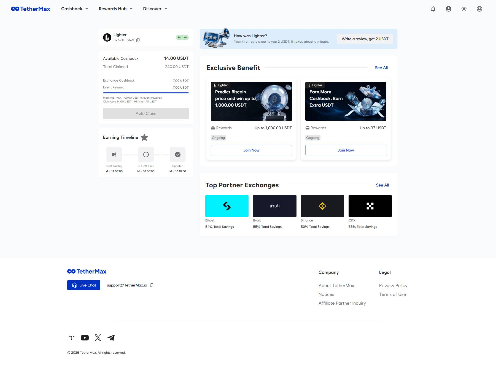 | 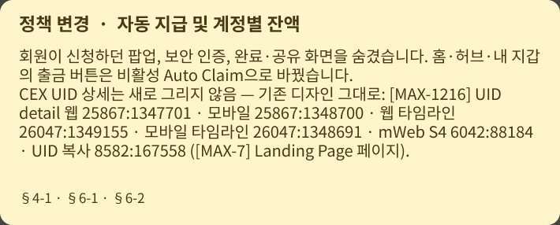 Figma 수정 후 캡처 |

- 누락: `Withdrawable 7.00 / 100.00 USDT` · [버튼] `Withdraw` · [버튼] `View Cashback Summary` · `Step 1` · `Make your first trading transaction` · `All trading fees will be consolidated for the next 24 hours.` · `Limited Time Offers` · `Trade to win up to $100K prize pool` · `Biggest Trading Competition` · [칩] `Ends in`
- 다름: `Exclusive For Members` ⇄ `Exclusive Benefit`
- 추가: `Matched 7.00 / 100.00 USDT in event rewards Claimable 14.00 USDT · Minimum 10 USDT` · [버튼] `Auto Claim`

### 2.10 `home.main:s3App` · 모바일 — S3 앱·모바일웹 빈 홈 카드

Figma [8582:154521](https://www.figma.com/design/hsa3bSV9QmFTe2jsf6tzTm/UI-UX-Design?node-id=8582-154521) `mWeb/landingPage` · 출처 색인

| 프로토타입 | Figma |
|---|---|
| 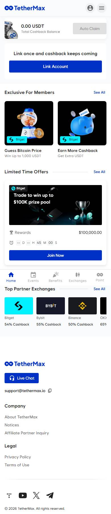 |  기존 디자인 카탈로그(섹션 전체) |

- 누락: `BASIC` · `Unlock Your First Cashback in 3 Steps!` · `Add Characters` · `Create TetherMax account` · `Browse partner exchange` · `Link your UID with us` · `81,836 of our users earn an average of 47.00 USDT to 284.00 USDT in cashback per month.` · `Biggest Trading Competition` · [칩] `Ends in` · `55% Total Savings`
- 다름: `Earn more cashback when you sign up` ⇄ `Earn More Cashback`

### 2.11 `guest.modal:picker` · PC — 거래소 선택

Figma [29035:98030](https://www.figma.com/design/hsa3bSV9QmFTe2jsf6tzTm/UI-UX-Design?node-id=29035-98030) `Web / Guest / picker · 거래소 선택` · 출처 정밀

| 프로토타입 | Figma |
|---|---|
| 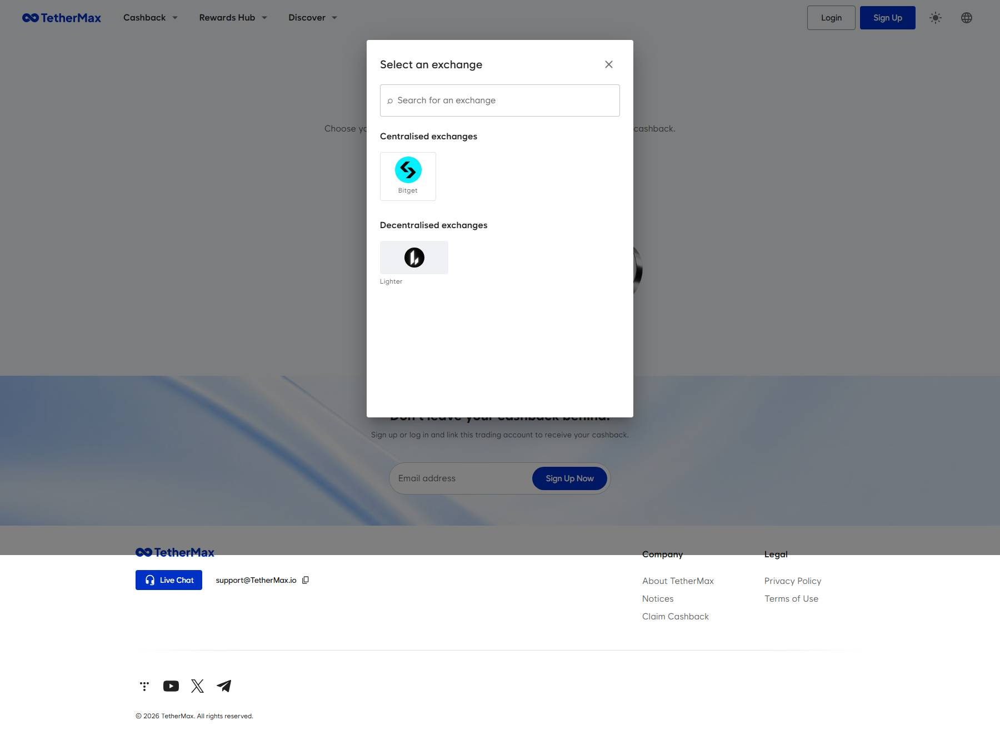 | Figma 캡처 필요(연결 후) |

- 누락: `Brokers` · `Cashback Calculator` · `Exchange Events` · `Points` · `Beginner's Guide` · `All` · `CEX` · `DEX` · `Top Popular Exchanges`
- 다름: `All Exchanges (17)` ⇄ `Centralised exchanges`
- 추가: `No account? Join our partner exchange ⟶` · `Decentralised exchanges`

### 2.12 `home.main:auto` · 모바일 — 기본 — 로그인 상태(게스트·S3·S4)를 따름

Figma [22913:1051713](https://www.figma.com/design/hsa3bSV9QmFTe2jsf6tzTm/UI-UX-Design?node-id=22913-1051713) `mWeb/landingPage` · 출처 정밀 · 같은 문제: `home.main:normal`

| 프로토타입 | Figma |
|---|---|
|  | 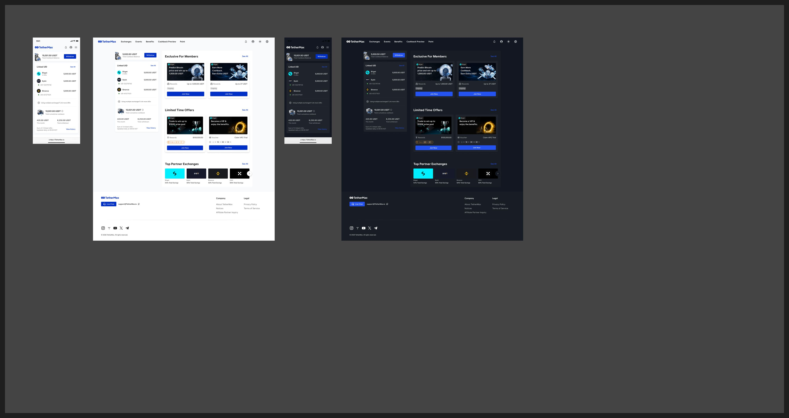 기존 디자인 카탈로그(섹션 전체) |

- 누락: `BASIC` · [버튼] `Withdraw` · `2 UIDs` · `Total cumulative cashback` · `This month` · `Total withdrawn` · `Sum of 3 linked UIDs · Updated daily at 09:00 KST` · [버튼] `View history` · `Biggest Trading Competition`
- 다름: `Using multiple exchanges? Link more UIDs` ⇄ `Trading on multiple exchanges? Link more`
- 추가: [버튼] `Auto Claim`

### 2.13 `home.wallet:normal` · 모바일 — 정상 — 부분 매칭 · 최소액 이상 (PW1)

Figma [26047:1348691](https://www.figma.com/design/hsa3bSV9QmFTe2jsf6tzTm/UI-UX-Design?node-id=26047-1348691) `UID detail / mobile / new timeline` · 출처 정밀

| 프로토타입 | Figma |
|---|---|
| 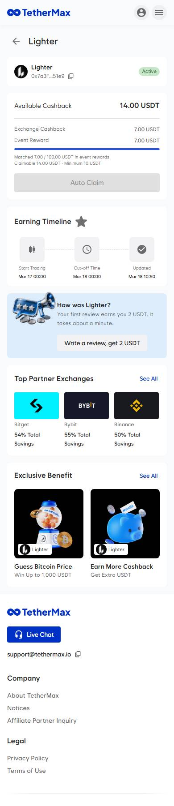 |  Figma 수정 후 캡처 |

- 누락: `Withdrawable 7.00 / 100.00 USDT` · `Step 1` · `Make your first trading transaction` · `All trading fees will be consolidated for the next 24 hours.` · `My Linked Accounts` · [버튼] `Withdraw` · [버튼] `View Cashback Summary`
- 다름: `Earn extra USDT` ⇄ `Get Extra USDT` · `Total Claimed` ⇄ `Auto Claim` · `Exclusive For Members` ⇄ `Exclusive Benefit`
- 추가: `Matched 7.00 / 100.00 USDT in event rewards Claimable 14.00 USDT · Minimum 10 USDT`

### 2.14 `home.wallet:reviewed` · 모바일 — 리뷰 작성 후 — 리뷰 유도 없음

Figma [25867:1348944](https://www.figma.com/design/hsa3bSV9QmFTe2jsf6tzTm/UI-UX-Design?node-id=25867-1348944) `UID detail / Mobile / Review already written (Plain)` · 출처 정밀

| 프로토타입 | Figma |
|---|---|
| 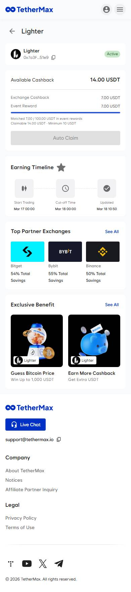 |  기존 디자인 카탈로그(섹션 전체) |

- 누락: `Withdrawable 7.00 / 100.00 USDT` · `Share your Bitget experience` · `Traders weighing up this exchange are waiting to hear from you.` · `Write a review` · `My Linked Accounts` · [버튼] `Withdraw` · [버튼] `View Cashback Summary`
- 다름: `Earn extra USDT` ⇄ `Get Extra USDT` · `Total Claimed` ⇄ `Auto Claim` · `Exclusive For Members` ⇄ `Exclusive Benefit`
- 추가: `Matched 7.00 / 100.00 USDT in event rewards Claimable 14.00 USDT · Minimum 10 USDT`

### 2.15 `link.select:normal` · 모바일 — 진입 — 첫 거래소 WOO X Pro 기본 선택 (G-379)

Figma [28969:126953](https://www.figma.com/design/hsa3bSV9QmFTe2jsf6tzTm/UI-UX-Design?node-id=28969-126953) `Link / Select an exchange / Light` · 출처 정밀 · 같은 문제: `link.select:dexlist`, `link.select:all`, `link.select:uid`, `link.select:uidFilled`

| 프로토타입 | Figma |
|---|---|
|  | Figma 캡처 필요(연결 후) |

- 누락: [입력] `Select an exchange` · [입력] `Search exchanges` · `All` · `CEX` · `DEX` · `Top Partner Exchanges` · `All exchanges (23)` · `54% Total Savings` · `BVOX` · `60% Total Savingst`

### 2.16 `dex.detail:edgex` · PC — EdgeX (회원 상태는 상단 토글)

Figma [28960:127454](https://www.figma.com/design/hsa3bSV9QmFTe2jsf6tzTm/UI-UX-Design?node-id=28960-127454) `DEX / detail / D4 EdgeX key features / light` · 출처 정밀 · 같은 문제: `dex.detail:normal`

| 프로토타입 | Figma |
|---|---|
| 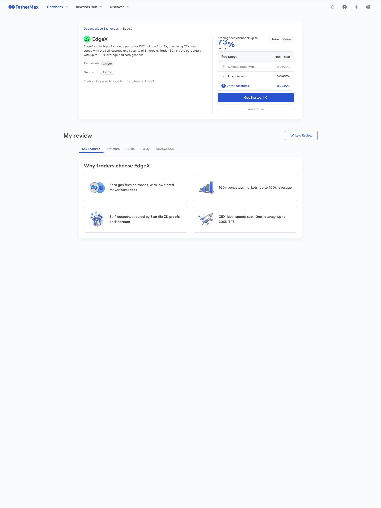 |  Figma 수정 후 캡처 |

- 누락: [칩] `DEX` · `Sign up` · `Log in or sign up to write a review` · `After signing up, link your EdgeX wallet address to post (anyone can read)`
- 다름: `Frequent traders notice the cashback on Premium fees.` ⇄ `Frequent traders notice the cashback on fees.` · `Install a self-custody wallet such as MetaMask. Keep your 12-word recovery phrase private. TetherMax never asks for a private key, recovery phrase or wallet signature.` ⇄ `Install a self-custody wallet such as MetaMask and save your recovery phrase. Keep your 12-word recovery phrase private. TetherMax never asks for a private key, recovery phrase or wallet signature.` · `Your selected $400K volume on a Premium account generates an estimated $112 in taker fees.` ⇄ `Your selected $400K volume generates an estimated $160 in taker fees.`
- 추가: `1 Without TetherMax` · `2 After discount` · `3 After cashback` · [버튼] `Auto Claim` · `My review` · `Key Features` · `Structure` · `Policy` · `Reviews (23)`

### 2.17 `about.intro:normal` · PC — 기본 — 파트너 캐러셀(DEX 포함) · 출금 피드 · 거래 계정 문구

Figma [28960:129521](https://www.figma.com/design/hsa3bSV9QmFTe2jsf6tzTm/UI-UX-Design?node-id=28960-129521) `Service intro / PC / Light (DEX)` · 출처 정밀

| 프로토타입 | Figma |
|---|---|
|  |  Figma 수정 후 캡처 |

- 누락: `07/23/26, 07:36 PM real-time` · `Final cashback rate` · `Up to 90%` · `Cumulative Cashback (as of today)` · `Cumulative Sign-ups (as of today)` · `Wallet ********…51e9` · `Biggest Trading Competition`
- 추가: [배지] `DEX` · `🔥 for new traders` · `Select a partner ▾` · `Trade Frequency ▾` · [버튼] `Calculate` · `ⓘ Actual savings may vary depending on your maker/taker ratio.` · `Events` · `Ends in 45 M 37 S`

### 2.18 `guest.modal:picker` · 모바일 — 거래소 선택

Figma [29035:98094](https://www.figma.com/design/hsa3bSV9QmFTe2jsf6tzTm/UI-UX-Design?node-id=29035-98094) `Mobile / Guest / picker · 거래소 선택` · 출처 정밀

| 프로토타입 | Figma |
|---|---|
| 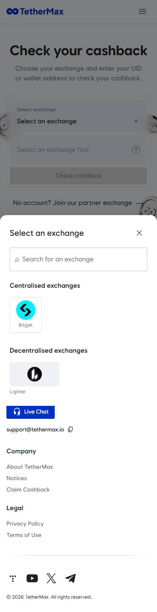 | Figma 캡처 필요(연결 후) |

- 누락: `Sign up in the app and earn more cashback` · [버튼] `Get the App` · `All` · `CEX` · `DEX` · `Top Popular Exchanges`
- 다름: `All Exchanges (17)` ⇄ `Centralised exchanges`
- 추가: `No account? Join our partner exchange ⟶` · `Decentralised exchanges`

### 2.19 `own.home:review` · 모바일 — 소유 확인중 (O11)

Figma [28982:126253](https://www.figma.com/design/hsa3bSV9QmFTe2jsf6tzTm/UI-UX-Design?node-id=28982-126253) `Ownership / Review in progress / Light` · 출처 정밀

| 프로토타입 | Figma |
|---|---|
| 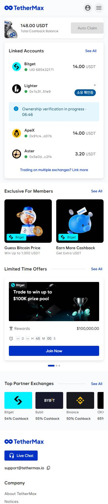 | Figma 캡처 필요(연결 후) |

- 누락: `BASIC` · `Wallet 0x7a3f…51e9` · `Biggest Trading Competition` · [칩] `Ends in` · `54% Total Savings`
- 다름: `Earn extra USDT` ⇄ `Get Extra USDT` · `Using multiple platforms? Link more accounts` ⇄ `Trading on multiple exchanges? Link more`
- 추가: `Ownership verification in progress · 06:46` · `54% Cashback`

### 2.20 `maxboard.main:regConfirm` · PC — 등록 확인 팝업

Figma [29330:190851](https://www.figma.com/design/hsa3bSV9QmFTe2jsf6tzTm/UI-UX-Design?node-id=29330-190851) `맥스보드 · 참여 계정 등록 확인 / PC` · 출처 정밀

| 프로토타입 | Figma |
|---|---|
| 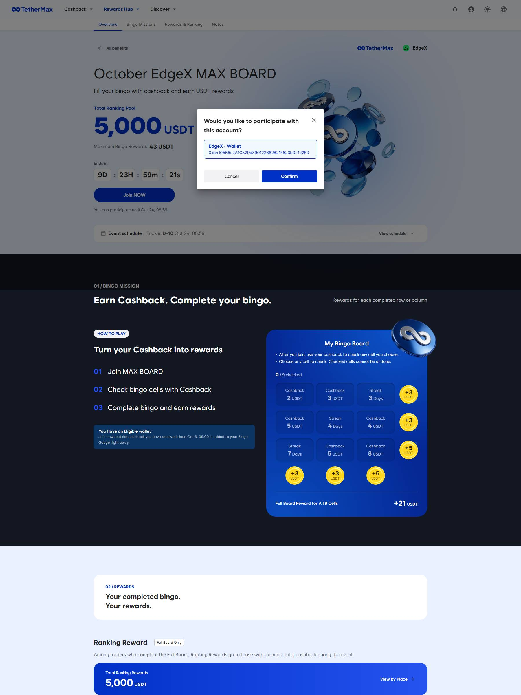 | Figma 캡처 필요(연결 후) |

- 누락: `You can't change it after registration.` · `If you select a new account, your progress on this board starts over. You can't change it `
- 추가: [탭] `Overview` · [탭] `Bingo Missions` · [탭] `Rewards & Ranking` · [탭] `Notes` · [버튼] `All benefits` · `October EdgeX MAX BOARD` · `Fill your bingo with cashback and earn USDT rewards` · `Total Ranking Pool` · `Maximum Bingo Rewards` · `Ends in` · [버튼] `Join NOW` · `You can participate until Oct 24, 08:59.` · 외 38

## 3. 화면별 불일치 표

이 표만 보면 됩니다. 한 행 = 상태 × 뷰 × 구분. 문제 없는 상태는 4장 집계에만 나옵니다.

### 1. 공통 · 셸 (헤더·푸터·공지·약관)

| 화면:상태 | 뷰 | Figma 노드 | 구분 | 내용 |
|---|---|---|---|---|
| `cmn.lang:sheet` 언어 바텀시트 | 모바일 | [12085:400397](https://www.figma.com/design/hsa3bSV9QmFTe2jsf6tzTm/UI-UX-Design?node-id=12085-400397) (정밀) | 추가 12 | `Cashback Hub` · `Events` · `Benefits` · `Cashback Calculator` · `Point` · `Theme` · `Terms of Use` · `Privacy Policy` · 외 4 |
| `cmn.listing:normal` 표 — Recommended | PC | [22598:410917](https://www.figma.com/design/hsa3bSV9QmFTe2jsf6tzTm/UI-UX-Design?node-id=22598-410917) (없음) | ⚠ 노드 없음 | 색인·수정결과 어디에도 없는 노드 — 노드 id 확인 또는 Figma 연결 후 재실행 |
| `cmn.listing:normal` 표 — Recommended | 모바일 | [5145:52544](https://www.figma.com/design/hsa3bSV9QmFTe2jsf6tzTm/UI-UX-Design?node-id=5145-52544) | 누락 5 | `Limited Time Offers` · `Trade to win up to $100K prize pool` · `Biggest Trading Competition` · `Rewards` · [칩] `Ends in` |
| `terms.use:normal` 이용약관 — 6.8 거래 계정 기준 개정 | 모바일 | [11572:247028](https://www.figma.com/design/hsa3bSV9QmFTe2jsf6tzTm/UI-UX-Design?node-id=11572-247028) (정밀) | 누락 1 | `TetherMax Terms of Service

Effective [28 08, 2023]
The purpose of these Terms of Service ` |
| `terms.privacy:normal` 개인정보처리방침 — 지갑 주소 · DEX 거래 기록 추가 | 모바일 | [11572:247029](https://www.figma.com/design/hsa3bSV9QmFTe2jsf6tzTm/UI-UX-Design?node-id=11572-247029) (정밀) | 누락 1 | `TetherMax Privacy Policy

Effective [08 28, 2023]

Last Amended [08 28, 2023]
JOO HOLDINGS` |
| `cmn.notfound:guest` 비로그인 | PC | [12216:419863](https://www.figma.com/design/hsa3bSV9QmFTe2jsf6tzTm/UI-UX-Design?node-id=12216-419863) (정밀) | 누락 3 | `Exchanges` · `Events` · `Benefits` |
| `cmn.notfound:guest` 비로그인 | PC | [12216:419863](https://www.figma.com/design/hsa3bSV9QmFTe2jsf6tzTm/UI-UX-Design?node-id=12216-419863) (정밀) | 다름 1 | `Cashback Preview` ⇄ `Cashback` |
| `cmn.notfound:guest` 비로그인 | PC | [12216:419863](https://www.figma.com/design/hsa3bSV9QmFTe2jsf6tzTm/UI-UX-Design?node-id=12216-419863) (정밀) | 추가 2 | [버튼] `Rewards Hub` · [버튼] `Discover` |
| `cmn.notfound:member` 로그인 | PC | [12216:421961](https://www.figma.com/design/hsa3bSV9QmFTe2jsf6tzTm/UI-UX-Design?node-id=12216-421961) (정밀) | 누락 3 | `Exchanges` · `Events` · `Benefits` |
| `cmn.notfound:member` 로그인 | PC | [12216:421961](https://www.figma.com/design/hsa3bSV9QmFTe2jsf6tzTm/UI-UX-Design?node-id=12216-421961) (정밀) | 다름 1 | `Cashback Preview` ⇄ `Cashback` |
| `cmn.notfound:member` 로그인 | PC | [12216:421961](https://www.figma.com/design/hsa3bSV9QmFTe2jsf6tzTm/UI-UX-Design?node-id=12216-421961) (정밀) | 추가 2 | [버튼] `Rewards Hub` · [버튼] `Discover` |

### 2. 랜딩 · 서비스 소개

| 화면:상태 | 뷰 | Figma 노드 | 구분 | 내용 |
|---|---|---|---|---|
| `landing.main:normal` 기본 — Our Partners·Featured에 DEX 포함 (PLP) | PC | [28960:128375](https://www.figma.com/design/hsa3bSV9QmFTe2jsf6tzTm/UI-UX-Design?node-id=28960-128375) (정밀) | 누락 3 | `Wallet ********…51e9` · `Biggest Trading Competition` · `New Users` |
| `landing.main:normal` 기본 — Our Partners·Featured에 DEX 포함 (PLP) | PC | [28960:128375](https://www.figma.com/design/hsa3bSV9QmFTe2jsf6tzTm/UI-UX-Design?node-id=28960-128375) (정밀) | 추가 2 | [배지] `DEX` · `Ends in 45 M 37 S` |
| `about.intro:normal` 기본 — 파트너 캐러셀(DEX 포함) · 출금 피드 · 거래 계정 문구 | PC | [28960:129521](https://www.figma.com/design/hsa3bSV9QmFTe2jsf6tzTm/UI-UX-Design?node-id=28960-129521) (정밀) | 누락 7 | `07/23/26, 07:36 PM real-time` · `Final cashback rate` · `Up to 90%` · `Cumulative Cashback (as of today)` · `Cumulative Sign-ups (as of today)` · `Wallet ********…51e9` · `Biggest Trading Competition` |
| `about.intro:normal` 기본 — 파트너 캐러셀(DEX 포함) · 출금 피드 · 거래 계정 문구 | PC | [28960:129521](https://www.figma.com/design/hsa3bSV9QmFTe2jsf6tzTm/UI-UX-Design?node-id=28960-129521) (정밀) | 추가 8 | [배지] `DEX` · `🔥 for new traders` · `Select a partner ▾` · `Trade Frequency ▾` · [버튼] `Calculate` · `ⓘ Actual savings may vary depending on your maker/taker ratio.` · `Events` · `Ends in 45 M 37 S` |
| `about.feed:normal` CEX·DEX 시간순 · DEX 배지 · 마스킹 | PC | [28960:128520](https://www.figma.com/design/hsa3bSV9QmFTe2jsf6tzTm/UI-UX-Design?node-id=28960-128520) (정밀) | 누락 1 | `Wallet ********…51e9` |
| `about.feed:normal` CEX·DEX 시간순 · DEX 배지 · 마스킹 | PC | [28960:128520](https://www.figma.com/design/hsa3bSV9QmFTe2jsf6tzTm/UI-UX-Design?node-id=28960-128520) (정밀) | 추가 1 | [배지] `DEX` |

### 3. 비회원 캐시백 조회

| 화면:상태 | 뷰 | Figma 노드 | 구분 | 내용 |
|---|---|---|---|---|
| `guest.search:search` 검색 · 초기 | PC | [29035:97622](https://www.figma.com/design/hsa3bSV9QmFTe2jsf6tzTm/UI-UX-Design?node-id=29035-97622) (정밀) | 누락 5 | `Brokers` · `Cashback Calculator` · `Exchange Events` · `Points` · `Beginner's Guide` |
| `guest.search:search` 검색 · 초기 | PC | [29035:97622](https://www.figma.com/design/hsa3bSV9QmFTe2jsf6tzTm/UI-UX-Design?node-id=29035-97622) (정밀) | 추가 1 | `No account? Join our partner exchange ⟶` |
| `guest.search:search` 검색 · 초기 | 모바일 | [29035:97732](https://www.figma.com/design/hsa3bSV9QmFTe2jsf6tzTm/UI-UX-Design?node-id=29035-97732) (정밀) | 누락 2 | `Sign up in the app and earn more cashback` · [버튼] `Get the App` |
| `guest.search:search` 검색 · 초기 | 모바일 | [29035:97732](https://www.figma.com/design/hsa3bSV9QmFTe2jsf6tzTm/UI-UX-Design?node-id=29035-97732) (정밀) | 추가 1 | `No account? Join our partner exchange ⟶` |
| `guest.search:emptydex` DEX 선택 · 입력 대기 | PC | [29037:102201](https://www.figma.com/design/hsa3bSV9QmFTe2jsf6tzTm/UI-UX-Design?node-id=29037-102201) (정밀) | 누락 5 | `Brokers` · `Cashback Calculator` · `Exchange Events` · `Points` · `Beginner's Guide` |
| `guest.search:emptydex` DEX 선택 · 입력 대기 | PC | [29037:102201](https://www.figma.com/design/hsa3bSV9QmFTe2jsf6tzTm/UI-UX-Design?node-id=29037-102201) (정밀) | 추가 1 | `No account? Join our partner exchange ⟶` |
| `guest.search:emptydex` DEX 선택 · 입력 대기 | 모바일 | [29037:102272](https://www.figma.com/design/hsa3bSV9QmFTe2jsf6tzTm/UI-UX-Design?node-id=29037-102272) (정밀) | 누락 2 | `Sign up in the app and earn more cashback` · [버튼] `Get the App` |
| `guest.search:emptydex` DEX 선택 · 입력 대기 | 모바일 | [29037:102272](https://www.figma.com/design/hsa3bSV9QmFTe2jsf6tzTm/UI-UX-Design?node-id=29037-102272) (정밀) | 추가 1 | `No account? Join our partner exchange ⟶` |
| `guest.search:emptycex` CEX 선택 · 입력 대기 | PC | [29037:102332](https://www.figma.com/design/hsa3bSV9QmFTe2jsf6tzTm/UI-UX-Design?node-id=29037-102332) (정밀) | 누락 5 | `Brokers` · `Cashback Calculator` · `Exchange Events` · `Points` · `Beginner's Guide` |
| `guest.search:emptycex` CEX 선택 · 입력 대기 | PC | [29037:102332](https://www.figma.com/design/hsa3bSV9QmFTe2jsf6tzTm/UI-UX-Design?node-id=29037-102332) (정밀) | 추가 1 | `No account? Join our partner exchange ⟶` |
| `guest.search:emptycex` CEX 선택 · 입력 대기 | 모바일 | [29037:102403](https://www.figma.com/design/hsa3bSV9QmFTe2jsf6tzTm/UI-UX-Design?node-id=29037-102403) (정밀) | 누락 2 | `Sign up in the app and earn more cashback` · [버튼] `Get the App` |
| `guest.search:emptycex` CEX 선택 · 입력 대기 | 모바일 | [29037:102403](https://www.figma.com/design/hsa3bSV9QmFTe2jsf6tzTm/UI-UX-Design?node-id=29037-102403) (정밀) | 추가 1 | `No account? Join our partner exchange ⟶` |
| `guest.search:dex` DEX · 지갑 주소 입력 완료 | PC | [29035:98155](https://www.figma.com/design/hsa3bSV9QmFTe2jsf6tzTm/UI-UX-Design?node-id=29035-98155) (정밀) | 누락 5 | `Brokers` · `Cashback Calculator` · `Exchange Events` · `Points` · `Beginner's Guide` |
| `guest.search:dex` DEX · 지갑 주소 입력 완료 | PC | [29035:98155](https://www.figma.com/design/hsa3bSV9QmFTe2jsf6tzTm/UI-UX-Design?node-id=29035-98155) (정밀) | 추가 1 | `No account? Join our partner exchange ⟶` |
| `guest.search:dex` DEX · 지갑 주소 입력 완료 | 모바일 | [29035:98218](https://www.figma.com/design/hsa3bSV9QmFTe2jsf6tzTm/UI-UX-Design?node-id=29035-98218) (정밀) | 누락 2 | `Sign up in the app and earn more cashback` · [버튼] `Get the App` |
| `guest.search:dex` DEX · 지갑 주소 입력 완료 | 모바일 | [29035:98218](https://www.figma.com/design/hsa3bSV9QmFTe2jsf6tzTm/UI-UX-Design?node-id=29035-98218) (정밀) | 추가 1 | `No account? Join our partner exchange ⟶` |
| `guest.search:cex` CEX · UID 입력 완료 | PC | [29035:98278](https://www.figma.com/design/hsa3bSV9QmFTe2jsf6tzTm/UI-UX-Design?node-id=29035-98278) (정밀) | 누락 5 | `Brokers` · `Cashback Calculator` · `Exchange Events` · `Points` · `Beginner's Guide` |
| `guest.search:cex` CEX · UID 입력 완료 | PC | [29035:98278](https://www.figma.com/design/hsa3bSV9QmFTe2jsf6tzTm/UI-UX-Design?node-id=29035-98278) (정밀) | 추가 1 | `No account? Join our partner exchange ⟶` |
| `guest.search:cex` CEX · UID 입력 완료 | 모바일 | [29035:98341](https://www.figma.com/design/hsa3bSV9QmFTe2jsf6tzTm/UI-UX-Design?node-id=29035-98341) (정밀) | 누락 2 | `Sign up in the app and earn more cashback` · [버튼] `Get the App` |
| `guest.search:cex` CEX · UID 입력 완료 | 모바일 | [29035:98341](https://www.figma.com/design/hsa3bSV9QmFTe2jsf6tzTm/UI-UX-Design?node-id=29035-98341) (정밀) | 추가 1 | `No account? Join our partner exchange ⟶` |
| `guest.search:bad` 입력 오류 · 선택 거래소 기준 | PC | [29035:98401](https://www.figma.com/design/hsa3bSV9QmFTe2jsf6tzTm/UI-UX-Design?node-id=29035-98401) (정밀) | 누락 5 | `Brokers` · `Cashback Calculator` · `Exchange Events` · `Points` · `Beginner's Guide` |
| `guest.search:bad` 입력 오류 · 선택 거래소 기준 | PC | [29035:98401](https://www.figma.com/design/hsa3bSV9QmFTe2jsf6tzTm/UI-UX-Design?node-id=29035-98401) (정밀) | 추가 1 | `No account? Join our partner exchange ⟶` |
| `guest.search:bad` 입력 오류 · 선택 거래소 기준 | 모바일 | [29035:98465](https://www.figma.com/design/hsa3bSV9QmFTe2jsf6tzTm/UI-UX-Design?node-id=29035-98465) (정밀) | 누락 2 | `Sign up in the app and earn more cashback` · [버튼] `Get the App` |
| `guest.search:bad` 입력 오류 · 선택 거래소 기준 | 모바일 | [29035:98465](https://www.figma.com/design/hsa3bSV9QmFTe2jsf6tzTm/UI-UX-Design?node-id=29035-98465) (정밀) | 추가 1 | `No account? Join our partner exchange ⟶` |
| `guest.search:loading` 거래소 조회 중 | PC | [29035:98526](https://www.figma.com/design/hsa3bSV9QmFTe2jsf6tzTm/UI-UX-Design?node-id=29035-98526) (정밀) | 누락 5 | `Brokers` · `Cashback Calculator` · `Exchange Events` · `Points` · `Beginner's Guide` |
| `guest.search:loading` 거래소 조회 중 | PC | [29035:98526](https://www.figma.com/design/hsa3bSV9QmFTe2jsf6tzTm/UI-UX-Design?node-id=29035-98526) (정밀) | 추가 1 | `No account? Join our partner exchange ⟶` |
| `guest.search:loading` 거래소 조회 중 | 모바일 | [29035:98580](https://www.figma.com/design/hsa3bSV9QmFTe2jsf6tzTm/UI-UX-Design?node-id=29035-98580) (정밀) | 누락 2 | `Sign up in the app and earn more cashback` · [버튼] `Get the App` |
| `guest.search:loading` 거래소 조회 중 | 모바일 | [29035:98580](https://www.figma.com/design/hsa3bSV9QmFTe2jsf6tzTm/UI-UX-Design?node-id=29035-98580) (정밀) | 추가 1 | `No account? Join our partner exchange ⟶` |
| `guest.result:above` 조회 성공 · 10 USDT 이상 | PC | [29035:97792](https://www.figma.com/design/hsa3bSV9QmFTe2jsf6tzTm/UI-UX-Design?node-id=29035-97792) (정밀) | 누락 1 | [칩] `Active` |
| `guest.result:above` 조회 성공 · 10 USDT 이상 | PC | [29035:97792](https://www.figma.com/design/hsa3bSV9QmFTe2jsf6tzTm/UI-UX-Design?node-id=29035-97792) (정밀) | 추가 1 | [버튼] `Sign up to link account` |
| `guest.result:above` 조회 성공 · 10 USDT 이상 | 모바일 | [29035:97855](https://www.figma.com/design/hsa3bSV9QmFTe2jsf6tzTm/UI-UX-Design?node-id=29035-97855) (정밀) | 누락 3 | `My Cashback` · `Search again` · [칩] `Active` |
| `guest.result:above` 조회 성공 · 10 USDT 이상 | 모바일 | [29035:97855](https://www.figma.com/design/hsa3bSV9QmFTe2jsf6tzTm/UI-UX-Design?node-id=29035-97855) (정밀) | 추가 1 | [버튼] `Sign up to link account` |
| `guest.result:below` 조회 성공 · 10 USDT 미만 | PC | [29035:98631](https://www.figma.com/design/hsa3bSV9QmFTe2jsf6tzTm/UI-UX-Design?node-id=29035-98631) (정밀) | 누락 1 | [칩] `Active` |
| `guest.result:below` 조회 성공 · 10 USDT 미만 | PC | [29035:98631](https://www.figma.com/design/hsa3bSV9QmFTe2jsf6tzTm/UI-UX-Design?node-id=29035-98631) (정밀) | 추가 1 | [버튼] `Sign up to link account` |
| `guest.result:below` 조회 성공 · 10 USDT 미만 | 모바일 | [29035:98694](https://www.figma.com/design/hsa3bSV9QmFTe2jsf6tzTm/UI-UX-Design?node-id=29035-98694) (정밀) | 누락 3 | `My Cashback` · `Search again` · [칩] `Active` |
| `guest.result:below` 조회 성공 · 10 USDT 미만 | 모바일 | [29035:98694](https://www.figma.com/design/hsa3bSV9QmFTe2jsf6tzTm/UI-UX-Design?node-id=29035-98694) (정밀) | 추가 1 | [버튼] `Sign up to link account` |
| `guest.result:zero` 조회 성공 · 잔액 0 | PC | [29035:98754](https://www.figma.com/design/hsa3bSV9QmFTe2jsf6tzTm/UI-UX-Design?node-id=29035-98754) (정밀) | 누락 1 | [칩] `Active` |
| `guest.result:zero` 조회 성공 · 잔액 0 | PC | [29035:98754](https://www.figma.com/design/hsa3bSV9QmFTe2jsf6tzTm/UI-UX-Design?node-id=29035-98754) (정밀) | 추가 1 | [버튼] `Sign up to link account` |
| `guest.result:zero` 조회 성공 · 잔액 0 | 모바일 | [29035:98817](https://www.figma.com/design/hsa3bSV9QmFTe2jsf6tzTm/UI-UX-Design?node-id=29035-98817) (정밀) | 누락 3 | `My Cashback` · `Search again` · [칩] `Active` |
| `guest.result:zero` 조회 성공 · 잔액 0 | 모바일 | [29035:98817](https://www.figma.com/design/hsa3bSV9QmFTe2jsf6tzTm/UI-UX-Design?node-id=29035-98817) (정밀) | 추가 1 | [버튼] `Sign up to link account` |
| `guest.result:belowcex` CEX · UID 잔액 조회 성공 | PC | [29035:99309](https://www.figma.com/design/hsa3bSV9QmFTe2jsf6tzTm/UI-UX-Design?node-id=29035-99309) (정밀) | 누락 1 | [칩] `Active` |
| `guest.result:belowcex` CEX · UID 잔액 조회 성공 | PC | [29035:99309](https://www.figma.com/design/hsa3bSV9QmFTe2jsf6tzTm/UI-UX-Design?node-id=29035-99309) (정밀) | 추가 1 | [버튼] `Sign up to link account` |
| `guest.result:belowcex` CEX · UID 잔액 조회 성공 | 모바일 | [29035:99372](https://www.figma.com/design/hsa3bSV9QmFTe2jsf6tzTm/UI-UX-Design?node-id=29035-99372) (정밀) | 누락 3 | `My Cashback` · `Search again` · [칩] `Active` |
| `guest.result:belowcex` CEX · UID 잔액 조회 성공 | 모바일 | [29035:99372](https://www.figma.com/design/hsa3bSV9QmFTe2jsf6tzTm/UI-UX-Design?node-id=29035-99372) (정밀) | 추가 1 | [버튼] `Sign up to link account` |
| `guest.result:handoff` 로그인 후 · 계정 미연동 (DEX) | PC | [29035:97915](https://www.figma.com/design/hsa3bSV9QmFTe2jsf6tzTm/UI-UX-Design?node-id=29035-97915) (정밀) | 누락 1 | [칩] `Active` |
| `guest.result:handoff` 로그인 후 · 계정 미연동 (DEX) | PC | [29035:97915](https://www.figma.com/design/hsa3bSV9QmFTe2jsf6tzTm/UI-UX-Design?node-id=29035-97915) (정밀) | 추가 1 | [버튼] `Link account` |
| `guest.result:handoff` 로그인 후 · 계정 미연동 (DEX) | 모바일 | [29035:97974](https://www.figma.com/design/hsa3bSV9QmFTe2jsf6tzTm/UI-UX-Design?node-id=29035-97974) (정밀) | 누락 4 | `Manage your cashback in the TetherMax app` · `My Cashback` · `Search again` · [칩] `Active` |
| `guest.result:handoff` 로그인 후 · 계정 미연동 (DEX) | 모바일 | [29035:97974](https://www.figma.com/design/hsa3bSV9QmFTe2jsf6tzTm/UI-UX-Design?node-id=29035-97974) (정밀) | 추가 1 | [버튼] `Link account` |
| `guest.result:handoffcex` CEX · 로그인 후 같은 UID 연동 | PC | [29037:102463](https://www.figma.com/design/hsa3bSV9QmFTe2jsf6tzTm/UI-UX-Design?node-id=29037-102463) (정밀) | 누락 1 | [칩] `Active` |
| `guest.result:handoffcex` CEX · 로그인 후 같은 UID 연동 | PC | [29037:102463](https://www.figma.com/design/hsa3bSV9QmFTe2jsf6tzTm/UI-UX-Design?node-id=29037-102463) (정밀) | 추가 1 | [버튼] `Link account` |
| `guest.result:handoffcex` CEX · 로그인 후 같은 UID 연동 | 모바일 | [29037:102530](https://www.figma.com/design/hsa3bSV9QmFTe2jsf6tzTm/UI-UX-Design?node-id=29037-102530) (정밀) | 누락 4 | `Manage your cashback in the TetherMax app` · `My Cashback` · `Search again` · [칩] `Active` |
| `guest.result:handoffcex` CEX · 로그인 후 같은 UID 연동 | 모바일 | [29037:102530](https://www.figma.com/design/hsa3bSV9QmFTe2jsf6tzTm/UI-UX-Design?node-id=29037-102530) (정밀) | 추가 1 | [버튼] `Link account` |
| `guest.modal:picker` 거래소 선택 | PC | [29035:98030](https://www.figma.com/design/hsa3bSV9QmFTe2jsf6tzTm/UI-UX-Design?node-id=29035-98030) (정밀) | 누락 9 | `Brokers` · `Cashback Calculator` · `Exchange Events` · `Points` · `Beginner's Guide` · `All` · `CEX` · `DEX` · `Top Popular Exchanges` |
| `guest.modal:picker` 거래소 선택 | PC | [29035:98030](https://www.figma.com/design/hsa3bSV9QmFTe2jsf6tzTm/UI-UX-Design?node-id=29035-98030) (정밀) | 다름 1 | `All Exchanges (17)` ⇄ `Centralised exchanges` |
| `guest.modal:picker` 거래소 선택 | PC | [29035:98030](https://www.figma.com/design/hsa3bSV9QmFTe2jsf6tzTm/UI-UX-Design?node-id=29035-98030) (정밀) | 추가 2 | `No account? Join our partner exchange ⟶` · `Decentralised exchanges` |
| `guest.modal:picker` 거래소 선택 | 모바일 | [29035:98094](https://www.figma.com/design/hsa3bSV9QmFTe2jsf6tzTm/UI-UX-Design?node-id=29035-98094) (정밀) | 누락 6 | `Sign up in the app and earn more cashback` · [버튼] `Get the App` · `All` · `CEX` · `DEX` · `Top Popular Exchanges` |
| `guest.modal:picker` 거래소 선택 | 모바일 | [29035:98094](https://www.figma.com/design/hsa3bSV9QmFTe2jsf6tzTm/UI-UX-Design?node-id=29035-98094) (정밀) | 다름 1 | `All Exchanges (17)` ⇄ `Centralised exchanges` |
| `guest.modal:picker` 거래소 선택 | 모바일 | [29035:98094](https://www.figma.com/design/hsa3bSV9QmFTe2jsf6tzTm/UI-UX-Design?node-id=29035-98094) (정밀) | 추가 2 | `No account? Join our partner exchange ⟶` · `Decentralised exchanges` |
| `guest.entry:normal` 모바일 홈 푸터 → Claim Cashback | 모바일 | [29037:113704](https://www.figma.com/design/hsa3bSV9QmFTe2jsf6tzTm/UI-UX-Design?node-id=29037-113704) (정밀) | 누락 2 | `Cumulative cashback` · `Cashback paid today (24h)` |

### 4. 홈 · 잔액 · 지갑 상세

| 화면:상태 | 뷰 | Figma 노드 | 구분 | 내용 |
|---|---|---|---|---|
| `home.main:auto` 기본 — 로그인 상태(게스트·S3·S4)를 따름 | PC | [28960:127837](https://www.figma.com/design/hsa3bSV9QmFTe2jsf6tzTm/UI-UX-Design?node-id=28960-127837) (정밀) | 누락 3 | `BASIC` · `Biggest Trading Competition` · `New Users` |
| `home.main:auto` 기본 — 로그인 상태(게스트·S3·S4)를 따름 | 모바일 | [22913:1051713](https://www.figma.com/design/hsa3bSV9QmFTe2jsf6tzTm/UI-UX-Design?node-id=22913-1051713) (정밀) | 누락 9 | `BASIC` · [버튼] `Withdraw` · `2 UIDs` · `Total cumulative cashback` · `This month` · `Total withdrawn` · `Sum of 3 linked UIDs · Updated daily at 09:00 KST` · [버튼] `View history` · `Biggest Trading Competition` |
| `home.main:auto` 기본 — 로그인 상태(게스트·S3·S4)를 따름 | 모바일 | [22913:1051713](https://www.figma.com/design/hsa3bSV9QmFTe2jsf6tzTm/UI-UX-Design?node-id=22913-1051713) (정밀) | 다름 1 | `Using multiple exchanges? Link more UIDs` ⇄ `Trading on multiple exchanges? Link more` |
| `home.main:auto` 기본 — 로그인 상태(게스트·S3·S4)를 따름 | 모바일 | [22913:1051713](https://www.figma.com/design/hsa3bSV9QmFTe2jsf6tzTm/UI-UX-Design?node-id=22913-1051713) (정밀) | 추가 1 | [버튼] `Auto Claim` |
| `home.main:guest` 비로그인 — 공개 화면 (home/S4#guest) | 모바일 | [29037:113704](https://www.figma.com/design/hsa3bSV9QmFTe2jsf6tzTm/UI-UX-Design?node-id=29037-113704) (정밀) | 추가 10 | [버튼] `Live Chat` · `support@tethermax.io` · `Company` · `About TetherMax` · `Notices` · `Claim Cashback` · `Legal` · `Privacy Policy` · 외 2 |
| `home.main:s3` S3 연동 0 — 체크리스트 · Cashback Preview (S3-1) | PC | [28960:127759](https://www.figma.com/design/hsa3bSV9QmFTe2jsf6tzTm/UI-UX-Design?node-id=28960-127759) (정밀) | 누락 3 | `BASIC` · `Biggest Trading Competition` · `New Users` |
| `home.main:s3` S3 연동 0 — 체크리스트 · Cashback Preview (S3-1) | PC | [28960:127759](https://www.figma.com/design/hsa3bSV9QmFTe2jsf6tzTm/UI-UX-Design?node-id=28960-127759) (정밀) | 추가 1 | `Cashback Preview` |
| `home.main:s3` S3 연동 0 — 체크리스트 · Cashback Preview (S3-1) | 모바일 | [4248:33574](https://www.figma.com/design/hsa3bSV9QmFTe2jsf6tzTm/UI-UX-Design?node-id=4248-33574) | 누락 4 | `BASIC` · `Biggest Trading Competition` · [칩] `Ends in` · `55% Total Savings` |
| `home.main:s3` S3 연동 0 — 체크리스트 · Cashback Preview (S3-1) | 모바일 | [4248:33574](https://www.figma.com/design/hsa3bSV9QmFTe2jsf6tzTm/UI-UX-Design?node-id=4248-33574) | 다름 2 | `Browse partner exchange` ⇄ `Browse partners` · `Earn more cashback when you sign up` ⇄ `Earn More Cashback` |
| `home.main:s3App` S3 앱·모바일웹 빈 홈 카드 | 모바일 | [8582:154521](https://www.figma.com/design/hsa3bSV9QmFTe2jsf6tzTm/UI-UX-Design?node-id=8582-154521) | 누락 10 | `BASIC` · `Unlock Your First Cashback in 3 Steps!` · `Add Characters` · `Create TetherMax account` · `Browse partner exchange` · `Link your UID with us` · `81,836 of our users earn an average of 47.00 USDT to 284.00 USDT in cashback per month.` · `Biggest Trading Competition` · [칩] `Ends in` · `55% Total Savings` |
| `home.main:s3App` S3 앱·모바일웹 빈 홈 카드 | 모바일 | [8582:154521](https://www.figma.com/design/hsa3bSV9QmFTe2jsf6tzTm/UI-UX-Design?node-id=8582-154521) | 다름 1 | `Earn more cashback when you sign up` ⇄ `Earn More Cashback` |
| `home.main:normal` S4 연동 있음 — CEX·DEX 한 목록 (S4-1) | PC | [28960:127837](https://www.figma.com/design/hsa3bSV9QmFTe2jsf6tzTm/UI-UX-Design?node-id=28960-127837) (정밀) | 누락 3 | `BASIC` · `Biggest Trading Competition` · `New Users` |
| `home.main:normal` S4 연동 있음 — CEX·DEX 한 목록 (S4-1) | 모바일 | [22913:1051713](https://www.figma.com/design/hsa3bSV9QmFTe2jsf6tzTm/UI-UX-Design?node-id=22913-1051713) (정밀) | 누락 9 | `BASIC` · [버튼] `Withdraw` · `2 UIDs` · `Total cumulative cashback` · `This month` · `Total withdrawn` · `Sum of 3 linked UIDs · Updated daily at 09:00 KST` · [버튼] `View history` · `Biggest Trading Competition` |
| `home.main:normal` S4 연동 있음 — CEX·DEX 한 목록 (S4-1) | 모바일 | [22913:1051713](https://www.figma.com/design/hsa3bSV9QmFTe2jsf6tzTm/UI-UX-Design?node-id=22913-1051713) (정밀) | 다름 1 | `Using multiple exchanges? Link more UIDs` ⇄ `Trading on multiple exchanges? Link more` |
| `home.main:normal` S4 연동 있음 — CEX·DEX 한 목록 (S4-1) | 모바일 | [22913:1051713](https://www.figma.com/design/hsa3bSV9QmFTe2jsf6tzTm/UI-UX-Design?node-id=22913-1051713) (정밀) | 추가 1 | [버튼] `Auto Claim` |
| `home.main:hw1` 총액 카드 · 4행 (HW1) | PC | [28960:126108](https://www.figma.com/design/hsa3bSV9QmFTe2jsf6tzTm/UI-UX-Design?node-id=28960-126108) (정밀) | 누락 3 | `BASIC` · `Biggest Trading Competition` · `New Users` |
| `home.main:app` 앱·모바일웹 — Wallet 라벨 없음 · 푸터 문구 | 모바일 | [8582:156599](https://www.figma.com/design/hsa3bSV9QmFTe2jsf6tzTm/UI-UX-Design?node-id=8582-156599) | 누락 4 | `BASIC` · `Biggest Trading Competition` · [칩] `Ends in` · `55% Total Savings` |
| `home.main:app` 앱·모바일웹 — Wallet 라벨 없음 · 푸터 문구 | 모바일 | [8582:156599](https://www.figma.com/design/hsa3bSV9QmFTe2jsf6tzTm/UI-UX-Design?node-id=8582-156599) | 다름 1 | `Using multiple exchanges? Link more UIDs` ⇄ `Trading on multiple exchanges? Link more` |
| `home.main:first` 첫 연동 — 체크리스트 없는 S4 + 토스트 (S3-7) | PC | [28960:127795](https://www.figma.com/design/hsa3bSV9QmFTe2jsf6tzTm/UI-UX-Design?node-id=28960-127795) (정밀) | 누락 3 | `BASIC` · `Biggest Trading Competition` · `New Users` |
| `home.main:newRow` 새 행 맨 아래 · 0.00 USDT (S4-6) | PC | [28960:127867](https://www.figma.com/design/hsa3bSV9QmFTe2jsf6tzTm/UI-UX-Design?node-id=28960-127867) (정밀) | 누락 3 | `BASIC` · `Biggest Trading Competition` · `New Users` |
| `home.main:multi` 같은 DEX 지갑 3개 · Aster 하위 계정 | 모바일 | [7633:92140](https://www.figma.com/design/hsa3bSV9QmFTe2jsf6tzTm/UI-UX-Design?node-id=7633-92140) | 누락 2 | `BASIC` · `2 UIDs` |
| `home.main:multi` 같은 DEX 지갑 3개 · Aster 하위 계정 | 모바일 | [7633:92140](https://www.figma.com/design/hsa3bSV9QmFTe2jsf6tzTm/UI-UX-Design?node-id=7633-92140) | 다름 1 | `Using multiple exchanges? Link more UIDs` ⇄ `Trading on multiple exchanges? Link more` |
| `home.wallet:normal` 정상 — 부분 매칭 · 최소액 이상 (PW1) | PC | [28960:125943](https://www.figma.com/design/hsa3bSV9QmFTe2jsf6tzTm/UI-UX-Design?node-id=28960-125943) (정밀) | 누락 3 | `Wallet 0x7a3F…51e9` · `Total Claimed` · `Up to 20% cashback` |
| `home.wallet:normal` 정상 — 부분 매칭 · 최소액 이상 (PW1) | PC | [28960:125943](https://www.figma.com/design/hsa3bSV9QmFTe2jsf6tzTm/UI-UX-Design?node-id=28960-125943) (정밀) | 추가 1 | `54% Total Savings` |
| `home.wallet:normal` 정상 — 부분 매칭 · 최소액 이상 (PW1) | 모바일 | [26047:1348691](https://www.figma.com/design/hsa3bSV9QmFTe2jsf6tzTm/UI-UX-Design?node-id=26047-1348691) (정밀) | 누락 7 | `Withdrawable 7.00 / 100.00 USDT` · `Step 1` · `Make your first trading transaction` · `All trading fees will be consolidated for the next 24 hours.` · `My Linked Accounts` · [버튼] `Withdraw` · [버튼] `View Cashback Summary` |
| `home.wallet:normal` 정상 — 부분 매칭 · 최소액 이상 (PW1) | 모바일 | [26047:1348691](https://www.figma.com/design/hsa3bSV9QmFTe2jsf6tzTm/UI-UX-Design?node-id=26047-1348691) (정밀) | 다름 3 | `Earn extra USDT` ⇄ `Get Extra USDT` · `Total Claimed` ⇄ `Auto Claim` · `Exclusive For Members` ⇄ `Exclusive Benefit` |
| `home.wallet:normal` 정상 — 부분 매칭 · 최소액 이상 (PW1) | 모바일 | [26047:1348691](https://www.figma.com/design/hsa3bSV9QmFTe2jsf6tzTm/UI-UX-Design?node-id=26047-1348691) (정밀) | 추가 1 | `Matched 7.00 / 100.00 USDT in event rewards Claimable 14.00 USDT · Minimum 10 USDT` |
| `home.wallet:noReward` 리워드 없음 · 최소액 이상 — Event Reward 행 없음 | PC | [29026:97581](https://www.figma.com/design/hsa3bSV9QmFTe2jsf6tzTm/UI-UX-Design?node-id=29026-97581) (정밀) | 누락 4 | `A = 120.00   ·   B = null` · `Claimable 0.00 USDT · Minimum 10 USDT You can claim cashback if you receive an additional ` · `Event Reward` · `Matched 0.00 / 8.00 USDT in event rewards Claimable 0.00 USDT · Minimum 10 USDT You can cl` |
| `home.wallet:noReward` 리워드 없음 · 최소액 이상 — Event Reward 행 없음 | PC | [29026:97581](https://www.figma.com/design/hsa3bSV9QmFTe2jsf6tzTm/UI-UX-Design?node-id=29026-97581) (정밀) | 추가 12 | `Active` · `How was Lighter?` · `Your first review earns you 2 USDT. It takes about a minute.` · [버튼] `Write a review, get 2 USDT` · `Exclusive Benefit` · [버튼] `See All` · `Predict Bitcoin price and win up to 1,000.00 USDT` · `Up to 1,000.00 USDT` · 외 4 |
| `home.wallet:zero` 모든 적립 잔액 0 | PC | [29026:97581](https://www.figma.com/design/hsa3bSV9QmFTe2jsf6tzTm/UI-UX-Design?node-id=29026-97581) (정밀) | 누락 3 | `A = 120.00   ·   B = null` · `Matched 0.00 / 8.00 USDT in event rewards Claimable 0.00 USDT · Minimum 10 USDT You can cl` · `Matched 7.00 / 100.00 USDT in event rewards Claimable 14.00 USDT · Minimum 10 USDT` |
| `home.wallet:zero` 모든 적립 잔액 0 | PC | [29026:97581](https://www.figma.com/design/hsa3bSV9QmFTe2jsf6tzTm/UI-UX-Design?node-id=29026-97581) (정밀) | 다름 2 | `Claimable 0.00 USDT · Minimum 10 USDT You can claim cashback if you re` ⇄ `Claimable 0.00 USDT · Minimum 10 USDT Additional exchange cashback nee` · `Event Reward` ⇄ `Rewards` |
| `home.wallet:zero` 모든 적립 잔액 0 | PC | [29026:97581](https://www.figma.com/design/hsa3bSV9QmFTe2jsf6tzTm/UI-UX-Design?node-id=29026-97581) (정밀) | 추가 12 | `Active` · `How was Lighter?` · `Your first review earns you 2 USDT. It takes about a minute.` · [버튼] `Write a review, get 2 USDT` · `Exclusive Benefit` · [버튼] `See All` · `Predict Bitcoin price and win up to 1,000.00 USDT` · `Up to 1,000.00 USDT` · 외 4 |
| `home.wallet:cashBelow` 캐시백만 보유 · 최소액 미만 | PC | [29026:97581](https://www.figma.com/design/hsa3bSV9QmFTe2jsf6tzTm/UI-UX-Design?node-id=29026-97581) (정밀) | 누락 3 | `A = 120.00   ·   B = null` · `Matched 0.00 / 8.00 USDT in event rewards Claimable 0.00 USDT · Minimum 10 USDT You can cl` · `Matched 7.00 / 100.00 USDT in event rewards Claimable 14.00 USDT · Minimum 10 USDT` |
| `home.wallet:cashBelow` 캐시백만 보유 · 최소액 미만 | PC | [29026:97581](https://www.figma.com/design/hsa3bSV9QmFTe2jsf6tzTm/UI-UX-Design?node-id=29026-97581) (정밀) | 다름 2 | `Claimable 0.00 USDT · Minimum 10 USDT You can claim cashback if you re` ⇄ `Claimable 3.00 USDT · Minimum 10 USDT Additional exchange cashback nee` · `Event Reward` ⇄ `Rewards` |
| `home.wallet:cashBelow` 캐시백만 보유 · 최소액 미만 | PC | [29026:97581](https://www.figma.com/design/hsa3bSV9QmFTe2jsf6tzTm/UI-UX-Design?node-id=29026-97581) (정밀) | 추가 12 | `Active` · `How was Lighter?` · `Your first review earns you 2 USDT. It takes about a minute.` · [버튼] `Write a review, get 2 USDT` · `Exclusive Benefit` · [버튼] `See All` · `Predict Bitcoin price and win up to 1,000.00 USDT` · `Up to 1,000.00 USDT` · 외 4 |
| `home.wallet:rewardOnly` 리워드만 보유 | PC | [29026:97581](https://www.figma.com/design/hsa3bSV9QmFTe2jsf6tzTm/UI-UX-Design?node-id=29026-97581) (정밀) | 누락 2 | `A = 120.00   ·   B = null` · `Claimable 0.00 USDT · Minimum 10 USDT You can claim cashback if you receive an additional ` |
| `home.wallet:rewardOnly` 리워드만 보유 | PC | [29026:97581](https://www.figma.com/design/hsa3bSV9QmFTe2jsf6tzTm/UI-UX-Design?node-id=29026-97581) (정밀) | 다름 1 | `Matched 0.00 / 8.00 USDT in event rewards Claimable 0.00 USDT · Minimu` ⇄ `Matched 0.00 / 8.00 USDT in event rewards Claimable 0.00 USDT · Minimu` |
| `home.wallet:rewardOnly` 리워드만 보유 | PC | [29026:97581](https://www.figma.com/design/hsa3bSV9QmFTe2jsf6tzTm/UI-UX-Design?node-id=29026-97581) (정밀) | 추가 12 | `Active` · `How was Lighter?` · `Your first review earns you 2 USDT. It takes about a minute.` · [버튼] `Write a review, get 2 USDT` · `Exclusive Benefit` · [버튼] `See All` · `Predict Bitcoin price and win up to 1,000.00 USDT` · `Up to 1,000.00 USDT` · 외 4 |
| `home.wallet:partialBelow` 부분 매칭 · 최소액 미만 | PC | [29026:97581](https://www.figma.com/design/hsa3bSV9QmFTe2jsf6tzTm/UI-UX-Design?node-id=29026-97581) (정밀) | 누락 2 | `A = 120.00   ·   B = null` · `Claimable 0.00 USDT · Minimum 10 USDT You can claim cashback if you receive an additional ` |
| `home.wallet:partialBelow` 부분 매칭 · 최소액 미만 | PC | [29026:97581](https://www.figma.com/design/hsa3bSV9QmFTe2jsf6tzTm/UI-UX-Design?node-id=29026-97581) (정밀) | 다름 1 | `Matched 0.00 / 8.00 USDT in event rewards Claimable 0.00 USDT · Minimu` ⇄ `Matched 2.00 / 8.00 USDT in event rewards Claimable 4.00 USDT · Minimu` |
| `home.wallet:partialBelow` 부분 매칭 · 최소액 미만 | PC | [29026:97581](https://www.figma.com/design/hsa3bSV9QmFTe2jsf6tzTm/UI-UX-Design?node-id=29026-97581) (정밀) | 추가 12 | `Active` · `How was Lighter?` · `Your first review earns you 2 USDT. It takes about a minute.` · [버튼] `Write a review, get 2 USDT` · `Exclusive Benefit` · [버튼] `See All` · `Predict Bitcoin price and win up to 1,000.00 USDT` · `Up to 1,000.00 USDT` · 외 4 |
| `home.wallet:fullBelow` 전액 매칭 · 최소액 미만 | PC | [29026:97581](https://www.figma.com/design/hsa3bSV9QmFTe2jsf6tzTm/UI-UX-Design?node-id=29026-97581) (정밀) | 누락 2 | `A = 120.00   ·   B = null` · `Claimable 0.00 USDT · Minimum 10 USDT You can claim cashback if you receive an additional ` |
| `home.wallet:fullBelow` 전액 매칭 · 최소액 미만 | PC | [29026:97581](https://www.figma.com/design/hsa3bSV9QmFTe2jsf6tzTm/UI-UX-Design?node-id=29026-97581) (정밀) | 다름 1 | `Matched 0.00 / 8.00 USDT in event rewards Claimable 0.00 USDT · Minimu` ⇄ `Matched 4.50 / 4.50 USDT in event rewards Claimable 9.00 USDT · Minimu` |
| `home.wallet:fullBelow` 전액 매칭 · 최소액 미만 | PC | [29026:97581](https://www.figma.com/design/hsa3bSV9QmFTe2jsf6tzTm/UI-UX-Design?node-id=29026-97581) (정밀) | 추가 12 | `Active` · `How was Lighter?` · `Your first review earns you 2 USDT. It takes about a minute.` · [버튼] `Write a review, get 2 USDT` · `Exclusive Benefit` · [버튼] `See All` · `Predict Bitcoin price and win up to 1,000.00 USDT` · `Up to 1,000.00 USDT` · 외 4 |
| `home.wallet:fullEqual` 전액 매칭 · 최소액과 일치 | PC | [29026:97581](https://www.figma.com/design/hsa3bSV9QmFTe2jsf6tzTm/UI-UX-Design?node-id=29026-97581) (정밀) | 누락 2 | `A = 120.00   ·   B = null` · `Claimable 0.00 USDT · Minimum 10 USDT You can claim cashback if you receive an additional ` |
| `home.wallet:fullEqual` 전액 매칭 · 최소액과 일치 | PC | [29026:97581](https://www.figma.com/design/hsa3bSV9QmFTe2jsf6tzTm/UI-UX-Design?node-id=29026-97581) (정밀) | 추가 12 | `Active` · `How was Lighter?` · `Your first review earns you 2 USDT. It takes about a minute.` · [버튼] `Write a review, get 2 USDT` · `Exclusive Benefit` · [버튼] `See All` · `Predict Bitcoin price and win up to 1,000.00 USDT` · `Up to 1,000.00 USDT` · 외 4 |
| `home.wallet:fullAbove` 전액 매칭 · 최소액 초과 | PC | [29026:97581](https://www.figma.com/design/hsa3bSV9QmFTe2jsf6tzTm/UI-UX-Design?node-id=29026-97581) (정밀) | 누락 2 | `A = 120.00   ·   B = null` · `Claimable 0.00 USDT · Minimum 10 USDT You can claim cashback if you receive an additional ` |
| `home.wallet:fullAbove` 전액 매칭 · 최소액 초과 | PC | [29026:97581](https://www.figma.com/design/hsa3bSV9QmFTe2jsf6tzTm/UI-UX-Design?node-id=29026-97581) (정밀) | 추가 12 | `Active` · `How was Lighter?` · `Your first review earns you 2 USDT. It takes about a minute.` · [버튼] `Write a review, get 2 USDT` · `Exclusive Benefit` · [버튼] `See All` · `Predict Bitcoin price and win up to 1,000.00 USDT` · `Up to 1,000.00 USDT` · 외 4 |
| `home.wallet:edge` 소수점 절삭 · 기준 직전 | PC | [29026:97581](https://www.figma.com/design/hsa3bSV9QmFTe2jsf6tzTm/UI-UX-Design?node-id=29026-97581) (정밀) | 누락 3 | `A = 120.00   ·   B = null` · `Matched 0.00 / 8.00 USDT in event rewards Claimable 0.00 USDT · Minimum 10 USDT You can cl` · `Matched 7.00 / 100.00 USDT in event rewards Claimable 14.00 USDT · Minimum 10 USDT` |
| `home.wallet:edge` 소수점 절삭 · 기준 직전 | PC | [29026:97581](https://www.figma.com/design/hsa3bSV9QmFTe2jsf6tzTm/UI-UX-Design?node-id=29026-97581) (정밀) | 다름 2 | `Claimable 0.00 USDT · Minimum 10 USDT You can claim cashback if you re` ⇄ `Claimable 9.99 USDT · Minimum 10 USDT Additional exchange cashback nee` · `Event Reward` ⇄ `Rewards` |
| `home.wallet:edge` 소수점 절삭 · 기준 직전 | PC | [29026:97581](https://www.figma.com/design/hsa3bSV9QmFTe2jsf6tzTm/UI-UX-Design?node-id=29026-97581) (정밀) | 추가 12 | `Active` · `How was Lighter?` · `Your first review earns you 2 USDT. It takes about a minute.` · [버튼] `Write a review, get 2 USDT` · `Exclusive Benefit` · [버튼] `See All` · `Predict Bitcoin price and win up to 1,000.00 USDT` · `Up to 1,000.00 USDT` · 외 4 |
| `home.wallet:reviewed` 리뷰 작성 후 — 리뷰 유도 없음 | PC | [25867:1348199](https://www.figma.com/design/hsa3bSV9QmFTe2jsf6tzTm/UI-UX-Design?node-id=25867-1348199) (정밀) | 누락 10 | `Withdrawable 7.00 / 100.00 USDT` · [버튼] `Withdraw` · [버튼] `View Cashback Summary` · `Share your Bitget experience` · `Traders weighing up this exchange are waiting to hear from you.` · `Write a review` · `Limited Time Offers` · `Trade to win up to $100K prize pool` · `Biggest Trading Competition` · [칩] `Ends in` |
| `home.wallet:reviewed` 리뷰 작성 후 — 리뷰 유도 없음 | PC | [25867:1348199](https://www.figma.com/design/hsa3bSV9QmFTe2jsf6tzTm/UI-UX-Design?node-id=25867-1348199) (정밀) | 다름 2 | `Total Claimed` ⇄ `Auto Claim` · `Exclusive For Members` ⇄ `Exclusive Benefit` |
| `home.wallet:reviewed` 리뷰 작성 후 — 리뷰 유도 없음 | PC | [25867:1348199](https://www.figma.com/design/hsa3bSV9QmFTe2jsf6tzTm/UI-UX-Design?node-id=25867-1348199) (정밀) | 추가 1 | `Matched 7.00 / 100.00 USDT in event rewards Claimable 14.00 USDT · Minimum 10 USDT` |
| `home.wallet:reviewed` 리뷰 작성 후 — 리뷰 유도 없음 | 모바일 | [25867:1348944](https://www.figma.com/design/hsa3bSV9QmFTe2jsf6tzTm/UI-UX-Design?node-id=25867-1348944) (정밀) | 누락 7 | `Withdrawable 7.00 / 100.00 USDT` · `Share your Bitget experience` · `Traders weighing up this exchange are waiting to hear from you.` · `Write a review` · `My Linked Accounts` · [버튼] `Withdraw` · [버튼] `View Cashback Summary` |
| `home.wallet:reviewed` 리뷰 작성 후 — 리뷰 유도 없음 | 모바일 | [25867:1348944](https://www.figma.com/design/hsa3bSV9QmFTe2jsf6tzTm/UI-UX-Design?node-id=25867-1348944) (정밀) | 다름 3 | `Earn extra USDT` ⇄ `Get Extra USDT` · `Total Claimed` ⇄ `Auto Claim` · `Exclusive For Members` ⇄ `Exclusive Benefit` |
| `home.wallet:reviewed` 리뷰 작성 후 — 리뷰 유도 없음 | 모바일 | [25867:1348944](https://www.figma.com/design/hsa3bSV9QmFTe2jsf6tzTm/UI-UX-Design?node-id=25867-1348944) (정밀) | 추가 1 | `Matched 7.00 / 100.00 USDT in event rewards Claimable 14.00 USDT · Minimum 10 USDT` |
| `home.wallet:totalClaimed` Total Claimed 행 | PC | [26047:1349155](https://www.figma.com/design/hsa3bSV9QmFTe2jsf6tzTm/UI-UX-Design?node-id=26047-1349155) (정밀) | 누락 10 | `Withdrawable 7.00 / 100.00 USDT` · [버튼] `Withdraw` · [버튼] `View Cashback Summary` · `Step 1` · `Make your first trading transaction` · `All trading fees will be consolidated for the next 24 hours.` · `Limited Time Offers` · `Trade to win up to $100K prize pool` · `Biggest Trading Competition` · [칩] `Ends in` |
| `home.wallet:totalClaimed` Total Claimed 행 | PC | [26047:1349155](https://www.figma.com/design/hsa3bSV9QmFTe2jsf6tzTm/UI-UX-Design?node-id=26047-1349155) (정밀) | 다름 1 | `Exclusive For Members` ⇄ `Exclusive Benefit` |
| `home.wallet:totalClaimed` Total Claimed 행 | PC | [26047:1349155](https://www.figma.com/design/hsa3bSV9QmFTe2jsf6tzTm/UI-UX-Design?node-id=26047-1349155) (정밀) | 추가 2 | `Matched 7.00 / 100.00 USDT in event rewards Claimable 14.00 USDT · Minimum 10 USDT` · [버튼] `Auto Claim` |
| `home.wallet:totalClaimed` Total Claimed 행 | 모바일 | [8582:157676](https://www.figma.com/design/hsa3bSV9QmFTe2jsf6tzTm/UI-UX-Design?node-id=8582-157676) | 누락 1 | `Withdrawable 7.00 / 100.00 USDT` |
| `home.wallet:totalClaimed` Total Claimed 행 | 모바일 | [8582:157676](https://www.figma.com/design/hsa3bSV9QmFTe2jsf6tzTm/UI-UX-Design?node-id=8582-157676) | 다름 2 | `Total event reward` ⇄ `Event Reward` · `Exclusive For Members` ⇄ `Exclusive Benefit` |
| `home.wallet:subaccounts` 하위 계정 나열 안 함 (Lighter) | PC | [28960:125943](https://www.figma.com/design/hsa3bSV9QmFTe2jsf6tzTm/UI-UX-Design?node-id=28960-125943) (정밀) | 누락 3 | `Wallet 0x7a3F…51e9` · `Total Claimed` · `Up to 20% cashback` |
| `home.wallet:subaccounts` 하위 계정 나열 안 함 (Lighter) | PC | [28960:125943](https://www.figma.com/design/hsa3bSV9QmFTe2jsf6tzTm/UI-UX-Design?node-id=28960-125943) (정밀) | 추가 1 | `54% Total Savings` |
| `my.main:normal` 회원 — Invite Friends (비파트너) | PC | [17170:235039](https://www.figma.com/design/hsa3bSV9QmFTe2jsf6tzTm/UI-UX-Design?node-id=17170-235039) | 누락 3 | `BASIC TIER` · `Upgrade to VIP to earn 3% extra Cashback` · `Upgrade to VIP to earn +3% extra Cashback` |
| `my.main:normal` 회원 — Invite Friends (비파트너) | 모바일 | [10061:197518](https://www.figma.com/design/hsa3bSV9QmFTe2jsf6tzTm/UI-UX-Design?node-id=10061-197518) (정밀) | 누락 4 | `Cashback Balance` · `BASIC TIER` · `Upgrade to VIP to earn 3% extra Cashback` · `Upgrade to VIP to earn +3% extra Cashback` |
| `my.main:partner` 파트너 — Partners Hub | 모바일 | [10981:110987](https://www.figma.com/design/hsa3bSV9QmFTe2jsf6tzTm/UI-UX-Design?node-id=10981-110987) (정밀) | 누락 4 | `Cashback Balance` · `BASIC TIER` · `Upgrade to VIP to earn 3% extra Cashback` · `Upgrade to VIP to earn +3% extra Cashback` |

### 5. 거래 계정 연동

| 화면:상태 | 뷰 | Figma 노드 | 구분 | 내용 |
|---|---|---|---|---|
| `link.select:normal` 진입 — 첫 거래소 WOO X Pro 기본 선택 (G-379) | PC | [28960:127765](https://www.figma.com/design/hsa3bSV9QmFTe2jsf6tzTm/UI-UX-Design?node-id=28960-127765) (정밀) | ⚠ 숨긴 프레임 | Figma에서 숨긴(또는 숨김 처리된 상위) 프레임을 근거로 쓰고 있음 |
| `link.select:normal` 진입 — 첫 거래소 WOO X Pro 기본 선택 (G-379) | PC | [28960:127765](https://www.figma.com/design/hsa3bSV9QmFTe2jsf6tzTm/UI-UX-Design?node-id=28960-127765) (정밀) | 추가 26 | `Total Cashback Balance` · [버튼] `Auto Claim` · `Linked Accounts` · [버튼] `See All` · `● Wallet 0x7a3F…51e9` · [버튼] `Using multiple platforms? Link more accounts` · `Exclusive For Members` · `Predict Bitcoin price and win up to 1,000.00 USDT` · 외 18 |
| `link.select:normal` 진입 — 첫 거래소 WOO X Pro 기본 선택 (G-379) | 모바일 | [28969:126953](https://www.figma.com/design/hsa3bSV9QmFTe2jsf6tzTm/UI-UX-Design?node-id=28969-126953) (정밀) | 누락 10 | [입력] `Select an exchange` · [입력] `Search exchanges` · `All` · `CEX` · `DEX` · `Top Partner Exchanges` · `All exchanges (23)` · `54% Total Savings` · `BVOX` · `60% Total Savingst` |
| `link.select:dexlist` 홈 Linked Accounts 푸터 → 공통 선택기 All | PC | [28960:127381](https://www.figma.com/design/hsa3bSV9QmFTe2jsf6tzTm/UI-UX-Design?node-id=28960-127381) (정밀) | 누락 1 | `Log in to the Bitget Website. Go to My Profile icon in the top right corner. Tap/Click on ` |
| `link.select:dexlist` 홈 Linked Accounts 푸터 → 공통 선택기 All | PC | [28960:127381](https://www.figma.com/design/hsa3bSV9QmFTe2jsf6tzTm/UI-UX-Design?node-id=28960-127381) (정밀) | 추가 4 | `Link your exchange UID` · [버튼] `Lighter DEX` · `Copy the UID from your exchange account and paste it above.` · [버튼] `Next` |
| `link.select:dexlist` 홈 Linked Accounts 푸터 → 공통 선택기 All | 모바일 | [28969:126953](https://www.figma.com/design/hsa3bSV9QmFTe2jsf6tzTm/UI-UX-Design?node-id=28969-126953) (정밀) | 다름 1 | `60% Total Savingst` ⇄ `Bitget 54% Total Savings` |
| `link.select:dexlist` 홈 Linked Accounts 푸터 → 공통 선택기 All | 모바일 | [28969:126953](https://www.figma.com/design/hsa3bSV9QmFTe2jsf6tzTm/UI-UX-Design?node-id=28969-126953) (정밀) | 추가 2 | [버튼] `Lighter DEX` · [버튼] `BVOX 60% Total Savings` |
| `link.select:all` 기존 연동 폼의 검색 팝오버 · All | PC | [28960:127381](https://www.figma.com/design/hsa3bSV9QmFTe2jsf6tzTm/UI-UX-Design?node-id=28960-127381) (정밀) | 누락 1 | `Log in to the Bitget Website. Go to My Profile icon in the top right corner. Tap/Click on ` |
| `link.select:all` 기존 연동 폼의 검색 팝오버 · All | PC | [28960:127381](https://www.figma.com/design/hsa3bSV9QmFTe2jsf6tzTm/UI-UX-Design?node-id=28960-127381) (정밀) | 추가 4 | `Link your exchange UID` · [버튼] `Lighter DEX` · `Copy the UID from your exchange account and paste it above.` · [버튼] `Next` |
| `link.select:all` 기존 연동 폼의 검색 팝오버 · All | 모바일 | [28969:126953](https://www.figma.com/design/hsa3bSV9QmFTe2jsf6tzTm/UI-UX-Design?node-id=28969-126953) (정밀) | 다름 1 | `60% Total Savingst` ⇄ `Bitget 54% Total Savings` |
| `link.select:all` 기존 연동 폼의 검색 팝오버 · All | 모바일 | [28969:126953](https://www.figma.com/design/hsa3bSV9QmFTe2jsf6tzTm/UI-UX-Design?node-id=28969-126953) (정밀) | 추가 2 | [버튼] `Lighter DEX` · [버튼] `BVOX 60% Total Savings` |
| `link.select:uid` UID 입력 화면에서 연 공통 선택기 | PC | [28960:127381](https://www.figma.com/design/hsa3bSV9QmFTe2jsf6tzTm/UI-UX-Design?node-id=28960-127381) (정밀) | 누락 1 | `Log in to the Bitget Website. Go to My Profile icon in the top right corner. Tap/Click on ` |
| `link.select:uid` UID 입력 화면에서 연 공통 선택기 | PC | [28960:127381](https://www.figma.com/design/hsa3bSV9QmFTe2jsf6tzTm/UI-UX-Design?node-id=28960-127381) (정밀) | 추가 4 | `Link your exchange UID` · [버튼] `Lighter DEX` · `Copy the UID from your exchange account and paste it above.` · [버튼] `Next` |
| `link.select:uid` UID 입력 화면에서 연 공통 선택기 | 모바일 | [28969:126953](https://www.figma.com/design/hsa3bSV9QmFTe2jsf6tzTm/UI-UX-Design?node-id=28969-126953) (정밀) | 다름 1 | `60% Total Savingst` ⇄ `Bitget 54% Total Savings` |
| `link.select:uid` UID 입력 화면에서 연 공통 선택기 | 모바일 | [28969:126953](https://www.figma.com/design/hsa3bSV9QmFTe2jsf6tzTm/UI-UX-Design?node-id=28969-126953) (정밀) | 추가 2 | [버튼] `Lighter DEX` · [버튼] `BVOX 60% Total Savings` |
| `link.select:uidFilled` UID 입력 후 연 공통 선택기 | PC | [28960:127381](https://www.figma.com/design/hsa3bSV9QmFTe2jsf6tzTm/UI-UX-Design?node-id=28960-127381) (정밀) | 누락 1 | `Log in to the Bitget Website. Go to My Profile icon in the top right corner. Tap/Click on ` |
| `link.select:uidFilled` UID 입력 후 연 공통 선택기 | PC | [28960:127381](https://www.figma.com/design/hsa3bSV9QmFTe2jsf6tzTm/UI-UX-Design?node-id=28960-127381) (정밀) | 추가 4 | `Link your exchange UID` · [버튼] `Lighter DEX` · `Copy the UID from your exchange account and paste it above.` · [버튼] `Next` |
| `link.select:uidFilled` UID 입력 후 연 공통 선택기 | 모바일 | [28969:126953](https://www.figma.com/design/hsa3bSV9QmFTe2jsf6tzTm/UI-UX-Design?node-id=28969-126953) (정밀) | 다름 1 | `60% Total Savingst` ⇄ `Bitget 54% Total Savings` |
| `link.select:uidFilled` UID 입력 후 연 공통 선택기 | 모바일 | [28969:126953](https://www.figma.com/design/hsa3bSV9QmFTe2jsf6tzTm/UI-UX-Design?node-id=28969-126953) (정밀) | 추가 2 | [버튼] `Lighter DEX` · [버튼] `BVOX 60% Total Savings` |
| `link.select:cex` 칩 CEX | PC | [29192:119719](https://www.figma.com/design/hsa3bSV9QmFTe2jsf6tzTm/UI-UX-Design?node-id=29192-119719) (정밀) | 누락 1 | `Log in to the Bitget Website. Go to My Profile icon in the top right corner. Tap/Click on ` |
| `link.select:cex` 칩 CEX | PC | [29192:119719](https://www.figma.com/design/hsa3bSV9QmFTe2jsf6tzTm/UI-UX-Design?node-id=29192-119719) (정밀) | 추가 3 | `Link your exchange UID` · `Copy the UID from your exchange account and paste it above.` · [버튼] `Next` |
| `link.select:cex` 칩 CEX | 모바일 | [28986:126528](https://www.figma.com/design/hsa3bSV9QmFTe2jsf6tzTm/UI-UX-Design?node-id=28986-126528) (정밀) | 다름 1 | `60% Total Savingst` ⇄ `Bitget 54% Total Savings` |
| `link.select:cex` 칩 CEX | 모바일 | [28986:126528](https://www.figma.com/design/hsa3bSV9QmFTe2jsf6tzTm/UI-UX-Design?node-id=28986-126528) (정밀) | 추가 1 | [버튼] `BVOX 60% Total Savings` |
| `link.select:dex` 칩 DEX (배지 없음) | PC | [29192:119723](https://www.figma.com/design/hsa3bSV9QmFTe2jsf6tzTm/UI-UX-Design?node-id=29192-119723) (정밀) | 누락 1 | `Log in to the Bitget Website. Go to My Profile icon in the top right corner. Tap/Click on ` |
| `link.select:dex` 칩 DEX (배지 없음) | PC | [29192:119723](https://www.figma.com/design/hsa3bSV9QmFTe2jsf6tzTm/UI-UX-Design?node-id=29192-119723) (정밀) | 추가 3 | `Link your exchange UID` · `Copy the UID from your exchange account and paste it above.` · [버튼] `Next` |
| `link.select:one` 검색 결과 1건 | 모바일 | [29051:104415](https://www.figma.com/design/hsa3bSV9QmFTe2jsf6tzTm/UI-UX-Design?node-id=29051-104415) (정밀) | 추가 1 | [입력] `Search exchanges` |
| `link.select:many` 검색 결과 여러 건 | 모바일 | [29051:104229](https://www.figma.com/design/hsa3bSV9QmFTe2jsf6tzTm/UI-UX-Design?node-id=29051-104229) (정밀) | 추가 1 | [입력] `Search exchanges` |
| `link.select:dexbit` DEX 칩에서 «bit» → 0건 | 모바일 | [29051:104597](https://www.figma.com/design/hsa3bSV9QmFTe2jsf6tzTm/UI-UX-Design?node-id=29051-104597) (정밀) | 다름 1 | `No results found for “bit”` ⇄ `No results found` |
| `link.select:dexbit` DEX 칩에서 «bit» → 0건 | 모바일 | [29051:104597](https://www.figma.com/design/hsa3bSV9QmFTe2jsf6tzTm/UI-UX-Design?node-id=29051-104597) (정밀) | 추가 2 | [입력] `Search exchanges` · `0 exchanges found` |
| `link.uid:empty` 빈 값 — Next 비활성 | PC | [9105:196091](https://www.figma.com/design/hsa3bSV9QmFTe2jsf6tzTm/UI-UX-Design?node-id=9105-196091) (정밀) | 누락 1 | `Log in to the Bitget Website. Go to My Profile icon in the top right corner. Tap/Click on ` |
| `link.uid:empty` 빈 값 — Next 비활성 | PC | [9105:196091](https://www.figma.com/design/hsa3bSV9QmFTe2jsf6tzTm/UI-UX-Design?node-id=9105-196091) (정밀) | 추가 2 | `Copy the UID from your exchange account and paste it above.` · [버튼] `Next` |
| `link.uid:empty` 빈 값 — Next 비활성 | 모바일 | [29051:100488](https://www.figma.com/design/hsa3bSV9QmFTe2jsf6tzTm/UI-UX-Design?node-id=29051-100488) (정밀) | 누락 1 | `Log in to the Bitget Website. Go to My Profile icon in the top right corner. Tap/Click on ` |
| `link.uid:empty` 빈 값 — Next 비활성 | 모바일 | [29051:100488](https://www.figma.com/design/hsa3bSV9QmFTe2jsf6tzTm/UI-UX-Design?node-id=29051-100488) (정밀) | 추가 3 | `Link your exchange UID` · `Copy the UID from your exchange account and paste it above.` · [버튼] `Next` |
| `link.addr:empty` 빈 값 — 안내 보임, Next 비활성 (L2) | PC | [28960:127275](https://www.figma.com/design/hsa3bSV9QmFTe2jsf6tzTm/UI-UX-Design?node-id=28960-127275) (정밀) | 추가 2 | `Link Account` · [버튼] `Next` |
| `link.addr:empty` 빈 값 — 안내 보임, Next 비활성 (L2) | 모바일 | [28969:126986](https://www.figma.com/design/hsa3bSV9QmFTe2jsf6tzTm/UI-UX-Design?node-id=28969-126986) (정밀) | 다름 1 | `Open Lighter and copy the wallet address from your account. Paste it a` ⇄ `Open Lighter and copy the wallet address from your account. Paste it a` |
| `link.addr:empty` 빈 값 — 안내 보임, Next 비활성 (L2) | 모바일 | [28969:126986](https://www.figma.com/design/hsa3bSV9QmFTe2jsf6tzTm/UI-UX-Design?node-id=28969-126986) (정밀) | 추가 2 | `Link Account` · [버튼] `Next` |
| `link.addr:valid` 유효 주소 — Next 활성 (L3) | PC | [28960:127279](https://www.figma.com/design/hsa3bSV9QmFTe2jsf6tzTm/UI-UX-Design?node-id=28960-127279) (정밀) | 추가 3 | `Link Account` · [입력] `Paste your wallet address` · [버튼] `Next` |
| `link.addr:valid` 유효 주소 — Next 활성 (L3) | 모바일 | [28969:126996](https://www.figma.com/design/hsa3bSV9QmFTe2jsf6tzTm/UI-UX-Design?node-id=28969-126996) (정밀) | 다름 1 | `Open Lighter and copy the wallet address from your account. Paste it a` ⇄ `Open Lighter and copy the wallet address from your account. Paste it a` |
| `link.addr:valid` 유효 주소 — Next 활성 (L3) | 모바일 | [28969:126996](https://www.figma.com/design/hsa3bSV9QmFTe2jsf6tzTm/UI-UX-Design?node-id=28969-126996) (정밀) | 추가 3 | `Link Account` · [입력] `Paste your wallet address` · [버튼] `Next` |
| `link.addr:e2` 빈 값 제출 — Enter your wallet address. | PC | [28980:132144](https://www.figma.com/design/hsa3bSV9QmFTe2jsf6tzTm/UI-UX-Design?node-id=28980-132144) (정밀) | 누락 1 | `Empty` |
| `link.addr:e2` 빈 값 제출 — Enter your wallet address. | PC | [28980:132144](https://www.figma.com/design/hsa3bSV9QmFTe2jsf6tzTm/UI-UX-Design?node-id=28980-132144) (정밀) | 추가 3 | `Link Account` · [입력] `Paste your wallet address` · [버튼] `Next` |
| `link.addr:ws` 주소 안 공백 — Remove spaces… (L4) | PC | [28980:132242](https://www.figma.com/design/hsa3bSV9QmFTe2jsf6tzTm/UI-UX-Design?node-id=28980-132242) (정밀) | 누락 1 | `Space within the address` |
| `link.addr:ws` 주소 안 공백 — Remove spaces… (L4) | PC | [28980:132242](https://www.figma.com/design/hsa3bSV9QmFTe2jsf6tzTm/UI-UX-Design?node-id=28980-132242) (정밀) | 추가 3 | `Link Account` · [입력] `Paste your wallet address` · [버튼] `Next` |
| `link.addr:ws` 주소 안 공백 — Remove spaces… (L4) | 모바일 | [28969:127006](https://www.figma.com/design/hsa3bSV9QmFTe2jsf6tzTm/UI-UX-Design?node-id=28969-127006) (정밀) | 다름 1 | `Open Lighter and copy the wallet address from your account. Paste it a` ⇄ `Open Lighter and copy the wallet address from your account. Paste it a` |
| `link.addr:ws` 주소 안 공백 — Remove spaces… (L4) | 모바일 | [28969:127006](https://www.figma.com/design/hsa3bSV9QmFTe2jsf6tzTm/UI-UX-Design?node-id=28969-127006) (정밀) | 추가 3 | `Link Account` · [입력] `Paste your wallet address` · [버튼] `Next` |
| `link.addr:case` 다른 형식 · 대소문자 원문 유지 — 오류 없음 | PC | [28980:132193](https://www.figma.com/design/hsa3bSV9QmFTe2jsf6tzTm/UI-UX-Design?node-id=28980-132193) (정밀) | 누락 1 | [입력] `Address entered · original case` |
| `link.addr:case` 다른 형식 · 대소문자 원문 유지 — 오류 없음 | PC | [28980:132193](https://www.figma.com/design/hsa3bSV9QmFTe2jsf6tzTm/UI-UX-Design?node-id=28980-132193) (정밀) | 추가 3 | `Link Account` · [입력] `Paste your wallet address` · [버튼] `Next` |
| `link.addr:rejected` 거래소가 주소 거절 — 입력 유지 | PC | [28980:132291](https://www.figma.com/design/hsa3bSV9QmFTe2jsf6tzTm/UI-UX-Design?node-id=28980-132291) (정밀) | 누락 1 | `Address rejected by the exchange` |
| `link.addr:rejected` 거래소가 주소 거절 — 입력 유지 | PC | [28980:132291](https://www.figma.com/design/hsa3bSV9QmFTe2jsf6tzTm/UI-UX-Design?node-id=28980-132291) (정밀) | 추가 3 | `Link Account` · [입력] `Paste your wallet address` · [버튼] `Next` |
| `link.addr:e6` ENS·이름 입력 | PC | [28980:132340](https://www.figma.com/design/hsa3bSV9QmFTe2jsf6tzTm/UI-UX-Design?node-id=28980-132340) (정밀) | 누락 1 | `Name instead of address` |
| `link.addr:e6` ENS·이름 입력 | PC | [28980:132340](https://www.figma.com/design/hsa3bSV9QmFTe2jsf6tzTm/UI-UX-Design?node-id=28980-132340) (정밀) | 추가 3 | `Link Account` · [입력] `Paste your wallet address` · [버튼] `Next` |
| `link.addr:e7` 제로 주소 | PC | [28980:132389](https://www.figma.com/design/hsa3bSV9QmFTe2jsf6tzTm/UI-UX-Design?node-id=28980-132389) (정밀) | 누락 1 | `Zero address` |
| `link.addr:e7` 제로 주소 | PC | [28980:132389](https://www.figma.com/design/hsa3bSV9QmFTe2jsf6tzTm/UI-UX-Design?node-id=28980-132389) (정밀) | 추가 3 | `Link Account` · [입력] `Paste your wallet address` · [버튼] `Next` |
| `link.signup:return` 3 Return — 상세로 돌아와 Link Wallet → 미리 선택된 연동 모달 | PC | [28960:127422](https://www.figma.com/design/hsa3bSV9QmFTe2jsf6tzTm/UI-UX-Design?node-id=28960-127422) (정밀) | 다름 2 | `Install a self-custody wallet, or sign up on Lighter with email to get` ⇄ `Install a self-custody wallet, or sign up on Lighter with email to get` · `Link Wallet` ⇄ `Link Account` |
| `link.signup:return` 3 Return — 상세로 돌아와 Link Wallet → 미리 선택된 연동 모달 | PC | [28960:127422](https://www.figma.com/design/hsa3bSV9QmFTe2jsf6tzTm/UI-UX-Design?node-id=28960-127422) (정밀) | 추가 23 | `✓ Trade crypto, RWAs and pre IPO perps onchain` · `✓ Earn Lighter points while you trade` · `✓ Leverage up to 50x on selected markets` · `✓ 0% maker and taker fees on Standard accounts` · `1 Without TetherMax` · `2 After cashback` · [버튼] `Auto Claim` · `My review` · 외 15 |
| `link.captcha:normal` GEETEST 퍼즐 (L5) | PC | [28960:127287](https://www.figma.com/design/hsa3bSV9QmFTe2jsf6tzTm/UI-UX-Design?node-id=28960-127287) (정밀) | 추가 2 | `Link Account` · [버튼] `Next` |
| `link.captcha:success` Verification Success | PC | [28966:124154](https://www.figma.com/design/hsa3bSV9QmFTe2jsf6tzTm/UI-UX-Design?node-id=28966-124154) (정밀) | 추가 1 | [버튼] `Back to Home` |
| `link.captcha:success` Verification Success | 모바일 | [28969:127073](https://www.figma.com/design/hsa3bSV9QmFTe2jsf6tzTm/UI-UX-Design?node-id=28969-127073) (정밀) | 추가 1 | [버튼] `Back to Home` |
| `link.proc:normal` 귀속 조회 중 — 최소 1초 (L6) | PC | [28960:127293](https://www.figma.com/design/hsa3bSV9QmFTe2jsf6tzTm/UI-UX-Design?node-id=28960-127293) (정밀) | 추가 1 | [버튼] `Back to Home` |
| `link.proc:normal` 귀속 조회 중 — 최소 1초 (L6) | 모바일 | [25963:14034](https://www.figma.com/design/hsa3bSV9QmFTe2jsf6tzTm/UI-UX-Design?node-id=25963-14034) (정밀) | 추가 2 | [버튼] `Back to Home` · [버튼] `Need help? Contact Support` |
| `link.proc:prelink` 연동 전 잔액 출금 대기 | PC | [28966:124158](https://www.figma.com/design/hsa3bSV9QmFTe2jsf6tzTm/UI-UX-Design?node-id=28966-124158) (정밀) | 추가 1 | [버튼] `Back to Home` |
| `link.proc:prelink` 연동 전 잔액 출금 대기 | 모바일 | [28969:127087](https://www.figma.com/design/hsa3bSV9QmFTe2jsf6tzTm/UI-UX-Design?node-id=28969-127087) (정밀) | 추가 1 | [버튼] `Back to Home` |
| `link.result:limit` 한도 초과 — Trading account limit reached (L15) | PC | [28960:127349](https://www.figma.com/design/hsa3bSV9QmFTe2jsf6tzTm/UI-UX-Design?node-id=28960-127349) (정밀) | 추가 1 | [버튼] `Need help? Contact Support` |
| `link.result:limit` 한도 초과 — Trading account limit reached (L15) | 모바일 | [28969:127118](https://www.figma.com/design/hsa3bSV9QmFTe2jsf6tzTm/UI-UX-Design?node-id=28969-127118) (정밀) | 추가 1 | [버튼] `Need help? Contact Support` |
| `link.result:pending` 확인 중 — manual_link_pending (L11) | PC | [28960:127313](https://www.figma.com/design/hsa3bSV9QmFTe2jsf6tzTm/UI-UX-Design?node-id=28960-127313) (정밀) | 추가 1 | [버튼] `Back to Home` |
| `link.result:pending` 확인 중 — manual_link_pending (L11) | 모바일 | [28969:127080](https://www.figma.com/design/hsa3bSV9QmFTe2jsf6tzTm/UI-UX-Design?node-id=28969-127080) (정밀) | 추가 1 | [버튼] `Back to Home` |
| `link.done:weekly` Lighter — Weekly (L7) | PC | [28960:127297](https://www.figma.com/design/hsa3bSV9QmFTe2jsf6tzTm/UI-UX-Design?node-id=28960-127297) (정밀) | 누락 1 | `Linked successfully.  Wallet  0x7a3f9C2B41dE8806f5a1b3C9E4d2f07a6b8C51e9 Daily  ·  Next up` |
| `link.done:weekly` Lighter — Weekly (L7) | PC | [28960:127297](https://www.figma.com/design/hsa3bSV9QmFTe2jsf6tzTm/UI-UX-Design?node-id=28960-127297) (정밀) | 추가 3 | `Weekly · Next update 26.11.30 09:00` · [버튼] `Back to Home` · `Account linked successfully` |
| `link.done:weekly` Lighter — Weekly (L7) | 모바일 | [28969:127101](https://www.figma.com/design/hsa3bSV9QmFTe2jsf6tzTm/UI-UX-Design?node-id=28969-127101) (정밀) | 누락 1 | `Linked successfully.  Wallet  0x7a3f9C2B41dE8806f5a1b3C9E4d2f07a6b8C51e9 Daily  ·  Next up` |
| `link.done:weekly` Lighter — Weekly (L7) | 모바일 | [28969:127101](https://www.figma.com/design/hsa3bSV9QmFTe2jsf6tzTm/UI-UX-Design?node-id=28969-127101) (정밀) | 추가 3 | `Weekly settlement · Monday` · [버튼] `Back to Home` · `Account linked successfully` |
| `link.done:normal` EdgeX · Daily | PC | [28960:127861](https://www.figma.com/design/hsa3bSV9QmFTe2jsf6tzTm/UI-UX-Design?node-id=28960-127861) (정밀) | 추가 2 | [버튼] `Back to Home` · `Account linked successfully` |
| `link.done:apex` ApeX — Daily (G-025 롤업 합의 전제) | PC | [28960:127861](https://www.figma.com/design/hsa3bSV9QmFTe2jsf6tzTm/UI-UX-Design?node-id=28960-127861) (정밀) | 누락 1 | `Linked successfully.  Wallet  0x7a3f9C2B41dE8806f5a1b3C9E4d2f07a6b8C51e9 Daily  ·  Next up` |
| `link.done:apex` ApeX — Daily (G-025 롤업 합의 전제) | PC | [28960:127861](https://www.figma.com/design/hsa3bSV9QmFTe2jsf6tzTm/UI-UX-Design?node-id=28960-127861) (정밀) | 추가 2 | [버튼] `Back to Home` · `Account linked successfully` |
| `link.done:apexIdPending` ApeX AccountID 미반환 — 회원에게는 연동 완료 | PC | [28960:127861](https://www.figma.com/design/hsa3bSV9QmFTe2jsf6tzTm/UI-UX-Design?node-id=28960-127861) (정밀) | 추가 2 | [버튼] `Back to Home` · `Account linked successfully` |
| `link.lguide:normal` Lighter 가이드 Step 3 — Plus·Premium 안내 (D2) | PC | [28960:127444](https://www.figma.com/design/hsa3bSV9QmFTe2jsf6tzTm/UI-UX-Design?node-id=28960-127444) (보정) | 누락 1 | `DEX` |

### 6. 소유권 인증

| 화면:상태 | 뷰 | Figma 노드 | 구분 | 내용 |
|---|---|---|---|---|
| `own.inuse:cooldown` Ownership Claim Unavailable — 30일 쿨다운 (O2) | PC | [28960:127650](https://www.figma.com/design/hsa3bSV9QmFTe2jsf6tzTm/UI-UX-Design?node-id=28960-127650) (정밀) | 추가 1 | `Lighter Wallet 0x7a3f…51e9` |
| `own.inuse:cooldown` Ownership Claim Unavailable — 30일 쿨다운 (O2) | 모바일 | [28982:126298](https://www.figma.com/design/hsa3bSV9QmFTe2jsf6tzTm/UI-UX-Design?node-id=28982-126298) (정밀) | 추가 1 | `Lighter Wallet 0x7a3f…51e9` |
| `own.verify:normal` Step 1 · 파일 없음 (O3) | PC | [28960:127635](https://www.figma.com/design/hsa3bSV9QmFTe2jsf6tzTm/UI-UX-Design?node-id=28960-127635) (정밀) | 추가 1 | `Most requests are reviewed within 5 minutes.` |
| `own.verify:normal` Step 1 · 파일 없음 (O3) | 모바일 | [28982:126103](https://www.figma.com/design/hsa3bSV9QmFTe2jsf6tzTm/UI-UX-Design?node-id=28982-126103) (정밀) | 추가 1 | `Most requests are reviewed within 5 minutes.` |
| `own.verify:s2` Step 2 (O4) | PC | [28960:127664](https://www.figma.com/design/hsa3bSV9QmFTe2jsf6tzTm/UI-UX-Design?node-id=28960-127664) (정밀) | 추가 1 | `Most requests are reviewed within 5 minutes.` |
| `own.verify:s2` Step 2 (O4) | 모바일 | [28982:126127](https://www.figma.com/design/hsa3bSV9QmFTe2jsf6tzTm/UI-UX-Design?node-id=28982-126127) (정밀) | 추가 1 | `Most requests are reviewed within 5 minutes.` |
| `own.verify:s3` Step 3 (O5) | PC | [28960:127670](https://www.figma.com/design/hsa3bSV9QmFTe2jsf6tzTm/UI-UX-Design?node-id=28960-127670) (정밀) | 추가 1 | `Most requests are reviewed within 5 minutes.` |
| `own.verify:s3` Step 3 (O5) | 모바일 | [28982:126151](https://www.figma.com/design/hsa3bSV9QmFTe2jsf6tzTm/UI-UX-Design?node-id=28982-126151) (정밀) | 추가 1 | `Most requests are reviewed within 5 minutes.` |
| `own.verify:uploaded` 업로드 완료 · 제출 가능 (O7) | PC | [28960:127682](https://www.figma.com/design/hsa3bSV9QmFTe2jsf6tzTm/UI-UX-Design?node-id=28960-127682) (정밀) | 추가 2 | `3.2 MB • Complete` · `Most requests are reviewed within 5 minutes.` |
| `own.verify:uploaded` 업로드 완료 · 제출 가능 (O7) | 모바일 | [28982:126199](https://www.figma.com/design/hsa3bSV9QmFTe2jsf6tzTm/UI-UX-Design?node-id=28982-126199) (정밀) | 추가 2 | `3.2 MB • Complete` · `Most requests are reviewed within 5 minutes.` |
| `own.home:review` 소유 확인중 (O11) | PC | [28960:127709](https://www.figma.com/design/hsa3bSV9QmFTe2jsf6tzTm/UI-UX-Design?node-id=28960-127709) (보정) | 누락 1 | `Verifying ownership` |
| `own.home:review` 소유 확인중 (O11) | 모바일 | [28982:126253](https://www.figma.com/design/hsa3bSV9QmFTe2jsf6tzTm/UI-UX-Design?node-id=28982-126253) (정밀) | 누락 5 | `BASIC` · `Wallet 0x7a3f…51e9` · `Biggest Trading Competition` · [칩] `Ends in` · `54% Total Savings` |
| `own.home:review` 소유 확인중 (O11) | 모바일 | [28982:126253](https://www.figma.com/design/hsa3bSV9QmFTe2jsf6tzTm/UI-UX-Design?node-id=28982-126253) (정밀) | 다름 2 | `Earn extra USDT` ⇄ `Get Extra USDT` · `Using multiple platforms? Link more accounts` ⇄ `Trading on multiple exchanges? Link more` |
| `own.home:review` 소유 확인중 (O11) | 모바일 | [28982:126253](https://www.figma.com/design/hsa3bSV9QmFTe2jsf6tzTm/UI-UX-Design?node-id=28982-126253) (정밀) | 추가 2 | `Ownership verification in progress · 06:46` · `54% Cashback` |
| `own.home:unlinked` 이전 보유자 · 연동 해제 행 (O14) | PC | [28960:127727](https://www.figma.com/design/hsa3bSV9QmFTe2jsf6tzTm/UI-UX-Design?node-id=28960-127727) (정밀) | 누락 3 | `BASIC` · `Biggest Trading Competition` · `New Users` |
| `own.home:reclaimRejectedRow` 재청구 거절 · 홈 계정 행 | PC | [29202:120644](https://www.figma.com/design/hsa3bSV9QmFTe2jsf6tzTm/UI-UX-Design?node-id=29202-120644) (정밀) | 누락 2 | `We were unable to verify your wallet ownership.  Reason from review: The full wallet addre` · `Apply for Ownership` |
| `own.home:reclaimRejectedRow` 재청구 거절 · 홈 계정 행 | PC | [29202:120644](https://www.figma.com/design/hsa3bSV9QmFTe2jsf6tzTm/UI-UX-Design?node-id=29202-120644) (정밀) | 다름 2 | `Ownership Verification Unsuccessful` ⇄ `Ownership verification was unsuccessful. View reason.` · `Remove Wallet` ⇄ `● Wallet 0x7a3f…51e9` |
| `own.home:reclaimRejectedRow` 재청구 거절 · 홈 계정 행 | 모바일 | [28982:126338](https://www.figma.com/design/hsa3bSV9QmFTe2jsf6tzTm/UI-UX-Design?node-id=28982-126338) (정밀) | 누락 2 | `We were unable to verify your wallet ownership.  Reason from review: The full wallet addre` · `Apply for Ownership` |
| `own.home:reclaimRejectedRow` 재청구 거절 · 홈 계정 행 | 모바일 | [28982:126338](https://www.figma.com/design/hsa3bSV9QmFTe2jsf6tzTm/UI-UX-Design?node-id=28982-126338) (정밀) | 다름 2 | `Ownership Verification Unsuccessful` ⇄ `Ownership verification was unsuccessful. View reason.` · `Remove Wallet` ⇄ `See All` |

### 7. 캐시백 허브

| 화면:상태 | 뷰 | Figma 노드 | 구분 | 내용 |
|---|---|---|---|---|
| `hub.main:normal` 게스트 · DEX 탭 계산기 (H1) | PC | [28960:126884](https://www.figma.com/design/hsa3bSV9QmFTe2jsf6tzTm/UI-UX-Design?node-id=28960-126884) (정밀) | 추가 1 | [배지] `Highest payout` |
| `hub.main:normal` 게스트 · DEX 탭 계산기 (H1) | 모바일 | [28960:130794](https://www.figma.com/design/hsa3bSV9QmFTe2jsf6tzTm/UI-UX-Design?node-id=28960-130794) (정밀) | 추가 2 | [버튼] `Join EdgeX` · [배지] `Highest payout` |
| `hub.main:cex` 게스트 · CEX 탭 (H1-CEX, Bybit $100,000) | PC | [28960:126944](https://www.figma.com/design/hsa3bSV9QmFTe2jsf6tzTm/UI-UX-Design?node-id=28960-126944) (정밀) | 추가 1 | [배지] `Highest payout` |
| `hub.main:cex` 게스트 · CEX 탭 (H1-CEX, Bybit $100,000) | 모바일 | [28960:130854](https://www.figma.com/design/hsa3bSV9QmFTe2jsf6tzTm/UI-UX-Design?node-id=28960-130854) (정밀) | 추가 4 | `Up to 50% cashback` · [버튼] `Join Bitget` · [배지] `Highest payout` · [버튼] `Join BVOX` |
| `hub.main:brokers` 게스트 · Brokers 칩 비교표 (H1-Broker) | PC | [28960:126950](https://www.figma.com/design/hsa3bSV9QmFTe2jsf6tzTm/UI-UX-Design?node-id=28960-126950) (정밀) | 추가 1 | [배지] `Highest payout` |
| `hub.main:brokers` 게스트 · Brokers 칩 비교표 (H1-Broker) | 모바일 | [28960:130860](https://www.figma.com/design/hsa3bSV9QmFTe2jsf6tzTm/UI-UX-Design?node-id=28960-130860) (정밀) | 누락 2 | `Never connect a wallet` · `1 lot` |
| `hub.main:brokers` 게스트 · Brokers 칩 비교표 (H1-Broker) | 모바일 | [28960:130860](https://www.figma.com/design/hsa3bSV9QmFTe2jsf6tzTm/UI-UX-Design?node-id=28960-130860) (정밀) | 다름 1 | `Monthly lots traded` ⇄ `Monthly trading volume` |
| `hub.main:brokers` 게스트 · Brokers 칩 비교표 (H1-Broker) | 모바일 | [28960:130860](https://www.figma.com/design/hsa3bSV9QmFTe2jsf6tzTm/UI-UX-Design?node-id=28960-130860) (정밀) | 추가 3 | [배지] `Highest payout` · [버튼] `Join RS Finance` · [버튼] `Join INFINOX` |
| `hub.main:member` 로그인 · 연동 0 — 이유 카드 없음 (H2) | PC | [28960:126890](https://www.figma.com/design/hsa3bSV9QmFTe2jsf6tzTm/UI-UX-Design?node-id=28960-126890) (정밀) | 추가 1 | [배지] `Highest payout` |
| `hub.main:member` 로그인 · 연동 0 — 이유 카드 없음 (H2) | 모바일 | [28960:130800](https://www.figma.com/design/hsa3bSV9QmFTe2jsf6tzTm/UI-UX-Design?node-id=28960-130800) (정밀) | 추가 2 | [버튼] `Join EdgeX` · [배지] `Highest payout` |
| `hub.main:cexPanel` CEX UID 연동 — CEX 잔액 패널 (H3) | PC | [28960:126896](https://www.figma.com/design/hsa3bSV9QmFTe2jsf6tzTm/UI-UX-Design?node-id=28960-126896) (정밀) | 추가 1 | [배지] `Highest payout` |
| `hub.main:cexPanel` CEX UID 연동 — CEX 잔액 패널 (H3) | 모바일 | [28960:130806](https://www.figma.com/design/hsa3bSV9QmFTe2jsf6tzTm/UI-UX-Design?node-id=28960-130806) (정밀) | 추가 4 | `Up to 50% cashback` · [버튼] `Join Bitget` · [배지] `Highest payout` · [버튼] `Join BVOX` |
| `hub.main:cexBelowMin` CEX 잔액 10 USDT 미만 (H4) | PC | [28960:126902](https://www.figma.com/design/hsa3bSV9QmFTe2jsf6tzTm/UI-UX-Design?node-id=28960-126902) (정밀) | 누락 1 | [탭] `Cashback is claimed automatically once your claimable amount reaches 10 USDT.` |
| `hub.main:cexBelowMin` CEX 잔액 10 USDT 미만 (H4) | PC | [28960:126902](https://www.figma.com/design/hsa3bSV9QmFTe2jsf6tzTm/UI-UX-Design?node-id=28960-126902) (정밀) | 다름 1 | `You can claim cashback if you receive an additional 3.00 USDT in excha` ⇄ `You can claim if you receive an additional 3.00 USDT in exchange cashb` |
| `hub.main:cexBelowMin` CEX 잔액 10 USDT 미만 (H4) | PC | [28960:126902](https://www.figma.com/design/hsa3bSV9QmFTe2jsf6tzTm/UI-UX-Design?node-id=28960-126902) (정밀) | 추가 2 | `Minimum per account: 10 USDT.` · [배지] `Highest payout` |
| `hub.main:cexBelowMin` CEX 잔액 10 USDT 미만 (H4) | 모바일 | [28960:130812](https://www.figma.com/design/hsa3bSV9QmFTe2jsf6tzTm/UI-UX-Design?node-id=28960-130812) (정밀) | 누락 1 | `Cashback is claimed automatically once your claimable amount reaches 10 USDT.` |
| `hub.main:cexBelowMin` CEX 잔액 10 USDT 미만 (H4) | 모바일 | [28960:130812](https://www.figma.com/design/hsa3bSV9QmFTe2jsf6tzTm/UI-UX-Design?node-id=28960-130812) (정밀) | 다름 1 | `You can claim cashback if you receive an additional 3.00 USDT in excha` ⇄ `You can claim if you receive an additional 3.00 USDT in exchange cashb` |
| `hub.main:cexBelowMin` CEX 잔액 10 USDT 미만 (H4) | 모바일 | [28960:130812](https://www.figma.com/design/hsa3bSV9QmFTe2jsf6tzTm/UI-UX-Design?node-id=28960-130812) (정밀) | 추가 5 | `Minimum per account: 10 USDT.` · `Up to 50% cashback` · [버튼] `Join Bitget` · [배지] `Highest payout` · [버튼] `Join BVOX` |
| `hub.main:dexPanel` DEX 잔액 패널 — EdgeX 지갑 연동 (H8) | PC | [28960:126926](https://www.figma.com/design/hsa3bSV9QmFTe2jsf6tzTm/UI-UX-Design?node-id=28960-126926) (보정) | 누락 4 | `Total available cashback` · `Reported by EdgeX` · `Reported next day 1.25 USDT` · `Cashback is sent automatically to your linked EdgeX wallet.` |
| `hub.main:dexPanel` DEX 잔액 패널 — EdgeX 지갑 연동 (H8) | 모바일 | [28960:130836](https://www.figma.com/design/hsa3bSV9QmFTe2jsf6tzTm/UI-UX-Design?node-id=28960-130836) (정밀) | 누락 6 | `Total available cashback` · `Total exchange cashback` · `Reported by EdgeX` · `Paid to your TetherMax balance` · `Minimum 10 USDT` · `Cashback is sent automatically to your linked EdgeX wallet.` |
| `hub.main:dexPanel` DEX 잔액 패널 — EdgeX 지갑 연동 (H8) | 모바일 | [28960:130836](https://www.figma.com/design/hsa3bSV9QmFTe2jsf6tzTm/UI-UX-Design?node-id=28960-130836) (정밀) | 추가 2 | [버튼] `Join EdgeX` · [배지] `Highest payout` |
| `hub.main:dexBelowMin` 최소액 미만 — 넛지 (H4 · DEX & CEX) | PC | [28960:126902](https://www.figma.com/design/hsa3bSV9QmFTe2jsf6tzTm/UI-UX-Design?node-id=28960-126902) (정밀) | 누락 4 | [탭] `From your Bybit trades` · [탭] `From events. Invitation rewards are separate.` · `BVOX` · [버튼] `Join BVOX` |
| `hub.main:dexBelowMin` 최소액 미만 — 넛지 (H4 · DEX & CEX) | PC | [28960:126902](https://www.figma.com/design/hsa3bSV9QmFTe2jsf6tzTm/UI-UX-Design?node-id=28960-126902) (정밀) | 다름 2 | `You can claim cashback if you receive an additional 3.00 USDT in excha` ⇄ `You can claim if you receive an additional 3.00 USDT in exchange cashb` · `Search for a partner` ⇄ `Search for a DEX` |
| `hub.main:dexBelowMin` 최소액 미만 — 넛지 (H4 · DEX & CEX) | PC | [28960:126902](https://www.figma.com/design/hsa3bSV9QmFTe2jsf6tzTm/UI-UX-Design?node-id=28960-126902) (정밀) | 추가 6 | `Reported by EdgeX` · `Claimable 7.00 USDT` · `Total claimed` · `Cashback is sent automatically to your linked EdgeX wallet.` · `DEX` · [배지] `Highest payout` |
| `hub.main:dexBelowMin` 최소액 미만 — 넛지 (H4 · DEX & CEX) | 모바일 | [28960:130812](https://www.figma.com/design/hsa3bSV9QmFTe2jsf6tzTm/UI-UX-Design?node-id=28960-130812) (정밀) | 누락 3 | `From your Bybit trades` · `From events. Invitation rewards are separate.` · `BVOX` |
| `hub.main:dexBelowMin` 최소액 미만 — 넛지 (H4 · DEX & CEX) | 모바일 | [28960:130812](https://www.figma.com/design/hsa3bSV9QmFTe2jsf6tzTm/UI-UX-Design?node-id=28960-130812) (정밀) | 다름 3 | `You can claim cashback if you receive an additional 3.00 USDT in excha` ⇄ `You can claim if you receive an additional 3.00 USDT in exchange cashb` · `Compare cashback across 16 exchanges` ⇄ `Compare cashback across 4 DEXs` · `Search for a partner` ⇄ `Search for a DEX` |
| `hub.main:dexBelowMin` 최소액 미만 — 넛지 (H4 · DEX & CEX) | 모바일 | [28960:130812](https://www.figma.com/design/hsa3bSV9QmFTe2jsf6tzTm/UI-UX-Design?node-id=28960-130812) (정밀) | 추가 7 | `Reported by EdgeX` · `Claimable 7.00 USDT` · `Total claimed` · `Cashback is sent automatically to your linked EdgeX wallet.` · `Up to 30% cashback` · [버튼] `Join EdgeX` · [배지] `Highest payout` |
| `hub.main:dexError` 패널 로드 실패 (H7 — CEX 탭 시안을 DEX로) | PC | [28960:126920](https://www.figma.com/design/hsa3bSV9QmFTe2jsf6tzTm/UI-UX-Design?node-id=28960-126920) (정밀) | 누락 3 | `Exchange` · `BVOX` · [버튼] `Join BVOX` |
| `hub.main:dexError` 패널 로드 실패 (H7 — CEX 탭 시안을 DEX로) | PC | [28960:126920](https://www.figma.com/design/hsa3bSV9QmFTe2jsf6tzTm/UI-UX-Design?node-id=28960-126920) (정밀) | 다름 1 | `Search for a partner` ⇄ `Search for a DEX` |
| `hub.main:dexError` 패널 로드 실패 (H7 — CEX 탭 시안을 DEX로) | PC | [28960:126920](https://www.figma.com/design/hsa3bSV9QmFTe2jsf6tzTm/UI-UX-Design?node-id=28960-126920) (정밀) | 추가 3 | [버튼] `Auto Claim` · `DEX` · [배지] `Highest payout` |
| `hub.main:dexError` 패널 로드 실패 (H7 — CEX 탭 시안을 DEX로) | 모바일 | [28960:130830](https://www.figma.com/design/hsa3bSV9QmFTe2jsf6tzTm/UI-UX-Design?node-id=28960-130830) (정밀) | 누락 1 | `BVOX` |
| `hub.main:dexError` 패널 로드 실패 (H7 — CEX 탭 시안을 DEX로) | 모바일 | [28960:130830](https://www.figma.com/design/hsa3bSV9QmFTe2jsf6tzTm/UI-UX-Design?node-id=28960-130830) (정밀) | 다름 2 | `Compare cashback across 16 exchanges` ⇄ `Compare cashback across 4 DEXs` · `Search for a partner` ⇄ `Search for a DEX` |
| `hub.main:dexError` 패널 로드 실패 (H7 — CEX 탭 시안을 DEX로) | 모바일 | [28960:130830](https://www.figma.com/design/hsa3bSV9QmFTe2jsf6tzTm/UI-UX-Design?node-id=28960-130830) (정밀) | 추가 4 | [버튼] `Auto Claim` · `Up to 30% cashback` · [버튼] `Join EdgeX` · [배지] `Highest payout` |
| `hub.main:noLedger` 원장 미수신 DEX → 계산기 (H2와 같은 화면) | PC | [28960:126890](https://www.figma.com/design/hsa3bSV9QmFTe2jsf6tzTm/UI-UX-Design?node-id=28960-126890) (정밀) | 다름 1 | `Lighter Premium taker, 0.0280%` ⇄ `EdgeX taker, 0.0380%` |
| `hub.main:noLedger` 원장 미수신 DEX → 계산기 (H2와 같은 화면) | PC | [28960:126890](https://www.figma.com/design/hsa3bSV9QmFTe2jsf6tzTm/UI-UX-Design?node-id=28960-126890) (정밀) | 추가 1 | [배지] `Highest payout` |
| `hub.main:noLedger` 원장 미수신 DEX → 계산기 (H2와 같은 화면) | 모바일 | [28960:130800](https://www.figma.com/design/hsa3bSV9QmFTe2jsf6tzTm/UI-UX-Design?node-id=28960-130800) (정밀) | 다름 1 | `Lighter Premium taker, 0.0280%` ⇄ `EdgeX taker, 0.0380%` |
| `hub.main:noLedger` 원장 미수신 DEX → 계산기 (H2와 같은 화면) | 모바일 | [28960:130800](https://www.figma.com/design/hsa3bSV9QmFTe2jsf6tzTm/UI-UX-Design?node-id=28960-130800) (정밀) | 추가 2 | [버튼] `Join EdgeX` · [배지] `Highest payout` |
| `hub.main:cards` 비교표 카드 뷰 (평점 생략) | PC | [22807:98684](https://www.figma.com/design/hsa3bSV9QmFTe2jsf6tzTm/UI-UX-Design?node-id=22807-98684) (정밀) | 누락 19 | `Bitget 2026 King of Traders (KOT)` · `Win up to 2,000,000 USDT` · [버튼] `See All` · `54% Total Savings` · [칩] `Recommended` · [칩] `All` · `Bitget x TetherMax` · [버튼] `View Bitget` · `Promoted` · `Limited Time Offers` · 외 9 |
| `hub.main:cards` 비교표 카드 뷰 (평점 생략) | PC | [22807:98684](https://www.figma.com/design/hsa3bSV9QmFTe2jsf6tzTm/UI-UX-Design?node-id=22807-98684) (정밀) | 다름 3 | `Search for an exchange` ⇄ `Search for a DEX` · `Cashback Boost` ⇄ `cashback` · `Join Now` ⇄ `Join EdgeX` |
| `hub.main:cards` 비교표 카드 뷰 (평점 생략) | PC | [22807:98684](https://www.figma.com/design/hsa3bSV9QmFTe2jsf6tzTm/UI-UX-Design?node-id=22807-98684) (정밀) | 추가 22 | `Trade, Earn Back. Repeat.` · `Compare cashback opportunities across exchanges and brokers in one place.` · `YOUR CASHBACK` · `Decentralised Exchanges` · `Brokers` · `PARTNER` · [버튼] `Auto Claim` · `Pick where you trade` · 외 14 |
| `hub.main:cards` 비교표 카드 뷰 (평점 생략) | 모바일 | [28960:130794](https://www.figma.com/design/hsa3bSV9QmFTe2jsf6tzTm/UI-UX-Design?node-id=28960-130794) (정밀) | 누락 18 | `CASHBACK ESTIMATE` · `Lighter Premium taker, 0.0280%` · `Paid to your TetherMax balance` · `Trading fees after cashback` · `Estimated monthly cashback` · `Per day $0.18` · `Per year $67.20` · [입력] `Learn More` · `Why sign up with TetherMax?` · `Support in 2 minutes` · 외 8 |
| `hub.main:cards` 비교표 카드 뷰 (평점 생략) | 모바일 | [28960:130794](https://www.figma.com/design/hsa3bSV9QmFTe2jsf6tzTm/UI-UX-Design?node-id=28960-130794) (정밀) | 추가 3 | [버튼] `Auto Claim` · [버튼] `Join EdgeX` · [배지] `Highest payout` |
| `hub.main:emptySearch` 비교표 빈 검색 | 모바일 | [5145:50887](https://www.figma.com/design/hsa3bSV9QmFTe2jsf6tzTm/UI-UX-Design?node-id=5145-50887) | 다름 2 | `No results found for Crypto.com` ⇄ `No results found for “Hyperliquid”` · `All Partner Exchanges` ⇄ `Centralised exchanges` |

### 8. DEX 개요 · 상세

| 화면:상태 | 뷰 | Figma 노드 | 구분 | 내용 |
|---|---|---|---|---|
| `dex.overview:member` 로그인 — Learn and Earn 띠로 끝 | PC | [28960:125522](https://www.figma.com/design/hsa3bSV9QmFTe2jsf6tzTm/UI-UX-Design?node-id=28960-125522) (없음) | ⚠ 노드 없음 | 색인·수정결과 어디에도 없는 노드 — 노드 id 확인 또는 Figma 연결 후 재실행 |
| `dex.overview:member` 로그인 — Learn and Earn 띠로 끝 | 모바일 | [28960:130952](https://www.figma.com/design/hsa3bSV9QmFTe2jsf6tzTm/UI-UX-Design?node-id=28960-130952) (없음) | ⚠ 노드 없음 | 색인·수정결과 어디에도 없는 노드 — 노드 id 확인 또는 Figma 연결 후 재실행 |
| `dex.overview:list` Venue 리스트 뷰 | PC | [28960:125536](https://www.figma.com/design/hsa3bSV9QmFTe2jsf6tzTm/UI-UX-Design?node-id=28960-125536) (보정) | 누락 1 | `content_CT-17_*` |
| `dex.overview:list` Venue 리스트 뷰 | 모바일 | [28960:130958](https://www.figma.com/design/hsa3bSV9QmFTe2jsf6tzTm/UI-UX-Design?node-id=28960-130958) (없음) | ⚠ 노드 없음 | 색인·수정결과 어디에도 없는 노드 — 노드 id 확인 또는 Figma 연결 후 재실행 |
| `dex.overview:overflow` 파트너 8개 — glance 가로 넘침 (Figma 전용) | PC | [28960:125542](https://www.figma.com/design/hsa3bSV9QmFTe2jsf6tzTm/UI-UX-Design?node-id=28960-125542) (정밀) | 누락 1 | `On TetherMax, from 10 USDT, to your linked wallet` |
| `dex.overview:overflow` 파트너 8개 — glance 가로 넘침 (Figma 전용) | PC | [28960:125542](https://www.figma.com/design/hsa3bSV9QmFTe2jsf6tzTm/UI-UX-Design?node-id=28960-125542) (정밀) | 다름 2 | `Who holds your money changes. Your DEX cashback does not.` ⇄ `Who holds your money changes. Your cashback does not.` · `Where you withdraw` ⇄ `Where payouts go` |
| `dex.overview:overflow` 파트너 8개 — glance 가로 넘침 (Figma 전용) | PC | [28960:125542](https://www.figma.com/design/hsa3bSV9QmFTe2jsf6tzTm/UI-UX-Design?node-id=28960-125542) (정밀) | 추가 3 | `Trade on the DEX. Paste your address on TetherMax.` · `To your linked wallet from 10 USDT` · `Event and invitation rewards are available.` |
| `dex.detail:normal` 게스트 — EdgeX | PC | [28960:127454](https://www.figma.com/design/hsa3bSV9QmFTe2jsf6tzTm/UI-UX-Design?node-id=28960-127454) (정밀) | 누락 1 | [칩] `DEX` |
| `dex.detail:normal` 게스트 — EdgeX | PC | [28960:127454](https://www.figma.com/design/hsa3bSV9QmFTe2jsf6tzTm/UI-UX-Design?node-id=28960-127454) (정밀) | 다름 3 | `Frequent traders notice the cashback on Premium fees.` ⇄ `Frequent traders notice the cashback on fees.` · `Install a self-custody wallet such as MetaMask. Keep your 12-word reco` ⇄ `Install a self-custody wallet such as MetaMask and save your recovery ` · `Your selected $400K volume on a Premium account generates an estimated` ⇄ `Your selected $400K volume generates an estimated $160 in taker fees.` |
| `dex.detail:normal` 게스트 — EdgeX | PC | [28960:127454](https://www.figma.com/design/hsa3bSV9QmFTe2jsf6tzTm/UI-UX-Design?node-id=28960-127454) (정밀) | 추가 8 | `1 Without TetherMax` · `2 After discount` · `3 After cashback` · `Key Features` · `Structure` · `Policy` · `Reviews (23)` · `Log in or sign up to write a review · After signing up, link your EdgeX wallet address to ` |
| `dex.detail:normal` 게스트 — EdgeX | 모바일 | [28960:131011](https://www.figma.com/design/hsa3bSV9QmFTe2jsf6tzTm/UI-UX-Design?node-id=28960-131011) (없음) | ⚠ 노드 없음 | 색인·수정결과 어디에도 없는 노드 — 노드 id 확인 또는 Figma 연결 후 재실행 |
| `dex.detail:edgex` EdgeX (회원 상태는 상단 토글) | PC | [28960:127454](https://www.figma.com/design/hsa3bSV9QmFTe2jsf6tzTm/UI-UX-Design?node-id=28960-127454) (정밀) | 누락 4 | [칩] `DEX` · `Sign up` · `Log in or sign up to write a review` · `After signing up, link your EdgeX wallet address to post (anyone can read)` |
| `dex.detail:edgex` EdgeX (회원 상태는 상단 토글) | PC | [28960:127454](https://www.figma.com/design/hsa3bSV9QmFTe2jsf6tzTm/UI-UX-Design?node-id=28960-127454) (정밀) | 다름 3 | `Frequent traders notice the cashback on Premium fees.` ⇄ `Frequent traders notice the cashback on fees.` · `Install a self-custody wallet such as MetaMask. Keep your 12-word reco` ⇄ `Install a self-custody wallet such as MetaMask and save your recovery ` · `Your selected $400K volume on a Premium account generates an estimated` ⇄ `Your selected $400K volume generates an estimated $160 in taker fees.` |
| `dex.detail:edgex` EdgeX (회원 상태는 상단 토글) | PC | [28960:127454](https://www.figma.com/design/hsa3bSV9QmFTe2jsf6tzTm/UI-UX-Design?node-id=28960-127454) (정밀) | 추가 9 | `1 Without TetherMax` · `2 After discount` · `3 After cashback` · [버튼] `Auto Claim` · `My review` · `Key Features` · `Structure` · `Policy` · 외 1 |
| `dex.detail:edgex` EdgeX (회원 상태는 상단 토글) | 모바일 | [28960:131011](https://www.figma.com/design/hsa3bSV9QmFTe2jsf6tzTm/UI-UX-Design?node-id=28960-131011) (없음) | ⚠ 노드 없음 | 색인·수정결과 어디에도 없는 노드 — 노드 id 확인 또는 Figma 연결 후 재실행 |
| `dex.detail:unlinked` 회원 · 미연동 — Link Wallet | PC | [28969:129666](https://www.figma.com/design/hsa3bSV9QmFTe2jsf6tzTm/UI-UX-Design?node-id=28969-129666) (정밀) | 누락 10 | `Lighter is a decentralized trading platform designed for security, scale, and performance ` · [칩] `Tokenised Equity` · [칩] `Pre-IPO` · [칩] `Commodities` · [칩] `Indices & ETFs` · [칩] `Forex` · [칩] `Fiat` · `Cashback applies to Premium and Plus accounts. Standard accounts pay 0% fees, so there is ` · [버튼] `Premium` · [버튼] `Plus` |
| `dex.detail:unlinked` 회원 · 미연동 — Link Wallet | PC | [28969:129666](https://www.figma.com/design/hsa3bSV9QmFTe2jsf6tzTm/UI-UX-Design?node-id=28969-129666) (정밀) | 다름 1 | `Final Maker` ⇄ `Maker` |
| `dex.detail:unlinked` 회원 · 미연동 — Link Wallet | PC | [28969:129666](https://www.figma.com/design/hsa3bSV9QmFTe2jsf6tzTm/UI-UX-Design?node-id=28969-129666) (정밀) | 추가 91 | `EdgeX is a high-performance perpetual DEX built on StarkEx, combining CEX-level speed with` · `Cashback applies to eligible trading fees on EdgeX.` · `1 Without TetherMax` · `2 After discount` · `3 After cashback` · `Key Features` · `Structure` · `Guide` · 외 83 |
| `dex.detail:signupReturn` 가입 후 복귀 — Link Wallet 주 버튼 강조 | PC | [28960:127422](https://www.figma.com/design/hsa3bSV9QmFTe2jsf6tzTm/UI-UX-Design?node-id=28960-127422) (정밀) | 다름 1 | `Install a self-custody wallet, or sign up on Lighter with email to get` ⇄ `Install a self-custody wallet, or sign up on Lighter with email to get` |
| `dex.detail:signupReturn` 가입 후 복귀 — Link Wallet 주 버튼 강조 | PC | [28960:127422](https://www.figma.com/design/hsa3bSV9QmFTe2jsf6tzTm/UI-UX-Design?node-id=28960-127422) (정밀) | 추가 13 | `✓ Trade crypto, RWAs and pre IPO perps onchain` · `✓ Earn Lighter points while you trade` · `✓ Leverage up to 50x on selected markets` · `✓ 0% maker and taker fees on Standard accounts` · `1 Without TetherMax` · `2 After cashback` · `Key Features` · `Structure` · 외 5 |
| `dex.detail:linked` 회원 · 연동 완료 — Auto Claim · 리뷰 쓰기 | PC | [28969:129751](https://www.figma.com/design/hsa3bSV9QmFTe2jsf6tzTm/UI-UX-Design?node-id=28969-129751) (정밀) | 누락 10 | `Lighter is a decentralized trading platform designed for security, scale, and performance ` · [칩] `Tokenised Equity` · [칩] `Pre-IPO` · [칩] `Commodities` · [칩] `Indices & ETFs` · [칩] `Forex` · [칩] `Fiat` · `Cashback applies to Premium and Plus accounts. Standard accounts pay 0% fees, so there is ` · [버튼] `Premium` · [버튼] `Plus` |
| `dex.detail:linked` 회원 · 연동 완료 — Auto Claim · 리뷰 쓰기 | PC | [28969:129751](https://www.figma.com/design/hsa3bSV9QmFTe2jsf6tzTm/UI-UX-Design?node-id=28969-129751) (정밀) | 다름 1 | `Final Maker` ⇄ `Maker` |
| `dex.detail:linked` 회원 · 연동 완료 — Auto Claim · 리뷰 쓰기 | PC | [28969:129751](https://www.figma.com/design/hsa3bSV9QmFTe2jsf6tzTm/UI-UX-Design?node-id=28969-129751) (정밀) | 추가 90 | `EdgeX is a high-performance perpetual DEX built on StarkEx, combining CEX-level speed with` · `Cashback applies to eligible trading fees on EdgeX.` · `1 Without TetherMax` · `2 After discount` · `3 After cashback` · `Key Features` · `Structure` · `Guide` · 외 82 |
| `dex.detail:aster` Aster | PC | [28960:127627](https://www.figma.com/design/hsa3bSV9QmFTe2jsf6tzTm/UI-UX-Design?node-id=28960-127627) (보정) | 누락 2 | `DEX` · `content_CT-06_*` |
| `dex.detail:aster` Aster | 모바일 | [28960:131017](https://www.figma.com/design/hsa3bSV9QmFTe2jsf6tzTm/UI-UX-Design?node-id=28960-131017) (없음) | ⚠ 노드 없음 | 색인·수정결과 어디에도 없는 노드 — 노드 id 확인 또는 Figma 연결 후 재실행 |
| `dex.detail:apex` ApeX | PC | [28960:127633](https://www.figma.com/design/hsa3bSV9QmFTe2jsf6tzTm/UI-UX-Design?node-id=28960-127633) (보정) | 누락 1 | `DEX` |
| `dex.detail:apex` ApeX | 모바일 | [28960:131023](https://www.figma.com/design/hsa3bSV9QmFTe2jsf6tzTm/UI-UX-Design?node-id=28960-131023) (없음) | ⚠ 노드 없음 | 색인·수정결과 어디에도 없는 노드 — 노드 id 확인 또는 Figma 연결 후 재실행 |
| `dex.detail:lighter` Lighter — Premium/Plus (온보딩 후 — 보류) | PC | [28960:127443](https://www.figma.com/design/hsa3bSV9QmFTe2jsf6tzTm/UI-UX-Design?node-id=28960-127443) (보정) | 누락 1 | `DEX` |
| `dex.detail:lighter` Lighter — Premium/Plus (온보딩 후 — 보류) | 모바일 | [28960:130990](https://www.figma.com/design/hsa3bSV9QmFTe2jsf6tzTm/UI-UX-Design?node-id=28960-130990) (보정) | 누락 2 | `Log in or sign up to write a review` · `DEX` |
| `dex.detail:drawer` How this works 드로어 (REQ-344) | PC | [22544:808136](https://www.figma.com/design/hsa3bSV9QmFTe2jsf6tzTm/UI-UX-Design?node-id=22544-808136) (정밀) | 누락 35 | `Total Savings` · `Exchange discount 50% + TetherMax cashback 54%` · `Final Maker` · `Pay only $23 instead of $100 in fees and save 77%` · [버튼] `Already have an account?` · `Need a hand getting started?` · `Take a quick tour of the essentials` · `Learn how to get started, set up your account, and complete KYC verification. ` · `Recent Average Cashback` · [칩] `Active Users` · 외 25 |
| `dex.detail:drawer` How this works 드로어 (REQ-344) | PC | [22544:808136](https://www.figma.com/design/hsa3bSV9QmFTe2jsf6tzTm/UI-UX-Design?node-id=22544-808136) (정밀) | 다름 12 | `TetherMax returns $41.51 to you, so your effective fee becomes $18.49.` ⇄ `TetherMax returns $48.00 (30%) to you, so your effective fee becomes $` · `Your selected $400K volume generates an estimated $60 in trading fees.` ⇄ `Your selected $400K volume generates an estimated $160 in taker fees.` · `Does it support Bybit too? I linked one UID already and I am not sure ` ⇄ `Does it support ApeX too? I linked my Lighter wallet already and I am ` · `Terms & Conditions` ⇄ `Terms and conditions` · `Trading activity generates a settlement amount for the partner.` ⇄ `Eligible trading activity generates a settlement for the referring par` · `55% boosted cashback` ⇄ `3 After cashback` 외 6 |
| `dex.detail:drawer` How this works 드로어 (REQ-344) | PC | [22544:808136](https://www.figma.com/design/hsa3bSV9QmFTe2jsf6tzTm/UI-UX-Design?node-id=22544-808136) (정밀) | 추가 54 | `Decentralised Exchanges` · `EdgeX is a high-performance perpetual DEX built on StarkEx, combining CEX-level speed with` · `Perpetuals` · `Crypto` · `Deposit` · `Cashback applies to eligible trading fees on EdgeX.` · `Trading fees cashback up to` · `Fee stage` · 외 46 |
| `dex.detail:drawer` How this works 드로어 (REQ-344) | 모바일 | [22988:114502](https://www.figma.com/design/hsa3bSV9QmFTe2jsf6tzTm/UI-UX-Design?node-id=22988-114502) (정밀) | 누락 28 | `Total Savings` · `Exchange discount 50% + Cashback 54%` · `Pay only $3 instead of $100 in fees and save 95.5%` · [버튼] `Link UID` · [탭] `User Data` · `About $112 in fees on $400K volume` · `Bitget pays TetherMax` · `A share of those fees, as a partner` · `You get $41.51 back` · [칩] `Active Users` · 외 18 |
| `dex.detail:drawer` How this works 드로어 (REQ-344) | 모바일 | [22988:114502](https://www.figma.com/design/hsa3bSV9QmFTe2jsf6tzTm/UI-UX-Design?node-id=22988-114502) (정밀) | 다름 7 | `Cashback comes from eligible partner settlements. Final amounts vary b` ⇄ `Cashback comes from eligible exchange partner settlements. Final amoun` · `Does it support Bybit too? I linked one UID already and I am not sure ` ⇄ `Does it support ApeX too? I linked my Lighter wallet already and I am ` · `Terms & Conditions` ⇄ `Terms and conditions` · `20% of the fee, paid to your TetherMax balance` ⇄ `Paid to your TetherMax balance.` · `95% boosted cashback` ⇄ `3 After cashback` · `Cashback arrives at the same time every day.` ⇄ `Cashback reaches my TetherMax balance every day.` 외 1 |
| `dex.detail:drawer` How this works 드로어 (REQ-344) | 모바일 | [22988:114502](https://www.figma.com/design/hsa3bSV9QmFTe2jsf6tzTm/UI-UX-Design?node-id=22988-114502) (정밀) | 추가 69 | `Decentralised Exchanges` · `EdgeX is a high-performance perpetual DEX built on StarkEx, combining CEX-level speed with` · `Perpetuals` · `Crypto` · `Deposit` · `Cashback applies to eligible trading fees on EdgeX.` · `Trading fees cashback up to` · `1 Without TetherMax` · 외 61 |
| `dex.detail:step2` 단계 가이드 Step 2 (Lighter) | PC | [29386:137364](https://www.figma.com/design/hsa3bSV9QmFTe2jsf6tzTm/UI-UX-Design?node-id=29386-137364) (정밀) | 누락 4 | [칩] `DEX` · `Sign up` · `Log in or sign up to write a review` · `After signing up, link your Lighter wallet address to post (anyone can read)` |
| `dex.detail:step2` 단계 가이드 Step 2 (Lighter) | PC | [29386:137364](https://www.figma.com/design/hsa3bSV9QmFTe2jsf6tzTm/UI-UX-Design?node-id=29386-137364) (정밀) | 추가 9 | `1 Without TetherMax` · `2 After cashback` · [버튼] `Auto Claim` · `My review` · `Key Features` · `Structure` · `Policy` · `Reviews (23)` · 외 1 |
| `dex.detail:step3` 단계 가이드 Step 3 (Lighter) | PC | [28960:127444](https://www.figma.com/design/hsa3bSV9QmFTe2jsf6tzTm/UI-UX-Design?node-id=28960-127444) (보정) | 누락 1 | `DEX` |
| `dex.detail:step3` 단계 가이드 Step 3 (Lighter) | 모바일 | [28960:130999](https://www.figma.com/design/hsa3bSV9QmFTe2jsf6tzTm/UI-UX-Design?node-id=28960-130999) (없음) | ⚠ 노드 없음 | 색인·수정결과 어디에도 없는 노드 — 노드 id 확인 또는 Figma 연결 후 재실행 |
| `dex.detail:faq2` FAQ 두 구역 펼침 — Withdrawals & Account Management | PC | [29367:138679](https://www.figma.com/design/hsa3bSV9QmFTe2jsf6tzTm/UI-UX-Design?node-id=29367-138679) (정밀) | 누락 5 | [칩] `DEX` · `Log in or sign up to write a review` · `After signing up, link your Lighter wallet address to post (anyone can read)` · `This review is under moderation` · `It was flagged and is hidden while our team checks it against the review guidelines.` |
| `dex.detail:faq2` FAQ 두 구역 펼침 — Withdrawals & Account Management | PC | [29367:138679](https://www.figma.com/design/hsa3bSV9QmFTe2jsf6tzTm/UI-UX-Design?node-id=29367-138679) (정밀) | 추가 12 | `1 Without TetherMax` · `2 After cashback` · [버튼] `Auto Claim` · `My review` · `Key Features` · `Structure` · `Policy` · `Reviews (23)` · 외 4 |
| `dex.detail:reviewsEmpty` 리뷰 없음 (G-169) | PC | [22442:219830](https://www.figma.com/design/hsa3bSV9QmFTe2jsf6tzTm/UI-UX-Design?node-id=22442-219830) (정밀) | 누락 31 | [칩] `3 events` · `Total Savings` · `Exchange discount 50% + TetherMax cashback 54%` · `Pay only $23 instead of $100 in fees and save $77` · [버튼] `Already have an account?` · [탭] `User Data` · `Normal trading fee` · `Stuck on KYC verification?` · `Walk back through ID check, camera capture and confirmation step by step.` · [버튼] `Check the steps` · 외 21 |
| `dex.detail:reviewsEmpty` 리뷰 없음 (G-169) | PC | [22442:219830](https://www.figma.com/design/hsa3bSV9QmFTe2jsf6tzTm/UI-UX-Design?node-id=22442-219830) (정밀) | 다름 6 | `TetherMax returns $41.51 to you, so your effective fee becomes $18.49.` ⇄ `TetherMax returns $48.00 (30%) to you, so your effective fee becomes $` · `Your selected $400K volume generates an estimated $60 in trading fees.` ⇄ `Your selected $400K volume generates an estimated $160 in taker fees.` · `Terms & Conditions` ⇄ `Terms and conditions` · `Trading activity generates a settlement amount for the partner.` ⇄ `Eligible trading activity generates a settlement for the referring par` · `55% boosted cashback` ⇄ `3 After cashback` · `Existing account eligibility` ⇄ `Account Types & Eligibility` |
| `dex.detail:reviewsEmpty` 리뷰 없음 (G-169) | PC | [22442:219830](https://www.figma.com/design/hsa3bSV9QmFTe2jsf6tzTm/UI-UX-Design?node-id=22442-219830) (정밀) | 추가 41 | `Decentralised Exchanges` · `EdgeX is a high-performance perpetual DEX built on StarkEx, combining CEX-level speed with` · `Perpetuals` · `Crypto` · `Deposit` · `Cashback applies to eligible trading fees on EdgeX.` · `Trading fees cashback up to` · `1 Without TetherMax` · 외 33 |
| `dex.detail:reviewsEmpty` 리뷰 없음 (G-169) | 모바일 | [22956:84690](https://www.figma.com/design/hsa3bSV9QmFTe2jsf6tzTm/UI-UX-Design?node-id=22956-84690) (정밀) | 누락 21 | `Total Savings` · `Exchange discount 50% + Cashback 54%` · `Pay only $3 instead of $100 in fees and save 95.5%` · [버튼] `Link UID` · [탭] `User Data` · `About $112 in fees on $400K volume` · `Bitget pays TetherMax` · `A share of those fees, as a partner` · `You get $41.51 back` · [칩] `Active Users` · 외 11 |
| `dex.detail:reviewsEmpty` 리뷰 없음 (G-169) | 모바일 | [22956:84690](https://www.figma.com/design/hsa3bSV9QmFTe2jsf6tzTm/UI-UX-Design?node-id=22956-84690) (정밀) | 다름 5 | `Cashback comes from eligible partner settlements. Final amounts vary b` ⇄ `Cashback comes from eligible exchange partner settlements. Final amoun` · `Terms & Conditions` ⇄ `Terms and conditions` · `20% of the fee, paid to your TetherMax balance` ⇄ `Paid to your TetherMax balance.` · `95% boosted cashback` ⇄ `3 After cashback` · `Recent Average Cashback` ⇄ `TetherMax gives cashback` |
| `dex.detail:reviewsEmpty` 리뷰 없음 (G-169) | 모바일 | [22956:84690](https://www.figma.com/design/hsa3bSV9QmFTe2jsf6tzTm/UI-UX-Design?node-id=22956-84690) (정밀) | 추가 52 | `Decentralised Exchanges` · `EdgeX is a high-performance perpetual DEX built on StarkEx, combining CEX-level speed with` · `Perpetuals` · `Crypto` · `Deposit` · `Cashback applies to eligible trading fees on EdgeX.` · `Trading fees cashback up to` · `1 Without TetherMax` · 외 44 |

### 10. 캐시백 요약 · 랭킹

| 화면:상태 | 뷰 | Figma 노드 | 구분 | 내용 |
|---|---|---|---|---|
| `summary.main:normal` 월 보기 — 필터 · 캘린더 · 월간 카드 · 일별 목록 (CS1) | 모바일 | [29065:6687](https://www.figma.com/design/hsa3bSV9QmFTe2jsf6tzTm/UI-UX-Design?node-id=29065-6687) (정밀) | 누락 2 | `BTC Prediction Reward` · `Cashback Challenge Reward` |
| `summary.main:normal` 월 보기 — 필터 · 캘린더 · 월간 카드 · 일별 목록 (CS1) | 모바일 | [29065:6687](https://www.figma.com/design/hsa3bSV9QmFTe2jsf6tzTm/UI-UX-Design?node-id=29065-6687) (정밀) | 다름 1 | `All Cashback Types` ⇄ `All Types` |
| `summary.main:normal` 월 보기 — 필터 · 캘린더 · 월간 카드 · 일별 목록 (CS1) | 모바일 | [29065:6687](https://www.figma.com/design/hsa3bSV9QmFTe2jsf6tzTm/UI-UX-Design?node-id=29065-6687) (정밀) | 추가 7 | `Monthly total cashback` · `Received` · `Withdrawn` · `Net` · `All amounts are shown in USDT. Cashback a DEX pays in USDC is shown 1:1 in USDT. Each cale` · `Exchange Cashback` · `Claim Amount` |
| `summary.main:otherDay` 다른 날 선택 (CS2) | PC | [28960:127139](https://www.figma.com/design/hsa3bSV9QmFTe2jsf6tzTm/UI-UX-Design?node-id=28960-127139) (정밀) | 누락 3 | `2026/05/26 (Today)` · `Exchange Cashback` · `Lighter Wallet 0x7a3f9C2B41dE8806f5a1b3C9E4d2f07a6b8C51e9` |
| `summary.main:eventDay` 이벤트 리워드 날 · 큰 금액 축약 (CS3) | PC | [28960:127145](https://www.figma.com/design/hsa3bSV9QmFTe2jsf6tzTm/UI-UX-Design?node-id=28960-127145) (정밀) | 추가 5 | `Monthly total cashback` · `Received` · `Withdrawn` · `Net` · `All amounts are shown in USDT. Cashback a DEX pays in USDC is shown 1:1 in USDT. Each cale` |
| `ranking.main:normal` 순위 매겨짐 (RK2) | PC | [28960:127207](https://www.figma.com/design/hsa3bSV9QmFTe2jsf6tzTm/UI-UX-Design?node-id=28960-127207) (없음) | ⚠ 노드 없음 | 색인·수정결과 어디에도 없는 노드 — 노드 id 확인 또는 Figma 연결 후 재실행 |
| `ranking.main:unranked` 순위 미집계 – (RK1) | PC | [28960:127201](https://www.figma.com/design/hsa3bSV9QmFTe2jsf6tzTm/UI-UX-Design?node-id=28960-127201) (없음) | ⚠ 노드 없음 | 색인·수정결과 어디에도 없는 노드 — 노드 id 확인 또는 Figma 연결 후 재실행 |
| `ranking.main:unranked` 순위 미집계 – (RK1) | 모바일 | [29065:6980](https://www.figma.com/design/hsa3bSV9QmFTe2jsf6tzTm/UI-UX-Design?node-id=29065-6980) (정밀) | 누락 7 | `Cashback Balance` · `BASIC TIER` · `Upgrade to VIP to earn 3% extra Cashback` · `Upgrade to VIP to earn +3% extra Cashback` · `All` · `CEX` · `DEX` |
| `ranking.main:empty` 자격 계정 없음 (RK3) | PC | [28960:127213](https://www.figma.com/design/hsa3bSV9QmFTe2jsf6tzTm/UI-UX-Design?node-id=28960-127213) (없음) | ⚠ 노드 없음 | 색인·수정결과 어디에도 없는 노드 — 노드 id 확인 또는 Figma 연결 후 재실행 |
| `ranking.main:empty` 자격 계정 없음 (RK3) | 모바일 | [29065:4998](https://www.figma.com/design/hsa3bSV9QmFTe2jsf6tzTm/UI-UX-Design?node-id=29065-4998) (없음) | ⚠ 노드 없음 | 색인·수정결과 어디에도 없는 노드 — 노드 id 확인 또는 Figma 연결 후 재실행 |
| `ranking.main:wallet` 지갑 주소 전체 보기 — 툴팁 | PC | [28984:126296](https://www.figma.com/design/hsa3bSV9QmFTe2jsf6tzTm/UI-UX-Design?node-id=28984-126296) (정밀) | 누락 1 | `Close` |
| `ranking.main:wallet` 지갑 주소 전체 보기 — 툴팁 | PC | [28984:126296](https://www.figma.com/design/hsa3bSV9QmFTe2jsf6tzTm/UI-UX-Design?node-id=28984-126296) (정밀) | 다름 1 | `Wallet address` ⇄ `Wallet 0x7a3f…51e9` |
| `ranking.main:board` 월간 순위 CEX+DEX 한 목록 (혜택 랭킹 카드) | 모바일 | [25849:1340946](https://www.figma.com/design/hsa3bSV9QmFTe2jsf6tzTm/UI-UX-Design?node-id=25849-1340946) | 누락 1 | `Reward message` |

### 11. 친구 초대 · 파트너 허브

| 화면:상태 | 뷰 | Figma 노드 | 구분 | 내용 |
|---|---|---|---|---|
| `invite.main:normal` 초대 랜딩 (IF1) | PC | [28960:126816](https://www.figma.com/design/hsa3bSV9QmFTe2jsf6tzTm/UI-UX-Design?node-id=28960-126816) (정밀) | 누락 2 | [버튼] `View Coupons` · `If you sign up using this link, you do not need to enter a separate friend invitation code` |
| `invite.main:normal` 초대 랜딩 (IF1) | PC | [28960:126816](https://www.figma.com/design/hsa3bSV9QmFTe2jsf6tzTm/UI-UX-Design?node-id=28960-126816) (정밀) | 추가 2 | `Invitation Rewards are earned on trading cashback from linked CEX and DEX accounts.` · `Invitation Rewards are paid in USDT to your designated linked account from 50 USDT.` |
| `invite.main:code` Invite 탭 — 코드·링크 (IF3) | PC | [28960:126828](https://www.figma.com/design/hsa3bSV9QmFTe2jsf6tzTm/UI-UX-Design?node-id=28960-126828) (정밀) | 누락 2 | [버튼] `View Coupons` · `If you sign up using this link, you do not need to enter a separate friend invitation code` |
| `invite.main:code` Invite 탭 — 코드·링크 (IF3) | PC | [28960:126828](https://www.figma.com/design/hsa3bSV9QmFTe2jsf6tzTm/UI-UX-Design?node-id=28960-126828) (정밀) | 추가 2 | `Invitation Rewards are earned on trading cashback from linked CEX and DEX accounts.` · `Invitation Rewards are paid in USDT to your designated linked account from 50 USDT.` |
| `invite.main:codeCopied` 코드 복사 토스트 (IF4) | PC | [28960:126834](https://www.figma.com/design/hsa3bSV9QmFTe2jsf6tzTm/UI-UX-Design?node-id=28960-126834) (정밀) | 누락 2 | [버튼] `View Coupons` · `If you sign up using this link, you do not need to enter a separate friend invitation code` |
| `invite.main:codeCopied` 코드 복사 토스트 (IF4) | PC | [28960:126834](https://www.figma.com/design/hsa3bSV9QmFTe2jsf6tzTm/UI-UX-Design?node-id=28960-126834) (정밀) | 다름 1 | `Earn a portion of your friend's cashback rewards whenever they trade.` ⇄ `Earn a portion of your friend's cashback rewards when your friends cla` |
| `invite.main:codeCopied` 코드 복사 토스트 (IF4) | PC | [28960:126834](https://www.figma.com/design/hsa3bSV9QmFTe2jsf6tzTm/UI-UX-Design?node-id=28960-126834) (정밀) | 추가 2 | `Invitation Rewards are earned on trading cashback from linked CEX and DEX accounts.` · `Invitation Rewards are paid in USDT to your designated linked account from 50 USDT.` |
| `invite.main:linkCopied` 링크 복사 토스트 (IF5) | PC | [28960:126840](https://www.figma.com/design/hsa3bSV9QmFTe2jsf6tzTm/UI-UX-Design?node-id=28960-126840) (정밀) | 누락 2 | [버튼] `View Coupons` · `If you sign up using this link, you do not need to enter a separate friend invitation code` |
| `invite.main:linkCopied` 링크 복사 토스트 (IF5) | PC | [28960:126840](https://www.figma.com/design/hsa3bSV9QmFTe2jsf6tzTm/UI-UX-Design?node-id=28960-126840) (정밀) | 다름 1 | `Earn a portion of your friend's cashback rewards whenever they trade.` ⇄ `Earn a portion of your friend's cashback rewards when your friends cla` |
| `invite.main:linkCopied` 링크 복사 토스트 (IF5) | PC | [28960:126840](https://www.figma.com/design/hsa3bSV9QmFTe2jsf6tzTm/UI-UX-Design?node-id=28960-126840) (정밀) | 추가 2 | `Invitation Rewards are earned on trading cashback from linked CEX and DEX accounts.` · `Invitation Rewards are paid in USDT to your designated linked account from 50 USDT.` |
| `invite.main:empty` Invitation Reward 탭 — 0명 빈 상태 (IF6) | PC | [28960:126846](https://www.figma.com/design/hsa3bSV9QmFTe2jsf6tzTm/UI-UX-Design?node-id=28960-126846) (정밀) | 누락 2 | [버튼] `View Coupons` · `If you sign up using this link, you do not need to enter a separate friend invitation code` |
| `invite.main:empty` Invitation Reward 탭 — 0명 빈 상태 (IF6) | PC | [28960:126846](https://www.figma.com/design/hsa3bSV9QmFTe2jsf6tzTm/UI-UX-Design?node-id=28960-126846) (정밀) | 추가 2 | `Invitation Rewards are earned on trading cashback from linked CEX and DEX accounts.` · `Invitation Rewards are paid in USDT to your designated linked account from 50 USDT.` |
| `invite.main:rewards` Invitation Reward 탭 — 자동 지급 (IF7) | PC | [28967:127210](https://www.figma.com/design/hsa3bSV9QmFTe2jsf6tzTm/UI-UX-Design?node-id=28967-127210) (정밀) | 누락 2 | [버튼] `View Coupons` · `If you sign up using this link, you do not need to enter a separate friend invitation code` |
| `invite.main:rewards` Invitation Reward 탭 — 자동 지급 (IF7) | PC | [28967:127210](https://www.figma.com/design/hsa3bSV9QmFTe2jsf6tzTm/UI-UX-Design?node-id=28967-127210) (정밀) | 추가 2 | `Invitation Rewards are earned on trading cashback from linked CEX and DEX accounts.` · `Invitation Rewards are paid in USDT to your designated linked account from 50 USDT.` |
| `invite.landing:normal` 피초대자 가입 랜딩 (IF2) | PC | [28960:126822](https://www.figma.com/design/hsa3bSV9QmFTe2jsf6tzTm/UI-UX-Design?node-id=28960-126822) (정밀) | 누락 1 | `If you sign up using this link, you do not need to enter a separate friend invitation code` |
| `invite.landing:normal` 피초대자 가입 랜딩 (IF2) | PC | [28960:126822](https://www.figma.com/design/hsa3bSV9QmFTe2jsf6tzTm/UI-UX-Design?node-id=28960-126822) (정밀) | 추가 2 | `Invitation Rewards are earned on trading cashback from linked CEX and DEX accounts.` · `Invitation Rewards are paid in USDT to your designated linked account from 50 USDT.` |
| `partner.hub:normal` 대시보드 — Linked Accounts · 퍼널 (PH1) | PC | [28960:127182](https://www.figma.com/design/hsa3bSV9QmFTe2jsf6tzTm/UI-UX-Design?node-id=28960-127182) (정밀) | 다름 1 | `Claimable Amount` ⇄ `Available for payout` |
| `partner.hub:normal` 대시보드 — Linked Accounts · 퍼널 (PH1) | 모바일 | [29065:3660](https://www.figma.com/design/hsa3bSV9QmFTe2jsf6tzTm/UI-UX-Design?node-id=29065-3660) (정밀) | 다름 1 | `Claimable Amount` ⇄ `Available for payout` |
| `partner.hub:total` Total → 거래소별 집계 모달 (PH2) | 모바일 | [6266:13382](https://www.figma.com/design/hsa3bSV9QmFTe2jsf6tzTm/UI-UX-Design?node-id=6266-13382) | 누락 1 | `Exchange UIDs` |
| `partner.hub:total` Total → 거래소별 집계 모달 (PH2) | 모바일 | [6266:13382](https://www.figma.com/design/hsa3bSV9QmFTe2jsf6tzTm/UI-UX-Design?node-id=6266-13382) | 추가 46 | `Partner Hub` · [탭] `Dashboard` · [탭] `Sub-Account` · `Updated in 15mins` · `Available for payout` · `Total Cumulative Invite Reward` · `View history` · `Reward Rate` · 외 38 |
| `partner.hub:modal` 하위 회원별 연동 계정 모달 | PC | [28960:127188](https://www.figma.com/design/hsa3bSV9QmFTe2jsf6tzTm/UI-UX-Design?node-id=28960-127188) (정밀) | ⚠ 숨긴 프레임 | Figma에서 숨긴(또는 숨김 처리된 상위) 프레임을 근거로 쓰고 있음 |
| `partner.hub:modal` 하위 회원별 연동 계정 모달 | PC | [28960:127188](https://www.figma.com/design/hsa3bSV9QmFTe2jsf6tzTm/UI-UX-Design?node-id=28960-127188) (정밀) | 추가 3 | `Linked Accounts` · `5 Accounts` · [버튼] `Close` |

### 12. 리워드 (맥스보드·리그·쿠폰·혜택·이벤트·TP)

| 화면:상태 | 뷰 | Figma 노드 | 구분 | 내용 |
|---|---|---|---|---|
| `maxboard.main:join` 참여 가능 · 자격 있음 | PC | [29062:111024](https://www.figma.com/design/hsa3bSV9QmFTe2jsf6tzTm/UI-UX-Design?node-id=29062-111024) (정밀) | 누락 1 | [탭] `Rules` |
| `maxboard.main:join` 참여 가능 · 자격 있음 | PC | [29062:111024](https://www.figma.com/design/hsa3bSV9QmFTe2jsf6tzTm/UI-UX-Design?node-id=29062-111024) (정밀) | 다름 2 | `Only accounts of the board's exchange registered on TetherMax within 3` ⇄ `Only wallets of the board's exchange registered on TetherMax within 30` · `You Have an Eligible Account` ⇄ `You Have an Eligible wallet` |
| `maxboard.main:join` 참여 가능 · 자격 있음 | PC | [29062:111024](https://www.figma.com/design/hsa3bSV9QmFTe2jsf6tzTm/UI-UX-Design?node-id=29062-111024) (정밀) | 추가 2 | [탭] `Notes` · `© 2026 TetherMax. All rights reserved.` |
| `maxboard.main:join` 참여 가능 · 자격 있음 | 모바일 | [29062:111380](https://www.figma.com/design/hsa3bSV9QmFTe2jsf6tzTm/UI-UX-Design?node-id=29062-111380) (정밀) | 누락 1 | [탭] `Rules` |
| `maxboard.main:join` 참여 가능 · 자격 있음 | 모바일 | [29062:111380](https://www.figma.com/design/hsa3bSV9QmFTe2jsf6tzTm/UI-UX-Design?node-id=29062-111380) (정밀) | 다름 2 | `Only accounts of the board's exchange registered on TetherMax within 3` ⇄ `Only wallets of the board's exchange registered on TetherMax within 30` · `You Have an Eligible Account` ⇄ `You Have an Eligible wallet` |
| `maxboard.main:join` 참여 가능 · 자격 있음 | 모바일 | [29062:111380](https://www.figma.com/design/hsa3bSV9QmFTe2jsf6tzTm/UI-UX-Design?node-id=29062-111380) (정밀) | 추가 3 | [탭] `Notes` · `Rank` · `© 2026 TetherMax. All rights reserved.` |
| `maxboard.main:normal` 참여 중 — 하루 한 번 업데이트돼요 | PC | [28537:449610](https://www.figma.com/design/hsa3bSV9QmFTe2jsf6tzTm/UI-UX-Design?node-id=28537-449610) | 누락 1 | `Total Ranking Pool` |
| `maxboard.main:normal` 참여 중 — 하루 한 번 업데이트돼요 | PC | [28537:449610](https://www.figma.com/design/hsa3bSV9QmFTe2jsf6tzTm/UI-UX-Design?node-id=28537-449610) | 다름 1 | `Only UIDs of the board's exchange registered on TetherMax within 30 da` ⇄ `Only wallets of the board's exchange registered on TetherMax within 30` |
| `maxboard.main:normal` 참여 중 — 하루 한 번 업데이트돼요 | 모바일 | [28537:458145](https://www.figma.com/design/hsa3bSV9QmFTe2jsf6tzTm/UI-UX-Design?node-id=28537-458145) | 누락 1 | `Total Ranking Pool` |
| `maxboard.main:normal` 참여 중 — 하루 한 번 업데이트돼요 | 모바일 | [28537:458145](https://www.figma.com/design/hsa3bSV9QmFTe2jsf6tzTm/UI-UX-Design?node-id=28537-458145) | 다름 1 | `Only UIDs of the board's exchange registered on TetherMax within 30 da` ⇄ `Only wallets of the board's exchange registered on TetherMax within 30` |
| `maxboard.main:complete` 보드 완성 (랭킹 ON) | PC | [29064:10322](https://www.figma.com/design/hsa3bSV9QmFTe2jsf6tzTm/UI-UX-Design?node-id=29064-10322) (정밀) | 다름 1 | `Event Rewards will be paid to your participating account from Oct 31, ` ⇄ `Event rewards will be paid to your participating wallet from Oct 31, 0` |
| `maxboard.main:complete` 보드 완성 (랭킹 ON) | PC | [29064:10322](https://www.figma.com/design/hsa3bSV9QmFTe2jsf6tzTm/UI-UX-Design?node-id=29064-10322) (정밀) | 추가 16 | [탭] `Overview` · [탭] `Bingo Missions` · [탭] `Rewards & Ranking` · [탭] `Notes` · [버튼] `All benefits` · `October EdgeX MAX BOARD` · `Fill your bingo with cashback and earn USDT rewards` · `Maximum Bingo Rewards` · 외 8 |
| `maxboard.main:complete` 보드 완성 (랭킹 ON) | 모바일 | [29064:10687](https://www.figma.com/design/hsa3bSV9QmFTe2jsf6tzTm/UI-UX-Design?node-id=29064-10687) (정밀) | 다름 1 | `Event Rewards will be paid to your participating account from Oct 31, ` ⇄ `Event rewards will be paid to your participating wallet from Oct 31, 0` |
| `maxboard.main:complete` 보드 완성 (랭킹 ON) | 모바일 | [29064:10687](https://www.figma.com/design/hsa3bSV9QmFTe2jsf6tzTm/UI-UX-Design?node-id=29064-10687) (정밀) | 추가 18 | `MAX BOARD` · [탭] `Overview` · [탭] `Bingo Missions` · [탭] `Rewards & Ranking` · [탭] `Notes` · [버튼] `All benefits` · `October EdgeX MAX BOARD` · `Fill your bingo with cashback and earn USDT rewards` · 외 10 |
| `maxboard.main:tally` 집계 · 참여자 | PC | [29064:12448](https://www.figma.com/design/hsa3bSV9QmFTe2jsf6tzTm/UI-UX-Design?node-id=29064-12448) (정밀) | 누락 1 | [탭] `Rules` |
| `maxboard.main:tally` 집계 · 참여자 | PC | [29064:12448](https://www.figma.com/design/hsa3bSV9QmFTe2jsf6tzTm/UI-UX-Design?node-id=29064-12448) (정밀) | 다름 1 | `Only accounts of the board's exchange registered on TetherMax within 3` ⇄ `Only wallets of the board's exchange registered on TetherMax within 30` |
| `maxboard.main:tally` 집계 · 참여자 | PC | [29064:12448](https://www.figma.com/design/hsa3bSV9QmFTe2jsf6tzTm/UI-UX-Design?node-id=29064-12448) (정밀) | 추가 3 | [탭] `Notes` · `i The participation period has ended, so cells can no longer be checked.` · `© 2026 TetherMax. All rights reserved.` |
| `maxboard.main:tally` 집계 · 참여자 | 모바일 | [29064:12826](https://www.figma.com/design/hsa3bSV9QmFTe2jsf6tzTm/UI-UX-Design?node-id=29064-12826) (정밀) | 누락 2 | [탭] `Rules` · `Max Cells to Check 0 cells` |
| `maxboard.main:tally` 집계 · 참여자 | 모바일 | [29064:12826](https://www.figma.com/design/hsa3bSV9QmFTe2jsf6tzTm/UI-UX-Design?node-id=29064-12826) (정밀) | 다름 1 | `Only accounts of the board's exchange registered on TetherMax within 3` ⇄ `Only wallets of the board's exchange registered on TetherMax within 30` |
| `maxboard.main:tally` 집계 · 참여자 | 모바일 | [29064:12826](https://www.figma.com/design/hsa3bSV9QmFTe2jsf6tzTm/UI-UX-Design?node-id=29064-12826) (정밀) | 추가 7 | [탭] `Notes` · `Checking closed after participation ended` · `i The participation period has ended, so cells can no longer be checked.` · `My Rewards` · `You have no rewards because you did not complete a bingo.` · `Rank` · `© 2026 TetherMax. All rights reserved.` |
| `maxboard.main:result` 결과 발표 · 참여자 (지급일 안내) | PC | [29064:13201](https://www.figma.com/design/hsa3bSV9QmFTe2jsf6tzTm/UI-UX-Design?node-id=29064-13201) (정밀) | 누락 1 | [탭] `Rules` |
| `maxboard.main:result` 결과 발표 · 참여자 (지급일 안내) | PC | [29064:13201](https://www.figma.com/design/hsa3bSV9QmFTe2jsf6tzTm/UI-UX-Design?node-id=29064-13201) (정밀) | 다름 2 | `Only accounts of the board's exchange registered on TetherMax within 3` ⇄ `Only wallets of the board's exchange registered on TetherMax within 30` · `Event Rewards will be paid to your participating account from Oct 31, ` ⇄ `Event rewards will be paid to your participating wallet from Oct 31, 0` |
| `maxboard.main:result` 결과 발표 · 참여자 (지급일 안내) | PC | [29064:13201](https://www.figma.com/design/hsa3bSV9QmFTe2jsf6tzTm/UI-UX-Design?node-id=29064-13201) (정밀) | 추가 3 | [탭] `Notes` · `i The participation period has ended, so cells can no longer be checked.` · `© 2026 TetherMax. All rights reserved.` |
| `maxboard.main:result` 결과 발표 · 참여자 (지급일 안내) | 모바일 | [29064:13579](https://www.figma.com/design/hsa3bSV9QmFTe2jsf6tzTm/UI-UX-Design?node-id=29064-13579) (정밀) | 누락 2 | [탭] `Rules` · `Max Cells to Check 0 cells` |
| `maxboard.main:result` 결과 발표 · 참여자 (지급일 안내) | 모바일 | [29064:13579](https://www.figma.com/design/hsa3bSV9QmFTe2jsf6tzTm/UI-UX-Design?node-id=29064-13579) (정밀) | 다름 2 | `Only accounts of the board's exchange registered on TetherMax within 3` ⇄ `Only wallets of the board's exchange registered on TetherMax within 30` · `Event Rewards will be paid to your participating account from Oct 31, ` ⇄ `Event rewards will be paid to your participating wallet from Oct 31, 0` |
| `maxboard.main:result` 결과 발표 · 참여자 (지급일 안내) | 모바일 | [29064:13579](https://www.figma.com/design/hsa3bSV9QmFTe2jsf6tzTm/UI-UX-Design?node-id=29064-13579) (정밀) | 추가 5 | [탭] `Notes` · `Checking closed after participation ended` · `i The participation period has ended, so cells can no longer be checked.` · `Rank` · `© 2026 TetherMax. All rights reserved.` |
| `maxboard.main:excluded` 결과 발표 · 제외 | PC | [29064:14754](https://www.figma.com/design/hsa3bSV9QmFTe2jsf6tzTm/UI-UX-Design?node-id=29064-14754) (정밀) | ⚠ 숨긴 프레임 | Figma에서 숨긴(또는 숨김 처리된 상위) 프레임을 근거로 쓰고 있음 |
| `maxboard.main:excluded` 결과 발표 · 제외 | PC | [29064:14754](https://www.figma.com/design/hsa3bSV9QmFTe2jsf6tzTm/UI-UX-Design?node-id=29064-14754) (정밀) | 추가 54 | [탭] `Overview` · [탭] `Bingo Missions` · [탭] `Rewards & Ranking` · [탭] `Notes` · [버튼] `All benefits` · `October EdgeX MAX BOARD` · `Fill your bingo with cashback and earn USDT rewards` · `Total Ranking Pool` · 외 46 |
| `maxboard.main:excluded` 결과 발표 · 제외 | 모바일 | [29064:15127](https://www.figma.com/design/hsa3bSV9QmFTe2jsf6tzTm/UI-UX-Design?node-id=29064-15127) (정밀) | ⚠ 숨긴 프레임 | Figma에서 숨긴(또는 숨김 처리된 상위) 프레임을 근거로 쓰고 있음 |
| `maxboard.main:excluded` 결과 발표 · 제외 | 모바일 | [29064:15127](https://www.figma.com/design/hsa3bSV9QmFTe2jsf6tzTm/UI-UX-Design?node-id=29064-15127) (정밀) | 추가 55 | `MAX BOARD` · [탭] `Overview` · [탭] `Bingo Missions` · [탭] `Rewards & Ranking` · [탭] `Notes` · [버튼] `All benefits` · `October EdgeX MAX BOARD` · `Fill your bingo with cashback and earn USDT rewards` · 외 47 |
| `maxboard.main:payout` 지급 기간 — 이벤트 리워드 확인하기 | PC | [29064:13958](https://www.figma.com/design/hsa3bSV9QmFTe2jsf6tzTm/UI-UX-Design?node-id=29064-13958) (정밀) | 누락 1 | [탭] `Rules` |
| `maxboard.main:payout` 지급 기간 — 이벤트 리워드 확인하기 | PC | [29064:13958](https://www.figma.com/design/hsa3bSV9QmFTe2jsf6tzTm/UI-UX-Design?node-id=29064-13958) (정밀) | 다름 2 | `Only accounts of the board's exchange registered on TetherMax within 3` ⇄ `Only wallets of the board's exchange registered on TetherMax within 30` · `Event Rewards will be paid to your participating account from Oct 31, ` ⇄ `Event rewards will be paid to your participating wallet from Oct 31, 0` |
| `maxboard.main:payout` 지급 기간 — 이벤트 리워드 확인하기 | PC | [29064:13958](https://www.figma.com/design/hsa3bSV9QmFTe2jsf6tzTm/UI-UX-Design?node-id=29064-13958) (정밀) | 추가 3 | [탭] `Notes` · `i The participation period has ended, so cells can no longer be checked.` · `© 2026 TetherMax. All rights reserved.` |
| `maxboard.main:payout` 지급 기간 — 이벤트 리워드 확인하기 | 모바일 | [29064:14356](https://www.figma.com/design/hsa3bSV9QmFTe2jsf6tzTm/UI-UX-Design?node-id=29064-14356) (정밀) | 누락 1 | [탭] `Rules` |
| `maxboard.main:payout` 지급 기간 — 이벤트 리워드 확인하기 | 모바일 | [29064:14356](https://www.figma.com/design/hsa3bSV9QmFTe2jsf6tzTm/UI-UX-Design?node-id=29064-14356) (정밀) | 다름 2 | `Only accounts of the board's exchange registered on TetherMax within 3` ⇄ `Only wallets of the board's exchange registered on TetherMax within 30` · `Event Rewards will be paid to your participating account from Oct 31, ` ⇄ `Event rewards will be paid to your participating wallet from Oct 31, 0` |
| `maxboard.main:payout` 지급 기간 — 이벤트 리워드 확인하기 | 모바일 | [29064:14356](https://www.figma.com/design/hsa3bSV9QmFTe2jsf6tzTm/UI-UX-Design?node-id=29064-14356) (정밀) | 추가 4 | [탭] `Notes` · `i The participation period has ended, so cells can no longer be checked.` · `Rank` · `© 2026 TetherMax. All rights reserved.` |
| `maxboard.main:reselect` 참여 지갑 해제 · 재선택 가능 | PC | [29064:8888](https://www.figma.com/design/hsa3bSV9QmFTe2jsf6tzTm/UI-UX-Design?node-id=29064-8888) (정밀) | 누락 1 | [탭] `Rules` |
| `maxboard.main:reselect` 참여 지갑 해제 · 재선택 가능 | PC | [29064:8888](https://www.figma.com/design/hsa3bSV9QmFTe2jsf6tzTm/UI-UX-Design?node-id=29064-8888) (정밀) | 다름 3 | `Only accounts of the board's exchange registered on TetherMax within 3` ⇄ `Only wallets of the board's exchange registered on TetherMax within 30` · `You Can No Longer Participate with This Account` ⇄ `You Can No Longer Participate with This wallet` · `This account can no longer join this board.` ⇄ `This wallet can no longer join this board.` |
| `maxboard.main:reselect` 참여 지갑 해제 · 재선택 가능 | PC | [29064:8888](https://www.figma.com/design/hsa3bSV9QmFTe2jsf6tzTm/UI-UX-Design?node-id=29064-8888) (정밀) | 추가 2 | [탭] `Notes` · `© 2026 TetherMax. All rights reserved.` |
| `maxboard.main:reselect` 참여 지갑 해제 · 재선택 가능 | 모바일 | [29064:9244](https://www.figma.com/design/hsa3bSV9QmFTe2jsf6tzTm/UI-UX-Design?node-id=29064-9244) (정밀) | 누락 1 | [탭] `Rules` |
| `maxboard.main:reselect` 참여 지갑 해제 · 재선택 가능 | 모바일 | [29064:9244](https://www.figma.com/design/hsa3bSV9QmFTe2jsf6tzTm/UI-UX-Design?node-id=29064-9244) (정밀) | 다름 3 | `Only accounts of the board's exchange registered on TetherMax within 3` ⇄ `Only wallets of the board's exchange registered on TetherMax within 30` · `You Can No Longer Participate with This Account` ⇄ `You Can No Longer Participate with This wallet` · `This account can no longer join this board.` ⇄ `This wallet can no longer join this board.` |
| `maxboard.main:reselect` 참여 지갑 해제 · 재선택 가능 | 모바일 | [29064:9244](https://www.figma.com/design/hsa3bSV9QmFTe2jsf6tzTm/UI-UX-Design?node-id=29064-9244) (정밀) | 추가 3 | [탭] `Notes` · `Rank` · `© 2026 TetherMax. All rights reserved.` |
| `maxboard.main:pick` 참여 계정 선택 레이어 (Join NOW) | PC | [29330:190799](https://www.figma.com/design/hsa3bSV9QmFTe2jsf6tzTm/UI-UX-Design?node-id=29330-190799) (정밀) | 추가 52 | [탭] `Overview` · [탭] `Bingo Missions` · [탭] `Rewards & Ranking` · [탭] `Notes` · [버튼] `All benefits` · `October EdgeX MAX BOARD` · `Fill your bingo with cashback and earn USDT rewards` · `Total Ranking Pool` · 외 44 |
| `maxboard.main:regConfirm` 등록 확인 팝업 | PC | [29330:190851](https://www.figma.com/design/hsa3bSV9QmFTe2jsf6tzTm/UI-UX-Design?node-id=29330-190851) (정밀) | 누락 2 | `You can't change it after registration.` · `If you select a new account, your progress on this board starts over. You can't change it ` |
| `maxboard.main:regConfirm` 등록 확인 팝업 | PC | [29330:190851](https://www.figma.com/design/hsa3bSV9QmFTe2jsf6tzTm/UI-UX-Design?node-id=29330-190851) (정밀) | 추가 50 | [탭] `Overview` · [탭] `Bingo Missions` · [탭] `Rewards & Ranking` · [탭] `Notes` · [버튼] `All benefits` · `October EdgeX MAX BOARD` · `Fill your bingo with cashback and earn USDT rewards` · `Total Ranking Pool` · 외 42 |
| `maxboard.main:repick` 참여 계정 재선택 레이어 (Select New Account) | PC | [29330:190799](https://www.figma.com/design/hsa3bSV9QmFTe2jsf6tzTm/UI-UX-Design?node-id=29330-190799) (정밀) | 추가 51 | [탭] `Overview` · [탭] `Bingo Missions` · [탭] `Rewards & Ranking` · [탭] `Notes` · `You Can No Longer Participate with This wallet` · `This wallet can no longer join this board.` · [버튼] `All benefits` · `October EdgeX MAX BOARD` · 외 43 |
| `maxboard.main:confirm` 새 지갑 재선택 확인 팝업 | PC | [28537:462948](https://www.figma.com/design/hsa3bSV9QmFTe2jsf6tzTm/UI-UX-Design?node-id=28537-462948) | 누락 1 | `Bitget UID 48377210` |
| `maxboard.main:confirm` 새 지갑 재선택 확인 팝업 | PC | [28537:462948](https://www.figma.com/design/hsa3bSV9QmFTe2jsf6tzTm/UI-UX-Design?node-id=28537-462948) | 다름 1 | `If you select a new UID, your progress on this board starts over. You ` ⇄ `If you select a new wallet, your progress on this board starts over. Y` |
| `maxboard.main:confirm` 새 지갑 재선택 확인 팝업 | 모바일 | [28537:462988](https://www.figma.com/design/hsa3bSV9QmFTe2jsf6tzTm/UI-UX-Design?node-id=28537-462988) | 누락 1 | `Bitget UID 48377210` |
| `maxboard.main:confirm` 새 지갑 재선택 확인 팝업 | 모바일 | [28537:462988](https://www.figma.com/design/hsa3bSV9QmFTe2jsf6tzTm/UI-UX-Design?node-id=28537-462988) | 다름 1 | `If you select a new UID, your progress on this board starts over. You ` ⇄ `If you select a new wallet, your progress on this board starts over. Y` |
| `maxboard.main:reselNone` 참여 지갑 해제 · 선택지 없음 | PC | [29064:9601](https://www.figma.com/design/hsa3bSV9QmFTe2jsf6tzTm/UI-UX-Design?node-id=29064-9601) (정밀) | 누락 1 | [탭] `Rules` |
| `maxboard.main:reselNone` 참여 지갑 해제 · 선택지 없음 | PC | [29064:9601](https://www.figma.com/design/hsa3bSV9QmFTe2jsf6tzTm/UI-UX-Design?node-id=29064-9601) (정밀) | 다름 5 | `Only accounts of the board's exchange registered on TetherMax within 3` ⇄ `Only wallets of the board's exchange registered on TetherMax within 30` · `You Can No Longer Participate with This Account` ⇄ `You Can No Longer Participate with This wallet` · `This account can no longer join this board.` ⇄ `This wallet can no longer join this board.` · `Link a new account to participate again.` ⇄ `Link a new wallet to participate again.` · `You have no eligible EdgeX account` ⇄ `No Eligible EdgeX wallet` |
| `maxboard.main:reselNone` 참여 지갑 해제 · 선택지 없음 | PC | [29064:9601](https://www.figma.com/design/hsa3bSV9QmFTe2jsf6tzTm/UI-UX-Design?node-id=29064-9601) (정밀) | 추가 3 | [탭] `Notes` · [버튼] `Link Account` · `© 2026 TetherMax. All rights reserved.` |
| `maxboard.main:reselNone` 참여 지갑 해제 · 선택지 없음 | 모바일 | [29064:9961](https://www.figma.com/design/hsa3bSV9QmFTe2jsf6tzTm/UI-UX-Design?node-id=29064-9961) (정밀) | 누락 1 | [탭] `Rules` |
| `maxboard.main:reselNone` 참여 지갑 해제 · 선택지 없음 | 모바일 | [29064:9961](https://www.figma.com/design/hsa3bSV9QmFTe2jsf6tzTm/UI-UX-Design?node-id=29064-9961) (정밀) | 다름 5 | `Only accounts of the board's exchange registered on TetherMax within 3` ⇄ `Only wallets of the board's exchange registered on TetherMax within 30` · `You Can No Longer Participate with This Account` ⇄ `You Can No Longer Participate with This wallet` · `This account can no longer join this board.` ⇄ `This wallet can no longer join this board.` · `Link a new account to participate again.` ⇄ `Link a new wallet to participate again.` · `You have no eligible EdgeX account` ⇄ `No Eligible EdgeX wallet` |
| `maxboard.main:reselNone` 참여 지갑 해제 · 선택지 없음 | 모바일 | [29064:9961](https://www.figma.com/design/hsa3bSV9QmFTe2jsf6tzTm/UI-UX-Design?node-id=29064-9961) (정밀) | 추가 4 | [탭] `Notes` · [버튼] `Link Account` · `Rank` · `© 2026 TetherMax. All rights reserved.` |
| `maxboard.main:noEligible` 참여 전 · 자격 지갑 없음 | PC | [29064:8176](https://www.figma.com/design/hsa3bSV9QmFTe2jsf6tzTm/UI-UX-Design?node-id=29064-8176) (정밀) | 누락 1 | [탭] `Rules` |
| `maxboard.main:noEligible` 참여 전 · 자격 지갑 없음 | PC | [29064:8176](https://www.figma.com/design/hsa3bSV9QmFTe2jsf6tzTm/UI-UX-Design?node-id=29064-8176) (정밀) | 다름 3 | `Only accounts of the board's exchange registered on TetherMax within 3` ⇄ `Only wallets of the board's exchange registered on TetherMax within 30` · `Only EdgeX accounts registered with TetherMax after Sep 3, 09:00 can p` ⇄ `Only EdgeX wallets registered on TetherMax on or after Sep 3, 09:00 ca` · `You have no eligible EdgeX account` ⇄ `No Eligible EdgeX wallet` |
| `maxboard.main:noEligible` 참여 전 · 자격 지갑 없음 | PC | [29064:8176](https://www.figma.com/design/hsa3bSV9QmFTe2jsf6tzTm/UI-UX-Design?node-id=29064-8176) (정밀) | 추가 3 | [탭] `Notes` · [버튼] `Link Account` · `© 2026 TetherMax. All rights reserved.` |
| `maxboard.main:noEligible` 참여 전 · 자격 지갑 없음 | 모바일 | [29064:8531](https://www.figma.com/design/hsa3bSV9QmFTe2jsf6tzTm/UI-UX-Design?node-id=29064-8531) (정밀) | 누락 1 | [탭] `Rules` |
| `maxboard.main:noEligible` 참여 전 · 자격 지갑 없음 | 모바일 | [29064:8531](https://www.figma.com/design/hsa3bSV9QmFTe2jsf6tzTm/UI-UX-Design?node-id=29064-8531) (정밀) | 다름 3 | `Only accounts of the board's exchange registered on TetherMax within 3` ⇄ `Only wallets of the board's exchange registered on TetherMax within 30` · `Only EdgeX accounts registered with TetherMax after Sep 3, 09:00 can p` ⇄ `Only EdgeX wallets registered on TetherMax on or after Sep 3, 09:00 ca` · `You have no eligible EdgeX account` ⇄ `No Eligible EdgeX wallet` |
| `maxboard.main:noEligible` 참여 전 · 자격 지갑 없음 | 모바일 | [29064:8531](https://www.figma.com/design/hsa3bSV9QmFTe2jsf6tzTm/UI-UX-Design?node-id=29064-8531) (정밀) | 추가 4 | [탭] `Notes` · [버튼] `Link Account` · `Rank` · `© 2026 TetherMax. All rights reserved.` |
| `maxboard.main:preopen` 사전공개 · 자격 있음 | PC | [29064:7182](https://www.figma.com/design/hsa3bSV9QmFTe2jsf6tzTm/UI-UX-Design?node-id=29064-7182) (정밀) | 누락 1 | [탭] `Rules` |
| `maxboard.main:preopen` 사전공개 · 자격 있음 | PC | [29064:7182](https://www.figma.com/design/hsa3bSV9QmFTe2jsf6tzTm/UI-UX-Design?node-id=29064-7182) (정밀) | 다름 2 | `Only accounts of the board's exchange registered on TetherMax within 3` ⇄ `Only wallets of the board's exchange registered on TetherMax within 30` · `You Have an Eligible Account` ⇄ `You Have an Eligible wallet` |
| `maxboard.main:preopen` 사전공개 · 자격 있음 | PC | [29064:7182](https://www.figma.com/design/hsa3bSV9QmFTe2jsf6tzTm/UI-UX-Design?node-id=29064-7182) (정밀) | 추가 2 | [탭] `Notes` · `© 2026 TetherMax. All rights reserved.` |
| `maxboard.main:preopen` 사전공개 · 자격 있음 | 모바일 | [29064:7428](https://www.figma.com/design/hsa3bSV9QmFTe2jsf6tzTm/UI-UX-Design?node-id=29064-7428) (정밀) | 누락 1 | [탭] `Rules` |
| `maxboard.main:preopen` 사전공개 · 자격 있음 | 모바일 | [29064:7428](https://www.figma.com/design/hsa3bSV9QmFTe2jsf6tzTm/UI-UX-Design?node-id=29064-7428) (정밀) | 다름 2 | `Only accounts of the board's exchange registered on TetherMax within 3` ⇄ `Only wallets of the board's exchange registered on TetherMax within 30` · `You Have an Eligible Account` ⇄ `You Have an Eligible wallet` |
| `maxboard.main:preopen` 사전공개 · 자격 있음 | 모바일 | [29064:7428](https://www.figma.com/design/hsa3bSV9QmFTe2jsf6tzTm/UI-UX-Design?node-id=29064-7428) (정밀) | 추가 2 | [탭] `Notes` · `© 2026 TetherMax. All rights reserved.` |
| `maxboard.main:preopenNo` 사전공개 · 자격 없음 | PC | [29064:7679](https://www.figma.com/design/hsa3bSV9QmFTe2jsf6tzTm/UI-UX-Design?node-id=29064-7679) (정밀) | 누락 1 | [탭] `Rules` |
| `maxboard.main:preopenNo` 사전공개 · 자격 없음 | PC | [29064:7679](https://www.figma.com/design/hsa3bSV9QmFTe2jsf6tzTm/UI-UX-Design?node-id=29064-7679) (정밀) | 다름 3 | `Only accounts of the board's exchange registered on TetherMax within 3` ⇄ `Only wallets of the board's exchange registered on TetherMax within 30` · `Only EdgeX accounts registered with TetherMax after Sep 3, 09:00 can p` ⇄ `Only EdgeX wallets registered on TetherMax on or after Sep 3, 09:00 ca` · `You have no eligible EdgeX account` ⇄ `No Eligible EdgeX wallet` |
| `maxboard.main:preopenNo` 사전공개 · 자격 없음 | PC | [29064:7679](https://www.figma.com/design/hsa3bSV9QmFTe2jsf6tzTm/UI-UX-Design?node-id=29064-7679) (정밀) | 추가 2 | [탭] `Notes` · `© 2026 TetherMax. All rights reserved.` |
| `maxboard.main:preopenNo` 사전공개 · 자격 없음 | 모바일 | [29064:7925](https://www.figma.com/design/hsa3bSV9QmFTe2jsf6tzTm/UI-UX-Design?node-id=29064-7925) (정밀) | 누락 1 | [탭] `Rules` |
| `maxboard.main:preopenNo` 사전공개 · 자격 없음 | 모바일 | [29064:7925](https://www.figma.com/design/hsa3bSV9QmFTe2jsf6tzTm/UI-UX-Design?node-id=29064-7925) (정밀) | 다름 3 | `Only accounts of the board's exchange registered on TetherMax within 3` ⇄ `Only wallets of the board's exchange registered on TetherMax within 30` · `Only EdgeX accounts registered with TetherMax after Sep 3, 09:00 can p` ⇄ `Only EdgeX wallets registered on TetherMax on or after Sep 3, 09:00 ca` · `You have no eligible EdgeX account` ⇄ `No Eligible EdgeX wallet` |
| `maxboard.main:preopenNo` 사전공개 · 자격 없음 | 모바일 | [29064:7925](https://www.figma.com/design/hsa3bSV9QmFTe2jsf6tzTm/UI-UX-Design?node-id=29064-7925) (정밀) | 추가 2 | [탭] `Notes` · `© 2026 TetherMax. All rights reserved.` |
| `maxboard.main:ended404` 종료 · 404 | PC | [29064:15501](https://www.figma.com/design/hsa3bSV9QmFTe2jsf6tzTm/UI-UX-Design?node-id=29064-15501) (정밀) | 추가 1 | [버튼] `Back to Home` |
| `maxboard.main:ended404` 종료 · 404 | 모바일 | [29064:15511](https://www.figma.com/design/hsa3bSV9QmFTe2jsf6tzTm/UI-UX-Design?node-id=29064-15511) (정밀) | 추가 2 | `MAX BOARD` · [버튼] `Back to Home` |
| `coupon.box:normal` Coupons 탭 | PC | [11982:372438](https://www.figma.com/design/hsa3bSV9QmFTe2jsf6tzTm/UI-UX-Design?node-id=11982-372438) (정밀) | 추가 3 | [탭] `Coupons 7` · `To use a coupon, you must link at least one account (UID or wallet).` · `'Coupon for UID binding' is given the first time you link a UID from a centralised exchang` |
| `coupon.box:normal` Coupons 탭 | 모바일 | [11922:364127](https://www.figma.com/design/hsa3bSV9QmFTe2jsf6tzTm/UI-UX-Design?node-id=11922-364127) (정밀) | 누락 1 | `USDT Max` |
| `coupon.box:normal` Coupons 탭 | 모바일 | [11922:364127](https://www.figma.com/design/hsa3bSV9QmFTe2jsf6tzTm/UI-UX-Design?node-id=11922-364127) (정밀) | 추가 1 | [탭] `Coupons 7` |
| `coupon.box:empty` 쿠폰 없음 | PC | [11982:388195](https://www.figma.com/design/hsa3bSV9QmFTe2jsf6tzTm/UI-UX-Design?node-id=11982-388195) (정밀) | 추가 3 | [탭] `Coupons 0` · `To use a coupon, you must link at least one account (UID or wallet).` · `'Coupon for UID binding' is given the first time you link a UID from a centralised exchang` |
| `coupon.box:empty` 쿠폰 없음 | 모바일 | [11982:387214](https://www.figma.com/design/hsa3bSV9QmFTe2jsf6tzTm/UI-UX-Design?node-id=11982-387214) (정밀) | 추가 1 | [탭] `Coupons 0` |
| `coupon.box:emptyDone` Completed 비어 있음 | PC | [11982:389627](https://www.figma.com/design/hsa3bSV9QmFTe2jsf6tzTm/UI-UX-Design?node-id=11982-389627) (정밀) | 추가 2 | `To use a coupon, you must link at least one account (UID or wallet).` · `'Coupon for UID binding' is given the first time you link a UID from a centralised exchang` |
| `coupon.box:picker` 계정 선택 — CEX/DEX 그룹 | PC | [29062:117713](https://www.figma.com/design/hsa3bSV9QmFTe2jsf6tzTm/UI-UX-Design?node-id=29062-117713) (정밀) | 누락 3 | `All` · `CEX` · `DEX` |
| `coupon.box:picker` 계정 선택 — CEX/DEX 그룹 | 모바일 | [29062:117894](https://www.figma.com/design/hsa3bSV9QmFTe2jsf6tzTm/UI-UX-Design?node-id=29062-117894) (정밀) | 누락 3 | `All` · `CEX` · `DEX` |
| `coupon.box:picker6` 계정 5개 초과 · Deactivated | 모바일 | [12474:164724](https://www.figma.com/design/hsa3bSV9QmFTe2jsf6tzTm/UI-UX-Design?node-id=12474-164724) (정밀) | 다름 1 | `Select a UID to apply this coupon` ⇄ `Select an account to apply this coupon` |
| `coupon.box:picker6` 계정 5개 초과 · Deactivated | 모바일 | [12474:164724](https://www.figma.com/design/hsa3bSV9QmFTe2jsf6tzTm/UI-UX-Design?node-id=12474-164724) (정밀) | 추가 3 | `Centralised Exchanges` · `Decentralised Exchanges` · `EdgeX · Wallet` |
| `coupon.box:done` 적용 완료 | PC | [29065:7079](https://www.figma.com/design/hsa3bSV9QmFTe2jsf6tzTm/UI-UX-Design?node-id=29065-7079) (정밀) | 누락 1 | `Total Amount` |
| `coupon.box:done` 적용 완료 | PC | [29065:7079](https://www.figma.com/design/hsa3bSV9QmFTe2jsf6tzTm/UI-UX-Design?node-id=29065-7079) (정밀) | 추가 2 | [버튼] `Back to Home` · [버튼] `View Rewards` |
| `league.main:normal` 팀 리더보드 | PC | [1095:64518](https://www.figma.com/design/hsa3bSV9QmFTe2jsf6tzTm/UI-UX-Design?node-id=1095-64518) (정밀) | 누락 3 | `Partner Exchanges` · `Test Cashback` · `Service Introduction` |
| `league.main:normal` 팀 리더보드 | 모바일 | [1017:17857](https://www.figma.com/design/hsa3bSV9QmFTe2jsf6tzTm/UI-UX-Design?node-id=1017-17857) (정밀) | 누락 1 | `Consultation: Chat Support (00:00 - 24:00)
 Email: support@tetherMax.io` |
| `league.main:create` 팀 생성 (자격 있음 → Create Team) | 모바일 | [2913:24073](https://www.figma.com/design/hsa3bSV9QmFTe2jsf6tzTm/UI-UX-Design?node-id=2913-24073) | 추가 3 | `Global League` · [버튼] `Cancel` · [버튼] `Confirm` |
| `league.main:createPick` 팀 생성 계정 선택 | 모바일 | [29062:110984](https://www.figma.com/design/hsa3bSV9QmFTe2jsf6tzTm/UI-UX-Design?node-id=29062-110984) (정밀) | 추가 32 | `Global League` · `Summary` · `Team League` · `TEAM PRIZE POOL (USDT)` · `All Teams` · `Next Update: 22:30` · `Search` · `Ranking` · 외 24 |
| `league.main:picker` 참가 계정 선택 — DEX 지갑 포함 | 모바일 | [2913:21161](https://www.figma.com/design/hsa3bSV9QmFTe2jsf6tzTm/UI-UX-Design?node-id=2913-21161) | 누락 2 | `Consultation: Chat Support (00:00 - 24:00) Email: support@tetherMax.io` · `Announcements ／ Affiliate Partner Inquiry Term of Use ／ Privacy Policy` |
| `league.main:lighter` Lighter 리그 (보류) | PC | [1095:64518](https://www.figma.com/design/hsa3bSV9QmFTe2jsf6tzTm/UI-UX-Design?node-id=1095-64518) (정밀) | 누락 3 | `Partner Exchanges` · `Test Cashback` · `Service Introduction` |
| `league.main:lighter` Lighter 리그 (보류) | 모바일 | [1017:17857](https://www.figma.com/design/hsa3bSV9QmFTe2jsf6tzTm/UI-UX-Design?node-id=1017-17857) (정밀) | 누락 1 | `Consultation: Chat Support (00:00 - 24:00)
 Email: support@tetherMax.io` |
| `benefits.list:normal` 회원 · 진행 중 | PC | [10954:228708](https://www.figma.com/design/hsa3bSV9QmFTe2jsf6tzTm/UI-UX-Design?node-id=10954-228708) (정밀) | 누락 2 | `BASIC` · `Bind your exchange UID` |
| `benefits.list:normal` 회원 · 진행 중 | PC | [10954:228708](https://www.figma.com/design/hsa3bSV9QmFTe2jsf6tzTm/UI-UX-Design?node-id=10954-228708) (정밀) | 추가 2 | [탭] `Ongoing 10` · `Link a CEX UID to Get Cashback` |
| `benefits.list:normal` 회원 · 진행 중 | 모바일 | [17170:172813](https://www.figma.com/design/hsa3bSV9QmFTe2jsf6tzTm/UI-UX-Design?node-id=17170-172813) | 추가 39 | `Benefits` · `Stack rewards on every trade.` · `Total Event Rewards` · [버튼] `View History` · `Special Benefits` · `Guess Bitcoin Price` · `Win Up to 1,000 USDT` · `Earn More Cashback` · 외 31 |
| `benefits.list:guest` 게스트 · 완료 탭 | PC | [29062:113000](https://www.figma.com/design/hsa3bSV9QmFTe2jsf6tzTm/UI-UX-Design?node-id=29062-113000) (보정) | 누락 2 | `Cashback under 0.01 USDT isn’t included in the rankings.` · `Ranking rewards can’t be claimed on their own. They’re matched 1:1 with the same account’s` |
| `benefits.list:guestOn` 게스트 · 진행 중 탭 | 모바일 | [29062:113469](https://www.figma.com/design/hsa3bSV9QmFTe2jsf6tzTm/UI-UX-Design?node-id=29062-113469) (정밀) | 누락 2 | [버튼] `View History` · `BASIC` |
| `benefits.list:guestOn` 게스트 · 진행 중 탭 | 모바일 | [29062:113469](https://www.figma.com/design/hsa3bSV9QmFTe2jsf6tzTm/UI-UX-Design?node-id=29062-113469) (정밀) | 추가 1 | [탭] `Ongoing 10` |
| `benefits.list:doneEmpty` 회원 · 완료 0건 | PC | [10954:230325](https://www.figma.com/design/hsa3bSV9QmFTe2jsf6tzTm/UI-UX-Design?node-id=10954-230325) (정밀) | 누락 3 | `BASIC` · `You haven’t completed any benefits yet.` · [버튼] `View Benefits` |
| `benefits.list:doneEmpty` 회원 · 완료 0건 | PC | [10954:230325](https://www.figma.com/design/hsa3bSV9QmFTe2jsf6tzTm/UI-UX-Design?node-id=10954-230325) (정밀) | 추가 3 | [탭] `Ongoing 10` · `No Completed Rewards Yet` · [버튼] `Explore Ongoing Rewards` |
| `benefits.list:doneEmpty` 회원 · 완료 0건 | 모바일 | [11100:221304](https://www.figma.com/design/hsa3bSV9QmFTe2jsf6tzTm/UI-UX-Design?node-id=11100-221304) (정밀) | 누락 2 | `BASIC` · `You haven’t completed any benefits yet.` |
| `benefits.list:doneEmpty` 회원 · 완료 0건 | 모바일 | [11100:221304](https://www.figma.com/design/hsa3bSV9QmFTe2jsf6tzTm/UI-UX-Design?node-id=11100-221304) (정밀) | 다름 1 | `View Benefits` ⇄ `Benefits` |
| `benefits.list:doneEmpty` 회원 · 완료 0건 | 모바일 | [11100:221304](https://www.figma.com/design/hsa3bSV9QmFTe2jsf6tzTm/UI-UX-Design?node-id=11100-221304) (정밀) | 추가 3 | [탭] `Ongoing 10` · `No Completed Rewards Yet` · [버튼] `Explore Ongoing Rewards` |
| `benefits.list:uidm` UID 연동 3 USDT 상세 (CEX 전용) | 모바일 | [11731:356403](https://www.figma.com/design/hsa3bSV9QmFTe2jsf6tzTm/UI-UX-Design?node-id=11731-356403) (정밀) | 추가 1 | [버튼] `Link UID and Get 3 USDT Coupon` |
| `benefits.list:first` 첫 캐시백 10 USDT 상세 (CEX · DEX) | PC | [10978:69402](https://www.figma.com/design/hsa3bSV9QmFTe2jsf6tzTm/UI-UX-Design?node-id=10978-69402) (정밀) | 누락 1 | [버튼] `Withdraw Cashback and Get 10 USDT` |
| `benefits.list:first` 첫 캐시백 10 USDT 상세 (CEX · DEX) | PC | [10978:69402](https://www.figma.com/design/hsa3bSV9QmFTe2jsf6tzTm/UI-UX-Design?node-id=10978-69402) (정밀) | 추가 1 | [버튼] `Auto Claim` |
| `challenge.detail:normal` 레벨 1 (0%) | PC | [10981:85015](https://www.figma.com/design/hsa3bSV9QmFTe2jsf6tzTm/UI-UX-Design?node-id=10981-85015) (정밀) | 추가 1 | [버튼] `Claim 5 USDT Coupon` |
| `challenge.detail:progress` 게이지 진행 (35%) | PC | [10981:85020](https://www.figma.com/design/hsa3bSV9QmFTe2jsf6tzTm/UI-UX-Design?node-id=10981-85020) (정밀) | 추가 1 | [버튼] `Claim 5 USDT Coupon` |
| `challenge.detail:progress` 게이지 진행 (35%) | 모바일 | [10739:232621](https://www.figma.com/design/hsa3bSV9QmFTe2jsf6tzTm/UI-UX-Design?node-id=10739-232621) (정밀) | 누락 1 | `Unlocks after signing up` |
| `challenge.detail:progress` 게이지 진행 (35%) | 모바일 | [10739:232621](https://www.figma.com/design/hsa3bSV9QmFTe2jsf6tzTm/UI-UX-Design?node-id=10739-232621) (정밀) | 추가 2 | `Complete level 1 reward to unlock` · [버튼] `Claim 5 USDT Coupon` |
| `challenge.detail:pick` 보상 받을 계정 선택 | PC | [10981:85017](https://www.figma.com/design/hsa3bSV9QmFTe2jsf6tzTm/UI-UX-Design?node-id=10981-85017) (정밀) | 다름 1 | `Select a UID to receive the reward` ⇄ `Select an account for the reward` |
| `challenge.detail:pick` 보상 받을 계정 선택 | PC | [10981:85017](https://www.figma.com/design/hsa3bSV9QmFTe2jsf6tzTm/UI-UX-Design?node-id=10981-85017) (정밀) | 추가 3 | `Centralised Exchanges` · `Decentralised Exchanges` · `EdgeX · Wallet` |
| `events.list:exchange` 거래소 이벤트 탭 | PC | [29062:112586](https://www.figma.com/design/hsa3bSV9QmFTe2jsf6tzTm/UI-UX-Design?node-id=29062-112586) (정밀) | 추가 5 | `B BioFin` · `Bitget Trading Competition` · `Total 150,000 USDT Przie Pool` · `WSOT Vol & PnL Trading Competition` · `Up to 3,200,000 USDT` |
| `events.list:exchange` 거래소 이벤트 탭 | 모바일 | [29062:112729](https://www.figma.com/design/hsa3bSV9QmFTe2jsf6tzTm/UI-UX-Design?node-id=29062-112729) (없음) | ⚠ 노드 없음 | 색인·수정결과 어디에도 없는 노드 — 노드 id 확인 또는 Figma 연결 후 재실행 |
| `events.list:filterMo` 거래소 필터 (모바일 시트) | 모바일 | [29069:6544](https://www.figma.com/design/hsa3bSV9QmFTe2jsf6tzTm/UI-UX-Design?node-id=29069-6544) (정밀) | 추가 17 | `Events` · `B BioFin` · `BioFin Cashback Boost` · `Up to 85% cashback` · [버튼] `Join Now` · `Bitget Trading Competition` · `Total 150,000 USDT Przie Pool` · `WSOT Vol & PnL Trading Competition` · 외 9 |
| `tp.main:tp` TP 탭 | 모바일 | [29062:114572](https://www.figma.com/design/hsa3bSV9QmFTe2jsf6tzTm/UI-UX-Design?node-id=29062-114572) (정밀) | 누락 2 | `Do accumulated points have an expiration date?` · `Why are earning rates different by exchange?` |
| `tp.main:tp` TP 탭 | 모바일 | [29062:114572](https://www.figma.com/design/hsa3bSV9QmFTe2jsf6tzTm/UI-UX-Design?node-id=29062-114572) (정밀) | 다름 3 | `Top trending exchange` ⇄ `Top trending exchanges` · `Trade with Bitget` ⇄ `Trade WOO X Pro` · `Withdraw Cashback` ⇄ `Exchange Cashback` |
| `tp.main:tp` TP 탭 | 모바일 | [29062:114572](https://www.figma.com/design/hsa3bSV9QmFTe2jsf6tzTm/UI-UX-Design?node-id=29062-114572) (정밀) | 추가 3 | `How To Earn TetherMax Points (TP)?` · `What exactly is TP (TetherMax Point)?` · `TP is an exclusive bonus reward provided to tetherMax members. While your existing 100% US` |

### 13. 퀴즈 · Beginner’s Guide

| 화면:상태 | 뷰 | Figma 노드 | 구분 | 내용 |
|---|---|---|---|---|
| `quiz.list:guest` 게스트 (Not Signed In) | 모바일 | [29058:108346](https://www.figma.com/design/hsa3bSV9QmFTe2jsf6tzTm/UI-UX-Design?node-id=29058-108346) (정밀) | 추가 5 | `Beginner’s Guide` · `DEX vs. CEX: Who Holds Your Money and Who Runs the Book` · `Learn how custody, order matching and price feeds change when you trade onchain, and what ` · `The Real Cost of a DEX Trade: Fees, Funding and Liquidation` · `Covers why the headline fee is the smallest cost, why cashback never applies to funding, a` |
| `quiz.article:guest4` 게스트 · 모듈 4 (Login to Take Quiz) | PC | [28960:130629](https://www.figma.com/design/hsa3bSV9QmFTe2jsf6tzTm/UI-UX-Design?node-id=28960-130629) (정밀) | 추가 1 | [버튼] `Back` |
| `quiz.play:login4` 모듈 4 · 게스트 제출 → 로그인 필요 | PC | [28978:127406](https://www.figma.com/design/hsa3bSV9QmFTe2jsf6tzTm/UI-UX-Design?node-id=28978-127406) (정밀) | 다름 1 | `●   A published, audited way to withdraw straight from the blockchain` ⇄ `A published, audited way to access the funds directly` |
| `quiz.play:login5` 모듈 5 · 로그인 필요 | PC | [28978:128037](https://www.figma.com/design/hsa3bSV9QmFTe2jsf6tzTm/UI-UX-Design?node-id=28978-128037) (정밀) | 다름 1 | `●   Auto-deleveraging can close your position early` ⇄ `Auto-deleveraging can close your position early, even in profit` |
| `quiz.play:fail4` 모듈 4 · 제출 실패 | PC | [28978:127476](https://www.figma.com/design/hsa3bSV9QmFTe2jsf6tzTm/UI-UX-Design?node-id=28978-127476) (정밀) | 다름 1 | `●   A published, audited way to withdraw straight from the blockchain` ⇄ `A published, audited way to access the funds directly` |
| `quiz.play:fail5` 모듈 5 · 제출 실패 | PC | [28978:128107](https://www.figma.com/design/hsa3bSV9QmFTe2jsf6tzTm/UI-UX-Design?node-id=28978-128107) (정밀) | 다름 1 | `●   Auto-deleveraging can close your position early` ⇄ `Auto-deleveraging can close your position early, even in profit` |
| `quiz.basics:normal` 본문 교체 (거래 계정 · 자동 지급) | PC | [19604:32207](https://www.figma.com/design/hsa3bSV9QmFTe2jsf6tzTm/UI-UX-Design?node-id=19604-32207) | 누락 2 | `$200 in fees → $160 back in USDT → your net cost $40 $500 in fees → $400 back in USDT → yo` · `• Minimum withdrawal: You can request a withdrawal once the combined balance of remaining ` |
| `quiz.basics:normal` 본문 교체 (거래 계정 · 자동 지급) | PC | [19604:32207](https://www.figma.com/design/hsa3bSV9QmFTe2jsf6tzTm/UI-UX-Design?node-id=19604-32207) | 추가 4 | `Minimum claim: Once an account’s remaining cashback plus matched event rewards reaches 10 ` · `Event reward rule: Event rewards can only be withdrawn alongside exchange cashback for the` · `Once requirements are met, TetherMax sends the amount to that account automatically. You d` · `How: Link your account. Each account is claimed automatically once it reaches 10 USDT, wit` |

### 14. 사용자 이메일

| 화면:상태 | 뷰 | Figma 노드 | 구분 | 내용 |
|---|---|---|---|---|
| `email.link:e30` 30 · 지갑 연동 완료 | 모바일 | [29064:2151](https://www.figma.com/design/hsa3bSV9QmFTe2jsf6tzTm/UI-UX-Design?node-id=29064-2151) (정밀) | 추가 1 | `© 2026 TetherMax. All rights reserved.` |
| `email.link:e31ref` 31 · 레퍼럴 귀속 불일치 | PC | [29061:902](https://www.figma.com/design/hsa3bSV9QmFTe2jsf6tzTm/UI-UX-Design?node-id=29061-902) (정밀) | 누락 1 | [버튼] `Link Wallet` |
| `email.link:e31ref` 31 · 레퍼럴 귀속 불일치 | 모바일 | [29064:2214](https://www.figma.com/design/hsa3bSV9QmFTe2jsf6tzTm/UI-UX-Design?node-id=29064-2214) (정밀) | 누락 1 | [버튼] `Link Wallet` |
| `email.link:e31ref` 31 · 레퍼럴 귀속 불일치 | 모바일 | [29064:2214](https://www.figma.com/design/hsa3bSV9QmFTe2jsf6tzTm/UI-UX-Design?node-id=29064-2214) (정밀) | 추가 1 | `© 2026 TetherMax. All rights reserved.` |
| `email.link:e31dup` 31 · 기존 연동 | PC | [29061:970](https://www.figma.com/design/hsa3bSV9QmFTe2jsf6tzTm/UI-UX-Design?node-id=29061-970) (정밀) | 누락 1 | [버튼] `Link Wallet` |
| `email.link:e31dup` 31 · 기존 연동 | 모바일 | [29064:2277](https://www.figma.com/design/hsa3bSV9QmFTe2jsf6tzTm/UI-UX-Design?node-id=29064-2277) (정밀) | 누락 1 | [버튼] `Link Wallet` |
| `email.link:e31dup` 31 · 기존 연동 | 모바일 | [29064:2277](https://www.figma.com/design/hsa3bSV9QmFTe2jsf6tzTm/UI-UX-Design?node-id=29064-2277) (정밀) | 추가 1 | `© 2026 TetherMax. All rights reserved.` |
| `email.link:e31auto` 31 · 중복 자동 거절 | PC | [29061:1038](https://www.figma.com/design/hsa3bSV9QmFTe2jsf6tzTm/UI-UX-Design?node-id=29061-1038) (정밀) | 누락 1 | [버튼] `Link Wallet` |
| `email.link:e31auto` 31 · 중복 자동 거절 | 모바일 | [29064:2340](https://www.figma.com/design/hsa3bSV9QmFTe2jsf6tzTm/UI-UX-Design?node-id=29064-2340) (정밀) | 누락 1 | [버튼] `Link Wallet` |
| `email.link:e31auto` 31 · 중복 자동 거절 | 모바일 | [29064:2340](https://www.figma.com/design/hsa3bSV9QmFTe2jsf6tzTm/UI-UX-Design?node-id=29064-2340) (정밀) | 추가 1 | `© 2026 TetherMax. All rights reserved.` |
| `email.link:e31op` 31 · 운영자 거절 | PC | [29061:1106](https://www.figma.com/design/hsa3bSV9QmFTe2jsf6tzTm/UI-UX-Design?node-id=29061-1106) (정밀) | 누락 1 | [버튼] `Link Wallet` |
| `email.link:e31op` 31 · 운영자 거절 | 모바일 | [29064:2403](https://www.figma.com/design/hsa3bSV9QmFTe2jsf6tzTm/UI-UX-Design?node-id=29064-2403) (정밀) | 누락 1 | [버튼] `Link Wallet` |
| `email.link:e31op` 31 · 운영자 거절 | 모바일 | [29064:2403](https://www.figma.com/design/hsa3bSV9QmFTe2jsf6tzTm/UI-UX-Design?node-id=29064-2403) (정밀) | 추가 1 | `© 2026 TetherMax. All rights reserved.` |
| `email.dex:e28` 28 · ApeX 연동 이전 미수령 | 모바일 | [29064:2529](https://www.figma.com/design/hsa3bSV9QmFTe2jsf6tzTm/UI-UX-Design?node-id=29064-2529) (정밀) | 추가 1 | `© 2026 TetherMax. All rights reserved.` |
| `email.dex:e29` 29 · 거래소 지원 종료 | 모바일 | [29064:2592](https://www.figma.com/design/hsa3bSV9QmFTe2jsf6tzTm/UI-UX-Design?node-id=29064-2592) (정밀) | 추가 3 | `Notice: From the service termination date, new wallet linking and cashback accumulation wi` · `• Cashback already credited to your TetherMax balance remains available for payout. Open y` · `© 2026 TetherMax. All rights reserved.` |
| `email.pay:received` 지급 · 자동 지급 접수 | 모바일 | [29064:2655](https://www.figma.com/design/hsa3bSV9QmFTe2jsf6tzTm/UI-UX-Design?node-id=29064-2655) (정밀) | 추가 1 | `© 2026 TetherMax. All rights reserved.` |
| `email.pay:done` 지급 · 자동 지급 완료 | 모바일 | [29064:2718](https://www.figma.com/design/hsa3bSV9QmFTe2jsf6tzTm/UI-UX-Design?node-id=29064-2718) (정밀) | 추가 1 | `© 2026 TetherMax. All rights reserved.` |
| `email.pay:failed` 지급 · 자동 지급 실패 | 모바일 | [29064:2844](https://www.figma.com/design/hsa3bSV9QmFTe2jsf6tzTm/UI-UX-Design?node-id=29064-2844) (정밀) | 추가 1 | `© 2026 TetherMax. All rights reserved.` |
| `email.own:unlink` 소유권 · 이전 소유자 연동 해제 | 모바일 | [29064:2907](https://www.figma.com/design/hsa3bSV9QmFTe2jsf6tzTm/UI-UX-Design?node-id=29064-2907) (정밀) | 추가 1 | `© 2026 TetherMax. All rights reserved.` |
| `email.league:e16` 16 · 팀 리그 수상 | 모바일 | [29064:4561](https://www.figma.com/design/hsa3bSV9QmFTe2jsf6tzTm/UI-UX-Design?node-id=29064-4561) (정밀) | 추가 1 | `© 2026 TetherMax. All rights reserved.` |
| `email.league:e17` 17 · 팀 리그 참여 감사 | 모바일 | [29064:4624](https://www.figma.com/design/hsa3bSV9QmFTe2jsf6tzTm/UI-UX-Design?node-id=29064-4624) (정밀) | 추가 1 | `© 2026 TetherMax. All rights reserved.` |
| `email.league:e18` 18 · 개인 리그 수상 | 모바일 | [29064:4687](https://www.figma.com/design/hsa3bSV9QmFTe2jsf6tzTm/UI-UX-Design?node-id=29064-4687) (정밀) | 추가 1 | `© 2026 TetherMax. All rights reserved.` |
| `email.league:e19` 19 · 개인 리그 참여 감사 | 모바일 | [29064:4750](https://www.figma.com/design/hsa3bSV9QmFTe2jsf6tzTm/UI-UX-Design?node-id=29064-4750) (정밀) | 추가 1 | `© 2026 TetherMax. All rights reserved.` |
| `email.league:e20` 20 · 리그 수상 제외 | 모바일 | [29064:4813](https://www.figma.com/design/hsa3bSV9QmFTe2jsf6tzTm/UI-UX-Design?node-id=29064-4813) (정밀) | 추가 1 | `© 2026 TetherMax. All rights reserved.` |
| `email.maxboard:e24` 24 · 맥스보드 리워드 확정 | 모바일 | [29064:4876](https://www.figma.com/design/hsa3bSV9QmFTe2jsf6tzTm/UI-UX-Design?node-id=29064-4876) (정밀) | 추가 1 | `© 2026 TetherMax. All rights reserved.` |
| `email.maxboard:e25` 25 · 맥스보드 랭킹 수상 | 모바일 | [29064:4939](https://www.figma.com/design/hsa3bSV9QmFTe2jsf6tzTm/UI-UX-Design?node-id=29064-4939) (정밀) | 추가 1 | `© 2026 TetherMax. All rights reserved.` |
| `email.account:t6` T6 · 비밀번호 재설정 코드 | 모바일 | [29064:5002](https://www.figma.com/design/hsa3bSV9QmFTe2jsf6tzTm/UI-UX-Design?node-id=29064-5002) (정밀) | 추가 1 | `© 2026 TetherMax. All rights reserved.` |
| `email.account:t7` T7 · 비밀번호 재설정 완료 | 모바일 | [29064:5128](https://www.figma.com/design/hsa3bSV9QmFTe2jsf6tzTm/UI-UX-Design?node-id=29064-5128) (정밀) | 추가 1 | `© 2026 TetherMax. All rights reserved.` |
| `email.account:t34` T34 · 가입 환영 | PC | [29062:9367](https://www.figma.com/design/hsa3bSV9QmFTe2jsf6tzTm/UI-UX-Design?node-id=29062-9367) (정밀) | 다름 1 | `You have registered as a member after agreeing to the terms of use and` ⇄ `You have registered as a member after agreeing to the terms of use and` |
| `email.account:t34` T34 · 가입 환영 | 모바일 | [29064:5254](https://www.figma.com/design/hsa3bSV9QmFTe2jsf6tzTm/UI-UX-Design?node-id=29064-5254) (정밀) | 추가 7 | `You have registered as a member after agreeing to the terms of use and privacy policy. You` · `How to Get Started` · `1. Sign up using the link on your exchange’s detail page.` · `2. Link your exchange UID or DEX wallet to TetherMax.` · `3. When an account’s claimable cashback reaches 10 USDT, it is paid automatically to that ` · `4. Open the TetherMax app to check your cashback.` · `© 2026 TetherMax. All rights reserved.` |

### 15. 기존 테더맥스 (CEX·계정·마이)

| 화면:상태 | 뷰 | Figma 노드 | 구분 | 내용 |
|---|---|---|---|---|
| `auth.login:normal` 기본 — 빈 입력 | PC | [10548:210709](https://www.figma.com/design/hsa3bSV9QmFTe2jsf6tzTm/UI-UX-Design?node-id=10548-210709) (정밀) | 누락 1 | `Remember me` |
| `auth.login:normal` 기본 — 빈 입력 | 모바일 | [10548:207012](https://www.figma.com/design/hsa3bSV9QmFTe2jsf6tzTm/UI-UX-Design?node-id=10548-207012) (정밀) | 누락 1 | `Remember me` |
| `auth.login:guest` 게스트 조회 결과에서 로그인 | PC | [29037:110849](https://www.figma.com/design/hsa3bSV9QmFTe2jsf6tzTm/UI-UX-Design?node-id=29037-110849) (정밀) | 누락 1 | `Remember me` |
| `auth.login:guest` 게스트 조회 결과에서 로그인 | 모바일 | [29037:110880](https://www.figma.com/design/hsa3bSV9QmFTe2jsf6tzTm/UI-UX-Design?node-id=29037-110880) (정밀) | 누락 1 | `Remember me` |
| `auth.login:error` 입력 오류 — This field is required | PC | [11049:154170](https://www.figma.com/design/hsa3bSV9QmFTe2jsf6tzTm/UI-UX-Design?node-id=11049-154170) (정밀) | 누락 1 | `Remember me` |
| `auth.login:error` 입력 오류 — This field is required | 모바일 | [10548:215467](https://www.figma.com/design/hsa3bSV9QmFTe2jsf6tzTm/UI-UX-Design?node-id=10548-215467) (정밀) | 누락 1 | `Remember me` |
| `auth.login:reset` 비밀번호 재설정 완료 토스트 | PC | [11073:165120](https://www.figma.com/design/hsa3bSV9QmFTe2jsf6tzTm/UI-UX-Design?node-id=11073-165120) (정밀) | 누락 1 | `Remember me` |
| `auth.login:reset` 비밀번호 재설정 완료 토스트 | PC | [11073:165120](https://www.figma.com/design/hsa3bSV9QmFTe2jsf6tzTm/UI-UX-Design?node-id=11073-165120) (정밀) | 추가 1 | `✓ Password reset successfully.` |
| `auth.signup:invite` 초대 코드로 가입 | PC | [10548:199108](https://www.figma.com/design/hsa3bSV9QmFTe2jsf6tzTm/UI-UX-Design?node-id=10548-199108) (정밀) | 누락 4 | `Invitation Reward Received` · `Thank you for signing up through a referral link. Your USDT coupon is now available.` · `Close` · `View Coupon` |
| `auth.signup:invite` 초대 코드로 가입 | 모바일 | [10548:191334](https://www.figma.com/design/hsa3bSV9QmFTe2jsf6tzTm/UI-UX-Design?node-id=10548-191334) (정밀) | 누락 4 | `Invitation Reward Received` · `Thank you for signing up through invitation. Your USDT reward is now available.` · `Close` · `View Reward` |
| `auth.signup:error` 입력 오류 | PC | [11049:147536](https://www.figma.com/design/hsa3bSV9QmFTe2jsf6tzTm/UI-UX-Design?node-id=11049-147536) (정밀) | 누락 1 | [입력] `Enter a valid email address` |
| `auth.signup:error` 입력 오류 | PC | [11049:147536](https://www.figma.com/design/hsa3bSV9QmFTe2jsf6tzTm/UI-UX-Design?node-id=11049-147536) (정밀) | 추가 1 | `This field is required` |
| `auth.signup:error` 입력 오류 | 모바일 | [10548:205271](https://www.figma.com/design/hsa3bSV9QmFTe2jsf6tzTm/UI-UX-Design?node-id=10548-205271) (정밀) | 누락 2 | [입력] `abc@gmail.com` · [입력] `1234ABC` |
| `auth.signup:error` 입력 오류 | 모바일 | [10548:205271](https://www.figma.com/design/hsa3bSV9QmFTe2jsf6tzTm/UI-UX-Design?node-id=10548-205271) (정밀) | 추가 1 | `This field is required` |

## 4. 그룹별 집계

| 그룹 | 상태×뷰 | 문제 없음 | 일치율 | 누락 | 다름 | 추가 | 확인 불가 인스턴스 |
|---|---|---|---|---|---|---|---|
| 1. 공통 · 셸 (헤더·푸터·공지·약관) | 34 | 28 | 83% | 13 | 2 | 16 | 28 |
| 2. 랜딩 · 서비스 소개 | 3 | 0 | 94% | 11 | 0 | 11 | 0 |
| 3. 비회원 캐시백 조회 | 35 | 6 | 79% | 92 | 2 | 30 | 0 |
| 4. 홈 · 잔액 · 지갑 상세 | 36 | 4 | 70% | 131 | 27 | 128 | 60 |
| 5. 거래 계정 연동 | 64 | 17 | 91% | 28 | 11 | 145 | 2 |
| 6. 소유권 인증 | 34 | 19 | 92% | 13 | 6 | 14 | 1 |
| 7. 캐시백 허브 | 23 | 0 | 91% | 62 | 18 | 77 | 1 |
| 8. DEX 개요 · 상세 | 32 | 14 | 79% | 158 | 41 | 451 | 0 |
| 9. 계산기 (/payback) | 19 | 19 | 100% | 0 | 0 | 0 | 33 |
| 10. 캐시백 요약 · 랭킹 | 17 | 11 | 86% | 14 | 2 | 12 | 1 |
| 11. 친구 초대 · 파트너 허브 | 17 | 6 | 92% | 14 | 4 | 63 | 4 |
| 12. 리워드 (맥스보드·리그·쿠폰·혜택·이벤트·TP) | 77 | 15 | 92% | 59 | 58 | 488 | 38 |
| 13. 퀴즈 · Beginner’s Guide | 25 | 18 | 98% | 2 | 4 | 10 | 4 |
| 14. 사용자 이메일 | 42 | 16 | 97% | 8 | 1 | 29 | 0 |
| 15. 기존 테더맥스 (CEX·계정·마이) | 15 | 4 | 87% | 18 | 0 | 3 | 0 |

## 5. 위치·크기 대조

Figma 좌표 캐시 `ref/figma_geom.json`(주요 흐름 대표 상태 39노드)에 있는 상태×뷰만 대조합니다. 프로토타입은 같은 상태를 디자인 보기로 렌더해 프레임(모달 프레임이면 모달 상자) 원점 기준 rect를 잽니다. 허용 오차 2px.

| 비교 | 짝 짓는 법 | 무엇을 봄 |
|---|---|---|
| 버튼·칩·탭·입력 | 라벨이 같은 것(양쪽 같은 개수일 때 위→아래 순서) | 폭·높이 |
| 카드(모서리 둥근 채운 상자) | 안에 든 짝지은 문구가 가장 많이 겹치는 것 | 폭·높이 |
| 카드 안 요소 | 가장 안쪽 카드 기준 | 왼쪽 여백 · 세로 위치(문구는 중심, 버튼은 위 모서리) · 버튼은 오른쪽 여백도(예: 버튼이 카드 오른쪽 끝에 붙었는가) · 위아래 이웃 요소의 중심 사이 거리(요소 간격) |
| 카드 밖 문구 | 문구가 같은 것 | 가로 위치만(왼·가운데·오른쪽 중 가까운 기준). 세로 위치는 위쪽 구성 차이가 누적되므로 보지 않음 |

> 한계: 글자 폭은 글꼴 렌더링 차이가 있어 문구의 폭은 보지 않습니다. 배경 화면 위에 모달을 그린 Figma 프레임은 뒤 화면 요소와 겹쳐 짝이 틀어지므로 대조하지 않습니다. 같은 라벨이 양쪽 개수가 다르면 짝을 짓지 않습니다. Figma 프레임 폭과 프로토타입 프레임 폭이 다르면 표의 「폭」 열에 함께 적습니다.

| 항목 | 값 |
|---|---|
| 대조한 상태×뷰 | 47 |
| 짝지은 요소 · 카드 | 1353 · 269 |
| 어긋남(>2px) | **857** — 안쪽 세로 위치(중심) 300 · 요소 간격 140 · 안쪽 왼쪽 여백 131 · 카드 높이 122 · 가로 위치 58 · 카드 폭 36 · 버튼 폭 29 · 버튼 높이 20 · 안쪽 위 여백 19 · 안쪽 오른쪽 여백 2 |
| 그중 40px 넘음 | 222 — 대개 여백이 아니라 배치 구조가 다름(다른 열·다른 카드 안에 있음). 표에 「배치 다름」으로 표시 |

### 5.1 상위 문제 12건

어긋남 크기(요소당 최대 40px로 잘라 합산) 큰 순, 같은 Figma 프레임은 한 번만. 대표 이슈 = 여백·간격 이슈 중 가장 큰 것.

| # | 화면:상태 | 뷰 | Figma | 폭(Figma/프로토) | 이슈 수 | 대표 이슈 |
|---|---|---|---|---|---|---|
| 1 | `dex.detail:normal` 게스트 — EdgeX | PC | [28960:127454](https://www.figma.com/design/hsa3bSV9QmFTe2jsf6tzTm/UI-UX-Design?node-id=28960-127454) | 1440/1440 | 85 | 안쪽 왼쪽 여백 `% gives cashback` 16→56px (Δ+40) |
| 2 | `dex.detail:drawer` How this works 드로어 (REQ-344) | PC | [22544:808136](https://www.figma.com/design/hsa3bSV9QmFTe2jsf6tzTm/UI-UX-Design?node-id=22544-808136) | 1440/1440 | 63 | 안쪽 왼쪽 여백 `% gives cashback` 16→56px (Δ+40) |
| 3 | `dex.detail:drawer` How this works 드로어 (REQ-344) | 모바일 | [22988:114502](https://www.figma.com/design/hsa3bSV9QmFTe2jsf6tzTm/UI-UX-Design?node-id=22988-114502) | 375/375 | 60 | 안쪽 왼쪽 여백 `how this works` 40→16px (Δ-24) |
| 4 | `dex.overview:overflow` 파트너 8개 — glance 가로 넘침 (Figma 전용) | PC | [28960:125542](https://www.figma.com/design/hsa3bSV9QmFTe2jsf6tzTm/UI-UX-Design?node-id=28960-125542) | 1440/1440 | 58 | 요소 간격 `the exchange holds them → who holds your` 72→88px (Δ+16) |
| 5 | `dex.detail:reviewsEmpty` 리뷰 없음 (G-169) | PC | [22442:219830](https://www.figma.com/design/hsa3bSV9QmFTe2jsf6tzTm/UI-UX-Design?node-id=22442-219830) | 1440/1440 | 39 | 안쪽 왼쪽 여백 `% gives cashback` 16→56px (Δ+40) |
| 6 | `dex.detail:reviewsEmpty` 리뷰 없음 (G-169) | 모바일 | [22956:84690](https://www.figma.com/design/hsa3bSV9QmFTe2jsf6tzTm/UI-UX-Design?node-id=22956-84690) | 375/375 | 36 | 요소 간격 `returned to you → effective fee` 44→70px (Δ+26) |
| 7 | `hub.main:normal` 게스트 · DEX 탭 계산기 (H1) | 모바일 | [28960:130794](https://www.figma.com/design/hsa3bSV9QmFTe2jsf6tzTm/UI-UX-Design?node-id=28960-130794) | 375/375 | 34 | 요소 간격 `monthly trading volume → trading fees` 168→182px (Δ+14) |
| 8 | `landing.main:normal` 기본 — Our Partners·Featured에 DEX 포함 (PLP) | PC | [28960:128375](https://www.figma.com/design/hsa3bSV9QmFTe2jsf6tzTm/UI-UX-Design?node-id=28960-128375) | 1440/1440 | 26 | 안쪽 왼쪽 여백 `partner` 243→277px (Δ+34) |
| 9 | `hub.main:member` 로그인 · 연동 0 — 이유 카드 없음 (H2) | 모바일 | [28960:130800](https://www.figma.com/design/hsa3bSV9QmFTe2jsf6tzTm/UI-UX-Design?node-id=28960-130800) | 375/375 | 33 | 요소 간격 `cashback, #% → trading fees after cashba` 112→95px (Δ-17) |
| 10 | `dex.detail:unlinked` 회원 · 미연동 — Link Wallet | PC | [28969:129666](https://www.figma.com/design/hsa3bSV9QmFTe2jsf6tzTm/UI-UX-Design?node-id=28969-129666) | 1440/1440 | 12 | 요소 간격 `crypto → deposit` 72→40px (Δ-32) |
| 11 | `home.wallet:normal` 정상 — 부분 매칭 · 최소액 이상 (PW1) | 모바일 | [26047:1348691](https://www.figma.com/design/hsa3bSV9QmFTe2jsf6tzTm/UI-UX-Design?node-id=26047-1348691) | 375/375 | 19 | 안쪽 왼쪽 여백 `how was %` 80→112px (Δ+32) |
| 12 | `home.wallet:normal` 정상 — 부분 매칭 · 최소액 이상 (PW1) | PC | [28960:125943](https://www.figma.com/design/hsa3bSV9QmFTe2jsf6tzTm/UI-UX-Design?node-id=28960-125943) | 1440/1440 | 19 | 안쪽 왼쪽 여백 `write a review, get # usdt` 462→499px (Δ+37) |

#### 5.1.1 `dex.detail:normal` · PC — 안쪽 왼쪽 여백 `% gives cashback`

| 프로토타입 | Figma |
|---|---|
|  |  |

| 구분 | 대상 | Figma | 프로토타입 | Δ |
|---|---|---|---|---|
| 안쪽 왼쪽 여백 | `% gives cashback` | 16px | 56px | +40 |
| 안쪽 세로 위치(중심) | `$# cashback returned to you` | 525px | 558px | +33 |
| 안쪽 세로 위치(중심) | `where your cashback comes from` | 320px | 352px | +32 |
| 안쪽 세로 위치(중심) | `you` | 464px | 496px | +32 |
| 안쪽 세로 위치(중심) | `trading fee $#` | 390px | 421px | +31 |
| 안쪽 세로 위치(중심) | `partner settlement` | 390px | 421px | +31 |
| 안쪽 왼쪽 여백 | `eligible trading activity generates a settlement f` | 16px | 42px | +26 |
| 안쪽 왼쪽 여백 | `how this works` | 328px | 303px | -25 |
| 요소 간격 | `total volume → where your cashback comes from` | 100px | 125px | +25 |
| 안쪽 왼쪽 여백 | `ai review summary` | 66px | 45px | -21 |
| 안쪽 왼쪽 여백 | `yes #` | 113px | 92px | -21 |
| 안쪽 왼쪽 여백 | `yes #` | 113px | 92px | -21 |
| … | 외 73건 | | | |

#### 5.1.2 `dex.detail:drawer` · PC — 안쪽 왼쪽 여백 `% gives cashback`

| 프로토타입 | Figma |
|---|---|
|  | 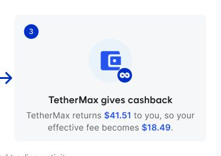 |

| 구분 | 대상 | Figma | 프로토타입 | Δ |
|---|---|---|---|---|
| 안쪽 왼쪽 여백 | `% gives cashback` | 16px | 56px | +40 |
| 안쪽 세로 위치(중심) | `browse by tag` | 458px | 496px | +38 |
| 안쪽 세로 위치(중심) | `$# cashback returned to you` | 525px | 558px | +33 |
| 안쪽 세로 위치(중심) | `where your cashback comes from` | 320px | 352px | +32 |
| 안쪽 세로 위치(중심) | `you` | 464px | 496px | +32 |
| 요소 간격 | `maker → where your cashback comes from` | 288px | 320px | +32 |
| 안쪽 세로 위치(중심) | `partner settlement` | 392px | 421px | +29 |
| 요소 간격 | `몇 군데 비교하고 여기로 정했어요 → show translation` | 144px | 116px | -28 |
| 안쪽 세로 위치(중심) | `support replies quickly, even at weekends` | 364px | 391px | +27 |
| 안쪽 세로 위치(중심) | `from real reviews, summarised by ai. wording § dif` | 394px | 420px | +26 |
| 카드 높이 | `maker` | (192,104) 1056×436 | (192,100) 1056×461 | +25 |
| 안쪽 왼쪽 여백 | `how this works` | 328px | 303px | -25 |
| … | 외 51건 | | | |

#### 5.1.3 `dex.detail:drawer` · 모바일 — 안쪽 왼쪽 여백 `how this works`

| 프로토타입 | Figma |
|---|---|
|  |  |

| 구분 | 대상 | Figma | 프로토타입 | Δ |
|---|---|---|---|---|
| 가로 위치 | `ai review summary` | (72,3419) 129×20 | (37,6062) 151×16 | -35 |
| 카드 폭 | `join now` | (16,2354) 343×296 | (0,4345) 375×194 | +32 |
| 카드 폭 | `# reviews` | (30,3006) 315×333 | (17,5609) 341×409 | +26 |
| 안쪽 왼쪽 여백 | `how this works` | 40px | 16px | -24 |
| 요소 간격 | `maker → returned to you` | 134px | 158px | +24 |
| 안쪽 왼쪽 여백 | `final taker` | 221px | 244px | +23 |
| 요소 간격 | `returned to you → with %` | 66px | 89px | +23 |
| 안쪽 세로 위치(중심) | `returned to you` | 234px | 254px | +20 |
| 가로 위치 | `lowest rated` | (327,4004) 86×24 | (310,6431) 85×16 | -17 |
| 카드 폭 | `fee stage` | (16,122) 343×674 | (24,447) 327×102 | -16 |
| 카드 폭 | `fee stage` | (32,398) 311×180 | (24,447) 327×102 | +16 |
| 가로 위치 | `highest rated` | (205,4004) 90×24 | (189,6431) 88×16 | -16 |
| … | 외 48건 | | | |

#### 5.1.4 `dex.overview:overflow` · PC — 요소 간격 `the exchange holds them → who holds your funds`

| 프로토타입 | Figma |
|---|---|
| 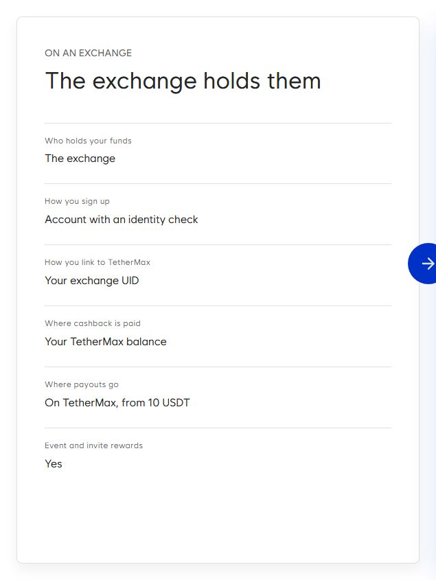 | 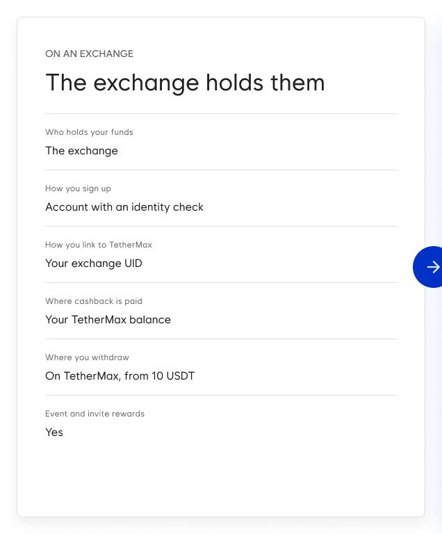 |

| 구분 | 대상 | Figma | 프로토타입 | Δ |
|---|---|---|---|---|
| 안쪽 세로 위치(중심) | `your % balance` | 435px | 474px | +39 |
| 안쪽 세로 위치(중심) | `your % balance` | 464px | 503px | +39 |
| 안쪽 세로 위치(중심) | `where cashback is paid` | 409px | 447px | +38 |
| 안쪽 세로 위치(중심) | `where cashback is paid` | 434px | 472px | +38 |
| 안쪽 세로 위치(중심) | `your cashback` | 497px | 533px | +36 |
| 안쪽 세로 위치(중심) | `your wallet address, pasted` | 375px | 406px | +31 |
| 안쪽 세로 위치(중심) | `how you link to %` | 328px | 358px | +30 |
| 안쪽 세로 위치(중심) | `how you link to %` | 345px | 375px | +30 |
| 안쪽 세로 위치(중심) | `your exchange uid` | 354px | 384px | +30 |
| 안쪽 세로 위치(중심) | `account with an identity check` | 273px | 296px | +23 |
| 안쪽 세로 위치(중심) | `email or a wallet, no kyc check` | 286px | 309px | +23 |
| 안쪽 세로 위치(중심) | `how you sign up` | 247px | 269px | +22 |
| … | 외 46건 | | | |

#### 5.1.5 `dex.detail:reviewsEmpty` · PC — 안쪽 왼쪽 여백 `% gives cashback`

| 프로토타입 | Figma |
|---|---|
|  |  |

| 구분 | 대상 | Figma | 프로토타입 | Δ |
|---|---|---|---|---|
| 안쪽 왼쪽 여백 | `% gives cashback` | 16px | 56px | +40 |
| 안쪽 세로 위치(중심) | `$# cashback returned to you` | 525px | 558px | +33 |
| 안쪽 세로 위치(중심) | `where your cashback comes from` | 320px | 352px | +32 |
| 안쪽 세로 위치(중심) | `you` | 464px | 496px | +32 |
| 안쪽 세로 위치(중심) | `partner settlement` | 392px | 421px | +29 |
| 안쪽 왼쪽 여백 | `how this works` | 328px | 303px | -25 |
| 요소 간격 | `total volume → where your cashback comes from` | 100px | 125px | +25 |
| 안쪽 왼쪽 여백 | `maker` | 986px | 963px | -23 |
| 안쪽 왼쪽 여백 | `taker` | 933px | 911px | -22 |
| 카드 높이 | `you trade on %` | (208,1313) 317×209 | (208,1802) 317×228 | +19 |
| 카드 높이 | `% pays a settlement` | (561,1313) 317×209 | (561,1802) 317×228 | +19 |
| 카드 높이 | `% gives cashback` | (915,1313) 317×209 | (915,1802) 317×228 | +19 |
| … | 외 27건 | | | |

#### 5.1.6 `dex.detail:reviewsEmpty` · 모바일 — 요소 간격 `returned to you → effective fee`

| 프로토타입 | Figma |
|---|---|
| 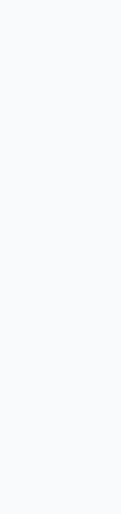 | 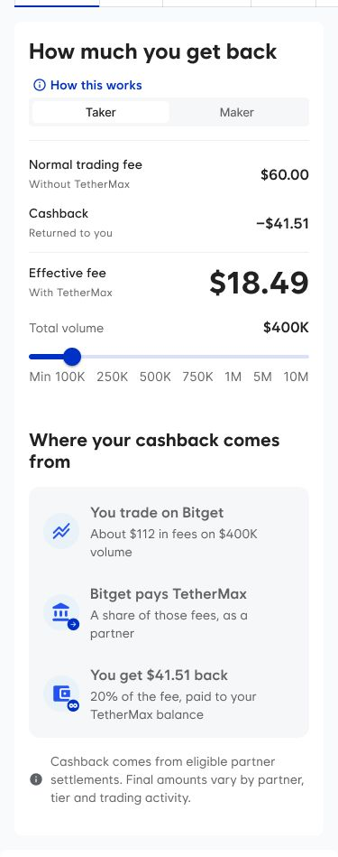 |

| 구분 | 대상 | Figma | 프로토타입 | Δ |
|---|---|---|---|---|
| 카드 폭 | `join now` | (16,2354) 343×296 | (0,4345) 375×194 | +32 |
| 요소 간격 | `returned to you → effective fee` | 44px | 70px | +26 |
| 안쪽 왼쪽 여백 | `how this works` | 40px | 16px | -24 |
| 안쪽 세로 위치(중심) | `returned to you` | 234px | 254px | +20 |
| 카드 폭 | `fee stage` | (16,122) 343×674 | (33,502) 326×185 | -17 |
| 카드 폭 | `fee stage` | (32,398) 311×180 | (33,502) 326×185 | +15 |
| 요소 간격 | `normal trading fee → returned to you` | 76px | 91px | +15 |
| 안쪽 왼쪽 여백 | `final taker` | 221px | 235px | +14 |
| 안쪽 왼쪽 여백 | `you trade on %` | 68px | 80px | +12 |
| 버튼 높이 | `join now` | (32,2602) 311×32 | (132,4465) 112×42 | +10 |
| 요소 간격 | `maker → normal trading fee` | 58px | 67px | +9 |
| 안쪽 세로 위치(중심) | `how this works` | 70px | 62px | -8 |
| … | 외 24건 | | | |

#### 5.1.7 `hub.main:normal` · 모바일 — 요소 간격 `monthly trading volume → trading fees`

| 프로토타입 | Figma |
|---|---|
| 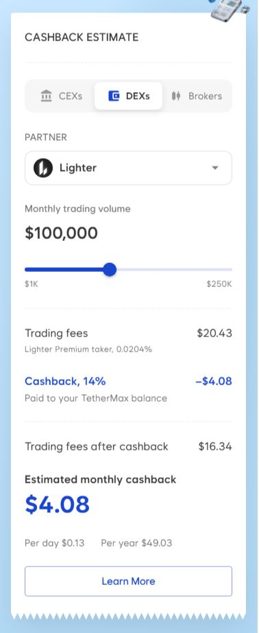 |  |

| 구분 | 대상 | Figma | 프로토타입 | Δ |
|---|---|---|---|---|
| 안쪽 세로 위치(중심) | `cashback, #%` | 499px | 536px | +37 |
| 안쪽 세로 위치(중심) | `paid to your % balance` | 524px | 561px | +37 |
| 안쪽 세로 위치(중심) | `trading fees` | 433px | 466px | +33 |
| 안쪽 세로 위치(중심) | `% premium taker, #%` | 457px | 490px | +33 |
| 카드 높이 | `brokers` | (16,2246) 343×236 | (16,2252) 343×216 | -20 |
| 안쪽 세로 위치(중심) | `monthly trading volume` | 265px | 285px | +20 |
| 요소 간격 | `monthly trading volume → trading fees` | 168px | 182px | +14 |
| 안쪽 세로 위치(중심) | `partner` | 168px | 181px | +13 |
| 카드 높이 | `centralised exchanges` | (16,1852) 343×378 | (16,1568) 343×388 | +10 |
| 안쪽 왼쪽 여백 | `per year $#` | 124px | 134px | +10 |
| 안쪽 세로 위치(중심) | `futures cashback` | 348px | 358px | +10 |
| 요소 간격 | `cashback estimate → cexs` | 76px | 86px | +10 |
| … | 외 22건 | | | |

#### 5.1.8 `landing.main:normal` · PC — 안쪽 왼쪽 여백 `partner`

| 프로토타입 | Figma |
|---|---|
| 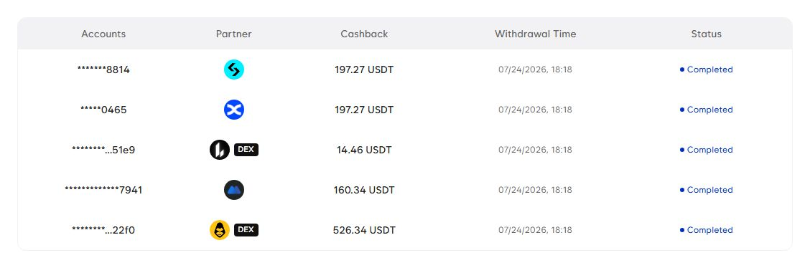 | 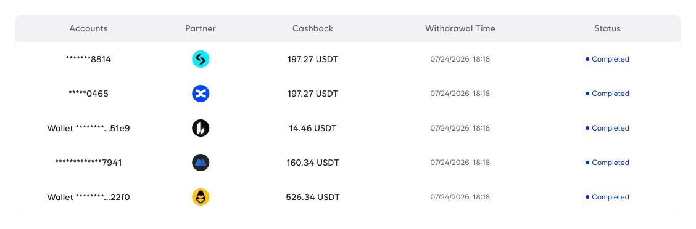 |

| 구분 | 대상 | Figma | 프로토타입 | Δ |
|---|---|---|---|---|
| 안쪽 왼쪽 여백 | `partner` | 243px | 277px | +34 |
| 안쪽 세로 위치(중심) | `more cashback. extra usdt` | 90px | 64px | -26 |
| 요소 간격 | `more cashback. extra usdt → rewards` | 92px | 118px | +26 |
| 버튼 폭 | `see all` | (1179,4746) 69×42 | (1154,4814) 94×42 | +25 |
| 버튼 폭 | `see all` | (1179,5222) 69×42 | (1154,5291) 94×42 | +25 |
| 카드 폭 | `referral code` | (298,3857) 294×98 | (286,3923) 318×103 | +24 |
| 버튼 폭 | `support@%.io` | (193,6576) 184×36 | (192,6573) 201×36 | +17 |
| 안쪽 세로 위치(중심) | `call the bitcoin price, win up to # usdt` | 90px | 76px | -14 |
| 요소 간격 | `call the bitcoin price, win up to # usdt → rewards` | 92px | 106px | +14 |
| 카드 높이 | `wednesday` | (736,1693) 200×58 | (736,1761) 200×64 | +6 |
| 카드 높이 | `referral code` | (298,3857) 294×98 | (286,3923) 318×103 | +5 |
| 안쪽 세로 위치(중심) | `you will receive a #% discount for # days` | 80px | 85px | +5 |
| … | 외 14건 | | | |

#### 5.1.9 `hub.main:member` · 모바일 — 요소 간격 `cashback, #% → trading fees after cashback`

| 프로토타입 | Figma |
|---|---|
| 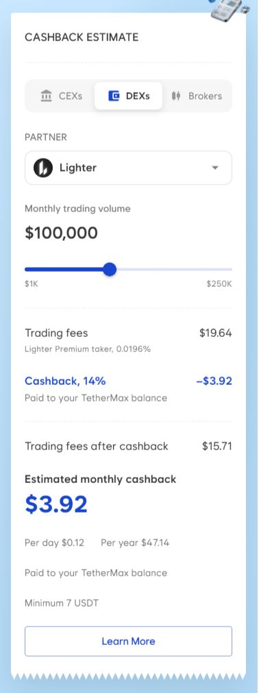 | 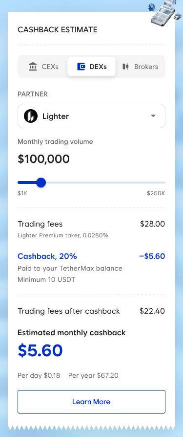 |

| 구분 | 대상 | Figma | 프로토타입 | Δ |
|---|---|---|---|---|
| 안쪽 세로 위치(중심) | `cashback, #%` | 499px | 536px | +37 |
| 안쪽 세로 위치(중심) | `trading fees` | 433px | 466px | +33 |
| 안쪽 세로 위치(중심) | `% premium taker, #%` | 457px | 490px | +33 |
| 안쪽 세로 위치(중심) | `per day $#` | 743px | 772px | +29 |
| 안쪽 세로 위치(중심) | `per year $#` | 743px | 772px | +29 |
| 안쪽 세로 위치(중심) | `estimated monthly cashback` | 655px | 680px | +25 |
| 안쪽 세로 위치(중심) | `trading fees after cashback` | 611px | 632px | +21 |
| 카드 높이 | `brokers` | (16,2269) 343×236 | (16,2340) 343×216 | -20 |
| 안쪽 세로 위치(중심) | `monthly trading volume` | 265px | 285px | +20 |
| 요소 간격 | `cashback, #% → trading fees after cashback` | 112px | 95px | -17 |
| 요소 간격 | `monthly trading volume → trading fees` | 168px | 182px | +14 |
| 안쪽 세로 위치(중심) | `partner` | 168px | 181px | +13 |
| … | 외 21건 | | | |

#### 5.1.10 `dex.detail:unlinked` · PC — 요소 간격 `crypto → deposit`

| 프로토타입 | Figma |
|---|---|
| 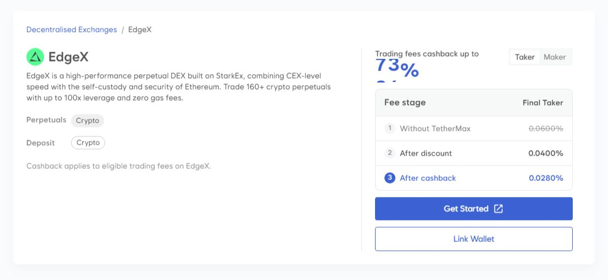 | 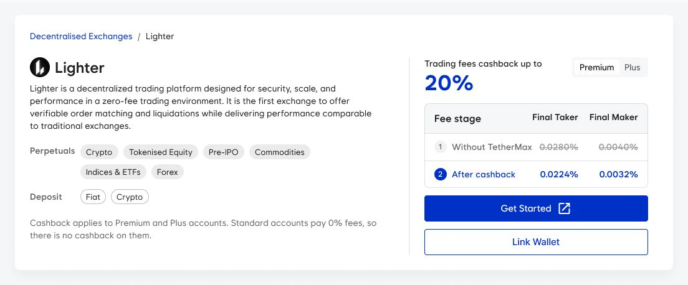 |

| 구분 | 대상 | Figma | 프로토타입 | Δ |
|---|---|---|---|---|
| 요소 간격 | `crypto → deposit` | 72px | 40px | -32 |
| 안쪽 세로 위치(중심) | `perpetuals` | 218px | 198px | -20 |
| 안쪽 세로 위치(중심) | `crypto` | 220px | 200px | -20 |
| 요소 간격 | `trading fees cashback up to → perpetuals` | 140px | 120px | -20 |
| 안쪽 세로 위치(중심) | `final taker` | 22px | 25px | +3 |
| 가로 위치 · 배치 다름 | `without %` | (893,286) 129×20 | (323,1279) 112×14 | -570 |
| 안쪽 왼쪽 여백 · 배치 다름 | `final taker` | 173px | 268px | +95 |
| 안쪽 세로 위치(중심) · 배치 다름 | `crypto` | 292px | 240px | -52 |
| 안쪽 세로 위치(중심) · 배치 다름 | `deposit` | 292px | 240px | -52 |
| 카드 높이 · 배치 다름 | `decentralised exchanges` | (192,84) 1056×410 | (192,106) 1056×461 | +51 |
| 카드 높이 · 배치 다름 | `fee stage` | (849,226) 359×136 | (849,248) 359×185 | +49 |
| 안쪽 왼쪽 여백 · 배치 다름 | `crypto` | 163px | 115px | -48 |

#### 5.1.11 `home.wallet:normal` · 모바일 — 안쪽 왼쪽 여백 `how was %`

| 프로토타입 | Figma |
|---|---|
| 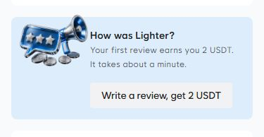 | 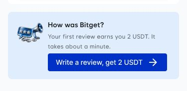 |

| 구분 | 대상 | Figma | 프로토타입 | Δ |
|---|---|---|---|---|
| 안쪽 세로 위치(중심) | `event reward` | 137px | 105px | -32 |
| 안쪽 왼쪽 여백 | `how was %` | 80px | 112px | +32 |
| 안쪽 왼쪽 여백 | `your first review earns you # usdt. it takes about` | 80px | 112px | +32 |
| 안쪽 왼쪽 여백 | `write a review, get # usdt` | 96px | 128px | +32 |
| 안쪽 세로 위치(중심) | `exchange cashback` | 111px | 80px | -31 |
| 요소 간격 | `available cashback → exchange cashback` | 83px | 52px | -31 |
| 가로 위치 | `top partner exchanges` | (16,870) 178×24 | (32,836) 178×19 | +16 |
| 가로 위치 | `#% total savings` | (16,998) 106×20 | (32,964) 57×34 | +16 |
| 가로 위치 | `guess bitcoin price` | (16,1273) 180×20 | (32,1257) 130×16 | +16 |
| 가로 위치 | `win up to # usdt` | (16,1293) 180×20 | (32,1277) 129×14 | +16 |
| 가로 위치 | `earn more cashback` | (212,1273) 180×20 | (196,1257) 140×16 | -16 |
| 가로 위치 | `#% total savings` | (132,998) 108×20 | (144,964) 57×34 | +12 |
| … | 외 7건 | | | |

#### 5.1.12 `home.wallet:normal` · PC — 안쪽 왼쪽 여백 `write a review, get # usdt`

| 프로토타입 | Figma |
|---|---|
| 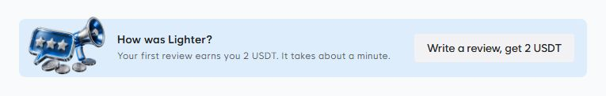 | 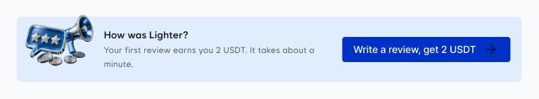 |

| 구분 | 대상 | Figma | 프로토타입 | Δ |
|---|---|---|---|---|
| 안쪽 왼쪽 여백 | `write a review, get # usdt` | 462px | 499px | +37 |
| 버튼 폭 | `write a review, get # usdt` | (1009,133) 239×36 | (1044,123) 202×36 | -37 |
| 안쪽 세로 위치(중심) | `event reward` | 137px | 105px | -32 |
| 카드 높이 | `available cashback` | (176,184) 347×268 | (178,184) 343×237 | -31 |
| 안쪽 세로 위치(중심) | `exchange cashback` | 111px | 80px | -31 |
| 안쪽 세로 위치(중심) | `matched # / # usdt in event rewards claimable # us` | 180px | 149px | -31 |
| 요소 간격 | `available cashback → exchange cashback` | 83px | 52px | -31 |
| 카드 높이 | `how was %` | (547,104) 718×94 | (545,104) 717×74 | -20 |
| 안쪽 세로 위치(중심) | `predict bitcoin price and win up to # usdt` | 90px | 76px | -14 |
| 안쪽 세로 위치(중심) | `earn more cashback. earn extra usdt` | 90px | 76px | -14 |
| 요소 간격 | `predict bitcoin price and win up to # usdt → rewar` | 92px | 106px | +14 |
| 요소 간격 | `earn more cashback. earn extra usdt → rewards` | 92px | 106px | +14 |
| … | 외 7건 | | | |

### 5.2 상태×뷰별 어긋남

| 화면:상태 | 뷰 | Figma | 짝 | 어긋남 | 유형 |
|---|---|---|---|---|---|
| `calc.p1:normal` | 모바일 | [8135:170663](https://www.figma.com/design/hsa3bSV9QmFTe2jsf6tzTm/UI-UX-Design?node-id=8135-170663) | 2 | 3 | 카드 높이 1 · 카드 폭 1 · 안쪽 왼쪽 여백 1 |
| `calc.p1:normal` | PC | [7260:88375](https://www.figma.com/design/hsa3bSV9QmFTe2jsf6tzTm/UI-UX-Design?node-id=7260-88375) | 2 | 1 | 카드 높이 1 |
| `calc.p2:none` | 모바일 | [29194:121368](https://www.figma.com/design/hsa3bSV9QmFTe2jsf6tzTm/UI-UX-Design?node-id=29194-121368) | 9 | 6 | 가로 위치 4 · 카드 폭 1 · 버튼 폭 1 |
| `calc.p2:none` | PC | [29194:120700](https://www.figma.com/design/hsa3bSV9QmFTe2jsf6tzTm/UI-UX-Design?node-id=29194-120700) | 10 | 4 | 가로 위치 4 |
| `calc.p2:normal` | 모바일 | [29194:121368](https://www.figma.com/design/hsa3bSV9QmFTe2jsf6tzTm/UI-UX-Design?node-id=29194-121368) | 9 | 6 | 가로 위치 4 · 카드 폭 1 · 버튼 폭 1 |
| `calc.p2:normal` | PC | [29194:120700](https://www.figma.com/design/hsa3bSV9QmFTe2jsf6tzTm/UI-UX-Design?node-id=29194-120700) | 10 | 4 | 가로 위치 4 |
| `dex.detail:drawer` | 모바일 | [22988:114502](https://www.figma.com/design/hsa3bSV9QmFTe2jsf6tzTm/UI-UX-Design?node-id=22988-114502) | 32 | 60 | 안쪽 세로 위치(중심) 15 · 가로 위치 12 · 안쪽 왼쪽 여백 12 · 요소 간격 7 · 카드 높이 6 · 카드 폭 4 · 안쪽 위 여백 1 · 안쪽 오른쪽 여백 1 · 버튼 폭 1 · 버튼 높이 1 |
| `dex.detail:drawer` | PC | [22544:808136](https://www.figma.com/design/hsa3bSV9QmFTe2jsf6tzTm/UI-UX-Design?node-id=22544-808136) | 40 | 63 | 안쪽 세로 위치(중심) 24 · 안쪽 왼쪽 여백 14 · 요소 간격 11 · 카드 높이 9 · 카드 폭 2 · 버튼 높이 2 · 버튼 폭 1 |
| `dex.detail:edgex` | PC | [28960:127454](https://www.figma.com/design/hsa3bSV9QmFTe2jsf6tzTm/UI-UX-Design?node-id=28960-127454) | 106 | 85 | 안쪽 세로 위치(중심) 47 · 안쪽 왼쪽 여백 15 · 요소 간격 12 · 카드 높이 10 · 버튼 폭 1 |
| `dex.detail:moderation` | 모바일 | [27392:1062](https://www.figma.com/design/hsa3bSV9QmFTe2jsf6tzTm/UI-UX-Design?node-id=27392-1062) | 2 | 4 | 카드 폭 1 · 카드 높이 1 · 안쪽 세로 위치(중심) 1 · 요소 간격 1 |
| `dex.detail:moderation` | PC | [27392:937](https://www.figma.com/design/hsa3bSV9QmFTe2jsf6tzTm/UI-UX-Design?node-id=27392-937) | 2 | 1 | 카드 폭 1 |
| `dex.detail:normal` | PC | [28960:127454](https://www.figma.com/design/hsa3bSV9QmFTe2jsf6tzTm/UI-UX-Design?node-id=28960-127454) | 107 | 85 | 안쪽 세로 위치(중심) 47 · 안쪽 왼쪽 여백 15 · 요소 간격 12 · 카드 높이 10 · 버튼 폭 1 |
| `dex.detail:reviewsEmpty` | 모바일 | [22956:84690](https://www.figma.com/design/hsa3bSV9QmFTe2jsf6tzTm/UI-UX-Design?node-id=22956-84690) | 17 | 36 | 안쪽 세로 위치(중심) 11 · 요소 간격 7 · 카드 높이 5 · 안쪽 왼쪽 여백 4 · 카드 폭 3 · 가로 위치 2 · 안쪽 위 여백 1 · 안쪽 오른쪽 여백 1 · 버튼 폭 1 · 버튼 높이 1 |
| `dex.detail:reviewsEmpty` | PC | [22442:219830](https://www.figma.com/design/hsa3bSV9QmFTe2jsf6tzTm/UI-UX-Design?node-id=22442-219830) | 24 | 39 | 안쪽 세로 위치(중심) 12 · 안쪽 왼쪽 여백 10 · 카드 높이 8 · 요소 간격 4 · 버튼 높이 2 · 카드 폭 1 · 가로 위치 1 · 버튼 폭 1 |
| `dex.detail:unlinked` | PC | [28969:129666](https://www.figma.com/design/hsa3bSV9QmFTe2jsf6tzTm/UI-UX-Design?node-id=28969-129666) | 12 | 12 | 안쪽 세로 위치(중심) 5 · 카드 높이 2 · 안쪽 왼쪽 여백 2 · 요소 간격 2 · 가로 위치 1 |
| `dex.overview:overflow` | PC | [28960:125542](https://www.figma.com/design/hsa3bSV9QmFTe2jsf6tzTm/UI-UX-Design?node-id=28960-125542) | 116 | 58 | 안쪽 세로 위치(중심) 36 · 요소 간격 10 · 안쪽 왼쪽 여백 6 · 카드 높이 5 · 버튼 폭 1 |
| `home.main:auto` | 모바일 | [22913:1051713](https://www.figma.com/design/hsa3bSV9QmFTe2jsf6tzTm/UI-UX-Design?node-id=22913-1051713) | 2 | 0 | — |
| `home.main:auto` | PC | [28960:127837](https://www.figma.com/design/hsa3bSV9QmFTe2jsf6tzTm/UI-UX-Design?node-id=28960-127837) | 31 | 17 | 안쪽 세로 위치(중심) 4 · 요소 간격 4 · 안쪽 왼쪽 여백 3 · 카드 폭 2 · 버튼 폭 2 · 카드 높이 1 · 안쪽 위 여백 1 |
| `home.main:hw1` | PC | [28960:126108](https://www.figma.com/design/hsa3bSV9QmFTe2jsf6tzTm/UI-UX-Design?node-id=28960-126108) | 32 | 17 | 안쪽 세로 위치(중심) 4 · 요소 간격 4 · 안쪽 왼쪽 여백 3 · 카드 폭 2 · 버튼 폭 2 · 카드 높이 1 · 안쪽 위 여백 1 |
| `home.main:normal` | 모바일 | [22913:1051713](https://www.figma.com/design/hsa3bSV9QmFTe2jsf6tzTm/UI-UX-Design?node-id=22913-1051713) | 2 | 0 | — |
| `home.main:normal` | PC | [28960:127837](https://www.figma.com/design/hsa3bSV9QmFTe2jsf6tzTm/UI-UX-Design?node-id=28960-127837) | 31 | 17 | 안쪽 세로 위치(중심) 4 · 요소 간격 4 · 안쪽 왼쪽 여백 3 · 카드 폭 2 · 버튼 폭 2 · 카드 높이 1 · 안쪽 위 여백 1 |
| `home.wallet:normal` | 모바일 | [26047:1348691](https://www.figma.com/design/hsa3bSV9QmFTe2jsf6tzTm/UI-UX-Design?node-id=26047-1348691) | 19 | 19 | 가로 위치 7 · 안쪽 세로 위치(중심) 4 · 안쪽 왼쪽 여백 3 · 요소 간격 3 · 카드 높이 2 |
| `home.wallet:normal` | PC | [28960:125943](https://www.figma.com/design/hsa3bSV9QmFTe2jsf6tzTm/UI-UX-Design?node-id=28960-125943) | 32 | 19 | 안쪽 세로 위치(중심) 6 · 안쪽 왼쪽 여백 3 · 요소 간격 3 · 카드 폭 2 · 카드 높이 2 · 버튼 폭 2 · 안쪽 위 여백 1 |
| `home.wallet:reviewed` | 모바일 | [25867:1348944](https://www.figma.com/design/hsa3bSV9QmFTe2jsf6tzTm/UI-UX-Design?node-id=25867-1348944) | 19 | 15 | 가로 위치 7 · 안쪽 세로 위치(중심) 5 · 카드 높이 2 · 요소 간격 1 |
| `home.wallet:reviewed` | PC | [25867:1348199](https://www.figma.com/design/hsa3bSV9QmFTe2jsf6tzTm/UI-UX-Design?node-id=25867-1348199) | 20 | 20 | 안쪽 세로 위치(중심) 7 · 카드 폭 3 · 카드 높이 3 · 요소 간격 3 · 가로 위치 2 · 안쪽 왼쪽 여백 1 · 버튼 폭 1 |
| `home.wallet:subaccounts` | PC | [28960:125943](https://www.figma.com/design/hsa3bSV9QmFTe2jsf6tzTm/UI-UX-Design?node-id=28960-125943) | 32 | 19 | 안쪽 세로 위치(중심) 6 · 안쪽 왼쪽 여백 3 · 요소 간격 3 · 카드 폭 2 · 카드 높이 2 · 버튼 폭 2 · 안쪽 위 여백 1 |
| `home.wallet:totalClaimed` | PC | [26047:1349155](https://www.figma.com/design/hsa3bSV9QmFTe2jsf6tzTm/UI-UX-Design?node-id=26047-1349155) | 21 | 19 | 안쪽 세로 위치(중심) 6 · 카드 폭 3 · 카드 높이 3 · 안쪽 왼쪽 여백 2 · 가로 위치 2 · 요소 간격 2 · 버튼 폭 1 |
| `hub.main:cards` | 모바일 | [28960:130794](https://www.figma.com/design/hsa3bSV9QmFTe2jsf6tzTm/UI-UX-Design?node-id=28960-130794) | 49 | 15 | 카드 높이 7 · 안쪽 세로 위치(중심) 6 · 요소 간격 2 |
| `hub.main:cards` | PC | [22807:98684](https://www.figma.com/design/hsa3bSV9QmFTe2jsf6tzTm/UI-UX-Design?node-id=22807-98684) | 2 | 1 | 버튼 폭 1 |
| `hub.main:member` | 모바일 | [28960:130800](https://www.figma.com/design/hsa3bSV9QmFTe2jsf6tzTm/UI-UX-Design?node-id=28960-130800) | 60 | 33 | 안쪽 세로 위치(중심) 14 · 요소 간격 9 · 카드 높이 8 · 안쪽 왼쪽 여백 1 · 버튼 높이 1 |
| `hub.main:member` | PC | [28960:126890](https://www.figma.com/design/hsa3bSV9QmFTe2jsf6tzTm/UI-UX-Design?node-id=28960-126890) | 61 | 17 | 안쪽 위 여백 4 · 요소 간격 4 · 안쪽 왼쪽 여백 3 · 버튼 높이 3 · 카드 높이 2 · 버튼 폭 1 |
| `hub.main:noLedger` | 모바일 | [28960:130800](https://www.figma.com/design/hsa3bSV9QmFTe2jsf6tzTm/UI-UX-Design?node-id=28960-130800) | 59 | 32 | 안쪽 세로 위치(중심) 13 · 요소 간격 9 · 카드 높이 8 · 안쪽 왼쪽 여백 1 · 버튼 높이 1 |
| `hub.main:noLedger` | PC | [28960:126890](https://www.figma.com/design/hsa3bSV9QmFTe2jsf6tzTm/UI-UX-Design?node-id=28960-126890) | 60 | 18 | 안쪽 왼쪽 여백 4 · 안쪽 위 여백 4 · 요소 간격 4 · 버튼 높이 3 · 카드 높이 2 · 버튼 폭 1 |
| `hub.main:normal` | 모바일 | [28960:130794](https://www.figma.com/design/hsa3bSV9QmFTe2jsf6tzTm/UI-UX-Design?node-id=28960-130794) | 71 | 34 | 안쪽 세로 위치(중심) 15 · 요소 간격 9 · 카드 높이 8 · 안쪽 왼쪽 여백 1 · 버튼 높이 1 |
| `hub.main:normal` | PC | [28960:126884](https://www.figma.com/design/hsa3bSV9QmFTe2jsf6tzTm/UI-UX-Design?node-id=28960-126884) | 74 | 16 | 안쪽 위 여백 4 · 요소 간격 4 · 안쪽 왼쪽 여백 3 · 버튼 높이 3 · 카드 높이 1 · 버튼 폭 1 |
| `landing.main:normal` | PC | [28960:128375](https://www.figma.com/design/hsa3bSV9QmFTe2jsf6tzTm/UI-UX-Design?node-id=28960-128375) | 109 | 26 | 안쪽 왼쪽 여백 7 · 가로 위치 7 · 안쪽 세로 위치(중심) 3 · 버튼 폭 3 · 요소 간격 3 · 카드 높이 2 · 카드 폭 1 |
| `link.addr:empty` | 모바일 | [28969:126986](https://www.figma.com/design/hsa3bSV9QmFTe2jsf6tzTm/UI-UX-Design?node-id=28969-126986) | 5 | 2 | 가로 위치 1 · 버튼 높이 1 |
| `link.done:apex` | PC | [28960:127861](https://www.figma.com/design/hsa3bSV9QmFTe2jsf6tzTm/UI-UX-Design?node-id=28960-127861) | 4 | 0 | — |
| `link.done:apexIdPending` | PC | [28960:127861](https://www.figma.com/design/hsa3bSV9QmFTe2jsf6tzTm/UI-UX-Design?node-id=28960-127861) | 4 | 0 | — |
| `link.done:normal` | PC | [28960:127861](https://www.figma.com/design/hsa3bSV9QmFTe2jsf6tzTm/UI-UX-Design?node-id=28960-127861) | 4 | 0 | — |
| `link.proc:normal` | 모바일 | [25963:14034](https://www.figma.com/design/hsa3bSV9QmFTe2jsf6tzTm/UI-UX-Design?node-id=25963-14034) | 1 | 0 | — |
| `link.result:normal` | 모바일 | [28969:127125](https://www.figma.com/design/hsa3bSV9QmFTe2jsf6tzTm/UI-UX-Design?node-id=28969-127125) | 6 | 0 | — |
| `link.result:normal` | PC | [28960:127301](https://www.figma.com/design/hsa3bSV9QmFTe2jsf6tzTm/UI-UX-Design?node-id=28960-127301) | 6 | 0 | — |
| `link.select:normal` | PC | [28960:127765](https://www.figma.com/design/hsa3bSV9QmFTe2jsf6tzTm/UI-UX-Design?node-id=28960-127765) | 0 | 0 | — |
| `link.uid:empty` | 모바일 | [29051:100488](https://www.figma.com/design/hsa3bSV9QmFTe2jsf6tzTm/UI-UX-Design?node-id=29051-100488) | 3 | 1 | 버튼 높이 1 |
| `summary.main:normal` | 모바일 | [29065:6687](https://www.figma.com/design/hsa3bSV9QmFTe2jsf6tzTm/UI-UX-Design?node-id=29065-6687) | 12 | 7 | 카드 높이 3 · 안쪽 왼쪽 여백 3 · 안쪽 세로 위치(중심) 1 |
| `summary.main:normal` | PC | [28960:127133](https://www.figma.com/design/hsa3bSV9QmFTe2jsf6tzTm/UI-UX-Design?node-id=28960-127133) | 22 | 26 | 안쪽 왼쪽 여백 8 · 카드 높이 6 · 카드 폭 4 · 안쪽 세로 위치(중심) 4 · 요소 간격 3 · 버튼 폭 1 |

## 6. Figma 문구를 하나도 못 읽은 상태×뷰

41건. 프레임 전체가 인스턴스이거나 이름뿐인 레이어만 있어 색인으로는 대조할 수 없습니다. 정밀 캐시(10장)에 넣어야 대조됩니다.

| 화면:상태 | 뷰 | Figma 노드 | 프레임 이름 | 가려진 인스턴스 |
|---|---|---|---|---|
| `cmn.header:guest` 비로그인 — Login · Sign Up | PC | [19604:32578](https://www.figma.com/design/hsa3bSV9QmFTe2jsf6tzTm/UI-UX-Design?node-id=19604-32578) | Type=Pre-Login, BG=Light | content 1 |
| `cmn.header:hover` Cashback 드롭다운 열림 | PC | [19604:32652](https://www.figma.com/design/hsa3bSV9QmFTe2jsf6tzTm/UI-UX-Design?node-id=19604-32652) | Property 1=Cashback | content 1 |
| `cmn.header:rewards` Rewards Hub 드롭다운 열림 | PC | [19604:32665](https://www.figma.com/design/hsa3bSV9QmFTe2jsf6tzTm/UI-UX-Design?node-id=19604-32665) | Property 1=Rewards Hub | content 1 |
| `cmn.header:discover` Discover 드롭다운 열림 | PC | [19604:32678](https://www.figma.com/design/hsa3bSV9QmFTe2jsf6tzTm/UI-UX-Design?node-id=19604-32678) | Property 1=Discover | content 1 |
| `cmn.drawer:normal` 비로그인 — 환영 블록 | 모바일 | [19604:33156](https://www.figma.com/design/hsa3bSV9QmFTe2jsf6tzTm/UI-UX-Design?node-id=19604-33156) | mWeb/landingPage/Post-login | content 1 |
| `cmn.drawer:member` 로그인 | 모바일 | [19604:32998](https://www.figma.com/design/hsa3bSV9QmFTe2jsf6tzTm/UI-UX-Design?node-id=19604-32998) | mWeb/landingPage/Post-login | content 1 |
| `cmn.appnav:normal` Home 활성 | 모바일 | [8582:155585](https://www.figma.com/design/hsa3bSV9QmFTe2jsf6tzTm/UI-UX-Design?node-id=8582-155585) | <BottomNavigation> | shell 4 |
| `cmn.appnav:events` Events 활성 | 모바일 | [8582:155585](https://www.figma.com/design/hsa3bSV9QmFTe2jsf6tzTm/UI-UX-Design?node-id=8582-155585) | <BottomNavigation> | shell 4 |
| `cmn.appnav:exchange` Exchanges 활성 | 모바일 | [8582:155585](https://www.figma.com/design/hsa3bSV9QmFTe2jsf6tzTm/UI-UX-Design?node-id=8582-155585) | <BottomNavigation> | shell 4 |
| `cmn.listing:cards` 카드 뷰 (모바일) | 모바일 | [8471:65818](https://www.figma.com/design/hsa3bSV9QmFTe2jsf6tzTm/UI-UX-Design?node-id=8471-65818) | mWeb/LP | content 1 |
| `notice.list:normal` 카테고리 · 신규 거래소 추가 | PC | [23102:1009753](https://www.figma.com/design/hsa3bSV9QmFTe2jsf6tzTm/UI-UX-Design?node-id=23102-1009753) | Newsletter / List / PC 1440 | content 1 |
| `notice.list:normal` 카테고리 · 신규 거래소 추가 | 모바일 | [23102:1010436](https://www.figma.com/design/hsa3bSV9QmFTe2jsf6tzTm/UI-UX-Design?node-id=23102-1010436) | Newsletter / List / mobile 375 | content 1 |
| `terms.use:normal` 이용약관 — 6.8 거래 계정 기준 개정 | PC | [12474:202799](https://www.figma.com/design/hsa3bSV9QmFTe2jsf6tzTm/UI-UX-Design?node-id=12474-202799) | Web | content 1 |
| `terms.privacy:normal` 개인정보처리방침 — 지갑 주소 · DEX 거래 기록 추가 | PC | [12474:202970](https://www.figma.com/design/hsa3bSV9QmFTe2jsf6tzTm/UI-UX-Design?node-id=12474-202970) | Web | content 1 |
| `notice.urgent:normal` 공지 팝업 — 오늘 하루 보지 않기 | PC | [26019:11273](https://www.figma.com/design/hsa3bSV9QmFTe2jsf6tzTm/UI-UX-Design?node-id=26019-11273) | <Paper> | content 2 · button 1 |
| `notice.urgent:normal` 공지 팝업 — 오늘 하루 보지 않기 | 모바일 | [26019:11602](https://www.figma.com/design/hsa3bSV9QmFTe2jsf6tzTm/UI-UX-Design?node-id=26019-11602) | <Dialog> | content 2 · button 1 |
| `ranking.main:board` 월간 순위 CEX+DEX 한 목록 (혜택 랭킹 카드) | PC | [26651:60616](https://www.figma.com/design/hsa3bSV9QmFTe2jsf6tzTm/UI-UX-Design?node-id=26651-60616) | MAXOP-805 / Ranking card with reward messages / PC 1440 (card width 928) | content 1 |
| `invite.main:normal` 초대 랜딩 (IF1) | 모바일 | [12474:203982](https://www.figma.com/design/hsa3bSV9QmFTe2jsf6tzTm/UI-UX-Design?node-id=12474-203982) | mWeb/allPartnerExchange | content 1 |
| `invite.main:code` Invite 탭 — 코드·링크 (IF3) | 모바일 | [12503:260211](https://www.figma.com/design/hsa3bSV9QmFTe2jsf6tzTm/UI-UX-Design?node-id=12503-260211) | mWeb/allPartnerExchange | content 1 |
| `invite.landing:normal` 피초대자 가입 랜딩 (IF2) | 모바일 | [12565:243367](https://www.figma.com/design/hsa3bSV9QmFTe2jsf6tzTm/UI-UX-Design?node-id=12565-243367) | mWeb/allPartnerExchange | content 1 |
| `partner.hub:modal` 하위 회원별 연동 계정 모달 | PC | [28960:127188](https://www.figma.com/design/hsa3bSV9QmFTe2jsf6tzTm/UI-UX-Design?node-id=28960-127188) | DEX / Sub-Account · Member ID / Linked Accounts detail | - |
| `maxboard.main:excluded` 결과 발표 · 제외 | PC | [29064:14754](https://www.figma.com/design/hsa3bSV9QmFTe2jsf6tzTm/UI-UX-Design?node-id=29064-14754) | 맥스보드 · 결과 발표 · 제외 / PC = 결과 발표 · 참여자와 같음 | - |
| `maxboard.main:excluded` 결과 발표 · 제외 | 모바일 | [29064:15127](https://www.figma.com/design/hsa3bSV9QmFTe2jsf6tzTm/UI-UX-Design?node-id=29064-15127) | 맥스보드 · 결과 발표 · 제외 / 모바일 = 결과 발표 · 참여자와 같음 | - |
| `maxboard.main:failToast` 등록 실패 토스트 | 모바일 | [28537:459718](https://www.figma.com/design/hsa3bSV9QmFTe2jsf6tzTm/UI-UX-Design?node-id=28537-459718) | toast | content 1 |
| `coupon.box:history` Completed 탭 · 사용/만료 이력 | PC | [26648:710899](https://www.figma.com/design/hsa3bSV9QmFTe2jsf6tzTm/UI-UX-Design?node-id=26648-710899) | MAXOP-796 / Completed tab with Used and Expired / PC 1440 | content 1 |
| `coupon.box:done` 적용 완료 | 모바일 | [25994:12167](https://www.figma.com/design/hsa3bSV9QmFTe2jsf6tzTm/UI-UX-Design?node-id=25994-12167) | mWeb / Coupon claimed / with close | content 1 |
| `benefits.list:normal` 회원 · 진행 중 | 모바일 | [17170:172813](https://www.figma.com/design/hsa3bSV9QmFTe2jsf6tzTm/UI-UX-Design?node-id=17170-172813) | Frame 1984078611 | - |
| `benefits.list:guest` 게스트 · 완료 탭 | 모바일 | [9365:199934](https://www.figma.com/design/hsa3bSV9QmFTe2jsf6tzTm/UI-UX-Design?node-id=9365-199934) | mWeb/allPartnerExchange | content 1 |
| `benefits.list:guestOn` 게스트 · 진행 중 탭 | PC | [9961:168203](https://www.figma.com/design/hsa3bSV9QmFTe2jsf6tzTm/UI-UX-Design?node-id=9961-168203) | Web | content 1 |
| `benefits.list:first` 첫 캐시백 10 USDT 상세 (CEX · DEX) | 모바일 | [9622:112561](https://www.figma.com/design/hsa3bSV9QmFTe2jsf6tzTm/UI-UX-Design?node-id=9622-112561) | mWeb/allPartnerExchange | content 1 |
| `home.timeline:normal` EdgeX Daily D+1 | PC | [26047:56579](https://www.figma.com/design/hsa3bSV9QmFTe2jsf6tzTm/UI-UX-Design?node-id=26047-56579) | Step=1 | content 1 |
| `home.timeline:normal` EdgeX Daily D+1 | 모바일 | [26047:56579](https://www.figma.com/design/hsa3bSV9QmFTe2jsf6tzTm/UI-UX-Design?node-id=26047-56579) | Step=1 | content 1 |
| `my.main:partner` 파트너 — Partners Hub | PC | [12474:173500](https://www.figma.com/design/hsa3bSV9QmFTe2jsf6tzTm/UI-UX-Design?node-id=12474-173500) | Web | content 1 |
| `link.select:normal` 진입 — 첫 거래소 WOO X Pro 기본 선택 (G-379) | PC | [28960:127765](https://www.figma.com/design/hsa3bSV9QmFTe2jsf6tzTm/UI-UX-Design?node-id=28960-127765) | DEX / story / S3-2 Link Account, choose a partner / light | - |
| `link.uid:filled` UID 입력 완료 — Next 활성 (게스트 조회 handoffcex 포함) | PC | [9287:185462](https://www.figma.com/design/hsa3bSV9QmFTe2jsf6tzTm/UI-UX-Design?node-id=9287-185462) | Web | content 1 |
| `link.uid:filled` UID 입력 완료 — Next 활성 (게스트 조회 handoffcex 포함) | 모바일 | [9105:188659](https://www.figma.com/design/hsa3bSV9QmFTe2jsf6tzTm/UI-UX-Design?node-id=9105-188659) | mWeb/LP | content 1 |
| `own.home:unlinked` 이전 보유자 · 연동 해제 행 (O14) | 모바일 | [12783:404139](https://www.figma.com/design/hsa3bSV9QmFTe2jsf6tzTm/UI-UX-Design?node-id=12783-404139) | mWeb/landingPage | content 1 |
| `dex.overview:normal` 게스트 — 이유 카드 · 마지막 CTA 띠까지 | PC | [28960:125521](https://www.figma.com/design/hsa3bSV9QmFTe2jsf6tzTm/UI-UX-Design?node-id=28960-125521) | 색인 이후 새 프레임(Figma수정결과_2차.md) | - |
| `dex.overview:normal` 게스트 — 이유 카드 · 마지막 CTA 띠까지 | 모바일 | [28960:130946](https://www.figma.com/design/hsa3bSV9QmFTe2jsf6tzTm/UI-UX-Design?node-id=28960-130946) | 색인 이후 새 프레임(Figma수정결과_2차.md) | - |
| `dex.overview:lighter` Lighter 카드 (온보딩 후 — 보류) | PC | [28960:125521](https://www.figma.com/design/hsa3bSV9QmFTe2jsf6tzTm/UI-UX-Design?node-id=28960-125521) | 색인 이후 새 프레임(Figma수정결과_2차.md) | - |
| `dex.overview:lighter` Lighter 카드 (온보딩 후 — 보류) | 모바일 | [28960:130946](https://www.figma.com/design/hsa3bSV9QmFTe2jsf6tzTm/UI-UX-Design?node-id=28960-130946) | 색인 이후 새 프레임(Figma수정결과_2차.md) | - |

## 7. 디자인 없는 상태

### 7.1 PC·모바일 모두 Figma 노드 없음 (91)

| 그룹 | 화면:상태 | 상태 |
|---|---|---|
| 1. 공통 · 셸 (헤더·푸터·공지·약관) | `cmn.appnav:inapp` | 미지원 Cashback 페이지 → 인앱 브라우저 |
| 2. 랜딩 · 서비스 소개 | `landing.main:heroDex` | Hero Exchange = DEX |
| 2. 랜딩 · 서비스 소개 | `landing.main:inactive` | Featured·Hero 파트너 비활성 |
| 2. 랜딩 · 서비스 소개 | `about.intro:loading` | 피드 불러오는 중 |
| 2. 랜딩 · 서비스 소개 | `about.intro:empty` | 피드 없음 |
| 2. 랜딩 · 서비스 소개 | `about.intro:error` | 피드 실패 |
| 2. 랜딩 · 서비스 소개 | `about.feed:loading` | 불러오는 중 |
| 2. 랜딩 · 서비스 소개 | `about.feed:empty` | 내역 없음 |
| 2. 랜딩 · 서비스 소개 | `about.feed:error` | 불러오기 실패 |
| 4. 홈 · 잔액 · 지갑 상세 | `home.main:s3Pending` | 확인 중 계정만 있음 → S4 전환 |
| 4. 홈 · 잔액 · 지갑 상세 | `home.main:statuses` | 상태 행(CEX) — 점 색 · 시계(확인 중 · 소유 확인 중) · 배너(수동 연동 실패 · 소유 확인 실패 · 해제), 칩 없음 |
| 4. 홈 · 잔액 · 지갑 상세 | `home.main:walletStates` | 상태 행(DEX 지갑) — wallet 문구 분기 |
| 4. 홈 · 잔액 · 지갑 상세 | `home.main:linkFail` | 수동 연동 실패 배너 탭 → UID Linking Unsuccessful |
| 4. 홈 · 잔액 · 지갑 상세 | `home.main:linkFailWallet` | 수동 연동 실패(DEX) → Wallet Linking Unsuccessful |
| 4. 홈 · 잔액 · 지갑 상세 | `home.main:issue` | 이슈 행 탭 → 문제 안내 모달 |
| 4. 홈 · 잔액 · 지갑 상세 | `home.main:issueWallet` | 이슈(DEX) → There is a problem with this wallet. |
| 4. 홈 · 잔액 · 지갑 상세 | `home.main:loading` | 로딩 — 스켈레톤 |
| 4. 홈 · 잔액 · 지갑 상세 | `home.main:error` | 잔액 로드 실패 |
| 4. 홈 · 잔액 · 지갑 상세 | `home.main:many` | 계정 11개 이상 — 10개 + 더보기 |
| 4. 홈 · 잔액 · 지갑 상세 | `home.main:full` | 지갑 전체 주소 펼침 |
| 4. 홈 · 잔액 · 지갑 상세 | `home.main:transferred` | 10 USDT 미만 이관 4.00 |
| 4. 홈 · 잔액 · 지갑 상세 | `home.main:pending` | 확인 중 — 연동 시도중이에요 · - |
| 4. 홈 · 잔액 · 지갑 상세 | `home.main:inactive` | DEX 오프보딩 — 이슈 처리(빨간 점 → 문제 안내 모달) |
| 4. 홈 · 잔액 · 지갑 상세 | `home.main:rejected` | 확인 중 거절 — 행 제거 |
| 4. 홈 · 잔액 · 지갑 상세 | `home.main:faq` | 홈 FAQ — 회원 답변 |
| 4. 홈 · 잔액 · 지갑 상세 | `home.main:seeAll` | See All — 연동 계정 목록 모달 |
| 4. 홈 · 잔액 · 지갑 상세 | `home.wallet:loading` | 잔액 로딩 — 스켈레톤 |
| 4. 홈 · 잔액 · 지갑 상세 | `home.wallet:error` | 잔액 조회 실패 — 기존 빈 상태 |
| 4. 홈 · 잔액 · 지갑 상세 | `home.wallet:pending` | 연동 시도중 |
| 4. 홈 · 잔액 · 지갑 상세 | `home.timeline:apex` | ApeX D+2 |
| 4. 홈 · 잔액 · 지갑 상세 | `home.timeline:lighter` | Lighter Weekly W+1 (온보딩 후) |
| 4. 홈 · 잔액 · 지갑 상세 | `home.timeline:warning` | 순차 지급 경고 |
| 4. 홈 · 잔액 · 지갑 상세 | `wd.reflect:normal` | 지급 전 |
| 4. 홈 · 잔액 · 지갑 상세 | `wd.reflect:deducted` | 신청 생성 — 선차감 (같은 새로고침에 반영) |
| 4. 홈 · 잔액 · 지갑 상세 | `wd.reflect:restored` | 최종 실패 — 복원 |
| 5. 거래 계정 연동 | `link.select:none` | 검색 결과 없음 (All 칩) |
| 5. 거래 계정 연동 | `link.select:region` | 지역 제한 DEX — 목록에서 제외 |
| 5. 거래 계정 연동 | `link.select:fail` | 파트너 목록 로드 실패 (캐시 없음) |
| 5. 거래 계정 연동 | `link.select:intro` | STG 웹 진입 질문 |
| 5. 거래 계정 연동 | `link.addr:kept` | 실패 후 주소 유지 |
| 5. 거래 계정 연동 | `link.addr:hub` | 허브 진입 — 그 거래소 미리 선택 |
| 5. 거래 계정 연동 | `link.addr:lighter` | Lighter 상세 진입 — 거래소 미리 선택 |
| 5. 거래 계정 연동 | `link.addr:apex` | ApeX 상세 진입 — 거래소 미리 선택 |
| 5. 거래 계정 연동 | `link.addr:edgex` | EdgeX 상세 진입 — 거래소 미리 선택 |
| 5. 거래 계정 연동 | `link.addr:aster` | Aster 상세 진입 — 거래소 미리 선택 |
| 5. 거래 계정 연동 | `link.captcha:retry` | 퍼즐 실패·만료 — 주소 유지 재시도 |
| 5. 거래 계정 연동 | `link.done:truncated` | 180일 넘는 기록 — Cashback shown from |
| 6. 소유권 인증 | `own.home:reclaimUid` | 재청구 다이얼로그 — CEX UID (기존 MAX-561) |
| 7. 캐시백 허브 | `hub.main:dexPartial` | A=3 · B=8 — 일부만 출금 |
| 7. 캐시백 허브 | `hub.main:dexLoading` | 패널 로딩 |
| 7. 캐시백 허브 | `hub.main:dexMulti` | 같은 DEX 복수 지갑 +N |
| 7. 캐시백 허브 | `hub.main:aster` | Aster — USDT value at payout |
| 7. 캐시백 허브 | `hub.main:totalClaimed` | Total claimed (G-053 유지) |
| 7. 캐시백 허브 | `hub.main:rateFail` | 요율 서비스 실패 |
| 7. 캐시백 허브 | `hub.main:lighterAccruing` | Lighter 주중 「집계 전」 (G-100) |
| 8. DEX 개요 · 상세 | `dex.overview:defiStale` | DefiLlama 실패 — 마지막 캐시값 + 기준 시각 |
| 8. DEX 개요 · 상세 | `dex.overview:defiHidden` | DefiLlama 24시간 넘게 실패 — 숨김 |
| 8. DEX 개요 · 상세 | `dex.overview:noBanner` | 게시 배너 없음 — 렌더 안 함 |
| 8. DEX 개요 · 상세 | `dex.overview:empty` | 노출 DEX 0개 — 영역 숨김 (G-160) |
| 8. DEX 개요 · 상세 | `dex.overview:maint` | 특정 DEX 점검·일시 연동 불가 (G-162) |
| 8. DEX 개요 · 상세 | `dex.detail:maker` | Maker 토글 (D4 토글 선택 변형 재사용) |
| 8. DEX 개요 · 상세 | `dex.detail:pendingLink` | 확인 중 지갑만 있음 — 연동 버튼 자리 비활성 「확인 중」 |
| 8. DEX 개요 · 상세 | `dex.detail:offboarded` | DEX 오프보딩 — 랜딩 리다이렉트 |
| 9. 계산기 (/payback) | `calc.p1:noUsers` | 사용자 수 없음 — 카드 숨김 |
| 9. 계산기 (/payback) | `calc.p3:normal` | 카드 4장 — 빈도 선택됨 |
| 9. 계산기 (/payback) | `calc.p4:normal` | DEX(EdgeX) — Did you know 숨김 |
| 9. 계산기 (/payback) | `calc.p5:normal` | EdgeX — Daily |
| 9. 계산기 (/payback) | `calc.p5:aster` | Aster 각주 |
| 9. 계산기 (/payback) | `calc.p5:apex` | ApeX — Daily |
| 9. 계산기 (/payback) | `calc.p5:lighter` | Lighter — Daily |
| 10. 캐시백 요약 · 랭킹 | `summary.main:dexRange` | 거래소 범위 DEX 전체 |
| 10. 캐시백 요약 · 랭킹 | `summary.main:returned` | Withdrawal returned 행 |
| 10. 캐시백 요약 · 랭킹 | `summary.main:lighter` | Lighter Credited · Withheld (온보딩 후) |
| 10. 캐시백 요약 · 랭킹 | `summary.main:oneEmpty` | 계정 1개 선택 빈 상태 |
| 10. 캐시백 요약 · 랭킹 | `summary.main:old` | 180일 넘은 달 |
| 10. 캐시백 요약 · 랭킹 | `ranking.main:dex` | 순위표 DEX 칩 |
| 11. 친구 초대 · 파트너 허브 | `invite.main:terms` | 약관 bullet 펼침 |
| 11. 친구 초대 · 파트너 허브 | `invite.main:below50` | 10 USDT 미만 |
| 12. 리워드 (맥스보드·리그·쿠폰·혜택·이벤트·TP) | `maxboard.main:today` | 참여 중 · 오늘 마감 |
| 12. 리워드 (맥스보드·리그·쿠폰·혜택·이벤트·TP) | `maxboard.main:final` | 마지막 날 Batch 후 완성 |
| 12. 리워드 (맥스보드·리그·쿠폰·혜택·이벤트·TP) | `coupon.box:picker1` | 계정 1개 |
| 12. 리워드 (맥스보드·리그·쿠폰·혜택·이벤트·TP) | `coupon.box:notFound` | 없는·남의 쿠폰 — 404 |
| 12. 리워드 (맥스보드·리그·쿠폰·혜택·이벤트·TP) | `coupon.box:noAccount` | 연동 계정 없음 |
| 12. 리워드 (맥스보드·리그·쿠폰·혜택·이벤트·TP) | `league.main:dexOnly` | DEX 지갑만 연동한 회원 |
| 12. 리워드 (맥스보드·리그·쿠폰·혜택·이벤트·TP) | `league.main:notLinked` | DEX 리그 미연동 안내 |
| 12. 리워드 (맥스보드·리그·쿠폰·혜택·이벤트·TP) | `league.main:card` | DEX 리그 혜택 카드 · URL |
| 12. 리워드 (맥스보드·리그·쿠폰·혜택·이벤트·TP) | `tp.intro:normal` | 소개 — 게스트·회원 같은 화면 (dev 기준) |
| 15. 기존 테더맥스 (CEX·계정·마이) | `auth.login:otp` | Continue → 이메일 인증 모달 |
| 15. 기존 테더맥스 (CEX·계정·마이) | `auth.login:otpGuest` | 게스트 조회에서 로그인 → 이메일 인증 |
| 15. 기존 테더맥스 (CEX·계정·마이) | `auth.signup:otp` | Continue → Email Verification 모달 |
| 15. 기존 테더맥스 (CEX·계정·마이) | `auth.signup:otpGuest` | 게스트 조회에서 가입 → 이메일 인증 |

### 7.2 한쪽 뷰만 있음 (105)

| 화면:상태 | 상태 | 없는 쪽 | 있는 쪽 노드 |
|---|---|---|---|
| `cmn.header:normal` | 로그인 | 모바일 | [28967:127332](https://www.figma.com/design/hsa3bSV9QmFTe2jsf6tzTm/UI-UX-Design?node-id=28967-127332) |
| `cmn.header:guest` | 비로그인 — Login · Sign Up | 모바일 | [19604:32578](https://www.figma.com/design/hsa3bSV9QmFTe2jsf6tzTm/UI-UX-Design?node-id=19604-32578) |
| `cmn.header:hover` | Cashback 드롭다운 열림 | 모바일 | [19604:32652](https://www.figma.com/design/hsa3bSV9QmFTe2jsf6tzTm/UI-UX-Design?node-id=19604-32652) |
| `cmn.header:rewards` | Rewards Hub 드롭다운 열림 | 모바일 | [19604:32665](https://www.figma.com/design/hsa3bSV9QmFTe2jsf6tzTm/UI-UX-Design?node-id=19604-32665) |
| `cmn.header:discover` | Discover 드롭다운 열림 | 모바일 | [19604:32678](https://www.figma.com/design/hsa3bSV9QmFTe2jsf6tzTm/UI-UX-Design?node-id=19604-32678) |
| `cmn.header:unread` | 알림 안 읽음 (빨간 점) | 모바일 | [8643:121393](https://www.figma.com/design/hsa3bSV9QmFTe2jsf6tzTm/UI-UX-Design?node-id=8643-121393) |
| `cmn.header:bellFail` | 알림 로드 실패 — 점 숨김 | 모바일 | [28967:127332](https://www.figma.com/design/hsa3bSV9QmFTe2jsf6tzTm/UI-UX-Design?node-id=28967-127332) |
| `cmn.drawer:normal` | 비로그인 — 환영 블록 | PC | [19604:33156](https://www.figma.com/design/hsa3bSV9QmFTe2jsf6tzTm/UI-UX-Design?node-id=19604-33156) |
| `cmn.drawer:member` | 로그인 | PC | [19604:32998](https://www.figma.com/design/hsa3bSV9QmFTe2jsf6tzTm/UI-UX-Design?node-id=19604-32998) |
| `cmn.lang:sheet` | 언어 바텀시트 | PC | [12085:400397](https://www.figma.com/design/hsa3bSV9QmFTe2jsf6tzTm/UI-UX-Design?node-id=12085-400397) |
| `cmn.footer:guest` | 모바일 게스트 — Company › Claim Cashback | PC | [29072:1797](https://www.figma.com/design/hsa3bSV9QmFTe2jsf6tzTm/UI-UX-Design?node-id=29072-1797) |
| `cmn.appnav:normal` | Home 활성 | PC | [8582:155585](https://www.figma.com/design/hsa3bSV9QmFTe2jsf6tzTm/UI-UX-Design?node-id=8582-155585) |
| `cmn.appnav:events` | Events 활성 | PC | [8582:155585](https://www.figma.com/design/hsa3bSV9QmFTe2jsf6tzTm/UI-UX-Design?node-id=8582-155585) |
| `cmn.appnav:exchange` | Exchanges 활성 | PC | [8582:155585](https://www.figma.com/design/hsa3bSV9QmFTe2jsf6tzTm/UI-UX-Design?node-id=8582-155585) |
| `cmn.listing:cards` | 카드 뷰 (모바일) | PC | [8471:65818](https://www.figma.com/design/hsa3bSV9QmFTe2jsf6tzTm/UI-UX-Design?node-id=8471-65818) |
| `cmn.appupdate:normal` | Update Required 다이얼로그 | PC | [2913:17755](https://www.figma.com/design/hsa3bSV9QmFTe2jsf6tzTm/UI-UX-Design?node-id=2913-17755) |
| `summary.main:otherDay` | 다른 날 선택 (CS2) | 모바일 | [28960:127139](https://www.figma.com/design/hsa3bSV9QmFTe2jsf6tzTm/UI-UX-Design?node-id=28960-127139) |
| `summary.main:eventDay` | 이벤트 리워드 날 · 큰 금액 축약 (CS3) | 모바일 | [28960:127145](https://www.figma.com/design/hsa3bSV9QmFTe2jsf6tzTm/UI-UX-Design?node-id=28960-127145) |
| `summary.main:account` | 계정 필터 드롭다운 (CS6 All Accounts) | 모바일 | [29265:120180](https://www.figma.com/design/hsa3bSV9QmFTe2jsf6tzTm/UI-UX-Design?node-id=29265-120180) |
| `summary.main:noMonth` | 활동 없는 달 (CS5) | 모바일 | [28960:127157](https://www.figma.com/design/hsa3bSV9QmFTe2jsf6tzTm/UI-UX-Design?node-id=28960-127157) |
| `summary.main:noDay` | 활동 없는 날 · 큰 금액 (CS4) | 모바일 | [28960:127151](https://www.figma.com/design/hsa3bSV9QmFTe2jsf6tzTm/UI-UX-Design?node-id=28960-127151) |
| `ranking.main:normal` | 순위 매겨짐 (RK2) | 모바일 | [28960:127207](https://www.figma.com/design/hsa3bSV9QmFTe2jsf6tzTm/UI-UX-Design?node-id=28960-127207) |
| `ranking.main:wallet` | 지갑 주소 전체 보기 — 툴팁 | 모바일 | [28984:126296](https://www.figma.com/design/hsa3bSV9QmFTe2jsf6tzTm/UI-UX-Design?node-id=28984-126296) |
| `invite.main:codeCopied` | 코드 복사 토스트 (IF4) | 모바일 | [28960:126834](https://www.figma.com/design/hsa3bSV9QmFTe2jsf6tzTm/UI-UX-Design?node-id=28960-126834) |
| `invite.main:linkCopied` | 링크 복사 토스트 (IF5) | 모바일 | [28960:126840](https://www.figma.com/design/hsa3bSV9QmFTe2jsf6tzTm/UI-UX-Design?node-id=28960-126840) |
| `partner.hub:modal` | 하위 회원별 연동 계정 모달 | 모바일 | [28960:127188](https://www.figma.com/design/hsa3bSV9QmFTe2jsf6tzTm/UI-UX-Design?node-id=28960-127188) |
| `maxboard.main:pick` | 참여 계정 선택 레이어 (Join NOW) | 모바일 | [29330:190799](https://www.figma.com/design/hsa3bSV9QmFTe2jsf6tzTm/UI-UX-Design?node-id=29330-190799) |
| `maxboard.main:regConfirm` | 등록 확인 팝업 | 모바일 | [29330:190851](https://www.figma.com/design/hsa3bSV9QmFTe2jsf6tzTm/UI-UX-Design?node-id=29330-190851) |
| `maxboard.main:repick` | 참여 계정 재선택 레이어 (Select New Account) | 모바일 | [29330:190799](https://www.figma.com/design/hsa3bSV9QmFTe2jsf6tzTm/UI-UX-Design?node-id=29330-190799) |
| `maxboard.main:failToast` | 등록 실패 토스트 | PC | [28537:459718](https://www.figma.com/design/hsa3bSV9QmFTe2jsf6tzTm/UI-UX-Design?node-id=28537-459718) |
| `coupon.box:picker6` | 계정 5개 초과 · Deactivated | PC | [12474:164724](https://www.figma.com/design/hsa3bSV9QmFTe2jsf6tzTm/UI-UX-Design?node-id=12474-164724) |
| `coupon.box:unable` | 사용 불가 | PC | [12474:164021](https://www.figma.com/design/hsa3bSV9QmFTe2jsf6tzTm/UI-UX-Design?node-id=12474-164021) |
| `league.main:picker` | 참가 계정 선택 — DEX 지갑 포함 | PC | [2913:21161](https://www.figma.com/design/hsa3bSV9QmFTe2jsf6tzTm/UI-UX-Design?node-id=2913-21161) |
| `challenge.detail:normal` | 레벨 1 (0%) | 모바일 | [10981:85015](https://www.figma.com/design/hsa3bSV9QmFTe2jsf6tzTm/UI-UX-Design?node-id=10981-85015) |
| `challenge.detail:pick` | 보상 받을 계정 선택 | 모바일 | [10981:85017](https://www.figma.com/design/hsa3bSV9QmFTe2jsf6tzTm/UI-UX-Design?node-id=10981-85017) |
| `events.list:filterPc` | 거래소 필터 (PC 셀렉트·목록) | 모바일 | [29069:6595](https://www.figma.com/design/hsa3bSV9QmFTe2jsf6tzTm/UI-UX-Design?node-id=29069-6595) |
| `events.list:filterMo` | 거래소 필터 (모바일 시트) | PC | [29069:6544](https://www.figma.com/design/hsa3bSV9QmFTe2jsf6tzTm/UI-UX-Design?node-id=29069-6544) |
| `quiz.list:normal` | 회원 · 모듈 4·5 카드 | 모바일 | [28960:130554](https://www.figma.com/design/hsa3bSV9QmFTe2jsf6tzTm/UI-UX-Design?node-id=28960-130554) |
| `quiz.list:completed` | 완료 모듈 (Completed) | 모바일 | [19604:31447](https://www.figma.com/design/hsa3bSV9QmFTe2jsf6tzTm/UI-UX-Design?node-id=19604-31447) |
| `quiz.article:guest4` | 게스트 · 모듈 4 (Login to Take Quiz) | 모바일 | [28960:130629](https://www.figma.com/design/hsa3bSV9QmFTe2jsf6tzTm/UI-UX-Design?node-id=28960-130629) |
| `quiz.article:member5` | 회원 · 모듈 5 (Take the Quiz) | 모바일 | [28960:130685](https://www.figma.com/design/hsa3bSV9QmFTe2jsf6tzTm/UI-UX-Design?node-id=28960-130685) |
| `quiz.play:q4` | 모듈 4 · 문항 2개 | 모바일 | [28960:130741](https://www.figma.com/design/hsa3bSV9QmFTe2jsf6tzTm/UI-UX-Design?node-id=28960-130741) |
| `quiz.play:q5` | 모듈 5 · 문항 2개 | 모바일 | [28960:130764](https://www.figma.com/design/hsa3bSV9QmFTe2jsf6tzTm/UI-UX-Design?node-id=28960-130764) |
| `quiz.play:val4` | 모듈 4 · 미응답 제출 차단 (Validation) | 모바일 | [28978:127308](https://www.figma.com/design/hsa3bSV9QmFTe2jsf6tzTm/UI-UX-Design?node-id=28978-127308) |
| `quiz.play:val5` | 모듈 5 · Validation | 모바일 | [28978:127939](https://www.figma.com/design/hsa3bSV9QmFTe2jsf6tzTm/UI-UX-Design?node-id=28978-127939) |
| `quiz.play:login4` | 모듈 4 · 게스트 제출 → 로그인 필요 | 모바일 | [28978:127406](https://www.figma.com/design/hsa3bSV9QmFTe2jsf6tzTm/UI-UX-Design?node-id=28978-127406) |
| `quiz.play:login5` | 모듈 5 · 로그인 필요 | 모바일 | [28978:128037](https://www.figma.com/design/hsa3bSV9QmFTe2jsf6tzTm/UI-UX-Design?node-id=28978-128037) |
| `quiz.play:fail4` | 모듈 4 · 제출 실패 | 모바일 | [28978:127476](https://www.figma.com/design/hsa3bSV9QmFTe2jsf6tzTm/UI-UX-Design?node-id=28978-127476) |
| `quiz.play:fail5` | 모듈 5 · 제출 실패 | 모바일 | [28978:128107](https://www.figma.com/design/hsa3bSV9QmFTe2jsf6tzTm/UI-UX-Design?node-id=28978-128107) |
| `quiz.play:score4` | 모듈 4 · 채점 불가 (정답·해설 로드 실패) | 모바일 | [28978:127543](https://www.figma.com/design/hsa3bSV9QmFTe2jsf6tzTm/UI-UX-Design?node-id=28978-127543) |
| `quiz.play:score5` | 모듈 5 · 채점 불가 | 모바일 | [28978:128174](https://www.figma.com/design/hsa3bSV9QmFTe2jsf6tzTm/UI-UX-Design?node-id=28978-128174) |
| `quiz.result:r0_4` | 모듈 4 · 0 / 2 | 모바일 | [28978:127606](https://www.figma.com/design/hsa3bSV9QmFTe2jsf6tzTm/UI-UX-Design?node-id=28978-127606) |
| `quiz.result:r1_4` | 모듈 4 · 1 / 2 | 모바일 | [28978:127673](https://www.figma.com/design/hsa3bSV9QmFTe2jsf6tzTm/UI-UX-Design?node-id=28978-127673) |
| `quiz.result:r2_4` | 모듈 4 · 2 / 2 | 모바일 | [28978:127742](https://www.figma.com/design/hsa3bSV9QmFTe2jsf6tzTm/UI-UX-Design?node-id=28978-127742) |
| `quiz.result:done4` | 모듈 4 · 이미 완료 (재응시 없음) | 모바일 | [28978:127811](https://www.figma.com/design/hsa3bSV9QmFTe2jsf6tzTm/UI-UX-Design?node-id=28978-127811) |
| `quiz.result:r0_5` | 모듈 5 · 0 / 2 | 모바일 | [28978:128237](https://www.figma.com/design/hsa3bSV9QmFTe2jsf6tzTm/UI-UX-Design?node-id=28978-128237) |
| `quiz.result:r1_5` | 모듈 5 · 1 / 2 | 모바일 | [28978:128304](https://www.figma.com/design/hsa3bSV9QmFTe2jsf6tzTm/UI-UX-Design?node-id=28978-128304) |
| `quiz.result:r2_5` | 모듈 5 · 2 / 2 | 모바일 | [28978:128373](https://www.figma.com/design/hsa3bSV9QmFTe2jsf6tzTm/UI-UX-Design?node-id=28978-128373) |
| `quiz.result:done5` | 모듈 5 · 이미 완료 | 모바일 | [28978:128442](https://www.figma.com/design/hsa3bSV9QmFTe2jsf6tzTm/UI-UX-Design?node-id=28978-128442) |
| `quiz.basics:normal` | 본문 교체 (거래 계정 · 자동 지급) | 모바일 | [19604:32207](https://www.figma.com/design/hsa3bSV9QmFTe2jsf6tzTm/UI-UX-Design?node-id=19604-32207) |
| `auth.login:reset` | 비밀번호 재설정 완료 토스트 | 모바일 | [11073:165120](https://www.figma.com/design/hsa3bSV9QmFTe2jsf6tzTm/UI-UX-Design?node-id=11073-165120) |
| `landing.main:normal` | 기본 — Our Partners·Featured에 DEX 포함 (PLP) | 모바일 | [28960:128375](https://www.figma.com/design/hsa3bSV9QmFTe2jsf6tzTm/UI-UX-Design?node-id=28960-128375) |
| `about.intro:normal` | 기본 — 파트너 캐러셀(DEX 포함) · 출금 피드 · 거래 계정 문구 | 모바일 | [28960:129521](https://www.figma.com/design/hsa3bSV9QmFTe2jsf6tzTm/UI-UX-Design?node-id=28960-129521) |
| `about.feed:normal` | CEX·DEX 시간순 · DEX 배지 · 마스킹 | 모바일 | [28960:128520](https://www.figma.com/design/hsa3bSV9QmFTe2jsf6tzTm/UI-UX-Design?node-id=28960-128520) |
| `guest.entry:normal` | 모바일 홈 푸터 → Claim Cashback | PC | [29037:113704](https://www.figma.com/design/hsa3bSV9QmFTe2jsf6tzTm/UI-UX-Design?node-id=29037-113704) |
| `home.main:guest` | 비로그인 — 공개 화면 (home/S4#guest) | PC | [29037:113704](https://www.figma.com/design/hsa3bSV9QmFTe2jsf6tzTm/UI-UX-Design?node-id=29037-113704) |
| `home.main:s3App` | S3 앱·모바일웹 빈 홈 카드 | PC | [8582:154521](https://www.figma.com/design/hsa3bSV9QmFTe2jsf6tzTm/UI-UX-Design?node-id=8582-154521) |
| `home.main:hw1` | 총액 카드 · 4행 (HW1) | 모바일 | [28960:126108](https://www.figma.com/design/hsa3bSV9QmFTe2jsf6tzTm/UI-UX-Design?node-id=28960-126108) |
| `home.main:errToast` | 공통 오류 토스트 — Something went wrong. Please try again. | 모바일 | [29449:145568](https://www.figma.com/design/hsa3bSV9QmFTe2jsf6tzTm/UI-UX-Design?node-id=29449-145568) |
| `home.main:app` | 앱·모바일웹 — Wallet 라벨 없음 · 푸터 문구 | PC | [8582:156599](https://www.figma.com/design/hsa3bSV9QmFTe2jsf6tzTm/UI-UX-Design?node-id=8582-156599) |
| `home.main:first` | 첫 연동 — 체크리스트 없는 S4 + 토스트 (S3-7) | 모바일 | [28960:127795](https://www.figma.com/design/hsa3bSV9QmFTe2jsf6tzTm/UI-UX-Design?node-id=28960-127795) |
| `home.main:newRow` | 새 행 맨 아래 · 0.00 USDT (S4-6) | 모바일 | [28960:127867](https://www.figma.com/design/hsa3bSV9QmFTe2jsf6tzTm/UI-UX-Design?node-id=28960-127867) |
| `home.main:multi` | 같은 DEX 지갑 3개 · Aster 하위 계정 | PC | [7633:92140](https://www.figma.com/design/hsa3bSV9QmFTe2jsf6tzTm/UI-UX-Design?node-id=7633-92140) |
| `home.wallet:noReward` | 리워드 없음 · 최소액 이상 — Event Reward 행 없음 | 모바일 | [29026:97581](https://www.figma.com/design/hsa3bSV9QmFTe2jsf6tzTm/UI-UX-Design?node-id=29026-97581) |
| `home.wallet:zero` | 모든 적립 잔액 0 | 모바일 | [29026:97581](https://www.figma.com/design/hsa3bSV9QmFTe2jsf6tzTm/UI-UX-Design?node-id=29026-97581) |
| `home.wallet:cashBelow` | 캐시백만 보유 · 최소액 미만 | 모바일 | [29026:97581](https://www.figma.com/design/hsa3bSV9QmFTe2jsf6tzTm/UI-UX-Design?node-id=29026-97581) |
| `home.wallet:rewardOnly` | 리워드만 보유 | 모바일 | [29026:97581](https://www.figma.com/design/hsa3bSV9QmFTe2jsf6tzTm/UI-UX-Design?node-id=29026-97581) |
| `home.wallet:partialBelow` | 부분 매칭 · 최소액 미만 | 모바일 | [29026:97581](https://www.figma.com/design/hsa3bSV9QmFTe2jsf6tzTm/UI-UX-Design?node-id=29026-97581) |
| `home.wallet:fullBelow` | 전액 매칭 · 최소액 미만 | 모바일 | [29026:97581](https://www.figma.com/design/hsa3bSV9QmFTe2jsf6tzTm/UI-UX-Design?node-id=29026-97581) |
| `home.wallet:fullEqual` | 전액 매칭 · 최소액과 일치 | 모바일 | [29026:97581](https://www.figma.com/design/hsa3bSV9QmFTe2jsf6tzTm/UI-UX-Design?node-id=29026-97581) |
| `home.wallet:fullAbove` | 전액 매칭 · 최소액 초과 | 모바일 | [29026:97581](https://www.figma.com/design/hsa3bSV9QmFTe2jsf6tzTm/UI-UX-Design?node-id=29026-97581) |
| `home.wallet:edge` | 소수점 절삭 · 기준 직전 | 모바일 | [29026:97581](https://www.figma.com/design/hsa3bSV9QmFTe2jsf6tzTm/UI-UX-Design?node-id=29026-97581) |
| `home.wallet:subaccounts` | 하위 계정 나열 안 함 (Lighter) | 모바일 | [28960:125943](https://www.figma.com/design/hsa3bSV9QmFTe2jsf6tzTm/UI-UX-Design?node-id=28960-125943) |
| `link.select:one` | 검색 결과 1건 | PC | [29051:104415](https://www.figma.com/design/hsa3bSV9QmFTe2jsf6tzTm/UI-UX-Design?node-id=29051-104415) |
| `link.select:many` | 검색 결과 여러 건 | PC | [29051:104229](https://www.figma.com/design/hsa3bSV9QmFTe2jsf6tzTm/UI-UX-Design?node-id=29051-104229) |
| `link.select:dexbit` | DEX 칩에서 «bit» → 0건 | PC | [29051:104597](https://www.figma.com/design/hsa3bSV9QmFTe2jsf6tzTm/UI-UX-Design?node-id=29051-104597) |
| `link.addr:e2` | 빈 값 제출 — Enter your wallet address. | 모바일 | [28980:132144](https://www.figma.com/design/hsa3bSV9QmFTe2jsf6tzTm/UI-UX-Design?node-id=28980-132144) |
| `link.addr:case` | 다른 형식 · 대소문자 원문 유지 — 오류 없음 | 모바일 | [28980:132193](https://www.figma.com/design/hsa3bSV9QmFTe2jsf6tzTm/UI-UX-Design?node-id=28980-132193) |
| `link.addr:rejected` | 거래소가 주소 거절 — 입력 유지 | 모바일 | [28980:132291](https://www.figma.com/design/hsa3bSV9QmFTe2jsf6tzTm/UI-UX-Design?node-id=28980-132291) |
| `link.addr:e6` | ENS·이름 입력 | 모바일 | [28980:132340](https://www.figma.com/design/hsa3bSV9QmFTe2jsf6tzTm/UI-UX-Design?node-id=28980-132340) |
| `link.addr:e7` | 제로 주소 | 모바일 | [28980:132389](https://www.figma.com/design/hsa3bSV9QmFTe2jsf6tzTm/UI-UX-Design?node-id=28980-132389) |
| `link.signup:return` | 3 Return — 상세로 돌아와 Link Wallet → 미리 선택된 연동 모달 | 모바일 | [28960:127422](https://www.figma.com/design/hsa3bSV9QmFTe2jsf6tzTm/UI-UX-Design?node-id=28960-127422) |
| `link.result:unavailable` | 선택 뒤 연동 불가로 바뀐 거래소 | PC | [28969:127153](https://www.figma.com/design/hsa3bSV9QmFTe2jsf6tzTm/UI-UX-Design?node-id=28969-127153) |
| `link.done:normal` | EdgeX · Daily | 모바일 | [28960:127861](https://www.figma.com/design/hsa3bSV9QmFTe2jsf6tzTm/UI-UX-Design?node-id=28960-127861) |
| `link.done:apex` | ApeX — Daily (G-025 롤업 합의 전제) | 모바일 | [28960:127861](https://www.figma.com/design/hsa3bSV9QmFTe2jsf6tzTm/UI-UX-Design?node-id=28960-127861) |
| `link.done:apexIdPending` | ApeX AccountID 미반환 — 회원에게는 연동 완료 | 모바일 | [28960:127861](https://www.figma.com/design/hsa3bSV9QmFTe2jsf6tzTm/UI-UX-Design?node-id=28960-127861) |
| `link.lguide:normal` | Lighter 가이드 Step 3 — Plus·Premium 안내 (D2) | 모바일 | [28960:127444](https://www.figma.com/design/hsa3bSV9QmFTe2jsf6tzTm/UI-UX-Design?node-id=28960-127444) |
| `hub.main:emptySearch` | 비교표 빈 검색 | PC | [5145:50887](https://www.figma.com/design/hsa3bSV9QmFTe2jsf6tzTm/UI-UX-Design?node-id=5145-50887) |
| `dex.overview:overflow` | 파트너 8개 — glance 가로 넘침 (Figma 전용) | 모바일 | [28960:125542](https://www.figma.com/design/hsa3bSV9QmFTe2jsf6tzTm/UI-UX-Design?node-id=28960-125542) |
| `dex.detail:unlinked` | 회원 · 미연동 — Link Wallet | 모바일 | [28969:129666](https://www.figma.com/design/hsa3bSV9QmFTe2jsf6tzTm/UI-UX-Design?node-id=28969-129666) |
| `dex.detail:signupReturn` | 가입 후 복귀 — Link Wallet 주 버튼 강조 | 모바일 | [28960:127422](https://www.figma.com/design/hsa3bSV9QmFTe2jsf6tzTm/UI-UX-Design?node-id=28960-127422) |
| `dex.detail:linked` | 회원 · 연동 완료 — Auto Claim · 리뷰 쓰기 | 모바일 | [28969:129751](https://www.figma.com/design/hsa3bSV9QmFTe2jsf6tzTm/UI-UX-Design?node-id=28969-129751) |
| `dex.detail:step2` | 단계 가이드 Step 2 (Lighter) | 모바일 | [29386:137364](https://www.figma.com/design/hsa3bSV9QmFTe2jsf6tzTm/UI-UX-Design?node-id=29386-137364) |
| `dex.detail:faq2` | FAQ 두 구역 펼침 — Withdrawals & Account Management | 모바일 | [29367:138679](https://www.figma.com/design/hsa3bSV9QmFTe2jsf6tzTm/UI-UX-Design?node-id=29367-138679) |
| `calc.p5:mobile` | 375폭 (모바일 보기로 확인) | PC | [8135:170693](https://www.figma.com/design/hsa3bSV9QmFTe2jsf6tzTm/UI-UX-Design?node-id=8135-170693) |

## 8. 예외로 뺀 것

| 규칙 | 범위 | 구분 | 대상 | 근거 | 적용 건수 |
|---|---|---|---|---|---|
| EX-01 | `calc.`  | any | `/.*/` | 계산기(/payback)는 실서비스 계산기 화면의 흐름·문구·동작을 그대로 채택 (_Figma수정_결정.md 9차 「계산기(/payback) 프로토타입 (2026-11-27)」) | 74 |
| EX-02 | `*`  | diff | `linked uid→linked accounts · uids→accounts · uid→account` | CEX·DEX 공통 문맥은 UID 대신 Account (_Figma수정_결정.md 용어 규칙(2026-11-26) · N5 · N10 · Q4 G-451) | 8 |
| EX-03 | `*`  | diff | `Using multiple platforms? Link more accounts` | 홈·마이 연동 유도 문구 확정 (_Figma수정_결정.md Q3 G-451) | 0 |
| EX-04 | `home.wallet`  | added | `/^(Earning Timeline／Start Trading／Cut-off Time／Updated)$/i` | UID·지갑 상세는 기존 Earning Timeline 3단계 디자인 그대로 (_Figma수정_결정.md N16·N17·N19 · A6) | 48 |
| EX-05 | `home.wallet`  | added | `Top Partner Exchanges` | 지갑 상세 하단은 기존 디자인 Top Partner Exchanges(CEX·DEX 공통) (_Figma수정_결정.md 「지갑 상세 하단」) | 9 |
| EX-06 | `*`  | missing | `Top Partner DEXs` | Top Partner DEXs 폐기 (_Figma수정_결정.md 「지갑 상세 하단」) | 0 |
| EX-07 | `link.`  | added | `/^Don.t have an account yet\? Register here$/i` | 연동 모달 가입 링크 문구는 실서비스 문구 (_Figma수정_결정.md 12차 「연동 모달 가입 링크 문구」) | 2 |
| EX-08 | `*`  | missing | `/^Start by signing up for /i` | 연동 모달 가입 중간 안내 없음 (_Figma수정_결정.md 12차 「연동 모달 가입 중간 안내」) | 0 |
| EX-09 | `quiz.`  | diff | `withdraw→claim` | 요청·동작은 Claim(Cashback Basics 소제목 등) (_Figma수정_결정.md 11차 · 용어 규칙(2026-11-26) D2) | 1 |
| EX-10 | `cmn.`  | diff | `exchanges events→exchange events` | GNB Rewards Hub 항목 Exchange Events (_Figma수정_결정.md 9차 「GNB Rewards Hub ▾ 항목」) | 0 |
| EX-11 | `*`  | missing | `/^(data delayed／delayed／dex data pending／cashback update delayed／last updated\b.*)$/i` | 반영 지연 표시 없음 원칙 (_Figma수정_결정.md 10차 「반영 지연 · 오프보딩」 · 11차) | 0 |
| EX-12 | `home.`  | missing | `/^(no cashback yet／inactive／trying to link／verifying ownership)$/i` | 홈 연동 행은 칩이 아니라 기존 디자인(상태 점·시계·배너) (_Figma수정_결정.md 10차 「홈 연동 계정 행 상태 표시」) | 0 |
| EX-13 | `*`  | missing | `/^(receive league prize／receive prize)$/i` | 글로벌 리그 상금 수령 화면 없음 — 참가 계정으로 지급 (_Figma수정_결정.md 12차 · REQ-391) | 0 |
| EX-14 | `*`  | missing | `/milestone/i` | Cashback Milestone은 없어진 기능 (_Figma수정_결정.md A-18) | 0 |
| EX-15 | `*`  | missing | `/verification limit reached/i` | 시도 한도 미도입 (G-063 · _프로토타입_전체/README.md 반영 원칙) | 0 |
| EX-16 | `*`  | missing | `/^real-time ranking$/i` | TP 화면 Real-Time Ranking 칩 없음(현행에 없음) (Figma수정결과_6차.md 🔴 #47·#48) | 0 |
| EX-17 | `cmn.header`  | any | `/^(events／benefits／point／cashback preview／cashback hub／discover／rewards hub／exchanges?)$/i` | 새 GNB 구성(Cashback ▾ · Rewards Hub ▾ · Discover ▾). 근거 프레임은 옛 GNB 페이지라 메뉴 이름이 다름 (_Figma수정_결정.md D4 · A1) | 7 |

## 9. 실행 방법

| 할 일 | 명령 (`_프로토타입_전체/`에서) |
|---|---|
| 최신 프로토타입 빌드 | `node build.cjs` (→ `_latest.html`) |
| 전체 대조 + 이 문서 갱신 | `python -I tools/figma-diff.py` |
| 일부 화면만 (문서는 그 범위로 다시 씀) | `python -I tools/figma-diff.py events.` |
| 캡처 없이 빠르게 | `python -I tools/figma-diff.py --no-shots` |
| 다른 빌드 파일로 | `python -I tools/figma-diff.py --html TetherMax_전체프로토타입_YYYYMMDD_HHMM.html` |
| 위치·크기 대조 끄기 · 허용 오차 | `--no-geom` · `--geom-tol 2` (기본 2px). Figma 좌표 캐시 `ref/figma_geom.json`에 있는 노드만 대조 |
| 기계용 결과 | `tools/out/figma-diff.json` (상태×뷰별 누락·추가·다름·예외·위치 이슈) |
| 예외 추가 | `tools/figma-diff-exceptions.json`의 `rules`에 `{"id","scope","vp","type","figma"/"proto"/"equiv","reason","ref"}` 추가. `scope` = `*` · `화면id` · `화면id:상태` · `그룹접두사.` · `접두사*` / `type` = `missing`·`added`·`diff`·`any` / 문구는 정규화 후 같거나 포함(6자 이상), `/정규식/i`도 됨. **근거(결정 기록 위치)가 없으면 넣지 않는다** |

## 10. Figma 최신 색인으로 다시 돌리는 법

| 단계 | 방법 |
|---|---|
| A. 정밀 문구 캐시 — REST (권장) | Figma 개인 액세스 토큰을 환경 변수로: `set FIGMA_TOKEN=...`(PowerShell `$env:FIGMA_TOKEN='...'`) → `python -I tools/figma-fetch.py` → 프로토타입이 참조하는 모든 노드의 실제 문구(인스턴스 내부 포함, 숨김 반영)를 `ref/figma_text.json`에 저장. 토큰은 파일에 저장하지 않음 |
| A2. 정밀 문구·좌표 캐시 — Figma MCP | `python -I tools/figma-fetch.py --ids`로 노드 목록 → `tools/figma-text-dump.js`의 `IDS`(좌표까지 받으려면 `GEO = true`)를 채워 `use_figma`로 실행. `use_figma` 반환은 48KB 한도라 결과를 LZ 압축(`{"s","n","next","z"}`)해 돌려주고, 다 못 담으면 `START = next`로 이어서 다시 실행(한도 오류 시 60초 대기). 반환 문자열들을 한 파일에 줄 단위로 모아 `python -I tools/figma-fetch.py --merge 받은파일.txt` → `ref/figma_text.json`·`ref/figma_geom.json` |
| B. 색인(레이어 이름) 갱신 | 페이지마다 `get_metadata(fileKey=hsa3bSV9QmFTe2jsf6tzTm, nodeId=페이지 id)` 결과를 `ref/figma_pages/<페이지id 콜론→하이픈>.xml`로 덮어쓰기 → `python tools/figindex.py` |
| C. 다시 대조 | `python -I tools/figma-diff.py` — 정밀 캐시에 있는 노드는 정밀, 없는 노드는 색인으로 자동 선택. 수정결과 문서의 보정은 색인 노드에만 적용(정밀 캐시는 이미 최신이므로) |
| 캡처 | Figma 이미지는 `Figma수정결과_img`·`기존디자인_카탈로그/img` 중 그 노드(또는 상위·하위 프레임)를 찍은 것을 재사용. 없으면 「Figma 캡처 필요(연결 후)」 — 연결 후 `get_screenshot`으로 받아 `Figma수정결과_img/<이름>_after.jpg`로 두고 수정결과 문서 행에 노드 id와 함께 적으면 다음 실행부터 붙음 |
