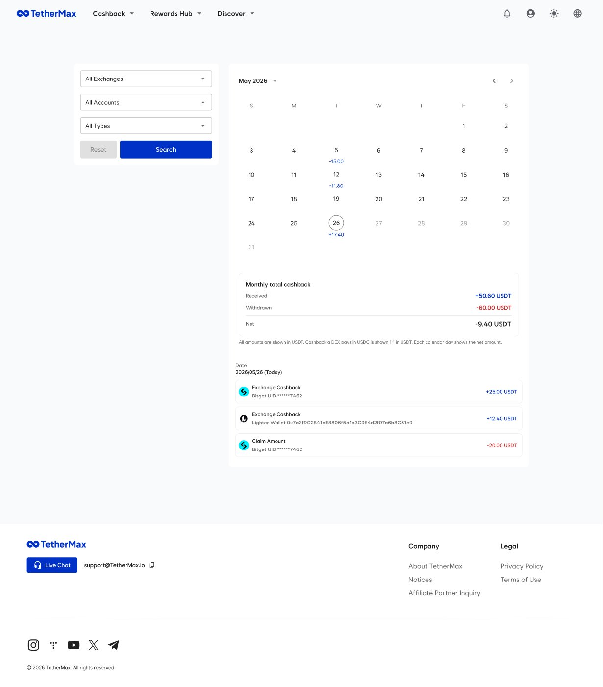

# 프로토타입 ↔ Figma 자동 대조

| 항목 | 내용 |
|---|---|
| 생성 | 2026-11-27 21:30 · `python -I _프로토타입_전체/tools/figma-diff.py` (스크립트가 이 문서를 통째로 다시 씁니다) |
| 프로토타입 | `_프로토타입_전체/_latest.html` — 모든 화면 × 상태 × PC·모바일을 실제 브라우저로 렌더(디자인 보기 · 주석 숨김 · 상태에 맞는 로그인 상태) |
| Figma 기준 | 상태의 `figma.pc` / `figma.mo` 노드. 문구 출처: 정밀 캐시 `ref/figma_text.json` 있음 393노드 → 오프라인 색인 `ref/figma_pages/*.xml`(2026-11-27 파일 기준) → 색인 이후 수정 `05.리포트/Figma수정결과_*.md` 10개(문구 교체 102 · 숨김 29 · 새 프레임 42) |
| 예외 | `_프로토타입_전체/tools/figma-diff-exceptions.json` 규칙 76개 — 결정 기록으로 의도적으로 다르게 한 것. 결과에서 빼고 8장에 따로 적음 |

## 1. 요약

| 항목 | 값 |
|---|---|
| 화면 · 상태 (문서 화면 제외) | 1 화면 · 12 상태 |
| 대조한 상태×뷰 | **9** (Figma 출처: 정밀 9) |
| 디자인 없음 | 상태 5 (PC·모바일 모두 없음) · 한쪽 뷰만 있음 5 — 7장 |
| **일치율** (Figma 문구 기준) | **100.0%** — Figma 문구 85개 중 일치 82 |
| **누락** (Figma에만) | **0** |
| **문구 다름** | **0** |
| **추가** (프로토타입에만) | **16** |
| 문제 없는 상태×뷰 | 6 / 9 |
| 예외로 뺀 건 | 3 |
| 위치·크기 (기하 모드) | 대조한 상태×뷰 2 · 2px 넘게 어긋난 요소 0건() — 5장 |
| 확인 불가 | Figma 색인에서 내부가 안 보이는 인스턴스 0개(버튼 0 · 칩 0 · 탭 0 · 입력 0 · 블록 0) · 그래서 판정을 보류한 프로토타입 문구 40개 |

### 읽는 법

| 구분 | 뜻 | 보는 법 |
|---|---|---|
| 누락 | Figma 프레임에 보이는 문구인데 프로토타입 그 상태에 없음 | 프로토타입에 넣거나, 의도적이면 예외 파일에 근거와 함께 등록 |
| 문구 다름 | 비슷하지만 다른 문구(유사도 0.6 이상 짝) | `Figma` ⇄ `프로토타입` |
| 추가 | 프로토타입에만 있음 | Figma 쪽에 같은 종류의 요소가 인스턴스로 가려져 있으면 판정하지 않고 「확인 불가」로 셈 |
| 제외 | 숫자·금액·날짜·주소·마스킹 ID·거래소 이름 같은 표본 값, Figma의 이름뿐인 레이어(`Button`·`Label`·`Description`·`h6`·`headline (DX-1)` 등), GNB·푸터(공통 셸 화면 `cmn.*`에서만 대조 — 프로토타입은 `header.gnb`·`footer`·`.mo-top`·`.mo-nav`, Figma는 셸 레이어 하위 또는 좌표 캐시의 상단 GNB 띠(PC 64px · 모바일 56px, 상태 표시줄 있으면 +44px)·하단 푸터 영역. 문구·위치 대조 모두) | — |
| 출처 | 정밀 = Figma 실제 문구 · 색인 = 텍스트 레이어 이름(자동 이름 = 문구라서 대부분 맞지만, 이름을 바꾼 레이어는 틀릴 수 있음) · 보정 = 색인 이후 새 프레임이라 수정결과 문서의 문구로만 대조(누락만 판정) | — |

> 정밀 모드: Figma 쪽 문구는 정밀 캐시(2026-11-27T19:44 수신, 393노드 — 인스턴스 안 버튼·칩·탭 라벨까지 실제 문구)를 우선 쓰고, 캐시에 없는 노드만 색인(레이어 이름)으로 대조합니다. 출처별 수는 위 「대조한 상태×뷰」. 색인으로 남은 노드는 인스턴스 내부를 못 봐서 「확인 불가」로 셉니다.

## 2. 상위 문제 1건

누락 + 문구 다름이 많은 순(추가는 동점 정리용). 같은 Figma 프레임 · 같은 내용의 상태는 한 번만 싣고 「같은 문제」로 묶음. 캡처: 왼쪽 프로토타입(디자인 보기, 위쪽 최대 2400px) · 오른쪽 Figma(기존 캡처 재사용, 없으면 「Figma 캡처 필요(연결 후)」).

| # | 화면:상태 | 뷰 | Figma | 누락 | 다름 | 추가 | 대표 내용 |
|---|---|---|---|---|---|---|---|
| 1 | `summary.main:otherDay` 다른 날 선택 (CS2) | PC | [28960:127139](https://www.figma.com/design/hsa3bSV9QmFTe2jsf6tzTm/UI-UX-Design?node-id=28960-127139) | 0 | 0 | 6 | `Monthly total cashback` · `Received` · `Withdrawn` · 외 3 |

### 2.1 `summary.main:otherDay` · PC — 다른 날 선택 (CS2)

Figma [28960:127139](https://www.figma.com/design/hsa3bSV9QmFTe2jsf6tzTm/UI-UX-Design?node-id=28960-127139) `DEX / CS2 Month view, other day selected / light` · 출처 정밀

| 프로토타입 | Figma |
|---|---|
| (캡처 생략) |  Figma 수정 후 캡처 |

- 추가: `Monthly total cashback` · `Received` · `Withdrawn` · `Net` · `All amounts are shown in USDT. Cashback a DEX pays in USDC is shown 1:1 in USDT. Each cale` · `Date`

## 3. 화면별 불일치 표

이 표만 보면 됩니다. 한 행 = 상태 × 뷰 × 구분. 문제 없는 상태는 4장 집계에만 나옵니다.

### 10. 캐시백 요약 · 랭킹

| 화면:상태 | 뷰 | Figma 노드 | 구분 | 내용 |
|---|---|---|---|---|
| `summary.main:normal` 월 보기 — 필터 · 캘린더 · 월간 카드 · 일별 목록 (CS1) | 모바일 | [29065:6687](https://www.figma.com/design/hsa3bSV9QmFTe2jsf6tzTm/UI-UX-Design?node-id=29065-6687) (정밀) | 추가 5 | `Monthly total cashback` · `Received` · `Withdrawn` · `Net` · `All amounts are shown in USDT. Cashback a DEX pays in USDC is shown 1:1 in USDT. Each cale` |
| `summary.main:otherDay` 다른 날 선택 (CS2) | PC | [28960:127139](https://www.figma.com/design/hsa3bSV9QmFTe2jsf6tzTm/UI-UX-Design?node-id=28960-127139) (정밀) | 추가 6 | `Monthly total cashback` · `Received` · `Withdrawn` · `Net` · `All amounts are shown in USDT. Cashback a DEX pays in USDC is shown 1:1 in USDT. Each cale` · `Date` |
| `summary.main:eventDay` 이벤트 리워드 날 · 큰 금액 축약 (CS3) | PC | [28960:127145](https://www.figma.com/design/hsa3bSV9QmFTe2jsf6tzTm/UI-UX-Design?node-id=28960-127145) (정밀) | 추가 5 | `Monthly total cashback` · `Received` · `Withdrawn` · `Net` · `All amounts are shown in USDT. Cashback a DEX pays in USDC is shown 1:1 in USDT. Each cale` |

## 4. 그룹별 집계

| 그룹 | 상태×뷰 | 문제 없음 | 일치율 | 누락 | 다름 | 추가 | 확인 불가 인스턴스 |
|---|---|---|---|---|---|---|---|
| 10. 캐시백 요약 · 랭킹 | 9 | 6 | 100% | 0 | 0 | 16 | 0 |

## 5. 위치·크기 대조

Figma 좌표 캐시 `ref/figma_geom.json`(주요 흐름 대표 상태 58노드)에 있는 상태×뷰만 대조합니다. 프로토타입은 같은 상태를 디자인 보기로 렌더해 프레임(모달 프레임이면 모달 상자) 원점 기준 rect를 잽니다. 허용 오차 2px.

| 비교 | 짝 짓는 법 | 무엇을 봄 |
|---|---|---|
| 버튼·칩·탭·입력 | 라벨이 같은 것(양쪽 같은 개수일 때 위→아래 순서) | 폭·높이 |
| 카드(모서리 둥근 채운 상자) | 안에 든 짝지은 문구가 가장 많이 겹치는 것 | 폭·높이 |
| 카드 안 요소 | 가장 안쪽 카드 기준 | 왼쪽 여백 · 세로 위치(문구는 중심, 버튼은 위 모서리) · 버튼은 오른쪽 여백도(예: 버튼이 카드 오른쪽 끝에 붙었는가) · 위아래 이웃 요소의 중심 사이 거리(요소 간격) |
| 카드 밖 문구 | 문구가 같은 것 | 가로 위치만(왼·가운데·오른쪽 중 가까운 기준). 세로 위치는 위쪽 구성 차이가 누적되므로 보지 않음 |

> 한계: 글자 폭은 글꼴 렌더링 차이가 있어 문구의 폭은 보지 않습니다. 배경 화면 위에 모달을 그린 Figma 프레임은 뒤 화면 요소와 겹쳐 짝이 틀어지므로 대조하지 않습니다. 같은 라벨이 양쪽 개수가 다르면 짝을 짓지 않습니다. Figma 프레임 폭과 프로토타입 프레임 폭이 다르면 표의 「폭」 열에 함께 적습니다.

| 항목 | 값 |
|---|---|
| 대조한 상태×뷰 | 2 |
| 짝지은 요소 · 카드 | 35 · 16 |
| 어긋남(>2px) | **0** —  |
| 그중 40px 넘음 | 0 — 대개 여백이 아니라 배치 구조가 다름(다른 열·다른 카드 안에 있음). 표에 「배치 다름」으로 표시 |

### 5.1 상위 문제 0건

어긋남 크기(요소당 최대 40px로 잘라 합산) 큰 순, 같은 Figma 프레임은 한 번만. 대표 이슈 = 여백·간격 이슈 중 가장 큰 것.

| # | 화면:상태 | 뷰 | Figma | 폭(Figma/프로토) | 이슈 수 | 대표 이슈 |
|---|---|---|---|---|---|---|

### 5.2 상태×뷰별 어긋남

| 화면:상태 | 뷰 | Figma | 짝 | 어긋남 | 유형 |
|---|---|---|---|---|---|
| `summary.main:normal` | 모바일 | [29065:6687](https://www.figma.com/design/hsa3bSV9QmFTe2jsf6tzTm/UI-UX-Design?node-id=29065-6687) | 15 | 0 | — |
| `summary.main:normal` | PC | [28960:127133](https://www.figma.com/design/hsa3bSV9QmFTe2jsf6tzTm/UI-UX-Design?node-id=28960-127133) | 20 | 0 | — |

## 6. Figma 문구를 하나도 못 읽은 상태×뷰

0건. 프레임 전체가 인스턴스이거나 이름뿐인 레이어만 있어 색인으로는 대조할 수 없습니다. 정밀 캐시(10장)에 넣어야 대조됩니다.

| 화면:상태 | 뷰 | Figma 노드 | 프레임 이름 | 가려진 인스턴스 |
|---|---|---|---|---|

## 7. 디자인 없는 상태

### 7.1 PC·모바일 모두 Figma 노드 없음 (5)

| 그룹 | 화면:상태 | 상태 |
|---|---|---|
| 10. 캐시백 요약 · 랭킹 | `summary.main:dexRange` | 거래소 범위 DEX 전체 |
| 10. 캐시백 요약 · 랭킹 | `summary.main:returned` | Withdrawal returned 행 |
| 10. 캐시백 요약 · 랭킹 | `summary.main:lighter` | Lighter Credited · Withheld (온보딩 후) |
| 10. 캐시백 요약 · 랭킹 | `summary.main:oneEmpty` | 계정 1개 선택 빈 상태 |
| 10. 캐시백 요약 · 랭킹 | `summary.main:old` | 180일 넘은 달 |

### 7.2 한쪽 뷰만 있음 (5)

| 화면:상태 | 상태 | 없는 쪽 | 있는 쪽 노드 |
|---|---|---|---|
| `summary.main:otherDay` | 다른 날 선택 (CS2) | 모바일 | [28960:127139](https://www.figma.com/design/hsa3bSV9QmFTe2jsf6tzTm/UI-UX-Design?node-id=28960-127139) |
| `summary.main:eventDay` | 이벤트 리워드 날 · 큰 금액 축약 (CS3) | 모바일 | [28960:127145](https://www.figma.com/design/hsa3bSV9QmFTe2jsf6tzTm/UI-UX-Design?node-id=28960-127145) |
| `summary.main:account` | 계정 필터 드롭다운 (CS6 All Accounts) | 모바일 | [29265:120180](https://www.figma.com/design/hsa3bSV9QmFTe2jsf6tzTm/UI-UX-Design?node-id=29265-120180) |
| `summary.main:noMonth` | 활동 없는 달 (CS5) | 모바일 | [28960:127157](https://www.figma.com/design/hsa3bSV9QmFTe2jsf6tzTm/UI-UX-Design?node-id=28960-127157) |
| `summary.main:noDay` | 활동 없는 날 · 큰 금액 (CS4) | 모바일 | [28960:127151](https://www.figma.com/design/hsa3bSV9QmFTe2jsf6tzTm/UI-UX-Design?node-id=28960-127151) |

## 8. 예외로 뺀 것

| 규칙 | 범위 | 구분 | 대상 | 근거 | 적용 건수 |
|---|---|---|---|---|---|
| EX-01 | `calc.`  | any | `/.*/` | 계산기(/payback)는 실서비스 계산기 화면의 흐름·문구·동작을 그대로 채택 (_Figma수정_결정.md 9차 「계산기(/payback) 프로토타입 (2026-11-27)」) | 0 |
| EX-02 | `*`  | diff | `linked uid→linked accounts · uids→accounts · uid→account` | CEX·DEX 공통 문맥은 UID 대신 Account (_Figma수정_결정.md 용어 규칙(2026-11-26) · N5 · N10 · Q4 G-451) | 0 |
| EX-03 | `*`  | diff | `Using multiple platforms? Link more accounts` | 홈·마이 연동 유도 문구 확정 (_Figma수정_결정.md Q3 G-451) | 0 |
| EX-04 | `home.wallet`  | added | `/^(Earning Timeline／Start Trading／Cut-off Time／Updated)$/i` | UID·지갑 상세는 기존 Earning Timeline 3단계 디자인 그대로 (_Figma수정_결정.md N16·N17·N19 · A6) | 0 |
| EX-05 | `home.wallet`  | added | `Top Partner Exchanges` | 지갑 상세 하단은 기존 디자인 Top Partner Exchanges(CEX·DEX 공통) (_Figma수정_결정.md 「지갑 상세 하단」) | 0 |
| EX-06 | `*`  | missing | `Top Partner DEXs` | Top Partner DEXs 폐기 (_Figma수정_결정.md 「지갑 상세 하단」) | 0 |
| EX-07 | `link.`  | added | `/^Don.t have an account yet\? Register here$/i` | 연동 모달 가입 링크 문구는 실서비스 문구 (_Figma수정_결정.md 12차 「연동 모달 가입 링크 문구」) | 0 |
| EX-08 | `*`  | missing | `/^Start by signing up for /i` | 연동 모달 가입 중간 안내 없음 (_Figma수정_결정.md 12차 「연동 모달 가입 중간 안내」) | 0 |
| EX-09 | `quiz.`  | diff | `withdraw→claim` | 요청·동작은 Claim(Cashback Basics 소제목 등) (_Figma수정_결정.md 11차 · 용어 규칙(2026-11-26) D2) | 0 |
| EX-10 | `cmn.`  | diff | `exchanges events→exchange events` | GNB Rewards Hub 항목 Exchange Events (_Figma수정_결정.md 9차 「GNB Rewards Hub ▾ 항목」) | 0 |
| EX-11 | `*`  | missing | `/^(data delayed／delayed／dex data pending／cashback update delayed／last updated\b.*)$/i` | 반영 지연 표시 없음 원칙 (_Figma수정_결정.md 10차 「반영 지연 · 오프보딩」 · 11차) | 0 |
| EX-12 | `home.`  | missing | `/^(no cashback yet／inactive／trying to link／verifying ownership)$/i` | 홈 연동 행은 칩이 아니라 기존 디자인(상태 점·시계·배너) (_Figma수정_결정.md 10차 「홈 연동 계정 행 상태 표시」) | 0 |
| EX-13 | `*`  | missing | `/^(receive league prize／receive prize)$/i` | 글로벌 리그 상금 수령 화면 없음 — 참가 계정으로 지급 (_Figma수정_결정.md 12차 · REQ-391) | 0 |
| EX-14 | `*`  | missing | `/milestone/i` | Cashback Milestone은 없어진 기능 (_Figma수정_결정.md A-18) | 0 |
| EX-15 | `*`  | missing | `/verification limit reached/i` | 시도 한도 미도입 (G-063 · _프로토타입_전체/README.md 반영 원칙) | 0 |
| EX-16 | `*`  | missing | `/^real-time ranking$/i` | TP 화면 Real-Time Ranking 칩 없음(현행에 없음) (Figma수정결과_6차.md 🔴 #47·#48) | 0 |
| EX-17 | `cmn.header`  | any | `/^(events／benefits／point／cashback preview／cashback hub／discover／rewards hub／exchanges?)$/i` | 새 GNB 구성(Cashback ▾ · Rewards Hub ▾ · Discover ▾). 근거 프레임은 옛 GNB 페이지라 메뉴 이름이 다름 (_Figma수정_결정.md D4 · A1) | 0 |
| EX-A01 | `hub.main`  | diff | `/^You can claim cashback if you receive an additional/i` | 허브 패널 넛지 영문 문구는 확정 문구(금액 = 매칭 계산값) (00_DEX_최종정책.md 부록 G G-139 (사용자 2026-11-25)) | 0 |
| EX-A02 | `hub.main:dexBelowMin`  | any | `/^(From your Bybit trades／BVOX／Join BVOX／Search for a partner／Compare cashback across 16 exchanges)$/i` | H4(28960:126902)는 CEX(Bybit) 탭 시안 — 웹 라벨이 `DEX & CEX balance under 10 USDT`(28960:126903)라 DEX 탭으로 그림. CEX 표 행·Bybit 하위 줄·CEX 검색 문구는 DEX 탭에 없음 (README 반영 원칙(사용자 결정 2026-11-25: 맞는 프레임이 없으면 가장 가까운 프레임) · 정책 B-5-4 · REQ-301) | 0 |
| EX-A03 | `hub.main:dexError`  | any | `/^(Exchange／BVOX／Join BVOX／Search for a partner／Compare cashback across 16 exchanges)$/i` | H7(28960:126920)은 CEX(Bybit) 탭 시안 — 상태는 DEX 탭 잔액 로드 실패라 DEX 표·DEX 검색 문구 (README 반영 원칙(사용자 결정 2026-11-25) · REQ-301) | 0 |
| EX-A04 | `hub.main:dexPanel`  | missing | `/^Reported next day/i` | H8의 다음 날 반영 예정 금액 줄 — 추정·지연 줄을 두지 않음 (00_DEX_최종정책.md 허브 패널 줄 구성(추정 줄 없음, G-100) · _Figma수정_결정.md 11차 반영 지연 표시 없음 원칙) | 0 |
| EX-A05 | `hub.main:cards` pc | any | `/^(Bitget 2026 King of Traders \(KOT\)／Win up to 2,000,000 USDT／See All／54% Total Savings／Recommended／All／Bitget x TetherMax／View Bitget／Promoted／Limited Time Offers／Trade to win up to \$100K prize pool／Biggest Trading Competition／Rewards／Ends in／Sign up, deposit & trade to get \$14,410／New Users／Become a VIP & enjoy the benefits\.／Voucher／Claim VIP2 Trial／Search for an exchange／Cashback Boost／Join Now)$/i` | 기존 거래소 목록 카드 뷰(22807:98684)는 카드 모양만 참조 — 상단 배너·캠페인 칸·추천/부스트 칩은 허브 비교표에 없고, 버튼은 `Join {partner}`, 칩은 CEX·DEX·Brokers (정책 G-150(Live Campaigns 삭제) · _Figma수정_결정.md N7(Boost 범위 아님) · REQ-311 · D7(배너는 DEX 랜딩)) | 0 |
| EX-A06 | `hub.main:emptySearch`  | diff | `All Partner Exchanges` | 거래소 목록 페이지가 캐시백 허브로 바뀜 — 별도 Exchange Listings 페이지·제목 없음(빈 검색 배치만 기존 화면 참조) (_Figma수정_결정.md Q7 G-463 · 12차 「허브 CEX 라우트 행 목적지」) | 0 |
| EX-B1 | `home.`  | missing | `/^(total cumulative cashback／this month／total withdrawn／sum of \d+ linked (uids／accounts).*／view history)$/i` | 홈 누적 캐시백 블록(MAXOP-731) 없음 — 근거 프레임 22913:1051713은 기존 [MAX-7] 판 (_Figma수정_결정.md 12차 「홈 누적 캐시백 블록(MAXOP-731)」) | 0 |
| EX-B2 | `home.`  | missing | `/^(withdraw／withdrawable [\d.]+ \/ [\d.]+ usdt／view cashback summary)$/i` | 출금 버튼·출금 화면 없음 — 잔액 카드는 비활성 Auto Claim(근거 프레임은 기존 [MAX-7] UID 상세·홈) (_Figma수정_결정.md 4차 Q1 G-448 · 현행 판 B6 · REQ-270) | 0 |
| EX-B4 | `own.home`  | missing | `/^(verifying ownership)$/i` | 홈 연동 행은 칩이 아니라 기존 디자인(파란 점 · 시계 · 경과 시간) (_Figma수정_결정.md 10차 「확인 중 · 소유 확인 중 행 표시」) | 0 |
| EX-B5 | `home.`  | diff | `Trading on multiple exchanges? Link more` | 앱·모바일웹 연동 유도 문구(웹은 Using multiple platforms? Link more accounts) (_Figma수정_결정.md Q3 G-451 · 화면요소_정의_전수점검.md home.main 푸터 행) | 0 |
| EX-B5o | `own.home`  | diff | `Trading on multiple exchanges? Link more` | EX-B5와 같음(배경 = 회원 홈) (_Figma수정_결정.md Q3 G-451) | 0 |
| EX-B8 | `summary.`  | diff | `all cashback types→all types` | 유형 셀렉트 기본값은 정책 문구 All Types (REQ-378 · 100-summary.js 머리 주석(정책 > Figma, README 반영 원칙)) | 1 |
| EX-B9 | `home.main`  | diff | `browse partner exchange→browse partners · link your uid with us→link your account with us` | 모바일 근거 프레임은 기존 [MAX-7] 판 — DEX(revision) 웹 S3-1 문구(Account 규칙)로 통일 (_Figma수정_결정.md 용어 규칙(2026-11-26) · N5 · S3-1 28960:127759) | 0 |
| EX-A08 | `dex.detail:edgex`  | missing | `/^(Sign up／Log in or sign up to write a review／After signing up, link your \w+ wallet address to post \(anyone can read\))$/i` | 이 상태는 상단 로그인 토글을 따르는 공용 상태라 점검은 회원 기준으로 렌더 — Figma D4는 게스트 시안(게스트 리뷰 안내는 `dex.detail:normal`에서 일치) (_Figma수정_결정.md 12차 「화면 목록판 표시」(로그인 상태 전환 = 그 상태의 화면)) | 0 |
| EX-A09 | `dex.detail:step2`  | missing | `/^(DEX／Sign up／Log in or sign up to write a review／After signing up, link your \w+ wallet address to post \(anyone can read\))$/i` | EX-A08과 같음 — 단계 가이드 상태는 로그인 토글을 따르고 점검은 회원 기준 렌더 (_Figma수정_결정.md 12차 「화면 목록판 표시」) | 0 |
| EX-A10 | `dex.detail:faq2`  | missing | `/^(Log in or sign up to write a review／After signing up, link your \w+ wallet address to post \(anyone can read\))$/i` | EX-A08과 같음 — FAQ 상태는 로그인 토글을 따르고 점검은 회원 기준 렌더 (_Figma수정_결정.md 12차 「화면 목록판 표시」) | 0 |
| EX-A11 | `dex.detail:unlinked`  | any | `/^(Lighter is a decentralized trading platform.*／Tokenised Equity／Pre-IPO／Commodities／Indices & ETFs／Forex／Fiat／Cashback applies to Premium and Plus accounts.*／Premium／Plus／Final Maker)$/i` | 회원 오퍼 박스 프레임(28969:129666)은 Lighter 예시 — 상태는 공용 템플릿의 EdgeX 상세라 Lighter 소개·자산 칩·Premium/Plus 토글이 없음(오퍼 박스 CTA만 참조) (README 반영 원칙(사용자 결정 2026-11-25) · 상태 정의 S5_14(29002:128667)) | 0 |
| EX-A12 | `dex.detail:linked`  | any | `/^(Lighter is a decentralized trading platform.*／Tokenised Equity／Pre-IPO／Commodities／Indices & ETFs／Forex／Fiat／Cashback applies to Premium and Plus accounts.*／Premium／Plus／Final Maker)$/i` | EX-A11과 같음 — 회원 연동 완료 오퍼 박스 프레임(28969:129751)은 Lighter 예시 (README 반영 원칙(사용자 결정 2026-11-25) · 상태 정의 S5_15(29002:128699)) | 0 |
| EX-A14 | `dex.`  | missing | `/^content_CT-\d+_\*$/` | Figma content 계획 레이어 이름(`content_CT-nn_*`) — 화면 문구가 아님(figmaAnnotations와 같은 성격, 정밀 문구 캐시에 들어와 이름 필터가 안 걸림) (05.리포트/Figma수정결과 content 계획(CT-nn) 레이어 명명) | 0 |
| EX-A15 | `dex.detail:lighter`  | missing | `/^(Log in or sign up to write a review／After signing up, link your \w+ wallet address to post \(anyone can read\))$/i` | EX-A08과 같음 — Lighter 상태는 로그인 토글을 따르고 점검은 회원 기준 렌더 (_Figma수정_결정.md 12차 「화면 목록판 표시」) | 0 |
| EX-A16 | `dex.detail:faq2`  | missing | `/^(This review is under moderation／It was flagged and is hidden while our team checks it against the review guidelines\.?)$/i` | CT-29 ② 프레임에 함께 그려진 내 리뷰 검토 중 카드는 별도 상태 `dex.detail:moderation`(27392:937)에서 그림 — FAQ 상태는 FAQ 두 구역 펼침만 (README 반영 원칙(사용자 결정 2026-11-25) · 상태 정의 S5_20(29002:128826)) | 0 |
| EX-B01 | `brokers.`  | diff | `compare in one price→compare in one place · see the full picture committing→see the full picture before committing · experience leve→experience level · indices, , futures→indices, futures · product available→products available · 84% off→84%off · by "borrowing" from→by 'borrowing' from · using "disposable risk capital":money→using 'disposable risk capital': money · tethermax's ib link to activate your discount : registrations→tethermax`s ib link to activate your discount: registrations` | Brokers 페이지는 실서비스 문구 그대로 — Figma V2의 오탈자·띄어쓰기·따옴표 차이(실서비스가 고친 쪽) (_Figma수정_결정.md 12차 「Brokers 페이지 (2026-11-27)」 · 05.리포트/Brokers_페이지_정리안.md 1장(실서비스 = Figma V2, 다른 곳은 실서비스가 최신)) | 0 |
| EX-B02 | `brokers.main` mo | any | `/^(FX is the market where one currency is traded against another\. A CFD lets you trade price movement without owning the underlying asset . making .*／Check fees, leverage, conditions, and all disclosures carefully before making any deposit\.／A CFD gives price exposure without ownership of the underlying asset\..*／Leveraged trading can amplify both gains and losses\. Review the product carefully before opening\.／Product terms, leverage limits, and availability differ significantly by jurisdiction\.／Whether you.re new to FX or comparing brokers for the first time, this keeps you informed\.／FX is one of the world.s largest financial markets, where currencies are traded in pairs\.／How it works／Read the basics)$/i` | 모바일 Figma의 줄인 문구 — 실서비스 모바일은 PC와 같은 문구(스냅숏 PC·모바일 문구 차이는 히어로 위험 고지 한 줄뿐) (_Figma수정_결정.md 12차 「Brokers 페이지 (2026-11-27)」 · 05.리포트/Brokers_페이지_정리안.md 1장(실서비스 = Figma V2, 다른 곳은 실서비스가 최신)) | 0 |
| EX-B03 | `brokers.main`  | missing | `/^No\. FX is based on currency pairs and different market drivers\./i` | FAQ 첫 답변은 실서비스 원문(CFD 소유 설명) — Figma 답변은 옛 초안 (_Figma수정_결정.md 12차 「Brokers 페이지 (2026-11-27)」 · 05.리포트/Brokers_페이지_정리안.md 1장(실서비스 = Figma V2, 다른 곳은 실서비스가 최신)) | 0 |
| EX-B04 | `brokers.learn`  | missing | `/^(LEARN／JPY\/USD／EUR\/USD／EUR\/JPY／Quotes／Trade／Charts／History／Message／0\.90?／38／xxx)$/i` | Learn 배너 이미지 속 글자(휴대폰 화면·통화쌍 카드)와 Figma 자리표시 `xxx` — 실서비스는 이미지 한 장 (_Figma수정_결정.md 12차 「Brokers 페이지 (2026-11-27)」 · 05.리포트/Brokers_페이지_정리안.md 1장(실서비스 = Figma V2, 다른 곳은 실서비스가 최신)) | 0 |
| EX-B05 | `brokers.compare`  | missing | `/^Category$/i` | 비교표 첫 머리 칸은 실서비스에서 비어 있음 (_Figma수정_결정.md 12차 「Brokers 페이지 (2026-11-27)」 · 05.리포트/Brokers_페이지_정리안.md 1장(실서비스 = Figma V2, 다른 곳은 실서비스가 최신)) | 0 |
| EX-B06 | `brokers.detail`  | missing | `/^(View Website／Most Popular／Sign up on the referral link & complete KYC in the MY PROFILE section, under the Trader.s Menu\.／STP 10\/ ECN 0)$/i` | 실서비스 상세: 모바일도 `Sign Up`(Figma `View Website`), STP 카드 `Most Popular` 표시 없음, INFINOX 1단계 문구는 RS와 같은 실서비스 문구, 표 값 띄어쓰기 (_Figma수정_결정.md 12차 「Brokers 페이지 (2026-11-27)」 · 05.리포트/Brokers_페이지_정리안.md 1장(실서비스 = Figma V2, 다른 곳은 실서비스가 최신)) | 0 |
| EX-B10 | `home.wallet`  | missing | `Event Reward` | 이벤트 리워드가 없으면(B = null·0) Event Reward 행 없음 — 정책이 Figma(행 0.00 표시)보다 우선 (REQ-277 수용 기준 「이벤트 리워드 0 지갑 → Event Reward 행 없음」 · README 반영 원칙) | 0 |
| EX-B11 | `home.wallet:reviewed`  | missing | `/^(how was lighter\?／your first review earns you 2 usdt\. it takes about a minute\.／write a review, get 2 usdt)$/i` | 리뷰를 이미 쓴 지갑은 리뷰 유도 없음(PW1은 리뷰 전 상태) (REQ-278 · 정책 B-3-4) | 0 |
| EX-B15 | `home.wallet`  | diff | `exclusive for members→exclusive benefit` | 지갑 상세 혜택 섹션 제목은 Exclusive Benefit(DEX(revision) PW1 웹과 같게) (REQ-278 · 화면요소_정의_전수점검.md home.wallet `Exclusive Benefit` 행) | 0 |
| EX-B17 | `link.done`  | missing | `/^linked successfully\./i` | 본문을 줄 단위로 표시하고, 정산 주기는 정책 값(Lighter = Weekly · 그 밖 Daily) — Figma L7 본문은 모든 DEX를 Daily로 적음 (REQ-095 · G-099) | 0 |
| EX-B22 | `own.home` mo | missing | `/^wallet 0x[0-9a-f]{4}(…／\.\.\.)[0-9a-f]{4}$/i` | 앱·모바일웹 연동 행은 주소만(`Wallet` 라벨 없음) — 홈 행과 같은 규칙 (REQ-271 · home.main `app` 상태) | 0 |
| EX-B23 | `summary.main:otherDay`  | missing | `/^(2026\/05\/26 \(today\)／exchange cashback／lighter wallet 0x[0-9a-f]+)$/i` | CS2 프레임은 다른 날을 골라도 일별 목록이 오늘(26일) 그대로 — 선택한 날 목록을 보여 줌 (REQ-371(날짜 선택 = 그날 목록) · 100-summary.js otherDay 상태 메모) | 2 |
| EX-B24 | `home.` mo | any | `/^(get extra usdt／earn more cashback when you sign up／\d+% cashback／\d+% total savings)$/i` | 모바일 근거 프레임(기존 [MAX-7] 22913:1051713 · 4248:33574 · 8582:154521 · 29474:136690)끼리 같은 카드의 표본 문구가 다름 — 웹 DEX(revision) HW1·PW1 라벨(`Earn extra USDT` · `n% Total Savings` · 지갑 상세 DEX 타일 `Up to n% cashback`)로 통일 (_Figma수정_결정.md 8차 「홈 누적 캐시백 블록 모바일 · 기존 원본이 없는 화면 = 지금 디자인 기조」 · HW1 28960:126108 · PW1 28960:125943) | 0 |
| EX-B25 | `home.main` mo | missing | `/^\d+ uids$/i` | 같은 CEX 여러 UID 묶음 행 — 표본 계정에 같은 CEX가 둘 이상 없음(묶음 행은 연동 계정 목록 모달로, DEX는 지갑마다 행) (화면요소_정의_전수점검.md 🔴#14 · REQ-118 · REQ-271) | 0 |
| EX-A17 | `hub.main:member`  | geom | `` | 로그인 계산기에는 `Paid to your TetherMax balance · Minimum 10 USDT` 줄이 더 있음(Figma H2에는 없음) — 카드가 그만큼 높음. 모바일 H2는 Cashback 하위 글상자가 한 줄인데 높이 46으로 그려져 아래 줄이 23px 내려가 있음(Figma 그리기 차이) (정책 B-5-2(10 USDT 최소 안내 = 서버값) · REQ-298) | 0 |
| EX-A18 | `hub.main:noLedger`  | geom | `` | EX-A17과 같음 — 원장 미수신 DEX는 H2와 같은 로그인 계산기 (정책 B-5-2 · REQ-298 · REQ-299) | 0 |
| EX-A19 | `hub.main` mo | geom | `` | 모바일 비교 카드 끝 전폭 `Join {partner}` 버튼만큼 높음 — Figma 모바일 카드(버튼 없이 chevron)는 정책과 달라 Figma 수정 대상 (정책 B-5-8 모바일 · 05.리포트/화면요소_정의_전수점검.md #46) | 0 |
| EX-A21 | `dex.detail:edgex`  | geom | `` | 이 상태는 로그인 토글을 따르는 공용 상태라 점검이 회원(연동) 기준으로 렌더 — Figma D4(게스트)의 리뷰 안내 카드(1008×210 + 간격 18)가 회원에게는 없어 그 아래 정렬 탭·리뷰 항목이 234px 위에 옴. 같은 D4 배치는 게스트 상태 `dex.detail:normal`에서 어긋남 0 (_Figma수정_결정.md 12차 「화면 목록판 표시」 · 정책 B-7-8(리뷰 작성 안내는 게스트·미연동)) | 0 |
| EX-A22 | `dex.detail:unlinked`  | geom | `` | 회원 미연동 오퍼 박스 프레임(28969:129666)은 Lighter 예시 — Lighter 전용 요소(자산 칩 6개 두 줄·Premium/Plus 토글·Taker/Maker 2열 단계 표)로 히어로·단계 표 높이와 칩 위치가 다름. 상태는 EdgeX 공용 템플릿(같은 배치는 `dex.detail:normal`에서 어긋남 0) (README 반영 원칙(사용자 결정 2026-11-25) · 상태 정의 S5_14(29002:128667) · EX-A11) | 0 |
| EX-A23 | `dex.overview:normal` pc | geom | `` | venue 2열 격자 홀수 칸 — 마지막 카드는 왼쪽 칸 폭 그대로(빈칸 유지). Figma OA(29361:137628)는 마지막 EdgeX 카드를 두 칸 폭으로 늘림 (00_DEX_최종정책.md 부록 G G-168(사용자 2026-11-25: 마지막 칸 왼쪽 정렬, 빈칸 유지)) | 0 |
| EX-A24 | `dex.overview` mo | geom | `` | Figma 모바일 OA(29363:135072 · 29363:136040)는 Lighter 포함 4개 — 정책상 Lighter 보류라 3개로 렌더해 glance 카드(230)와 venue 카드(343)의 TVL 칸 짝이 엇갈림(칸 크기 자체는 같음) (00_DEX_최종정책.md Lighter 온보딩 보류(G-428) · dex.overview:normal 상태 메모) | 0 |
| EX-A25 | `dex.overview`  | added | `/^(Bitget Trading Competition／Total 150,000 USDT Przie Pool)$/` | 프로모 배너 캐러셀 두 번째 슬라이드 — 실사이트 거래소 목록 상단 배너(같은 어드민 배너, 원문 그대로). Figma는 첫 슬라이드(Aster)만 그림 (_Figma수정_결정.md D7 · Q7 G-463(같은 배너 사용)) | 0 |
| EX-C01 | `invite.main`  | missing | `View Coupons` | Figma 친구 초대·포인트 프레임의 `View Coupons` 버튼은 레이어 불투명도 0(화면에 보이지 않음) — 보이는 요소가 아님 (Figma 28960:126816 · 29365:134702 (버튼 Frame opacity 0, 2026-11-27 MCP 확인)) | 0 |
| EX-C02 | `tp.main`  | missing | `View Coupons` | EX-C01과 같음 — 포인트 PC 프레임의 투명(불투명도 0) 버튼 (Figma 29365:134702 (opacity 0)) | 0 |
| EX-C03 | `invite.main`  | diff | `Earn a portion of your friend's cashback rewards whenever they trade.` | How it works 3단계 끝 문구 확정 — 코드·링크 복사 토스트 프레임 2개만 옛 문구가 남아 있음 (ref/decisions_1125.json G-198 확정) | 0 |
| EX-C04 | `maxboard.main:normal`  | missing | `Total Ranking Pool` | 참여 중 상태 근거 프레임은 기존 CEX 빙고판([MAX-] 28537:449610·458145). DEX(revision) 진행·완성 프레임(29064:10322·10687)의 히어로는 `Maximum Bingo Rewards`만 크게 표시 — DEX 프레임 기준 (README 반영 원칙(Figma DEX(revision) 우선) · Figma 29064:10322) | 0 |
| EX-C05 | `maxboard.main:normal`  | diff | `/^Only UIDs of the board's exchange registered/i` | 유의사항은 Account 용어(DEX(revision) 22프레임 `Only accounts…`) — 기존 CEX 프레임만 `Only UIDs…` (_Figma수정_결정.md 용어 규칙(2026-11-26) · N5 · 05.리포트/Figma_최신변경_대조.md B1) | 0 |
| EX-C06 | `maxboard.main:confirm`  | missing | `/^Bitget UID \d+$/i` | 재선택 확인 근거 프레임은 기존 CEX 빙고판(Bitget UID 표본) — DEX 보드는 선택한 EdgeX 지갑 박스(`EdgeX · Wallet` + 주소, DEX(revision) 29330:190851과 같은 모양) (REQ-655 · Figma 29330:190851) | 0 |
| EX-C07 | `maxboard.main:regConfirm`  | missing | `/^If you select a new account, your progress on this board starts over/i` | 29330:190851 프레임에 등록 확인·재선택 확인 대화상자 2개가 같이 있음 — 재선택 문구는 `maxboard.main:confirm` 상태에 있음 (Figma 29330:190851 · 화면 상태 maxboard.main:confirm) | 0 |
| EX-C08 | `league.main`  | missing | `/^(Consultation ?: Chat Support／Announcements \／ Affiliate Partner Inquiry)/i` | 리그 프레임(A10)에 옛 푸터가 페이지 안에 그려져 있음 — 프로토타입은 공통 셸 푸터(FooterA · Footer/mWeb)를 씀 (_Figma수정_결정.md A1(새 GNB) · DEX(revision) FooterA 28967:127334) | 0 |
| EX-C09 | `league.main:summary`  | missing | `Optimize Your Institutional Trading Strategies` | Summary 배너 자리(`Banner Image`) 안 예시 레이어 이름 — 배너 이미지는 운영 등록값 (Figma 29185:121228 리그 예시 메모(배너 이미지는 운영 등록값)) | 0 |
| EX-C10 | `coupon.box`  | diff | `a uid→an account` | 쿠폰 계정 선택 제목 — CEX·DEX 공통 문맥은 UID 대신 Account(기존 [MAX-499] 프레임의 `Select a UID…`) (_Figma수정_결정.md 용어 규칙(2026-11-26) · N5 · N10) | 0 |
| EX-C11 | `challenge.detail`  | diff | `a uid→an account` | 챌린지 보상 계정 선택 제목 — CEX·DEX 공통 문맥은 Account(기존 MAX-503 프레임의 `Select a UID…`) (_Figma수정_결정.md 용어 규칙(2026-11-26) · N5 · N10) | 0 |
| EX-C12 | `challenge.detail:progress`  | missing | `Unlocks after signing up` | 모바일 35% 프레임(10739:232621)은 게스트용 잠금 문구가 남은 옛 변형 — 회원 진행 상태는 PC 10981:85020과 같은 `Complete level {n} reward to unlock` (Figma 10981:85020(PC 같은 상태) · 기존 [MAX-468] MAX-503) | 0 |
| EX-C13 | `quiz.basics`  | missing | `/^\$200 in fees → \$160 back in USDT → your net cost \$40 \$500 in fees/i` | 같은 세 줄(`$200 …` · `$500 …` · `$1,000 …`)을 줄마다 따로 그림 — 색인 레이어 이름이 세 줄을 한 덩어리로 가짐 (Figma 19604:32207 같은 문구) | 0 |
| EX-C14 | `quiz.basics`  | missing | `/^• Minimum withdrawal: You can request a withdrawal once the combined balance/i` | Cashback Basics 요약·조건 문구는 Account 기준 · 자동 지급(Claim) 문구로 교체 확정 (_Figma수정_결정.md Q8 · N12 · 11차(Claim cashback and rewards) · 용어 규칙 D2) | 0 |
| EX-C15 | `cmn.footer`  | diff | `Terms of Use` | 푸터 Legal 링크 이름은 실서비스 푸터 원문 `Terms of Service`(→ /terms/use). 드로어는 `Terms of Use` 유지 (05.리포트/화면요소_정의_전수점검.md cmn.footer `Terms of Service`(🔁 IA 1.1 TRM) · 실서비스 푸터 스냅숏) | 0 |
| EX-C16 | `cmn.notfound`  | any | `/^(events／benefits／point／cashback preview／cashback hub／discover／rewards hub／exchanges?)$/i` | 404 근거 프레임([MAX-497])은 옛 GNB — 새 GNB 구성(Cashback ▾ · Rewards Hub ▾ · Discover ▾) (_Figma수정_결정.md D4 · A1 (EX-17과 같은 근거)) | 0 |

## 9. 실행 방법

| 할 일 | 명령 (`_프로토타입_전체/`에서) |
|---|---|
| 최신 프로토타입 빌드 | `node build.cjs` (→ `_latest.html`) |
| 전체 대조 + 이 문서 갱신 | `python -I tools/figma-diff.py` |
| 일부 화면만 (문서는 그 범위로 다시 씀) | `python -I tools/figma-diff.py events.` |
| 캡처 없이 빠르게 | `python -I tools/figma-diff.py --no-shots` |
| 다른 빌드 파일로 | `python -I tools/figma-diff.py --html TetherMax_전체프로토타입_YYYYMMDD_HHMM.html` |
| 위치·크기 대조 끄기 · 허용 오차 | `--no-geom` · `--geom-tol 2` (기본 2px). Figma 좌표 캐시 `ref/figma_geom.json`에 있는 노드만 대조 |
| 기계용 결과 | `tools/out/figma-diff.json` (상태×뷰별 누락·추가·다름·예외·위치 이슈) |
| 예외 추가 | `tools/figma-diff-exceptions.json`의 `rules`에 `{"id","scope","vp","type","figma"/"proto"/"equiv","reason","ref"}` 추가. `scope` = `*` · `화면id` · `화면id:상태` · `그룹접두사.` · `접두사*` / `type` = `missing`·`added`·`diff`·`any` / 문구는 정규화 후 같거나 포함(6자 이상), `/정규식/i`도 됨. **근거(결정 기록 위치)가 없으면 넣지 않는다** |

## 10. Figma 최신 색인으로 다시 돌리는 법

| 단계 | 방법 |
|---|---|
| A. 정밀 문구 캐시 — REST (권장) | Figma 개인 액세스 토큰을 환경 변수로: `set FIGMA_TOKEN=...`(PowerShell `$env:FIGMA_TOKEN='...'`) → `python -I tools/figma-fetch.py` → 프로토타입이 참조하는 모든 노드의 실제 문구(인스턴스 내부 포함, 숨김 반영)를 `ref/figma_text.json`에 저장. 토큰은 파일에 저장하지 않음 |
| A2. 정밀 문구·좌표 캐시 — Figma MCP | `python -I tools/figma-fetch.py --ids`로 노드 목록 → `tools/figma-text-dump.js`의 `IDS`(좌표까지 받으려면 `GEO = true`)를 채워 `use_figma`로 실행. `use_figma` 반환은 48KB 한도라 결과를 LZ 압축(`{"s","n","next","z"}`)해 돌려주고, 다 못 담으면 `START = next`로 이어서 다시 실행(한도 오류 시 60초 대기). 반환 문자열들을 한 파일에 줄 단위로 모아 `python -I tools/figma-fetch.py --merge 받은파일.txt` → `ref/figma_text.json`·`ref/figma_geom.json` |
| B. 색인(레이어 이름) 갱신 | 페이지마다 `get_metadata(fileKey=hsa3bSV9QmFTe2jsf6tzTm, nodeId=페이지 id)` 결과를 `ref/figma_pages/<페이지id 콜론→하이픈>.xml`로 덮어쓰기 → `python tools/figindex.py` |
| C. 다시 대조 | `python -I tools/figma-diff.py` — 정밀 캐시에 있는 노드는 정밀, 없는 노드는 색인으로 자동 선택. 수정결과 문서의 보정은 색인 노드에만 적용(정밀 캐시는 이미 최신이므로) |
| 캡처 | Figma 이미지는 `Figma수정결과_img`·`기존디자인_카탈로그/img` 중 그 노드(또는 상위·하위 프레임)를 찍은 것을 재사용. 없으면 「Figma 캡처 필요(연결 후)」 — 연결 후 `get_screenshot`으로 받아 `Figma수정결과_img/<이름>_after.jpg`로 두고 수정결과 문서 행에 노드 id와 함께 적으면 다음 실행부터 붙음 |
