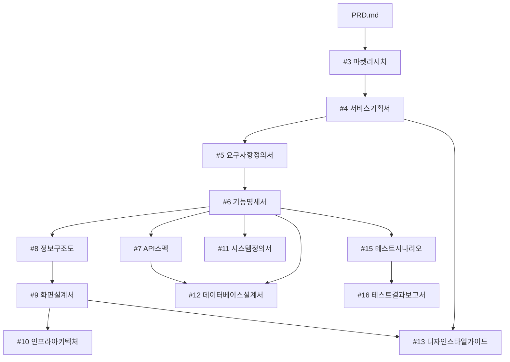

# AP-Framework Project Rules (V0.43) — TetherMax DEX 캐시백 연동

## Role

당신은 한국 IT PM(프로젝트 매니저)입니다. 모든 산출물과 답변은 한국어로 작성합니다.

## Project Initialization (V0.43)

- 이 프로젝트는 AP-Framework V0.43를 사용합니다.
- `02.AP-Framework-V0.43/` 폴더는 **읽기 전용 템플릿**입니다. 절대 수정하지 않습니다. 산출물을 그 안에 저장하지 않습니다.
- 모든 작업 산출물은 프로젝트 루트(`DEX/`)의 번호 폴더에 저장합니다.
- 프롬프트 참조: `02.AP-Framework-V0.43/prompts/` (docx 형식).
- 문서 템플릿: `02.AP-Framework-V0.43/<번호폴더>/<문서명>.md.docx` — 구조(섹션·표 항목)만 참고하고, 산출물은 MD로 작성합니다.

## Project Context

### 도메인 컨텍스트: TetherMax DEX 캐시백 연동 (Lighter · ApeX · EdgeX · Aster)

| 항목 | 내용 |
|---|---|
| 서비스 유형 | 거래 수수료 캐시백(리베이트) 플랫폼 — 기존 CEX 캐시백 서비스에 DEX 4곳 추가 |
| 대상 고객 | 테더맥스 회원(CEX·DEX 트레이더), 백오피스 운영자(Master · Operator · PM · CS) |
| 핵심 키워드 | 지갑 주소 연동, 레퍼럴 귀속, 파트너 원장 수집, 매칭 출금, 온체인 지급(Wallet A/B) |
| 구조(V2) | DEX의 트레이더 캐시백 0% + 커미션 100%를 Wallet A로 받고, 테더맥스가 산정·적립한 캐시백을 Wallet B에서 회원 지갑으로 온체인 지급. 가스비는 테더맥스 전액 부담 |
| 최상위 원본 | `00_DEX_최종정책.md` — **정책 > 요구사항정의서 > 기능명세서 > API스펙·정보구조도**. 산출물이 정책과 다르면 정책이 맞습니다 |

### 도메인 용어

| 용어 | 설명 |
|---|---|
| 캐시백 / cashback | 공식 용어. `페이백`·`payback`·`rebate`를 쓰지 않음(기존 화면 이름을 바꾸는 대상으로 언급할 때만 예외) |
| 거래 계정 / Account | CEX UID와 DEX 지갑을 함께 가리킬 때. CEX만이면 `UID`, DEX만이면 `지갑`/`wallet` |
| 게스트 / guest | 비회원의 공식어. `non-member` 쓰지 않음. 게스트는 DEX 조회·출금 불가 |
| 연동 / Link · 연동 해제 / Unlink | `integration`·`disconnect` 쓰지 않음 |
| 확인 중 | 기존 상태 `manual_link_pending`(`연동 시도중이에요`) 재사용 |
| 매칭 공식 | 계정별 출금 가능액 = `A + MIN(B, A)` (A 거래소 캐시백, B 이벤트 리워드), 10 USDT 이상만 출금 |
| Wallet A / Wallet B | A = 커미션 수령, B = 회원 지급 전용(가스 선충전) |
| G-nnn | 정책 부록 G의 미정 항목 ID. ❓ 내부 결정 · ⏳ 외부 회신 대기 · 🔴 개발 전 결정 필요 |

## 이 프로젝트에서 템플릿과 다르게 정한 것 (사용자 결정 2026-11-16)

| 템플릿 규칙 | 이 프로젝트 |
|---|---|
| #1 착수보고서가 #5 요구사항정의서의 전제조건 | **착수보고서를 만들지 않음.** #5는 착수보고서 없이 진행(.progress.md에 [SKIP]) |
| NotebookLM 등록·동기화(P-103·P-104, Gate-Check 완료 처리 (b)) | **NotebookLM 사용 안 함.** 등록·동기화·`.AP-key.md` 작업을 하지 않음 |
| 이모지 사용 금지 | **이모지 허용.** 상태 표시(❓ ⏳ 🔴 🆕 ✏️ ⚪ ⛔)를 그대로 씀 |
| Group A(#7·#8·#11·#15) 병렬 생성 | 현재는 #7 API스펙 · #8 정보구조도까지만. #11·#15는 요청 시 |
| 산출물 형식 | **MD만.** docx·xlsx는 요청할 때만. 다이어그램은 Mermaid |

## Document Rules

- 모든 산출물은 마크다운(.md)으로 작성합니다.
- 산출물은 번호 폴더에 저장합니다: `01.관리문서/` · `02.기획문서/` · `03.구현문서/` · `04.검수문서/` · `05.리포트/`(온디맨드 파생 자료).
- 코드는 `src/`(frontend/, backend/), 테스트 코드는 `tests/`에 저장합니다.
- 재생성 가능한 HTML/PPTX/PDF 산출물은 파일명에 `_YYYYMMDD_HHMM`을 붙여 기존 파일을 덮어쓰지 않습니다. MD 원본은 단일 파일로 유지합니다.

### 작성 원칙 (이 프로젝트에서 확인된 것)

- **정해지지 않은 값은 지어내지 않습니다.** 확정된 부분만 쓰고, 미정은 `❓ G-nnn`(또는 `❓ 사용자 확인 #n`)으로 표시합니다.
- **공유 문서에 판정 이력을 남기지 않습니다.** 「문제없음」 주석, 「이전에는 ~였으나」 같은 변경 이력, 정정 표시를 쓰지 않고 지금 유효한 것만 남깁니다.
- **기존 기준선과 역방향 대조를 합니다.** DEX 명세만 보고 쓰면 기존 테더맥스 정책과 모순됩니다. 산출물을 고친 뒤 `_제출본_V2/_V1잔존물점검.py` · `_결정정합점검.py` · `_명세정합점검.py`로 점검합니다.
- **어드민 입력과 사용자 화면을 같은 필드로 맞춥니다.** 어드민에서 입력하는 콘텐츠는 어드민 필드 → 어드민 API → 사용자 API → 사용자 화면이 1:1이어야 합니다. 한쪽만 고치지 않습니다. 대응표는 `05.리포트/명세_콘텐츠경로_대조.md`입니다.
- **기존 구조(화면·메뉴·API 경로)는 `LLM_wiki`에서 확인합니다**: `../LLM_wiki/docs/llm-wiki/`(백오피스 71메뉴 라우트 · 앱 URI 82개 · 기존 API 75개, 2026-07-23 기준). 사용자 웹 전체 라우트는 없습니다.
- 원문 문구(en/ko)는 원본에서 그대로 옮기고, 기억으로 다시 쓰지 않습니다.
- 사용자 화면 시각은 로컬 변환·타임존 라벨 없음, 서버·API는 UTC. 금액은 USDT 소수 둘째 자리 절삭.

## 통합자료실 운용 (00.통합자료실/)

- 프로젝트 참조 자료의 색인과 신규 자료 보관소입니다. NotebookLM과 연동하지 않습니다.
- 이미 루트에 있는 자료(`DEX/` · `DEX4/` · `_제출본_V2/` · `_맥스보드_원본/` 등)는 **옮기지 않고** `00.통합자료실/README.md` 색인에 위치를 적습니다. 점검 스크립트와 정책 문서가 현재 경로를 참조하기 때문입니다.
- 새로 받는 자료는 하위 폴더에 저장합니다: `고객자료/` · `정책자료/` · `인프라자료/` · `회의록/` · `참고자료/`.
- 파일명: 날짜가 있는 자료 `YYYYMMDD_자료명.확장자`, 일반 자료 `자료명.확장자`.
- 민감 정보(키·비밀번호·회원 식별자)는 저장하지 않습니다.

## Document Chaining (산출물 의존관계)



(#1 착수보고서 · #2 WBS · #14 중간보고서 · #17 완료보고서 · #18 제안서는 이 프로젝트 범위에서 만들지 않거나 요청 시 판단합니다.)

| # | 산출물 | 파일 경로 | 전제조건 |
|---|---|---|---|
| 3 | 마켓리서치 | 02.기획문서/마켓리서치.md | PRD.md 작성 완료 |
| 4 | 서비스기획서 | 02.기획문서/서비스기획서.md | #3 완료 |
| 5 | 요구사항정의서 | 02.기획문서/요구사항정의서.md | #4 완료 (#1 생략) |
| 6 | 기능명세서 | 02.기획문서/프론트_기능명세서_사용자.md · 백엔드_기능명세서_사용자.md · 프론트_기능명세서_백오피스.md · 백엔드_기능명세서_백오피스.md | #5 완료 |
| 7 | API스펙 | 02.기획문서/API스펙_사용자.md · API스펙_백오피스.md | #6 완료 |
| 8 | 정보구조도 | 02.기획문서/정보구조도_사용자.md · 정보구조도_백오피스.md | #6 완료 |

- #6~#8은 담당자 기준으로 **사용자 화면**과 **백오피스** 문서를 나눕니다(사용자 결정 2026-11-24). 화면 담당이 나뉘지 않는 공통 백엔드(원장 수집 · 10분 주기 자동 지급 · 온체인 송금 · 알림 · 대사)는 백오피스 문서에 둡니다.
| 9 | 화면설계서 | 02.기획문서/화면설계서.md | #6, #8 완료 |
| 10 | 인프라아키텍처 | 03.구현문서/인프라아키텍처.md | #9 완료 |
| 11 | 시스템정의서 | 03.구현문서/시스템정의서.md | #6 완료 |
| 12 | 데이터베이스설계서 | 03.구현문서/데이터베이스설계서.md | #6, #7 완료 |
| 13 | 디자인스타일가이드 | 03.구현문서/디자인스타일가이드.md | #4, #9 완료 |
| 15 | 테스트시나리오 | 04.검수문서/테스트시나리오.md | #6 완료 |
| 16 | 테스트결과보고서 | 04.검수문서/테스트결과보고서.md | #15 완료 + tests/ 코드 존재 |

## Gate-Check Rules

- 산출물 생성 전 `.progress.md`를 읽고 전제조건(상태=완료)을 확인합니다.
- 미충족 시 사용자에게 미충족 항목을 안내하고 선행 산출물 생성을 제안합니다.
- 완료 처리: `.progress.md`의 상태를 「완료」로 바꾸고 완료일을 기록합니다. (NotebookLM 등록 단계는 이 프로젝트에서 생략)
- 사용자가 「gate-check 무시하고」라고 명시하면 경고 후 진행하고 `.progress.md`에 `[SKIP]`을 기록합니다.
- 산출물을 고치면 `.progress.md`의 「최종 갱신」을 갱신합니다.

## Output Format

- 표를 적극 활용합니다. 마크다운 표 형식: `| 항목 | 내용 |`.
- Mermaid 다이어그램은 ```` ```mermaid ```` 코드 블록으로 작성합니다.
- 요구사항 ID: `REQ-001`, `REQ-002`, … (문서 순서 일련번호. 도메인별 범위는 요구사항정의서 1장 첫 표). 비기능 `NFR-001`~. 기존 맥스보드 PRD 요구사항은 `MB-REQ-nnn`으로 구분합니다.
- 기능 ID: 문서별 접두 `FU-001`~(프론트·사용자) · `BU-`(백엔드·사용자) · `FA-`(프론트·백오피스) · `BA-`(백엔드·백오피스, 공통 처리 포함). 같은 요구사항이 화면과 서버에 걸리면 두 문서에 모두 넣습니다 · 테스트 ID: `TC-001`~ · API ID: 사용자 `API-0xx` · 어드민 `API-1xx` · 웹훅 `API-2xx` · 기존 맥스보드 `MB-API-xxx` · 내부 작업 `JOB-Dxx`.

## Git Conventions

- 커밋 메시지는 한국어로 작성합니다. 형식: `[주차] 산출물명 - 작업 내용` (예: `[W3] 정보구조도 - 기존 메뉴 71개 매핑`).
- 브랜치 명명: `feature/기능명`.

## Tech Stack

- 이 프로젝트는 **기존 테더맥스 시스템의 확장**입니다. 프레임워크 표준 스택(Next.js + Tailwind CSS / Express.js / PostgreSQL / Vercel)을 그대로 가정하지 않습니다.
- 확인된 것(LLM_wiki, 2026-07-23): 사용자 앱 = React Native(Expo SDK 53), 백오피스 = Next.js(RSC). 백엔드 언어·DB·배포 환경은 미확인입니다. 시스템정의서·인프라아키텍처를 쓸 때 먼저 확인합니다.
