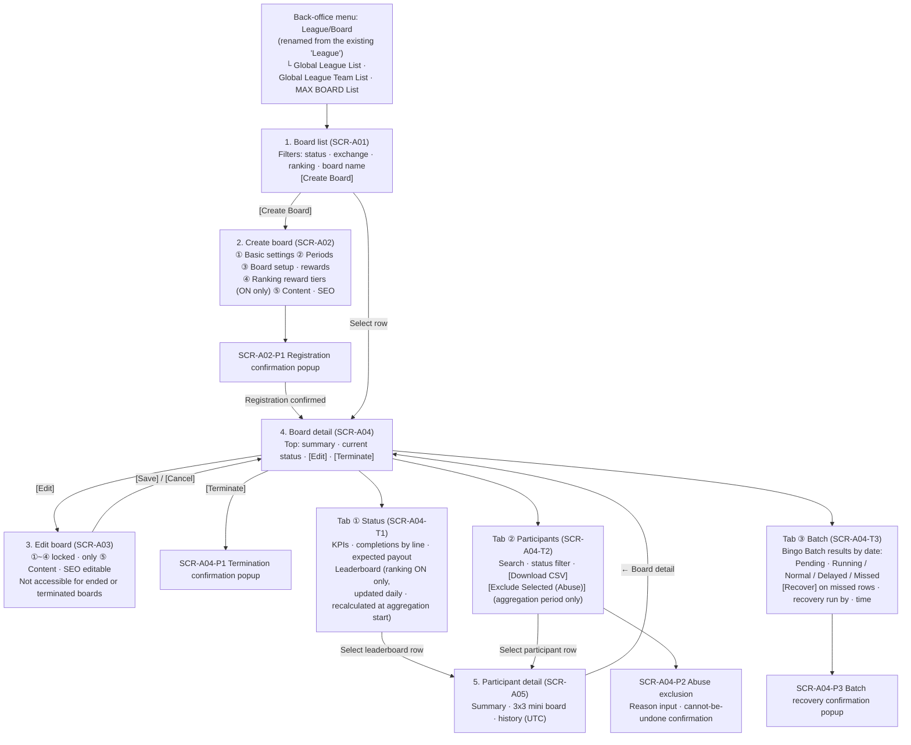
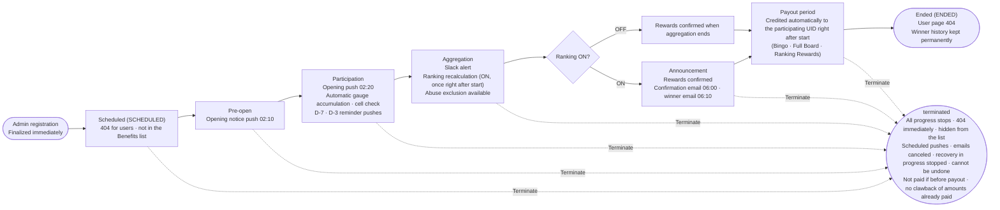
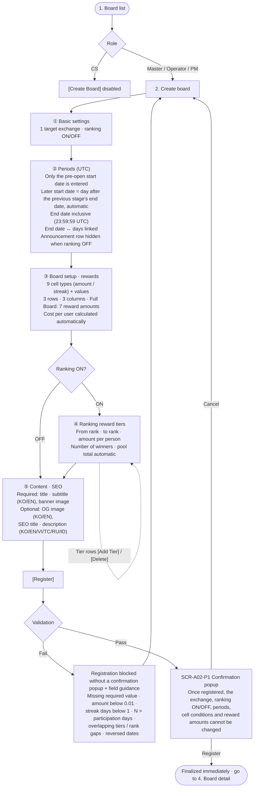
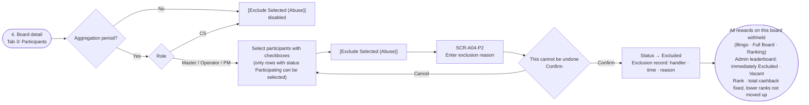
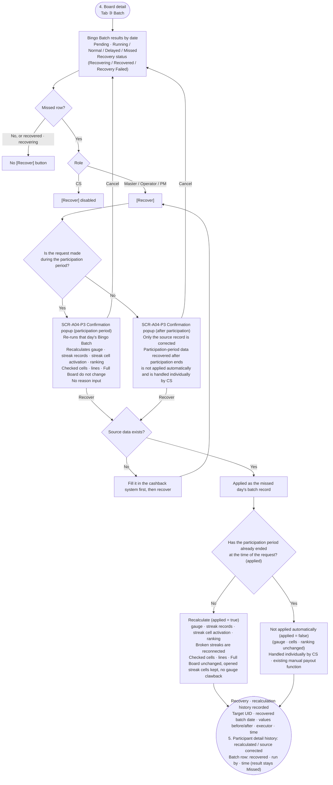
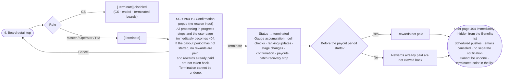

# Information Architecture — Back Office

> English translation of `정보구조도_ko.md`. If the two differ, the Korean original prevails.

| Item | Content |
|------|------|
| Project | TetherMax New Member Bingo Event (service name: MAX BOARD) |
| Written | 2026-10-01 |
| Version | v1.5 (2026-10-12 consistency review applied (confirmed 2026-10-12; the 2.1 lifecycle diagram and 3.2 are synchronized based on the user document): participant statuses Reset (ownership transfer / issue UID) / Forfeited and history labels organized, leaderboard status shown immediately with ranks fixed, Full Board users withdrawn or reset during participation removed from the ranking, Batch tab Pending · Running, Missed confirmation, recovery status, delay notice and Slack criteria, recovery recalculation scope and popup branch after the participation period, Terminate popup text unified and allowed stages, source document notation, notation for REQ references to the user document) / v1.4 (2026-10-07 PRD v0.11 and requirements v1.6 applied: back-office menu location League/Board > MAX BOARD List reconfirmed (REQ-012), Open Issue #NAME (IA-14) added, source mockup updated. User screen changes (REQ-116~123) are in the user information architecture) / v1.3 (2026-10-05 PRD v0.10 applied (abuse exclusion not disclosed, ownership transfer and issue UID handling, My Rewards empty state, ranking reward total / per place / column, streak bar, Notes in a single column, requirement traceability cleanup) / 2026-10-02 changes applied: batch recovery reason input removed, time display distinction, Bingo Batch introduced, days on which the Bingo Batch itself was missed confirmed as [Recover] only, reward wording unified from "pay" to "credit", ranking recalculated at aggregation start (reflected in the ① Status leaderboard, added to stage change processing), mockup 20261002_1247, PRD v0.9 applied) |
| Audience | Back-office developers and designers |
| Source documents | PRD.md v1.0 (overview; detailed history in Git v0.11), 분할문서/백오피스/요구사항정의서_en.md, 기능명세_프론트_en.md, 03.구현문서/맥스보드_어드민_목업_20261002_1247.html, src/mockup/index.html (default screen V2, latest user-screen and back-office mockup, Vercel deployment) |

> **Notation**
> - Screen IDs: user screens `SCR-Uxx`, admin screens `SCR-Axx`. Popups and layers append `-Px` to the parent screen ID.
> - URL paths are **tentative** and are finalized in the Screen Design (#9) and API Specification (#7). Existing TetherMax screens (Benefits list, login, UID linking) keep their existing paths.
> - All periods and times are **in UTC** (the back office shows UTC; the user screen converts to device local time), and amounts are in **USDT**.
> - Ranking ON/OFF is set at board creation and does not change afterwards. Elements marked "ranking ON only" in the diagrams below do not exist on ranking OFF boards.

> User screens are in `분할문서/사용자/정보구조도_en.md`. The period stage lifecycle and the non-screen system functions are included with the same content in both documents.

---

## 1. Sitemap

### 1.1 Admin Sitemap

The admin consists of **5 pages**. Abuse exclusion, termination, batch recovery and CSV download have no separate menu and are handled **inside the board detail**.

| # | Page | Entry | Main components | Related F-ID |
|---|--------|-----------|-----------|-----------|
| 1 | Board list | League/Board > MAX BOARD List | Filters (status, exchange, ranking ON/OFF, board name search), columns (board name, exchange, current status (color-coded, terminated in its own color), period, ranking, participating UIDs, Full Board users, expected payout), [Create Board] | F-021 |
| 2 | Create board | List → [Create Board] | Sections ①~⑤, cost per user, number of winners and ranking reward pool total calculated automatically, [Register] → confirmation popup. No draft saving or preview | F-022 |
| 3 | Edit board | Detail → [Edit] | Same sections as creation. ①~④ shown as locked (dimmed · hatched · dashed border · "Locked · Cannot Edit"), only ⑤ "Editable". [Cancel] [Save]. Separate page and separate API from creation | F-023 |
| 4 | Board detail | List → select row | Top summary (board name, current status, exchange, ranking, stage periods, cost per user) + [Edit] [Terminate], tabs ① Status ② Participants ③ Batch | F-024, F-025, F-027, F-028, F-029 |
| 5 | Participant detail | Detail ② Participants row / ① Leaderboard row | Summary (if excluded, exclusion info: handler · time · reason), 3×3 mini board (checked / opened / unchecked), history (UID registration · retroactive gauge, batch applied, cell checked, line completed, Full Board, streak cell activated, reset · forfeited · UID change after payout (reason: ownership transfer / issue UID), recalculated, source corrected, abuse exclusion, withdrawal). Separate page. Labels follow Functional Specification (Front-end) F-026 | F-026 |

**Access by role**

| Role | Page access | View | Create · Edit | CSV download | Abuse exclusion | Batch recovery | Terminate |
|------|-------------|------|-------------|--------------|-------------|-----------|-----------|
| Master / Operator | O | O | O | O | O (aggregation period only) | O | O |
| PM | O | O | O | O | O (aggregation period only) | O | O |
| CS | O | O | X (button disabled) | X (button disabled) | X (button disabled) | X (button disabled) | X (button disabled) |

> Disabled buttons for CS are also rejected by the server (403, F-030). The back office does not mask TUIDs or UIDs.

---

## 2. Operation Flows

### 2.1 Period Stage Lifecycle (Including Termination)

| Transition | Timing | Automatic processing | Related F-ID |
|------|------|-----------|-----------|
| Pre-open → Participation | Participation start date 00:00 UTC | Gauge accumulation starts (incl. non-member UIDs) | F-012, F-015 |
| Participation → Aggregation | Aggregation start date 00:00 UTC | Cell checks and joining end, (ranking ON) ranking recalculated once (all completers during participation, confirmed 2026-10-02), Slack alert | F-015, F-014, F-031 |
| Aggregation → Announcement (ON) | Announcement start date 00:00 UTC | Rewards confirmed, result email | F-017, F-033 |
| Aggregation → Payout period (OFF) | Payout period start date 00:00 UTC | Confirmed at aggregation end, automatic crediting, confirmation email | F-017, F-018, F-033 |
| Announcement → Payout period (ON) | Payout period start date 00:00 UTC | Automatic crediting (Ranking Rewards on the payout period start date) | F-018 |
| Payout period → Ended | Payout period ends | Page 404, hidden from the Benefits list | F-015, F-020 |
| Any stage → terminated | Immediately when an admin runs it (Scheduled through Payout, excluding normally ended and already terminated boards) | Not paid if before the payout period starts; amounts already paid are not clawed back; batch recovery in progress is stopped | F-029 |

### 2.2 [Admin] Board Creation · Registration

| Item | Rule |
|------|------|
| Draft saving · preview | None. Finalized as soon as the confirmation popup is confirmed |
| SEO not entered | The TetherMax site's default meta and default preview image are used |
| Cost per user | Shown only; the amount is not limited (operations guide) |
| Overlapping periods for the same exchange | Not blocked by the system (operations principle) |
| Edit flow | Detail [Edit] → 3. Edit board: ①~④ locked, only ⑤ editable → [Save] → detail. [Edit] disabled for ended or terminated boards |

### 2.3 [Admin] Abuse Exclusion

> The leaderboard (① Status) has no exclusion function. Exclusion is done only in the ② Participants tab. Exclusion records are viewed in the "Abuse Exclusion Records" table at the bottom of the ② Participants tab and in the participant detail.
> The admin leaderboard shows exclusions, withdrawals and forfeitures after aggregation starts as a status immediately, while ranks and total cashback stay fixed. The user leaderboard stays fixed at the recalculated result during aggregation, and vacant places are applied at announcement (confirmed 2026-10-12). Full Board users withdrawn or reset during the participation period are not left vacant; they are removed from the ranking in the next Bingo Batch recalculation.

### 2.4 [Admin] Missed Batch Recovery

> The subject of the delayed/missed judgment is the **Bingo Batch** (MAX BOARD's own daily batch that reads the cashback batch; once a day at a fixed time common to all exchanges; the time is a setting, open item #BATCH). Before judgment or running = Pending · Running; not completed 3 hours after the scheduled time = Delayed; not completed by 00:00 UTC of the next day = Missed (the run is stopped, late results are not applied, only [Recover], confirmed 2026-10-12). The operations Slack alert (F-031) is sent per Bingo Batch run (common to all boards): once on entering Delayed, once when Missed is confirmed, and immediately on a run error (confirmed 2026-10-12). The delay notice on the user screen (`batchDelayed`) is shown when "scheduled time + 3 hours has passed + not completed", and for a miss until it is recovered ("Cashback update delayed" (KO "페이백 반영이 지연되고 있어요"), REQ-063 (see User Requirements Definition)). Days on which the Bingo Batch itself was missed are not filled in automatically by the next day's Bingo Batch; they are filled only with [Recover] in the ③ Batch tab (confirmed 2026-10-02).

### 2.5 [Admin] Termination

> Full Terminate popup text (unified, confirmed 2026-10-12): "All processing in progress stops and the user page immediately becomes 404. If the payout period has not started, no rewards are paid, and rewards already paid are not taken back. Termination cannot be undone." Termination is allowed from Scheduled through Payout, and the button is disabled for boards that ended normally (`ENDED`) or are already terminated (`TERMINATED`).

---

## 3. Screen-Function Mapping

### 3.1 Admin Screens

| Screen ID | Screen name | URL (tentative) | Access | Main functions | Related function ID |
|---------|--------|------------|------|-----------|--------------|
| SCR-A01 | 1. Board list | `/admin/maxboard` | All for Master/Operator/PM, view for CS | Filters · search, status colors, real-time participating UIDs · Full Board users · expected payout, [Create Board] (disabled for CS) | F-021, F-030 |
| SCR-A02 | 2. Create board | `/admin/maxboard/new` | Master/Operator/PM | ①~⑤ input, automatic calculation, validation | F-022 |
| SCR-A02-P1 | Registration confirmation popup | Popup in SCR-A02 | Master/Operator/PM | Notice that amounts and conditions are finalized → register | F-022 |
| SCR-A03 | 3. Edit board | `/admin/maxboard/{boardId}/edit` | Master/Operator/PM (not for ended or terminated boards) | ①~④ locked, ⑤ Content · SEO edit · save | F-023 |
| SCR-A04 | 4. Board detail (top) | `/admin/maxboard/{boardId}` | All for Master/Operator/PM, view for CS | Summary, current status, [Edit] [Terminate] (disabled for CS) | F-024, F-029, F-030 |
| SCR-A04-T1 | Tab ① Status | `/admin/maxboard/{boardId}?tab=status` | All for Master/Operator/PM, view for CS | KPIs, completions by line, expected payout (confirmed payout after confirmation), leaderboard (ranking ON, full TUID shown, updated after each daily Bingo Batch, recalculated once at aggregation start to include all completers during participation; exclusions, withdrawals and forfeitures after aggregation starts are shown immediately as "Excluded · Vacant" with ranks fixed) → participant detail | F-024, F-014 |
| SCR-A04-T2 | Tab ② Participants | `/admin/maxboard/{boardId}?tab=participants` | All for Master/Operator/PM, view for CS | Search (TUID · UID), status filter (Participating / Reset / Forfeited / Excluded / Withdrawn) · reason filter (Ownership Transfer / Issue UID), [Download CSV] (disabled for CS), [Exclude Selected (Abuse)] (aggregation period only, "Participating" rows only, disabled for CS), abuse exclusion records table → participant detail | F-025, F-028 |
| SCR-A04-T3 | Tab ③ Batch | `/admin/maxboard/{boardId}?tab=batches` | All for Master/Operator/PM, view for CS | Bingo Batch results by date (Pending · Running/Normal/Delayed/Missed), [Recover] on missed rows (disabled for CS), recovery status · run by · time | F-027, F-019 |
| SCR-A04-P1 | Termination confirmation popup | Popup in SCR-A04 | Master/Operator/PM | Confirm the unified text (2.5), without a reason → terminated | F-029 |
| SCR-A04-P2 | Abuse exclusion reason · confirmation popup | Popup in SCR-A04-T2 | Master/Operator/PM, aggregation period | Enter reason → confirm "This cannot be undone" | F-028 |
| SCR-A04-P3 | Batch recovery confirmation popup | Popup in SCR-A04-T3 | Master/Operator/PM | Confirm re-running that day's Bingo Batch, without a reason. During participation the popup explains the recalculation; after participation it says "not applied automatically, handled individually by CS" | F-027, F-019 |
| SCR-A05 | 5. Participant detail | `/admin/maxboard/{boardId}/participants/{participantId}` | All for Master/Operator/PM, view for CS | Summary, 3×3 mini board, history (UTC) | F-026, F-020 |

### 3.2 Non-Screen System Functions (No Screen)

| Function | Screen where the result appears | Related function ID |
|------|----------------------|--------------|
| Bingo Batch: cashback application · gauge accumulation (source: cashback batch) | SCR-U02 gauge, SCR-A04-T3, SCR-A05 history | F-012 |
| Bingo Batch delay/miss judgment and recovery | SCR-U02 "Cashback update delayed" (delay or unrecovered miss during the participation period), SCR-A04-T3 batch results (Pending/Running / Normal / Delayed / Missed, recovery completed indicator), operations Slack | F-019, F-031 |
| Streak record · streak cell activation | SCR-U02 streak status, SCR-A05 mini board | F-013 |
| Ranking calculation | SCR-U02 leaderboard, SCR-A04-T1 leaderboard | F-014 |
| Automatic period stage change | All screens | F-015 |
| Ownership transfer · issue UID designation · withdrawal handling (based on account DB history time, checked daily until payout is complete) | SCR-U02 notice at the top (participating UID lost), SCR-A04-T2 status (Reset (Ownership Transfer) / Reset (Issue UID) / Forfeited (Ownership Transfer) / Forfeited (Issue UID) / Withdrawn), SCR-A05 history (including UID change after payout) | F-016 |
| Reward confirmation · automatic crediting | SCR-U02 announcement · payout notice (Bingo, Full Board and Ranking Rewards credited together right after the payout period starts; payout failures are handled by the backend, no screen) | F-017, F-018 |
| Slack · app push · email | App push destination: SCR-U02 | F-031, F-032, F-033 |

---

## 4. Items to Confirm

Items that needed a decision during information architecture design. As of 2026-10-07, only IA-12 (#IMG), IA-13 (#SC) and IA-14 (#NAME) remain.

| # | Item | Content | Related screens | Related F-ID |
|---|------|------|-----------|-----------|
| IA-1 | User screen URL · admin menu | **Confirmed (2026-10-01)**: the user detail address uses a `benefitNo` newly issued for each board (same as the Global League). **Admin menu (confirmed 2026-10-05)**: the existing back-office **"League" menu is renamed to "League/Board"**, and **"MAX BOARD List"** is added under it (after Global League List and Global League Team List) (confirmed 2026-10-05). The admin URL follows the existing back-office path rules | SCR-A01~A05 | F-021, F-022 |
| IA-9 | Selectable targets for abuse exclusion | **Confirmed 2026-10-05**: only participants whose status is "Participating" can be excluded. Reset, Forfeited, Excluded and Withdrawn rows cannot be selected (if any are mixed in, the whole request is rejected, F-028). The button is enabled only during the aggregation period | SCR-A04-T2 | F-028 |
| IA-10 | [Recover] button after participation ends | **Confirmed (2026-10-01)**: [Recover] can be used after participation ends. The popup says that only the source record is corrected without recalculation, and that participation-period data recovered after participation ends is not applied automatically and is handled individually by CS (text unified 2026-10-12). No recovery reason input (changed 2026-10-02) | SCR-A04-T3 | F-019, F-027 |
| IA-11 | [Terminate] button for ended · terminated boards | **Confirmed 2026-10-05**: boards that ended normally (payout period ended) or are already terminated cannot be terminated (allowed only from Scheduled through Payout). The button is disabled, and the API rejects with `BOARD_CLOSED` for a normal end and `ALREADY_TERMINATED` if already terminated (existing definition) | SCR-A04 | F-029 |
| IA-12 | Images other than the banner | PRD Open Issue #IMG. Affects the detail page components | SCR-U02, SCR-A02, SCR-A03 | F-022 |
| IA-13 | SEO Simplified Chinese (SC) | PRD Open Issue #SC. Once confirmed, SC is added to the ⑤ Content · SEO language tabs. Development default: not supported | SCR-A02, SCR-A03 | F-022, F-023, F-011 (see User Functional Specification) |
| IA-14 | Service name | PRD Open Issue #NAME (under review). Candidates: MAX BOARD / Max Bingo Board / Cashback Bingo / Max Bingo / Bingo Challenge. Once decided, the menu name (League/Board > MAX BOARD List), screen name, detail URL (`/max-board`) and push/email copy change (REQ-012) | SCR-A01 | F-021 |
