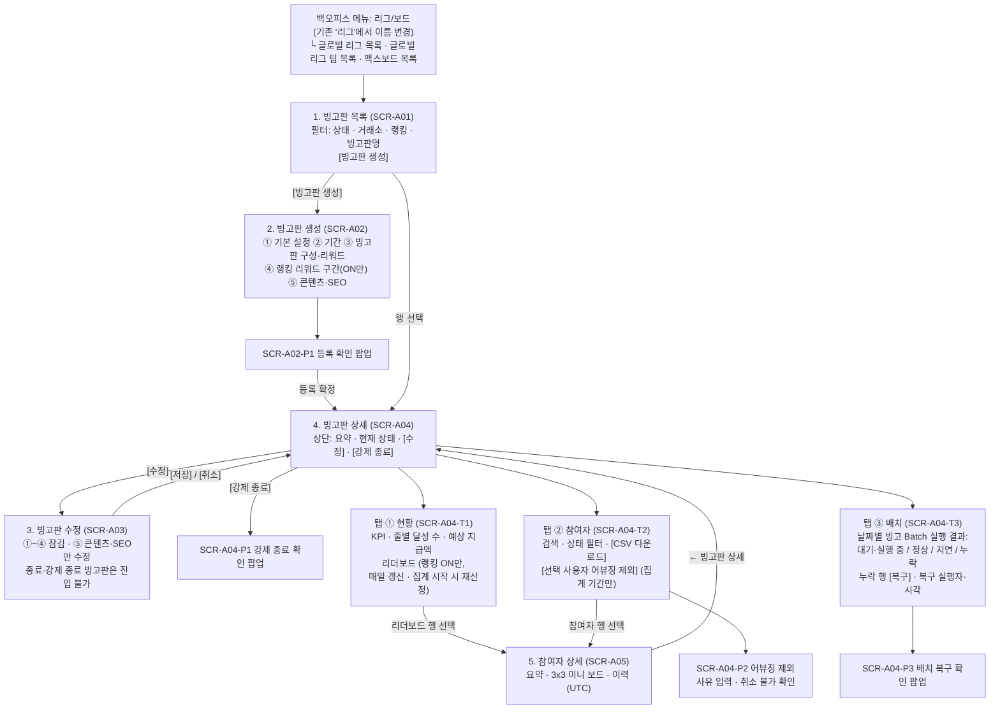
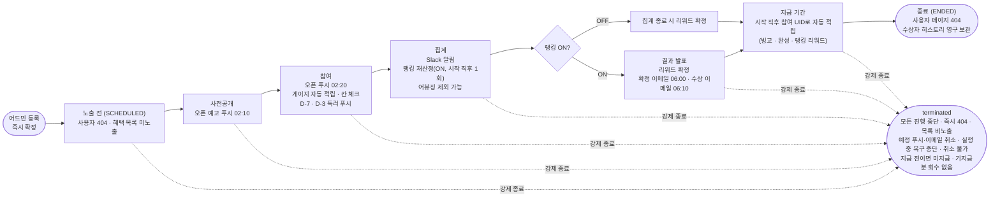
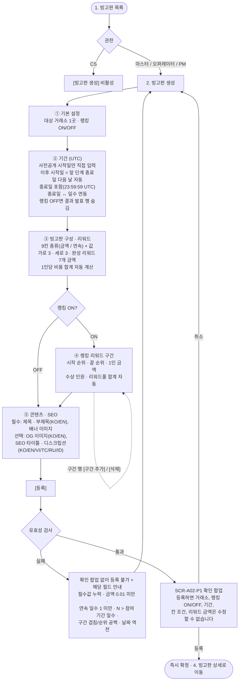
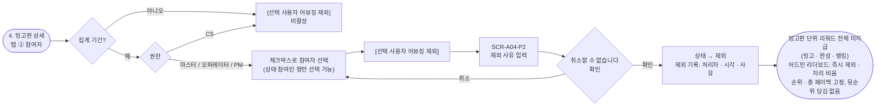
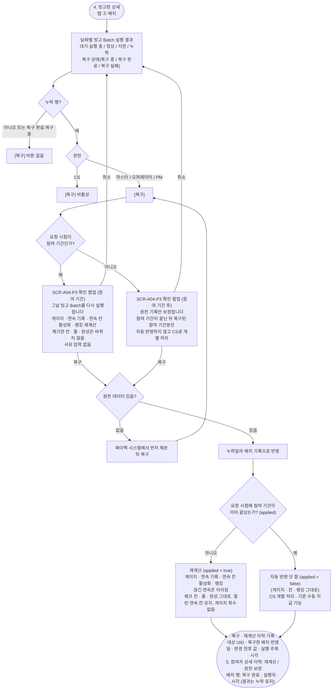
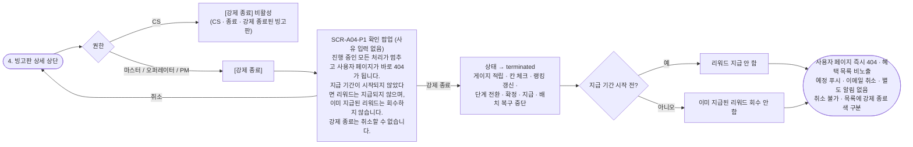

# 정보구조도 — 백오피스

| 항목 | 내용 |
|------|------|
| 프로젝트명 | TetherMax 신규 회원 빙고 이벤트 (서비스명: 맥스보드 / MAX BOARD) |
| 작성일 | 2026-10-01 |
| 버전 | v1.5 (2026-10-12 정합성 점검 반영(확정 2026-10-12, 2.1 생명주기 다이어그램·3.2는 사용자 문서 기준으로 동기화): 참여자 상태 초기화(소유권 이전·이슈 UID)/소멸·이력 라벨 정리, 리더보드 상태 즉시 표시·순위 고정·참여 기간 중 탈퇴·초기화 완성자 순위 제외, 배치 탭 대기·실행 중·누락 확정·복구 상태·지연 안내·Slack 기준, 복구 재계산 범위·참여 기간 후 팝업 분기, 강제 종료 팝업 문구 통일·가능 단계, 근거 문서 표기, 사용자 문서 REQ 참조 표기) / v1.4 (2026-10-07 PRD v0.11·요구사항 v1.6 반영: 백오피스 메뉴 위치 리그/보드 > 맥스보드 목록 재확인(REQ-012), Open Issue #NAME(IA-14) 추가, 근거 목업 갱신. 사용자 화면 변경(REQ-116~123)은 사용자 정보구조도) / v1.3 (2026-10-05 PRD v0.10 반영(어뷰징 제외 미안내, 소유권 이전·이슈 UID 처리, 내 리워드 빈 상태, 랭킹 리워드 총액·등수별·컬럼, 연속 막대, 유의사항 한 열, 요구사항 추적 정비) / 2026-10-02 변경 반영: 배치 복구 사유 입력 폐지, 시각 표시 구분, 빙고 Batch 도입, 빙고 Batch 자체 누락일 [복구] 전용 확정, 리워드 "지급 → 적립" 표현 통일, 집계 시작 시 랭킹 재산정(① 현황 리더보드 반영, 단계 전환 처리 추가), 목업 20261002_1247, PRD v0.9 반영) |
| 대상 독자 | 백오피스 개발자·디자이너 |
| 근거 문서 | PRD.md v1.0(개요, 상세 이력은 Git v0.11), 분할문서/백오피스/요구사항정의서_ko.md, 기능명세_프론트_ko.md, 03.구현문서/맥스보드_어드민_목업_20261002_1247.html, src/mockup/index.html(기본 화면 V2, 사용자 화면·백오피스 최신 목업, Vercel 배포본) |

> **표기 규칙**
> - 화면 ID: 사용자 화면 `SCR-Uxx`, 어드민 화면 `SCR-Axx`. 팝업·레이어는 부모 화면 ID에 `-Px`를 붙인다.
> - URL 경로는 **가칭**이며 화면설계서(#9)·API스펙(#7)에서 확정한다. 기존 테더맥스 화면(혜택 목록, 로그인, UID 연동)은 기존 경로를 그대로 쓴다.
> - 모든 기간·시각은 **UTC 기준**(백오피스 화면은 UTC 표시, 사용자 화면은 기기 로컬 시간으로 변환 표시), 금액은 **USDT**.
> - 랭킹 ON/OFF는 빙고판 생성 시 정해지며 이후 바뀌지 않는다. 아래 다이어그램에서 "랭킹 ON만"으로 표시한 요소는 랭킹 OFF 빙고판에서는 존재하지 않는다.

> 사용자 화면은 `분할문서/사용자/정보구조도_ko.md`에 있다. 기간 단계 생명주기와 화면 외 시스템 기능은 양쪽에 같은 내용으로 수록한다.

---

## 1. 사이트맵

### 1.1 어드민 사이트맵

어드민은 **5개 페이지**로 구성한다. 어뷰징 제외, 강제 종료, 배치 복구, CSV 다운로드는 독립 메뉴 없이 **빙고판 상세 안에서** 처리한다.

| # | 페이지 | 진입 경로 | 주요 구성 | 관련 F-ID |
|---|--------|-----------|-----------|-----------|
| 1 | 빙고판 목록 | 리그/보드 > 맥스보드 목록 | 필터(상태, 거래소, 랭킹 ON/OFF, 빙고판명 검색), 컬럼(빙고판명, 거래소, 현재 상태(색 구분, 강제 종료 별도 색), 기간, 랭킹, 참여 UID, 완성자, 예상 지급액), [빙고판 생성] | F-021 |
| 2 | 빙고판 생성 | 목록 → [빙고판 생성] | ①~⑤ 섹션, 1인당 비용 합계·수상 인원·랭킹 리워드풀 합계 자동 계산, [등록] → 확인 팝업. 임시저장·미리보기 없음 | F-022 |
| 3 | 빙고판 수정 | 상세 → [수정] | 생성과 같은 섹션. ①~④ 잠김 표시(흐림·빗금·점선·"잠김 · 수정 불가"), ⑤만 "수정 가능". [취소] [저장]. 생성과 별도 페이지·별도 API | F-023 |
| 4 | 빙고판 상세 | 목록 → 행 선택 | 상단 요약(빙고판명, 현재 상태, 거래소, 랭킹, 단계별 기간, 1인당 비용 합계) + [수정] [강제 종료], 탭 ① 현황 ② 참여자 ③ 배치 | F-024, F-025, F-027, F-028, F-029 |
| 5 | 참여자 상세 | 상세 ② 참여자 행 / ① 리더보드 행 | 요약(제외면 제외 정보: 처리자·시각·사유), 3×3 미니 보드(체크 / 열림 / 미체크), 이력(UID 등록·소급, 배치 반영, 칸 체크, 줄 완성, 빙고판 완성, 연속 칸 활성화, 초기화·소멸·지급 후 UID 변경(사유: 소유권 이전 / 이슈 UID), 재계산, 원천 보정, 어뷰징 제외, 탈퇴). 별도 페이지. 라벨은 기능명세_프론트 F-026 | F-026 |

**권한별 접근**

| 권한 | 페이지 진입 | 조회 | 생성 · 수정 | CSV 다운로드 | 어뷰징 제외 | 배치 복구 | 강제 종료 |
|------|-------------|------|-------------|--------------|-------------|-----------|-----------|
| 마스터 / 오퍼레이터 | O | O | O | O | O (집계 기간만) | O | O |
| PM | O | O | O | O | O (집계 기간만) | O | O |
| CS | O | O | X (버튼 비활성) | X (버튼 비활성) | X (버튼 비활성) | X (버튼 비활성) | X (버튼 비활성) |

> CS의 비활성 버튼은 서버에서도 거부한다(403, F-030). 백오피스에서는 TUID·UID를 마스킹하지 않는다.

---

## 2. 운영 흐름

### 2.1 기간 단계 생명주기 (강제 종료 포함)

| 전환 | 시점 | 자동 처리 | 관련 F-ID |
|------|------|-----------|-----------|
| 사전공개 → 참여 | 참여 시작일 UTC 00:00 | 게이지 적립 시작(비회원 UID 포함) | F-012, F-015 |
| 참여 → 집계 | 집계 시작일 UTC 00:00 | 칸 체크·참여 종료, (랭킹 ON) 랭킹 재산정 1회(참여 기간 중 모든 완성자 반영, 확정 2026-10-02), Slack 알림 | F-015, F-014, F-031 |
| 집계 → 결과 발표 (ON) | 결과 발표 시작일 UTC 00:00 | 리워드 확정, 결과 이메일 | F-017, F-033 |
| 집계 → 지급 기간 (OFF) | 지급 기간 시작일 UTC 00:00 | 집계 종료 시 확정, 자동 적립, 확정 이메일 | F-017, F-018, F-033 |
| 결과 발표 → 지급 기간 (ON) | 지급 기간 시작일 UTC 00:00 | 자동 적립(랭킹 리워드는 지급 기간 시작일) | F-018 |
| 지급 기간 → 종료 | 지급 기간 종료 | 페이지 404, 혜택 목록 비노출 | F-015, F-020 |
| 아무 단계 → terminated | 어드민 실행 즉시(노출 전~지급 기간, 정상 종료·이미 강제 종료 제외) | 지급 기간 시작 전이면 미지급, 기지급분 회수 없음, 실행 중인 배치 복구 중단 | F-029 |

### 2.2 [어드민] 빙고판 생성·등록

| 항목 | 규칙 |
|------|------|
| 임시저장·미리보기 | 없음. 확인 팝업 확인 즉시 확정 |
| SEO 미입력 | 테더맥스 사이트 기본 메타 정보·기본 미리보기 이미지 사용 |
| 1인당 비용 합계 | 표시만 하고 금액을 제한하지 않음(운영 가이드) |
| 같은 거래소 기간 중복 | 시스템이 막지 않음(운영 원칙) |
| 수정 흐름 | 상세 [수정] → 3. 빙고판 수정: ①~④ 잠김, ⑤만 수정 → [저장] → 상세. 종료·강제 종료 빙고판은 [수정] 비활성 |

### 2.3 [어드민] 어뷰징 제외

> 리더보드(① 현황)에는 제외 기능을 두지 않는다. 제외는 ② 참여자 탭에서만 한다. 제외 기록은 ② 참여자 탭 하단 "어뷰징 제외 기록" 표와 참여자 상세에서 본다.
> 어드민 리더보드는 집계 시작 이후 제외·탈퇴·소멸을 즉시 상태로 표시하되 순위·총 페이백은 고정한다. 사용자 리더보드는 집계 동안 재산정 결과 그대로 고정되며 비운 자리는 결과 발표 때 반영된다(확정 2026-10-12). 참여 기간 중 탈퇴·초기화된 완성자는 자리 비움이 아니라 다음 빙고 Batch 재산정에서 순위 대상에서 빠진다.

### 2.4 [어드민] 배치 누락 복구

> 지연·누락 판정 대상은 **빙고 Batch**다(페이백 배치를 불러오는 맥스보드 전용 일 배치, 하루 1회 모든 거래소 공통 고정 시각, 시각은 설정값·미정 #BATCH). 판정 전·실행 중 = 대기·실행 중, 예정 시각 + 3시간 미완료 = 지연, 다음 날 00:00 UTC까지 미완료 = 누락(실행 중단, 늦은 결과 미반영, [복구]로만, 확정 2026-10-12). 운영 Slack 알림(F-031)은 빙고 Batch 실행 1회(모든 빙고판 공통) 단위로 지연 진입 시 1회, 누락 확정 시 1회, 실행 오류 즉시 보낸다(확정 2026-10-12). 사용자 화면의 지연 안내(`batchDelayed`)는 "예정 시각 + 3시간 경과 + 미완료"일 때, 누락이면 복구 전까지 표시한다("페이백 반영이 지연되고 있어요", REQ-063(사용자 요구사항정의서 참조)). 빙고 Batch 자체가 누락된 날은 다음 날 빙고 Batch가 자동으로 채우지 않으며 ③ 배치 탭 [복구]로만 채운다(확정 2026-10-02).

### 2.5 [어드민] 강제 종료

> 강제 종료 팝업 전문(통일, 확정 2026-10-12): "진행 중인 모든 처리가 멈추고 사용자 페이지가 바로 404가 됩니다. 지급 기간이 시작되지 않았다면 리워드는 지급되지 않으며, 이미 지급된 리워드는 회수하지 않습니다. 강제 종료는 취소할 수 없습니다." 강제 종료 가능 단계는 노출 전~지급 기간이며 정상 종료(`ENDED`)·이미 강제 종료(`TERMINATED`)된 빙고판은 버튼 비활성이다.

---

## 3. 화면-기능 매핑

### 3.1 어드민 화면

| 화면 ID | 화면명 | URL (가칭) | 접근 | 주요 기능 | 관련 기능 ID |
|---------|--------|------------|------|-----------|--------------|
| SCR-A01 | 1. 빙고판 목록 | `/admin/maxboard` | 마스터/오퍼레이터/PM 전체, CS 조회 | 필터·검색, 상태 색 구분, 실시간 참여 UID·완성자·예상 지급액, [빙고판 생성](CS 비활성) | F-021, F-030 |
| SCR-A02 | 2. 빙고판 생성 | `/admin/maxboard/new` | 마스터/오퍼레이터/PM | ①~⑤ 입력, 자동 계산, 유효성 검사 | F-022 |
| SCR-A02-P1 | 등록 확인 팝업 | SCR-A02 내 팝업 | 마스터/오퍼레이터/PM | 금액·조건 확정 안내 → 등록 | F-022 |
| SCR-A03 | 3. 빙고판 수정 | `/admin/maxboard/{boardId}/edit` | 마스터/오퍼레이터/PM (종료·terminated 빙고판 불가) | ①~④ 잠김, ⑤ 콘텐츠·SEO 수정·저장 | F-023 |
| SCR-A04 | 4. 빙고판 상세 (상단) | `/admin/maxboard/{boardId}` | 마스터/오퍼레이터/PM 전체, CS 조회 | 요약, 현재 상태, [수정] [강제 종료](CS 비활성) | F-024, F-029, F-030 |
| SCR-A04-T1 | 탭 ① 현황 | `/admin/maxboard/{boardId}?tab=status` | 마스터/오퍼레이터/PM 전체, CS 조회 | KPI, 줄별 달성 수, 예상 지급액(확정 이후 확정 지급액), 리더보드(랭킹 ON, TUID 전체 표시, 매일 빙고 Batch 후 갱신, 집계 시작 시 한 번 재산정해 참여 기간 중 모든 완성자 반영, 집계 시작 이후 제외·탈퇴·소멸은 즉시 "제외 · 자리 비움" 표시·순위 고정) → 참여자 상세 | F-024, F-014 |
| SCR-A04-T2 | 탭 ② 참여자 | `/admin/maxboard/{boardId}?tab=participants` | 마스터/오퍼레이터/PM 전체, CS 조회 | 검색(TUID·UID), 상태 필터(참여 / 초기화 / 소멸 / 제외 / 탈퇴)·사유 필터(소유권 이전 / 이슈 UID), [CSV 다운로드](CS 비활성), [선택 사용자 어뷰징 제외](집계 기간·"참여" 행만·CS 비활성), 어뷰징 제외 기록 표 → 참여자 상세 | F-025, F-028 |
| SCR-A04-T3 | 탭 ③ 배치 | `/admin/maxboard/{boardId}?tab=batches` | 마스터/오퍼레이터/PM 전체, CS 조회 | 날짜별 빙고 Batch 실행 결과(대기·실행 중/정상/지연/누락), 누락 행 [복구](CS 비활성), 복구 상태·실행자·시각 | F-027, F-019 |
| SCR-A04-P1 | 강제 종료 확인 팝업 | SCR-A04 내 팝업 | 마스터/오퍼레이터/PM | 통일 문구(2.5) 확인, 사유 없이 → terminated | F-029 |
| SCR-A04-P2 | 어뷰징 제외 사유·확인 팝업 | SCR-A04-T2 내 팝업 | 마스터/오퍼레이터/PM, 집계 기간 | 사유 입력 → "취소할 수 없습니다" 확인 | F-028 |
| SCR-A04-P3 | 배치 복구 확인 팝업 | SCR-A04-T3 내 팝업 | 마스터/오퍼레이터/PM | 사유 없이 해당일 빙고 Batch 재실행 확인. 참여 기간이면 재계산 안내, 참여 기간 후면 "자동 반영 없이 CS 개별 처리" 안내 | F-027, F-019 |
| SCR-A05 | 5. 참여자 상세 | `/admin/maxboard/{boardId}/participants/{participantId}` | 마스터/오퍼레이터/PM 전체, CS 조회 | 요약, 3×3 미니 보드, 이력(UTC) | F-026, F-020 |

### 3.2 화면 외 시스템 기능 (화면 없음)

| 기능 | 결과가 드러나는 화면 | 관련 기능 ID |
|------|----------------------|--------------|
| 빙고 Batch: 페이백 반영·게이지 적립 (원천: 페이백 배치) | SCR-U02 게이지, SCR-A04-T3, SCR-A05 이력 | F-012 |
| 빙고 Batch 지연·누락 판정·복구 | SCR-U02 "페이백 반영이 지연되고 있어요"(참여 기간 지연·복구 전 누락), SCR-A04-T3 배치 결과(대기·실행 중 / 정상 / 지연 / 누락, 복구 완료 표시), 운영 Slack | F-019, F-031 |
| 연속 기록·연속 칸 활성화 | SCR-U02 연속 현황, SCR-A05 미니 보드 | F-013 |
| 랭킹 산정 | SCR-U02 리더보드, SCR-A04-T1 리더보드 | F-014 |
| 기간 단계 자동 전환 | 전 화면 | F-015 |
| 소유권 이전·이슈 UID 지정·탈퇴 처리(계정 DB 이력 시각 기준, 지급 완료까지 매일 대조) | SCR-U02 맨 위 안내(참여 UID를 잃음), SCR-A04-T2 상태(초기화(소유권 이전) / 초기화(이슈 UID) / 소멸(소유권 이전) / 소멸(이슈 UID) / 탈퇴), SCR-A05 이력(지급 후 UID 변경 포함) | F-016 |
| 리워드 확정·자동 적립 | SCR-U02 결과 발표·지급 안내(지급 기간 시작 직후 빙고·완성·랭킹 리워드 함께 적립, 지급 실패는 백엔드 처리, 화면 없음) | F-017, F-018 |
| Slack·앱 푸시·이메일 | 앱 푸시 이동 경로: SCR-U02 | F-031, F-032, F-033 |

---

## 4. 확인 필요

정보구조 설계 중 결정이 필요했던 항목이다. 2026-10-07 기준 IA-12(#IMG), IA-13(#SC), IA-14(#NAME)만 남아 있다.

| # | 항목 | 내용 | 관련 화면 | 관련 F-ID |
|---|------|------|-----------|-----------|
| IA-1 | 사용자 화면 URL·어드민 메뉴 | **확정(2026-10-01)**: 사용자 상세 주소는 빙고판마다 새로 발급되는 `benefitNo` 방식(글로벌 리그와 같음). **어드민 메뉴(확정 2026-10-05)**: 기존 백오피스 **"리그" 메뉴명을 "리그/보드"로 바꾸고**, 그 아래(글로벌 리그 목록·글로벌 리그 팀 목록 다음)에 **"맥스보드 목록"** 을 추가한다(확정 2026-10-05). 어드민 URL은 기존 백오피스 경로 규칙에 따름 | SCR-A01~A05 | F-021, F-022 |
| IA-9 | 어뷰징 제외 선택 대상 | **확정 2026-10-05**: 상태가 "참여"인 참여자만 제외할 수 있다. 초기화·소멸·제외·탈퇴 행은 선택 불가(섞여 있으면 전체 거부, F-028). 버튼은 집계 기간에만 활성 | SCR-A04-T2 | F-028 |
| IA-10 | 참여 기간 종료 후 [복구] 버튼 | **확정(2026-10-01)**: 참여 기간 종료 후에도 [복구] 사용 가능. 원천 기록만 보정하고 재계산하지 않으며, 참여 기간이 끝난 뒤 복구된 참여 기간분은 자동 반영하지 않고 CS로 개별 처리한다는 점을 팝업에 안내(2026-10-12 문구 통일). 복구 사유 입력 없음(2026-10-02 변경) | SCR-A04-T3 | F-019, F-027 |
| IA-11 | 종료·terminated 빙고판의 [강제 종료] 버튼 | **확정 2026-10-05**: 정상 종료(지급 기간 종료)·이미 강제 종료된 빙고판은 강제 종료할 수 없다(노출 전~지급 기간만 가능). 버튼 비활성, API는 정상 종료면 `BOARD_CLOSED`, 이미 강제 종료면 `ALREADY_TERMINATED`로 거부(기존 정의) | SCR-A04 | F-029 |
| IA-12 | 배너 외 추가 이미지 | PRD Open Issue #IMG. 상세 페이지 구성 요소에 영향 | SCR-U02, SCR-A02, SCR-A03 | F-022 |
| IA-13 | SEO 중국어 간체(SC) | PRD Open Issue #SC. 확정 시 ⑤ 콘텐츠·SEO 언어 탭에 SC 추가. 개발 기본값: 미지원 | SCR-A02, SCR-A03 | F-022, F-023, F-011(사용자 기능명세 참조) |
| IA-14 | 서비스명 | PRD Open Issue #NAME(검토 중). 후보: 맥스보드 / 맥스 빙고 보드 / 페이백 빙고 / 맥스 빙고 / 빙고 챌린지. 확정 시 메뉴명(리그/보드 > 맥스보드 목록)·화면 이름·상세 주소(`/max-board`)·푸시·이메일 문구 변경(REQ-012) | SCR-A01 | F-021 |
