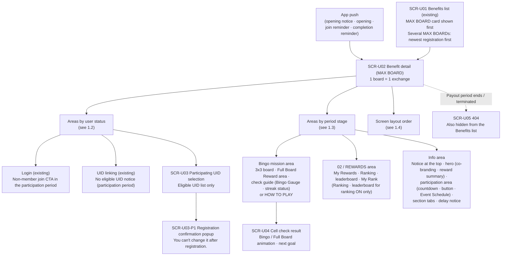
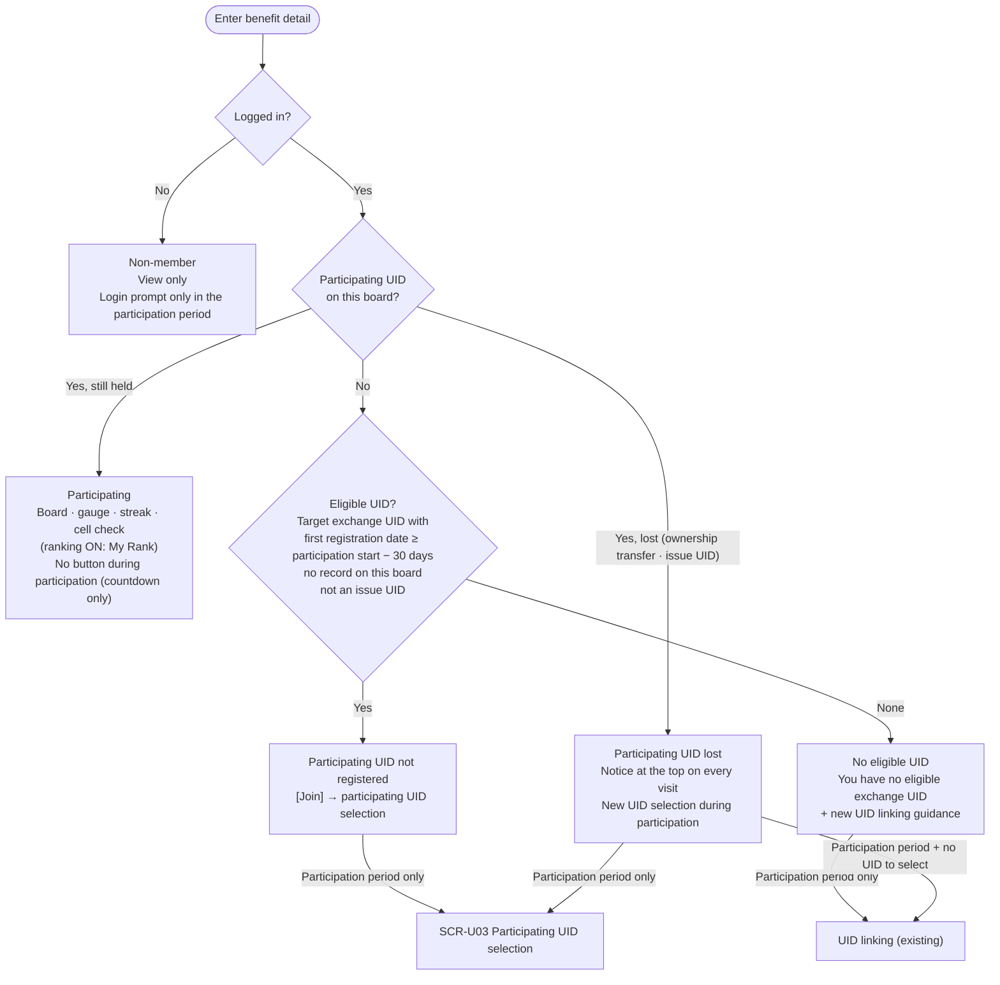
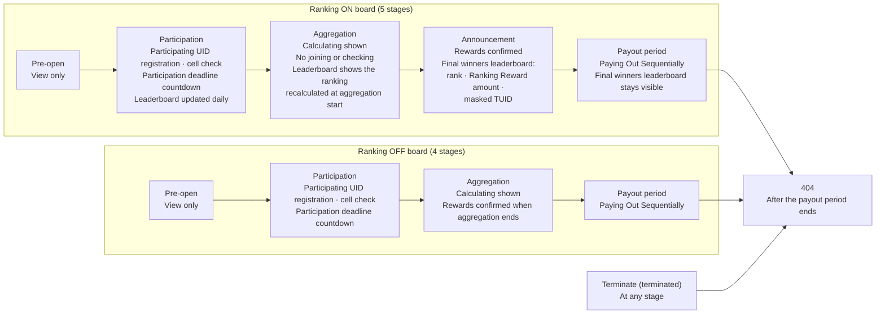
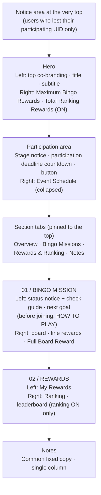
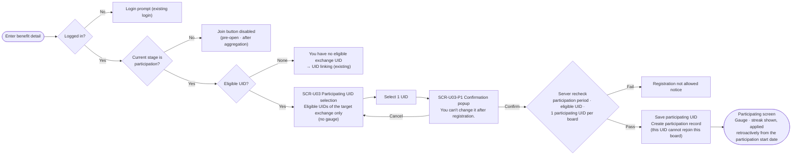
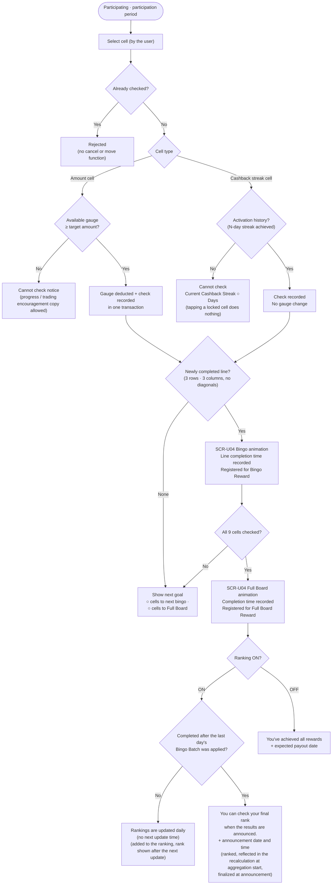
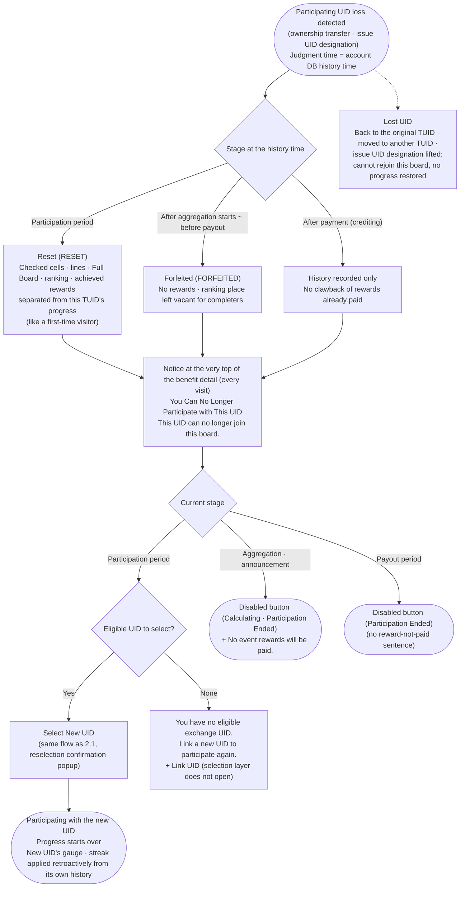
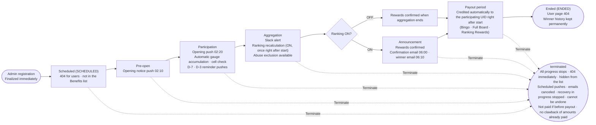

# Information Architecture — User Screens

> English translation of `정보구조도_ko.md`. If the two differ, the Korean original prevails.
> EN copy not yet in the language pack is marked [EN draft] and needs language-pack review.

| Item | Content |
|------|------|
| Project | TetherMax New Member Bingo Event (service name: MAX BOARD) |
| Written | 2026-10-01 |
| Version | v1.5 (2026-10-12 consistency review applied (confirmed 2026-10-12): 1.4 screen layout order rewritten to the mockup default screen (V2) layout (notice area at the top, hero, participation area, section tabs, Bingo mission, HOW TO PLAY, 02 / REWARDS), user-initiated unlink concept removed, 2.3 rewritten as "Participating UID Lost → Reset · Forfeited", 1.2 state "participating UID lost", disabled buttons for non-members in pre-open and aggregation, no Link UID in pre-open, leaderboard frozen in the aggregation stage, same columns in every stage, last updated time not shown, empty-state copy, streak copy replaced, Notes in 15 languages, Scheduled (SCHEDULED) added to the lifecycle, Ranking Rewards credited at the same time in the payout period (2.4), issue UIDs excluded in the eligibility conditions (1.2, 2.1), registration confirmation popup in the polite 해요 style, `{exchange}` as a variable, deadline example date, IA-13 #SC added and IA-7 updated in section 4, source documents notation) / v1.4 (2026-10-07 PRD v0.11, requirements v1.6 and functional spec v1.7 applied: benefit detail screen layout order (1.4) added, co-branded logos at the top, participation deadline countdown, no button for participants, disabled buttons, cell state display, Full Board display, expandable Event Schedule, Max Cells to Check, card hidden by cell composition, 02 / REWARDS area, no winner count above the leaderboard, Paying Out Sequentially (REQ-116~123, REQ-052, 057, 083), Open Issue #NAME (IA-14)) / v1.3 (2026-10-05 PRD v0.10 applied (abuse exclusion not disclosed, ownership transfer and issue UID handling, My Rewards empty state, ranking reward total / per place / column, streak bar, Notes in a single column, requirement traceability cleanup) / 2026-10-02: user screen times shown converted to local time, final winners leaderboard shown through the payout period, IA-4 confirmed, Bingo Batch introduced, next update time removed (only "Updated once a day" shown during participation), aggregation-stage leaderboard shows the last updated ranking (IA-4 changed), leaderboard label "Final Ranking", reward wording unified from "pay" to "credit", leaderboard shows all winning places (every stage), exception for completion after the last day's Bingo Batch, ranking copy for non-completers changed to the polite conversational style, post-participation screen for non-participants, only "Final Streak: ○ Days" shown after aggregation, difference between the aggregation ranking and the final ranking and recalculation at announcement confirmed, leaderboard pagination (10 rows per page, My Rank row fixed below the list) and only existing ranks shown when completers are fewer than the winning places, non-members explicitly included in the post-participation non-participant screen, "Calculating" label confirmed, aggregation-stage leaderboard changed to the ranking recalculated at aggregation start (all completers during participation, IA-4 updated), best streak removed from the streak display, EN streak wording in Title Case (1 Day, 4 Days), leaderboard fixed at 10 rows per page, PRD v0.9 applied) |
| Audience | User-screen developers and designers |
| Source documents | PRD.md v1.0 (overview; detailed history in Git v0.11), 분할문서/사용자/요구사항정의서_en.md, 기능명세_프론트_en.md, 03.구현문서/맥스보드_어드민_목업_20261002_1247.html, src/mockup/index.html (default screen V2, latest integrated user-screen and back-office mockup, Vercel deployment) |

> **Notation**
> - Screen IDs: user screens `SCR-Uxx`, admin screens `SCR-Axx`. Popups and layers append `-Px` to the parent screen ID.
> - The benefit detail URL is confirmed as `/{lang}/max-board?benefitNo={n}` (IA-1). Existing TetherMax screens (Benefits list, login, UID linking) keep their existing paths.
> - All period and time judgments are **in UTC**, and amounts are in **USDT**. Dates and times shown on the user screen are UTC values **converted to the user's device local time** (no "UTC" label; periods show date + time). Values written in UTC below, such as stage change times, are the judgment basis.
> - Ranking ON/OFF is set at board creation and does not change afterwards. Elements marked "ranking ON only" in the diagrams below do not exist on ranking OFF boards.

> Back-office screens are in `분할문서/백오피스/정보구조도_en.md`. The period stage lifecycle and the non-screen system functions are included with the same content in both documents.

---

## 1. Sitemap

### 1.1 User Sitemap

MAX BOARD is shown as a card in TetherMax **Benefits**, and tapping the card opens the **benefit detail (MAX BOARD)**. The user screen is effectively a single benefit detail page whose layout changes with the user's status and the period stage.

| Area | Components | Notes |
|------|-----------|------|
| Benefit card (SCR-U01) | Banner image, title, subtitle | KO if the user's language is KO, otherwise EN. Shown only from the pre-open stage through the payout period |
| Bingo mission area | 3×3 board (3 cell states: locked / checkable / checked; a streak cell becomes checkable when activated. Cells show state by style without status text, see 1.4), Full Board Reward area under the board (shows "Full Board Complete" (KO "빙고판을 완성했어요") when all 9 cells are checked), Bingo Gauge (available gauge), Max Cells to Check ○, streak record (during participation "Current Cashback Streak" + "○ Days" + "Cashback Streak" + progress bar, best streak not shown; after aggregation "Final Cashback Streak" + the same number; KO "현재 연속 페이백 기록" / "최종 연속 페이백 기록"), "Updated once a day" (KO "하루 한 번 업데이트돼요") (during participation only; no next update time or applied date shown. While the Bingo Batch is delayed, the delay notice takes priority), HOW TO PLAY instead of the check guide for users who have not joined | Users without a participating UID see only the board layout (all 9 cells in the locked style), with no gauge. No cell recommendation or highlight. The card for a cell type the board does not have (gauge/streak) is hidden (confirmed 2026-10-05). REQ-120~122, REQ-127 |
| Ranking area | Vacant place rows hidden and rank numbers kept (from the announcement, confirmed 2026-10-05, 10-12), ranking info, Total Ranking Rewards + Ranking Rewards by Place popup (from pre-open, confirmed 2026-10-02), leaderboard (same columns in every stage: rank, trader (masked TUID), total cashback, Ranking Reward. In every stage the ranks of all winning places + My Rank (fixed below the list regardless of page; my Ranking Reward amount only in this row, "-" if outside the winning places); pagination fixed at 10 rows per page (no user adjustment, page numbers + Prev/Next, buttons hidden when there is only 1 page, single column on PC and mobile); if completers are fewer than the winning places, only existing ranks are shown (no empty rows); "Updated once a day" during participation; no next update time or last updated time). Empty states: pre-open "Rankings Open When the Event Starts" (KO "랭킹은 참여 기간이 시작되면 공개돼요"), 0 completers "No one has completed the board yet." (KO "아직 빙고판을 완성한 사람이 없어요"). In the aggregation stage, the ranking recalculated at aggregation start (all completers during participation) is shown frozen + "Calculating" (KO "집계 중") (places vacated in the meantime are applied at announcement). In the announcement and payout periods, the final winners leaderboard (label "Final Ranking" (KO "최종 순위"), same columns) | Ranking ON only. Right side of the 02 / REWARDS area (My Rewards on the left: Bingo Rewards and Full Board Reward only). No total count such as "All ○ winners" (KO "수상 인원 ○명 전체") above the leaderboard (REQ-052, confirmed 2026-10-06). Non-completers see "Complete the Full Board to enter the ranking." (KO "빙고판을 완성하면 랭킹에 참여할 수 있어요") during participation and "You did not complete the Full Board, so you are not ranked." (KO "빙고판을 완성하지 않아 랭킹 대상이 아니에요") after aggregation. Users who complete after the last day's Bingo Batch see "You can check your final rank when the results are announced." (KO "최종 순위는 결과 발표 때 확인할 수 있어요") + the announcement date and time until participation ends (the recalculated rank is shown from the aggregation stage) |
| Info area | Notice area at the very top (users who lost their participating UID), hero (top co-branding: TetherMax logo, divider, exchange logo / title and subtitle / reward summary "Maximum Bingo Rewards" = 6 lines + Full Board total, "Total Ranking Rewards" with ranking ON), participation area (participation deadline countdown (participation stage only) and button, Event Schedule ("Event Schedule" (KO "전체 일정 보기") collapsed by default. Converted to device local time, date + time. E.g. on a KST device 2026.10.08 09:00 ~ 2026.10.22 08:59)), section tabs, "Cashback update delayed" (KO "페이백 반영이 지연되고 있어요"), payout period status "Paying Out Sequentially" (KO "순차적으로 지급 중") | Delay notice only while the Bingo Batch is delayed or a miss is not yet recovered during the participation period (participants' gauge and streak area; leaderboard for all users). No banner image on the detail. Placement and conditions in 1.4 (REQ-030, REQ-063, REQ-116, REQ-117, REQ-123, REQ-126, REQ-128, REQ-057) |

### 1.2 Benefit Detail — Branching by User Status

The detail page splits into 5 states by login status and UID-based eligibility (F-003). Eligibility is judged **by UID, not by TUID sign-up date**. Users cannot unlink a UID themselves; the only causes of losing the participating UID are ownership transfer and issue UID designation (confirmed 2026-10-12).

| Status | Condition | Display | Possible actions | Related F-ID |
|------|-----------|-----------|-----------|-----------|
| Non-member | Not logged in | Board layout, reward structure, period info | View. Login prompt CTA only in the participation period (pre-open disabled "Opens on ○○", aggregation disabled "Calculating", no login prompt) | F-002, F-003 |
| No eligible UID | Logged in. 0 UIDs on the target exchange that meet the 30-day rule, have no record on this board and are not issue UIDs | "You have no eligible {exchange} UID" [EN draft] (KO "참여할 수 있는 {거래소} UID가 없어요") + new UID linking guidance (including pre-open; the exchange name is the board's exchange) | View, UID linking (existing screen) only in the participation period. Pre-open shows the guidance text only (no button) | F-003 |
| Participating UID not registered | Logged in. 1 or more eligible UIDs, no participating UID on this board | Board layout (no gauge), "You have an eligible UID" (KO "참여할 수 있는 UID가 있어요") (including pre-open), Join button (disabled "Opens on ○○" in pre-open) | Participation period: register a participating UID | F-003, F-004 |
| (Non-participant after participation) | Announcement and payout periods, including non-members; no eligible UID and not registered both see the same screen | "The Participation Period Has Ended" (KO "참여 기간이 끝났어요") + disabled button "Participation Ended" (KO "참여 기간 종료"). With ranking ON, "Check the final ranking." (KO "최종 순위를 확인해보세요.") + final ranking. No login prompt or payout notice | View only ("Calculating" stays during the aggregation stage) | F-002, F-003, F-010 |
| Participating | Participating UID registered on this board, still linked | Board, Bingo Gauge (applied retroactively), streak record ("Current Cashback Streak" during participation, "Final Cashback Streak" after aggregation), next goal, My Rank with ranking ON. During participation, no separate button (such as "Go to Trade"), only the participation deadline countdown (REQ-118) | Participation period: check cells | F-002, F-006~F-010 |
| Participating UID lost | The participating UID was transferred (ownership transfer) or designated as an issue UID (no user-initiated unlink, confirmed 2026-10-12). Reset during the participation period, forfeited after aggregation starts and before payout, history only after payout | Notice area at the very top (not a popup, on every visit) with the title "You Can No Longer Participate with This UID" (KO "참여 중이던 UID로 더 이상 참여할 수 없어요") + body "This UID can no longer join this board." (KO "이 UID로는 이 빙고판에 다시 참여할 수 없어요.") (no distinction by cause). Below it, the same as for a first-time participant. In the aggregation and announcement stages, "No event rewards will be paid." [EN draft] (KO "이벤트 리워드는 지급되지 않아요") is added (not in the payout period) | Participation period: reselect a new UID if there is an eligible UID to select; otherwise "You have no eligible {exchange} UID. Link a new UID to participate again." [EN draft] (KO "참여할 수 있는 {거래소} UID가 없어요. 새 UID를 연동하면 다시 참여할 수 있어요.") + Link UID. After the participation period: only the disabled button (aggregation "Calculating", announcement and payout periods "Participation Ended") and the notice | F-005, F-016 |

> In the pre-open stage and the stages after aggregation, the Join button is disabled regardless of the result. In the pre-open stage, logged-in users are also shown their eligibility result (F-003, IA-6 confirmed 2026-10-05).
> Buttons that cannot be pressed ("Opens on ○○", "Calculating", "Participation Ended", "Unavailable") are shown with a gray background and gray text and cannot be clicked. Active buttons (Join Now, etc.) keep their color (REQ-119, F-002, confirmed 2026-10-06). Buttons by stage × state: section 3 "Button table" of the front-end Functional Specification. Pre-open has no [Link UID] or login prompt, and all users see the disabled "Opens on ○○" (confirmed 2026-10-12).

### 1.3 Benefit Detail — Screen Variations by Period Stage

Ranking ON boards have 5 stages; ranking OFF boards have 4 stages without the announcement. Stages change automatically at 00:00 UTC.

| Stage | Page | Participating UID registration | Cell check | Screen layout (common) | Ranking ON additions |
|------|--------|---------------|---------|------------------|-------------------|
| Pre-open | Open | No | No | Board layout, reward structure, stage periods, eligibility result for logged-in users | Ranking info, Total Ranking Rewards · per-place popup (leaderboard ranks not shown) |
| Participation | Open | Yes (incl. last day) | Yes | Board, Bingo Gauge, streak status, next goal, delay notice, participation deadline countdown (REQ-117. Other stages show the stage date and time notice), no button for participating users (REQ-118) | Ranking info, leaderboard (updated at each daily Bingo Batch), My Rank |
| Aggregation | Open | No | No | "Calculating" shown, disabled button "Calculating" for all users (no login prompt). The streak record shows "Final Cashback Streak" (same in the announcement and payout periods) | Ranking info, leaderboard (shows the ranking recalculated right after aggregation starts, frozen, including all completers during participation; no updates after that; "Calculating" shown. Places vacated in the meantime through abuse exclusion, withdrawal or forfeiture are applied at announcement, and the difference from the final ranking comes only from these vacant places, confirmed 2026-10-02, 10-12) |
| Announcement | Open | No | No | (Stage that exists for ranking ON only) Confirmed rewards ("Rewards Confirmed" (KO "리워드가 확정됐어요") + payout time). Non-participants see "The Participation Period Has Ended" + disabled "Participation Ended" + "Check the final ranking." | Final winners leaderboard (label "Final Ranking"; columns the same as in other stages: rank, trader, total cashback, Ranking Reward. Vacant place rows hidden, numbers kept) |
| Payout period | Open | No | No | Confirmed rewards, payout notice (status "Paying Out Sequentially", REQ-057). Non-participants see "The Participation Period Has Ended" + disabled "Participation Ended" (plus "Check the final ranking." with ranking ON) | Final winners leaderboard stays visible (same content as the announcement, until the end (404)) |
| Payout period ended | 404 | - | - | Hidden from the Benefits list. Winner history is kept | - |
| Terminated | 404 (immediately) | No | No | Immediately hidden from the Benefits list | - |

**Ranking ON / OFF differences**

| Item | Ranking ON | Ranking OFF |
|------|---------|----------|
| Period stages | 5 stages (incl. announcement) | 4 stages (no announcement) |
| Ranking info area · leaderboard | Shown (all winning places + My Rank in every stage). The aggregation stage shows the ranking recalculated at aggregation start (no updates after that); from the announcement it becomes the final winners leaderboard, shown until the payout period ends (404) (no updates after aggregation) | Not rendered |
| Reward confirmation | Announcement start | Aggregation end |
| Screen right after Full Board | Only "Rankings are updated daily" (KO "랭킹은 매일 업데이트돼요") (no next update time). Exception: if completed after the last day's Bingo Batch is applied, "You can check your final rank when the results are announced." + announcement date and time | "You've achieved all rewards" [EN draft] (KO "모든 리워드를 달성했어요") + expected payout date |
| Reward confirmation email | Announcement start date 06:00 | Payout period start date 06:00 |
| Ranking winner congratulations email | Announcement start date 06:10 | None |
| Admin detail | Leaderboard in ① Status, announcement period in the top summary | No leaderboard or announcement period |
| Admin creation | Announcement row in ② Periods, ④ Ranking reward tiers section | Announcement row and ④ section hidden |

### 1.4 Benefit Detail — Screen Layout Order

The benefit detail (SCR-U02) follows **the layout of the mockup default screen (V2, event-style design)**, and copy and policy follow this document and the functional specifications (implementation basis = V2 layout + document rules, confirmed 2026-10-12). Parts of V2 that differ from the document rules (the secondary text "TETHERMAX × exchange / PAYBACK EVENT" at the top, English "payback" and "Maxboard" wording, the full schedule expanded by default without times, the deadline hidden below the countdown, the pre-open name "사전 공개 / Preview") are not implemented. It is laid out from top to bottom in the order below; on mobile (620px or less), two-column areas stack into one column. Ranking OFF boards do not render the ranking or leaderboard.

| Order | Area | Components · display rules | Display condition | Related REQ | Related F-ID |
|------|------|---------------------|-----------|----------|-----------|
| 0 | Notice area at the very top | For users who lost their participating UID (ownership transfer, issue UID designation), a notice area (not a popup) with the title "You Can No Longer Participate with This UID" (KO "참여 중이던 UID로 더 이상 참여할 수 없어요") + body "This UID can no longer join this board." (KO "이 UID로는 이 빙고판에 다시 참여할 수 없어요.") (no distinction by cause). In the aggregation and announcement stages "No event rewards will be paid." [EN draft] is added; not in the payout period. Buttons are in the participation area (participation period only) | Every time the user enters the detail while in that state | REQ-030, REQ-110 | F-005 |
| 1 | Hero | Left: top co-branding (TetherMax logo, vertical divider, exchange logo. The TetherMax logo turns white in dark mode. No month or event-type text and no secondary label such as "MAX BOARD / 2026.10" or "TETHERMAX × exchange / PAYBACK EVENT"), title and subtitle (` ` line breaks applied). Right: reward summary "Maximum Bingo Rewards ○○ USDT" (KO "빙고 리워드 최대 ○○ USDT") (= 3 rows + 3 columns + Full Board Reward total, maximum per person); with ranking ON, "Total Ranking Rewards ○○ USDT" (KO "랭킹 리워드 총 ○○ USDT") (tapping opens the per-place popup). Amounts without unnecessary zeros. The banner image is not shown (only for the Benefits list card) | All stages | REQ-112, REQ-116, REQ-128, REQ-129 | F-002 |
| 2 | Participation area | Band right below the hero. Left: stage notice and button. In the participation stage, "Ends in" (KO "참여 마감까지") + a Days : Hrs : Mins : Secs (KO 일 : 시간 : 분 : 초) flip-clock countdown (updated every second, deadline = 23:59:59 UTC on the participation end date) + the deadline in local time (never hidden; e.g., participation end date 10-21 (UTC) → on a KST device "Ends Oct 22, 08:59", KO "10월 22일 08:59 마감"); "Ends Today" (KO "오늘 마감") when the local date of the deadline is the device's today. No flip effect with the reduce-motion setting. Other stages show a stage notice (pre-open: participation start time; aggregation: announcement time (ON) or payout time (OFF); announcement and payout: payout time; payout period "Paying Out Sequentially"). Buttons by stage × state (section 3 "Button table" of the front-end Functional Specification): pre-open, disabled "Opens on ○○" for all users (no Link UID or login prompt); participation period, Log In to Participate / Link UID / Join Now / Select New UID for users who have not joined, no button for participating users; aggregation, disabled "Calculating"; announcement and payout periods, disabled "Participation Ended" for non-participants; payout period, "Check Event Rewards" for participants; users who lost their participating UID get no button after the participation period. Right: Event Schedule ("Event Schedule" (KO "전체 일정 보기"), **collapsed by default**; when collapsed, a one-line current-stage notice (e.g., "Ends in D-8 · Oct 22, 08:59"); when expanded, horizontal stages on PC / vertical timeline on mobile across the full width of the participation area; periods with date + time; current stage highlighted; stage names Pre-launch / Participation / Calculating / Results / Reward Distribution (KO 오픈 예정 / 참여 기간 / 결과 집계 / 결과 발표 / 리워드 지급)) | All stages (countdown in the participation stage only) | REQ-117~119, REQ-123~125 | F-002 |
| 3 | Section tabs | 이벤트 안내 / 빙고 미션 / 리워드 · 랭킹 ("리워드" with ranking OFF) / 유의사항 (EN Overview / Bingo Missions / Rewards & Ranking (OFF Rewards) / Notes [EN draft]). Pinned to the top of the screen while scrolling; tapping scrolls to that section and highlights the tab (moves instantly with the reduce-motion setting). Overview = hero and participation area, Bingo Missions = 4, Rewards & Ranking = 5, Notes = 6 | All stages | REQ-126 | F-002 |
| 4 | Bingo mission | Eyebrow "01 / BINGO MISSION", title "페이백을 쌓고, 빙고를 완성하세요" (EN "Earn Cashback. Complete Your Bingo." [EN draft]), sub-copy "가로·세로 한 줄마다 리워드" (EN "Rewards for each completed row or column" [EN draft]). Left: status notice (eligibility notice; aggregation, announcement and payout stage notices) + check guide (Bingo Gauge card (available gauge), Cashback streak card (during participation "Current Cashback Streak" + "○ Days" + "Cashback Streak" + progress bar; after aggregation "Final Cashback Streak" + the same number), "Max Cells to Check ○" on each card, "Updated once a day" during participation (delay notice takes priority while the Bingo Batch is delayed), the card for a cell type the board does not have is hidden) + next goal ("○ cells to next bingo" (KO "다음 빙고까지 ○칸"), "○ cells to Full Board" (KO "빙고판 완성까지 ○칸")). Users who are not participating see HOW TO PLAY instead of the check guide (title "Turn Your Cashback into Rewards" (KO "페이백이 리워드가 되는 가장 즐거운 방법"), 01 Join MAX BOARD / 02 Check Bingo Cells with Cashback / 03 Complete Bingo and Earn Rewards [EN draft]). Right: board (3 cell states shown by style without text: checked = check mark + light background; checkable = white card (light teal for streak cells); locked = dashed border + translucent. Tapping a locked cell does nothing. Amount cells "5 USDT", streak cells "4 Days". Row and column rewards in USDT. The Full Board Reward area under the board switches to a check mark + "Full Board Complete" (KO "빙고판을 완성했어요") when all 9 cells are checked (amount kept). Users without a participating UID see all 9 cells in the locked style). No cell recommendation or highlight | All stages (gauge and streak values and the next goal for participating users only) | REQ-078~080, REQ-113, REQ-120~122, REQ-127 | F-006, F-009 |
| 5 | 02 / REWARDS | Title "완성한 빙고가 리워드가 됩니다" (EN "Your completed bingo. Your rewards." [EN draft]). Left: My Rewards (only Bingo Rewards per line, the Full Board Reward and the total; Ranking Rewards are not included. Empty-state copy, status badge Pending / Calculating / Confirmed, payout date notice). Right (ranking ON only): Ranking (Total Ranking Rewards + Ranking Rewards by Place popup) + leaderboard (same columns in every stage: rank, trader, total cashback, Ranking Reward. My Ranking Reward amount only in the My Rank row, "-" if outside the winning places. Last updated time not shown. Empty states: pre-open "Rankings Open When the Event Starts", participation period with 0 completers "No one has completed the board yet."). No total count such as "All ○ winners" (KO "수상 인원 ○명 전체") above the leaderboard | All stages (no Ranking or leaderboard on the right for ranking OFF; My Rewards for participating users only) | REQ-052, REQ-057, REQ-111, REQ-112, REQ-130, REQ-131 | F-006, F-010 |
| 6 | Notes | Common fixed copy for all boards (hard-coded on the front end in 15 languages; original text in the language pack / copy sheet), single column on PC too | All stages | REQ-108 | - |

---

## 2. User Flow

### 2.1 Participating UID Registration

Only the eligible UID list is shown (no per-UID gauge), and the UID is registered after a confirmation popup. The participation record is created at the moment of registration, and the gauge and streak accumulated since the participation start date are connected retroactively.

| Step | Rule | Basis |
|------|------|------|
| Eligibility | Target exchange UIDs whose TetherMax DB first registration date ≥ participation start date − 30 days (including registrations during participation), that have no record on this board and that are not designated as issue UIDs. TUID sign-up date does not matter | F-003, REQ-022~024, REQ-114 |
| Selection screen | Eligible UID list only, no per-UID gauge | F-004, REQ-028 |
| Confirmation popup | "You can't change it after registration." (KO "등록 후에는 변경할 수 없어요.") (for reselection "If you select a new UID, your progress on this board starts over. You can't change it after registration." (KO "새 UID를 선택하면 이 빙고판의 진행이 처음부터 다시 시작돼요. 등록 후에는 변경할 수 없어요.")). No menu to change the participating UID | F-004, F-005, REQ-028, REQ-029 |
| Registration period | Any time during participation (incl. last day) | REQ-033 |
| Retroactive application | Joining after the last day's Bingo Batch still applies the gauge accumulated until then; nothing more accumulates afterwards | PRD Gauge |
| Other boards | Boards for different exchanges each allow a separate registration of 1 UID | REQ-027 |

### 2.2 Cell Check

The user selects a cell directly. Amount cells spend gauge; streak cells are checked without gauge once activated. Right after a check, line and Full Board completion is judged and the next goal is shown.

| Item | Amount cell | Cashback streak cell |
|------|---------|----------------|
| Check condition | Available gauge ≥ target amount | Activated at some point by an N-day cashback streak (0.01 or more per day) based on cashback batch dates (judged at the Bingo Batch) |
| Gauge | Spends the target amount | Not spent |
| Stays active | - | Once opened, stays active even if the streak breaks |
| Common | Check only during participation. No cancel or move after a check. No reward for checking a single cell. Rewards are only "registered"; confirmation and crediting are in F-017 · F-018 | |

### 2.3 Participating UID Lost → Reset · Forfeited

Users cannot unlink a UID themselves. A participating UID is cut off for two reasons: **ownership transfer** (someone else takes it through ownership verification) and **issue UID designation** (withdrawal is separate); the judgment time is the time in the TetherMax account DB history. During the participation period the user is reset and, like a first-time visitor on that board, can select a new UID; after aggregation starts and before payout the participation is forfeited and there are no rewards. After payment (crediting), rewards already paid are not clawed back (confirmed 2026-10-12).

| Situation | Handling | Basis |
|------|------|------|
| Lost during participation | Reset (`RESET`, reason `OWNERSHIP_TRANSFER` / `ISSUE_UID`). Notice at the top + new UID selection (if there is no eligible UID to select, "You have no eligible {exchange} UID. Link a new UID to participate again." [EN draft] + Link UID). The new UID must also meet the 30-day rule, have no record on this board and not be an issue UID. A completer is removed from the ranking at the next Bingo Batch calculation (not a vacant place) | F-005, F-016, REQ-030 |
| Lost after aggregation starts ~ before payout | Forfeited (`FORFEITED`). No reselection, no rewards; a completer's ranking place is left vacant (the user leaderboard applies it at announcement). The screen adds "No event rewards will be paid." in the aggregation and announcement stages | F-005, F-016, REQ-031, REQ-066 |
| Lost after payment (crediting) | No clawback; history only, without changing participation status or paid amounts. The screen shows the same notice (no reward-not-paid sentence) and no "Check Event Rewards" | F-016, F-018, REQ-031 |
| Ownership transfer | Participation does not move to the new TUID. The new TUID cannot join this board with it either | F-016, REQ-032 |
| Issue UID designation | Same rules as ownership transfer. Gauge and streak are not recorded during the designated period; rejoining is not possible even if the designation is lifted | F-016, REQ-115 |
| Lost UID comes back to the original TUID | Cannot rejoin, no progress restored | REQ-024 |

### 2.4 Period Stage Lifecycle (Including Termination)

| Transition | Timing | Automatic processing | Related F-ID |
|------|------|-----------|-----------|
| Registration → Scheduled | Immediately on admin registration | Scheduled (`SCHEDULED`): 404 for users, not shown in the Benefits list (confirmed 2026-10-05) | F-015 |
| Scheduled → Pre-open | Pre-open start date 00:00 UTC | Shown in the Benefits list from now on, opening notice push 02:10 | F-015, F-032 |
| Pre-open → Participation | Participation start date 00:00 UTC | Gauge accumulation starts (incl. non-member UIDs) | F-012, F-015 |
| Participation → Aggregation | Aggregation start date 00:00 UTC | Cell checks and joining end, (ranking ON) ranking recalculated once (all completers during participation, confirmed 2026-10-02), Slack alert | F-015, F-014, F-031 |
| Aggregation → Announcement (ON) | Announcement start date 00:00 UTC | Rewards confirmed, result email | F-017, F-033 |
| Aggregation → Payout period (OFF) | Payout period start date 00:00 UTC | Confirmed at aggregation end, automatic crediting, confirmation email | F-017, F-018, F-033 |
| Announcement → Payout period (ON) | Payout period start date 00:00 UTC | Automatic crediting (Bingo, Full Board and Ranking Rewards all right after the start, confirmed 2026-10-12) | F-018 |
| Payout period → Ended | Payout period ends | Page 404, hidden from the Benefits list | F-015, F-020 |
| Any stage → terminated | Immediately when an admin runs it (from Scheduled through the payout period; not for boards already ended normally or already terminated) | 404 immediately, scheduled pushes and emails canceled, recovery in progress stopped. Not paid if before the payout period starts; amounts already paid are not clawed back | F-029 |

---

## 3. Screen-Function Mapping

### 3.1 User Screens

| Screen ID | Screen name | URL (tentative) | Access | Main functions | Related function ID |
|---------|--------|------------|------|-----------|--------------|
| SCR-U01 | Benefits list (MAX BOARD card) | Existing Benefits list path | Everyone (incl. non-members) | MAX BOARD card shown first, MAX BOARDs ordered by newest registration, title · subtitle (KO/EN) · banner | F-001, F-011 |
| SCR-U02 | Benefit detail (MAX BOARD) | `/{lang}/max-board?benefitNo={benefitNo}` | Everyone (non-members can view) | Screen by stage, notice at the top (users who lost their participating UID), hero (top co-branding, reward summary), participation area (eligibility notice, participation deadline countdown, button, Event Schedule), section tabs, Bingo mission (board · completion display, check guide (gauge · streak status, Max Cells to Check), next goal or HOW TO PLAY), 02 / REWARDS (My Rewards, leaderboard with ranking ON), Notes, SEO meta (layout in 1.4) | F-002, F-003, F-005, F-006, F-009, F-010, F-011 |
| SCR-U03 | Participating UID selection | Layer in SCR-U02 (mobile bottom sheet, PC popup, IA-2 confirmed 2026-10-05) | Logged in + has an eligible UID, participation period | Eligible UID list (no gauge), reselection after losing the participating UID (reset) | F-004, F-005 |
| SCR-U03-P1 | Participating UID registration confirmation popup | Popup in SCR-U02 | Logged in, participation period | Confirm "You can't change it after registration." → register (for reselection "If you select a new UID, your progress on this board starts over. You can't change it after registration.") | F-004, F-005 |
| SCR-U04 | Cell check result (Bingo / Full Board) | Layer in SCR-U02 | Participating, participation period | Bingo · Full Board animation, next goal, ranking ON: "Rankings are updated daily" (no rank shown; completion after the last day's Bingo Batch shows "You can check your final rank when the results are announced.") / OFF: all rewards achieved + expected payout date | F-007, F-008, F-009 |
| SCR-U05 | 404 | `/{lang}/max-board?benefitNo={benefitNo}` (payout period ended · terminated) | Everyone | Page not shown | F-002, F-015, F-029 |
| (Existing) | Login | Existing path | Non-members | Login prompt from the join CTA in the participation period | F-002 |
| (Existing) | UID linking | Existing path | Logged in | No eligible UID in the participation period (including users who lost their participating UID and have no UID to select) → register a new UID | F-003, F-005 |

### 3.2 Non-Screen System Functions (No Screen)

| Function | Screen where the result appears | Related function ID |
|------|----------------------|--------------|
| Bingo Batch: cashback application · gauge accumulation (source: cashback batch) | SCR-U02 gauge, SCR-A04-T3, SCR-A05 history | F-012 |
| Bingo Batch delay/miss judgment and recovery | SCR-U02 "Cashback update delayed" (delay or unrecovered miss during the participation period), SCR-A04-T3 batch results (Pending/Running / Normal / Delayed / Missed, recovery completed indicator), operations Slack | F-019, F-031 |
| Streak record · streak cell activation | SCR-U02 streak status, SCR-A05 mini board | F-013 |
| Ranking calculation | SCR-U02 leaderboard, SCR-A04-T1 leaderboard | F-014 |
| Automatic period stage change | All screens | F-015 |
| Ownership transfer · issue UID designation · withdrawal handling (based on account DB history time, checked daily until payout is complete) | SCR-U02 notice at the top (participating UID lost), SCR-A04-T2 status (Reset (Ownership Transfer) / Reset (Issue UID) / Forfeited (Ownership Transfer) / Forfeited (Issue UID) / Withdrawn), SCR-A05 history (including UID change after payout) | F-016 |
| Reward confirmation · automatic crediting | SCR-U02 announcement · payout notice (Bingo, Full Board and Ranking Rewards credited together right after the payout period starts; payout failures are handled by the backend, no screen) | F-017, F-018 |
| Slack · app push · email | App push destination: SCR-U02 | F-031, F-032, F-033 |

---

## 4. Items to Confirm

Items that needed a decision during information architecture design. As of 2026-10-12, all items are confirmed except IA-12 (PRD Open Issue #IMG), IA-13 (#SC) and IA-14 (#NAME). Undecided items are developed with the development defaults shown.

| # | Item | Content | Related screens | Related F-ID |
|---|------|------|-----------|-----------|
| IA-1 | User screen URL | **Confirmed (2026-10-01)**: like the Global League, a `benefitNo` newly issued for each board is appended to the address (e.g. Global League `https://tethermax.io/ko/global-league/individual/join-global-league?benefitNo=27`). The path is confirmed as `/{lang}/max-board?benefitNo={n}`, and the number is issued by the backend. The admin menu is League/Board > MAX BOARD List (confirmed 2026-10-05) | SCR-U02 | F-001, F-002 |
| IA-2 | Participating UID selection screen form | **Confirmed 2026-10-05**: a layer inside the benefit detail (mobile bottom sheet, PC popup) | SCR-U03 | F-004 |
| IA-3 | Return location after login | **Confirmed 2026-10-05**: after login the user returns to the original benefit detail (same `benefitNo`). The join CTA sends the user to the existing login screen, and if the user completes sign-up from that screen, they also return to the same benefit detail (confirmed 2026-10-05) | SCR-U02 | F-002 |
| IA-4 | User leaderboard coverage by stage | **Confirmed (2026-10-02, updated 2026-10-12)**: in every stage (participation, aggregation, announcement, payout period), all winning places (e.g. up to 30th if there are 30 winners) + My Rank. Columns are the same in every stage (rank, trader, total cashback, Ranking Reward). Pre-open has no ranks (ranking info + "Rankings Open When the Event Starts"); participation is updated at each daily Bingo Batch (completers withdrawn or reset during participation drop out at the next calculation); aggregation shows the ranking recalculated once right after aggregation starts (all completers during participation) frozen and then stops updating ("Calculating" shown; places vacated in the meantime are applied at announcement); from the announcement, the final winners leaderboard is announced and stays visible until the payout period ends (404). Additionally confirmed 2026-10-02: pagination fixed at 10 rows per page (no user adjustment, page numbers + Prev/Next, same in every stage, buttons hidden when there is only 1 page); if completers are fewer than the winning places, only existing ranks are shown (no empty rows); the My Rank row is fixed below the list. The last updated time is not shown | SCR-U02 | F-002, F-010 |
| IA-5 | "Current rank" basis right after Full Board | **Confirmed (2026-10-01, updated 2026-10-02)**: right after completion no rank is shown, only "Rankings are updated daily" (no next update time). The rank appears after the next update. Exception (2026-10-02): if completed after the last day's Bingo Batch is applied, "You can check your final rank when the results are announced." + announcement date and time (rank reflected in the recalculation at aggregation start, finalized at announcement) | SCR-U04 | F-009, F-014 |
| IA-6 | Screen for logged-in users in the pre-open stage | **Confirmed 2026-10-05, updated 2026-10-12**: in the pre-open stage too, eligibility is checked with the logged-in user's currently linked UIDs and the result is shown (the 30-day rule is computed from the participation start date, so the result is the same after the start; later changes such as an ownership transfer or issue UID designation are judged again during participation). With an eligible UID, "You have an eligible UID" + participation start date and time; without, "You have no eligible {exchange} UID" + new UID linking guidance text (no [Link UID] button). The button is the disabled "Opens on ○○" for all users (including non-members), with no login prompt | SCR-U02 | F-003 |
| IA-7 | Screen for users who lost their participating UID | **Confirmed 2026-10-12** (replaces the 2026-10-02 decision): users cannot unlink a UID themselves; the causes are ownership transfer and issue UID designation. Regardless of the cause, the notice area at the very top of the benefit detail (not a popup, on every visit) shows the title "You Can No Longer Participate with This UID" (KO "참여 중이던 UID로 더 이상 참여할 수 없어요") + body "This UID can no longer join this board." (KO "이 UID로는 이 빙고판에 다시 참여할 수 없어요."). The former title "Your Participating UID Has Been Unlinked" (KO "참여 중이던 UID의 연동이 해제되었어요") and the former bodies (KO "연동 해제된 UID로는…", "참여 기간이 끝나 새 UID를 선택할 수 없어요…") are removed. Below it, the same as for a first-time participant: participation period + UID available to select → [Select New UID]; none → "You have no eligible {exchange} UID. Link a new UID to participate again." [EN draft] + [Link UID]. After the participation period, only the disabled button (aggregation "Calculating", announcement and payout periods "Participation Ended") and the notice; in the aggregation and announcement stages "No event rewards will be paid." [EN draft] is added; not in the payout period | SCR-U02 | F-005 |
| IA-8 | User screen for abuse-excluded users | **Confirmed (2026-10-02)**: the exclusion is not disclosed. There is no separate notice copy or screen state such as "Not eligible" (KO "지급 대상 아님"). During aggregation they look the same as other participants; in the announcement and payout periods (the payout period for ranking OFF), My Rewards amounts show "-" (no crediting notice), and My Rank and the leaderboard "My Rank" row are hidden. No result email is sent | SCR-U02 | F-017, F-028 |
| IA-12 | Images other than the banner | PRD Open Issue #IMG. Affects the detail page components | SCR-U02, SCR-A02, SCR-A03 | F-022 |
| IA-13 | SEO Simplified Chinese (SC) | PRD Open Issue #SC (front-end developer confirmation). Development default: not supported (SEO in 6 languages only). Once confirmed, SC is added to the user SEO meta (REQ-087) | SCR-U02 | F-011 |
| IA-14 | Service name | PRD Open Issue #NAME (under review). Candidates: MAX BOARD / Max Bingo Board / Cashback Bingo / Max Bingo / Bingo Challenge. Once decided, screen name, menu name, detail URL (`/max-board`) and push/email copy change (REQ-075, REQ-083, REQ-116) | SCR-U01, SCR-U02 | F-001, F-002, F-011 |
