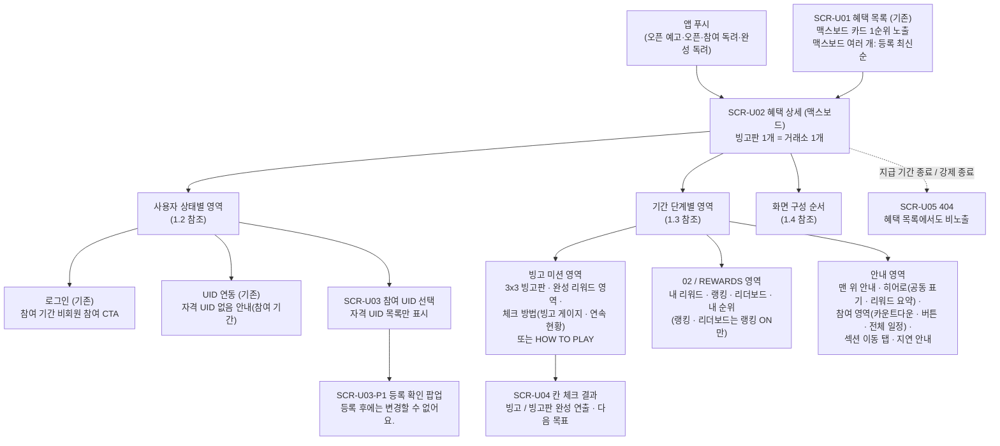
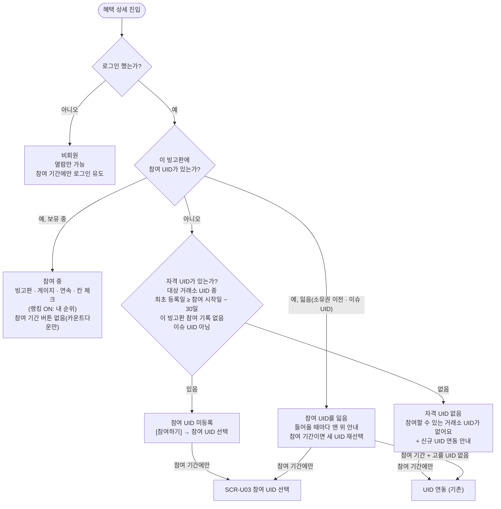
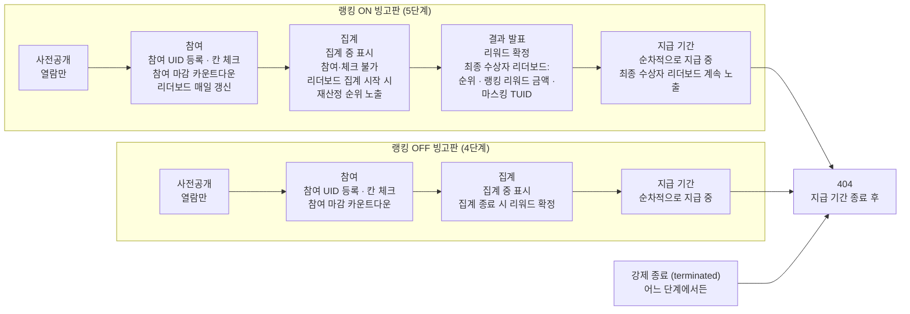
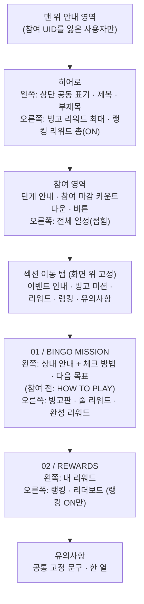
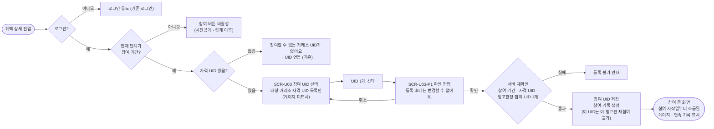
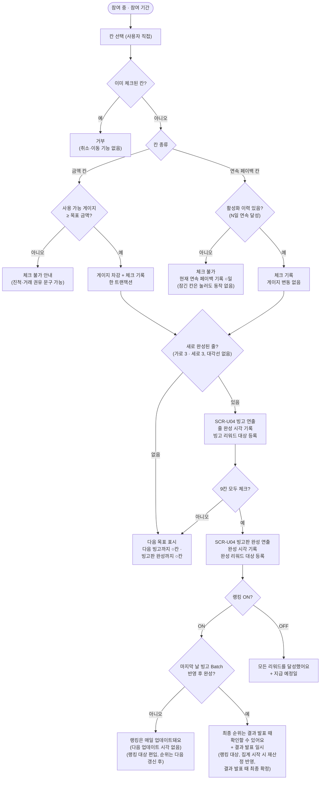
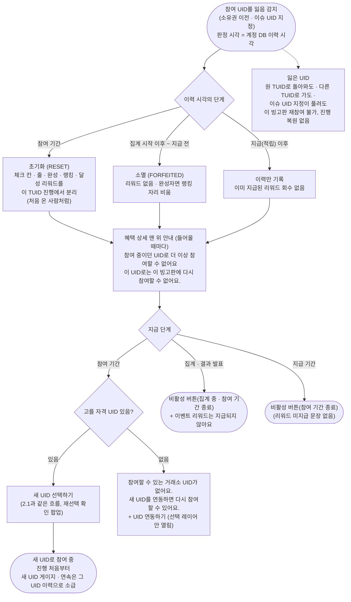
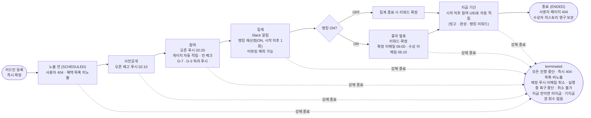

# 정보구조도 — 사용자 화면

| 항목 | 내용 |
|------|------|
| 프로젝트명 | TetherMax 신규 회원 빙고 이벤트 (서비스명: 맥스보드 / MAX BOARD) |
| 작성일 | 2026-10-01 |
| 버전 | v1.5 (2026-10-12 정합성 점검 반영(확정 2026-10-12): 1.4 화면 구성 순서를 목업 기본 화면(V2) 배치로 재작성(맨 위 안내 영역·히어로·참여 영역·섹션 이동 탭·빙고 미션·HOW TO PLAY·02 / REWARDS), 사용자 직접 연동 해제 개념 삭제·2.3 "참여 UID를 잃음 → 초기화·소멸"로 재작성·1.2 상태 "참여 UID를 잃음", 사전공개·집계 비회원 비활성 버튼·사전공개 UID 연동하기 없음, 리더보드 집계 단계 고정·컬럼 전 단계 동일·마지막 갱신 시각 미표시·빈 상태 문구, 연속 기록 문구 교체, 유의사항 15개 언어, 생명주기에 노출 전(SCHEDULED) 추가·지급 기간 랭킹 리워드 동시 적립(2.4), 자격 조건에 이슈 UID 제외(1.2·2.1), 등록 확인 팝업 해요체, `{거래소}` 변수화, 마감 예시 날짜, 4장 IA-13 #SC 추가·IA-7 갱신, 근거 문서 표기) / v1.4 (2026-10-07 PRD v0.11·요구사항 v1.6·기능명세 v1.7 반영: 혜택 상세 화면 구성 순서(1.4) 추가, 상단 로고 공동 표기, 참여 마감 카운트다운, 참여 중 버튼 없음, 비활성 버튼, 칸 상태 표시, 빙고판 완성 표시, 전체 일정 펼침형, 체크 가능한 최대 칸, 칸 구성별 카드 숨김, 02 / REWARDS 영역, 리더보드 수상 인원 표기 없음, 순차적으로 지급 중(REQ-116~123, REQ-052·057·083), Open Issue #NAME(IA-14)) / v1.3 (2026-10-05 PRD v0.10 반영(어뷰징 제외 미안내, 소유권 이전·이슈 UID 처리, 내 리워드 빈 상태, 랭킹 리워드 총액·등수별·컬럼, 연속 막대, 유의사항 한 열, 요구사항 추적 정비) / 2026-10-02 사용자 화면 시각 로컬 변환 표시 반영, 최종 수상자 리더보드 지급 기간까지 노출, IA-4 확정, 빙고 Batch 도입, 다음 업데이트 시각 제거("하루 한 번 업데이트돼요"만 참여 기간 중 표시), 집계 단계 리더보드 마지막 갱신 순위 노출(IA-4 변경), 리더보드 라벨 "최종 순위", 리워드 "지급 → 적립" 표현 통일, 리더보드 수상 인원 전체 표시(모든 단계), 마지막 날 빙고 Batch 이후 완성 예외, 미완성자 랭킹 문구 해요체 교체, 참여 기간 이후 미참여자 화면, 집계 이후 연속 기록 "최종 연속 ○일"만 표시, 집계 중 순위와 최종 순위 차이·결과 발표 재산정 확정, 리더보드 페이지네이션(한 페이지 10행, 내 순위 행 목록 아래 고정)·완성자가 수상 인원보다 적으면 있는 순위까지만 표시, 참여 기간 이후 미참여자 화면 비회원 포함 명시, "집계 중 / Calculating" 표기 확정, 집계 단계 리더보드를 집계 시작 시 재산정 순위로 변경(참여 기간 중 모든 완성자 반영, IA-4 갱신), 연속 표시에서 최고 기록 제거, EN 연속 표기 Title Case(1 Day, 4 Days), 리더보드 한 페이지 10행 고정, PRD v0.9 반영) |
| 대상 독자 | 사용자 화면 개발자·디자이너 |
| 근거 문서 | PRD.md v1.0(개요, 상세 이력은 Git v0.11), 분할문서/사용자/요구사항정의서_ko.md, 기능명세_프론트_ko.md, 03.구현문서/맥스보드_어드민_목업_20261002_1247.html, src/mockup/index.html(기본 화면 V2, 사용자 화면·백오피스 최신 통합 목업, Vercel 배포본) |

> **표기 규칙**
> - 화면 ID: 사용자 화면 `SCR-Uxx`, 어드민 화면 `SCR-Axx`. 팝업·레이어는 부모 화면 ID에 `-Px`를 붙인다.
> - 혜택 상세 URL은 `/{lang}/max-board?benefitNo={n}`로 확정(IA-1). 기존 테더맥스 화면(혜택 목록, 로그인, UID 연동)은 기존 경로를 그대로 쓴다.
> - 모든 기간·시각 판정은 **UTC 기준**, 금액은 **USDT**. 사용자 화면에 보이는 날짜·시각은 UTC 값을 **사용자 기기의 로컬 시간으로 변환해 표시**한다("UTC" 표기 없음, 기간은 날짜+시각). 아래 단계 전환 시각 등 UTC로 적힌 값은 판정 기준이다.
> - 랭킹 ON/OFF는 빙고판 생성 시 정해지며 이후 바뀌지 않는다. 아래 다이어그램에서 "랭킹 ON만"으로 표시한 요소는 랭킹 OFF 빙고판에서는 존재하지 않는다.

> 백오피스 화면은 `분할문서/백오피스/정보구조도_ko.md`에 있다. 기간 단계 생명주기와 화면 외 시스템 기능은 양쪽에 같은 내용으로 수록한다.

---

## 1. 사이트맵

### 1.1 사용자 사이트맵

맥스보드는 테더맥스 **혜택 목록**에 카드로 노출되고, 카드를 누르면 **혜택 상세(맥스보드)** 로 들어간다. 사용자 화면은 사실상 혜택 상세 1개 페이지이며, 사용자 상태와 기간 단계에 따라 화면 구성이 달라진다.

| 영역 | 구성 요소 | 비고 |
|------|-----------|------|
| 혜택 카드 (SCR-U01) | 배너 이미지, 제목, 부제목 | 사용자 언어가 KO면 KO, 그 외는 EN. 사전공개~지급 기간 단계만 노출 |
| 빙고 미션 영역 | 3×3 빙고판(칸 상태 3종: 잠김 / 체크 가능 / 체크됨, 연속 칸은 활성화되면 체크 가능. 칸에는 상태 문구 없이 모양으로 구분, 1.4 참조), 빙고판 아래 완성 리워드 영역(9칸 체크 시 "빙고판을 완성했어요" 완료 표시), 빙고 게이지(사용 가능 게이지), 체크 가능한 최대 칸 ○칸, 연속 기록(참여 기간 "현재 연속 페이백 기록" + "○일" + "연속 페이백" + 진행 막대, 최고 기록 미표시, 집계 이후 "최종 연속 페이백 기록" + 같은 숫자, EN "Current Cashback Streak" / "Final Cashback Streak"), "하루 한 번 업데이트돼요"(참여 기간 중에만, 다음 업데이트 시각·반영 날짜 표기 없음. 빙고 Batch 지연 중에는 지연 안내 우선), 참여 전 사용자는 체크 방법 대신 HOW TO PLAY | 참여 UID가 없는 사용자는 빙고판 구성만(9칸 잠김 모양), 게이지 미표시. 칸 추천·강조 안내 없음. 빙고판에 없는 칸 종류의 카드(게이지/연속)는 숨김(확정 2026-10-05). REQ-120~122, REQ-127 |
| 랭킹 영역 | 비운 자리 행 숨김·순위 번호 유지(결과 발표부터, 확정 2026-10-05·10-12), 랭킹 안내, 총 랭킹 리워드 + 등수별 랭킹 리워드 팝업(사전공개부터, 확정 2026-10-02), 리더보드(모든 단계 같은 컬럼: 순위, 트레이더(마스킹 TUID), 총 페이백, 랭킹 리워드. 모든 단계에서 수상 인원 전체의 순위 + 내 순위(페이지와 무관하게 목록 아래 고정, 내 랭킹 리워드 금액은 이 행에서만, 수상권 밖이면 "-"), 한 페이지 10행 고정 페이지네이션(사용자 조절 없음, 페이지 번호 + 이전/다음, 1페이지뿐이면 버튼 숨김, PC·모바일 1열), 완성자가 수상 인원보다 적으면 있는 순위까지만(빈 행 없음), 참여 기간 중 "하루 한 번 업데이트돼요", 다음 업데이트 시각·마지막 갱신 시각 없음). 빈 상태: 사전공개 "랭킹은 참여 기간이 시작되면 공개돼요", 완성자 0명 "아직 빙고판을 완성한 사람이 없어요". 집계 단계는 집계 시작 시 재산정 순위(참여 기간 중 모든 완성자 반영)를 고정 노출 + "집계 중"(그 사이 비운 자리는 결과 발표 때 반영). 결과 발표·지급 기간은 최종 수상자 리더보드(라벨 "최종 순위" / "Final Ranking", 컬럼 같음) | 랭킹 ON만. 02 / REWARDS 영역 오른쪽(왼쪽은 내 리워드: 빙고 리워드·완성 리워드만). 리더보드 위에 "수상 인원 ○명 전체" 같은 총 인원 표기 없음(REQ-052, 확정 2026-10-06). 미완성자는 참여 기간 "빙고판을 완성하면 랭킹에 참여할 수 있어요", 집계 이후 "빙고판을 완성하지 않아 랭킹 대상이 아니에요". 마지막 날 빙고 Batch 이후 완성자는 참여 기간 종료까지 "최종 순위는 결과 발표 때 확인할 수 있어요" + 결과 발표 일시(집계 단계부터 재산정 순위 표시) |
| 안내 영역 | 맨 위 안내 영역(참여 UID를 잃은 사용자), 히어로(상단 공동 표기: TetherMax 로고, 구분선, 거래소 로고 / 제목·부제목 / 리워드 요약 "빙고 리워드 최대" = 6줄 + 완성 합계, 랭킹 ON "랭킹 리워드 총"), 참여 영역(참여 마감 카운트다운(참여 단계만)·버튼, 전체 일정("전체 일정 보기" 접힘 기본. 기기 로컬 시간 변환, 날짜+시각. 예: KST 기기에서 2026.10.08 09:00 ~ 2026.10.22 08:59)), 섹션 이동 탭, "페이백 반영이 지연되고 있어요", 지급 기간 상태 문구 "순차적으로 지급 중" | 지연 안내는 참여 기간 빙고 Batch 지연·복구 전 누락 시에만(참여자 게이지·연속 영역, 모든 사용자 리더보드). 배너 이미지는 상세에 없음. 배치·조건은 1.4 참조(REQ-030, REQ-063, REQ-116, REQ-117, REQ-123, REQ-126, REQ-128, REQ-057) |

### 1.2 혜택 상세 — 사용자 상태 분기

상세 페이지는 로그인 여부와 UID 기준 참여 자격(F-003)에 따라 5가지 상태로 나뉜다. 자격 판정은 **TUID 가입일이 아닌 UID 기준**이다. 사용자는 UID를 직접 연동 해제할 수 없으며, 참여 UID를 잃는 원인은 소유권 이전·이슈 UID 지정뿐이다(확정 2026-10-12).

| 상태 | 판정 조건 | 표시 내용 | 가능 행동 | 관련 F-ID |
|------|-----------|-----------|-----------|-----------|
| 비회원 | 로그인 안 함 | 빙고판 구성, 리워드 구성, 기간 안내 | 열람. 참여 기간에만 로그인 유도 CTA(사전공개 비활성 "○○ 오픈 예정", 집계 비활성 "집계 중", 로그인 유도 없음) | F-002, F-003 |
| 자격 UID 없음 | 로그인. 대상 거래소 UID 중 30일 기준 충족 + 이 빙고판 참여 기록 없음 + 이슈 UID 아님인 UID가 0개 | "참여할 수 있는 {거래소} UID가 없어요" + 신규 UID 연동 안내(사전공개 포함, 거래소명은 빙고판 거래소) | 열람, 참여 기간에만 UID 연동(기존 화면). 사전공개는 안내 문구만(버튼 없음) | F-003 |
| 참여 UID 미등록 | 로그인. 자격 UID 1개 이상, 이 빙고판 참여 UID 없음 | 빙고판 구성(게이지 미표시), "참여할 수 있는 UID가 있어요"(사전공개 포함), 참여 버튼(사전공개는 비활성 "○○ 오픈 예정") | 참여 기간: 참여 UID 등록 | F-003, F-004 |
| (참여 기간 이후 미참여자) | 결과 발표·지급 기간 + 비회원 포함, 자격 UID 없음·참여 UID 미등록 모두 같은 화면 | "참여 기간이 끝났어요" + 비활성 버튼 "참여 기간 종료". 랭킹 ON이면 "최종 순위를 확인해보세요." + 최종 순위. 로그인 유도·지급 안내 없음 | 열람만(집계 단계는 "집계 중" 유지) | F-002, F-003, F-010 |
| 참여 중 | 이 빙고판 참여 UID 등록, 연동 유지 | 빙고판, 빙고 게이지(소급 반영), 연속 기록(참여 기간 "현재 연속 페이백 기록", 집계 이후 "최종 연속 페이백 기록"), 다음 목표, 랭킹 ON이면 내 순위. 참여 기간에는 별도 버튼("거래하러 가기" 등) 없이 참여 마감 카운트다운만(REQ-118) | 참여 기간: 칸 체크 | F-002, F-006~F-010 |
| 참여 UID를 잃음 | 참여 UID가 소유권 이전 또는 이슈 UID 지정됨(사용자 직접 연동 해제 없음, 확정 2026-10-12). 참여 기간이면 초기화, 집계 시작 이후~지급 전이면 소멸, 지급 후면 이력만 | 맨 위 안내 영역(팝업 아님, 들어올 때마다) 제목 "참여 중이던 UID로 더 이상 참여할 수 없어요" + 본문 "이 UID로는 이 빙고판에 다시 참여할 수 없어요."(원인 구분 없음). 그 아래는 처음 참여하는 사람과 같음. 집계·결과 발표 단계에는 "이벤트 리워드는 지급되지 않아요" 추가(지급 기간은 없음) | 참여 기간: 고를 자격 UID 있으면 새 UID 재선택, 없으면 "참여할 수 있는 {거래소} UID가 없어요. 새 UID를 연동하면 다시 참여할 수 있어요." + UID 연동하기. 참여 기간 이후: 비활성 버튼(집계 "집계 중", 결과 발표·지급 기간 "참여 기간 종료")과 안내만 | F-005, F-016 |

> 사전공개 단계와 집계 이후 단계에서는 판정 결과와 관계없이 참여 버튼이 비활성이다. 사전공개 단계에도 로그인 사용자에게는 자격 조회 결과를 보여준다(F-003, IA-6 확정 2026-10-05).
> 누를 수 없는 버튼("○○ 오픈 예정", "집계 중", "참여 기간 종료", "참여할 수 없어요")은 회색 배경·회색 글자로 표시하고 클릭할 수 없다. 활성 버튼(참여하기 등)은 기존 색을 유지한다(REQ-119, F-002, 확정 2026-10-06). 단계×상태별 버튼은 기능명세_프론트 3장 "버튼 표". 사전공개에는 [UID 연동하기]·로그인 유도가 없고 모든 사용자에게 비활성 "○○ 오픈 예정"을 보여준다(확정 2026-10-12).

### 1.3 혜택 상세 — 기간 단계별 화면 변형

랭킹 ON 빙고판은 5단계, 랭킹 OFF 빙고판은 결과 발표를 뺀 4단계다. 단계는 UTC 00:00에 자동 전환된다.

| 단계 | 페이지 | 참여 UID 등록 | 칸 체크 | 화면 구성 (공통) | 랭킹 ON 추가 요소 |
|------|--------|---------------|---------|------------------|-------------------|
| 사전공개 | 열림 | 불가 | 불가 | 빙고판 구성, 리워드 구성, 단계별 기간, 로그인 사용자 자격 조회 결과 | 랭킹 안내, 총 랭킹 리워드·등수별 팝업(리더보드 순위는 비공개) |
| 참여 | 열림 | 가능(마지막 날 포함) | 가능 | 빙고판, 빙고 게이지, 연속 현황, 다음 목표, 지연 안내, 참여 마감 카운트다운(REQ-117. 다른 단계는 단계별 일시 안내), 참여 중 사용자는 버튼 없음(REQ-118) | 랭킹 안내, 리더보드(매일 빙고 Batch 때 갱신), 내 순위 |
| 집계 | 열림 | 불가 | 불가 | "집계 중"(EN "Calculating") 표시, 모든 사용자 비활성 버튼 "집계 중"(로그인 유도 없음). 연속 기록은 "최종 연속 페이백 기록"(결과 발표·지급 기간도 같음) | 랭킹 안내, 리더보드(집계 시작 직후 재산정한 순위를 고정 노출, 참여 기간 중 모든 완성자 반영, 이후 갱신 멈춤, "집계 중" 표시. 그 사이 어뷰징 제외·탈퇴·소멸로 비운 자리는 결과 발표 때 반영하며, 최종 순위와의 차이는 이 비운 자리에서만 생김, 확정 2026-10-02·10-12) |
| 결과 발표 | 열림 | 불가 | 불가 | (랭킹 ON만 존재하는 단계) 확정 리워드("리워드가 확정됐어요" + 지급 일시). 미참여자는 "참여 기간이 끝났어요" + 비활성 "참여 기간 종료" + "최종 순위를 확인해보세요." | 최종 수상자 리더보드(라벨 "최종 순위", 컬럼은 다른 단계와 같음: 순위, 트레이더, 총 페이백, 랭킹 리워드. 비운 자리 행 숨김·번호 유지) |
| 지급 기간 | 열림 | 불가 | 불가 | 확정 리워드, 지급 안내(상태 문구 "순차적으로 지급 중", REQ-057). 미참여자는 "참여 기간이 끝났어요" + 비활성 "참여 기간 종료"(랭킹 ON이면 "최종 순위를 확인해보세요." 추가) | 최종 수상자 리더보드 계속 노출(결과 발표와 같은 내용, 종료(404)까지) |
| 지급 기간 종료 | 404 | - | - | 혜택 목록 비노출. 수상자 히스토리는 보관 | - |
| 강제 종료 | 404 (즉시) | 불가 | 불가 | 혜택 목록 즉시 비노출 | - |

**랭킹 ON / OFF 차이 요약**

| 구분 | 랭킹 ON | 랭킹 OFF |
|------|---------|----------|
| 기간 단계 | 5단계 (결과 발표 포함) | 4단계 (결과 발표 없음) |
| 랭킹 안내 영역·리더보드 | 노출(모든 단계에서 수상 인원 전체 + 내 순위). 집계 단계는 집계 시작 시 재산정 순위(이후 갱신 없음), 결과 발표부터 최종 수상자 리더보드로 바뀌어 지급 기간 종료(404)까지 노출(집계 이후 갱신 없음) | 그리지 않음 |
| 리워드 확정 시점 | 결과 발표 시작 | 집계 종료 |
| 빙고판 완성 직후 화면 | "랭킹은 매일 업데이트돼요"만(다음 업데이트 시각 없음). 예외: 마지막 날 빙고 Batch 반영 후 완성이면 "최종 순위는 결과 발표 때 확인할 수 있어요" + 결과 발표 일시 | "모든 리워드를 달성했어요" + 지급 예정일 |
| 리워드 확정 이메일 | 결과 발표 시작일 06:00 | 지급 기간 시작일 06:00 |
| 랭킹 수상 축하 이메일 | 결과 발표 시작일 06:10 | 없음 |
| 어드민 상세 | ① 현황에 리더보드, 상단 요약에 결과 발표 기간 | 리더보드·결과 발표 기간 없음 |
| 어드민 생성 | ② 기간에 결과 발표 행, ④ 랭킹 리워드 구간 섹션 | 결과 발표 행·④ 섹션 숨김 |

### 1.4 혜택 상세 — 화면 구성 순서

혜택 상세(SCR-U02)는 **목업 기본 화면(V2, 이벤트형 디자인)의 배치**를 따르고, 문구·정책은 이 문서와 기능명세를 따른다(구현 기준 = V2 배치 + 문서 규칙, 확정 2026-10-12). V2에서 문서 규칙과 다른 부분(상단 "TETHERMAX × 거래소 / PAYBACK EVENT" 보조 문구, 영문 payback·Maxboard 표기, 전체 일정 기본 펼침·시각 미표시, 카운트다운 아래 마감 일시 숨김, 사전공개 이름 "사전 공개 / Preview")은 구현하지 않는다. 위에서 아래로 아래 순서로 구성하며, 모바일(620px 이하)은 좌우 2단 영역을 위아래 1단으로 쌓는다. 랭킹 OFF 빙고판은 랭킹·리더보드를 그리지 않는다.

| 순서 | 영역 | 구성 요소·표시 규칙 | 표시 조건 | 관련 REQ | 관련 F-ID |
|------|------|---------------------|-----------|----------|-----------|
| 0 | 맨 위 안내 영역 | 참여 UID를 잃은 사용자(소유권 이전·이슈 UID 지정)에게 팝업이 아닌 안내 영역으로 제목 "참여 중이던 UID로 더 이상 참여할 수 없어요" + 본문 "이 UID로는 이 빙고판에 다시 참여할 수 없어요."(원인 구분 없음). 집계·결과 발표 단계에는 "이벤트 리워드는 지급되지 않아요" 추가, 지급 기간에는 없음. 버튼은 참여 영역에(참여 기간만) | 그 상태인 동안 상세에 들어올 때마다 | REQ-030, REQ-110 | F-005 |
| 1 | 히어로 | 왼쪽: 상단 공동 표기(TetherMax 로고, 세로 구분선, 거래소 로고. 다크 모드에서 TetherMax 로고는 흰색. 월·이벤트 성격 문구, "MAX BOARD / 2026.10", "TETHERMAX × 거래소 / PAYBACK EVENT" 같은 보조 표기 없음), 제목·부제목(` ` 줄바꿈 적용). 오른쪽: 리워드 요약 "빙고 리워드 최대 ○○ USDT"(= 가로 3줄 + 세로 3줄 + 완성 리워드 합계, 1인 최대), 랭킹 ON이면 "랭킹 리워드 총 ○○ USDT"(누르면 등수별 팝업). 금액은 불필요한 0 없이. 배너 이미지는 표시하지 않음(혜택 목록 카드 전용) | 모든 단계 | REQ-112, REQ-116, REQ-128, REQ-129 | F-002 |
| 2 | 참여 영역 | 히어로 바로 아래 띠. 왼쪽: 단계 안내와 버튼. 참여 단계는 "참여 마감까지" + 일 : 시간 : 분 : 초 플립 시계 카운트다운(매초 갱신, 마감 = 참여 종료일 23:59:59 UTC) + 마감 일시 로컬 시간(숨기지 않음, 예: 참여 종료일 10-21(UTC) → KST 기기 "10월 22일 08:59 마감"), 마감 일시의 로컬 날짜가 기기의 오늘이면 "오늘 마감". 동작 줄이기 설정이면 넘김 효과 없음. 다른 단계는 단계 안내(사전공개: 참여 시작 일시, 집계: 결과 발표 일시(ON)·지급 일시(OFF), 결과 발표·지급: 지급 일시, 지급 기간 "순차적으로 지급 중"). 버튼은 단계×상태별(기능명세_프론트 3장 "버튼 표"): 사전공개 모든 사용자 비활성 "○○ 오픈 예정"(UID 연동하기·로그인 유도 없음), 참여 기간 참여 전 사용자는 로그인하고 참여하기·UID 연동하기·참여하기·새 UID 선택하기, 참여 중 사용자는 버튼 없음, 집계 비활성 "집계 중", 결과 발표·지급 기간 미참여자 비활성 "참여 기간 종료", 지급 기간 참여자 "이벤트 리워드 확인하기", 참여 UID를 잃은 사용자는 참여 기간 이후 버튼 없음. 오른쪽: 전체 일정("전체 일정 보기", **접힘이 기본**, 접힌 상태는 현재 단계 한 줄 안내(예: "참여 마감까지 D-8 · 10월 22일 08:59"), 펼치면 참여 영역 전체 폭에 PC 가로 단계 / 모바일 세로 타임라인, 기간은 날짜+시각, 현재 단계 강조, 단계 이름 오픈 예정 / 참여 기간 / 결과 집계 / 결과 발표 / 리워드 지급) | 모든 단계(카운트다운은 참여 단계만) | REQ-117~119, REQ-123~125 | F-002 |
| 3 | 섹션 이동 탭 | 이벤트 안내 / 빙고 미션 / 리워드 · 랭킹(랭킹 OFF "리워드") / 유의사항. 스크롤해도 화면 위에 고정, 누르면 해당 섹션으로 스크롤하고 탭 강조(동작 줄이기 설정이면 즉시 이동). 이벤트 안내 = 히어로·참여 영역, 빙고 미션 = 4, 리워드 · 랭킹 = 5, 유의사항 = 6 | 모든 단계 | REQ-126 | F-002 |
| 4 | 빙고 미션 | 머리말 "01 / BINGO MISSION", 제목 "페이백을 쌓고, 빙고를 완성하세요", 보조 "가로·세로 한 줄마다 리워드". 왼쪽: 상태 안내(자격 안내, 집계·결과 발표·지급 단계 안내) + 체크 방법(빙고 게이지 카드(사용 가능 게이지), 연속 페이백 카드(참여 기간 "현재 연속 페이백 기록" + "○일" + "연속 페이백" + 진행 막대, 집계 이후 "최종 연속 페이백 기록" + 같은 숫자), 각 카드에 "체크 가능한 최대 칸 ○칸", 참여 기간 중 "하루 한 번 업데이트돼요"(빙고 Batch 지연 시 지연 안내 우선), 빙고판에 없는 칸 종류의 카드는 숨김) + 다음 목표("다음 빙고까지 ○칸", "빙고판 완성까지 ○칸"). 참여 중이 아닌 사용자는 체크 방법 대신 HOW TO PLAY(제목 "페이백이 리워드가 되는 가장 즐거운 방법", 01 맥스보드 참여하기 / 02 페이백으로 빙고 칸 체크 / 03 빙고 완성하고 리워드 받기). 오른쪽: 빙고판(칸 상태 3종을 문구 없이 모양으로 구분: 체크 완료 = 체크 표시 + 연한 배경, 체크 가능 = 흰 카드(연속 칸은 연한 청록), 잠김 = 점선 + 반투명. 잠긴 칸은 눌러도 동작 없음. 금액 칸 "5 USDT", 연속 칸 "4일". 가로·세로 줄 리워드 USDT 표기. 빙고판 아래 완성 리워드 영역은 9칸을 모두 체크하면 체크 표시 + "빙고판을 완성했어요"(금액 유지). 참여 UID가 없는 사용자는 9칸 모두 잠김 모양). 칸 추천·강조 없음 | 모든 단계(게이지·연속 값·다음 목표는 참여 중 사용자만) | REQ-078~080, REQ-113, REQ-120~122, REQ-127 | F-006, F-009 |
| 5 | 02 / REWARDS | 제목 "완성한 빙고가 리워드가 됩니다". 왼쪽: 내 리워드(빙고 리워드 줄별·완성 리워드와 합계만, 랭킹 리워드는 넣지 않음. 빈 상태 문구, 상태 배지 받을 예정 / 집계 중 / 확정, 지급일 안내). 오른쪽(랭킹 ON만): 랭킹(총 랭킹 리워드 + 등수별 랭킹 리워드 팝업) + 리더보드(모든 단계 같은 컬럼: 순위, 트레이더, 총 페이백, 랭킹 리워드. 내 순위 행에만 내 랭킹 리워드 금액, 수상권 밖이면 "-". 마지막 갱신 시각 미표시. 빈 상태: 사전공개 "랭킹은 참여 기간이 시작되면 공개돼요", 참여 기간 완성자 0명 "아직 빙고판을 완성한 사람이 없어요"). 리더보드 위에 "수상 인원 ○명 전체" 같은 총 인원 표기는 두지 않음 | 모든 단계(랭킹 OFF는 오른쪽 랭킹·리더보드 없음, 내 리워드는 참여 중 사용자만) | REQ-052, REQ-057, REQ-111, REQ-112, REQ-130, REQ-131 | F-006, F-010 |
| 6 | 유의사항 | 모든 빙고판 공통 고정 문구(15개 언어 프론트 하드코딩, 원문은 언어팩/문구 시트), PC에서도 한 열 | 모든 단계 | REQ-108 | - |

---

## 2. 사용자 흐름 (User Flow)

### 2.1 참여 UID 등록

자격 UID 목록만 보여주고(UID별 게이지 미표시), 확인 팝업을 거쳐 등록한다. 등록하는 순간 참여 기록이 생기며, 참여 시작일부터 쌓인 게이지와 연속 기록이 소급되어 연결된다.

| 단계 | 규칙 | 근거 |
|------|------|------|
| 자격 판정 | 대상 거래소 UID 중 테더맥스 DB 최초 등록일 ≥ 참여 시작일 − 30일(참여 기간 중 등록 포함), 이 빙고판 참여 기록 없음, 이슈 UID로 지정되지 않음. TUID 가입일 무관 | F-003, REQ-022~024, REQ-114 |
| 선택 화면 | 자격 UID 목록만, UID별 게이지 미표시 | F-004, REQ-028 |
| 확인 팝업 | "등록 후에는 변경할 수 없어요."(재선택은 "새 UID를 선택하면 이 빙고판의 진행이 처음부터 다시 시작돼요. 등록 후에는 변경할 수 없어요."). 참여 UID 변경 메뉴 없음 | F-004, F-005, REQ-028, REQ-029 |
| 등록 가능 기간 | 참여 기간 중 언제든(마지막 날 포함) | REQ-033 |
| 소급 | 마지막 날 빙고 Batch 이후 참여해도 그때까지 쌓인 게이지는 소급, 이후 추가 적립 없음 | PRD 게이지 |
| 다른 빙고판 | 거래소가 다른 빙고판에는 각각 UID 1개씩 별도 등록 가능 | REQ-027 |

### 2.2 칸 체크

사용자가 칸을 직접 선택한다. 금액 칸은 게이지를 소진하고, 연속 칸은 활성화되면 게이지 없이 체크한다. 체크 직후 줄·빙고판 완성을 판정하고 다음 목표를 보여준다.

| 구분 | 금액 칸 | 연속 페이백 칸 |
|------|---------|----------------|
| 체크 조건 | 사용 가능 게이지 ≥ 목표 금액 | 페이백 배치 반영일 기준 N일 연속 페이백(0.01 이상)으로 활성화된 이력(판정은 빙고 Batch 때) |
| 게이지 | 목표 금액만큼 소진 | 소진 없음 |
| 활성 유지 | - | 한 번 열리면 연속이 끊겨도 계속 활성 |
| 공통 | 참여 기간에만 체크. 체크 후 취소·이동 불가. 칸 1개 체크 리워드 없음. 리워드는 "대상 등록"만 하고 확정·적립은 F-017·F-018 | |

### 2.3 참여 UID를 잃음 → 초기화·소멸

사용자는 UID를 직접 연동 해제할 수 없다. 참여 UID가 끊기는 원인은 **소유권 이전**(다른 사람이 소유권 인증으로 가져감)과 **이슈 UID 지정** 두 가지이며(탈퇴는 별도), 판정 시각은 테더맥스 계정 DB 이력의 시각이다. 참여 기간 중이면 초기화되어 그 빙고판에서 처음 온 사람처럼 새 UID를 고를 수 있고, 집계 시작 이후 지급 전이면 소멸되어 리워드가 없다. 지급(적립) 이후면 이미 지급된 리워드는 회수하지 않는다(확정 2026-10-12).

| 상황 | 처리 | 근거 |
|------|------|------|
| 참여 기간 중 잃음 | 초기화(`RESET`, 사유 `OWNERSHIP_TRANSFER` / `ISSUE_UID`). 맨 위 안내 + 새 UID 재선택(고를 자격 UID가 없으면 "참여할 수 있는 {거래소} UID가 없어요. 새 UID를 연동하면 다시 참여할 수 있어요." + UID 연동하기). 새 UID도 30일 기준·이 빙고판 참여 기록 없음·이슈 UID 아님 충족 필요. 완성자였다면 다음 빙고 Batch 산정에서 순위 대상에서 빠짐(자리 비움 아님) | F-005, F-016, REQ-030 |
| 집계 시작 이후~지급 전 잃음 | 소멸(`FORFEITED`). 재선택 불가, 리워드 없음, 완성자면 랭킹 자리 비움(사용자 리더보드는 결과 발표 때 반영). 화면은 집계·결과 발표 단계에 "이벤트 리워드는 지급되지 않아요" 추가 | F-005, F-016, REQ-031, REQ-066 |
| 지급(적립) 이후 잃음 | 회수 없음, 참여 상태·지급 금액 변경 없이 이력만. 화면은 같은 안내(리워드 미지급 문장 없음), "이벤트 리워드 확인하기" 없음 | F-016, F-018, REQ-031 |
| 소유권 이전 | 참여는 새 TUID로 넘어가지 않음. 새 TUID에서도 이 빙고판 재참여 불가 | F-016, REQ-032 |
| 이슈 UID 지정 | 소유권 이전과 같은 규칙. 지정 기간에는 게이지·연속 기록 안 함, 지정이 풀려도 재참여 불가 | F-016, REQ-115 |
| 잃은 UID가 원 TUID로 돌아옴 | 재참여 불가, 진행 상태 복원 없음 | REQ-024 |

### 2.4 기간 단계 생명주기 (강제 종료 포함)

| 전환 | 시점 | 자동 처리 | 관련 F-ID |
|------|------|-----------|-----------|
| 등록 → 노출 전 | 어드민 등록 즉시 | 노출 전(`SCHEDULED`): 사용자 404, 혜택 목록 미노출(확정 2026-10-05) | F-015 |
| 노출 전 → 사전공개 | 사전공개 시작일 UTC 00:00 | 혜택 목록 노출 시작, 오픈 예고 푸시 02:10 | F-015, F-032 |
| 사전공개 → 참여 | 참여 시작일 UTC 00:00 | 게이지 적립 시작(비회원 UID 포함) | F-012, F-015 |
| 참여 → 집계 | 집계 시작일 UTC 00:00 | 칸 체크·참여 종료, (랭킹 ON) 랭킹 재산정 1회(참여 기간 중 모든 완성자 반영, 확정 2026-10-02), Slack 알림 | F-015, F-014, F-031 |
| 집계 → 결과 발표 (ON) | 결과 발표 시작일 UTC 00:00 | 리워드 확정, 결과 이메일 | F-017, F-033 |
| 집계 → 지급 기간 (OFF) | 지급 기간 시작일 UTC 00:00 | 집계 종료 시 확정, 자동 적립, 확정 이메일 | F-017, F-018, F-033 |
| 결과 발표 → 지급 기간 (ON) | 지급 기간 시작일 UTC 00:00 | 자동 적립(빙고·완성·랭킹 리워드 모두 시작 직후, 확정 2026-10-12) | F-018 |
| 지급 기간 → 종료 | 지급 기간 종료 | 페이지 404, 혜택 목록 비노출 | F-015, F-020 |
| 아무 단계 → terminated | 어드민 실행 즉시(노출 전~지급 기간, 정상 종료·이미 강제 종료된 빙고판 제외) | 즉시 404, 예정 푸시·이메일 취소, 실행 중 복구 중단. 지급 기간 시작 전이면 미지급, 기지급분 회수 없음 | F-029 |

---

## 3. 화면-기능 매핑

### 3.1 사용자 화면

| 화면 ID | 화면명 | URL (가칭) | 접근 | 주요 기능 | 관련 기능 ID |
|---------|--------|------------|------|-----------|--------------|
| SCR-U01 | 혜택 목록 (맥스보드 카드) | 기존 혜택 목록 경로 | 전체(비회원 포함) | 맥스보드 카드 1순위 노출, 맥스보드끼리 등록 최신순, 제목·부제목(KO/EN)·배너 | F-001, F-011 |
| SCR-U02 | 혜택 상세 (맥스보드) | `/{lang}/max-board?benefitNo={benefitNo}` | 전체(비회원 열람) | 단계별 화면, 맨 위 안내(참여 UID를 잃은 사용자), 히어로(상단 공동 표기, 리워드 요약), 참여 영역(참여 가능 여부 안내, 참여 마감 카운트다운, 버튼, 전체 일정), 섹션 이동 탭, 빙고 미션(빙고판·완성 표시, 체크 방법(게이지·연속 현황, 체크 가능한 최대 칸), 다음 목표 또는 HOW TO PLAY), 02 / REWARDS(내 리워드, 랭킹 ON이면 리더보드), 유의사항, SEO 메타(화면 구성은 1.4) | F-002, F-003, F-005, F-006, F-009, F-010, F-011 |
| SCR-U03 | 참여 UID 선택 | SCR-U02 내 레이어(모바일 바텀시트, PC 팝업, IA-2 확정 2026-10-05) | 로그인 + 자격 UID 보유, 참여 기간 | 자격 UID 목록(게이지 미표시), 참여 UID를 잃은 뒤(초기화) 재선택 | F-004, F-005 |
| SCR-U03-P1 | 참여 UID 등록 확인 팝업 | SCR-U02 내 팝업 | 로그인, 참여 기간 | "등록 후에는 변경할 수 없어요." 확인 → 등록(재선택은 "새 UID를 선택하면 이 빙고판의 진행이 처음부터 다시 시작돼요. 등록 후에는 변경할 수 없어요.") | F-004, F-005 |
| SCR-U04 | 칸 체크 결과 (빙고 / 빙고판 완성) | SCR-U02 내 레이어 | 참여 중, 참여 기간 | 빙고·빙고판 완성 연출, 다음 목표, 랭킹 ON: "랭킹은 매일 업데이트돼요"(순위 미표시, 마지막 날 빙고 Batch 이후 완성은 "최종 순위는 결과 발표 때 확인할 수 있어요") / OFF: 모든 리워드 달성 + 지급 예정일 | F-007, F-008, F-009 |
| SCR-U05 | 404 | `/{lang}/max-board?benefitNo={benefitNo}` (지급 기간 종료·terminated) | 전체 | 페이지 비노출 | F-002, F-015, F-029 |
| (기존) | 로그인 | 기존 경로 | 비회원 | 참여 기간 참여 CTA 로그인 유도 | F-002 |
| (기존) | UID 연동 | 기존 경로 | 로그인 | 참여 기간 자격 UID 없음(참여 UID를 잃고 고를 UID 없음 포함) → 새 UID 등록 | F-003, F-005 |

### 3.2 화면 외 시스템 기능 (화면 없음)

| 기능 | 결과가 드러나는 화면 | 관련 기능 ID |
|------|----------------------|--------------|
| 빙고 Batch: 페이백 반영·게이지 적립 (원천: 페이백 배치) | SCR-U02 게이지, SCR-A04-T3, SCR-A05 이력 | F-012 |
| 빙고 Batch 지연·누락 판정·복구 | SCR-U02 "페이백 반영이 지연되고 있어요"(참여 기간 지연·복구 전 누락), SCR-A04-T3 배치 결과(대기·실행 중 / 정상 / 지연 / 누락, 복구 완료 표시), 운영 Slack | F-019, F-031 |
| 연속 기록·연속 칸 활성화 | SCR-U02 연속 현황, SCR-A05 미니 보드 | F-013 |
| 랭킹 산정 | SCR-U02 리더보드, SCR-A04-T1 리더보드 | F-014 |
| 기간 단계 자동 전환 | 전 화면 | F-015 |
| 소유권 이전·이슈 UID 지정·탈퇴 처리(계정 DB 이력 시각 기준, 지급 완료까지 매일 대조) | SCR-U02 맨 위 안내(참여 UID를 잃음), SCR-A04-T2 상태(초기화(소유권 이전) / 초기화(이슈 UID) / 소멸(소유권 이전) / 소멸(이슈 UID) / 탈퇴), SCR-A05 이력(지급 후 UID 변경 포함) | F-016 |
| 리워드 확정·자동 적립 | SCR-U02 결과 발표·지급 안내(지급 기간 시작 직후 빙고·완성·랭킹 리워드 함께 적립, 지급 실패는 백엔드 처리, 화면 없음) | F-017, F-018 |
| Slack·앱 푸시·이메일 | 앱 푸시 이동 경로: SCR-U02 | F-031, F-032, F-033 |

---

## 4. 확인 필요

정보구조 설계 중 결정이 필요했던 항목이다. 2026-10-12 기준 IA-12(PRD Open Issue #IMG), IA-13(#SC), IA-14(#NAME)를 뺀 모든 항목이 확정됐다. 미확정 항목은 표시한 개발 기본값으로 개발한다.

| # | 항목 | 내용 | 관련 화면 | 관련 F-ID |
|---|------|------|-----------|-----------|
| IA-1 | 사용자 화면 URL | **확정(2026-10-01)**: 글로벌 리그처럼 빙고판마다 새로 발급되는 `benefitNo`를 주소에 붙인다(예: 글로벌 리그 `https://tethermax.io/ko/global-league/individual/join-global-league?benefitNo=27`). 경로는 `/{lang}/max-board?benefitNo={n}`로 확정, 번호는 백엔드가 발급. 어드민 메뉴는 리그/보드 > 맥스보드 목록(확정 2026-10-05) | SCR-U02 | F-001, F-002 |
| IA-2 | 참여 UID 선택 화면 형태 | **확정 2026-10-05**: 혜택 상세 안 레이어(모바일 바텀시트, PC 팝업) | SCR-U03 | F-004 |
| IA-3 | 로그인 후 복귀 위치 | **확정 2026-10-05**: 로그인 후 원래 혜택 상세(같은 `benefitNo`)로 돌아온다. 참여 CTA는 기존 로그인 화면으로 보내고, 그 화면에서 회원가입을 마친 경우에도 같은 혜택 상세로 돌아온다(확정 2026-10-05) | SCR-U02 | F-002 |
| IA-4 | 단계별 사용자 리더보드 노출 범위 | **확정(2026-10-02, 2026-10-12 갱신)**: 참여·집계·결과 발표·지급 기간 모든 단계에서 수상 인원 전체(예: 30명이면 30위까지) + 내 순위. 컬럼은 모든 단계 같음(순위, 트레이더, 총 페이백, 랭킹 리워드). 사전공개는 순위 없음(랭킹 안내 + "랭킹은 참여 기간이 시작되면 공개돼요"), 참여는 매일 빙고 Batch 때 갱신(참여 기간 중 탈퇴·초기화된 완성자는 다음 산정에서 빠짐), 집계는 집계 시작 직후 한 번 재산정한 순위(참여 기간 중 모든 완성자 반영)를 고정 노출하고 이후 갱신을 멈춤("집계 중" 표시, 그 사이 비운 자리는 결과 발표 때 반영), 결과 발표부터는 최종 수상자 리더보드를 발표하고 지급 기간 종료(404)까지 계속 노출. 2026-10-02 추가 확정: 한 페이지 10행 고정 페이지네이션(사용자 조절 없음, 페이지 번호 + 이전/다음, 모든 단계 동일, 1페이지뿐이면 버튼 숨김), 완성자가 수상 인원보다 적으면 있는 순위까지만(빈 행 없음), 내 순위 행은 목록 아래 고정. 마지막 갱신 시각은 표시하지 않음 | SCR-U02 | F-002, F-010 |
| IA-5 | 빙고판 완성 직후 "현재 순위" 기준 | **확정(2026-10-01, 2026-10-02 갱신)**: 완성 직후에는 순위를 보여주지 않고 "랭킹은 매일 업데이트돼요"만 표시(다음 업데이트 시각 없음). 순위는 다음 갱신 후. 예외(2026-10-02): 마지막 날 빙고 Batch 반영 후 완성이면 "최종 순위는 결과 발표 때 확인할 수 있어요" + 결과 발표 일시(집계 시작 시 재산정 때 순위 반영, 결과 발표 때 최종 확정) | SCR-U04 | F-009, F-014 |
| IA-6 | 사전공개 단계의 로그인 사용자 화면 | **확정 2026-10-05, 2026-10-12 갱신**: 사전공개 단계에도 로그인 사용자의 현재 연동 UID로 자격을 조회해 결과를 보여준다(30일 기준은 참여 시작일로 계산하므로 시작 후에도 같은 결과. 소유권 이전·이슈 UID 지정 등 이후 변화는 참여 기간에 다시 판정). 자격 UID 있음 "참여할 수 있는 UID가 있어요" + 참여 시작 일시, 없음 "참여할 수 있는 {거래소} UID가 없어요" + 신규 UID 연동 안내 문구([UID 연동하기] 버튼 없음). 버튼은 모든 사용자(비회원 포함) 비활성 "○○ 오픈 예정", 로그인 유도 없음 | SCR-U02 | F-003 |
| IA-7 | 참여 UID를 잃은 사용자 화면 | **확정 2026-10-12**(2026-10-02 결정을 대체): 사용자는 UID를 직접 연동 해제할 수 없으며 원인은 소유권 이전·이슈 UID 지정이다. 원인과 관계없이 혜택 상세 맨 위 안내 영역(팝업 아님, 들어올 때마다)에 제목 "참여 중이던 UID로 더 이상 참여할 수 없어요"(EN "You Can No Longer Participate with This UID") + 본문 "이 UID로는 이 빙고판에 다시 참여할 수 없어요."(EN "This UID can no longer join this board."). 기존 제목 "참여 중이던 UID의 연동이 해제되었어요"와 본문 "연동 해제된 UID로는…", "참여 기간이 끝나 새 UID를 선택할 수 없어요…"는 삭제. 그 아래는 처음 참여하는 사람과 같음: 참여 기간 + 고를 UID 있음 → [새 UID 선택하기], 없음 → "참여할 수 있는 {거래소} UID가 없어요. 새 UID를 연동하면 다시 참여할 수 있어요." + [UID 연동하기]. 참여 기간 이후는 비활성 버튼(집계 "집계 중", 결과 발표·지급 기간 "참여 기간 종료")과 안내만, 집계·결과 발표 단계에는 "이벤트 리워드는 지급되지 않아요" 추가, 지급 기간에는 이 문장 없음 | SCR-U02 | F-005 |
| IA-8 | 어뷰징 제외 사용자의 사용자 화면 | **확정(2026-10-02)**: 제외 사실을 알리지 않는다. "지급 대상 아님" 같은 별도 안내 문구·화면 상태는 없다. 집계 기간은 일반 참여자와 같고, 결과 발표·지급 기간(랭킹 OFF는 지급 기간)에는 내 리워드 금액 "-"(적립 안내 미표시), 내 순위·리더보드 "내 순위" 행 숨김. 결과 이메일은 보내지 않는다 | SCR-U02 | F-017, F-028 |
| IA-12 | 배너 외 추가 이미지 | PRD Open Issue #IMG. 상세 페이지 구성 요소에 영향 | SCR-U02, SCR-A02, SCR-A03 | F-022 |
| IA-13 | SEO 중국어 간체(SC) | PRD Open Issue #SC(프론트 개발자 확인). 개발 기본값: 미지원(SEO 6개 언어만). 확정 시 사용자 SEO 메타에 SC 추가(REQ-087) | SCR-U02 | F-011 |
| IA-14 | 서비스명 | PRD Open Issue #NAME(검토 중). 후보: 맥스보드 / 맥스 빙고 보드 / 페이백 빙고 / 맥스 빙고 / 빙고 챌린지. 확정 시 화면 이름·메뉴명·상세 주소(`/max-board`)·푸시·이메일 문구 변경(REQ-075, REQ-083, REQ-116) | SCR-U01, SCR-U02 | F-001, F-002, F-011 |
